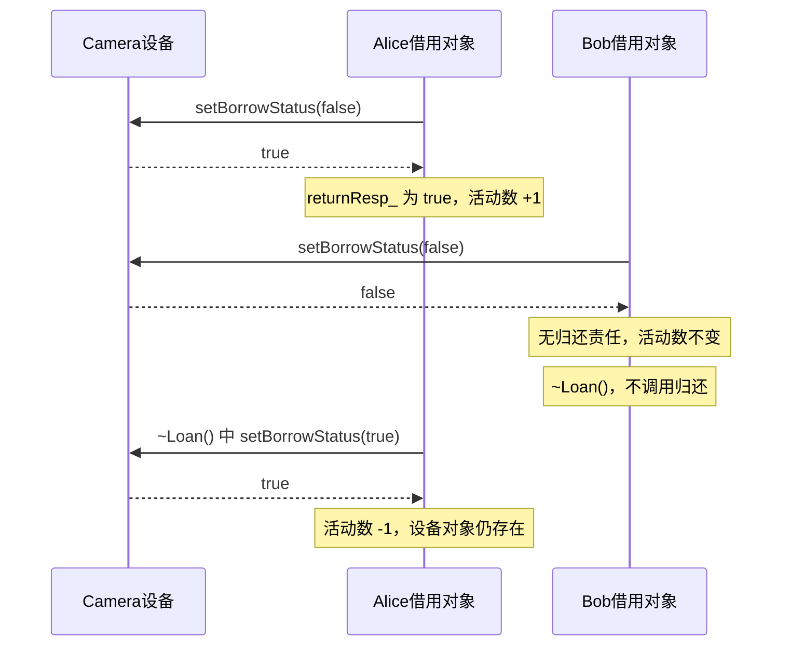
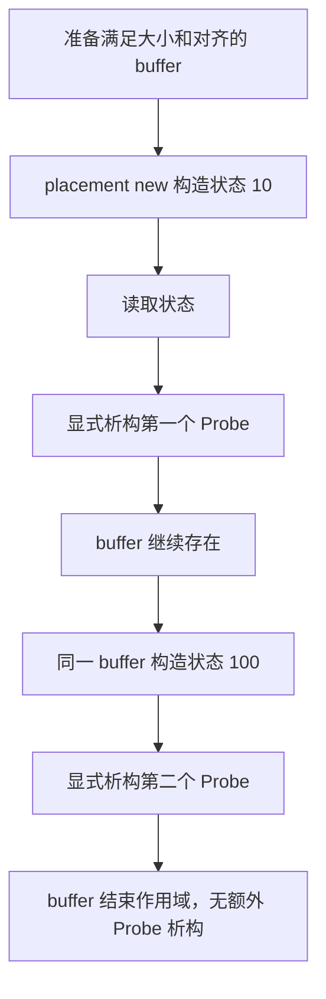

# 12.1.16 封装系统性实验与回顾

这份笔记记录 `encapsulation_lab.cpp` 的六阶段实验。目标是把类的语法连接到状态维护、对象协作、资源归还和内存布局，而不是只记住构造、析构、static 的写法。

工作源码文件名：`encapsulation_lab.cpp`。同目录保存本次原样源码附件：[[12.1.16 封装综合实验源码.cpp|完整源码快照]]。正文节选关键代码并解释；部分节选为便于说明省略日志，完整实现以附件为准。快照不会自动跟随工作文件更新。

> [!info] 阅读和验证范围
> 本文保留实际类名 `Devce`，不把它悄悄改成 `Device`。原文件保存时只启用实验五、六；整理时在临时副本中启用六个阶段连续验证，C++17 编译无警告，现有断言全部通过。没有修改工作源码。构造参数合法、单线程、计数不溢出是本实验前提；没有引入继承与虚函数。

## 阅读路线

- [[#一、先建立系统中的对象关系]]
- [[#二、实验一：设备状态、构造与共享计数]]
- [[#三、实验二：借用责任与自动归还]]
- [[#四、实验三：拥有者、观察者与动态对象]]
- [[#五、实验四：快照、mutable 与只读友元]]
- [[#六、实验五：布局、对齐与成员生命周期]]
- [[#七、实验六：存储与对象生命周期分离]]
- [[#八、这次实验中修正的错误]]
- [[#九、如何编译、验证与重新练习]]

## 一、先建立系统中的对象关系

### 1. 类、对象、状态、责任

[[12.1.1 面向对象概念]]和[[12.1.2 类]]在本实验中的落点是：给不同对象分配清楚的状态和责任。设备存在，与设备正在被某人借用，是两件事。

| 类型或变量 | 表示什么 | 保存什么 | 是否拥有设备 |
|---|---|---|---|
| `Devce` | 一台设备实体 | 名字、编号、电量、空闲标记、快照次数 | 它本身就是设备对象 |
| `Loan` | 一次借用尝试 | 客户名、设备引用、是否承担归还责任 | 否，只引用设备 |
| `unique_ptr<Loan>` | 借用对象的拥有者 | 管理一个动态 Loan 的指针 | 拥有 Loan，不拥有 Devce |
| `Loan* observer` | 临时观察者 | 同一个 Loan 的地址 | 否，不负责 delete |
| `Devce::Snapshot` | 某一时刻的数据记录 | 名字、编号、电量、空闲标记的值副本 | 否，没有借用责任 |
| `Trace` | 顺序观察工具 | 日志标签 | 否 |
| `Probe` | 原始存储实验用对象 | 一个 int 状态 | 否 |

`Loan` 引用的设备必须比它活得久。设备放在外层、借用放在内层，能够自然满足这个约束。把引用保存进对象，不会复制设备，也不会延长设备生命周期。引用的基础见[[1.C++基础/6. 指针/6.4 引用|引用]]。

### 2. 不变量比 getter/setter 更重要

不变量是接口应始终维护的规则：电量位于 0～100，编号不重用，一台设备最多有一个成功借用者，失败借用不归还设备，当前数量不为负。

把字段设为 private 只提供访问边界；如果公开任意 setter，仍能把状态改坏。因此没有公开设置设备数量、编号、电量的任意赋值接口，借用状态修改也放在 private，由受控入口调用。

### 3. 看代码时分开问四件事

| 问题 | 示例 |
|---|---|
| 类型是什么？ | `Devce::Snapshot` 是类型，`oldSnapshot` 是对象 |
| 数据在哪里？ | `id_` 在设备对象内；静态数量由整个类共享 |
| 谁拥有对象？ | `unique_ptr<Loan>` 负责销毁 Loan，observer 不负责 |
| 谁拥有存储？ | placement new 构造的 Probe 使用现有 buffer，不拥有 buffer |

“对象结束”“指针变量结束”“存储释放”不能互相替代。后面六个实验反复验证的正是这些区别。

## 二、实验一：设备状态、构造与共享计数

### 1. 需要维护的数据

每台设备独立保存名字、编号、电量和空闲状态。当前设备数、累计创建数由所有设备共享。`snapshot_count_` 是每台设备独立的辅助统计，不是全类总数。

```cpp
// Devce 内部的关键数据，省略其他声明。
string name_;
int id_;
int battery_power_;
bool borrow_status_ = true;

static int device_num;
inline static int cumulative_id_ = 0;
mutable int snapshot_count_ = 0;
```

普通字段跟随对象，静态数据在没有设备对象时也可以存在。当前数量每次析构减一；累计数量代表历史，只增加，不在析构时减少。这个区分连接[[12.1.9 静态成员变量]]中的共享语义。

### 2. 构造统一分配身份，委托只初始化同一个对象

带参构造负责初始化字段、生成新编号、增加当前数量。成员初始化列表里的顺序与成员声明保持一致。

```cpp
Devce::Devce(string name, int battery_power)
    : name_(name), id_(++cumulative_id_), battery_power_(battery_power)
{
   ++Devce::device_num;
   cout << "构造 " << name_ << "，编号=" << id_ << "，地址=" << this << endl;
}
```

只传名字时，委托给同一个类的双参数构造，默认电量为 100。

```cpp
Devce::Devce(string name) : Devce(name, 100) {}
```

这里不会创建两个设备。目标构造返回后才执行委托构造函数体；空函数体不代表没初始化。不能在委托构造体里再增加计数，否则一个对象会被计数两次。普通成员的赋值也不应冒充初始化，例如传参数时写 `battery_power_ = 100` 没有必要，直接传 `100`。

初始化列表、委托与 explicit 的完整背景见[[12.1.6 构造函数]]。类外实现成员函数的语法见[[12.1.4 类的成员函数]]。

### 3. explicit 拒绝无意创建临时设备

`explicit Devce(string name);` 并非语法强制，而是本实验的接口设计：字符串名字不应自动成为一台新设备。

```cpp
std::string name = "Camera";
Devce direct(name);       // 明确构造，允许。
// Devce implicit = name; // explicit 拒绝隐式转换。
```

一个不带 explicit 的转换构造可能让传错参数的函数调用悄悄创建临时设备，分配新编号并改变累计数。explicit 保留直接初始化，要求调用者明确表达创建意图。类外定义不重复写 explicit。

### 4. 充放电接口要在失败时保持原状态

耗电必须拒绝零、负数和超出剩余电量的参数。原来误写过“减掉当前全部电量”，结果 80 耗电 30 变成 0；也曾检查错变量，没拒绝负耗电，导致减负数变成充电。

```cpp
bool Devce::consume(int batteryPower)
{

   if (batteryPower <= 0 || batteryPower > battery_power_)
   {
      return false;
   }
   else
   {
      battery_power_ -= batteryPower;
      return true;
   }
}
```

充电先检查正数，再与剩余容量比较。这样不必先计算一个可能溢出的加法。构造参数合法的前提保证当前电量本来就在 0～100 内。

```cpp
bool Devce::charging(int batteryPower)
{
   if (batteryPower <= 0)
      return false;
   // 先比较剩余空间，避免对过大参数先做加法。
   if (batteryPower > 100 - battery_power_)
   {
      return false;
   }
   else
   {
      battery_power_ += batteryPower;
   }
   return true;
}
```

验收顺序是：80 耗电 30 得到 50；耗电 60 失败仍为 50；零、负耗电失败；充电 -1、0、60 都失败；充电 50 成功得到 100。失败返回值和状态不变要同时检查。

### 5. 基线计数让阶段能够连续运行

不能假设累计数永远从 0 开始。阶段二运行前，阶段一已经创建过两个设备。正确测试记录开始值，验证增量，不强行重置历史。

```cpp
const int initialCurrent = Devce::getDeviceNum();
const int initialTotal = Devce::getCumulativeId();
{
    Devce camera("Camera", 80);
    assert(Devce::getDeviceNum() == initialCurrent + 1);
    {
        Devce recorder("Recorder");
        assert(recorder.getId() == camera.getId() + 1);
        assert(Devce::getDeviceNum() == initialCurrent + 2);
    }
    assert(Devce::getDeviceNum() == initialCurrent + 1);
}
assert(Devce::getDeviceNum() == initialCurrent);
assert(Devce::getCumulativeId() == initialTotal + 2);
```

析构只减少当前数，保留累计数。最后一个设备对象销毁不代表类共享历史随之消失。析构的调用时机见[[12.1.7 析构函数]]。

### 6. const 观察与编译失败实验

`observeDevice(const Devce&)` 使用已有设备的只读引用，不创建副本。查询函数声明和类外定义都需要匹配的尾部 const。

取消 `device.charging(1)` 的注释应因 const 限制编译失败；类外执行 `camera.battery_power_ = -1` 应因 private 限制失败。编译失败实验一次只改一处，记录原因后恢复，不能把不应编译的示例留在正常运行路径中。

## 三、实验二：借用责任与自动归还

### 1. Loan 不是另一台设备

`Devce& dev_` 绑定已有设备，`returnResp_` 表示这次尝试是否成功并承担归还责任。活动借用数统计成功且尚未结束的借用，不统计失败的 Loan 对象。失败对象也正常构造、正常析构，只是没有归还责任。

| 对象 | 是否承担归还责任 | 对活动借用数的影响 |
|---|---|---|
| Alice 成功借到 Camera | 是 | 构造 +1，析构 -1 |
| Bob 尝试借同一台，失败 | 否 | 构造与析构都不改变 |
| Carol 在 Alice 归还后借到 | 是 | 重新 +1，再归还 -1 |

`Loan` 禁止默认构造，因为它必须绑定设备；复制和移动也被禁止。复制归还责任会导致两个对象都认为自己应归还同一设备。这里禁止移动 Loan，不妨碍移动它的 unique_ptr 拥有者；本实验第三阶段并不需要手写 Loan 的移动构造。

### 2. 空闲标记与当前能否借出不是同一个量

实际源码里 `borrow_status_ == true` 表示没有被借用。`getBorrowStatus()` 直接返回这个标记；快照的 `available` 字段也沿用它。它们的注释“是否可借”容易误读，不能只看名字。

真正的可借条件是：空闲标记为真，并且电量大于 0。因此设备可以已归还、标记为空闲，但因零电量仍不能借出。

### 3. 借出和归还使用不同前置条件

最终代码仍用一个 private 布尔设置接口，但函数内明确区分了动作：传 true 是归还，传 false 是借出。可读性更好的后续重构是拆成 `tryBorrow()` 和 `returnDevice()`；此处按实际源码讲解，不替换实现。

```cpp
bool Devce::setBorrowStatus(bool borrowStatus)
{
   // 归还设备
   if (borrowStatus == true)
   {
      if (borrow_status_ == true)
         return false;

      borrow_status_ = true;
      return true;
   }

   // 借出设备
   if (battery_power_ <= 0 || borrow_status_ == false)
   {
      return false;
   }

   borrow_status_ = false;
   return true;
}
```

原来的错误是无论借出还是归还，都先检查“当前可借”。成功借出后标记已经 false，归还自然被拒绝。另一个错误是用零电量阻止归还：设备没电只妨碍新的借用，不应阻止已有持有者归还。

### 4. 析构只归还自己成功取得的责任

源码的关键逻辑如下，省略日志。失败对象直接结束；成功对象要求归还成功，再减少活动数。assert 是检测内部规则失效，不是让普通业务失败崩溃。

```cpp
Loan::~Loan()
{
    if (!returnResp_) {
        return;
    }
    const bool returned = setBorrowed(dev_, true);
    assert(returned && "成功借用的对象应能归还设备");
    if (returned) {
        --activeBorrowNum_;
        returnResp_ = false;
    }
}
```

归还依赖设备仍然存在。把设备放在外层、所有 Loan 放在内层，保证析构时引用有效。这个模式把资源取得与释放绑定到对象生命周期，称为 RAII。这里的资源是“设备借用资格”，不一定是堆内存。

下面的时序对应阶段二实际的 Alice/Bob 场景，均为同步操作，没有阻塞或等待。



这张图把“Bob 对象消失”和“Camera 被归还”分开了：能析构不代表有归还权限，真正的责任在成功的 Alice 身上。

### 5. 友元成员函数与完整类型

`setBorrowStatus()` 是 Devce 的私有函数。Devce 只把访问权限授予 `Loan::setBorrowed()`；后者再被 Loan 的构造/析构调用。

```cpp
// Loan 类中先声明这个成员函数：
bool setBorrowed(Devce& dev, bool borrow);

// Devce 类中进行授权：
friend bool Loan::setBorrowed(Devce& dev, bool borrow);

// 在 Devce 完整定义之后实现：
bool Loan::setBorrowed(Devce& dev, bool borrow)
{
    return dev.setBorrowStatus(borrow);
}
```

`class Devce;` 只是前置声明，足以声明指针/引用，不足以让编译器知道 getName 等成员。因此 Loan 类内只声明构造函数，等 Devce 完整定义后再实现调用它的函数体。

源码里 Loan 还有 `friend class Devce;`：它让 Devce 能访问 Loan 的私有成员，便于当前布局中在 Devce 的友元声明里命名 Loan 的私有 `setBorrowed()`。友元授权有方向；真正允许修改设备的，是 Devce 内对 Loan 成员函数的授权。若以后简化为友元类，也要清楚谁授权给谁，不能以为关系自动双向。访问规则见[[12.1.11 友元]]。

### 6. 阶段二验收故事

依次验证：Alice 成功、Bob 失败且析构无影响、Alice 析构归还、Carol 再借成功、成功局部借用提前 return 自动归还。另测试借用中电量耗尽仍可归还、零电量新借用失败且析构无影响、充电后重新借用成功。

辅助函数必须先确认自己借用成功，才能证明提前 return 会归还；在 Alice 持有期间调用辅助函数，只能证明失败对象提前返回不影响 Alice。

## 四、实验三：拥有者、观察者与动态对象

### 1. get() 只观察，reset() 销毁被管理对象

这段与最终场景等价，省略重复断言。设备先声明，拥有者后声明，让逆序析构自然满足依赖关系。

```cpp
Devce device("Permanence", 100);
std::unique_ptr<Loan> owner;
{
    owner = std::make_unique<Loan>("Liu", device);
    Loan* observer = owner.get();
    assert(observer->getReturnResp());
}
assert(owner != nullptr);
assert(!device.getBorrowStatus());
owner.reset();
assert(owner == nullptr);
assert(device.getBorrowStatus());
```

内层消失的是 observer 变量；owner 仍在外层，Loan 仍由它管理。reset 销毁 Loan 并使 owner 为空，owner 变量自身继续存在，直到外层结束才析构。不要把“智能指针析构”和“智能指针释放对象”混为一件事。

所有权规则可回看[[1.C++基础/6. 指针/智能指针/独享智能指针|独享智能指针]]。裸观察指针不能单独 delete，也不能在 owner.reset() 后继续解引用。

| 主体 | 构造或建立位置 | 结束时机 | 责任 |
|---|---|---|---|
| Devce 设备 | 最外层 | 整个函数结束 | 提供 Loan 引用的有效目标 |
| unique_ptr 拥有者 | 设备之后的外层 | 函数结束；可提前 reset | 负责销毁所拥有的 Loan |
| Loan 动态对象 | make_unique 内 | reset 或拥有者析构 | 成功时归还设备 |
| observer 裸指针变量 | 内层 get() | 内层结束 | 无释放责任 |

如果先声明 owner，再声明 device，而 Loan 一直存活到函数返回，逆序析构可能先销毁设备，再让 Loan 析构访问失效设备。当前正确顺序不应仅依赖“正常路径记得 reset”，还应照顾提前返回路径。

### 2. 局部拥有者与提前 return

若 owner 本身定义在内层，退出内层时它析构，随即销毁 Loan。提前 return 也结束正常局部对象生命周期，不需要写手动 delete。

```cpp
void borrowAndReturnEarly(Devce &device)
{
   const int initialActive = Loan::getActiveBorrowNum();
   auto owner = make_unique<Loan>("EarlyReturn", device);

   assert(owner->getReturnResp());
   assert(!device.getBorrowStatus());
   assert(Loan::getActiveBorrowNum() == initialActive + 1);

   return;
}
```

函数返回后的调用者检查设备为空闲、活动数恢复基线。把 `make_unique` 的返回值移动给另一个拥有者，不会复制或移动 Loan 对象本身；发生的是管理责任转移。

曾经出现的错误是第二个场景创建 Liu1，却继续调用已 reset 的 Liu 的普通成员函数。Liu 此时为空，调用属于未定义行为，不是可以靠 assert 恢复的普通失败。

## 五、实验四：快照、mutable 与只读友元

### 1. Snapshot 是类型，snapshot() 是函数

嵌套类型只改变名称所属范围，不会自动绑定设备，也不会自动保存设备状态。类型定义与函数声明要分开读。

```cpp
// Devce 的 public 区域：
struct Snapshot {
    std::string name;
    int id;
    int batteryPower;
    bool available;
};
Snapshot snapshot() const;
```

`Snapshot snapshot() const;` 意味着声明一个名叫 snapshot、返回 Snapshot 对象的只读成员函数。它与 `int getId() const;` 结构相同，只是返回类型换成自定义类型。`Snapshot record;` 才是变量声明。

嵌套名称和访问规则的背景见[[12.1.12 嵌套类]]。单独声明嵌套类型不增加每个设备对象的大小；真的声明该类型的非静态成员对象才会参与布局。

### 2. 按值复制当前状态，旧记录不再跟踪设备

先构造局部结果，再增加次数。若字符串复制构造失败，不会提前把这次统计进去。

```cpp
Devce::Snapshot Devce::snapshot() const
{
   Snapshot result{
       name_,
       id_,
       battery_power_,
       borrow_status_};

   ++snapshot_count_;
   return result;
}
```

设备从 80 耗电到 50 后，旧快照仍保存 80，新快照保存 50。它们没有引用设备内部电量，不会自动同步。旧快照的名字是 Camera，是因为当时复制了设备名字，不是因为 Snapshot 类型规定名字只能是什么。

```cpp
auto oldSnapshot = camera.snapshot();
bool ok = camera.consume(30);
assert(ok);
auto newSnapshot = camera.snapshot();
assert(oldSnapshot.batteryPower == 80);
assert(newSnapshot.batteryPower == 50);

auto copy = oldSnapshot;   // 复制一个新对象。
copy.name = "副本记录";
assert(oldSnapshot.name == "Camera");
assert(camera.getName() == "Camera");
```

本例 std::string、int、bool 按值复制后可以独立修改。`auto& alias = oldSnapshot` 才是给原对象建立别名；如果修改 alias.name，oldSnapshot.name 会变。以后若结构体保存指针/引用，复制结构体不代表自动复制其指向的所有资源，要重新分析共享关系。

| 被复制的类型 | 是否允许 | 原因 |
|---|---|---|
| Snapshot | 允许 | 只是独立记录，不持有归还责任 |
| Devce | 本实验禁止 | 复制身份涉及新编号、设备数量与已有借用引用 |
| Loan | 本实验禁止 | 复制归还责任可能导致重复归还 |

快照记着设备编号 3，不表示它成为另一台编号 3 的设备。生成、复制、销毁快照都不应增加设备数或活动借用数。

### 3. const 查询为何能修改次数

`snapshot_count_` 是非静态 mutable int，每台设备有自己的计数；它不是所有设备的总次数。const 函数不能通过当前对象修改普通非 mutable 数据成员，但允许修改明确声明为 mutable 的成员。

这种区分是设计选择：名字、电量是业务状态，快照次数是辅助统计。mutable 不意味着整个对象可写，也不意味着线程安全；当前实验只有一个线程。const 的语义见[[12.1.5 const成员函数]]。

生成两次快照应得到 0→1→2；查询 getSnapshotCount()、复制已有快照都不能增加次数。通过 const Devce& 调用 snapshot() 也应正常工作。

### 4. 只读友元审计：权限与修改意图分开

类内声明 `friend void auditDevice(const Devce& device);`，类外实现普通自由函数。它没有隐式 this，通过参数 device 指明审计哪台设备，不写 `Devce::auditDevice`，调用方式为 `auditDevice(view)`。

源码审计直接检查电量范围、编号范围和设备数量范围，读取空闲标记与快照次数；没有调用 snapshot()，所以审计不会额外生成快照。审计能访问私有字段，是 friend 授权的结果，不是 const 的作用。

下面是该函数的连续源码片段 1，需接在前一段后面阅读。

```cpp
void auditDevice(const Devce &device);

public:
   explicit Devce(string name);
   Devce(string name, int battery_power);
   ~Devce();

   // 避免隐式复制或移动绕过本实验的构造计数。
   Devce(const Devce &) = delete;
   Devce &operator=(const Devce &) = delete;
   Devce(Devce &&) = delete;
   Devce &operator=(Devce &&) = delete;

   string getName() const;
   int getId() const;
   int getBatteryPower() const;
   // 查询设备能否被借出
   bool getBorrowStatus() const;
   // bool setId(int id);
   // bool setBatteryPower(int battery_power);
   bool consume(int batteryPower);  // 耗电
   bool charging(int batteryPower); // 充电
   void printInfo() const;

   static int getDeviceNum();
   static int getCumulativeId();
```

下面是该函数的连续源码片段 2，需接在前一段后面阅读。

```cpp
   // 快照
   struct Snapshot
   {
      std::string name;
      int id;
      int batteryPower;
      bool available;
   }
```

const Devce& 仍允许修改 mutable 成员，可写静态成员也不受该参数的 const 限制。因此“只读审计”除了参数 const，还依赖实现选择不修改这些状态。测试在审计前后比较名字、编号、电量、空闲标记和快照次数。

审计报告的范围有限：编号位于合理区间，不足以证明全系统编号唯一；空闲标记也不足以核对所有 Loan。它是本地一致性检查，不是完整业务审计系统。

临时写一个未授权的普通函数，直接读取 device.battery_power_，应编译失败。该反向测试在整理时的临时副本中验证通过；正常源码不应保留可执行的错误访问。

## 六、实验五：布局、对齐与成员生命周期

### 1. 相同字段，不同排列

字段用哪种字符初值不影响布局；差异来自排列以及实现的对齐规则。

```cpp
struct Cat {
    char c = 'C';
    int num = 10;
    char a = 'A';
};
struct Dog {
    char c = 'D';
    char a = 'O';
    int num = 10;
};
```

本次 macOS arm64、Apple Clang 与 libc++ 环境中：Cat 为 12 字节，Dog 为 8 字节，对齐都为 4。

| 类型 | 实际布局 |
|---|---|
| Cat | c 在 0；1～3 填充；num 在 4～7；a 在 8；9～11 尾部填充 |
| Dog | c 在 0；a 在 1；2～3 填充；num 在 4～7 |

这些是实现测量结果，不能把固定数值断言成所有平台规则。`sizeof`、`alignof` 都可以查询类型，不需要额外创建没用到的 cat/dog 变量。对齐与空间的背景见[[12.1.3 类的空间]]和[[12.1.14 类的底层]]；继承/vtable 不在本实验范围。

### 2. 函数、静态数据与对象大小

CatWithFunctions 保持原字段顺序，增加普通函数、静态函数和 inline static count 后，实测仍为 12。CatWithExtraData 增加非静态 int extra，实测变成 16。

函数代码不放进每个对象，静态数据也不属于对象子对象；非静态数据需要参与对象布局。但增加成员后的总大小变化受填充影响，不保证总是“原大小加成员大小”。

### 3. offsetof 查询的是偏移

`offsetof` 是 <cstddef> 提供的宏，不是普通函数。第一个参数是类型，第二个是成员名。它不创建对象，结果是成员距离对象起点的字节数，不是绝对地址，也不是成员大小。

```cpp
cout << offsetof(Cat, c) << '\n';   // 本平台为 0。
cout << offsetof(Cat, num) << '\n'; // 本平台为 4。
cout << offsetof(Cat, a) << '\n';   // 本平台为 8。
```

本实验只用于简单的标准布局结构 Cat/Dog，不对 Devce 使用 offsetof。对非标准布局类型的支持存在限制；不能拿它查询静态数据或成员函数。

### 4. 嵌套类型定义不是成员对象

最初把 class Trace 定义进 Cat，只有类型 Cat::Trace，却没有任何 Trace 成员对象。创建 Cat 时自然没有 Trace 构造日志。

最终单独定义 Trace，在构造/析构时打印标签；OrderTest 真正拥有 first_、second_ 两个 Trace 对象。

```cpp
class OrderTest {
private:
    Trace first_;
    Trace second_;
public:
    OrderTest() : first_("first"), second_("second") {
        cout << "OrderTest 构造" << endl;
    }
    ~OrderTest() {
        cout << "OrderTest 析构" << endl;
    }
};
```

实验时把初始化列表故意写成 second_ 在前，实际仍先构造 first_，因为成员按类内声明顺序初始化。最终恢复与声明一致的书写顺序，避免误读和编译器警告。“初始化列表从右往左执行”是错误解释。

完整顺序是：

```text
Trace first_ 构造
Trace second_ 构造
OrderTest 构造函数体
……使用对象……
OrderTest 析构函数体
Trace second_ 析构
Trace first_ 析构
```

“先析构 second_”只描述成员之间的顺序，外部类析构函数体先于这两个成员执行。在析构函数体内，成员对象尚未执行自己的析构。

### 5. 为什么 Devce 是 40 字节

本次实际布局如下，string 大小来自当前 libc++，不是语言固定规则。

| 成员或填充 | 起始偏移 | 大小 |
|---|---:|---:|
| string name_ | 0 | 24 |
| int id_ | 24 | 4 |
| int battery_power_ | 28 | 4 |
| bool borrow_status_ | 32 | 1 |
| 对齐填充 | 33 | 3 |
| mutable int snapshot_count_ | 36 | 4 |
| 合计 | | 40 |

整个对象对齐为 8，40 已满足要求。mutable 成员仍计入大小；嵌套 Snapshot 仅定义类型，不是设备的成员对象。std::string 本体大小不等于字符数量，也不包含它可能额外申请的动态存储。短字符串优化属于库实现细节，不能用它把 sizeof 当成字符长度。

### 6. 指针 8 字节，不代表对象也为 8 字节

当前编译目标是 arm64，不是 x86；Devce* 实测为 8 字节，保存地址，不内含整个设备。指针大小由编译目标与 ABI 决定，不能只凭操作系统是 64 位就推断所有程序和所有指针表示。

当前 int 为 4 字节，与它写在 struct、class、普通函数内部无关。类静态数据不计入对象空间的原因是它不属于每个对象，不是因为“它在函数生命周期里”。作用域与存储期必须分开：

| 项目 | 作用域/含义 | 生命周期或存储期 |
|---|---|---|
| 类静态数据成员 | 类作用域，共享一份 | 静态存储期，不随单个对象析构消失 |
| 非静态数据成员 | 每个对象各有一份 | 跟随其所属对象 |
| 函数局部 static | 名字限于块作用域 | 静态存储期，非平凡初始化通常首次执行到声明时进行 |

## 七、实验六：存储与对象生命周期分离

### 1. Probe 只是观察工具

Probe 表示实验样品，不需要真实业务功能。它保存一个独立 int 状态，用 10、100、1000 区分几次构造，并打印构造/析构及 this 地址。最初用 static 加减实现的是所有 Probe 的数量，不是每个对象的状态。

普通构造固定保存传入状态，默认构造委托到状态 1。析构日志必须明确写“析构”，否则仅看日志会误以为又构造了一次。

### 2. A：普通 new/delete

本小节按题目特意使用裸指针与手动释放，目的是观察机制；系统中常规拥有关系仍优先用 unique_ptr。该教学例外也适用于后面的 placement new，不是建议用裸指针替换第三阶段的智能指针。

```cpp
Probe* owner = new Probe(10);
{
    Probe* observer = owner;
    assert(observer->getState() == 10);
}
cout << "内层已结束，Probe 仍存在\n";
assert(owner->getState() == 10);
delete owner;
owner = nullptr;
cout << "Probe 已销毁，存储已释放\n";
```

裸指针没有自动释放能力，“拥有”“观察”是程序设计约定。observer 离开作用域不会触发 Probe 析构。delete 调用析构并释放相应动态存储；owner 随后设空，不能再执行 owner->getState()。

普通 new 的对象不会仅因为创建表达式所在代码块结束就析构。这次最初的困惑正来自把局部指针与所指对象当成一个生命周期。更多背景见[[1.C++基础/6. 指针/6.2 动态内存分配与释放|动态内存分配与释放]]。

### 3. B：先准备 buffer，再 placement new

`alignas(Probe)` 保证地址对齐；`sizeof(Probe)` 保证容量。创建 byte 数组不等于创建 Probe。

```cpp
alignas(Probe) std::byte buffer[sizeof(Probe)];
cout << "存储准备完成，尚未构造 Probe\n";
Probe* ptr = new (buffer) Probe(10);
assert(ptr->getState() == 10);
assert(static_cast<void*>(ptr) == static_cast<void*>(buffer));
ptr->~Probe();
ptr = nullptr;
```

标准非分配 placement new 使用传入位置，不另申请存储。new (buffer) Probe(10) 负责在该位置初始化对象并返回指针；它不会替你扩容或修正对齐。

显式析构只完成对象清理，不释放 buffer。现在仍有存储，但原 Probe 的生命周期已结束，不能通过旧对象读取状态。完整背景见[[12.1.8 对象放置构造]]。

第二次构造复用同一 buffer，使用本次构造返回的新指针：

```cpp
Probe* newPtr = new (buffer) Probe(100);
assert(newPtr->getState() == 100);
assert(static_cast<void*>(newPtr) == static_cast<void*>(buffer));
newPtr->~Probe();
newPtr = nullptr;
```

地址相同不代表还是第一个对象。两个对象先后存在，各显式析构一次。随后 buffer 离开作用域，不会自动再调用 Probe 析构。

不能对缓冲区里的 Probe 使用普通 delete，也不能用默认 unique_ptr<Probe> 接管它，因为默认删除器会执行 delete。不要对正常自动对象先显式析构后又让作用域再次析构；本节使用的是原始字节存储，没有自动 Probe 对象替你管理析构。



图里的 buffer 从头到尾保留，而 Probe 的生命周期先后开始、结束两次。这里没有线程等待，使用流程图区分存储与对象即可。

### 4. C：malloc、构造、析构、free 分成四步

对于当前非平凡 Probe，malloc 只取得存储，不调用其构造函数。先检查分配失败，再构造，构造完成后才读取成员。

```cpp
void* storage = std::malloc(sizeof(Probe));
if (storage == nullptr) {
    std::cerr << "分配失败\n";
    return;
}
Probe* object = nullptr;
try {
    object = new (storage) Probe(1000);
} catch (...) {
    std::free(storage);
    throw;
}
assert(object->getState() == 1000);
object->~Probe();
object = nullptr;
std::free(storage);
storage = nullptr;
```

catch 分支处理构造失败时的存储释放：构造未完成，不去调用这个完整 Probe 的析构。成功路径先显式析构，再 free。free 不会替你运行 Probe 析构。原始分配地址 storage 用于释放，不要把 object 设空后误把 free(nullptr) 当成释放原存储。

[[12.1.13 malloc与new]]中的对比在这里变成了实际顺序；不要执行 malloc 配 delete、new 配 free、new[] 配 delete 等不匹配操作。这些是未定义行为，不能用“只析构第一个对象”描述成稳定结果。

### 5. malloc 也保证对齐，只是不保证任意更高要求

本题 Probe 只有 int，普通 malloc 的基本对齐足够。普通字节数组本身不保证适合 Probe，因而 B 使用 alignas；malloc 返回的存储则自带基本对齐保证，不能把两者混为一谈。

基本对齐以 alignof(std::max_align_t) 为界。若某类型要求更高对齐，例如在常见平台上声明 alignas(64) 的特殊类型，就不能假定普通 malloc 一定满足。申请更多字节不等于要求地址更对齐。可用支持相应对齐的 C++17 对齐 new 或合适的对齐分配接口，并匹配释放。

### 6. 三种方式的配对表

| 创建或构造方式 | 谁提供存储 | 谁调用析构 | 谁释放存储 |
|---|---|---|---|
| 自动局部 Probe | 所在作用域 | 正常退出作用域自动调用 | 所在作用域管理 |
| make_unique<Probe> | 动态分配 | reset/拥有者析构时自动调用 | unique_ptr 默认删除器 |
| 普通 new Probe | 动态分配 | 对应 delete | 同一次 delete |
| buffer 上 placement new | 现有字节数组 | 本题显式调用 | 数组所在作用域 |
| malloc 后 placement new | malloc | 本题显式调用 | free 原始地址 |

析构是对象的清理步骤，释放是存储管理步骤。智能指针把它们组合管理，placement new 实验把它们拆开观察。

## 八、这次实验中修正的错误

| 当时的写法或误解 | 为什么错 | 当前应如何判断 |
|---|---|---|
| 设备引用 dev 与 NULL 比较 | dev 是对象引用，不是可空指针 | 检查设备业务状态；引用目标必须有效 |
| `cout << getId` | 函数名不是调用结果 | 使用 getId()；静态函数名也不能代替计数值 |
| 同一个 getter 定义两遍 | 重复提供函数体 | 类内声明与类外定义配合，每份普通实现保留一次 |
| const 查询给借用状态赋值 | 修改普通非 mutable 成员 | 查询计算/返回结果；动作负责修改状态 |
| 析构减少累计数 | 历史消失，编号可能重用 | 只减少当前数 |
| 借用失败也归还设备 | 会归还其他成功持有者的设备 | 只有 returnResp_ 为 true 才归还 |
| 归还也要求设备当前可借 | 成功借出后自然不可借，导致永远还不了 | 分开借出和归还的前提 |
| 查询快照次数也递增 | 读计数本身改变统计 | 只在 snapshot() 增加 |
| 定义嵌套 Trace 就以为有成员对象 | 类型定义不是对象声明 | 真正声明 Trace first_、second_ |
| 初始化列表从右到左 | 成员执行按声明顺序 | 用日志和编译顺序警告验证 |
| 指针设空后仍调用 getState | 空指针不能调用普通对象成员 | 对象销毁后只打印普通标记 |
| B 重复定义同名 buffer | 同作用域重定义 | 一块存储供两次构造复用 |
| 构造 100，却断言状态 10 | 构造参数与预期值不匹配 | 每次构造用明确状态并对应断言 |
| 用 new 创建后只让裸指针离开作用域 | 所指动态对象没被销毁 | 明确拥有者和释放触发点 |
| static 的作用域等于函数生命周期 | 混淆作用域和存储期 | 类作用域与静态存储期分别描述 |

这里的错误可以分层排查：先看编译错误，再看生命周期是否有效，最后检查业务返回值与状态。能编译不代表运行安全，能运行到结尾也不代表验收覆盖完整。

## 九、如何编译、验证与重新练习

### 1. 当前入口与全阶段入口

附件保留原样源码，main 只启用阶段五、六。如果要复现本次连续验收，在自己的副本里把入口改为：

```cpp
int main()
{
    stage1_device();
    stage2_loan();
    stage3_ownership();
    stage4_snapshot_and_friend();
    stage5_layout_and_order();
    stage6_storage_and_lifetime();
}
```

用 C++17 编译，不定义 NDEBUG。以下在源码所在目录执行；文件名可换成同目录源码附件的实际名字。

```sh
clang++ -std=c++17 -Wall -Wextra -pedantic encapsulation_lab.cpp -o encapsulation_lab
./encapsulation_lab
```

### 2. assert 是可执行的预期，不是业务处理

assert 来自 <cassert>，不是 C++11/17 新特性；C++98 已提供。C++11 引入的 static_assert 才是另一种编译期检查。assert 启用时条件失败会诊断并 abort，不是抛出可被 try/catch 捕获的异常，也不保证像正常 return 那样展开栈并析构局部对象。

定义 NDEBUG 后 assert 的表达式不执行，所以业务动作不能只写在里面。

```cpp
bool ok = camera.consume(30); // 无论断言是否启用，都执行耗电。
assert(ok);
assert(camera.getBatteryPower() == 50);

// 不保留这种写法：assert(camera.consume(30));
// 否则 NDEBUG 构建里耗电操作也消失。
```

输入零、负数、过量耗电是正常可能发生的业务失败，用 if 返回 false；内部设备数量为负、合法持有者无法归还是程序规则被破坏，才适合用断言辅助定位。发布配置是否定义 NDEBUG 由构建决定，不是编译器自动根据用途猜测。

### 3. 本次实际验证结果

验证日期 2026-10-19，Apple Clang 21.0.0，macOS arm64，C++17。全阶段临时副本编译无警告，执行退出码 0。原工作文件保持不变。地址每次运行可能变化，不要把某个绝对地址作为测试预期。

| 阶段 | 实际结果 |
|---|---|
| 一 | Camera/Recorder 各计数一次；结束后当前设备 0、累计 2 |
| 二 | Alice/Bob/Carol、提前返回、耗尽电量和充电重借通过；结束后当前设备 0、累计 3、活动借用 0 |
| 三 | 内层观察者结束不销毁 Loan；reset、局部拥有者析构、提前返回均归还；设备编号 4 |
| 四 | 第五台设备快照数为 2；审计电量、编号、计数检查均为真 |
| 五 | Cat 12/对齐4，Dog 8/对齐4；函数与静态数据版12，新增非静态 int 版16；Devce 40、指针8 |
| 六 | A 一次构造析构；B 同一存储先后两次构造析构；C 构造后显式析构再 free |

本次另在临时副本验证未授权自由函数访问 battery_power_ 被编译器拒绝。正常内存分配路径已经执行；malloc 实际失败、构造函数抛异常的路径只做了代码检查，没有声称人为触发过这些失败。现有 assert 是实验验收，不等于生产系统完整证明。

### 4. 当前设计边界

构造参数由题目保证合法，未设计异常输入恢复；计数只用于单线程且规模足够小，不处理溢出。getBorrowStatus 的名字与“能否借”注释有歧义，本文已按实际空闲标记解释。Loan 不拥有设备，不能单靠引用阻止外层错误销毁设备。

析构中的日志和断言用于教学；不要把普通业务失败设计成析构时抛异常。生产资源管理还需考虑日志失败、并发、错误传播等约束。本实验没有实现这些扩展，也没有覆盖继承与虚析构。

### 5. 合上源码后重新练习

先写对象关系与不变量，再独立写 Devce 的声明。完成充放电后加生命周期计数，再加 Loan。每阶段保留自己的“预测日志—实际日志—误判规则”三项记录。

能解释以下问题，才说明代码与概念已经连起来：

1. 为什么设备析构不等于借用结束？为什么失败 Loan 也会析构？
2. unique_ptr.reset() 结束了谁的生命周期？观察指针会自动置空吗？
3. 为什么复制 Snapshot 不增加设备数，却不允许默认复制 Loan？
4. const 函数为什么能修改 mutable？它能否因此修改电量？
5. 静态成员不计入对象大小，为什么 mutable 计数要计入？
6. 相同地址能否先后容纳两个对象？显式析构后存储是否必然释放？
7. malloc 为什么需要失败检查，placement new 为什么需要对齐？
8. 哪些字节数是当前实现结果，哪些生命周期规则来自语言保证？

## 十、与原章节的对应及规则依据

| 原笔记 | 本实验中的对应内容 |
|---|---|
| [[12.1.1 面向对象概念]]、[[12.1.2 类]] | 设备、借用与记录的职责分离，私有状态与接口规则 |
| [[12.1.3 类的空间]]、[[12.1.14 类的底层]] | 对齐、填充、成员偏移；不包含继承/vtable 实验 |
| [[12.1.4 类的成员函数]]、[[12.1.5 const成员函数]] | 类外定义、当前对象、只读接口、mutable 辅助计数 |
| [[12.1.6 构造函数]]、[[12.1.7 析构函数]] | 委托、explicit、责任取得与自动清理 |
| [[12.1.8 对象放置构造]]、[[12.1.13 malloc与new]] | 把原始存储、构造、析构和释放拆开验证 |
| [[12.1.9 静态成员变量]]、[[12.1.10 静态成员函数]] | 共享计数、无对象查询、类外定义与 inline static |
| [[12.1.11 友元]]、[[12.1.12 嵌套类]] | 最小授权与只读审计，嵌套快照类型 |

原来的[[12.1.15 封装基础代码填空实验]]侧重局部语法和短函数；本实验要求把接口、状态、生命周期和验收故事连接起来，两者用途不同。

规则核对使用以下标准草案入口。链接是持续更新的工作草案，本文代码按 C++17 使用其中与本题相关的稳定规则，不借用后续版本的新语法。布局表属于本机实测，不能作为语言固定保证。

- [成员初始化与委托构造](https://eel.is/c++draft/class.base.init)：成员按声明顺序初始化，委托目标返回后才执行委托体。
- [静态成员](https://eel.is/c++draft/class.static)：没有 this 的静态函数、共享静态数据与定义语法。
- [友元](https://eel.is/c++draft/class.friend)：友元权限与方向。
- [unique_ptr 修改操作](https://eel.is/c++draft/unique.ptr.single.modifiers)：reset 与对象释放。
- [断言](https://eel.is/c++draft/assertions)：NDEBUG 与断言失败。
- [大小与偏移](https://eel.is/c++draft/support.types.layout)、[sizeof](https://eel.is/c++draft/expr.sizeof)：offsetof 的限制及对象大小包含填充。
- [对象生命周期](https://eel.is/c++draft/basic.life)：对象何时存在，以及生命周期外访问的限制。
- [非分配 placement new](https://eel.is/c++draft/new.delete.placement)：在指定存储构造，不另行分配。
- [对齐](https://eel.is/c++draft/basic.align)：基本对齐与过度对齐的区别。

## 附录：各阶段验收源码索引

完整文件保存在同目录[[12.1.16 封装综合实验源码.cpp|源码附件]]，含类声明、所有实现、日志与完整断言。为避免本文出现数百行没有解释的代码墙，正文按知识点节选，复习时可按下面顺序在附件中定位。

| 入口或定义 | 重点观察 |
|---|---|
| Devce、Loan 类声明 | 哪些字段属于对象、哪些共享；谁能访问私有数据 |
| stage1_device | 基线计数、失败操作不改状态、作用域嵌套 |
| stage2_loan、auxiliary | 成功与失败对象的责任、提前返回和没电归还 |
| stage3_ownership、borrowAndReturnEarly | get/reset/拥有者析构三个时机 |
| stage4_snapshot_and_friend、auditDevice | 值记录与业务实体、计数与审计不改状态 |
| Cat/Dog、OrderTest、stage5_layout_and_order | 布局实测、成员声明顺序和外部类函数体 |
| Probe、stage6_storage_and_lifetime | 三种存储来源的构造析构与释放配对 |


## 附录二：六阶段连续运行的实际日志

以下为本次临时全阶段副本的实际输出，绝对地址统一替换为地址标签。同一标签表示本次运行中的同一地址；不同阶段的对象也可能复用相同地址，不能只凭地址判断对象身份。构造/析构事件及状态值保持原样。

```text
================实验1===================
构造 Camera，编号=1，地址=<地址1>
观察 Camera，编号=1，电量=100，可借标记=1
构造 Recorder，编号=2，地址=<地址2>
观察 Recorder，编号=2，电量=100，可借标记=1
析构 Recorder，编号=2，地址=<地址2>
观察 Camera，编号=1，电量=100，可借标记=1
析构 Camera，编号=1，地址=<地址1>
阶段一通过：当前设备数=0，累计创建数=2
================实验2===================
构造 Camera，编号=3，地址=<地址3>
构造借用：客户=Alice，设备编号=3，结果=成功
构造借用：客户=Bob，设备编号=3，结果=失败，设备已借出或电量不足
析构失败借用：客户=Bob，设备编号=3，不归还、不减计数
析构成功借用：客户=Alice，设备编号=3，归还=1
构造借用：客户=Carol，设备编号=3，结果=成功
析构成功借用：客户=Carol，设备编号=3，归还=1
构造借用：客户=EarlyReturn，设备编号=3，结果=成功
析构成功借用：客户=EarlyReturn，设备编号=3，归还=1
构造借用：客户=Draining，设备编号=3，结果=成功
析构成功借用：客户=Draining，设备编号=3，归还=1
构造借用：客户=EmptyBattery，设备编号=3，结果=失败，设备已借出或电量不足
析构失败借用：客户=EmptyBattery，设备编号=3，不归还、不减计数
构造借用：客户=Recharged，设备编号=3，结果=成功
析构成功借用：客户=Recharged，设备编号=3，归还=1
析构 Camera，编号=3，地址=<地址3>
阶段二通过：当前设备数=0，累计创建数=3，活动借用数=0
================实验3===================
构造 Permanence，编号=4，地址=<地址4>
构造借用：客户=Liu，设备编号=4，结果=成功
析构成功借用：客户=Liu，设备编号=4，归还=1
构造借用：客户=Liu1，设备编号=4，结果=成功
析构成功借用：客户=Liu1，设备编号=4，归还=1
构造借用：客户=EarlyReturn，设备编号=4，结果=成功
析构成功借用：客户=EarlyReturn，设备编号=4，归还=1
析构 Permanence，编号=4，地址=<地址4>
================实验4===================
构造 Camera，编号=5，地址=<地址5>
审计设备：Camera，编号：5
电量合法：1
编号合法：1
设备计数合法：1
空闲标记：1
当前能否借出：1
快照生成次数：2
析构 Camera，编号=5，地址=<地址5>
================实验5===================
Cat：大小=12，对齐=4
Dog：大小=8，对齐=4
原版：12
增加函数和静态数据：12
增加非静态 int：16
Cat.c:0
Cat.num:4
Cat.a:8
标签是:first
标签是:second
OrderTest 构造
测试构造完成
OrderTest 析构
析构second
析构first
退出测试作用域
40
8
================实验6===================
--- A：普通 new / delete ---
构造 Probe 状态=10地址：<地址6>
A 标记1：观察指针作用域结束，Probe 仍存在
析构 Probe 状态=10地址：<地址6>
A 标记2：Probe 已析构，动态存储已释放
--- B：placement new 与存储复用 ---
B 标记1：缓冲区已准备，尚未构造 Probe
构造 Probe 状态=10地址：<地址7>
析构 Probe 状态=10地址：<地址7>
B 标记2：第一个对象已析构，缓冲区仍存在
构造 Probe 状态=100地址：<地址7>
析构 Probe 状态=100地址：<地址7>
B 标记3：第二个对象已析构，即将结束缓冲区作用域
B 标记4：缓冲区作用域结束，不应出现额外 Probe 析构日志
--- C：malloc + placement new + 显式析构 + free ---
C 标记1：malloc 成功，但尚未构造 Probe
构造 Probe 状态=1000地址：<地址6>
析构 Probe 状态=1000地址：<地址6>
C 标记2：Probe 已析构，原始存储尚未释放
C 标记3：存储已释放，free 不会再调用析构函数
实验六 A、B、C 验收完成。
```
