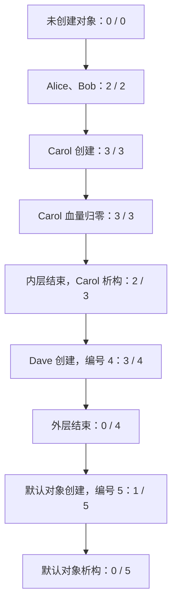

# static 实验：共享状态与对象计数

本实验用游戏角色验证类静态成员变量、静态成员函数和对象生命周期。使用 C++17，单线程运行；有效基础伤害范围为 0～100，不考虑整数溢出。

对象共享数据的依据见 [[1.C++基础/12. OOP/12.1 封装/12.1.9 静态成员变量|静态成员变量]]；无需创建对象即可调用的接口见 [[1.C++基础/12. OOP/12.1 封装/12.1.10 静态成员函数|静态成员函数]]。这两篇分别对应本实验的共享计数和查询/配置接口。

## 实验需求与成员设计

每个角色初始生命值为 100，拥有独立名字和编号。编号从 1 开始，随创建顺序递增，销毁后不重用。所有角色共享倍率，初始为 1，允许设置为 1～5；非法设置失败且不改变原值。负数伤害失败且不改变血量，合法伤害将血量最低扣到 0。

| 数据 | 是否 static | 原因 |
|---|---|---|
| name_、blood_、id_ | 否 | 必须区分具体对象 |
| magnification_ | 是 | 现有对象和新对象都读取同一个最新倍率 |
| cumulative_nums_ | 是 | 保存整个类的累计创建数量，并生成下一编号 |
| alive_num_ | 是 | 记录当前还未析构的对象数量 |

“存活”在这里指对象尚未析构。Carol 的血量变成 0，不会触发析构，也不减少对象数量。

查询倍率、设置倍率、查询两种计数都不需要某个对象，所以使用静态成员函数。伤害操作和 printInfo() 依赖具体角色，因此使用普通成员函数。printCharacter() 是静态函数，但它的参数明确指定了目标对象。

## 修改过程

### 第一次检查：析构计数和动态对象

最初析构函数减少了累计数，导致历史数量丢失，新角色可能重用编号。改为只减少 alive_num_；cumulative_nums_ 只在成功创建对象时增加，本实验中不提供重置接口。

最初场景用裸指针和 new 创建角色，离开代码块后指针变量消失，动态对象却没有销毁，因此析构函数未执行，最终当前对象数仍为 4。改为局部自动对象后，花括号结束触发析构，才能真正观察计数变化。

同时删除公开的计数 setter。外部随意修改数量会破坏编号和计数，即使成员变量是 private，也无法保证状态正确。普通整数赋值不会抛异常，try/catch 不能替代业务规则校验。

### 第二次检查：作用域正确，但默认构造重复计数

改为自动对象后，Carol 离开作用域得到 2 / 3，所有具名对象结束后得到 0 / 4，析构逻辑正确。

不过原默认构造函数仍有重复计数：

```cpp
// 历史错误示例，不是最终实现。
Character() : Character("") {
    ++cumulative_nums_;
}
```

委托目标的 id_(++cumulative_nums_) 已增加累计数；目标构造函数返回后，上面函数体又增加一次。两次构造函数执行过程服务于同一个对象，不会创建两个对象。初始计数为 0 时，默认对象编号为 1、当前数量为 1，累计数量却变成 2；下一个具名对象获得编号 3。

最终把默认构造函数体留空，由带参构造统一维护编号和计数：

```cpp
Character::Character() : Character("") {}
```

默认对象的名字为空，作为本实验额外的委托构造验证。具名场景使用非空名字；setName() 对空名字返回失败。若业务要求所有角色始终有非空名字，可改用约定的默认名字，或取消默认构造。

### 最后整理：声明、定义与验收

- 静态成员函数全部改为类内声明、类外定义，类外不重复 static；普通成员函数也统一拆出定义。
- alive_num_ 使用传统类内声明、类外定义；另外两个共享变量保留 inline static，比较两种方式。
- 倍率统一为 int，去掉 double 到 int 的查询转换和不必要的血量截断。
- printInfo() 保持 const；printCharacter() 直接调用 target.printInfo()，避免重复输出逻辑。
- 构造函数固定初始血量为 100，移除额外 blood 参数，避免直接设置 Dave 为 70 绕过伤害验证。
- 补上 Bob 受伤、Dave 读取新倍率、非法倍率、负数伤害、血量归零、作用域计数和默认构造的断言。
- 保留原有 getMagnication()/setMagnication()/getcumulative() 命名，便于对照原稿；这些命名可在后续统一调整。
- 移除未实现且参数类型不合适的 setBlood(string) 声明；setName() 的 bool 表示名字是否合法，内存分配异常仍可向外传播。
- 去掉 using namespace std 和陈旧 TODO，统一缩进、空格及换行。原稿另有备份，最终代码如下。

## 最终代码及分段解释

同目录 static_practice.cpp 是完整可运行源码。下面按源码顺序分段展示；各段连续拼接即为完整文件，不能把单个场景片段当作独立程序运行。代码快照不会自动跟随工作区文件变化。

### 代码段 1

对象数据与共享数据分开声明。倍率和历史数量在类内定义，当前数量只在类内声明，练习另一种定义方式。

```cpp
#include <algorithm>
#include <cassert>
#include <iostream>
#include <string>

// C++17 单线程实验：对象独立状态、共享配置与生命周期计数。
// 两种静态数据定义方式并存，静态函数统一类内声明、类外定义。
class Character {
private:
    std::string name_;  // 每个对象各有一份。
    int blood_;
    int id_;

    inline static int magnification_ = 1;  // 共享倍率，类内定义。
    inline static int cumulative_nums_ = 0;  // 历史数量，不因析构减少。
    static int alive_num_;  // 当前数量，下面提供类外定义。

public:
    Character();
    explicit Character(const std::string& name);
    ~Character();

    // 避免隐式复制或移动绕过本实验的构造计数。
    Character(const Character&) = delete;
    Character& operator=(const Character&) = delete;
    Character(Character&&) = delete;
    Character& operator=(Character&&) = delete;
```

### 代码段 2

接口声明中的 static 表明函数不依赖对象，只读对象接口使用 const。随后在类外定义 alive_num_，默认构造委托给带参构造：只分配一次编号、增加一次当前数量；析构只减少当前数量。

```cpp
    bool takeDamage(int baseDamage);
    void printInfo() const;
    std::string getName() const;
    int getBlood() const;
    int getId() const;
    bool setName(const std::string& name);

    // 这些操作不依赖某一个对象，没有 this。
    static int getMagnication();
    static bool setMagnication(int magnification);
    static int getcumulative();
    static int getAliveNum();
    static void printCharacter(const Character& target);
};

// 类外定义静态数据时，不再重复 static。
int Character::alive_num_ = 0;

// 委托初始化同一个对象，默认构造函数体不再重复增加计数。
Character::Character() : Character("") {}

Character::Character(const std::string& name)
    : name_(name), blood_(100), id_(++cumulative_nums_) {
    ++alive_num_;
}

Character::~Character() {
    --alive_num_;
}
```

### 代码段 3

普通成员函数同时读取对象血量和共享倍率。先拒绝负伤害，再把结果限制到 0；只读打印不改变角色状态。

```cpp
bool Character::takeDamage(int baseDamage) {
    if (baseDamage < 0) {
        return false;
    }
    // 本实验有效基础伤害为 0～100，倍率为 1～5，不考虑溢出。
    blood_ = std::max(0, blood_ - baseDamage * magnification_);
    return true;
}

void Character::printInfo() const {
    std::cout << name_ << "的 id 是 " << id_
              << "，血量为 " << blood_
              << "，当前倍率为 " << magnification_ << '\n';
}

std::string Character::getName() const {
    return name_;
}

int Character::getBlood() const {
    return blood_;
}

int Character::getId() const {
    return id_;
}
```

### 代码段 4

对象查询通过当前对象读取数据。名字设置先校验空字符串；倍率设置先校验范围，失败时保留原值。

```cpp
bool Character::setName(const std::string& name) {
    if (name.empty()) {
        return false;
    }
    name_ = name;
    return true;
}

// 静态成员函数的类外定义只写返回类型、类名和函数名。
int Character::getMagnication() {
    return magnification_;
}

bool Character::setMagnication(int magnification) {
    if (magnification < 1 || magnification > 5) {
        return false;
    }
    magnification_ = magnification;
    return true;
}

int Character::getcumulative() {
    return cumulative_nums_;
}

int Character::getAliveNum() {
    return alive_num_;
}
```

### 代码段 5

静态 printCharacter() 没有 this，但可通过参数 target 调用只读对象函数。辅助函数通过类名查询共享状态；assert 只验证结果，设置和伤害操作单独执行，避免关闭断言时跳过业务操作。

```cpp
void Character::printCharacter(const Character& target) {
    target.printInfo();  // 无 this，但参数明确指定了要访问的对象。
}

void printCounts(const char* stage) {
    std::cout << stage << "：当前对象数=" << Character::getAliveNum()
              << "，累计创建数=" << Character::getcumulative()
              << "，倍率=" << Character::getMagnication() << '\n';
}

// 只查询状态；有副作用的设置/伤害操作不放进 assert。
void checkCounts(int alive, int cumulative) {
    assert(Character::getAliveNum() == alive);
    assert(Character::getcumulative() == cumulative);
    (void)alive;
    (void)cumulative;
}

void runScenario() {
    checkCounts(0, 0);
    assert(Character::getMagnication() == 1);
    bool ok = Character::setMagnication(2);
    assert(ok);
    printCounts("未创建对象");
```

### 代码段 6

先创建自动对象并验证独立编号和血量。内层 Carol 与外层 Alice、Bob 生命周期不同，便于检验退出作用域后的数量。

```cpp
    {
        Character alice("Alice");
        Character bob("Bob");
        assert(alice.getId() == 1 && bob.getId() == 2);
        checkCounts(2, 2);
        ok = alice.takeDamage(10);
        assert(ok && alice.getBlood() == 80 && bob.getBlood() == 100);
        printCounts("Alice、Bob 创建后");

        {
            Character carol("Carol");
            assert(carol.getId() == 3);
            checkCounts(3, 3);
            ok = Character::setMagnication(3);
            assert(ok);
            ok = bob.takeDamage(10);
            assert(ok && bob.getBlood() == 70);
            assert(alice.getBlood() == 80 && carol.getBlood() == 100);
            printCounts("Carol 创建后");
```

### 代码段 7

失败路径同时检查返回值和状态不变。Carol 血量归零仍然计数，离开花括号才析构。累计数量保持 3，因此 Dave 获得编号 4；它从 100 血量开始受伤，验证使用新倍率 3。外层结束时当前数量回到 0。

```cpp
            ok = Character::setMagnication(0);
            assert(!ok && Character::getMagnication() == 3);
            ok = Character::setMagnication(6);
            assert(!ok && Character::getMagnication() == 3);
            ok = carol.takeDamage(-1);
            assert(!ok && carol.getBlood() == 100);
            ok = carol.takeDamage(100);
            assert(ok && carol.getBlood() == 0);
            checkCounts(3, 3);  // 血量为 0 不等于对象已析构。
            Character::printCharacter(carol);
        }

        checkCounts(2, 3);
        printCounts("Carol 离开作用域后");
        Character dave("Dave");
        assert(dave.getId() == 4);
        checkCounts(3, 4);
        ok = dave.takeDamage(10);
        assert(ok && dave.getBlood() == 70);
        Character::printCharacter(dave);
        printCounts("Dave 创建后");
    }  // 按创建顺序的逆序析构：Dave、Bob、Alice。

    checkCounts(0, 4);
    assert(Character::getMagnication() == 3);
    printCounts("所有具名角色离开作用域后");
```

### 代码段 8

具名对象销毁后，额外创建默认对象验证委托构造只计数一次。其析构后当前数量回到 0，累计数量保留为 5。

```cpp
    // 回归验证默认构造不会把历史数量多加一次。
    {
        Character anonymous;
        assert(anonymous.getId() == 5 && anonymous.getBlood() == 100);
        checkCounts(1, 5);
        printCounts("默认对象创建后");
    }
    checkCounts(0, 5);
    printCounts("默认对象离开作用域后");
    (void)ok;
}

int main() {
    runScenario();
    std::cout << "所有实验断言通过。\n";
}
```

## 执行结果

Alice、Bob、Carol、Dave 的编号依次为 1、2、3、4。Carol 先在内层作用域销毁，外层结束时依次销毁 Dave、Bob、Alice。默认对象随后获得编号 5，用来检验此前未覆盖的默认构造路径。

```text
未创建对象：当前对象数=0，累计创建数=0，倍率=2
Alice、Bob 创建后：当前对象数=2，累计创建数=2，倍率=2
Carol 创建后：当前对象数=3，累计创建数=3，倍率=3
Carol的 id 是 3，血量为 0，当前倍率为 3
Carol 离开作用域后：当前对象数=2，累计创建数=3，倍率=3
Dave的 id 是 4，血量为 70，当前倍率为 3
Dave 创建后：当前对象数=3，累计创建数=4，倍率=3
所有具名角色离开作用域后：当前对象数=0，累计创建数=4，倍率=3
默认对象创建后：当前对象数=1，累计创建数=5，倍率=3
默认对象离开作用域后：当前对象数=0，累计创建数=5，倍率=3
所有实验断言通过。
```

这里累计数最终为 5，是因为额外执行了默认对象验证。原来的四角色场景结束点仍是当前数 0、累计数 4。



图中的每对数字是“当前对象数 / 累计创建数”。生命值变化不改变数量，析构也不会减少历史数量。本实验只有一个执行线程，没有阻塞或等待。

## 易错点

### 类外定义不要重复 static

```cpp
// 类内声明：
static int getAliveNum();
// 类外定义（处于 Character 类定义之外）：
int Character::getAliveNum() {
    return alive_num_;
}
```

类内声明已经确定这是静态成员函数。类外定义用 Character:: 指明所属类，不再写 static；静态数据成员的类外定义也不重复写 static。类内已定义的 inline static 变量不再提供另一份类外定义。

### static 与 const 解决不同问题

普通查询函数末尾的 const 表示不通过当前对象修改其非静态状态。静态函数没有 this，所以不能加这样的尾部 const。const 普通成员函数仍然能够读取、甚至修改可写的共享静态数据；本实验的只读查询选择不修改任何状态。

### 对象调用静态函数不会创建对象专属配置

alice.setMagnication(3) 合法，但仍修改所有角色共享的倍率。使用 Character::setMagnication(3) 更清楚。普通成员函数能够读取静态数据，所以伤害操作不需要额外保存一份倍率。

### 动态存储期与作用域是两件事

普通 new 通常在堆上分配对象，但裸指针的局部作用域结束不会自动释放其指向的对象。普通 new 创建的对象要由对应 delete 或拥有它的智能指针管理。若局部 unique_ptr 拥有对象，作用域结束时先析构智能指针，再释放其拥有的对象。自动对象则直接在自己的作用域结束时析构。本实验使用自动对象以观察生命周期。

### 当前数量不能生成永久编号

当前数量会随析构减少；用它生成编号会导致重用。累计创建数在本实验中只增不减，可以同时承担编号来源。若以后增加重置历史计数的需求，应重新设计独立编号状态。

### 有副作用的操作不要只写在 assert 内

设置倍率、造成伤害都改变状态。本实验先执行并保存返回值，再通过 assert 检查。定义 NDEBUG 后 assert 不再执行，但实验的状态变化仍发生。验收请使用未定义 NDEBUG 的构建；结尾“断言通过”的提示也以这一条件为前提。

### 类静态成员与命名空间 static 不要混淆

命名空间作用域的 static 变量/函数具有内部链接。常规头文件中的这类定义被多个翻译单元包含时，每个翻译单元拥有独立实体，不能因此解释成“同一个类静态成员重复定义”。普通非 inline 类静态数据成员被使用时，需要适当的类外定义。

## 编译与复盘

在本笔记所在实验目录编译，不定义 NDEBUG：

```sh
clang++ -std=c++17 -Wall -Wextra -Wconversion -pedantic static_practice.cpp -o static_practice
./static_practice
```

整理后实际编译没有警告，上述全部断言通过。编译器可替换为支持 C++17 的 g++。本实验尚未实现复制、移动和多线程计数；禁用复制与移动是当前计数成立的前提。

复盘时可以暂时注释掉 alive_num_ 的类外定义并观察链接错误，再恢复；也可以改为 inline static 类内定义，同时移除类外定义。比较默认构造路径和带参构造路径是否都只维护一次计数。

## 规则依据

- [C++ 标准草案：静态成员](https://eel.is/c++draft/class.static)：静态函数没有 this；静态数据的共享语义；类外定义不重复 static。
- [C++ 标准草案：委托构造](https://eel.is/c++draft/class.base.init)：目标构造函数返回后，执行委托构造函数体，两者初始化同一个对象。
- [C++ 标准草案：delete 表达式](https://eel.is/c++draft/expr.delete)：普通删除表达式调用析构并释放存储。
- [C++ 标准草案：链接规则](https://eel.is/c++draft/basic.link)：命名空间 static 的内部链接与类静态成员规则需要区分。
