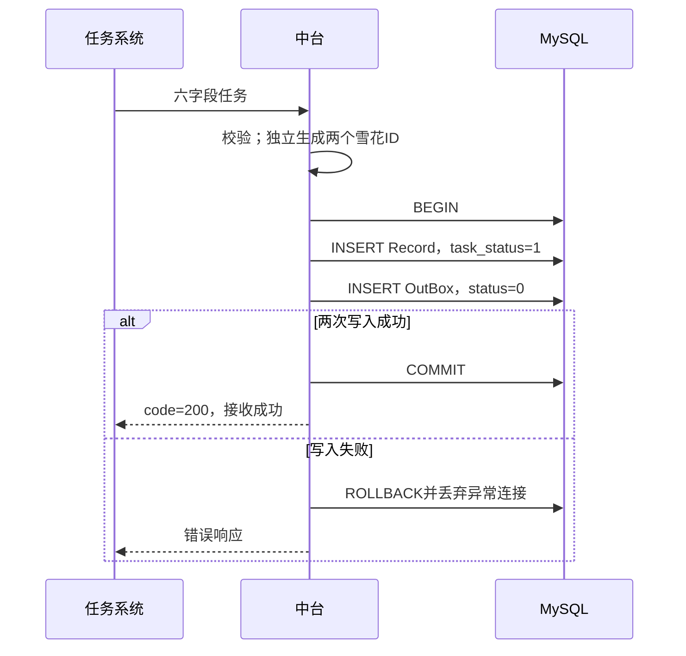
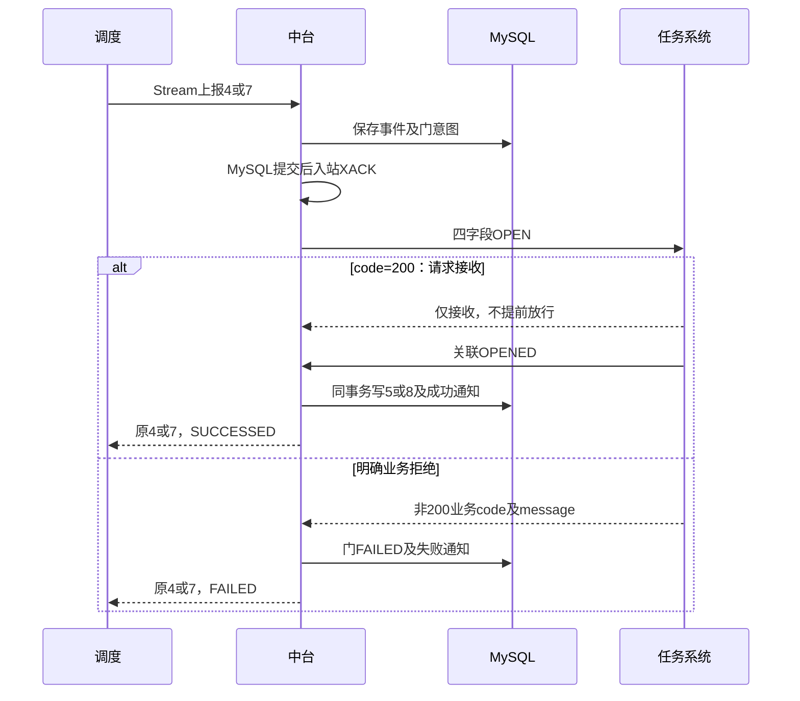

# 博赛德物流桥接模块：架构与实现

上层任务系统通过HTTP/2下发搬运任务，中台在同一MySQL事务里插入Record和OutBox。调度从OutBox领取任务，通过Redis Stream上报执行事实；中台唯一更新Record，并分别向调度返回通知、向任务系统反馈6/201/601。

`logistics_bridge`是独立Python 3.11+进程，不随Qt窗口启动，不改写ROS、Gateway或SDK控制链。这套物流能力只用于博赛德的`feature_vis`。

> [!info] 当前版本：2026-09-18，返回协议v2
> 返回JSON固定8字段，没有type。成功值按约定拼写为 **SUCCESSED**，失败值为FAILED。需要开门的4/7等待门结果，返回原4/7；数据库仍分别记录5/8。当前代码已通过133项隔离测试，尚未现场部署。
>
> 原 [[MFMS数据中台-物流任务对接实现方案]] 是历史讨论稿。旧execution_state映射、调度写Record、轮询Record等门、九字段ACK/RESULT协议均不再作为当前实现依据。

## 1. 模块和通信方向

```mermaid
flowchart TB
    U["任务／物流系统"]
    B["中台 logistics_bridge"]
    D[("MySQL：Record、OutBox及中台私有表")]
    S["调度系统"]
    E["bosaide:scheduler:events"]
    R["bosaide:middleware:results"]
    U -->|"HTTP/2 六字段接单"| B
    B -->|"同事务插入Record和OutBox"| D
    D -->|"OutBox任务交接"| S
    S -->|"维护OutBox交接状态"| D
    S -->|"执行事实"| E
    E --> B
    B -->|"唯一更新Record；保存事件及通知"| D
    B -->|"8字段返回"| R
    R --> S
    B -->|"HTTP/2反馈6、201、601"| U
    B -->|"四字段OPEN"| U
    U -->|"关联OPENED完成通知"| B
```



调度不再轮询Record等待门状态，也不写Record。OutBox仍是初始任务交接口，调度继续维护它的状态。上图门控生产路由与完成入口仍待接入；本地测试适配器不能代表现场门设备已联通。

| 代码文件 | 当前职责 |
|---|---|
| `app.py` | 接单校验、HTTP服务、资源启动关闭，组织三个后台工作器 |
| `repository.py` | 初始双表事务、同编号内容核验、基础schema预检 |
| `events.py` | 调度事件校验、状态转换校验、OPENED四字段校验 |
| `streams.py` | 消费调度Stream、pending恢复、可靠提交后XACK |
| `stream_repository.py` | 持久去重、顺序应用、Record单写、门结果及待反馈事务 |
| `notifications.py` | 8字段构造与校验、稳定messageId、独立返回发布器 |
| `stream_workers.py` | 独立物流反馈；测试用途门响应适配器 |
| `feedback.py`、`migration.py` | HTTP/2反馈客户端，以及旧确认日志的兼容和迁移 |
| `snowflake.py`、`config.py` | 持久雪花ID、配置和环境变量读取 |
| `schema.sql`、`migrations/` | 新表审阅模板及显式迁移，不由服务自动执行 |

代码目录为仓库内`src/mfms_server/tools/logistics_bridge/`。HTTP服务使用Hypercorn，反馈客户端使用HTTPX，MySQL连接池使用aiomysql。

## 2. 接单仍是原六字段

```json
{
  "taskCode": "T001",
  "startStorageCode": "START-001",
  "endStorageCode": "END-001",
  "containerCode": "CAN-001",
  "startStorageOpenDoor": true,
  "endStorageOpenDoor": false
}
```

前四项为字符串，后两项必须是JSON布尔值；起点与终点不同。接口字段`taskCode`与数据库`task_code`表示同一个外部任务编号，不是状态码。保留原编号、大小写及前导零，不转成数字。

`/handle_job`校验HTTP/2、路径、方法、认证配置和输入。六字段必须完整，拒绝重复键、额外字段和错误类型。具体现场地址、认证与配置不写死在笔记里。



两次INSERT使用同一连接、同一事务，不用触发器。Record.id与OutBox.id分别生成，OutBox.logistics_task_id关联Record.id，不申请第三个ID。接收成功只表示任务已保存，不表示车辆已运行。

网络中断可能导致上层重发。同taskCode、相同六字段且关联OutBox完整时，保留原记录并返回成功；同编号不同内容返回冲突。Record存在但OutBox缺失或异常，不能当作成功。事务失败的连接丢弃后，重复核验使用新的查询视图。

## 3. 数据库各表保存什么

| 表 | 列数 | 职责及写入方 |
|---|---:|---|
| `logisticsTaskRecord` | 12 | 原任务和当前执行状态；仅中台写 |
| `logisticsTaskOutBox` | 7 | 中台插入初始任务；调度维护交接状态 |
| `logisticsBridgeEvent` | 11 | 中台私有事件收件、应用进度、物流反馈待办 |
| `logisticsBridgeNotification` | 12 | 中台私有返回消息、发送进度、重投代次 |
| `logisticsBridgeDoor` | 11 | 中台私有门请求、源事件、点位及动作结果 |
| `logisticsBridgeDiagnostic` | 5 | 无法应用或解析的报文及诊断 |
| `logisticsBridgeLegacyAck` | 5 | 迁移保留的旧物流反馈确认 |

Record完整字段：`id`、`task_code`、`context`、`task_status`、`door_request_id`、`arrived_storage_code`、`created_at`、`started_at`、`ended_at`、`ended_reason`、`error_code`、`updated_at`。

OutBox完整字段：`id`、`logistics_task_id`、`payload`、`status`、`created_at`、`ended_at`、`updated_at`。context与payload仍是原六字段任务，不混入反馈进度或新增执行计划字段。

| OutBox.status | 含义 |
|---|---|
| 0 PENDING | 等待调度处理 |
| 1 PROCESSED | 数据库处理完成，等待调度投递内部Redis |
| 2 PUBLISHED | 调度内部Redis投递成功 |
| 3 FAILED | 交接处理或投递失败 |

OutBox.status不是taskStatus。`started_at`仍表示首张运单真正下发，不自动取状态2的入队时间，也不证明气罐已上车。`error_code`以JSON保留原始标量类型；任务编号采用精确区分大小写和尾空格的比较。表容量与最终现场DDL仍须核准。

## 4. 调度通过Stream上报执行事实

| 方向 | Stream | 消费组 |
|---|---|---|
| 调度→中台 | `bosaide:scheduler:events` | `middleware` |
| 中台→调度 | `bosaide:middleware:results` | `scheduler` |

每条Stream消息只使用一个`data`字段，值是JSON字符串。调度上报示例：

```json
{
  "eventId": "scheduler-T001-000003",
  "taskCode": "T001",
  "sequence": 3,
  "taskStatus": 4,
  "storageCode": "START-001"
}
```

sequence是每个任务的事件顺序号，从1开始。新事件递增，重试不变，重启不重置；它不是taskStatus、OutBox.status或Redis消息ID。中台生成的1/5/8不占调度序号。

4/7必须带真实业务storageCode，中台核对原任务起点或终点。事件先可靠保存到MySQL，再对入站消息执行Redis XACK。缺号时保存等待，不能越过前序直接应用；重投按事件身份和内容去重，冲突记录诊断，不覆盖原事实。消费者重启会恢复pending消息。

## 5. 返回协议：8字段，两种status

起点门打开后，返回给调度：

```json
{
  "messageId": "result-door-T001-0001",
  "sourceEventId": "scheduler-T001-000003",
  "taskCode": "T001",
  "taskStatus": 4,
  "status": "SUCCESSED",
  "requestOpenDoorId": "door-T001-0001",
  "storageCode": "START-001",
  "reason": null
}
```

messageId是稳定的不透明通知ID，示例命名不约束实现。重发保持同ID及完整内容。sourceEventId关联原调度事件；taskStatus保留原上报状态。不再返回type，也不再使用RECEIVED或REJECTED。

| 上报情况 | 返回时机和内容 |
|---|---|
| 除4/7以外的状态 | 可靠保存后SUCCESSED，只表示收件ACK |
| 4且startStorageOpenDoor=false | 任务、起点核对通过后可靠收件即SUCCESSED |
| 7且endStorageOpenDoor=false | 任务、终点核对通过后可靠收件即SUCCESSED |
| 4/7且对应开门需求=true | 不提前回成功；真实OPENED校验后SUCCESSED |
| 4/7对应门请求明确失败 | FAILED，保留原4/7并带失败原因 |

无需门的4/7即使暂时缺前序消息，也可确认收件；这不表示Record已应用该状态。需要门的4/7若先回同格式成功ACK，调度会误以为门已开，因此等待期间不生成提前成功通知。

普通状态示例：

```json
{
  "messageId": "receipt-T001-000004",
  "sourceEventId": "scheduler-T001-000004",
  "taskCode": "T001",
  "taskStatus": 6,
  "status": "SUCCESSED",
  "requestOpenDoorId": null,
  "storageCode": null,
  "reason": null
}
```

固定8字段，不适用填null。4/7保留点位，无需门时requestOpenDoorId为null；普通状态两个门相关字段都为null，成功reason为null。FAILED只允许4/7，reason为明确失败原因，关联真实门请求。

普通未知状态或业务拒绝仍可确认可靠收件，诊断另行保存，不发送REJECTED。未知任务、错点或冲突的4/7不能伪造开门成功或失败，只记录诊断。缺少可关联身份或JSON不可解析时，不伪造返回消息。

### 数据库存5/8，向调度返回4/7

| 已确认业务事实 | Record.task_status | 返回调度 |
|---|---:|---|
| 起点门已打开 | 5 | taskStatus=4，SUCCESSED |
| 终点门已打开 | 8 | taskStatus=7，SUCCESSED |

中台不再因开门完成主动向调度发送5/8。数据库仍保存这两个状态，便于记录当前阶段。任务系统HTTP仍只反馈6/201/601，不自动新增5/8反馈。

## 6. 门请求接收与开门完成是两件事

中台向任务系统发送严格四字段请求：

```json
{
  "requestOpenDoorId": "door-T001-0001",
  "taskCode": "T001",
  "storageCode": "START-001",
  "doorStatus": "OPEN"
}
```

同动作网络重试复用requestOpenDoorId，新动作新ID。当前只发OPEN；虽然接口资料提到OPEN/CLOSE，本轮不新增中台主动CLOSE。

| 任务系统响应或事实 | 中台处理 |
|---|---|
| JSON整数code=200 | 只记请求已接收，继续等完成事实 |
| 明确非200业务code且message说明原因 | 持久记录门失败，返回原4/7的FAILED |
| 网络超时、HTTP故障或无效响应 | 保留待办重试，不虚构门失败 |
| 关联OPENED | 核验任务、请求、点位、当前阶段；同事务写5/8及原4/7成功通知 |

OPENED使用同四字段，doorStatus改为`OPENED`。请求已接收不代表门已打开，5/8也不代表持续实时门状态。



失败后不写5/8；迟到OPENED不能让失败动作重新成功。成功和失败并发到达时，由同任务事务锁保证单一结果。重复上报等待中的到点事件不新建门动作，重复已完成事件重发原最终通知。

调度收到需要门的4/7返回时，核对任务、源事件、点位、请求ID及当前等待阶段。只有匹配的SUCCESSED才继续取放；重复、迟到或任务结束后的旧结果不能再次驱动动作。

> [!note] 现场适配仍待完成
> 真实开门接口地址、方法、鉴权和完成通知入口尚待联调，不能复用六字段接单口猜测路由。门响应适配器当前明确标为测试用途。调度上报301不自动转换为原4/7的FAILED。

## 7. 可靠反馈独立于执行和返回消息

**调度上报6后立即继续，不等待SUCCESSED、任务系统HTTP反馈或关门。** 中台只在可靠取货上车事实后反馈6；任务系统收到6按原任务关联关闭起点门，中台不另发CLOSE。迟到6的门关联和放货后关门仍待现场确认。

```json
{"taskCode":"T001","taskDetailStatus":6}
```

物流反馈范围只有6、201、601。事件应用、Record更新及物流反馈待办同事务保存到私有事件表。6之后即使很快出现7/201，待反馈6仍存在，不靠Record当前状态回推历史。

`DurableFeedbackWorker`在事务外发HTTP/2。同一任务按顺序发送，6未确认时后续反馈等待；单任务故障不阻塞其他任务。成功需实际HTTP/2、HTTP2xx、JSON整数code=200，随后将确认持久化到数据库。重试时间和错误也保存到数据库，当前可靠反馈不再依赖旧本地确认文件作为主进度。

返回通知由独立`NotificationPublisher`处理，与物流HTTP反馈互不阻塞。SQL可靠提交后才XADD；XADD成功但发送确认落库失败，会再次发送同messageId。重投递增generation，发送确认按代次更新，避免覆盖并发补发请求。

| 故障位置 | 恢复方式 |
|---|---|
| 入站消息MySQL提交前失败 | 不XACK，保留Redis pending |
| 已提交但XACK丢失 | 重投去重，继续已有待办 |
| 通知XADD成功但确认写库失败 | 同ID、同payload重发 |
| 任务系统已收反馈但HTTP响应丢失 | 按任务和状态幂等重试 |
| 服务重启 | 从持久事件、反馈及通知进度恢复 |

调度保存返回消息和本地处理进度后再Redis XACK，按messageId去重并恢复pending。通知SENT只表示Redis接收，不表示调度已处理或设备已动作。初次创建返回消费组从0-0读取，避免跳过已有待通知消息；消息保留与裁剪由部署配置保证。

## 8. 雪花 ID 也需要保存进度

当前雪花位布局已经固定：

```text
1 位符号 + 41 位毫秒时间差 + 5 位数据中心 + 5 位节点 + 12 位序列
```

拼接表达式为：

```python
id_value = ((timestamp_ms - epoch_ms) << 22) | (datacenter_id << 17) | (worker_id << 12) | sequence
```

同一毫秒内递增序列，进入下一毫秒从 0 开始。`epoch_ms` 和两个节点编号必须显式配置；代码没有替现场猜一组默认值。

`Snowflake.__call__()` 返回 ID 前，会先把毫秒和序列写入临时文件，刷新文件、原子替换 `snowflake.json`，再刷新所在目录。这样进程重启时还能接着已有序列分配，避免在同一毫秒内重新从 0 开始。

如果时间倒退，生成器暂时拒绝发号，等系统时间赶上；同毫秒 4096 个序列用完，也要等时间推进。持久化失败后，当前生成器停止发号，需要恢复存储并重启。已经分配但事务最终回滚的 ID 可以留下空缺，不能为了连续而回收重用。

本地文件锁只能管住同一目录。多台机器是否使用了冲突节点编号，仍由现场分配管理。`snowflake.json` 也不能随意恢复成旧备份，否则可能重新生成以前用过的 ID。

## 9. 统一taskStatus名称

下表为当前约定的19种状态。枚举已确认不等于每种业务转换均已实现；100、202、501、502、503、504的具体流转仍待定义，普通收件确认已覆盖这些状态。

| taskStatus | 含义 |
|---|---|
| 1 | 已生成 |
| 2 | 已下发 |
| 3 | 已分配 |
| 4 | 已到起点 |
| 5 | 起点门已打开 |
| 6 | 运送中 |
| 7 | 准备放下 |
| 8 | 终点门已打开 |
| 9 | 已放下 |
| 10 | 车离开 |
| 100 | 挂起 |
| 201 | 正常结束 |
| 202 | 手动正常结束 |
| 301 | 超时结束 |
| 501 | 异常结束 |
| 502 | 手动异常结束 |
| 503 | 下发失败 |
| 504 | 分配失败 |
| 601 | 手动取消 |

2的显示名为已下发，既有执行语义仍含入队及创建任务进度表；started_at单独取真实首运单下发事实。301名称为超时结束，当前业务实现覆盖调度连续三次开门超时；传输重试不累计为业务超时，恢复规则待确认。

## 10. 启停与旧数据迁移

服务加载配置、持久雪花状态、数据库池及schema预检，再启动接单服务、Stream消费者、物流反馈器和返回发布器。HTTP不占用数据库事务。退出时停止并清理服务和后台协程，释放HTTP、Redis、MySQL及文件锁；磁盘fsync故障不保证固定退出时限。

预检包含InnoDB、字段类型、唯一键、触发器可核验权限和v2通知能力。空旧表也不能跳过版本检查。服务只检查，不自动建表、改表、执行迁移或删除现场触发器。

| 迁移文件 | 用途 |
|---|---|
| `001_legacy_record.sql` | 显式迁移旧执行状态及表结构；活跃任务需审阅 |
| `002_scheduler_notifications.sql` | 历史v1通知表引入 |
| `003_eight_field_notifications.sql` | v1通知原样归档，建立v2表及门失败约束 |

旧execution_state=6表示超时，不能直接改列名成为新6运送中，也不能无事实映射301。旧RUNNING或started_at不能补造气罐上车。旧反馈确认日志须导入并保留，不能清空已确认记录或并行运行两套反馈器。

旧9字段通知的稳定ID已绑定原payload，不能原地改成8字段。切换前停旧发送器，核对Redis旧消息、pending和在途任务，保留归档后协调调度升级；不自动回填历史门成功。迁移DDL可能分步提交，失败后按实际状态和备份处理，不盲目重复重置。旧格式会被启动预检和发布器拒绝。

## 11. 已验证范围与继续阅读

2026-09-18的v2最终验证：**133项全部通过，0失败、0跳过；Ruff通过；Mypy检查25个Python文件通过。** 这是最新完整复测，旧62/82/109/124/125项均是历史阶段结果。

测试使用隔离MySQL8、Redis7、回环HTTP/2和明确标注的调度/门模拟器。覆盖事务回滚、序号乱序、pending恢复、返回去重、四种门需求组合、原4/7与数据库5/8分离、code200仅接收、明确拒绝FAILED、失败后迟到OPENED、并发单结果、终点失败保留待反馈6，以及实际003迁移保留旧历史。测试调度消费者用SQLite验证持久进度，不能替代生产调度。

现场仍待确认门接口和完成入口、最终DDL及权限、Redis保留与切换配置、雪花epoch和节点分配、消息时间源、需求拆分产物交接、迟到6关联、放货后关门及301恢复。当前未部署，也没有验证真实门设备或长期离线补动作。

阅读源码可沿`app.run()` → `Repository.accept()` → `StreamConsumer` → `StreamRepository.ingest()` / `_apply_ready()` → `opened()` / `door_failed()` → `NotificationPublisher`及`DurableFeedbackWorker`展开。

仓库中的当前资料：

- `.trellis/tasks/09-16-bosaide-logistics-bridge/调度开发对接协议-ACK与RESULT.md`：最新8字段调度协议，文件名保留历史命名。
- 同任务目录的`任务系统对接说明-taskCode与状态反馈.md`：任务编号、6/201/601反馈及门控关联。
- 同任务目录的`verification.md`：实际验证与外部依赖。
- `.trellis/spec/backend/bosaide-logistics-stream-contract.md`：实施契约，最新v2条款优先于旧章节。
- 模块`README.md`：安装、配置、运行和隔离测试入口。

504表示分配失败，普通收件后返回taskStatus=504、status=SUCCESSED；这里的成功只表示中台已收到消息，不表示分配成功。504不使用门控FAILED，也不自动加入任务系统HTTP反馈范围；具体业务状态转换仍待定义。
