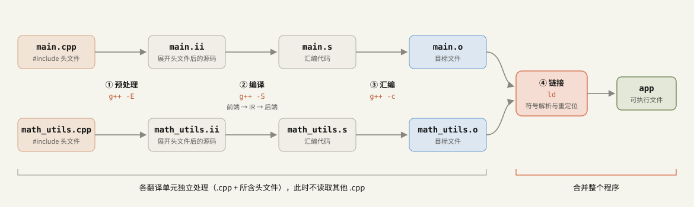
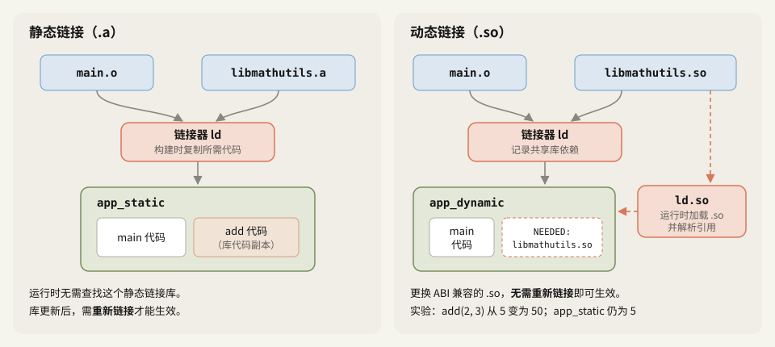
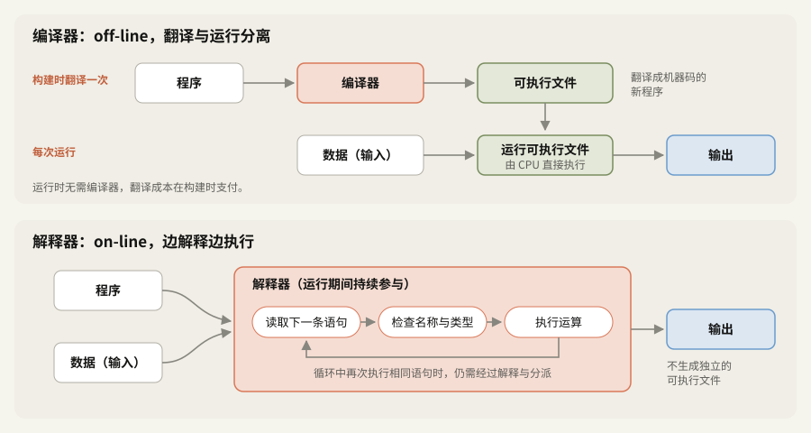
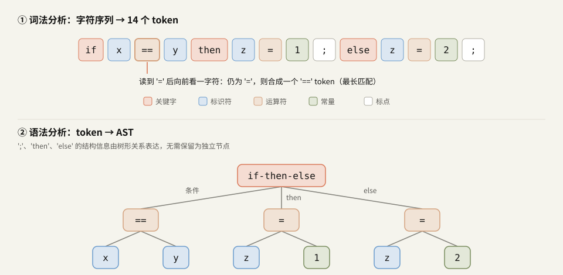

# 10 月 23 日学习记录

今天学习了 C++ 构建过程（预处理、编译、汇编、链接及 ODR），以及斯坦福 CS143 第 1 讲（编译器与解释器、编译器的五个阶段、语言设计）。这里整理了最初的理解，并在相应位置用**纠正**和**补充**标出错误与遗漏。

> [!info] 阅读说明
> - 正文整理自最初的学习记录。`> [!warning] 纠正` 标出理解有误的地方，`> [!note] 补充` 说明原记录遗漏的内容。
> - 原文记录：命令与输出均在 g++ 13.3（Ubuntu 24.04，x86-64）环境中实际运行验证。地址和临时文件名会随环境变化。
> - 若只想查看纠正内容，可直接看 §6 的汇总表。

## 0. 今日任务与完成情况

| 科目 | 计划 | 今日产出 |
|---|---|---|
| C++ 45 分钟 | 编译与链接、预处理、头文件、ODR；编译多文件程序。闭卷回答 3 个问题，编写或审查最小示例 | §1：整理并纠正构建四阶段、静态与动态链接、ODR 的理解。提供多文件示例，并复现 ODR 违规（§1.7、§1.8） |
| Linux 30–45 分钟 | find、grep、sed、awk、管道、重定向、退出码。至少留下一份命令记录、流程图或实验 | **本笔记中没有相关记录。** 待补充事项见 §7 |
| LLVM/MLIR 45–60 分钟 | 源码 → AST → IR → 机器码；前端、中端、后端的职责。产出带注释的 IR、代码、测试或问题记录之一 | §2–§5：CS143 第 1 讲整理与问题记录 |

---

## 1. C++：预处理、编译、汇编、链接

### 1.1 整体流程



| 阶段 | 输入 → 输出 | 主要工作 | 停在该阶段的命令 |
|---|---|---|---|
| ① 预处理 | `.cpp` → `.ii`（C 为 `.i`） | 展开 `#include`、宏展开、条件编译 | `g++ -E` |
| ② 编译 | `.ii` → `.s` | 词法、语法、语义分析 → IR → 优化 → 生成汇编代码 | `g++ -S` |
| ③ 汇编 | `.s` → `.o` | 将汇编代码转为机器码，记录符号表和重定位信息 | `g++ -c` |
| ④ 链接 | 多个 `.o` + 库 → 可执行文件 | 符号解析、重定位 | `g++ *.o -o app` |

①–③ 对每个**翻译单元**（translation unit）分别进行，也就是一个 `.cpp` 文件与它所包含的头文件组成的单元。此时编译器不掌握其他 `.cpp` 的内容。到 ④ 链接阶段，多个文件才合并起来。

### 1.2 预处理

预处理器不分析 C++ 语法，主要进行**文本替换**。

- `#include "x.h"`：将 `x.h` 的内容展开到当前位置。
- `#define`：展开宏。下例中的 `SQUARE(4)` 会变为 `((4) * (4))`。
- `#if`、`#ifdef`：根据条件保留或排除代码；`#pragma once` 用于防止同一头文件在一个翻译单元内重复包含。
- 去除注释。

> [!warning] 纠正
> 最初把“预处理”只理解成“宏展开”，遗漏了 **`#include` 的头文件展开**。下例中，9 行的 `main.cpp` 经 `g++ -E` 处理后，因展开 `<cstdio>` 而增加到 1,066 行。

### 1.3 编译：前端、中端、后端

编译阶段还可以分为三部分：词法、语法、语义分析属于**前端**，IR 优化属于**中端**，生成目标 CPU 汇编代码的部分属于**后端**。

**词法分析（lexical analysis）**将字符序列切分为 token（词法单元）。关键字（如 `if`、`while`、`for`）、括号与标点、运算符、标识符（变量名）、常量等都是 token。这个阶段发现的是**无法组成合法 token 的字符序列**。

```text
int a@b = 1;          → error: stray '@' in program            （词法分析）
const char* s = "abc; → error: missing terminating " character （词法分析）
```

> [!warning] 纠正
> 最初认为缺少分号也由词法分析发现。但 <code>int a &#61; 1 }</code> 中的 `int`、`a`、<code>&#61;</code>、`1`、`}` 都是合法 token，问题出在它们的**组合方式**，因此由语法分析报错（`expected ',' or ';' before '}' token`）。若把变量名写成 `my-var`，词法分析也能正常切分为 `my`、`-`、`var`，之后才在语法分析时报错（`expected initializer before '-' token`）。

**语法分析（parsing）**按语法规则组合 token，构建**抽象语法树（AST）**。在 <code>a &#61; 2</code> 中，<code>&#61;</code> 是父节点，`a` 是左子节点，`2` 是右子节点。括号不匹配，或 <code>a &#61; ;</code> 这样缺少操作数的情况，会在此阶段报错。树形结构见 §2.4 的图。

**语义分析**（semantic analysis）检查语法正确的 AST **在语义上是否成立**，并将分析结果附加到 AST。

- 名称解析：确定名称对应哪个作用域中的哪个声明。未声明的名称会触发 `'y' was not declared in this scope`。
- 类型检查：检查运算符与操作数的类型是否匹配。
- 插入隐式转换：如 <code>double d &#61; 1;</code>，需要在 AST 中加入 `int → double` 的转换节点。
- 重载决议：确定应调用哪个同名函数。

变量是否已经初始化，**一般无法在编译期完全准确地判断**，因为实际走哪条分支可能取决于运行时数据。因此，编译器有时只给出警告，也可能没有发现问题。

```cpp
int g()       { int x; return x; }                    // -Wall: 'x' is used uninitialized
int f(bool c) { int x; if (c) x = 1; return x; }      // -Wall -Wextra（-O0、-O2）：均无警告
```

语义分析后的 AST 会转换为 **IR（中间表示）**。中端优化 IR，后端选择目标 CPU 指令并生成汇编代码（`.s`）。在 LLVM 工具链中，Clang 对应前端，LLVM IR 优化 pass（`opt`）对应中端，`llc` 对应后端。

### 1.4 汇编

汇编器将 `.s` 转换为机器码，生成**目标文件（`.o`）**。

> [!warning] 纠正
> `.o` 不是可执行文件，而是**可重定位目标文件（relocatable object file）**。
> ```console
> $ file main.o
> main.o: ELF 64-bit LSB relocatable, x86-64, version 1 (SYSV), not stripped
> ```
> `.o` 除了机器码，还包含两类信息。
> - **符号表**：列出本文件定义的名称，以及需要从外部引入的名称。
> - **重定位信息**：标记“这里稍后需要填入 `add` 的地址”等待处理位置。
>
> 需要链接的原因也不限于使用库。调用自己编写的**另一个 `.cpp` 文件**中定义的函数，同样需要链接来解析引用。

用 `nm` 查看符号表即可观察这种区别。`U` 表示未定义（需要从外部引入），`T` 表示定义在代码（text）段中，`B` 表示定义在零初始化数据（bss）段中。

```console
$ nm -C main.o
                 U add(int, int)
                 U call_count
0000000000000000 T main
                 U printf
$ nm -C math_utils.o
0000000000000000 T add(int, int)
0000000000000000 B call_count
```

不加 `-C` 时，`add(int, int)` 会显示为 `_Z3addii`。为区分重载，C++ 实现会将参数类型等信息编码进符号名，这称为**名称修饰（name mangling）**。

### 1.5 链接

链接器主要做两件事。

1. **符号解析**：将各 `.o` 中的 `U` 符号与其他 `.o` 或库中的定义（`T`、`B` 等）匹配。找不到定义时出现 `undefined reference`；普通外部符号被重复定义时出现 `multiple definition`。
2. **重定位**：安排代码与数据的地址，并按重定位记录修正相应位置的地址或偏移。

结果是可执行文件。不指定 `-o` 时，默认文件名为 `a.out`；Linux 上的可执行文件不要求扩展名。

### 1.6 静态链接与动态链接



| | 静态链接（`.a`） | 动态链接（`.so`） |
|---|---|---|
| 链接时机 | 构建时的**链接阶段** | 链接时记录依赖，**运行时**由加载器（`ld.so`）加载并完成相应解析 |
| 可执行文件 | 包含所需库代码的**副本** | 保留对库的**引用**（`NEEDED: libmathutils.so`） |
| 大小与内存 | 可执行文件较大，不同程序可能包含各自的库代码副本 | 可执行文件较小，多个进程可共享内存中的库代码页 |
| 库发生变化后 | 必须**重新链接**程序才会生效 | ABI 兼容时，更换 `.so` 即可，无需重新链接 |
| 运行环境 | 不需要再查找被静态链接的那个库 | 找不到所需 `.so` 时，程序可能无法启动 |

> [!warning] 纠正
> - 静态链接发生在**链接阶段**，不发生在编译或汇编阶段。
> - 静态库变化后，自己的源文件**无需重新编译，只需重新链接**，已有 `.o` 可以继续使用。
> - 动态库的替换单位是**整个 `.so` 文件**，不是“修改过的片段”。如果函数签名或结构体布局等 ABI 发生变化，使用方也可能需要重新构建。

以下是原文记录的实验结果。

```console
$ ar rcs libmathutils.a math_utils.o                      # 静态库
$ g++ -fPIC -shared math_utils.cpp -o libmathutils.so     # 共享库
$ nm -C app_static | grep ' add'
0000000000001194 T add(int, int)          ← 定义已复制到可执行文件中
$ nm -C app_dynamic | grep ' add'
                 U add(int, int)          ← 运行时从 .so 中解析
$ readelf -d app_dynamic | grep NEEDED
 0x0000000000000001 (NEEDED)             Shared library: [libmathutils.so]
 0x0000000000000001 (NEEDED)             Shared library: [libc.so.6]

$ ./app_dynamic; echo "exit=$?"
./app_dynamic: error while loading shared libraries: libmathutils.so: cannot open shared object file: No such file or directory
exit=127
$ LD_LIBRARY_PATH=. ./app_dynamic
add(2, 3) = 5, SQUARE(4) = 16, call_count = 1

# 将 .so 替换为让 add 返回 10 * (a + b) 的版本（两个可执行文件均不重新链接）
$ LD_LIBRARY_PATH=. ./app_dynamic
add(2, 3) = 50, SQUARE(4) = 16, call_count = 1    ← 新版本立即生效
$ ./app_static
add(2, 3) = 5, SQUARE(4) = 16, call_count = 1     ← 仍使用旧副本
```

`NEEDED` 中也有 `libc.so.6`。若未另行指定，即使示例中的 `app_static` 静态链接了自己的库，C 标准库仍然采用动态链接。

### 1.7 ODR（One Definition Rule，单一定义规则）

ODR 规定实体的**定义数量及多份定义应满足的一致性要求**。

1. 同一个翻译单元中，变量、函数、类和模板等实体的定义**最多出现一次**。
2. 对程序中被 odr-use 的非 inline 函数或变量，程序整体必须提供一个定义；普通外部链接实体的定义不能重复。
3. 类、inline 函数、inline 变量、模板等可以在多个翻译单元中定义，但必须满足**定义的 token 序列一致**等 ODR 条件。

> [!warning] 纠正
> 最初认为“多处代码修改全局静态变量，会导致编译器无法从符号表确定值，因此违反 ODR”。这里有两处误解。
> - ODR 约束的是**定义的数量与一致性**，与运行时的值无关。一个全局变量只定义一次，由多个函数修改是正常用法；多线程下是否存在数据竞争是另一个问题。符号表记录名称和位置等信息，不记录变量运行中的值。
> - 全局 `static` 变量具有**内部链接**。在头文件中写 <code>static int counter &#61; 0;</code>，每个包含它的 `.cpp` 都会得到一个**同名但独立的变量**。这不违反 ODR，却容易与预期不同。
>   ```console
>   $ g++ sa.cpp sb.cpp -o st && ./st     # 调用两次 sa.cpp 的 inc() 后，在 sb.cpp 中输出
>   counter = 0                           # 只有 sa.cpp 中的 counter 变成了 2
>   ```

**实际 ODR 违规 ①：在头文件中定义普通外部链接变量。** 链接器会报告错误。

```cpp
// bad.h
#pragma once
int counter = 0;   // 定义：每个包含此头文件的 .cpp 都会产生一份定义
```

```console
$ g++ a.cpp b.cpp -o bad
/usr/bin/ld: /tmp/ccbjChGd.o:(.bss+0x0): multiple definition of `counter'; /tmp/cctBi8WF.o:(.bss+0x0): first defined here
collect2: error: ld returned 1 exit status
```

`#pragma once` 和 include guard 只能防止**同一个翻译单元中**重复包含头文件。`a.cpp` 和 `b.cpp` 分别包含一次，依然会产生重复定义，无法靠它们避免。

**实际 ODR 违规 ②：不同文件中的 inline 函数定义不同。** 这种情况可能构建成功且没有警告，但结果随选项和链接顺序改变；程序不符合 ODR，标准不要求编译器诊断。

```cpp
// x.cpp
inline int answer() { return 1; }
int from_x() { return answer(); }

// y.cpp
#include <cstdio>
inline int answer() { return 2; }   // 同名函数，定义不同
int from_x();
int main() { std::printf("main: %d, x.cpp: %d\n", answer(), from_x()); }
```

```console
$ g++ -O0 x.cpp y.cpp && ./a.out    →  main: 1, x.cpp: 1
$ g++ -O2 x.cpp y.cpp && ./a.out    →  main: 2, x.cpp: 1
$ g++ -O0 y.cpp x.cpp && ./a.out    →  main: 2, x.cpp: 2
```

在这次实验中，`-O0` 下链接器只保留先遇到的一份 `answer` 定义；`-O2` 下两个文件各自内联了本文件的定义。同一组源文件因此出现三种运行结果。这只是本次工具链的表现，不能依赖。

**正确做法**：普通外部变量在头文件中声明，在一个 `.cpp` 中定义。C++17 起也可以使用 `inline` 变量。

```cpp
// 方法 1：头文件中声明，在一个 .cpp 中定义
extern int counter;          // math_utils.h
int counter = 0;             // math_utils.cpp

// 方法 2（C++17）：多个翻译单元中有定义，仍是同一个对象
inline int counter = 0;      // 可放入头文件 → 实验结果 counter = 2
```

### 1.8 如何编译多文件程序

这是最初没弄清楚的部分。基本做法是**头文件放声明，`.cpp` 放定义**，**分别编译各个 `.cpp`，再通过链接合并**。

```cpp
// math_utils.h：声明“某处提供了这些实体”
#pragma once

int add(int a, int b);
extern int call_count;
```

```cpp
// math_utils.cpp：提供具体定义，整个程序只定义一次
#include "math_utils.h"

int call_count = 0;

int add(int a, int b) {
    ++call_count;
    return a + b;
}
```

```cpp
// main.cpp：根据声明调用 add，无需知道 add 的函数体
#include <cstdio>
#include "math_utils.h"

#define SQUARE(x) ((x) * (x))

int main() {
    int r = add(2, 3);
    std::printf("add(2, 3) = %d, SQUARE(4) = %d, call_count = %d\n",
                r, SQUARE(4), call_count);
    return 0;
}
```

**方法 1：一次构建。** `g++` 内部对每个文件分别执行 ①–③，最后统一链接。

```console
$ g++ -std=c++17 -Wall main.cpp math_utils.cpp -o app
$ ./app
add(2, 3) = 5, SQUARE(4) = 16, call_count = 1
```

命令行中不需要列出头文件，因为预处理时 `#include` 已将其展开到对应的 `.cpp` 中。

**方法 2：分步构建。** 这是实际项目中常用的方式。

```console
$ g++ -c main.cpp       -o main.o          # ①–③：仅处理 main.cpp
$ g++ -c math_utils.cpp -o math_utils.o    # ①–③：仅处理 math_utils.cpp
$ g++ main.o math_utils.o -o app           # ④：链接
```

这样只修改 `math_utils.cpp` 时，就只需重新编译该文件，然后重新链接。在 LLVM 这类大型项目中，避免重复编译能明显缩短构建时间。Make、CMake、Ninja 等工具会根据文件依赖，确定哪些内容需要重新构建。若修改头文件，包含该头文件的 `.cpp` 通常都需要重新编译。

**链接时遗漏文件**，可能导致编译通过、链接失败。因为 `main.cpp` 只根据声明就能完成编译。

```console
$ g++ main.o -o app2
/usr/bin/ld: main.o: in function `main':
main.cpp:(.text+0x17): undefined reference to `add(int, int)'
/usr/bin/ld: main.cpp:(.text+0x20): undefined reference to `call_count'
collect2: error: ld returned 1 exit status
```

| 错误信息 | 发生阶段 | 常见原因 |
|---|---|---|
| `'x' was not declared in this scope` | 编译（语义分析） | 漏写头文件 `#include`、名称拼写错误 |
| `undefined reference to 'f'` | 链接 | 遗漏包含定义的 `.cpp` 所生成的目标文件或库 |
| `multiple definition of 'x'` | 链接 | 在头文件中放置普通外部定义（§1.7 ①） |
| `cannot open shared object file`（退出码 127） | 运行（动态加载器） | 加载器找不到所需 `.so` |

### 1.9 复习问题

> [!question]- Q1. 执行 `g++ main.cpp math_utils.cpp -o app`，各阶段分别执行几次？
> 两个 `.cpp` 分别进行预处理、编译和汇编，各阶段共两次；最后链接一次。头文件在各 `.cpp` 的预处理阶段展开。

> [!question]- Q2. 修改静态库和共享库后，分别怎样让程序使用新版本？
> 静态库需要重新**链接**程序，自己的源文件无需重新编译。共享库在 ABI 兼容时只需更换 `.so`，从下一次运行起生效。

> [!question]- Q3. 为什么头文件中的 <code>int counter &#61; 0;</code> 会出问题？为什么 `#pragma once` 解决不了？
> 每个包含该头文件的 `.cpp` 都会生成 `counter` 的定义，违反 ODR，链接器报告 `multiple definition`。`#pragma once` 只能防止同一翻译单元内重复包含，不能阻止不同翻译单元产生重复定义。可在头文件中声明 `extern int counter;`，在一个 `.cpp` 中定义，或使用 C++17 的 <code>inline int counter &#61; 0;</code>。

---

## 2. 斯坦福 CS143 第 1 讲

### 2.1 编译器与解释器的区别



**编译器**以程序为输入，输出**用另一种语言表示的程序**，通常是机器码形式的可执行文件。此时不需要程序将来处理的数据。之后执行可执行文件，输入数据，才会得到结果。翻译与执行在时间上分离，因此称为 **off-line（离线）**。运行可执行文件时，编译器已经完成工作，无需继续参与。

**解释器**同时接收**程序和数据**，直接产生**执行结果**。在这个基本模型中，它不生成独立的可执行文件，而是逐条读取、解释并执行程序，因此称为 **on-line（在线）**。程序运行期间，解释器持续参与。

> [!warning] 纠正
> 最初写成了“将程序与数据交给解释器，会输出可执行文件”。解释器输出的是**程序执行结果**；生成目标程序的是编译器。

可以把编译器比作制作**译本**的翻译者：译本完成后，读者无需翻译者在场就能阅读。解释器则像**同声传译者**：演讲进行时持续翻译，相同演讲再次进行时，还要再次翻译。

| | 编译器 | 解释器 |
|---|---|---|
| 输入 | 程序 | 程序 + 数据 |
| 输出 | 可执行文件或另一种语言表示的程序 | 执行结果 |
| 翻译时机 | 运行前完成 | 在运行过程中持续解释 |
| 示例 | C、C++、Rust、Go 的常见实现 | Shell 脚本、早期 BASIC 的常见实现 |

> [!note] 补充：实际实现经常混用两种方式
> CPython 先将源码**编译**成字节码，再**解释执行**字节码。Java 编译成字节码后，JVM 可以先解释执行，再将高频执行部分即时编译为机器码（JIT，Just-In-Time）。JavaScript 的 V8 也使用 JIT。“编译型”和“解释型”主要区分的是**实现方式**，不是语言本身的固定属性。

### 2.2 为什么解释执行通常比编译后执行慢

对于相同的工作，解释器需要在**每次运行时，甚至循环的每次迭代中**承担解释开销。

1. **解释与分派（dispatch）开销**：每执行一条语句或字节码指令，都要判断指令种类并跳到相应处理代码。编译后的机器码通常已经完成这类选择，可由 CPU 直接执行。
2. **动态检查**：动态类型语言的解释器执行 `a + b` 时，可能需要检查两者类型，再选择整数加法、浮点加法或字符串拼接。若类型在编译时已知，编译器可以提前完成判断并直接生成相应的 `add` 等指令。
3. **变量访问开销**：解释器可能通过名称表、字典或内存中的对象访问变量；编译器则可能将常用变量放进 CPU 寄存器。
4. **优化机会有限**：提前编译可以在运行前花时间分析较大范围的代码。解释器边解释边执行，通常没有同样的时间预算和静态信息。

例如 Python 的 <code>for i in range(n): s +&#61; i</code>，每次迭代需要执行多条字节码、分派操作、处理对象类型，并产生新的整数结果。C 中类似循环的加法则可能直接作用于寄存器中的值。JIT 会在运行中将热点代码编译为机器码，以减少这类开销。

解释器也有优势：无需单独构建即可运行，在有兼容解释器的平台间迁移方便，也更容易在运行时检查状态或修改代码。

### 2.3 编译器的五个阶段

| 阶段 | 工作内容 | 类比英语句子 | 所属部分 | Clang/LLVM 中的对应部分 |
|---|---|---|---|---|
| 1. 词法分析（Lexical Analysis） | 将字符序列切分为 token | 将字母组合成单词 | 前端 | Clang `Lexer` |
| 2. 语法分析（Parsing） | 根据 token 构建 AST | 分析主语、谓语、宾语关系 | 前端 | Clang `Parser` |
| 3. 语义分析（Semantic Analysis） | 名称和类型检查，为 AST 添加信息 | 检查语法正确的句子是否有合理含义 | 前端 | Clang `Sema` |
| 4. 优化（Optimization） | 变换为运行更快或体积更小的程序 | 保持含义，改用更简洁的表达 | 中端 | LLVM IR pass（`opt`） |
| 5. 代码生成（Code Generation） | 转换为另一种语言，通常为汇编代码 | 翻译成另一种语言 | 后端 | `llc`、CodeGen |

MLIR 使用**多个抽象层级的 IR**，使优化可以在合适的层次进行。例如，张量操作级优化与循环级优化可以分别在对应层次完成。

### 2.4 词法分析：如何区分 <code>&#61;&#61;</code> 与 <code>&#61;</code>



词法分析器采用**最长匹配（maximal munch）**规则：从当前位置选取能够组成的**最长 token**。

读到 <code>&#61;</code> 后，词法分析器继续向前看一个字符（lookahead），再确定 token。

- 下一个字符也是 <code>&#61;</code>，就将两个字符合成一个 <code>&#61;&#61;</code>（比较）token。
- 否则，当前字符组成 <code>&#61;</code>（赋值）token。

图中的 <code>if x &#61;&#61; y then z &#61; 1; else z &#61; 2;</code> 共包含 14 个 token。同理，<code>&lt;&#61;</code>、<code>&gt;&#61;</code>、<code>!&#61;</code>、`++`、`->` 也各是一个 token。

最长匹配按词法规则机械地进行，因此 C++ 中的 `a+++b` 会切分为 `a ++ + b`。

```console
$ # int a = 1, b = 2; int c = a+++b;
c=3 a=2        ← (a++) + b = 1 + 2，之后 a 变为 2
```

C++03 中，`vector<vector<int>>` 里的 `>>` 会被识别为一个右移运算符 token，因此需要写成 `> >`。C++11 起，语法规则允许在相应模板上下文中将 `>>` 作为两个右尖括号处理。

### 2.5 语法分析

识别单词之后，还需要理解句子结构，就像分析英语的主语、谓语、宾语、修饰语与补语的关系。在程序语言中，这项工作由语法分析完成。

上图 AST 的 `if-then-else` 节点有三个子节点：条件、then 分支、else 分支。token 序列中的 `then`、`else`、`;` 不一定需要作为独立节点保留。它们标示的结构关系已经由树的形状表达，这就是“**抽象**语法树”的含义。

### 2.6 优化

优化类似于编辑句子：例如讲义将 “But a little bit like editing” 改为 “but akin to editing”，表达更简洁，**含义保持不变**。程序优化也是在保持语义的前提下，提高速度、减少内存使用或缩小代码体积。

例如，在适当的整数运算条件下，<code>X &#61; Y * 0</code> 可以改成 <code>X &#61; 0</code>。**浮点数不能直接套用这条规则**，因为结果不一定是普通的正零。

```console
    3 * 0.0 = 0
  nan * 0.0 = nan
  inf * 0.0 = -nan      ← 无穷大乘以零也得到 NaN
   -3 * 0.0 = -0        ← 负数乘以正零得到 -0.0（带符号的零）
```

原文使用 `-O2 -S` 检查 GCC 是否保留这种区别。

```asm
mul0_int:                 # int y * 0
    xorl  %eax, %eax      # 无需乘法，直接返回 0
    ret

mul0_double:              # double y * 0.0
    pxor  %xmm1, %xmm1    # 构造 0.0
    mulsd %xmm1, %xmm0    # 仍执行乘法，不能忽略 NaN、inf 与 -0.0
    ret
```

启用 `-ffast-math` 相当于允许优化器忽略 NaN、无穷大、带符号零等严格浮点约束，因此 `mul0_double` 也会变为 `pxor %xmm0, %xmm0; ret`。优化必须遵守**当前语言规则与编译选项所允许的语义范围**。

### 2.7 各阶段工作量的变化

讲义对比了早期编译器（如 FORTRAN I）与现代编译器各阶段的工作量。早期词法分析、语法分析占比较大；相关理论与工具（如词法分析器、解析器生成器）成熟后，这两部分占比下降。语义分析仍占一定比重，**优化的比重明显增加**，代码生成相对较小。这是课程中的总体比较，具体编译器和工作负载会有所不同。

AI 编译器中也常有类似情况：算子融合、分块、内存布局等优化，通常比单纯把模型读入 IR 需要更多工程工作。

观看讲义时留下了以下问题，在 §3–§5 中依次整理。

1. 为什么有这么多编程语言？
2. 为什么还在不断出现新的编程语言？
3. 什么是好的编程语言？

---

## 3. 为什么有这么多编程语言？

**不同应用领域的需求不同，有时还相互冲突。** 语言会围绕特定领域的需要设计和改进，很难有一种语言在所有领域都最合适。

| 领域 | 主要需求 | 代表语言 |
|---|---|---|
| 科学计算（数值计算、模拟、工程计算） | 大量浮点运算，高效处理向量、矩阵和多维数组，多核并行计算 | Fortran |
| 业务应用（数据库管理、业务查询、统计） | 程序结束后数据仍然保留的**持久性**，销售与财务报表，大量数据的查询、筛选和汇总 | SQL |
| 系统编程（操作系统、驱动、网络服务器、数据库内部实现） | 精细控制内存、CPU、线程、文件和网络连接等资源，满足实时约束，使执行时间可预测 | C、C++ |

### 3.1 为什么这些需求会冲突

语言设计需要在不同目标之间取舍。

- **内存管理**：自动内存管理（垃圾回收）能减少开发负担，但有运行时成本；手动管理便于精细控制，却更容易出错。
- **抽象层次**：高层抽象通常有利于开发效率；底层控制则方便直接操作硬件和系统资源。
- **可预测性**：垃圾回收等运行时功能方便开发，却可能让暂停时机和时长难以预测。对必须在规定时间内完成的实时系统，这会成为问题。

不同目标难以同时达到最优，因此语言会围绕领域需求作选择：Fortran 重视数值、数组和并行计算，SQL 重视数据查询与分析，C 和 C++ 重视资源控制及实时需求。

### 3.2 补充：SQL 作为编程语言有什么作用

SQL 是操作关系型数据库的**领域特定语言（DSL）**。它与 C++、Python 的主要区别之一，是采用**声明式**（declarative）表达。

- C++、Python 等**命令式**语言需要写明**怎样得到结果**：如何循环、比较顺序是什么、如何累计。
- SQL 主要写明**想要什么结果**，查找和处理方法由数据库决定。

例如，用两种方式表达“将记账表中 10 月起的支出按类别汇总，再按金额降序排列”。

```python
# Python：直接写出处理步骤
totals = {}
for spent_on, category, amount in rows:          # 逐行遍历
    if spent_on >= "2026-10-01":                 # 筛选 10 月起的数据
        totals[category] = totals.get(category, 0) + amount   # 按类别累计
result = sorted(totals.items(), key=lambda kv: kv[1], reverse=True)  # 排序
```

```sql
-- SQL：描述需要的结果
SELECT category, SUM(amount) AS total
FROM expenses
WHERE spent_on >= '2026-10-01'
GROUP BY category
ORDER BY total DESC;
```

原文使用 SQLite 验证，两者都得到 `餐饮 21000`、`咖啡 9700`、`交通 1550`。区别在于**由谁决定执行方法**。数据库接收 SQL 后，由内部的**查询优化器**（query optimizer）选择执行计划。即使 SQL 一字未改，添加索引也可能改变计划。

```text
无索引：  SCAN expenses                                   ← 扫描整张表
有索引：  SEARCH expenses USING INDEX idx_spent_on (spent_on>?)  ← 利用索引查找 10 月起的数据
```

这个过程与编译器相似：解析 SQL（语法分析），检查表名与列名（语义分析），优化关系代数形式的计划（优化），生成可执行计划（类似代码生成）。AI 编译器也有类似分工：PyTorch、TensorFlow 的模型图表达“计算什么”，XLA 或基于 MLIR 的编译器决定“怎样计算”。

通常不会单靠 SQL 编写界面或网络服务器，而是在 Python、Java 等通用语言编写的应用中向数据库提交 SQL，配合使用。

---

## 4. 为什么还在不断出现新的编程语言？

讲义从一个成本观点出发：**培训程序员是采用语言的重要成本**。学习新语言不只是熟悉语法，还包括编程范式、标准库、开发工具和生态。这个角度可以解释为什么成熟语言变化缓慢，同时又不断出现新语言。

### 4.1 广泛使用的语言很难大幅改变

语言用户越多，大改动影响的人越多。设计者需要兼顾重新学习的成本、旧代码的兼容性，以及相关项目、工具和库的迁移成本。C++ 添加新功能时反复考虑兼容性，也是这个原因。用户越多，大改动通常越难推进。

### 4.2 新语言可以从头设计

新语言起步时没有庞大的既有用户群，因此较少受到旧版本兼容性和用户重新学习成本的约束，可以重新设计语法、类型系统和功能，采用不同范式，避开旧语言的部分设计限制。

但新语言要被**采用**，其收益需要抵消培训和迁移成本。如果生产率提升足够大，开发者或组织才有采用的理由。Python 简洁的语法和丰富的库降低了多个领域的开发负担，是这类收益的例子。

做出语言原型与建立成熟生态是两件事。编译器、工具、库和开发者社区都需要长期投入。

### 4.3 填补既有语言未满足的需求（Fill a Void）

新语言常因已有语言未能充分满足某类需求而出现。

| 语言 | 试图满足的需求 |
|---|---|
| Java | 跨平台的面向对象开发（JVM，“一次编写，到处运行”） |
| Python | 简化开发过程，提高开发效率 |
| Go | 降低大规模软件开发的复杂度，通过 goroutine 和 channel 支持并发 |
| Rust | 无需垃圾回收也能提供内存安全，通过编译期的所有权与借用检查实现 |
| Swift | 为 Apple 平台提供替代 Objective-C 的现代语言，引入可选类型等安全机制 |

这些语言分别针对不同需求进行设计，没有一种方案能够替代所有旧语言。

> [!note] 补充：新语言往往长得像旧语言
> 讲义还从培训成本推导出一个倾向：“新语言的外观往往与已有语言相似。”例如 Java 的语法接近 C++；熟悉的表达方式可以降低学习成本，增加被采用的机会。

### 4.4 小结

成熟语言受到兼容性、学习成本和生态约束，难以迅速改变。新语言可以重新选择技术方案，因此当既有语言无法充分满足新需求时，就会出现新的设计。它能否广泛使用，取决于**生产率等收益是否超过学习、迁移及其他采用成本**。

---

## 5. 什么是好的编程语言？

**没有评价所有编程语言的单一通用标准**，因为它们的设计目标不同。常见评价维度如下。

| 维度 | 含义 |
|---|---|
| 性能 | 运行速度与资源使用效率 |
| 可读性 | 代码是否易于阅读和理解 |
| 易写性 | 能否方便、高效地表达程序 |
| 可靠性 | 程序能否稳定、正确地运行 |
| 可维护性 | 是否便于修改、调试与扩展 |
| 可移植性 | 是否容易移植到其他平台 |

这些维度可能相互冲突（§3.1），需要根据目标取舍。

### 5.1 使用广泛的语言就是好语言吗？

讲义用这个问题引导我们重新考虑评价标准。

**支持的理由**：广泛使用说明语言具有实际用途，可能满足了某个领域的需求，并积累了成熟工具、库、社区和学习资料。使用规模可以作为衡量语言**实践成功程度**的参考。

**反对的理由**：广泛使用并不代表设计在所有方面都优秀。语言可能因出现较早、积累了大量旧代码而持续使用，也可能因为项目依赖其库、框架、工具，或迁移成本过高而保留（§4.1）。例如，C++ 语法复杂、学习成本较高，但性能、底层控制和成熟生态使它仍广泛用于系统编程。流行程度不能代替设计评价。

### 5.2 应当怎样评价

需要结合应用领域和设计目标。

| 领域 | 评价重点 | 示例 |
|---|---|---|
| 系统编程 | 性能、资源控制、执行的可预测性 | C、C++ |
| 科学计算 | 数值计算、数组操作、并行计算 | Fortran |
| 数据分析 | 开发效率、库生态、数据处理能力 | Python |
| 数据库查询 | 查询与汇总能力、声明式表达能力 | SQL |
| 安全要求较高的软件 | 安全性、可靠性、可验证性 | Ada、Rust |

### 5.3 小结

语言质量不能用单一指标衡量，流行程度也不等同于设计质量。应当看它能否满足目标领域的需求，以及是否在不同目标之间作了合适的取舍。**好的编程语言，应能有效解决其目标用途中的问题。**

---

## 6. 纠正内容汇总

| 最初的理解 | 纠正后的理解 | 位置 |
|---|---|---|
| 预处理就是宏展开 | 还包括 `#include` 展开、条件编译和注释处理；头文件展开是重要工作之一 | §1.2 |
| 缺少分号由词法分析发现 | 通常由语法分析发现；词法分析发现的是 `@` 等无法组成合法 token 的字符序列 | §1.3 |
| 汇编器生成 `.o` **可执行文件** | `.o` 是**可重定位目标文件**，链接后才生成可执行文件 | §1.4 |
| 只有引用其他库时才需要链接 | 调用自己另一个 `.cpp` 中的函数也需要链接 | §1.4 |
| 静态链接发生在编译或汇编阶段 | 发生在**链接阶段** | §1.6 |
| 静态库变化后必须重新编译 | 若接口和源代码不变，可复用目标文件，**重新链接**即可 | §1.6 |
| 动态链接只替换修改的片段 | 通常以整个 `.so` 文件为替换单位，ABI 兼容时无需重新链接 | §1.6 |
| 多处修改全局静态变量会违反 ODR | ODR 约束定义数量与一致性；头文件中的 `static` 全局变量在各翻译单元中是独立对象 | §1.7 |
| 解释器接收程序和数据，输出可执行文件 | 解释器产生执行**结果**；编译器生成目标程序 | §2.1 |

## 7. 后续练习

- **补充 Linux 记录**：本笔记没有相关实验记录。可在 §1.8 的示例目录中执行并记录以下操作。
  - 用 `find . -name '*.o'` 查找目标文件，用 `nm -C *.o | grep ' U '` 筛选未定义符号，练习管道。
  - 用 `g++ main.o -o app2 2> link_error.txt` 将错误重定向到文件，用 `echo $?` 检查退出码（该链接失败示例为 1）。
  - 用 `sed` 修改 `math_utils.cpp` 中的 `return a + b;`，用 `awk '{print $3}'` 尝试提取 `nm` 输出的符号名，观察不同格式下列位置的差异。
- **用 Clang 观察前端**：用 `clang -Xclang -dump-tokens -fsyntax-only` 查看 token，用 `clang -Xclang -ast-dump -fsyntax-only` 查看 AST，用 `clang -S -emit-llvm` 生成 LLVM IR，对照 §2.3。比较 `-O0` 与 `-O2` 的 IR，并添加注释。
- **CS143 后续内容**：学习词法分析中的正则表达式与有限自动机，了解 §2.4 的最长匹配规则怎样实现。
