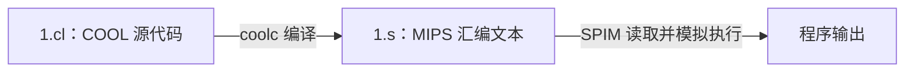

CS143 第二节课：
A complete compiler
  - Cool -> MIPS assembly language

In 5 programming assignments (PAs)
  - Write a Cool program
  - Lexical analysis
  - Parsing
  - Semantic analysis
  - Code generation

## 1. 今天的学习范围

结合 C++ 理解 COOL，先做到能读课程例子、能写小测试。词法、语法和类型规则的细节，等实现相应编译阶段时再逐项查手册。

COOL（Classroom Object-Oriented Language）是为编译器课程设计的小型语言。它保留类、继承、静态类型和自动内存管理，让学生有机会在一个学期内实现完整编译器。网上会出现大量 COOL 编译器仓库，是因为学生的课程作业就是实现它；“编译器比程序还多”可以当作调侃，没有统计支持。

## 2. 环境准备与本次排错记录

### 2.1 Ubuntu 能不能用 coolc

可以。本次环境是 WSL 中的 Ubuntu，`uname -m` 输出 `x86_64`。不需要因为老师使用 CentOS 就更换系统。

`coolc: command not found` 表示终端没有找到命令，不能据此判断系统不兼容。本次先在 `~/compiler` 下搜索，没有找到编译器，随后下载了课程工具。

以下为安装过程的记录，已完成的命令不用反复执行：

```bash
sudo apt update
sudo apt install git libc6-i386
git clone https://github.com/afterthat97/cool-compiler.git ~/compiler/cs143-tools
chmod +x ~/compiler/cs143-tools/bin/coolc
chmod +x ~/compiler/cs143-tools/bin/.i686/coolc
```

这里使用的是保存课程工具的第三方镜像。旧工具包含 32 位 x86 程序，`libc6-i386` 用于提供相应的兼容运行库。完整工具目录需要保留，不能只把外层的 `coolc` 启动脚本单独复制出来。

### 2.2 WSL 忘记密码怎么办

`sudo` 使用 Ubuntu 用户的密码；输入时不会显示字符，也不会显示星号。

若忘记密码，在 Windows PowerShell 中执行：

```powershell
wsl -d Ubuntu-24.04 -u root
```

然后在进入的 Linux 终端中重设用户密码并退出：

```bash
passwd ubuntu
exit
```

若发行版名称不同，先用 `wsl -l -q` 查看实际名称。笔记只记录操作方法，不记录密码。

### 2.3 PATH 和 .bashrc 是什么

第一次用完整路径调用成功：

```bash
~/compiler/cs143-tools/bin/coolc 1.cl
```

但直接输入 `coolc` 仍然找不到，是因为工具目录没有加入 `PATH`。`PATH` 是终端查找命令的目录列表，各目录以冒号分隔。

把下面这条配置追加到 `~/.bashrc`：

```bash
echo 'export PATH="$HOME/compiler/cs143-tools/bin:$PATH"' >> ~/.bashrc
source ~/.bashrc
```

- `$HOME` 是当前用户的主目录。
- 前面的工具目录会被优先搜索，后面的 `$PATH` 保留原来的目录。
- `export` 让子进程也能使用这个环境变量。
- `echo` 输出一段文字；单引号使其中的变量先保持为文字，等读取配置时再展开。
- `>>` 追加到文件末尾，不能随意换成会覆盖文件的 `>`。
- Bash 交互终端启动时通常会读取 `.bashrc`；`source` 让当前终端立即读取它。

追加配置通常只做一次。重复执行会添加重复行。

### 2.4 SPIM 参数报错的原因

本次工具显示版本为 SPIM 6.5。之前使用 `spim -f 1.s`，它打印 usage 后进入 `(spim)`，没有运行目标程序。这个版本要使用完整参数 `-file`：

```bash
coolc 1.cl
spim -file 1.s
```

`Ctrl+C` 表示中断执行，不等于退出 SPIM。在 `(spim)` 提示符后输入 `quit` 可以退出。

优先使用课程工具包附带的 SPIM；它配有 COOL 所需的运行时支持。官方手册也提醒，系统中其他版本的 SPIM 不一定能直接执行课程程序。

## 3. coolc 和 SPIM 各自做什么



`coolc` 检查源代码并生成 MIPS 汇编；没有编译错误不代表程序已经运行。`.s` 仍是可读的汇编文本，不是普通 Linux 可执行文件。

本机是 x86-64，不能直接执行 MIPS 指令。SPIM 模拟 MIPS 的寄存器、内存和指令执行过程。

### 为什么不直接生成本机程序

可以实现这样的 COOL 编译器。语言本身没有规定只能生成 MIPS，目标机器由编译器的实现决定。

课程选择 MIPS 和 SPIM，便于统一不同电脑的运行环境，也便于学习代码生成。MIPS 的基础寄存器和指令模型相对规整，学生可以集中理解表达式、对象和方法调用怎样转成指令。

如果要生成本机可执行文件，需要实现对应的后端，并安排调用约定、运行时支持以及汇编、链接等步骤。`g++ main.cpp -o main` 通常把多个阶段串成一次命令，不能把它理解为编译器内部没有中间步骤。

## 4. 从 C++ 过渡到 COOL

> [!note] 最需要先改过来的习惯
> COOL 中，方法体、代码块、`if` 和 `let` 都围绕“表达式产生值”来组织。方法不写 `return`，用方法体表达式的值作为返回值。

### 4.1 先读懂一个完整程序

```cool
class Main inherits IO {
    main() : Object {
        out_string("Hello, COOL!\n")
    };
};
```

预期程序输出（不含 SPIM 自身的版本信息）：

```text
Hello, COOL!
```

与下面这段 C++ 的输出效果相近：

```cpp
#include <iostream>

int main() {
    std::cout << "Hello, COOL!\n";
}
```

逐句理解 COOL：

- `class Main`：定义类。入口是 `Main` 类中定义的无参 `main()` 方法，不是全局函数。
- `inherits IO`：继承输入输出类，因而可以直接调用输出方法。
- `main() : Object`：冒号后是返回类型。入口方法不要求像 C++ 那样返回 `int`。
- `out_string(...)`：调用当前对象的方法，可以理解为省略了 `self.`。
- 方法定义结束和类定义结束都有分号。

COOL 类型名以大写字母开头，变量和方法名以小写字母开头。注释写法也不同：

```cool
-- 单行注释，类似 C++ 的 //
(* 多行注释，类似 C++ 的 /* ... */，但 COOL 的这种注释支持嵌套 *)
```

### 4.2 基本类型、声明和赋值

| 想表达的意思 | C++ | COOL |
| --- | --- | --- |
| 整数类型 | `int` | `Int` |
| 布尔类型 | `bool` | `Bool` |
| 字符串类型 | `std::string` | `String` |
| 真、假 | `true`、`false` | `true`、`false` |
| 声明并初始化 | `int x = 3;` | 属性：`x : Int <- 3;` |
| 给已有变量赋值 | `x = 5` | `x <- 5` |
| 比较是否相等 | `x == 5` | `x = 5` |

**`<-` 是赋值，`\=` 是相等比较。** 这是最容易套用 C++ 习惯而写错的地方。

类中声明的变量是属性；方法内部的局部变量用下一节的 `let` 声明，不能把属性声明直接搬进普通代码块。

未显式初始化时，`Int`、`Bool`、`String` 分别默认为 `0`、`false`、空字符串。其他对象类型默认为 `void`，它表示没有对象；COOL 没有直接书写这个空值的字面量。

### 4.3 let：声明局部变量，并限定使用范围

```cool
let x : Int <- 3, y : Int <- 4 in
    x + y
```

可以先把它读成：“在后面的表达式里，声明局部变量 x 和 y，再计算 x + y。”这整个 `let` 表达式的值是 `7`。

`in` 后面可以是一个表达式，也可以是用 `{ ... }` 组成的代码块：

```cool
let x : Int <- 3 in {
    out_int(x);
    x <- x + 1;
    out_int(x);
}
```

这里连续输出 `34`，因为 `out_int` 不会自动加空格或换行。局部变量 x 的作用范围只到这个 `let` 的主体结束。

### 4.4 方法、返回值和代码块

```cool
add(a : Int, b : Int) : Int {
    a + b
};
```

相当于 C++ 中的：

```cpp
int add(int a, int b) {
    return a + b;
}
```

方法外层的大括号只容纳一个主体表达式。要连续做几件事，就把一个代码块表达式放进去，因此会出现两层大括号：

```cool
add_and_print(a : Int, b : Int) : Int {
    {
        out_int(a + b);
        out_string("\n");
        a + b;
    }
};
```

这个片段放在继承 `IO` 的类中。内层代码块依次求值，最后一个表达式 `a + b` 的值成为代码块的值，也成为方法返回值。

分号可以这样检查：

- 代码块 `{ expr1; expr2; }` 内，每个表达式后都要有分号，包括最后一个。
- 方法 `f() : Int { expression };` 的主体表达式之后直接关闭方法大括号，最后用分号结束方法定义。
- 类定义也用 `};` 结束。

### 4.5 if 是可以产生结果的表达式

```cool
if x < 0 then
    "negative"
else
    "non-negative"
fi
```

在只选取结果这点上，类似 C++ 的：

```cpp
x < 0 ? "negative" : "non-negative"
```

COOL 的 `if` 必须写 `else`，用 `fi` 结束。条件必须是 `Bool`，不能像 C++ 那样把整数直接当条件。

### 4.6 while、算术和比较

```cool
while x < 3 loop {
    out_int(x);
    x <- x + 1;
} pool
```

这是一个循环表达式；若 x 初值为 0，会输出 `012`。`loop` 开始循环体，`pool` 结束循环。循环本身的结果是 `void`，不要用它返回一个 `Int`。

| C++ 习惯     | COOL 写法                    |
| ---------- | -------------------------- |
| `+ - * /`  | 同样使用 `+ - * /`；整数除法仍然是整数运算 |
| `< <= ==`  | `< <= =`                   |
| `x > y`    | 改写为 `y < x`                |
| `x >= y`   | 改写为 `y <= x`               |
| `x != y`   | `not (x = y)`              |
| `!flag`    | `not flag`                 |
| `-x`（一元负号） | `~x`，例如 `~5` 表示负五          |
| `++x`      | `x <- x + 1`               |

COOL 没有 C++ 的 `&&`、`||`，初学时可用嵌套 `if` 表达需要的逻辑。字符串拼接用 `concat`，不能照搬 C++ 的字符串 `+`。

### 4.7 输入输出与字符串

继承 `IO` 后，先记住四个方法：

| 方法 | 用途 |
| --- | --- |
| `out_string(s)` | 输出字符串 |
| `out_int(n)` | 输出整数 |
| `in_string()` | 读入一行字符串，结果不含末尾换行 |
| `in_int()` | 从一行输入中读取整数 |

输出方法不自动换行；需要自己输出 `"\n"`。

字符串常用方法：

```cool
"hello".length()       -- 5
"hello".concat("!")   -- "hello!"
"hello".substr(1, 3)   -- "ell"；起点从 0 计数，第二个参数是长度
```

### 4.8 对象、继承和 self

COOL 的 `self` 对应“当前对象”，作用上接近 C++ 的 `this`，但不是 C++ 指针语法。创建对象使用 `new 类名`，访问方法用点号。

下面是另一个可独立保存运行的完整程序：

```cool
class Animal {
    sound() : String { "animal" };
};

class Cat inherits Animal {
    sound() : String { "meow" };
};

class Main inherits IO {
    main() : Object {
        let a : Animal <- new Cat in {
            out_string(a.sound());
            out_string("\n");
        }
    };
};
```

预期输出 `meow`。a 的声明类型是 Animal，实际对象是 Cat，调用的是 Cat 的实现。这里接近 C++ 中通过基类指针或引用调用虚函数；COOL 普通方法调用具有动态分派行为，不需要写 `virtual`。

不要把 a 对照成 C++ 的 `Animal a = Cat{};`，后者涉及对象切片。COOL 对象变量的行为更接近对象引用。

其他初学规则：

- 只支持单继承；未写 `inherits` 时通常默认继承 `Object`，`Object` 自身除外。
- 属性通过本类及子类的方法访问，外部不能写 `a.field` 直接读属性；方法可以被外部调用。
- 没有 C++ 那套可自定义的构造函数、析构函数和 `delete`；对象内存由运行时自动管理。需要初始化参数时，课程例子常另写 `init(...)` 方法。
- `isvoid a` 检查 a 是否为空对象引用；对空对象调用方法会发生运行时错误。
- 读到 `SELF_TYPE`，先理解为与接收者类型相关的返回类型，常用于返回 `self` 的方法。读到 `case ... of ... esac`，先理解为按对象实际类型选择分支，它不是 C++ 按整数值匹配的 `switch`。两者细节等课程用到再学。

## 5. 一个综合小测试

下面把局部变量、循环、方法调用和条件表达式放在同一个程序中。保存为 `syntax_test.cl`：

```cool
class Main inherits IO {
    square(n : Int) : Int {
        n * n
    };

    main() : Object {
        let x : Int <- 0, sum : Int <- 0 in {
            while x < 5 loop {
                sum <- sum + x;
                x <- x + 1;
            } pool;

            out_string("sum = ");
            out_int(sum);
            out_string("\nsquare(5) = ");
            out_int(square(x));
            out_string("\n");

            out_string(
                if sum = 10 then "ok\n" else "wrong\n" fi
            );
        }
    };
};
```

编译并运行：

```bash
coolc syntax_test.cl
spim -file syntax_test.s
```

预期程序输出：

```text
sum = 10
square(5) = 25
ok
```

循环累加 0、1、2、3、4；结束时 x 为 5，所以 `square(x)` 得到 25。`if` 直接产生字符串，再交给输出方法。

可以做三个很小的改动来检查自己是否看懂：把循环上限改成 3；给 `square` 改名并同步改调用；把 Cat 的返回字符串换掉。每次先预测输出，再编译运行。

## 6. 学到什么程度就够了

验证记录（2026-10-24）：本笔记的三个完整 COOL 程序已在本机 WSL Ubuntu-24.04 中，使用课程工具包的 `coolc` 和 SPIM 6.5 编译、运行，输出与正文一致。其他短代码块用于解释语法，需要放入相应类和方法中，不是独立程序。

当前先能分清类型声明、赋值、比较，能读懂 `let`、`if`、`while` 和方法调用，并理解代码块最后一个表达式决定结果，就可以继续看课程。

写词法分析器时再精读标识符、字符串和注释规则；写语法分析器时再对照完整文法；写语义分析器时再深入作用域、继承、类型兼容和 `SELF_TYPE`。能猜懂适合起步，实现编译器时则必须按规则判断。

## 7. 参考资料

- [COOL 官方语言手册](https://theory.stanford.edu/~aiken/software/cooldist/handouts/cool-manual.pdf)：语法、类型与程序运行方式；入门优先读第 2—9 节。
- [COOL 项目设计论文](https://theory.stanford.edu/~aiken/publications/papers/sigplan96.pdf)：解释教学目标、MIPS/SPIM 的跨平台运行方式以及参考编译器的作用。
- [本次使用的课程工具镜像](https://github.com/afterthat97/cool-compiler)：第三方仓库，包含工具和课程作业实现；学习作业时先使用工具，不必提前阅读解答。

## 8. 后续追问：main、let 与两层大括号

### 8.1 逐行理解平方输出测试

这是对话中进一步拆解的小测试，与第 5 节的累加测试分开保存运行：

```cool
class Main inherits IO {               -- 定义入口类，继承输入输出方法
    square(n : Int) : Int {            -- 接收整数 n，返回整数
        n * n                         -- 表达式的值就是返回值，不写 return
    };                                -- 结束方法定义

    main() : Object {                 -- 无参入口方法，声明返回类型为 Object
        let x : Int <- 0 in {         -- 声明局部整数 x，初始化为 0
            while x < 3 loop {        -- 条件成立时执行循环体
                out_int(square(x));   -- 先计算平方，再输出整数
                out_string("\n");     -- 单独输出换行
                x <- x + 1;           -- 赋值，使 x 增加 1
            } pool;                   -- 结束循环体和 while 表达式
        }                             -- 结束 let 的主体代码块
    };                                -- 结束 main 方法定义
};                                    -- 结束 Main 类定义
```

保存为 `square_test.cl` 后执行：

```bash
coolc square_test.cl
spim -file square_test.s
```

预期输出：

```text
0
1
4
```

| 检查条件时的 x | `x < 3` | 本轮输出 | 自增后的 x |
| --- | --- | --- | --- |
| 0 | true | 0，再换行 | 1 |
| 1 | true | 1，再换行 | 2 |
| 2 | true | 4，再换行 | 3 |
| 3 | false | 退出循环 | — |

### 8.2 main() : Object 不是创建对象

COOL 方法的声明结构是 `方法名(参数列表) : 返回类型 { 主体表达式 };`。

因此，`main() : Object` 表示 main 没有参数，声明返回类型为 Object。冒号后面的类型描述返回值，与 `new Object` 创建对象是两回事。

Object 是 COOL 类型体系的根类型。COOL 的入口 main 不要求像 C++ 的全局 main 一样返回 int；程序运行时会创建 Main 对象并调用其 main 方法。

上面这个 main 最终返回什么，要顺着表达式向外看：

```text
while 的结果是 void（空对象引用）
    → let 主体代码块取最后一个表达式的结果，即 while 的结果
    → let 的结果取其主体结果
    → main 返回整个 let 的结果
```

这与声明返回 Object 相容。这里的 `void` 表示没有对象，不是 C++ 中表示“无返回值”的 `void` 类型；这个 while 表达式的静态类型是 Object。

### 8.3 let 的变量声明与作用范围

把 `let x : Int <- 0 in expression` 拆开读：

- `let`：声明局部变量。
- `x : Int`：变量名为 x，类型为 Int。
- `<- 0`：用 0 初始化。
- `in`：后面是使用该变量的主体表达式，x 的作用范围限于该主体。

与 C++ 在块内写 `int x = 0;` 的局部作用域有相似之处，但 COOL 的 let 还会产生值。例如 `let x : Int <- 3 in x * x` 的结果是 9。

`in` 后只需要一个表达式，所以不一定要写大括号。需要把多步操作组合起来时，再使用 `{ ... }` 代码块。

### 8.4 两层大括号不是重复的语法

只保留 main 的骨架：

```cool
main() : Object {             -- 外层：方法定义的边界
    let x : Int <- 0 in {      -- 内层：let 主体是一个代码块表达式
        while x < 3 loop
            x <- x + 1
        pool;
    }
};
```

方法外层大括号中放一个主体表达式，这里就是整个 let。let 的主体选择了一个代码块，所以又出现一层大括号；循环体也可以再用代码块组合多条操作。

原平方测试中，let 主体实际上只有一个 while，保留代码块是为了便于追加其他操作，不是 let 语法强制要求。

检查分号时，先判断自己正在结束哪个结构：

- `{ expr1; expr2; }`：块内每个表达式后都有分号。
- `while ... loop ... pool`：pool 结束循环；若整个 while 放在块内，后面再接分号。
- `f() : T { expression };`：方法主体之后关闭方法大括号，再用分号结束定义。

## 9. 后续追问：new IO、A2I 与多文件编译

### 9.1 多次 new 在 C++ 中也允许

`new IO` 每执行一次，都会创建一个新的 IO 对象。在同一个作用域中多次创建对象，C++ 和 COOL 都允许。

不能混淆的是“重复创建对象”和“重复声明同名变量”。C++ 的 `IO* a = new IO; IO* b = new IO;` 可以创建两个对象；在同一作用域中再次声明同名局部变量 a 才会产生重定义问题。C++ 还需要安排对象释放，通常交给智能指针管理；COOL 由运行时自动回收对象内存。

COOL 的 `(new IO).out_string("Hello\n")` 表示创建 IO 对象，接着调用它的方法。这里通过对象引用使用点号，不套用 C++ 中 `new` 返回指针后使用 `->` 的语法。

### 9.2 out_string 不能直接接收 IO 对象

最初口述的这一行类型不正确：

```cool
(new IO).out_string((new IO));
```

左边是方法接收者，右边是传入的参数。两次 new 创建不同对象，但 `out_string` 要求 String 参数，不能把 IO 对象直接传给它，也不会自动把对象转为字符串。

合法写法例如：

```cool
(new IO).out_string("Hello\n");
(new IO).out_string((new IO).type_name());
```

第二行通过 `type_name()` 得到字符串 `"IO"`，再输出。以上是方法体内的表达式片段，不是独立程序。

### 9.3 课程截图中的完整程序

截图中的代码整理后如下。它读入一个用字符串表示的整数，加 1，再输出：

```cool
class Main inherits A2I {
    main() : Object {
        (new IO).out_string(
            i2a(
                a2i((new IO).in_string()) + 1
            ).concat("\n")
        )
    };
};
```

按数据流理解输入 `123` 时的计算过程：

```text
内层 IO 对象的 in_string() → "123"
a2i("123")                → 整数 123
123 + 1                   → 整数 124
i2a(124)                  → 字符串 "124"
concat("\n")              → 字符串 "124\n"
外层 IO 对象的 out_string → 输出 124 并换行
```

这里创建了两个 IO 对象，分别负责输入、输出。Main 继承的是 A2I，因此能直接调用转换方法；输入输出方法则通过显式创建的 IO 对象调用。

### 9.4 A2I 在哪里

A2I 是课程提供的转换辅助类，不是 COOL 内置类。本次已在 WSL 工具目录中确认以下两个文件都包含该类：

```text
~/compiler/cs143-tools/examples/atoi.cl
~/compiler/cs143-tools/assignments/PA1/atoi.cl
```

本例选择 examples 中的文件。文件名 `atoi.cl` 和其中的类名 `A2I` 不必相同。

| 方法 | 用途 | 例子 |
| --- | --- | --- |
| `a2i(s)` | 字符串转整数 | `a2i("123")` 得到整数 123 |
| `i2a(n)` | 整数转字符串 | `i2a(124)` 得到字符串 `"124"` |

### 9.5 与 A2I 一起编译运行

把第 9.3 节的完整程序保存到 `~/compiler/cool/1.cl`，然后在 Ubuntu 终端执行：

```bash
cd ~/compiler/cool
coolc 1.cl ~/compiler/cs143-tools/examples/atoi.cl
spim -file 1.s
```

运行后输入 `123` 并按回车，程序输出 `124`。

`inherits A2I` 只声明继承关系，不会自动搜索并加载类定义。编译命令同时传入两个源文件，才把 Main 和 A2I 的定义一起交给编译器：

```text
1.cl：定义 Main 类
atoi.cl：定义 A2I 类
    → coolc 一起编译
    → 1.s
    → SPIM 执行
```

不需要像 C++ 那样写 `#include`，也不需要复制 A2I 的代码。默认输出名取第一个输入源文件的名字，所以把 `1.cl` 放在前面会生成 `1.s`。两个 atoi.cl 选择一个即可，不要把包含同名类的两个文件同时交给编译器。

验证记录（2026-10-24）：本次新增的两个完整程序均已使用本机 WSL 课程工具编译并运行。第 8.1 节平方测试输出 0、1、4，各占一行；A2I 程序输入 123，输出 124。结果与正文一致。

## 10. 课程最后的链表示例：保存不同类型的对象

最初的链表把 `item` 声明为 String，只能保存字符串。最终版本把它改成 Object，并通过 case 根据对象实际类型转换为字符串。List 继承 A2I，以便调用整数转字符串的方法 i2a。

```cool
class List inherits A2I {
    item : Object;
    next : List;

    init(i : Object, n : List) : List {
        {
            item <- i;
            next <- n;
            self;
        }
    };

    flatten() : String {
        let string : String <-
            case item of
                i : Int => i2a(i);
                s : String => s;
                o : Object => { abort(); ""; };
            esac
        in
            if isvoid next then
                string
            else
                string.concat(next.flatten())
            fi
    };
};
```

### 10.1 各部分怎样配合

- `item : Object`：允许节点保存 Int、String 等不同类型的对象；`next : List` 引用下一个节点。
- `init(i, n)`：设置节点内容与后继节点，最后返回 self，因而可以写 `(new List).init(...)`。init 是普通方法，不是语言内置构造函数。
- `let string : String <- case ... esac in ...`：先由 case 产生一个字符串，用它初始化局部变量 string，再执行 in 后面的表达式。
- `i : Int => i2a(i)`：实际对象是整数时，把它绑定到分支变量 i，并转换为字符串。
- `s : String => s`：实际对象是字符串时直接返回；Int 和 String 都继承 Object，case 会选择最接近对象实际类型的匹配分支，并非简单按书写顺序选第一个匹配项。
- `o : Object => { abort(); ""; }`：其他非空对象进入兜底分支并终止执行。空引用不会匹配这个分支，case 的被检查值为空时会发生运行时错误。空字符串表达式用于让该块在静态类型检查中具有 String 类型，正常执行不会走到它。
- `isvoid next`：检查链表是否到末尾；到末尾返回当前字符串，否则递归处理后续节点并用 concat 拼接。

flatten 的返回值沿递归调用向外拼接。例如节点内容依次为 `"count = "`、整数 `3`、换行字符串，最终结果就是 `"count = 3\n"`。

### 10.2 配套的完整运行入口

上面的 List 只有类定义。把下面的 Main 接在同一个文件里，保存为 `list.cl`：

```cool
class Main inherits IO {
    main() : Object {
        let nil : List,
            list : List <-
                (new List).init("count = ",
                    (new List).init(3,
                        (new List).init("\n", nil)))
        in
            out_string(list.flatten())
    };
};
```

这里的 nil 是未显式初始化的 List 引用，默认值为空，用于标记链尾。字符串和整数交替出现在链表中，用来检查两个 case 分支都能工作。

```bash
coolc list.cl ~/compiler/cs143-tools/examples/atoi.cl
spim -file list.s
```

预期程序输出：

```text
count = 3
```

## 11. 前三节课学习总结

本次验证（2026-10-24）：第 10 节的 List 与 Main 合并后，已在本机 WSL 中与 atoi.cl 一起编译，并通过 SPIM 运行，实际输出为 `count = 3`。

前三节课主要认识了 COOL 的基本语法，并用参考编译器编译、运行小程序，为后续亲自实现编译器做准备。目前重点是读懂课程示例、写出测试程序，并能说清程序应有的行为，不必把练习 COOL 本身当作长期目标。

### 11.1 已接触的语言功能

从最初的输入输出、字符串转整数并加 1，到阶乘循环、字符串链表，最后到保存不同类型对象的链表，例子逐步引入了这些内容：

| 内容 | 当前要理解的规则 |
| --- | --- |
| 类与继承 | class、inherits、属性、方法和 Main.main 入口 |
| 声明与赋值 | `名字 : 类型`；`<-` 赋值，`=` 比较相等 |
| 局部变量与作用域 | let 声明变量，in 后是变量的使用范围 |
| 表达式与返回值 | 方法主体产生返回值；代码块取最后一个表达式的值 |
| 控制流 | if/then/else/fi、while/loop/pool |
| 对象操作 | new 创建对象，self 表示当前对象，点号调用方法 |
| 空引用与递归 | isvoid 检查链尾，next.flatten() 递归处理后续节点 |
| 类型选择 | Object 可以引用不同类型对象；case 按实际类型选择分支 |
| 工具与辅助类 | coolc 生成 MIPS 汇编；SPIM 执行；A2I 提供转换方法 |

### 11.2 这些语法为什么是编译器实现的前置知识

后续写编译器时，同一段代码会从不同角度被处理：

| 编译阶段 | 结合本次例子理解要做什么 |
| --- | --- |
| 词法分析 | 识别 class、let、标识符、整数、字符串、`<-` 等词法单元 |
| 语法分析 | 判断这些词法单元能否组成类、方法、循环和 case，并建立语法树 |
| 语义分析 | 检查变量是否在作用域内、方法参数是否匹配、返回值与声明类型是否相容 |
| 代码生成 | 把表达式求值、分支、循环、对象创建和方法调用转成目标指令 |

例如 `(new IO).out_string(new IO)` 可以具有方法调用的语法形状，但实参 IO 与要求的 String 不匹配，属于类型检查要发现的问题；`next.flatten()` 则需要编译器处理接收者、方法调用和返回值。

理解 COOL 的规则，才能给自己写的编译器准备测试：哪些程序应该被接受，哪些应该报错，接受后的程序又应输出什么。参考编译器 coolc 可以用来对照行为。

### 11.3 当前的掌握边界

能够读懂加一、阶乘和链表例子，解释 let 的作用域、块的结果值和 case 的分支选择，并能修改输入、循环条件或节点内容验证输出，就具备继续学习的基础。

不要求现在背完语言手册或熟练写大型 COOL 程序。实现词法、语法、语义与代码生成阶段时，再精读对应规则；遇到不确定行为应查手册或用参考编译器验证，不能只凭 C++ 经验推断。
