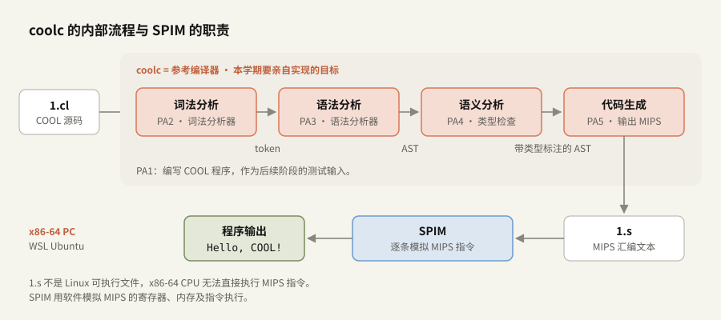
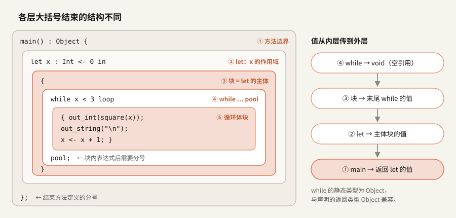
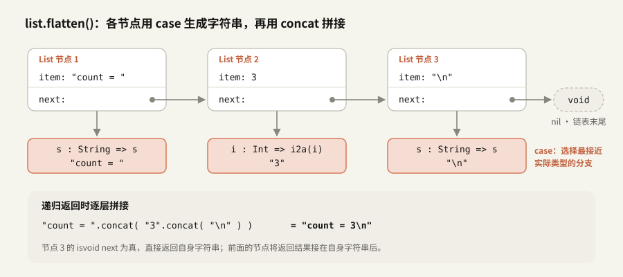
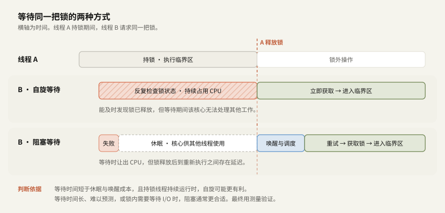

# 10 月 24 日学习记录

今天学习了斯坦福 CS143 第 2 讲（构建完整的编译器），对照 C++ 熟悉 COOL 语言，并解决了在 WSL Ubuntu 中安装课程工具（`coolc`、SPIM）时遇到的问题。还完成了三道 LeetCode 题，整理了 C++ 面试中选择自旋锁与互斥锁的依据。

> [!info] 阅读说明
> - 正文整理自最初的学习记录。`> [!warning] 纠正` 标出理解有误的地方，`> [!note] 补充` 说明原记录遗漏的内容。
> - 原文记录：COOL 程序在 WSL Ubuntu 24.04（x86-64）中使用课程工具 `coolc` 和 SPIM 6.5 编译运行，结果汇总在 §9.1。
> - 原文记录：C++ 解法（§10）和自旋锁示例（§11.10）使用 g++ 13.3（`-std=c++20 -Wall`）编译，并通过示例输入验证。
> - 若只想查看纠正内容，可直接看 §12 的汇总表。

## 0. 今日学习内容

| 主题 | 内容 | 位置 |
|---|---|---|
| CS143 第 2 讲 | 五个作业阶段、`coolc` 与 SPIM 的职责 | §1、§3 |
| 环境配置 | 运行 32 位课程工具、`PATH` 与 `.bashrc` | §2 |
| COOL 语法 | 对照 C++：类型、`let`、块、`if`、`while`、对象、`case` | §4–§8 |
| 学习总结 | 前三讲掌握的功能、进入下一阶段的标准、复习题 | §9 |
| 算法 | LeetCode 1、49、128 | §10 |
| C++ 面试 | 选择自旋锁与互斥锁的依据 | §11 |

---

## 1. CS143 第 2 讲：构建完整的编译器

这门课的目标是亲自实现一个将 COOL 源代码转换为 MIPS 汇编的编译器。编程作业（PA）分为五个阶段。

| 作业 | 内容 | 产出 |
|---|---|---|
| PA1 | 编写 COOL 程序 | 熟悉语言，并准备后续阶段使用的测试输入 |
| PA2 | 词法分析 | 将字符序列转换为 token 序列的词法分析器 |
| PA3 | 语法分析 | 根据 token 序列构建 AST 的语法分析器 |
| PA4 | 语义分析 | 检查作用域和类型，并为 AST 标注类型 |
| PA5 | 代码生成 | 根据 AST 输出 MIPS 汇编 |



> [!note] 补充：各阶段可以单独替换
> 课程工具的各阶段彼此分离，尚未实现的阶段可以用参考实现代替。例如，在 PA3 中，可以将自己写的语法分析器接在参考词法分析器后面测试。用 `ls ~/compiler/cs143-tools/bin` 可以查看已安装的工具；打开各 PA 目录中的脚本，可以看到这些阶段如何连接。

### 1.1 今天的学习范围

今天主要对照 C++ 熟悉 COOL，能够阅读课程示例并编写小型测试程序即可。词法、语法和类型规则的细节，等实现对应阶段时再查阅手册。

COOL（Classroom Object-Oriented Language）是为编译器课程设计的小型语言，支持类、继承、静态类型和自动内存管理。它有意限制了语言规模，使学生能在一个学期内实现完整的编译器。

网上有很多 COOL 编译器仓库，是因为实现编译器本身就是课程作业。课上说“COOL 的编译器比用它写的程序还多”，可以当作一句玩笑，没有统计数据支持这个说法。

---

## 2. 环境配置与排错记录

### 2.1 Ubuntu 也能使用 coolc 吗

可以。本次环境是 WSL 中的 Ubuntu，`uname -m` 输出 `x86_64`。老师使用 CentOS，并不意味着自己也需要更换操作系统。

`coolc: command not found` 只表示 shell 没有找到这个命令，不能据此判断操作系统不兼容。这次是因为 `~/compiler` 中根本没有编译器，所以需要另外准备课程工具。

将课程工具放到 `~/compiler/cs143-tools` 后，安装兼容库并添加执行权限。

```bash
sudo apt update
sudo apt install libc6-i386
chmod +x ~/compiler/cs143-tools/bin/coolc
chmod +x ~/compiler/cs143-tools/bin/.i686/coolc
```

旧版工具中包含 32 位 x86 程序。64 位 Ubuntu 默认没有 32 位 C 库，因此需要安装提供该库的 `libc6-i386`。

工具目录的结构必须完整保留。外层的 `bin/coolc` 并非实际程序，而是查找并运行对应架构下 `bin/.i686/coolc` 的脚本，因此只复制外层脚本无法正常运行。

> [!tip] 如果再次遇到没有执行权限的错误
> `spim` 等工具也采用相同结构。如果出现 `Permission denied`，用 `ls -l` 检查外层脚本和 `.i686` 内的实际程序是否都有执行权限。

### 2.2 PATH 与 .bashrc

最初使用完整路径时，成功运行了程序。

```bash
~/compiler/cs143-tools/bin/coolc 1.cl
```

但只输入 `coolc` 仍然提示找不到命令，因为工具目录没有加入 `PATH`。

`PATH` 是 shell 查找命令时依次搜索的目录列表，各路径用冒号（`:`）分隔。将下面的配置追加到 `~/.bashrc` 末尾。

```bash
echo 'export PATH="$HOME/compiler/cs143-tools/bin:$PATH"' >> ~/.bashrc
source ~/.bashrc
```

- `$HOME` 是当前用户的主目录。
- 工具目录放在最前面，因此会优先搜索。后面的 `$PATH` 保留已有的搜索路径。
- `export` 将变量导出为环境变量，使子进程也能读取。`PATH` 通常已经是环境变量，这里仍按惯例写上。
- `echo` 输出字符串。单引号中的变量不会展开，因此写入文件的是字面上的 `$HOME` 和 `$PATH`；等 shell 读取 `.bashrc` 时才会展开。
- `>>` 将内容追加到文件末尾。如果误写成覆盖文件的 `>`，原有 `.bashrc` 内容就会丢失。
- 交互式非登录 Bash shell 启动时会读取 `.bashrc`。新开终端后配置会自动生效，`source` 则让配置立即应用到当前 shell。

配置只需添加一次。重复执行同一条命令，会在 `.bashrc` 中产生重复行。

> [!note] 补充：避免重复添加，并检查命令来源
> ```bash
> # 仅在不存在相同行时追加
> line='export PATH="$HOME/compiler/cs143-tools/bin:$PATH"'
> grep -qxF "$line" ~/.bashrc || echo "$line" >> ~/.bashrc
> source ~/.bashrc
>
> # 检查 shell 实际找到的是哪个 coolc
> type -a coolc
> echo "$PATH" | tr ':' '\n' | head -3
> ```
> 同名命令存在于多个位置时，`type -a` 会按搜索顺序列出它们。

---

## 3. coolc 与 SPIM 的职责

```text
1.cl：COOL 源代码
    → 使用 coolc 编译
1.s：MIPS 汇编文本
    → SPIM 读取并模拟执行
程序输出
```

`coolc` 只检查源代码并生成 MIPS 汇编，不执行程序。编译没有报错，不代表程序已经运行成功。`.s` 文件是人类可读的汇编文本，不是 Linux 可执行文件（ELF）。

当前电脑使用 x86-64，无法直接执行 MIPS 指令。SPIM 用软件模拟 MIPS 的寄存器、内存和指令执行过程（见 §1 图的下半部分）。

> [!warning] 纠正：屏幕上不只有程序输出
> 使用 SPIM 运行时，程序输出之前会显示 SPIM 的版本、版权信息及 `Loaded: .../trap.handler`。`main` 正常结束后，COOL 运行时（trap.handler）还会输出 `COOL program successfully executed`。本笔记中的“预期输出”只包含程序自身输出的内容，省略了前后的提示行。以后将自己编译器生成的程序与 `coolc` 的结果对比时，两者也会带上这些提示，因此比较程序输出部分即可。

### 3.1 能否直接生成在当前电脑上运行的程序

可以实现这样的 COOL 编译器。COOL 语言并未规定必须以 MIPS 为目标架构，目标架构由编译器实现决定。

这门课选择 MIPS 和 SPIM，有两个原因。

- **统一运行环境**：学生的电脑即使不同，只要有 SPIM，就能在相同的模拟环境中运行。
- **目标架构易于学习**：MIPS 的寄存器和指令格式较为规整，便于集中理解表达式、对象和方法调用如何转换为指令。

如果想生成能在 x86-64 上直接运行的文件，需要实现 x86-64 后端，还要处理调用约定、运行时支持（内存分配、垃圾回收、内置类），并准备汇编和链接流程。

同样，`g++ main.cpp -o main` 也是用一条命令串起预处理、编译、汇编和链接（见 10 月 23 日笔记 §1）。命令只有一条，不代表内部只有一个阶段。

---

## 4. 对照 C++ 学习 COOL

COOL 中的方法体、块、`if` 和 `let` 都是**产生值的表达式**，这是它与 C++ 的一个主要区别。因此，COOL 没有 `return`，方法体表达式的值就是返回值。

### 4.1 从完整程序开始阅读

```cool
class Main inherits IO {
    main() : Object {
        out_string("Hello, COOL!\n")
    };
};
```

预期输出（省略 §3“纠正”中说明的 SPIM 提示行）：

```text
Hello, COOL!
```

输出结果与下面的 C++ 程序相同。

```cpp
#include <iostream>

int main() {
    std::cout << "Hello, COOL!\n";
}
```

各部分的含义如下。

- `class Main`：定义类。入口不是全局函数，而是在 `Main` 类中定义的不带参数的 `main()` 方法。
- `inherits IO`：继承输入输出类 `IO`，因此可以直接调用输出方法。
- `main() : Object`：返回类型写在冒号后，不必像 C++ 一样返回 `int`。
- `out_string(...)`：调用当前对象的方法，相当于省略了 `self.` 的 `self.out_string(...)`。
- 方法定义和类定义都以分号结束。

COOL 的类型名以大写字母开头，变量名和方法名以小写字母开头。注释语法也与 C++ 不同。

```cool
-- 单行注释：类似 C++ 的 //。
(* 多行注释：类似 C++ 的 /* ... */，但支持嵌套。 *)
```

> [!note] 补充：关键字不区分大小写
> `class`、`CLASS` 和 `Class` 是同一个关键字。例外是 `true` 和 `false`：首字母必须小写（`tRUE` 表示真，而 `True` 会被识别为类型名）。目前不必这样写，但在 PA2 实现词法分析器时，需要准确实现这条规则。

### 4.2 基本类型、声明与赋值

| 含义 | C++ | COOL |
| --- | --- | --- |
| 整数类型 | `int` | `Int` |
| 布尔类型 | `bool` | `Bool` |
| 字符串类型 | `std::string` | `String` |
| 真与假 | `true`, `false` | `true`, `false` |
| 声明并初始化 | `int x = 3;` | 属性声明：`x : Int <- 3;` |
| 给已有变量赋值 | `x = 5` | `x <- 5` |
| 判断是否相等 | `x == 5` | `x = 5` |

`<-` 表示赋值，`=` 表示相等比较，这是最容易受 C++ 习惯影响而混淆的地方。赋值也是表达式，其值就是赋进去的值。

类中声明的变量称为**属性**（attribute，对应 C++ 的成员变量）。方法中的局部变量用 `let` 声明，不能直接在块中使用属性声明的语法。

未显式初始化时，`Int` 的默认值是 `0`，`Bool` 是 `false`，`String` 是空字符串。其他对象类型的默认值是表示没有对象的 `void`。COOL 没有类似 C++ `nullptr`、可以直接写出的 `void` 字面量。

> [!note] 补充：`=` 比较什么
> - `Int`、`Bool`、`String` 比较的是**值**。`"ab" = "ab"` 的结果是 `true`。
> - 其他对象比较的是**是否为同一个对象**（引用是否相同）。即使内容相同，用 `new` 分别创建的两个对象也不相等。
> - 如果一侧是 `Int`、`Bool` 或 `String`，另一侧也必须是相同类型。`3 = "3"` 会产生类型错误。

### 4.3 let：声明局部变量并限定作用域

```cool
let x : Int <- 3, y : Int <- 4 in
    x + y
```

可以读作：“声明供后面的表达式使用的局部变量 x 和 y，然后计算 `x + y`。”整个 `let` 表达式的值为 `7`。

`in` 后面跟一个表达式。需要执行多个操作时，用 `{ ... }` 块将它们组合起来。

```cool
let x : Int <- 3 in {
    out_int(x);
    x <- x + 1;
    out_int(x);
}
```

`out_int` 不会添加空格或换行，因此输出为 `34`。局部变量 x 只在这个 `let` 的主体内有效。

> [!note] 补充：多个变量按声明顺序依次可见
> `let a : T1 <- e1, b : T2 <- e2 in body` 等价于 `let a : T1 <- e1 in let b : T2 <- e2 in body`。因此，后面变量的初始化表达式可以使用前面声明的变量。§8.2 中先声明 `nil`，紧接着就在 `list` 的初始化表达式中使用它，依据的就是这条规则。
>
> `let` 的主体会**尽可能向右延伸**。`let x : Int <- 1 in x + 2` 应读作 `let x ... in (x + 2)`，而不是 `(let x ... in x) + 2`。

### 4.4 方法、返回值与块

```cool
add(a : Int, b : Int) : Int {
    a + b
};
```

用 C++ 表达如下。

```cpp
int add(int a, int b) {
    return a + b;
}
```

方法最外层大括号中只能放**一个**主体表达式。需要依次执行多个操作时，就把一个块表达式放在这里，因此会出现两层大括号。

```cool
add_and_print(a : Int, b : Int) : Int {
    {
        out_int(a + b);
        out_string("\n");
        a + b;
    }
};
```

这个方法放在继承 `IO` 的类中。内层块依次求值，最后一个表达式 `a + b` 的值既是块的值，也是方法的返回值。

可以按下面的规则检查分号。

- 块 `{ expr1; expr2; }` 中，每个表达式后都要写分号，包括最后一个表达式。
- 方法 `f() : Int { expression };` 中，在主体表达式后关闭方法的大括号，再用分号结束定义。如果主体是单个表达式而不是块，表达式后不加分号。
- 类定义也以 `};` 结束。

### 4.5 if 也是产生值的表达式

```cool
if x < 0 then
    "negative"
else
    "non-negative"
fi
```

它在两个值之间选择一个，这一点类似 C++ 的条件运算符。

```cpp
x < 0 ? "negative" : "non-negative"
```

COOL 的 `if` 必须有 `else`，并以 `fi` 结束。条件必须为 `Bool` 类型，不能像 C++ 一样使用整数作为条件。

> [!note] 补充：整个 if 的类型
> `if` 的静态类型是两个分支类型的**最近公共祖先**。两个分支都是 `String` 时，结果类型为 `String`；像 `if c then 1 else "a" fi` 这样混合 `Int` 和 `String` 时，结果类型为 `Object`。此时若将结果赋给 `String` 变量，就会产生类型错误。§8.1 的 `case` 也遵循同样的规则。

### 4.6 while、算术运算与比较

```cool
while x < 3 loop {
    out_int(x);
    x <- x + 1;
} pool
```

如果 x 的初始值为 0，就会输出 `012`。`loop` 表示循环体开始，`pool` 表示循环结束（它是 `loop` 的倒写，`if`/`fi`、`case`/`esac` 也采用同样方式）。

循环表达式本身的值为 `void`，静态类型为 `Object`。因此，将它作为返回类型为 `Int` 的方法的返回值，会产生类型错误。

| C++ 写法    | COOL 写法                 |
| --------- | ----------------------- |
| `+ - * /` | 同样使用 `+ - * /`，整数除法只保留商 |
| `< <= ==` | `< <= =`                |
| `x > y`   | `y < x`                 |
| `x >= y`  | `y <= x`                |
| `x != y`  | `not (x = y)`           |
| `!flag`   | `not flag`              |
| `-x`      | `~x`，例如 `~5` 表示 -5      |
| `++x`     | `x <- x + 1`            |

COOL 没有 C++ 的 `&&` 和 `||`，目前可以用嵌套 `if` 表达所需逻辑。拼接字符串使用 `concat`，不能像 C++ 的 `std::string` 一样使用 `+`。

> [!note] 补充：没有负整数字面量
> COOL 没有一元 `-`，因此 `-5` 是语法错误，负五要写成 `~5`。二元减法仍然可以写成 `x - 5`。`not` 的优先级低于比较运算符，因此 `not x = y` 会按 `not (x = y)` 解析，不过加上括号更容易阅读。除以 0 会产生运行时错误。

### 4.7 输入输出与字符串

继承 `IO` 后，先熟悉下面四个方法。

| 方法 | 功能 |
| --- | --- |
| `out_string(s)` | 输出字符串 |
| `out_int(n)` | 输出整数 |
| `in_string()` | 读取一行字符串，结果不包含末尾的换行符 |
| `in_int()` | 从一行输入中读取整数，丢弃整数后面的其余内容 |

输出方法不会自动添加换行。需要换行时，显式输出 `"\n"`。

> [!note] 补充：输出方法返回 self
> `out_string` 和 `out_int` 的返回类型为 `SELF_TYPE`，实际返回调用它们的对象本身。因此，可以像 C++ 的 `std::cout << a << b` 一样连续调用。
> ```cool
> out_string("sum = ").out_int(10).out_string("\n")
> ```

常用的字符串方法如下。

```cool
"hello".length()       -- 5
"hello".concat("!")    -- "hello!"
"hello".substr(1, 3)   -- "ell"：起始下标从 0 开始，第二个参数是长度
```

如果 `substr` 的范围超过字符串长度，会产生运行时错误。

### 4.8 对象、继承与 self

COOL 的 `self` 指向当前对象，作用类似 C++ 的 `this`，但不使用指针语法（`this->`）。

使用 `new 类名` 创建对象，用点（`.`）调用方法。下面是可以直接保存并运行的完整程序。

```cool
class Animal {
    sound() : String { "animal" };
};

class Cat inherits Animal {
    sound() : String { "meow" };
};

class Main inherits IO {
    main() : Object {
        let a : Animal <- new Cat in {
            out_string(a.sound());
            out_string("\n");
        }
    };
};
```

预期输出为 `meow`。虽然 a 的声明类型是 `Animal`，但实际对象是 `Cat`，因此调用的是 `Cat` 的方法。

这与 C++ 通过基类指针或引用调用虚函数的行为类似。COOL 的普通方法调用始终采用动态分派，因此不需要另外写 `virtual`。

不能把这里的 a 对应为 C++ 的 `Animal a = Cat{};`。这段 C++ 代码会发生对象切片，`Cat` 部分被截掉，调用的是 `Animal` 的函数。可以将 COOL 对象变量理解为 C++ 的 `Animal&` 或 `Animal*`：它们**引用**对象。

入门时还需要了解以下规则。

- 只支持单继承。除 `Object` 本身外，省略 `inherits` 的类默认继承 `Object`。
- 属性只能在本类及子类的方法中使用，外部不能用 `a.field` 直接读取属性，但可以调用方法。类比 C++，相当于属性都是 `protected`，方法都是 `public`。
- 没有 C++ 那样由用户定义的构造函数、析构函数和 `delete`，对象内存由运行时自动回收。如果初始化需要参数，可以像课程示例一样定义普通方法 `init(...)`。
- `isvoid a` 检查 a 是否为空引用。通过空引用调用方法会产生运行时错误。
- 可以先把 `SELF_TYPE` 理解为表示“调用这个方法的对象的类型”的返回类型，常用于返回 `self` 的方法。
- `case ... of ... esac` 根据对象的**实际类型**选择分支，与 C++ 中比较整数值的 `switch` 不同（§8.1）。

> [!note] 补充：替代构造函数的方式及其他规则
> - **属性初始化表达式**：如 `count : Int <- 10;`，附在属性上的初始化表达式会在 `new` 创建对象时执行，起到类似无参构造函数的作用。
> - **不能继承的类**：不能继承 `Int`、`Bool` 和 `String`，可以继承 `IO` 与 `Object`。
> - **静态分派**：写成 `a@Animal.sound()` 时，无论实际类型是什么，都调用 `Animal` 中的方法，类似 C++ 的 `a.Animal::sound()`。

---

## 5. 综合测试

在同一个程序中使用局部变量、循环、方法调用和条件表达式。将以下内容保存为 `syntax_test.cl`。

```cool
class Main inherits IO {
    square(n : Int) : Int {
        n * n
    };

    main() : Object {
        let x : Int <- 0, sum : Int <- 0 in {
            while x < 5 loop {
                sum <- sum + x;
                x <- x + 1;
            } pool;

            out_string("sum = ");
            out_int(sum);
            out_string("\nsquare(5) = ");
            out_int(square(x));
            out_string("\n");

            out_string(
                if sum = 10 then "ok\n" else "wrong\n" fi
            );
        }
    };
};
```

编译并运行。

```bash
coolc syntax_test.cl
spim -file syntax_test.s
```

预期输出：

```text
sum = 10
square(5) = 25
ok
```

循环累加 0、1、2、3、4。循环结束时 x 为 5，因此 `square(x)` 为 25。`if` 产生一个字符串值，再将它作为参数传给输出方法。

可以逐步修改程序来检查理解。每次都**先预测输出，再编译运行**。

- 将循环上限改为 3。（预期：`sum = 3`、`square(5) = 9`、`wrong`。输出字符串中的“square(5)”保持原样，只有 x 变为 3。）
- 修改 `square` 的名称，同时修改调用处。也可以只改一处，观察会出现什么错误。
- 修改 §4.8 中 `Cat` 返回的字符串。

---

## 6. 补充整理：main、let 与两层大括号

### 6.1 逐行阅读平方输出测试

将下面的测试保存为与 §5 不同的文件后运行。

```cool
class Main inherits IO {               -- 定义入口类，并继承输入输出方法。
    square(n : Int) : Int {            -- 接收整数 n，返回整数。
        n * n                         -- 表达式的值就是返回值，因此不写 return。
    };                                -- 结束方法定义。

    main() : Object {                 -- 无参数的入口方法，返回类型为 Object。
        let x : Int <- 0 in {         -- 声明局部整数 x，并初始化为 0。
            while x < 3 loop {        -- 条件为真时执行循环体。
                out_int(square(x));   -- 计算平方并输出整数。
                out_string("\n");     -- 输出换行符。
                x <- x + 1;           -- 将 x 增加 1。
            } pool;                   -- 结束循环体和 while 表达式。
        }                             -- 结束 let 主体中的块。
    };                                -- 结束 main 方法定义。
};                                    -- 结束 Main 类定义。
```

保存为 `square_test.cl` 后运行。

```bash
coolc square_test.cl
spim -file square_test.s
```

预期输出：

```text
0
1
4
```

| 检查条件时的 x | `x < 3` | 本轮输出 | 增加后的 x |
| --- | --- | --- | --- |
| 0 | true | 0 和换行符 | 1 |
| 1 | true | 1 和换行符 | 2 |
| 2 | true | 4 和换行符 | 3 |
| 3 | false | 循环结束 | 不适用 |

### 6.2 main() : Object 的含义

COOL 方法声明的结构如下。

```text
方法名(参数列表) : 返回类型 { 主体表达式 };
```

因此，`main() : Object` 表示没有参数，声明的返回类型为 `Object`，与创建对象的 `new Object` 无关。

`Object` 是 COOL 类型层次的根。所有值的类型都符合 `Object` 类型，因此把返回类型声明为 `Object`，就可以接收主体产生的各种值。程序运行时，运行时系统会创建 `Main` 对象并调用 `main` 方法，相当于执行 `(new Main).main()`。它不需要像 C++ 的 `main` 一样返回退出码，因此不必返回 `int`。

从内向外追踪表达式，就能看出上面 `main` 的返回值。

```text
while 的结果是 void，即空对象引用。
    → let 主体中的块以最后一个表达式 while 的结果作为自己的值。
    → let 以主体的结果作为自己的值。
    → main 返回整个 let 的结果。
```

这个 while 表达式的静态类型为 `Object`，因此与返回类型 `Object` 兼容。

这里的 `void` 是表示“没有对象”的值，不要与 C++ 中表示没有返回值的 `void` **类型**混淆。

### 6.3 let 的变量声明与作用域

可以将 `let x : Int <- 0 in expression` 拆开理解。

- `let`：声明局部变量。
- `x : Int`：变量名是 x，类型为 `Int`。
- `<- 0`：初始化为 0。
- `in`：后面是主体表达式，x 的作用域仅限于这个主体。

它与 C++ 块中的 `int x = 0;` 都能建立局部作用域，但 COOL 的 `let` 本身还会产生值。例如，`let x : Int <- 3 in x * x` 的值为 9。

`in` 后只需要一个表达式，所以大括号不是必需的。需要组合多个操作时，才使用 `{ ... }` 块。

### 6.4 为什么会有两层大括号



只保留 `main` 的结构，如下所示。

```cool
main() : Object {             -- 外层：方法定义的边界
    let x : Int <- 0 in {     -- 内层：作为 let 主体的块表达式
        while x < 3 loop
            x <- x + 1
        pool;
    }
};
```

方法最外层大括号中放一个主体表达式，这里就是整个 `let`。由于 `let` 的主体采用块表达式，所以多了一层大括号。循环体中需要组合多个操作时，也使用块。

§6.1 的 `let` 主体实际上只有一个 `while`。保留块是为了方便以后增加其他操作，并非 `let` 语法的要求。

检查分号时，要分清它结束的是哪种结构。

- `{ expr1; expr2; }`：块中的每个表达式后都有分号。
- `while ... loop ... pool`：`pool` 结束循环。如果整个 `while` 位于块内，就在后面加分号。
- `f() : T { expression };`：主体表达式后关闭方法的大括号，再用分号结束定义。

---

## 7. 补充整理：new IO、A2I 与多文件编译

### 7.1 C++ 也可以多次使用 new

`new IO` 每执行一次就创建一个新的 IO 对象。在同一个作用域中创建多个对象，在 C++ 和 COOL 中都合法。

多次**创建对象**与**重复声明同名变量**是两件事。下面的 C++ 代码创建了两个对象。（这里的 `IO` 是用于说明的假想类。）

```cpp
IO* a = new IO;
IO* b = new IO;
```

如果在同一个作用域中再次声明局部变量 a，就会产生重定义错误。

C++ 中用 `new` 创建的对象需要主动释放，因此通常使用 `std::unique_ptr` 等智能指针。COOL 则由运行时自动回收对象内存。

COOL 的 `(new IO).out_string("Hello\n")` 先创建 IO 对象，再调用它的方法。对象引用使用点号，不使用 C++ 指针的 `->`。

### 7.2 不能将 IO 对象直接传给 out_string

下面的代码存在参数类型不匹配的问题。

```cool
(new IO).out_string((new IO));
```

左边的对象是接收方法调用的**接收者对象**，括号内的对象是**参数**。两个 `new` 创建了不同对象，但 `out_string` 要求参数类型为 `String`，不能传入 IO 对象，对象也不会自动转换为字符串。这个错误会在语义分析（类型检查）阶段被发现（§9.2）。

可以改成下面的写法。

```cool
(new IO).out_string("Hello\n");
(new IO).out_string((new IO).type_name());
```

第二行通过 `Object` 的 `type_name()` 方法取得字符串 `"IO"` 并输出。上面的代码是放在方法体中的表达式片段，本身不是完整程序。

### 7.3 将字符串形式输入的整数加 1

下面的程序读取字符串形式的整数，加 1 后输出。

```cool
class Main inherits A2I {
    main() : Object {
        (new IO).out_string(
            i2a(
                a2i((new IO).in_string()) + 1
            ).concat("\n")
        )
    };
};
```

输入 `123` 时，数据按以下顺序流动。

```text
内层 IO 对象的 in_string() → "123"
a2i("123")                → 整数 123
123 + 1                   → 整数 124
i2a(124)                  → 字符串 "124"
concat("\n")              → 字符串 "124\n"
外层 IO 的 out_string()   → 输出 124 和换行符
```

这里创建了两个 IO 对象，一个用于输入，一个用于输出。

`Main` 继承的是 `A2I`，因此可以直接调用转换方法；它没有继承 `IO`，所以需要通过显式创建的 IO 对象调用输入输出方法。COOL 只支持单继承，不能同时继承 `A2I` 和 `IO`。

### 7.4 A2I 在哪里

`A2I` 是课程提供的转换辅助类，不是 COOL 内置类。在本次学习环境中，以下两个文件都包含它。

```text
~/compiler/cs143-tools/examples/atoi.cl
~/compiler/cs143-tools/assignments/PA1/atoi.cl
```

本例使用 `examples` 中的文件。文件名（`atoi.cl`）不必与类名（`A2I`）相同。与 C++ 不同，COOL 不以文件为模块，而是将**输入的所有类视为一个程序**。

| 方法 | 功能 | 示例 |
| --- | --- | --- |
| `a2i(s)` | 将字符串转换为整数 | `a2i("123")` 的结果是整数 123 |
| `i2a(n)` | 将整数转换为字符串 | `i2a(124)` 的结果是字符串 `"124"` |

### 7.5 与 A2I 一起编译运行

将前面的程序保存为 `~/compiler/cool/1.cl`，在 Ubuntu 终端中执行。

```bash
cd ~/compiler/cool
coolc 1.cl ~/compiler/cs143-tools/examples/atoi.cl
spim -file 1.s
```

运行后输入 `123` 并按 Enter，会输出 `124`。

`inherits A2I` 只声明继承关系，不会自动查找并加载类定义。必须把两个源文件一起传给编译命令，编译器才能同时获得 `Main` 和 `A2I` 的定义。如果只传入 `1.cl`，语义分析阶段就会报告继承了未定义的类 `A2I`。

```text
1.cl：Main 类的定义
atoi.cl：A2I 类的定义
    → coolc 一起编译
    → 生成 1.s
    → 使用 SPIM 运行
```

不需要像 C++ 一样使用 `#include`，也不必复制粘贴 A2I 的代码。

输出文件默认沿用第一个输入文件的名称。由于先写的是 `1.cl`，因此生成 `1.s`。

两个 `atoi.cl` 只选择一个传入。如果同时传入包含同名类的两个文件，会出现类重定义错误。

> [!tip] 动手试试
> 如果输入非数字字符串（如 `12a`）会怎样？先阅读 `atoi.cl` 的 `a2i` 和 `c2i`，预测结果，再运行验证。

---

## 8. 课程最后的示例：存储不同类型对象的链表

最初的链表将 `item` 声明为 `String`，只能存储字符串。最终版本将 `item` 改为 `Object`，通过 `case` 判断对象的实际类型，再转换为字符串。

`List` 继承 `A2I`，以便使用将整数转换为字符串的 `i2a`。

```cool
class List inherits A2I {
    item : Object;
    next : List;

    init(i : Object, n : List) : List {
        {
            item <- i;
            next <- n;
            self;
        }
    };

    flatten() : String {
        let string : String <-
            case item of
                i : Int => i2a(i);
                s : String => s;
                o : Object => { abort(); ""; };
            esac
        in
            if isvoid next then
                string
            else
                string.concat(next.flatten())
            fi
    };
};
```



### 8.1 各部分的行为

由于 `item : Object`，节点可以存储 `Int`、`String` 等各种类型的对象。`next : List` 指向下一个节点。

`init(i, n)` 设置当前节点的数据和下一个节点，然后返回 `self`，因此可以用 `(new List).init(...)` 在创建对象后立即初始化。`init` 是普通方法，不是语言内置的构造函数。

在 `let string : String <- case ... esac in ...` 中，先由 `case` 产生字符串，用它初始化局部变量 `string`，再执行 `in` 后面的表达式。

`case` 的各分支行为如下。

- `i : Int => i2a(i)`：实际对象是整数时，将其绑定到分支变量 i，再转换为字符串。
- `s : String => s`：实际对象是字符串时，直接返回。
- `o : Object => { abort(); ""; }`：其他对象则终止程序。

`Int` 和 `String` 都继承 `Object`，因此也与 `Object` 分支匹配。但 `case` 会选择与实际对象类型**最近**的祖先类型分支，而不是按书写顺序选择第一个匹配项。因此，即使将 `Object` 分支写在最前面，结果也相同。

如果被检查的值是空引用，就会产生运行时错误，连 `Object` 分支也不会进入。没有任何匹配分支时，同样会报运行时错误。

`abort()` 后面的空字符串用于通过静态类型检查。`abort()` 的返回类型为 `Object`，如果没有空字符串，这个块的类型就是 `Object`，整个 `case` 的类型也会成为三个分支的公共祖先 `Object`（§4.5），无法用于初始化 `String` 变量。实际运行时，`abort()` 会终止程序，不会执行到空字符串。

`isvoid next` 检查是否到达链表末尾。如果是末尾，就返回当前字符串；否则递归处理下一个节点，并用 `concat` 将结果接在当前字符串后。

例如，节点内容依次为 `"count = "`、整数 `3` 和换行字符串时，`flatten` 的结果为 `"count = 3\n"`。

### 8.2 配套运行的 Main 类

前面的 `List` 只有类定义。将下面的 `Main` 追加到同一文件末尾，保存为 `list.cl`。

```cool
class Main inherits IO {
    main() : Object {
        let nil : List,
            list : List <-
                (new List).init("count = ",
                    (new List).init(3,
                        (new List).init("\n", nil)))
        in
            out_string(list.flatten())
    };
};
```

`nil` 是未初始化的 `List` 引用，默认值为空引用（`void`），用它标记链表末尾。`nil` 只是变量名，不是 COOL 关键字。在同一个 `let` 中先声明 `nil`，然后在 `list` 的初始化表达式中使用它，依据的是 §4.3 补充说明中的规则。

这里混合存储字符串和整数，可以检查两个 `case` 分支是否都执行了。

```bash
coolc list.cl ~/compiler/cs143-tools/examples/atoi.cl
spim -file list.s
```

预期输出：

```text
count = 3
```

---

## 9. 前三讲学习总结

前三讲主要熟悉了 COOL 的基本语法，并用参考编译器编译运行小程序，为之后自己实现编译器做准备。

当前目标是能读懂课程示例、编写测试程序，并解释程序应该如何运行。暂时不需要以熟练编写大型 COOL 程序为目标。

### 9.1 运行验证记录（2026-10-24）

原文记录：在 WSL Ubuntu 24.04 中使用课程工具 `coolc` 和 SPIM 6.5 编译运行，结果均与正文中的预期输出一致。

| 程序 | 位置 | 输入 | 输出 |
|---|---|---|---|
| Hello, COOL! | §4.1 | 无 | `Hello, COOL!` |
| Animal/Cat 动态分派 | §4.8 | 无 | `meow` |
| `syntax_test.cl` | §5 | 无 | `sum = 10`, `square(5) = 25`, `ok` |
| `square_test.cl` | §6.1 | 无 | `0`, `1`, `4`（每行一个） |
| `1.cl` + `atoi.cl` | §7.3 | `123` | `124` |
| `list.cl` + `atoi.cl` | §8.2 | 无 | `count = 3` |

正文中的简短代码片段用于说明语法，需要放入合适的类和方法中才能运行。

### 9.2 已掌握的语言功能

通过输入输出、字符串转整数后加 1、阶乘循环、字符串链表和存储多种类型对象的链表，学习了以下内容。

| 内容 | 当前需要理解的规则 |
| --- | --- |
| 类与继承 | `class`、`inherits`、属性、方法，以及 `Main.main` 入口 |
| 声明与赋值 | `名称 : 类型`，`<-` 表示赋值，`=` 表示相等比较 |
| 局部变量与作用域 | 用 `let` 声明，在 `in` 后的主体中使用 |
| 表达式与返回值 | 方法体产生返回值，块以最后一个表达式的值作为自己的值 |
| 控制流 | `if`/`then`/`else`/`fi`、`while`/`loop`/`pool` |
| 对象操作 | 用 `new` 创建，`self` 表示当前对象，用点号调用方法 |
| 空引用与递归 | 用 `isvoid` 检查链表末尾，用 `next.flatten()` 处理下一个节点 |
| 按类型分支 | `Object` 变量可以引用多种类型的对象，`case` 根据实际类型选择分支 |
| 工具与辅助类 | `coolc` 生成 MIPS 汇编，SPIM 执行，`A2I` 提供转换方法 |

### 9.3 为什么实现编译器之前要先熟悉这些语法

编写编译器时，同一段代码在各阶段需要从不同角度处理。

| 编译阶段 | 本次示例中需要处理的内容 |
| --- | --- |
| 词法分析 | 识别 `class`、`let`、标识符、整数、字符串、`<-` 等 token |
| 语法分析 | 判断 token 如何组成类、方法、循环、`case`，并生成语法树 |
| 语义分析 | 检查变量作用域、方法参数类型，以及返回值与声明类型是否兼容 |
| 代码生成 | 将表达式求值、分支、循环、对象创建、方法调用转换为目标指令 |

例如，`(new IO).out_string(new IO)` 在语法上是合法的方法调用，因此可以通过语法分析；但作为参数传入的 IO 对象与要求的 `String` 类型不符，必须在语义分析阶段报错。

要为 `next.flatten()` 生成代码，需要求出接收者对象，在其实际类中找到并调用方法，再接收并使用返回值。

熟悉 COOL 规则后，才能为自己的编译器编写测试。需要判断哪些程序应当被接受，哪些程序应当报错，以及正确程序应该输出什么。无法判断时，可以用参考编译器 `coolc` 的行为作为对照。

### 9.4 进入下一阶段的标准

能读懂加 1、阶乘和链表示例，并解释以下问题，就可以继续学习后面的课程。

- 类型声明（`:`）、赋值（`<-`）与比较（`=`）的区别
- `let` 的作用域
- 块的结果值，即最后一个表达式的值
- `case` 如何选择分支
- 改变输入、循环条件或节点内容后，输出会如何变化

现在不必背下整本语言手册，也不必编写大型 COOL 程序。进入各阶段时，再仔细阅读所需部分。

- 实现词法分析器时：标识符、字符串与注释规则
- 实现语法分析器时：完整语法与运算符优先级
- 语义分析阶段：作用域、继承、类型兼容性与 `SELF_TYPE`

入门阶段可以通过示例推测含义，但实现编译器时必须按照语言规范判断。行为不明确时，应查手册或用参考编译器验证，不能只凭 C++ 经验推测。

### 9.5 复习题

> [!question]- Q1. §6.1 中 main 的返回值是什么，静态类型是什么？
> 返回 `void`（空引用）。因为块的最后一个表达式是 `while`，而 `while` 的值为 `void`。其静态类型为 `Object`，与声明的返回类型 `Object` 兼容。

> [!question]- Q2. `let x : Int <- 3 in x * x + 1` 的值是 10，还是其他值？
> 是 10。`let` 的主体尽可能向右延伸，因此按 `let x ... in (x * x + 1)` 解析。

> [!question]- Q3. 删除 §8 中 flatten 的 `abort();` 后面的 `"";` 会怎样？
> 这个块的类型会变为 `Object`，整个 `case` 的类型也会成为三个分支类型的公共祖先 `Object`。由于试图用 `Object` 值初始化 `String` 变量 `string`，语义分析阶段会报告类型错误。

> [!question]- Q4. 在 §7.5 中只执行 `coolc 1.cl`，会在哪个阶段报什么错？
> 词法和语法分析通过，语义分析报告 `Main` 继承了未定义的类 `A2I`。

> [!question]- Q5. 如果链表节点的 item 为空引用（`void`），flatten 会怎样？
> `case` 不会选择任何分支，而是产生运行时错误，也不会进入 `o : Object` 分支。

---

## 10. 今日算法题解

### 10.1 LeetCode 1：两数之和

先将（值，原始下标）组成的数对排序，再用双指针从两端向中间收缩。两数之和小于目标值时移动左指针，大于目标值时移动右指针。

```cpp
using namespace std;

class Solution {
public:
    vector<int> twoSum(vector<int>& nums, int target) {
        int n = static_cast<int>(nums.size());

        vector<pair<int, int>> vec;
        int i = 0;

        for (auto it : nums) {
            vec.emplace_back(it, i++);
        }

        sort(vec.begin(), vec.end());

        int slow = 0;
        int fast = n - 1;

        while (fast > slow) {
            int num = vec[slow].first + vec[fast].first;

            if (num == target) {
                vector<int> res(2);
                res[0] = vec[slow].second;
                res[1] = vec[fast].second;
                return res;
            } else if (num < target) {
                slow++;
                continue;
            } else if (num > target) {
                fast--;
                continue;
            }
        }

        vector<int> res;
        return res;
    }
};
```

- 时间复杂度 O(n log n)，主要来自排序；空间复杂度 O(n)。
- 排序会改变元素顺序，因此需要在数对中同时保存原始下标。
- 数值范围为 ±10⁹，两数之和最大为 2×10⁹，小于 `int` 的最大值（约 2.147×10⁹），因此不会溢出。
- 三个分支已覆盖所有情况，所以去掉 `continue` 和最后一个 `else if` 的条件，行为也相同。

> [!note] 补充：使用哈希表实现 O(n) 解法
> 将已经遍历过的值存入哈希表。遍历每个元素时，检查之前是否出现过 `target - nums[i]`。
> ```cpp
> vector<int> twoSum(vector<int>& nums, int target) {
>     unordered_map<int, int> seen;  // 值 → 下标
>     for (int i = 0; i < static_cast<int>(nums.size()); ++i) {
>         auto it = seen.find(target - nums[i]);
>         if (it != seen.end()) return {it->second, i};
>         seen[nums[i]] = i;
>     }
>     return {};
> }
> ```
> 平均时间复杂度 O(n)，空间复杂度 O(n)。先寻找配对元素，再存入当前值，因此不会重复使用同一个元素，也能处理 `[3, 3]` 这样包含两个相同值的情况。

### 10.2 LeetCode 49：字母异位词分组

将每个字符串排序后的结果作为键。互为字母异位词的字符串排序后相同，因此会进入同一组。

```cpp
class Solution {
public:
    vector<vector<string>> groupAnagrams(vector<string>& strs) {
        int i = 0;
        unordered_map<string, vector<string>> mp;

        for (auto& it : strs) {
            string tmp = it;
            sort(tmp.begin(), tmp.end());
            mp[tmp].push_back(it);
        }

        vector<vector<string>> res;

        for (auto& [key, group] : mp) {
            res.push_back(group);
        }

        return res;
    }
};
```

- 设字符串数量为 n，最大长度为 k，时间复杂度为 O(n·k log k)，空间复杂度为 O(n·k)。
- `int i = 0;` 没有使用，可以删除。
- 最后的循环中，如果使用 `res.push_back(std::move(group));`，就会移动分组而不是复制。
- 利用只包含小写字母的条件，可以用 26 个字母的计数作为键代替排序，将时间复杂度降为 O(n·k)。

### 10.3 LeetCode 128：最长连续序列

将所有数放入集合，只从**序列起点**（集合中不存在 `tmp - 1` 的数）开始向右统计长度。

```cpp
class Solution {
public:
    int longestConsecutive(vector<int>& nums) {
        unordered_set<int> st;

        for (auto& num : nums) {
            st.insert(num);
        }

        int maxLen = 0;

        for (auto tmp : st) {
            int num = 1;

            if (tmp != INT_MIN && st.count(tmp - 1))
                continue;

            while (tmp != INT_MAX && st.count(tmp + 1)) {
                num++;
                tmp++;
            }

            maxLen = maxLen < num ? num : maxLen;
        }

        return maxLen;
    }
};
```

- 平均时间复杂度 O(n)，空间复杂度 O(n)。只从起点计数，因此每个数在 `while` 中只会被访问一次。如果不检查起点，最坏情况会退化为 O(n²)。
- `INT_MIN`、`INT_MAX` 检查用于防止 `tmp - 1`、`tmp + 1` 产生有符号整数溢出（未定义行为）。虽然在本题的数值范围（±10⁹）内不会发生，但保留检查是一个好习惯。
- `for (auto tmp : st)` 复制元素值，因此在循环内修改 `tmp` 不会影响集合。

---

## 11. C++ 面试准备：自旋锁与互斥锁的选择

一般的 C++ 应用先使用 `std::mutex` 保证正确性，再缩小临界区，根据实际负载下的测量结果考虑自旋等待。

考虑自旋锁需要满足三个条件：等待时间短、持锁线程能很快得到执行，以及测量确认存在性能收益。



### 11.1 阻塞等待让其他线程使用 CPU

阻塞等待时，等待线程停止执行，将 CPU 交给其他任务。

```text
获取锁失败
    → 进入等待状态
    → 被唤醒
    → 再次尝试获取锁
```

被唤醒不代表立即获得锁，因为其他线程可能抢先获取，所以还需要重新尝试。

如果把自旋等待比作站在会议室门口不停转动门把手，阻塞等待就是坐在等候区等待通知。收到通知后，再回到会议室检查是否空闲。

### 11.2 std::mutex 的内部行为取决于实现

标准库互斥锁可以组合多种执行路径。

```text
无竞争 → 快速路径（通过一次原子操作获取）
发生竞争 → 可能短暂自旋 → 阻塞等待
```

这只是一种可能的实现策略，不表示所有 `std::mutex` 都一定先自旋再阻塞。“提供互斥”与“每次都让线程休眠”是两件事。

> [!note] 补充：Linux 中的情况
> Linux 的 libstdc++ 中，`std::mutex` 封装了 glibc 的 `pthread_mutex_t`。默认类型先在用户态通过原子操作尝试快速路径，失败后通过 futex 系统调用休眠。无竞争时不需要系统调用，因此开销比想象中小。glibc 的 `PTHREAD_MUTEX_ADAPTIVE_NP` 类型会在休眠前短暂自旋。

### 11.3 让线程休眠和唤醒也有成本

线程休眠后再唤醒，会产生系统调用、上下文切换和调度延迟等成本。如果锁很快就会释放，短暂自旋后获取锁的成本可能更低。

判断哪种方式更合适，需要比较**预计等待时间**与**休眠及唤醒成本**。自旋等待并不总是更快。

### 11.4 值得测试自旋锁的条件

| 条件 | 需要确认的内容 |
| --- | --- |
| 可以并行执行 | 工作线程能够在不同核心上同时运行 |
| 临界区短 | 只更新少量共享状态 |
| 没有阻塞操作 | 持锁期间不等待磁盘或网络 |
| 竞争有限 | 同时尝试获取同一把锁的线程不多 |

满足这些条件时，可以把自旋锁列为性能测试的候选方案，实际收益仍要通过测量确认。

### 11.5 持锁线程等待 I/O 的情况

```text
线程 A：获取锁 → 等待磁盘或网络 I/O
线程 B：为了获取锁而持续自旋
```

B 自旋并不会让 A 的 I/O 更快完成，只是在等待暂时无法推进的工作时消耗 CPU。

先检查能否将耗时操作移到锁外。如果必须持锁等待，其他等待线程通常更适合采用阻塞等待。

### 11.6 先缩小持锁范围

更换锁的种类之前，先检查临界区。

```text
检查锁内执行的操作
    → 判断能否将磁盘、网络等耗时操作移到锁外
    → 只保留保护共享状态所必需的操作
```

### 11.7 代码短不代表锁很快就会释放

```cpp
lock();
update(state);
unlock();
```

代码行数只能反映要执行的工作。如果线程 A 刚获取锁就被操作系统抢占，即使代码很短，也可能长时间无法继续执行。

```text
线程 A：获取锁 → 调度器暂停其执行（抢占）
线程 B：尝试获取锁 → 等待 A 再次执行
```

B 无法替 A 执行剩余的临界区。即使 B 自旋，也必须等 A 再次执行并释放锁。因此，除了代码行数，还要检查实际等待时间，以及持锁线程能否及时获得执行机会。

> [!note] 补充：内核中常用自旋锁的原因与 RAII
> - Linux 内核的 `spin_lock` 在持锁期间禁用抢占，因此可以避免上述情况，使短暂等待的假设成立。用户态程序无法禁用抢占，不能沿用相同假设。
> - 实际 C++ 代码应使用 `std::lock_guard` 或 `std::scoped_lock`，避免手动调用 `lock()`/`unlock()`。即使 `update` 抛出异常，析构函数也会释放锁。

### 11.8 可运行线程数超过核心数的情况

等待线程占据核心持续自旋时，会挤占持锁线程和其他任务可用的执行资源。此时需要检查两个问题。

- 实际等待了多久？
- 持锁线程能否及时执行？

线程数增加不代表自旋等待更有利，反而可能妨碍真正需要推进工作的线程执行。

### 11.9 自旋等待与阻塞等待对比

| 比较项 | 自旋等待 | 阻塞等待 |
| --- | --- | --- |
| 等待方式 | 反复检查锁状态 | 停止执行，等待唤醒 |
| CPU 使用 | 等待期间仍消耗执行资源 | 等待期间其他线程可以执行 |
| 线程切换 | 可以避免休眠和唤醒成本 | 可能产生系统调用和调度成本 |
| 短时间等待 | 可能更有利 | 切换成本可能大于等待时间 |
| 长时间等待 | 容易浪费 CPU | 通常更合适 |
| 持锁线程被抢占 | 自旋直到该线程重新执行 | 可以将 CPU 交给其他任务 |
| 锁内存在 I/O | 不适合 | 更合适 |
| 一般选择 | 确认条件并测量后使用 | 普通 C++ 应用的默认选择 |

### 11.10 竞争激烈时的缓存成本

多个线程同时尝试获取同一把自旋锁时，会反复读取同一个锁变量，并尝试通过原子写操作获取锁。原子写需要独占缓存行，因此包含锁变量的缓存行会在核心之间来回迁移。竞争激烈时，除了忙等待本身的浪费，缓存一致性开销也会增加。因此，需要同时考虑线程数量和锁竞争程度。

> [!note] 补充：自己实现时可采用 TTAS
> 如果面试要求实现自旋锁，可以使用减少写操作的 **test-and-test-and-set（TTAS）** 方式。锁被占用时，只读取状态并等待；读取可以在各核心的缓存中完成，避免缓存行来回迁移。只有观察到锁已释放，才用 `exchange` 尝试获取。
> ```cpp
> #include <atomic>
>
> class SpinLock {
>     std::atomic<bool> locked{false};
> public:
>     void lock() noexcept {
>         for (;;) {
>             // 尝试获取：如果旧值为 false，就表示当前线程获得了锁
>             if (!locked.exchange(true, std::memory_order_acquire)) return;
>             // 锁被占用时，只读取状态并等待
>             while (locked.load(std::memory_order_relaxed)) {
> #if defined(__x86_64__) || defined(__i386__)
>                 __builtin_ia32_pause();  // x86 PAUSE：告知 CPU 当前处于自旋循环
> #endif
>             }
>         }
>     }
>     void unlock() noexcept { locked.store(false, std::memory_order_release); }
> };
> ```
> - `acquire`/`release` 约束临界区内读写与加锁、解锁之间的重排。unlock 之前的写入，对随后成功获取该锁的线程可见。
> - 由于提供了 `lock()`/`unlock()`，它可以与 `std::lock_guard<SpinLock>` 配合使用。原文记录：4 个线程各自将计数器增加 20 万次，结果正确达到 800000。
> - 实际使用中，还可以加入自旋一定次数后调用 `std::this_thread::yield()`，或转为阻塞等待的策略。转为阻塞对应 §11.2 所说的“短暂自旋后阻塞”。

### 11.11 实际项目中的验证顺序

1. 先用互斥锁保证行为正确。
2. 只保留必须持锁执行的操作。
3. 使用接近真实服务的负载进行测量。
4. 同时比较吞吐量、延迟、CPU 使用率和锁竞争。

| 指标 | 需要检查的内容 |
| --- | --- |
| 吞吐量 | 每秒完成的任务数 |
| 尾延迟 | P95、P99 等高百分位延迟 |
| CPU 使用率 | 忙等待是否消耗过多资源 |
| 竞争情况 | 线程等待时间和锁竞争次数 |

不要只看平均执行时间。自旋锁的平均表现可能更好，但遇到抢占时，尾延迟可能大幅上升。

### 11.12 没有适用于所有环境的固定标准

不存在划分自旋与阻塞的通用时间阈值，例如“低于几微秒就自旋”，因为以下因素会随机器和工作负载而变化。

| 影响因素 | 可能变化的条件 |
| --- | --- |
| 核心数 | 4 核、8 核、16 核等 |
| 调度 | 调度策略和运行负载 |
| 缓存 | 层次结构与共享方式 |
| 等待时间 | 短、长或难以预测 |
| 竞争程度 | 低或高 |
| 资源余量 | 充足或不足 |

应测量实际等待时间和竞争情况，再作选择。

### 11.13 面试回答整理

> [!example] 回答示例（约 1 分钟）
> 自旋锁和互斥锁都能实现互斥。自旋锁也是实现互斥的一种方式，两者的区别主要在于**等待方式**。自旋锁在获得锁之前会占用 CPU 忙等待；一般的互斥锁则在需要时让线程休眠，将 CPU 交给其他线程。
>
> 普通 C++ 应用先使用 `std::mutex`。只有等待时间比休眠和唤醒的成本更短、临界区没有 I/O 等阻塞操作、持锁线程能持续运行而不被抢占、竞争也不激烈时，才考虑自旋锁。即使满足这些条件，也要在真实负载下测量吞吐量、尾延迟和 CPU 使用率，确认有收益后再替换。在此之前，应先缩小临界区。

应对追问的关键词：持锁线程被抢占、线程数超过核心数、缓存行争用与 TTAS、内存顺序（`acquire`/`release`）、内核自旋锁与禁用抢占。

---

## 12. 纠正内容汇总

最初记录中几乎没有技术错误，纠正了一处，其余主要是补充遗漏的解释。

| 位置 | 最初理解 | 纠正内容 |
|---|---|---|
| §3、§4.1 | 去掉 SPIM 版本信息后，屏幕输出就与预期输出相同 | 程序输出后，COOL 运行时还会输出 `COOL program successfully executed`。预期输出只包含程序自身输出，省略了前后的提示行 |

主要补充内容：

| 位置 | 补充内容 |
|---|---|
| §2.2 | 避免向 `.bashrc` 重复添加配置，并用 `type -a` 检查命令来源 |
| §4.1 | 关键字不区分大小写；`true`/`false` 的首字母必须小写 |
| §4.2 | `=` 对基本类型比较值，对其他对象比较是否为同一个对象 |
| §4.3 | 声明多个变量的 `let` 等价于嵌套 `let`；主体尽可能向右延伸 |
| §4.5 | `if` 和 `case` 的类型是各分支类型的最近公共祖先 |
| §4.6 | 没有负整数字面量和一元 `-`，负五写作 `~5` |
| §4.7 | `out_string`/`out_int` 返回 `self`，因此可以连续调用 |
| §4.8 | 属性初始化表达式、不能继承的类、静态分派 `@` |
| §10 | 时间与空间复杂度、哈希表解法、溢出分析 |
| §11 | Linux 中 `std::mutex` 的实现、内核自旋锁禁用抢占、RAII、TTAS 实现与内存顺序 |

---

## 13. 参考资料

- [COOL 官方语言手册](https://theory.stanford.edu/~aiken/software/cooldist/handouts/cool-manual.pdf)：介绍语法、类型和运行规则。目前先阅读第 2–9 节（类、类型、属性、方法、表达式、基本类、Main 类）；第 10–11 节（词法结构、语法）在 PA2–PA3 阅读，第 12–13 节（类型规则、执行语义）在 PA4–PA5 阅读。
- [COOL 设计论文](https://theory.stanford.edu/~aiken/publications/papers/sigplan96.pdf)：介绍教学目标、使用 MIPS 与 SPIM 的执行方式，以及参考编译器的作用。
