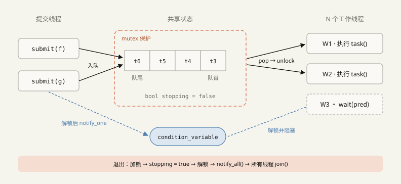
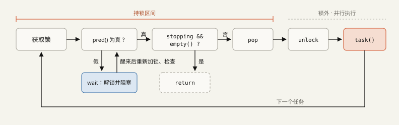
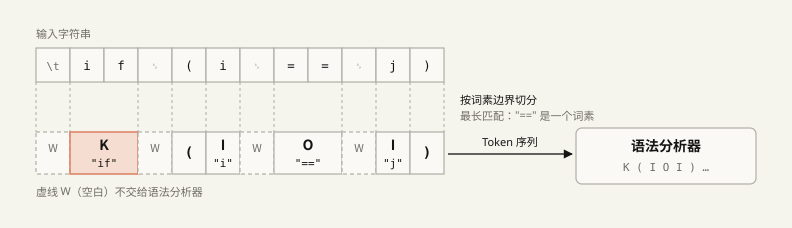
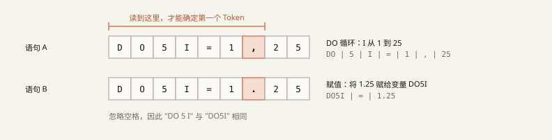
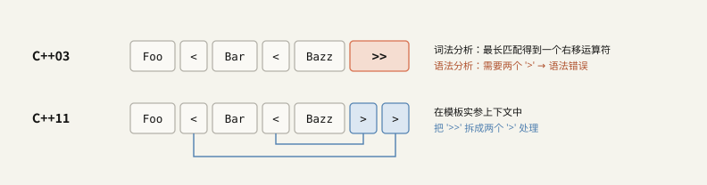
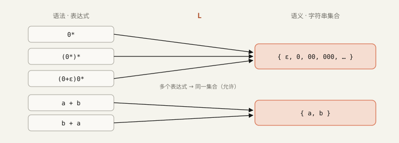
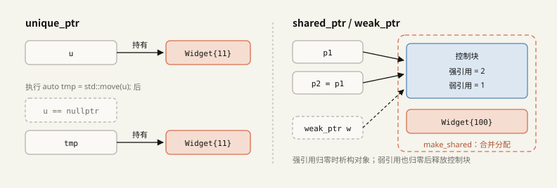
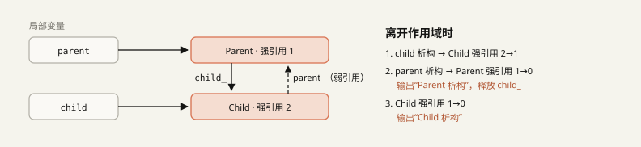

# 10 月 26 日学习记录

今天学习了 C++ 面试题（线程池实现）、斯坦福 CS143 第 3 讲的词法分析、正则语言与形式语言，以及 C++ 智能指针和两道双指针题。指针基础没来得及完成，推迟到 10/27。

> [!info] 阅读说明
> - 正文整理了我对这些内容的理解。`> [!warning] 纠正`标出最初理解有误的地方，`> [!note] 补充`标出原先遗漏的内容。
> - 插图引用 `assets/10_26/` 目录中的 SVG 文件。
> - 原笔记记录的验证结果：线程池参考实现（§1.10）用 g++ 13 和 `-std=c++17 -fsanitize=thread` 运行了 100 个任务并测试异常传递，未出现数据竞争警告；智能指针代码（§6.6）也已编译运行，断言和析构顺序均已检查。
> - 只想查看纠正内容，可以直接看 §9 的表格。

## 0. 今日学习内容

| 主题 | 内容 | 位置 |
|---|---|---|
| C++ 面试 | 线程池：等待、执行、退出三个环节，参考实现 | §1 |
| CS143 第 3 讲 | 词法分析：Token 与 lexeme、向前看，以及 Fortran、PL/I、C++ `>>` 案例 | §2 |
| CS143 | 正则语言：五条构造规则与示例 | §3 |
| CS143 | 形式语言与语义函数 $L$ | §4 |
| CS143 | 从正则表达式到实际词法规则，冲突处理规则 | §5 |
| C++ 基础语法 | 指针（未完成）、智能指针 | §6 |
| 算法 | LeetCode 283、11 | §7 |
| 复习 | 10 道自测题 | §8 |

### 0.1 本周学习计划

按工作日晚间约 2 小时、周末每天约 2 小时安排，共约 12 小时。先补完指针基础，独立实现线程池，再学习 CS143 第 4 讲的有限自动机，动手写一个小型词法分析器。

| 日期 | 主题 | 任务 | 时间 |
|---|---|---|---|
| 10/27 周二 | 指针基础（未完成部分） | 指针与引用、`const` 的位置（`const T*`、`T* const`）、数组到指针的退化（decay）；写出 3 个悬空指针示例，用 ASan 检查 | 1.5h |
| 10/27 周二 | 线程池 | 不看 §1.10 的参考实现，独立编写，再用 `-fsanitize=thread` 验证并对照检查清单 | 1h |
| 10/28 周三 | CS143 第 4 讲 | 有限自动机：DFA、NFA、状态转移图、ε 转移 | 1.5h |
| 10/28 周三 | LeetCode | 15. 三数之和：把今天学的双指针与排序结合起来 | 0.5h |
| 10/29 周四 | RE → NFA → DFA | 手动转换 `a(b\|c)*` 和 Pascal `num`，练习 Thompson 构造与子集构造 | 2h |
| 10/30 周五 | 实现小型词法分析器 | 用 C++ 实现 §5 的 Token 规则，测试最长匹配、规则优先级、错误 Token 三条规则 | 2h |
| 10/31 周六 | 联系 MLIR | 阅读 `mlir/lib/AsmParser/Lexer.cpp`，与自己写的词法分析器比较；查看 `MLIRContext` 如何使用线程池（`--mlir-disable-threading`） | 2h |
| 11/1 周日 | 复习 | 不看答案完成 §8 自测题；给线程池添加“丢弃等待中任务”的退出策略 | 1.5h |

> [!note] 补充：与 AI 编译器工作的联系
> 今天的内容可以沿两个方向继续看。MLIR PassManager 在多个函数上并行运行同一个 pass 时，底层会用到线程池；读取 MLIR 文本 IR 的第一步则是词法分析。这两部分都能结合实际代码学习，因此放进了周末安排。

---

## 1. C++ 面试：如何实现线程池？

原笔记将这道 C++ 面试题列为 Nexon、NCSoft、Netmarble、Krafton、三星电子、首尔机器人、SK 海力士、LG Innotek 等公司的面试题。

### 1.1 基本回答与追问

“创建多个线程，从任务队列中取出任务并执行”只是基本回答。面试官通常还会追问：

- 没有任务时，是占用 CPU 等待，还是阻塞等待？
- 如何保证任务队列的线程安全？
- 如何让线程池正常退出？

因此，说明结构之后，还需要讲清楚等待、同步和退出。

### 1.2 为什么需要线程池

如果每个任务都创建一个线程，就会反复经历“任务到来 → 创建线程 → 执行 → 销毁线程”。线程的创建和销毁涉及内核调用、栈分配和调度器登记，任务一多，这些开销就会拖慢程序。

线程池预先创建固定数量的线程并重复使用，省去每次执行任务时创建线程的开销，也能限制同时执行的任务数。这里讨论的是固定大小的线程池。

### 1.3 三个基本组成部分

| 组成部分 | 内容 | 作用 |
|---|---|---|
| 工作线程 | 固定数量的线程循环获取任务 | 执行任务，复用线程 |
| 任务队列 | 所有线程共享的队列 | 保存尚未执行的任务 |
| 同步机制 | `std::mutex` + `std::condition_variable` | 保护共享状态，让空闲线程阻塞等待并在需要时唤醒 |



虚线圈出的区域是 mutex 保护的共享状态。锁只保护队列和 `stopping` 标志，`task()` 在这个区域之外执行。

### 1.4 工作线程与提交者的执行流程

工作线程的一轮循环：

1. 获取队列的锁（`std::unique_lock`）。
2. 检查条件 `stopping || !tasks.empty()`。
3. 条件为假时，使用条件变量等待。释放锁与进入阻塞等待是一个原子操作。
4. 唤醒后重新获取锁，再次检查条件。
5. 取出任务后立即释放锁。
6. 在锁外执行任务，然后回到第 1 步。

提交者：

1. 持有同一个 mutex，将任务放入队列。
2. 释放锁，再通过 `notify_one()` 唤醒一个等待线程。



持锁检查并取出任务，解锁执行，再回到等待流程。线程被唤醒并不意味着一定有任务，必须重新检查条件。

### 1.5 面试要点①：条件变量与忙等待

忙等待（busy waiting）通过循环不断检查队列，即使没有任务也会占用 CPU 核心。使用条件变量后，线程可以阻塞休眠，等任务到来时再被唤醒。

“不占用 CPU”是指不轮询。进入等待、唤醒和调度仍然有开销。

#### 虚假唤醒与丢失唤醒

- 虚假唤醒（spurious wakeup）：线程可能在没有通知时醒来。即使收到了通知，也可能已有其他工作线程先取走任务，所以醒来后必须重新检查条件。
- 丢失唤醒（lost wakeup）：条件变量不会保存通知。如果通知发生在检查条件之后、进入等待之前，通知就可能丢失，导致队列里明明有任务，线程却一直休眠。

解决办法是用同一个 mutex 保护条件的检查与修改，并使用接受谓词（predicate）的 `wait` 重载。

```cpp
cv.wait(lock, [&] { return stopping || !tasks.empty(); });
// 等价于下面的写法：
// while (!(stopping || !tasks.empty())) cv.wait(lock);
```

`wait` 原子地完成解锁和进入等待，并在返回前重新获取锁。带谓词的重载在内部用 `while` 反复检查条件。参考：[C++ 标准草案 [thread.condition.condvar]](https://eel.is/c++draft/thread.condition.condvar)。

### 1.6 面试要点②：锁的范围

锁只保护队列、退出标志等共享状态。如果执行任务时也持有锁，那么一个耗时任务就会阻止其他工作线程取任务，也会阻止提交者入队，整个线程池实际上变成串行执行。

“在锁外执行”只表示不持有队列的锁。如果任务还会访问其他共享数据，那些数据需要另外同步。

### 1.7 面试要点③：正常退出

顺序是：持锁设置 stopping = true → 解锁 → `notify_all()` → 对每个线程调用 `join()`。

- `notify_one()` 只唤醒一个线程，其余线程可能一直休眠，无法看到退出标志。要让所有等待线程检查退出条件，应使用 `notify_all()`。
- `notify_all()` 和 `join()` 都不会强行停止正在执行的任务，前者负责唤醒，后者负责等待。

| 退出策略 | 行为 | 工作线程的退出条件 |
|---|---|---|
| 执行完队列中的任务再退出（drain） | 拒绝新任务，完成已接收的所有任务后退出 | `stopping && tasks.empty()` |
| 丢弃等待中的任务（discard） | 拒绝新任务，丢弃尚未开始的任务，只等待正在执行的任务结束 | `stopping`（退出时清空队列） |

采用 drain 策略却只检查 `stopping`，会让线程提前退出，队列中留下未执行的任务。

> [!note] 补充：四个常见追问
> - 析构前要完成 join：处于 `joinable()` 状态的 `std::thread` 被析构时会调用 `std::terminate`。C++20 的 `std::jthread` 会在析构时自动请求停止并 join。
> - 任务抛出异常怎么办：异常若逃出工作线程的入口函数，程序会调用 `std::terminate`。用 `packaged_task` 包装后，异常会保存到 future 的共享状态，调用者执行 `get()` 时再抛出。
> - 在线程池内部等待同一个池的任务可能死锁：任务 A 提交任务 B 后调用 `future.get()`。如果所有工作线程都在执行这样的 A，就没有线程能执行 B。
> - 可扩展的方向：有界队列（阻塞提交者以施加背压）、每线程独立队列与任务窃取（work stealing，减少全局队列的锁竞争）、优先级队列。

### 1.8 返回值：future、packaged_task、async

- `std::future`：接收结果的通道，本身不会启动任务。
- `std::packaged_task`：包装可调用对象，把返回值或异常保存到共享状态，是线程池中常用的做法。
- `std::async`：启动任务并返回 `std::future`。

流程为：任务 → packaged_task → 在线程池中执行 → future.get()。

`std::async` 的默认策略是 `launch::async | launch::deferred`，允许延迟执行。因此既不保证立即在其他线程执行，也不保证使用线程池。需要异步执行时，应显式指定 `std::launch::async`。参考：[[futures.async]](https://eel.is/c++draft/futures.async)。

> [!note] 补充：async 返回的 future 可能在析构时等待
> `std::launch::async` 返回的 future 在释放最后一个共享状态引用时，可能阻塞到任务完成。因此，像 `std::async(std::launch::async, f);` 这样丢弃返回值，临时 future 就会在该语句结束时析构并等待，代码实际表现为同步执行。

### 1.9 如何确定线程数

| 任务类型 | 起点 | 原因 |
|---|---|---|
| CPU 密集型 | 从接近硬件并发数的线程数开始，测量后调整 | 增加线程不会增加计算资源，反而可能增加上下文切换 |
| 阻塞 I/O 密集型 | 可以超过硬件并发数 | 一部分线程等待 I/O 时，其他线程仍可执行 |

`std::thread::hardware_concurrency()` 返回的是硬件线程上下文数量的提示值，既不是操作系统允许的最大线程数，也不是最佳线程池大小。无法确定时会返回 `0`，因此需要用 `std::max(1u, …)` 等方式兜底。参考：[[thread.thread.static]](https://eel.is/c++draft/thread.thread.static)。

I/O 线程也不能无限增加。线程栈内存、调度开销、连接数，以及磁盘和下游服务的吞吐量都会构成限制。使用 epoll、io_uring 等 I/O 机制，可以避免为每个等待中的请求安排一个线程。

### 1.10 小结：等待、执行与退出

> 线程池 = 固定的工作线程 + 线程安全的任务队列

| 环节 | 主要动作 |
|---|---|
| 等待 | 无任务时通过条件变量阻塞，有任务时唤醒一个线程 |
| 执行 | 取出任务后立即解锁，在锁外并行执行 |
| 退出 | 设置退出标志，唤醒所有线程，等待线程结束 |

> [!example] 参考回答（约 1 分钟）
> 线程池预先创建工作线程，通过线程安全的任务队列分发任务，用来复用线程并限制并发数。提交任务时先持有 mutex 入队，解锁后通知一个等待线程。工作线程使用带谓词的条件变量等待，重新检查条件以应对虚假唤醒，并通过同一把锁协调检查与修改，避免丢失唤醒。锁内只检查条件和取任务，任务在锁外执行。
>
> 退出时，持锁设置退出标志并拒绝新任务，然后用 `notify_all` 唤醒所有线程，再逐个 join。如果采用 drain 策略，只有“正在退出且队列为空”时，工作线程才退出。返回值和异常通过 `packaged_task` 与 future 传递。CPU 密集型任务可以从接近硬件并发数的线程数开始；阻塞 I/O 较多时可以增加线程，再根据测量结果调整。

#### 代码实现

这一部分在最初的笔记里是空白。按 10/27 的计划，先自己实现，再展开参考代码对照。

> [!todo]- 独立实现检查清单
> - `wait` 是否传入了谓词？
> - `task()` 是否在锁的范围之外调用？
> - 是否持锁修改 `stopping`，随后调用 `notify_all`？
> - 退出条件是否符合 drain/discard 策略？
> - 退出后收到 `submit` 如何处理？
> - 连续调用两次 `shutdown()` 是否安全？是否禁用了拷贝？
> - 任务抛出异常后，工作线程是否仍能继续运行？

> [!example]- 展开参考实现 · thread_pool.cpp（C++17）
> ```cpp
> #include <condition_variable>
> #include <functional>
> #include <future>
> #include <memory>
> #include <mutex>
> #include <queue>
> #include <stdexcept>
> #include <thread>
> #include <type_traits>
> #include <vector>
>
> class ThreadPool {
> public:
>     explicit ThreadPool(std::size_t n) {
>         if (n == 0) n = 1;                  // hardware_concurrency() 可能返回 0
>         workers_.reserve(n);
>         for (std::size_t i = 0; i < n; ++i)
>             workers_.emplace_back([this] { workerLoop(); });
>     }
>
>     ThreadPool(const ThreadPool&) = delete;
>     ThreadPool& operator=(const ThreadPool&) = delete;
>
>     ~ThreadPool() { shutdown(); }
>
>     // 需要返回值的任务：用 packaged_task 包装，并返回 future。
>     template <class F, class... Args>
>     auto submit(F&& f, Args&&... args)
>         -> std::future<std::invoke_result_t<F, Args...>> {
>         using R = std::invoke_result_t<F, Args...>;
>         // std::function 要求目标可拷贝，因此用 shared_ptr 包装只能移动的 packaged_task。
>         auto task = std::make_shared<std::packaged_task<R()>>(
>             std::bind(std::forward<F>(f), std::forward<Args>(args)...));
>         std::future<R> result = task->get_future();
>         {
>             std::lock_guard<std::mutex> lock(mutex_);
>             if (stopping_) throw std::runtime_error("submit on stopped ThreadPool");
>             tasks_.emplace([task] { (*task)(); });
>         }
>         cv_.notify_one();                     // 解锁后只唤醒一个线程
>         return result;
>     }
>
>     // drain 策略：完成已接收的所有任务后退出
>     void shutdown() {
>         {
>             std::lock_guard<std::mutex> lock(mutex_);
>             if (stopping_) return;            // 避免顺序重复调用时再次执行退出流程
>             stopping_ = true;
>         }
>         cv_.notify_all();                     // 让所有等待线程检查退出条件
>         for (auto& t : workers_)
>             if (t.joinable()) t.join();
>     }
>
> private:
>     void workerLoop() {
>         for (;;) {
>             std::function<void()> task;
>             {
>                 std::unique_lock<std::mutex> lock(mutex_);
>                 cv_.wait(lock, [this] { return stopping_ || !tasks_.empty(); });
>                 if (stopping_ && tasks_.empty()) return;
>                 task = std::move(tasks_.front());
>                 tasks_.pop();
>             }                                 // 在这里解锁
>             task();                           // 锁外执行，异常由 packaged_task 保存到 future 的共享状态
>         }
>     }
>
>     std::vector<std::thread> workers_;
>     std::queue<std::function<void()>> tasks_;
>     std::mutex mutex_;
>     std::condition_variable cv_;
>     bool stopping_ = false;                   // 由 mutex_ 保护，无需 atomic
> };
>
> // 使用示例
> // ThreadPool pool(std::max(1u, std::thread::hardware_concurrency()));
> // auto f = pool.submit([](int x) { return x * x; }, 7);
> // int r = f.get();   // 49
> // auto bad = pool.submit([]() -> int { throw std::runtime_error("boom"); });
> // bad.get();         // 在这里重新抛出 runtime_error
> ```

成员声明的顺序也有影响。成员按声明的逆序析构，`workers_` 放在最前面，就会最后析构。不过，析构函数体中的 `shutdown()` 已经先完成 join，因此工作线程不会访问已经析构的 mutex 或队列。

---

## 2. CS143 第 3 讲：词法分析

上一讲把编译过程分成词法分析、语法分析、语义分析、优化、代码生成五个阶段。这一讲介绍第一步：词法分析。

```cpp
if (i == j)
    z = 0;
else
    z = 1;
```

人看到的是带缩进的代码，词法分析器收到的却是一串连续的字符。

```text
\tif (i == j)\n\t\tz = 0;\n\telse\n\t\tz = 1;
```

### 2.1 Token 类别与词素

Token 类别（token class）是具有相同作用的字符串的集合。就像英语有名词、动词、形容词，编程语言也有以下类别。

- 标识符（Identifier）：以字母开头，后接字母或数字的字符串。例如 `A1`、`foo`、`B17`。
- 整数（Integer）：非空数字串。例如 `0`、`12`、`001`。
- 关键字（Keyword）：如 `if`、`else`、`begin`。
- 空白（Whitespace）：空格、换行符、制表符组成的字符串。
- 运算符与标点：如 `=`、`==`、`(`、`)`、`;`、`{`、`}`，通常各自属于一个类别。

> [!warning] 纠正
> - “starting with a latter”应为“starting with a **letter**”，意思是“以字母开头”。
> - “`#jst` 会被识别为字符串而不是变量名”不够准确。它的首字符不是字母，因此不符合这里的 Identifier 规则。具体属于哪一类，要看语言如何定义 `#`（在 C 中，它可以作为预处理指令的起始符号）。

词法分析器将输入切分成词素（lexeme，即实际的字符串片段），为每个词素标注类别，再把 `<Token 类别, lexeme>` 这样的二元组交给语法分析器。

```text
<Id, "foo"> <Op, "="> <Int, "42">
```

> [!warning] 纠正
> 最初写的 `<Op, "="> , <"Int", "42">` 中，逗号不是 Token，类别名 `Int` 也不应加引号。引号只用于词素，也就是实际字符串。



词法分析器做两件事：把字符串切分成词素，并确定每个词素的 Token 类别。

完整示例的类别序列如下（W = 空白，K = 关键字，I = 标识符，O = 比较运算符 `==`，N = 整数）。

```text
W K W ( I W O W I ) W I W = W N ; W K W I W = W N ;
```

> [!warning] 纠正
> 最初写的 `…I\W\O\W\I\W\I\W\=…` 漏掉了 `j` 后面的 `)`，还多写了一个 `I`。正确顺序是 `i`（I）→ 空格（W）→ `==`（O）→ 空格（W）→ `j`（I）→ `)` → `\n\t\t`（W）→ `z`（I）。连续空白 `\n\t\t` 合为一个 W。

### 2.2 为什么需要向前看（lookahead）

词法分析器从左向右读取输入，但有时只看当前字符，无法确定 Token 在哪里结束。

读到 `=` 时，还不知道它是赋值运算符，还是 `==` 的第一个字符，所以要预读下一个字符，这就是向前看（lookahead）。下一字符也是 `=`，就识别为比较运算符 `==`；否则是赋值运算符 `=`。向前看一个字符的开销很小。

### 2.3 Fortran：忽略空格的语言

早期 Fortran 的两项设计让词法分析变得困难。

1. 空格没有意义。`VA R1` 与 `VAR1` 相同，`DO 5 I` 与 `DO5I` 也相同。
2. 变量可以不声明。类型由名称的首字母决定，这称为隐式类型。

> [!warning] 纠正
> Fortran 的隐式类型规则不能只概括为“D 开头是实数”。完整规则是：首字母为 I～N 时，类型为 INTEGER；其余为 REAL。`DO5I` 以 D 开头，因此为 REAL，可以赋值 `1.25`。

```text
语句 A：DO 5 I = 1,25    DO 循环：I 从 1 到 25
语句 B：DO 5 I = 1.25    赋值语句：把 1.25 赋给变量 DO5I
```



两条语句只差一个逗号或小数点。在读到这个字符之前，无法判断 `DO` 是关键字，还是变量名 `DO5I` 的一部分。

> 需要向前看的内容越长，分析就越复杂，因此设计语言时应尽量缩短这一距离。

向前看距离较长时，保存已读字符的缓冲区会变大，状态机更复杂，也可能需要更多回退和重新分析。这会增加排查错误的难度，拖慢编译。C、C++、Java、Rust、Go 等现代语言通过空白或标点分隔标识符，并明确语法，让大多数 Token 的边界只需向前看一两个字符就能确定。

> [!note] 补充：“最多一个字符”不够准确
> C/C++ 也有需要看两个以上字符的情况。例如读到 `..` 后，还要看下一字符是否为 `.` 才能判断 `...`；`<::` 也有避免将 `<:` 识别为 `[` 替代写法的特殊规则。不过，这些例子不需要像 Fortran 那样一直读到语句后面才能区分。

### 2.4 PL/I：关键字不是保留字

IBM 在 20 世纪 60 年代设计的 PL/I 允许把关键字用作变量名，即关键字不是保留字。C/C++ 中的 `int if = 1;` 是错误的，但下面的 PL/I 代码有效。

```text
IF ELSE THEN THEN = ELSE; ELSE ELSE = THEN;
```

第一个 `IF`、第一个 `THEN`、分号后的第一个 `ELSE` 才是控制流关键字，其余位置是名为 `ELSE`、`THEN` 的变量。把 ELSE 改名为 a、THEN 改名为 b，翻译成 C 就是：

```c
if (a) { b = a; } else { a = b; }
```

#### 为什么这会增加词法分析的难度

- 依赖上下文：lexer 读到 `ELSE` 时，不能只凭单词决定它是 `<Keyword, ELSE>` 还是 `<Id, ELSE>`，还需要知道语句结构。这样一来，词法分析器就承担了部分语法分析工作，两阶段难以清楚分开。
- 向前看距离较长：如果 lexer 要独立判断，就需要继续读取后面的多个单词。后面出现 `=` 时可能是变量名，出现条件表达式时可能是关键字。

#### 无界向前看：DECLARE

```text
DECLARE (ARG1, ARG2, ..., ARGN)          -- 声明语句：DECLARE 是关键字
DECLARE (ARG1, ARG2, ..., ARGN) = 100;   -- 数组赋值：DECLARE 是数组名
```

无论括号内有多少个参数，都要读到右括号之后，查看是否出现 `=`，才能确定第一个单词的作用。参数数量没有上限，所需的向前看距离也没有上限。

因此，现代语言通常会把关键字设为保留字。例如只要拼写是 `if` 就按关键字处理，lexer 不必分析后续语句就能确定类别。

### 2.5 C++ 的 `>>` 问题

C++11 之前，嵌套模板需要写成 `vector<vector<int> >`，两个右尖括号之间必须有空格。连写会导致编译错误，原因是 lexer 的最长匹配（maximal munch）原则。

lexer 总是选择当前能匹配的最长 Token。因此 `++` 会成为一个自增运算符，而不是两个 `+`；`>>` 也会成为一个右移运算符，而不是两个 `>`。



图的上半部分表示 lexer 生成的单个 Token 无法满足语法分析器的要求；下半部分表示 C++11 把它拆成两个 Token，依次闭合内层 `Bar<` 和外层 `Foo<`。

写成 `Bazz> >` 时，空格会打断最长匹配，得到两个独立的 `>`。C++11 增加了规则：解析模板实参列表时，第一个不处于嵌套结构中的 `>>` 被视为两个独立的 `>`（[[temp.names]](https://eel.is/c++draft/temp.names)）。这需要语法分析阶段根据上下文拆分 Token。

> [!note] 补充：规则变更带来的影响
> C++03 中在模板实参里使用右移的代码 `X< 1>>2 >`，到了 C++11 会得到不同解释。现在需要加括号，写成 `X<(1>>2)>`。词法分析与语法分析发生关联时，就可能影响原有代码的解释方式。

### 2.6 小结

- 词法分析的目标：将输入字符串切分成词素，并确定每个词素的 Token 类别。
- 扫描从左向右进行，有时需要向前看。语言设计应尽量限制向前看的距离。

---

## 3. CS143：正则语言

词法结构由各类 Token 组成。要准确描述每个类别包含哪些字符串，可以使用正则语言（regular language），并通过正则表达式来描述它。

### 3.1 五条构造规则

字母表 $\Sigma$ 上的正则表达式构成满足下列规则的最小集合。不能通过这些规则构造出来的，就不属于这里定义的正则表达式。

| 规则 | 名称 | 表示的集合 | 示例 |
|---|---|---|---|
| $R = \varepsilon$ | 空字符串 | `{""}` | 一个长度为 0 的字符串 |
| $R = \text{'c'}$ | 单个字符（$c \in \Sigma$） | `{"c"}` | `'a'`、`'b'` |
| $R = R + R$ | 并集（Union） | $A \cup B$ | `'a' + 'b'` → `{a, b}` |
| $R = RR$ | 连接（Concatenation） | $\{ab \mid a \in A \land b \in B\}$ | `'a''b'` → `{ab}` |
| $R = R^*$ | 重复（Kleene 星号） | $\bigcup_{i \ge 0} A^i$ | `'a'*` → `{"", a, aa, …}` |

其中有两个基本元素（ε、单个字符），以及三种组合方式（并集、连接、重复）。$A^i$ 表示将 $A$ 连接 $i$ 次。

> [!warning] 纠正
> 最初写的 $A^0 = \varepsilon$ 应改为 $A^0 = \{\varepsilon\}$，也就是 `{""}`。$A^i$ 都是集合，连接 0 次的结果也应是“只包含空字符串的集合”。因此，$A^*$ 总是包含空字符串。

#### ε 与 ∅ 不同

- $\varepsilon$ 表示的集合 `{""}` 有 1 个元素，即空字符串。
- $\emptyset$ 是空集，没有任何元素。
- 与 $\varepsilon$ 连接不改变结果（$\varepsilon A = A$）；与 $\emptyset$ 连接则得到空集（$\emptyset A = \emptyset$）。但 $\emptyset^* = \{\varepsilon\}$。

### 3.2 按规则构造表达式：`a(b|c)*`

1. 构造单个字符 `'a'`、`'b'`、`'c'`。（规则 2）
2. 对 `'b'` 和 `'c'` 取并集，得到 `'b' + 'c'`。（规则 3）
3. 添加重复，得到 `('b' + 'c')*`。（规则 5）
4. 在前面连接 `'a'`，得到 `'a'('b' + 'c')*`。（规则 4）

### 3.3 示例（$\Sigma = \{0, 1\}$）

| 表达式 | 集合 | 说明 |
|---|---|---|
| $1^*$ | `{"", 1, 11, 111, …}` | 只包含 1 的所有字符串，包括空字符串 |
| $(1+0)1$ | `{11, 01}` | 首字符为 1 或 0，第二个字符必须为 1 |
| $0^* + 1^*$ | `{"", 0, 00, …} ∪ {"", 1, 11, …}` | 只含 0 或只含 1 的字符串，不包含 `01`、`10` 等混合情况 |
| $(0+1)^*$ | $\Sigma^*$ | 每次选择 0 或 1，重复零次或多次，因此包含由 0、1 构成的所有字符串 |

> [!warning] 纠正
> 课程板书把 $(1+0)1$ 的结果写成了 `{11, 10}`。按图右下角的纠正说明“这里应为 {11, 01}”，正确结果是 `{11, 01}`。

### 3.4 语法与语义

- 正则表达式是语法（Syntax），指写在纸上或代码中的 `a*b` 这类表示形式。
- 正则语言是语义（Semantics），指表达式所表示的字符串集合。

下一节的语义函数 $L$ 用来区分这两者。

---

## 4. CS143：形式语言与语义函数 $L$

### 4.1 字母表与语言

计算理论用数学方式定义语言。字母表 $\Sigma$ 是字符的集合，语言则是由这些字符组成的字符串的集合。

| | 字母表 $\Sigma$ | 语言 |
|---|---|---|
| 英语 | 26 个英文字母 | 所有符合语法的英语句子的集合 |
| C 语言 | 128 个 ASCII 字符（字母、数字、`;`、`{` 等） | 所有可以编译的有效 C 程序的集合 |

### 4.2 符号带来的混淆

§3 写了 $A + B = A \cup B$。严格来说，左边的 $A$ 是写下来的表达式，右边的 $A$ 却是字符串集合。这类似于把字符串 `"5"` 和数字 `5` 当成同一个东西。

### 4.3 语义函数 $L$

为此，引入函数 $L$，把语法映射到语义。

$$
L: \text{表达式} \longrightarrow \text{字符串集合}
$$

用这个函数，按结构归纳重新写出五条规则：

$$
\begin{aligned}
L(\varepsilon) &= \{""\} \\
L(\text{'c'}) &= \{\text{"c"}\} \\
L(A+B) &= L(A) \cup L(B) \\
L(AB) &= \{ab \mid a \in L(A) \land b \in L(B)\} \\
L(A^*) &= \bigcup_{i \ge 0} L(A)^i
\end{aligned}
$$

左边的 `+`、连接和 `*` 是语法符号，右边的 $\cup$ 和集合条件是数学运算。复合表达式的语义由子表达式的语义递归计算，基础情形是 ε 和单个字符。

| 阶段 | 问题 | 回答 |
|---|---|---|
| 图 1 | 什么是语言？ | 由字符构成的字符串的集合 |
| 图 3 | 如何表示这个集合？ | 用五条构造规则，但表达式和集合的写法仍有混淆 |
| 图 2 | 如何消除混淆？ | 用语义函数 $L$ 区分语法与语义 |
| 图 4 | 如何计算语义？ | 按结构归纳，将表达式拆成小部分，递归计算 |

### 4.4 为什么使用语义函数



$L$ 是多对一（many-to-one）函数。不同表达式可以映射到同一个集合，但一个表达式不能映射到两个不同集合。

1. 区分语法与语义。写成 $L(A+B) = L(A) \cup L(B)$，就能看出左边是在解释语法，右边是在做集合运算。
2. 单独讨论表示法。数学中写 `A + B`，工具中写 `A | B`，两者的语义都是 $L(A) \cup L(B)$。
3. 表达式与语义并非一一对应。$0^*$、$(0^*)^*$、$(0+\varepsilon)0^*$、$0 + 0^*$、$\varepsilon + 00^*$ 表示同一个集合。函数允许不同输入得到相同输出，正好能描述这种关系。

### 4.5 表示法为什么重要

42 只羊这个数量是语义，罗马数字 `XLII` 和阿拉伯数字 `42` 是两种语法。含义相同，但比起 `CXXVIII × XIX`，`128 × 19` 显然更容易计算。

好的表示法保留含义，同时让计算和推理更容易。用正则表达式描述字符串集合，也是这个道理。

### 4.6 多对一关系与编译器优化

多个程序可以具有相同语义，这是优化的依据。只要语义等价，编译器就可以把开销较大的代码换成开销较小的代码。

$$
\text{语义}(\texttt{x * 2}) = \text{语义}(\texttt{x << 1})
$$

> [!note] 补充：“语义相同”需要证明
> 对满足相应整数运算条件的 `x * 2` 和 `x << 1`，x86 编译器可能都生成 `add eax, eax` 或 `lea`。但对有符号整数，`x / 2` 与 `x >> 1` 可能不同。C++ 整数除法向零截断，所以 `-3 / 2 == -1`；算术右移向负无穷方向取整，所以 `-3 >> 1 == -2`。因此，编译器处理 `x / 2` 时可能还要生成符号修正指令。
>
> MLIR 的规范化模式（canonicalization）和 LLVM 的 InstCombine 规则也以语义等价为依据。检查等式成立的条件，例如符号、溢出、NaN，是编译器工程师经常要做的工作。

### 4.7 语义函数不是一对多

如果同一个表达式 $e$ 的语义 $L(e)$ 既可以解释为 A，也可以解释为 B，就出现了歧义（ambiguity）。人可以借助上下文和常识选择一种解释，但程序含义不明确时，不同编译器可能给出不同结果，带来错误或安全问题。因此，$L$ 必须是函数，为每个语法表达式确定唯一的语义。

| 概念 | 作用 | 性质 | 在计算机科学中的对应 |
|---|---|---|---|
| 语法（Syntax） | 表达形式 | 可以使用 C++、Rust、汇编、LLVM IR、MLIR 等不同表示法 | 字符、运算符、代码结构 |
| 语义（Semantics） | 实际含义 | 字符串集合、状态变化等数学模型 | 程序行为与计算结果 |
| 多对一（N:1） | 多种表达 → 同一含义 | 允许 | 用语义相同但更快的代码进行优化 |
| 一对多（1:N） | 同一表达 → 多种含义 | 不符合函数的定义 | 避免解释歧义导致的错误 |

---

## 5. CS143：从正则表达式到实际词法规则

只用五条基本规则描述 C 的词法，表达式会很长。实际使用时，会为模式命名，并引入语法糖。

### 5.1 正则定义（Regular Definitions）

不能每次定义标识符都列出 52 个英文字母，因此像宏一样给基本模式命名，方便复用。

```text
digit      = '0' + '1' + ... + '9'
letter     = 'a' + 'b' + ... + 'z' + 'A' + ... + 'Z'
Identifier = letter (letter + digit)*
```

标识符以字母开头，后面跟零个或多个字母或数字。

### 5.2 不可见字符与转义

空白字符在屏幕上不可见，因此用反斜杠转义表示：空格 `' '`、换行符 `'\n'`（ASCII 10）、制表符 `'\t'`（ASCII 9）、回车符 `'\r'`（ASCII 13）。

### 5.3 语法糖

| 表示法 | 含义 | 展开为基本运算 | 用途 |
|---|---|---|---|
| `A+` | 一次或多次 | `AA*` | 非空数字串 `digit+` |
| `A?` | 零次或一次 | `A + ε` | 可选的正负号、小数部分 |
| `[a-z]` | 字符范围 | `'a' + 'b' + … + 'z'` | 避免逐个列举字符 |
| `[^a-z]`（补充） | 补集 | $\Sigma$ 中除去该范围后剩余字符的并集 | 表示“不是引号的字符”等规则 |

> [!note] 补充：同一个 `+`，两种含义
> `A+` 中的 `+` 表示一次或多次，`A + B` 中的 `+` 表示并集。同一符号可以有不同含义，这正是 §4.4 所说的“单独讨论表示法”。flex、re2c 等工具用 `|` 表示并集。

### 5.4 主要 Token 规则

```text
// 基本定义
digit      = [0-9]
letter     = [a-zA-Z]

// Token 规则（越靠前，优先级越高）
Keyword    = "if" | "else" | "then" | "while" | ...   // 固定字符串的集合
Integer    = digit+                                   // 非空数字串
Identifier = letter (letter | digit)*                 // 以字母开头
Whitespace = (' ' | '\t' | '\n' | '\r')+              // 匹配后丢弃
```

> [!warning] 纠正
> 最初在 `blank_char` 中包含了 `'\r'`，却在 Whitespace 规则中漏掉了它。如果定义不一致，读取使用 Windows 换行符（`\r\n`）的文件时，`\r` 就可能因为不匹配任何规则而被识别为错误 Token。

### 5.5 冲突处理规则

即使规则已经定义完整，同一输入仍可能有多种切分方式。lexer 按以下顺序决定。

1. 最长匹配（Longest match）：选择能匹配的最长前缀。`foo123` 是一个 Identifier，而不是 `foo` + `123`；`==` 也是一个 Token，而不是两个 `=`。
2. 规则优先级（Priority）：多个规则匹配的长度相同时，选择列表中靠前的规则。`if` 同时匹配 Keyword 和 Identifier，但 Keyword 排在前面，因此按 Keyword 处理。
3. 错误规则（Error，补充）：遇到不符合其他规则的字符时，使用优先级最低的兜底规则。报告错误后，从下一个字符继续分析，这样一次编译可以报告多个错误。兜底规则应匹配单个字符，不能用任意长度字符串吞掉合法 Token。CS143 下一讲会把它作为第三条规则介绍。

最长匹配先于规则优先级。`if8` 匹配 Identifier 的长度是 3，比 Keyword `if` 的长度 2 更长，因此它是 Identifier。

### 5.6 示例：电子邮件地址

```text
anyone@cs.stanford.edu
letter+ '@' letter+ '.' letter+ '.' letter+
```

连接、`+` 和字符常量就能描述这个模式。不过，它只能接受恰好含两个点的地址。可用 `letter+ '@' (letter+ '.')+ letter+` 放宽域名层级限制；这仍只是教学示例，不是完整的邮箱地址校验规则。

### 5.7 示例：Pascal 数字

Pascal 数字有 `42`（整数）、`3.14159`（小数）、`6.02E+23`、`1E-5`（指数形式）等写法。可以从基本组成部分逐层构造。

```text
digit        = '0' + '1' + ... + '9'
digits       = digit+
opt_fraction = ('.' digits) + ε                 // = ('.' digits)?
opt_exponent = ('E' ('+' + '-' + ε) digits) + ε // = ('E' ('+'|'-')? digits)?
num          = digits opt_fraction opt_exponent
```

| 输入 | digits | opt_fraction | opt_exponent |
|---|---|---|---|
| `42` | `42` | ε | ε |
| `3.14` | `3` | `.14` | ε |
| `6.02E23` | `6` | `.02` | `E23` |
| `1E-5` | `1` | ε | `E-5` |

> [!warning] 纠正
> 课程中的定义只接受大写 `'E'`。如果也想接受最初笔记中的小写 `'e'`，需要把定义改为 `('E' + 'e')`。按当前定义，`.5` 和 `5.` 都不是合法数字，因为小数点前后必须有数字。

### 5.8 从规格到实现

前面写的是描述“要识别什么”的规格（specification）。接下来要解决的是如何实现。

> 给定字符串 $s$ 与正则表达式 $R$，如何判断 $s \in L(R)$？

下一讲介绍能快速回答这个问题的有限自动机（DFA/NFA）。把正则表达式转换成状态转移表，就能在与输入长度成正比的时间内完成判断。

---

## 6. C++ 基础语法：指针与智能指针

### 6.1 指针基础（未完成）

时间不够，推迟到 10/27，按下面的顺序补完。

- [ ] 指针与引用的区别：能否重新指向其他对象，能否为空，是否必须初始化。
- [ ] 看懂 `const` 的位置：`const int* p`（不能通过该指针修改所指的值）、`int* const p`（指针本身为常量）、`const int* const p`（两者都是）。
- [ ] 数组到指针的退化：将 `int a[10]` 传给普通指针形参时会退化为 `int*`，此时 `sizeof` 的结果不同。
- [ ] 写出三种悬空指针示例：返回局部变量地址、`delete` 后继续使用、`vector` 重新分配后继续使用旧元素指针。分别用 `-fsanitize=address` 检查。

### 6.2 智能指针对比

| | `unique_ptr` | `shared_ptr` | `weak_ptr` |
|---|---|---|---|
| 所有权 | 独占所有权 | 共享所有权（强引用计数） | 不拥有对象，只观察 |
| 拷贝 | 不可拷贝，只能移动 | 可以，强引用计数 +1 | 可以，弱引用计数 +1 |
| 创建 | `make_unique<T>(…)` | `make_shared<T>(…)` | 从 `shared_ptr` 创建 |
| 大小与开销 | 使用默认删除器时通常与裸指针相同 | 通常包含两个指针，另有控制块和原子计数操作 | 通常包含两个指针 |
| 删除器 | 属于类型的一部分（`unique_ptr<FILE, FileCloser>`） | 类型擦除，仍为 `shared_ptr<FILE>` | 不适用 |
| 访问对象 | `*`、`->`、`get()` | `*`、`->`、`get()` | 先用 `lock()` 获取 `shared_ptr` |



拷贝 `shared_ptr` 不会创建新对象，只会增加控制块的强引用计数。`weak_ptr` 指向同一个控制块，但不增加强引用计数。

### 6.3 纠正最初代码中的注释

原笔记记录的代码可以编译，断言也全部通过。需要纠正的主要是以下注释。

> [!warning] 纠正
> - `unique_ptr<Widget> p = new Widget(2);` 无法编译，并不是因为“不能拷贝构造”，而是因为接受裸指针的构造函数带有 `explicit`，不能用于这种带 `=` 的拷贝初始化。编译器报错为 `conversion from 'W*' to non-scalar type 'std::unique_ptr<W>' requested`。直接初始化 `unique_ptr<Widget> p(new Widget(2));` 则可以。
> - “`auto` 的类型是 `unique_ptr<Width>`”应改为 `unique_ptr<Widget>`；“裸指针 `widget*`”应改为 `Widget*`。
> - 被注释的 `unique_ptr<Widget>* p = new Widget(2);` 是类型不匹配，与所有权无关：它试图把 `Widget*` 赋给 `unique_ptr<Widget>*`。
> - `release()` 的准确含义是放弃所有权并返回裸指针。它不等同于移动构造，也不会自动把所有权交给另一个智能指针。调用者需要负责 `delete`；丢弃返回值会造成内存泄漏。
> - 文件打开失败时执行 `return 1;`，后面的 `shared_ptr`、`weak_ptr` 示例就都不会运行。要在没有 `2.txt` 时继续运行其他示例，应只跳过文件操作部分。

### 6.4 循环引用与析构顺序



Child → Parent 使用弱引用，因此 Parent 的强引用计数可以降为 0。如果两个方向都使用 `shared_ptr`，各自的强引用计数会停在 1，析构函数都不会调用，造成内存泄漏。原笔记的运行记录确认了“Parent 析构 → Child 析构”的顺序。

### 6.5 原笔记遗漏的四个问题

> [!note] 补充
> - 用同一裸指针分别构造两个 `shared_ptr`：例如 `Widget* raw = new Widget(1); shared_ptr<Widget> a(raw), b(raw);`，会创建两个控制块。各自计数归零时会分别 `delete`，导致重复释放。共享所有权应通过拷贝已有的 `shared_ptr` 实现。
> - 用 `this` 构造 `shared_ptr`：`shared_ptr<T>(this)` 也有同样的风险。应继承 `std::enable_shared_from_this<T>`，再通过 `shared_from_this()` 获取共享指针。
> - `make_shared` 与 `weak_ptr` 的内存释放：`make_shared` 通常把对象和控制块放在一次分配的内存中。强引用归零时立即调用对象析构函数，但只要还有 `weak_ptr`，这块内存就不会整体释放。如果用长寿命的 `weak_ptr` 观察大对象，可以考虑 `shared_ptr<T>(new T)`。
> - 线程安全的范围：引用计数的增减是原子的，但访问所指对象，以及多个线程对同一个 `shared_ptr` 变量进行读写，仍需同步。后者可使用 C++20 的 `std::atomic<std::shared_ptr<T>>`。不要先检查 `expired()` 再假定对象仍存活，应直接写 `if (auto p = w.lock())`，同时检查并获取强引用。

### 6.6 整理后的练习代码

> [!example]- 展开练习代码 · smart_ptr.cpp（已纠正注释）
> ```cpp
> #include <cassert>
> #include <cstdio>
> #include <iostream>
> #include <memory>
> using namespace std;
>
> struct Widget {
>     int id_;
>     explicit Widget(int id) : id_(id) { cout << " 调用构造函数 " << id_ << endl; }
>     ~Widget() { cout << " 调用析构函数 " << id_ << endl; }
> };
>
> // 自定义删除器：unique_ptr 为空时不会调用删除器
> struct FileCloser {
>     void operator()(FILE* file) const noexcept { fclose(file); }
> };
>
> int main() {
>     cout << "========== unique_ptr ==========" << endl;
>
>     auto up1 = make_unique<Widget>(1);            // unique_ptr<Widget>
>
>     // unique_ptr<Widget> up2 = new Widget(2);     // 错误：构造函数带 explicit，不能这样拷贝初始化
>     unique_ptr<Widget> up2(new Widget(2));         // 可以直接初始化
>
>     // get()：只借用裸指针 Widget*，不改变所有权
>     Widget* borrowed = up1.get();
>     assert(borrowed->id_ == 1);
>     borrowed = nullptr;                           // 将借来的指针置空，不影响 up1
>     assert(up1->id_ == 1);
>
>     // 移动构造：转移所有权，tmp 的类型是 unique_ptr<Widget>
>     auto up11 = make_unique<Widget>(11);
>     auto tmp = std::move(up11);
>     assert(up11 == nullptr);
>     assert(tmp->id_ == 11);
>
>     // 移动赋值：先释放原先持有的 Widget(3)
>     auto up3 = make_unique<Widget>(3);
>     up3 = std::move(up1);                          // 输出：调用析构函数 3
>     assert(up1 == nullptr);
>     assert(up3->id_ == 1);
>
>     // release()：放弃所有权并返回裸指针，此后由调用者负责 delete
>     Widget* raw = up2.release();
>     assert(up2 == nullptr && raw->id_ == 2);
>     delete raw;
>     raw = nullptr;
>
>     // reset(p)：释放原有资源（为空则跳过），再持有新资源
>     up2.reset(new Widget(22));
>     assert(up2->id_ == 22);
>
>     // 自定义删除器：删除器成为类型的一部分
>     {
>         unique_ptr<FILE, FileCloser> file{fopen("2.txt", "r")};
>         if (!file) {
>             perror("文件打开失败");              // 不 return，只跳过这一块
>         } else {
>             char buffer[256];
>             while (fgets(buffer, sizeof(buffer), file.get()) != nullptr)
>                 cout << buffer;
>             cout << endl;
>         }
>     }                                              // 在这里自动调用 fclose
>
>     cout << "========== shared_ptr ==========" << endl;
>
>     // make_shared：合并分配控制块与对象，控制块管理强、弱引用计数
>     auto p1 = make_shared<Widget>(100);
>     assert(p1.use_count() == 1);
>     {
>         auto p2 = p1;                              // 拷贝构造：共享同一个 Widget
>         assert(p1.get() == p2.get() && p1.use_count() == 2);
>
>         p2->id_ = 101;                             // 一方修改，另一方也能看到
>         assert(p1->id_ == 101);
>
>         shared_ptr<Widget> p3;
>         p3 = p1;                                   // 拷贝赋值：所有者数量 +1
>         assert(p1.use_count() == 3);
>
>         auto p4 = std::move(p3);                   // 移动：所有者数量不变
>         assert(p3 == nullptr && p3.use_count() == 0 && p4.use_count() == 3);
>
>         p2.reset();                                // 只有 p2 放弃所有权，其他所有者仍然存在
>         assert(p2 == nullptr && p1.use_count() == 2);
>     }                                              // p4 析构：强引用计数 2 → 1
>     assert(p1.use_count() == 1);
>     p1.reset();                                    // 最后一个所有者放弃所有权，输出：调用析构函数 101
>     assert(p1 == nullptr);
>
>     cout << "========== weak_ptr ==========" << endl;
>
>     weak_ptr<Widget> observer;
>     {
>         auto owner = make_shared<Widget>(1);
>         observer = owner;                          // 不增加强引用计数
>         assert(owner.use_count() == 1);
>         assert(observer.use_count() == 1);         // weak_ptr::use_count() 返回的也是强引用计数
>         assert(!observer.expired());               // 只能说明检查的那一刻对象仍存活
>
>         if (auto guard = observer.lock()) {        // 对象仍存活则取得临时 shared_ptr，强引用计数 +1
>             assert(guard.use_count() == 2);
>             cout << guard->id_ << '\n';
>         }                                          // guard 析构：强引用计数恢复为 1
>         assert(owner.use_count() == 1);
>     }                                              // owner 析构：强引用计数归零，立即调用 ~Widget()
>     assert(observer.expired());
>     assert(observer.lock() == nullptr);           // 对象已析构，无法使其复活
>     observer.reset();
>
>     cout << "========== 用 weak_ptr 解决循环引用 ==========" << endl;
>
>     struct Child;
>     struct Parent {
>         shared_ptr<Child> child_;
>         ~Parent() { cout << "Parent 析构\n"; }
>     };
>     struct Child {
>         weak_ptr<Parent> parent_;                  // 不增加 Parent 的强引用计数
>         ~Child() { cout << "Child 析构\n"; }
>     };
>     {
>         auto parent = make_shared<Parent>();
>         auto child = make_shared<Child>();
>         parent->child_ = child;                    // Child 的强引用计数为 2
>         child->parent_ = parent;                   // Parent 的强引用计数仍为 1
>         assert(parent.use_count() == 1 && child.use_count() == 2);
>
>         if (auto p = child->parent_.lock())
>             cout << "父对象仍然存活\n";
>     }                                              // 输出：Parent 析构 → Child 析构
> }
> ```

---

## 7. 算法：双指针

### 7.1 LeetCode 283：移动零

保持非零元素的相对顺序，将所有零移到数组末尾。要求原地操作，不使用额外数组。

```cpp
class Solution {
public:
    void moveZeroes(vector<int>& nums) {
        // fast：从前向后寻找非零元素。
        // slow：下一个非零元素应放入的位置。
        int slow = 0;
        int size = static_cast<int>(nums.size());
        for (int fast = 0; fast < size; fast++) {
            if (nums[fast] != 0) {
                swap(nums[slow], nums[fast]);
                slow++;
            }
        }
    }
};
```

- 循环不变量：每轮结束后，`nums[0, slow)` 按原顺序保存已扫描到的非零元素，`nums[slow, fast]` 中全为零。`fast` 扫描到末尾时，这个不变量就保证了结果正确。
- 时间复杂度 O(n)，空间复杂度 O(1)。

> [!note] 补充
> 最初代码使用 `if (== 0) continue; else { … }` 的结构，反转判断条件后可以减少分支，行为不变。另一种做法是用 `nums[slow++] = nums[fast]` 覆盖写入非零值，最后将剩余位置补零。两种方法都能保持顺序；交换法的写入次数取决于非零元素数量及是否跳过自交换，不能只看零的多少。`slow == fast` 时与自身交换是安全的。

### 7.2 LeetCode 11：盛最多水的容器

选出两根柱子，使面积 `min(h[l], h[r]) × (r − l)` 最大。

```cpp
class Solution {
public:
    int maxArea(vector<int>& height) {
        int left = 0;
        int right = static_cast<int>(height.size()) - 1;
        int best = 0;
        while (left < right) {
            int h = min(height[left], height[right]);
            best = max(best, h * (right - left));
            // 将较矮的一侧向内移动
            if (height[left] < height[right]) left++;
            else right--;
        }
        return best;
    }
};
```

为什么可以移动较矮的一侧：假设 `h[l] ≤ h[r]`。其他以 `l` 为左端点的组合 `(l, k)`（`l < k < r`），宽度都更小，高度又不可能超过 `h[l]`，因此面积不会更大。既然包含 `l` 的最佳候选已经计算过，就可以舍弃 `l`。每一步排除一个端点，时间复杂度为 O(n)，空间复杂度为 O(1)。

> [!note] 补充
> 最初代码在 `height[left] > height[right]` 时执行 `right--`，同样是在移动较矮的一侧。两侧高度相同时，移动任意一侧都不影响答案。按题目约束 n ≤ 10⁵、h ≤ 10⁴，面积不超过 10⁹，使用 `int` 足够。

---

## 8. 自测题

11/1 复习时，先自己回答，再展开答案核对。

> [!question]- 1. 用 `if (tasks.empty()) cv.wait(lock);` 这样的 `if` 判断，会有什么问题？
> 发生虚假唤醒，或者其他工作线程先取走任务后，醒来的线程可能对空队列调用 `front()` 或 `pop()`，造成未定义行为。应使用 `while` 或带谓词的重载重新检查条件。

> [!question]- 2. 如果退出条件只写 `if (stopping) return;`，剩余任务的 future 会怎样？
> 队列中未执行的 `packaged_task` 被销毁时，会将 `broken_promise` 错误存入关联的共享状态。对 future 调用 `get()` 会抛出 `std::future_error`。

> [!question]- 3. 举一个有 4 个工作线程的线程池发生死锁的场景。
> 4 个任务分别向同一个池提交子任务，然后调用 `future.get()` 等待。这样 4 个工作线程全部阻塞，没有线程能够执行子任务。

> [!question]- 4. $L(\emptyset^*)$ 是什么？它与 $L(\varepsilon)$ 相同吗？
> $L(\emptyset^*) = \emptyset^0 \cup \emptyset^1 \cup \dots = \{\varepsilon\} \cup \emptyset \cup \dots = \{\varepsilon\}$，因此与 $L(\varepsilon)$ 相同。重复 0 次总会贡献集合 $\{\varepsilon\}$。

> [!question]- 5. $(0+1)^*$ 与 $(0^*1^*)^*$ 表示同一种语言吗？
> 相同，都是 $\Sigma^* = \{0,1\}^*$。$0^*1^*$ 同时包含 `"0"` 和 `"1"`，重复连接就能构造任意 0/1 字符串。这是多对一映射的例子。

> [!question]- 6. 输入 `if8==x` 会被切分成哪些 Token？
> `<Id,"if8"> <Op,"=="> <Id,"x">`。最长匹配先于规则优先级，所以 `if8` 是一个 Identifier，不会拆成 Keyword `if` 和 Integer `8`。`==` 同理，也是一个 Token。

> [!question]- 7. 为什么编译器不能直接把 `x / 2` 换成 `x >> 1`？
> 对有符号整数，两者可能不等价。`-3 / 2 == -1`，因为除法向零截断；算术右移则得到 `-3 >> 1 == -2`，向负无穷取整。只有使用无符号类型，或能证明 x ≥ 0 等满足等价条件时，才能直接替换。

> [!question]- 8. C++11 之后如何解释 `X< 1>>2 >`？
> 模板实参列表中的 `>>` 被拆成两个 `>`，在 `X<1>` 处模板实参已经闭合，后面的 `> 2 >` 会按比较表达式一类的语法继续解析，通常导致错误。要表达右移，应写成 `X<(1>>2)>`。

> [!question]- 9. `make_shared` 创建的对象强引用归零，但还有 `weak_ptr`。何时调用析构函数，何时释放内存？
> 强引用归零时立即调用对象析构函数。在对象与控制块合并分配的实现中，整块内存要等弱引用也释放完后才释放。

> [!question]- 10. 第 11 题为什么不能始终移动较高的一侧？
> 移动较高的一侧后，宽度减少，高度仍受较矮一侧限制，面积不可能因此增大；同时却可能舍弃尚未检查的更优组合，即当前高柱与内部另一根柱子。例如 `[1, 8, 6, 2, 5, 4, 8, 3, 7]`，第一步若移动 `right`，就会错过面积为 49 的组合（8 和 7）。

---

## 9. 纠正内容汇总

| 位置 | 最初理解 | 纠正后 |
|---|---|---|
| §2.1 | "starting with a latter" | "starting with a letter" |
| §2.1 | `#jst` 会被识别为字符串而不是变量名 | 首字符不是字母，不符合 Identifier 规则；具体类别取决于语言对 `#` 的定义 |
| §2.1 | `<Op, "="> , <"Int", "42">` | `<Op, "="> <Int, "42">`，逗号不是 Token，类别名不加引号 |
| §2.1 | `…I W O W I W I W = …` | `…I W O W I ) W I W = …`，原来漏了 `)`，还多了一个 `I` |
| §2.3 | D 开头的变量自动为实数类型 | 完整规则：I～N 开头为 INTEGER，其余为 REAL |
| §3.1 | $A^0 = \varepsilon$ | $A^0 = \{\varepsilon\}$，结果是集合 |
| §5.4 | Whitespace 规则没有 `'\r'` | 补上 `'\r'`，与 `blank_char` 一致 |
| §5.7 | 指数部分以 `'E'` 或 `'e'` 开头 | 课程定义只接受 `'E'`；要接受 `'e'`，需改为 `('E' + 'e')` |
| §6.3 | `unique_ptr<W> p = new W;` 失败是因为不能拷贝构造 | 裸指针构造函数带 `explicit`，不能用于这种拷贝初始化 |
| §6.3 | `unique_ptr<Width>`, `widget*` | `unique_ptr<Widget>`, `Widget*` |
| §6.3 | `release()` 像移动构造一样把所有权交给新指针 | 放弃所有权并返回裸指针，由调用者负责 `delete` |
| §6.3 | 文件打开失败就 `return 1;` | 会跳过后续所有示例，应只跳过文件操作部分 |

主要补充内容：

| 位置 | 补充内容 |
|---|---|
| §0.1 | 本周学习计划及与 MLIR 的联系 |
| §1.7 | 析构时 join、异常传递、池内等待导致的死锁、扩展方向 |
| §1.8 | `std::async` 返回的 future 在析构时可能阻塞 |
| §1.10 | 线程池参考实现与检查清单，补上原先空缺的代码 |
| §2.3 | C/C++ 也有需要向前看两个以上字符的情况 |
| §2.5 | C++11 修改 `>>` 规则带来的影响 |
| §3.1 | ε 与 ∅ 的区别，$\emptyset^* = \{\varepsilon\}$ |
| §4.6 | `x / 2` 与 `x >> 1` 的区别，优化规则与语义等价 |
| §5.3、§5.5 | `[^…]` 补集、`+` 的两种含义、错误规则 |
| §6.5 | 同一裸指针重复构造 `shared_ptr`、`enable_shared_from_this`、`make_shared` 与 `weak_ptr` 的内存释放、线程安全范围 |
| §7 | 双指针循环不变量，第 11 题的正确性证明 |

---

## 10. 参考资料

- [C++ 标准草案：条件变量 [thread.condition.condvar]](https://eel.is/c++draft/thread.condition.condvar)
- [C++ 标准草案：async [futures.async]](https://eel.is/c++draft/futures.async)
- [C++ 标准草案：hardware_concurrency [thread.thread.static]](https://eel.is/c++draft/thread.thread.static)
- [C++ 标准草案：模板名与 `>>` [temp.names]](https://eel.is/c++draft/temp.names)
