# 10月27日学习记录

学习了斯坦福 CS143 第4讲（词法规格说明、有限自动机、正则表达式 → NFA、NFA → DFA、表驱动实现），以及两个面试准备主题（多线程与 C++ 内存模型、LeetCode 15. 3Sum）。10/28–29 复习了这些内容，并补上遗漏的联系。

> [!info] 阅读说明
> - 正文整理了我的理解。`> [!warning] 纠正`标记最初理解错误的部分，`> [!note] 补充`标记原先遗漏的部分。
> - 所有图均引用 `assets/10_27/` 文件夹中的 SVG 原文件。原笔记的 Mermaid 图已重新绘制为 SVG。
> - 使用 Python 验证了自动机计算：(1+0)\*1 的 ε 闭包和子集构造（§5）、倒数第 k 个字符语言的最小 DFA 大小（§3.7）、最长匹配的回退开销（§6.3）、`a(b|c)*` 转换（§10）。
> - 内存模型示例（§8）用 g++ 13 验证。acquire/release 发布代码在 `-fsanitize=thread` 下没有警告；把同一代码改为 relaxed 后，TSan 报告了 `data` 的数据竞争。Store buffering 试金石测试（§8.4）在这台机器（x86-64、4 核）上运行 200,000 次，acquire/release 出现了 381 次 `r1 == r2 == 0`，seq_cst 则为 0 次。x86 汇编通过 `-O2` 输出核对。ARM 指令来自标准映射表，未实际编译验证（没有交叉编译器）。
> - 3Sum 代码（§9）在 20,000 个随机输入上与穷举结果完全一致。
> - 只想看纠正内容，可以直接查看 §11 的表格。

## 0. 今天学习的内容

| 主题 | 内容 | 位置 |
|---|---|---|
| CS143 第4讲概览 | 从规格说明到实现的完整流程 | §1 |
| CS143 4-1 | 词法规格说明：切分与分类、前缀剥离算法、最长匹配、优先级、Error | §2 |
| CS143 4-2 | 有限自动机：DFA 与 NFA、状态集合模拟、状态爆炸 | §3 |
| CS143 4-3 | 正则表达式 → NFA：Thompson 构造 | §4 |
| CS143 4-4 | NFA → DFA：ε 闭包、子集构造、最小化 | §5 |
| CS143 4-5 | 表驱动实现：驱动循环、最长匹配回退、表压缩 | §6 |
| 总结 | 各阶段开销 | §7 |
| 面试 | 多线程与 C++ 内存模型 | §8 |
| 算法 | LeetCode 15. 3Sum | §9 |
| 复习 | 12 道检查题 | §10 |

### 0.1 计划检查

10/26 的计划把 CS143 第4讲和 3Sum 安排在 10/28，手动完成 RE → NFA → DFA 转换安排在 10/29。实际上，10/27 已学完第4讲全部内容（4-1~4-5）和 3Sum，10/28–29 用于复习。原定 10/27 的指针基础和线程池手写实现未在本笔记中记录，因此移入剩余计划。

| 日期 | 主题 | 任务 | 时间 |
|---|---|---|---|
| 10/30 周五 | 实现小型 lexer | 用 C++ 实现 §2.5 的三条规则和 §6.3 的回退。测试输入：`if8==x`、`..x`、`....`、`.....`、`$x` | 2h |
| 10/31 周六 | 联系 MLIR | 阅读 `mlir/lib/AsmParser/Lexer.cpp`，查看手写 lexer 如何实现最长匹配和关键字优先级（§6.5） | 2h |
| 11/1 周日 | 推迟的 C++ 内容 | 指针基础（10/26 §6.1），手写线程池并用 TSan 验证 | 2h |
| 11/2 周一 | 复习 | 不看答案完成 §10 检查题 | 1h |

> [!note] 补充：与 AI 编译器岗位的联系
> 第4讲的 RE → NFA → DFA → 表，与 MLIR 的 dialect lowering 结构相似：逐步把高层规格说明降低为机器可以直接执行的表示。每一步保留语义，只改变表示形式。内存模型则帮助理解 MLIR 并行运行 pass 时（`MLIRContext` 的线程池）如何处理共享状态，以及主机写完设备缓冲区后通知“已就绪”的发布模式（§8.5）。

---

## 1. CS143 第4讲概览

第3讲学习用正则表达式**描述** Token，第4讲则构建能够**执行**这些描述的机器。

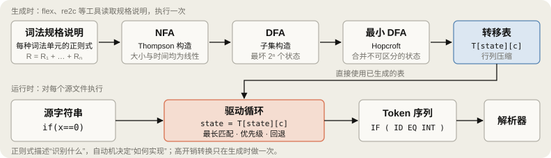

| 视频 | 问题 | 回答 | 位置 |
|---|---|---|---|
| 4-1 词法规格说明 | 如何用正则表达式把整个输入切分为 Token？ | 前缀剥离算法 + 三条决策规则 | §2 |
| 4-2 有限自动机 | 用什么执行正则表达式？ | DFA、NFA：表达能力相同，速度和大小不同 | §3 |
| 4-3 RE → NFA | 如何机械地把正则表达式转换为 NFA？ | Thompson 构造：组合五条规则 | §4 |
| 4-4 NFA → DFA | 如何消除 NFA 的非确定性？ | 子集构造：DFA 状态 = NFA 状态集合 | §5 |
| 4-5 实现 | 如何用代码运行 DFA？ | 二维转移表和驱动循环 | §6 |

---

## 2. CS143 4-1：词法规格说明（Lexical Specification）

### 2.1 复习正则表达式记号

| 记号 | 含义 | 展开为基本运算 |
|---|---|---|
| `A+` | 1 次或多次 | `AA*` |
| `A \| B` | 并集 | `A + B` |
| `A?` | 0 次或 1 次 | `A + ε` |
| `[a-z]` | 字符范围 | `'a' + 'b' + … + 'z'` |
| `[^a-z]` | 范围的补集 | $\Sigma$ 中除去 `[a-z]` 后剩余字符的并 |

CS143 幻灯片用 `+` 表示并。它与 `A+`（1 次或多次）中的 `+` 符号相同，需要根据上下文区分（10/26 §5.3）。

### 2.2 仅有 $s \in L(R)$ 还不够

第3讲结尾的问题是“字符串 $s$ 是否属于正则表达式 $R$ 的语言？”，只能回答**是或否**。判断 `"foo"` 是否为 Identifier 时足够，但词法分析器接收的是整个文件的字符流，而非预先切好的单词。

$$c_1 c_2 c_3 c_4 c_5 c_6 c_7 \dots c_n$$

`if(x==0)` 在内存中也只是字符数组 `['i','f','(','x','=','=','0',')']`。

### 2.3 切分与分类

$$\underbrace{c_1 c_2 c_3}_{w_1} \mid \underbrace{c_4 c_5 c_6 c_7}_{w_2} \mid \dots$$

词法分析器同时完成两件事。

1. **切分**：把输入分成连续片段 $w_1, w_2, \dots$ 的子字符串。
2. **分类**：对每个片段 $w_i$，找到满足 $w_i \in L(R_k)$ 的规则 $k$，标注 Token 类别。

例如 `int count` 分成 `"int"` ∈ L(Keyword)、`" "` ∈ L(Whitespace，丢弃)、`"count"` ∈ L(Identifier)。

问题在于，同一输入有多种切法。`==` 可以切成两个 `=`，也可以作为一个 `==`。§2.5 的规则用于消除这种歧义。

### 2.4 从规格说明到算法：五个步骤

**第 1 步：为每个 Token 类别编写正则表达式。**

```text
Number     = digit+
Keyword    = 'if' + 'else' + ...
Identifier = letter (letter + digit)*
OpenPar    = '('
...
```

- **Token 类别（token class）**：语法上的类别，如数字、关键字、标识符、左括号等。
- **Lexeme**：源代码中实际出现的字符串片段，如 `123`、`if`、`my_var`、`(`。

**第 2 步：将所有规则取并。**

$$R = \text{Keyword} + \text{Identifier} + \text{Number} + \dots = R_1 + R_2 + \dots$$

因为 $L(R) = L(R_1) \cup L(R_2) \cup \dots$，只要属于任意一种 Token，就属于 $L(R)$。这样可以用一个标准检查所有 Token。

**第 3 步：**设输入为 $x_1 \dots x_n$，对于 $1 \le i \le n$，检查前缀是否满足 $x_1 \dots x_i \in L(R)$。

**第 4 步：**若成功，则存在某个 $j$，使 $x_1 \dots x_i \in L(R_j)$。将该前缀输出为类别 $j$ 的 Token。

**第 5 步：**从输入中去掉 $x_1 \dots x_i$，回到第 3 步，重复直到输入为空。

本笔记将此算法称为**前缀剥离（prefix peeling）**。第 3 步的 $i$ 与第 4 步的 $j$ 不一定唯一，这是下一节要解决的问题。

### 2.5 三条决策规则

| 问题 | 示例 | 规则 |
|---|---|---|
| 长度 $i$ 有多个 | `foo`：`f`、`fo`、`foo` 都是 Identifier | **最长匹配（maximal munch）**：取最大的 $i$ |
| 规则 $j$ 有多个 | `if`：同时符合 Keyword 和 Identifier | **优先级**：选择列表中最先出现的规则 |
| 没有匹配的 $i$ | `$`、`#` 等字符 | **Error 规则**：优先级最低的兜底规则 |

三条规则按此顺序应用。先确定最长长度，只有相同长度匹配多条规则时才比较优先级。因此 `if8` 是 Identifier `if8`（3 个字符），而不是 Keyword `if`（2 个字符）（10/26 检查题 6）。

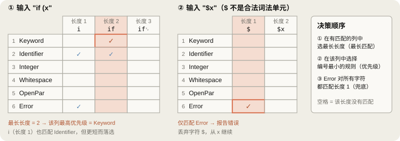

网格清楚地区分了两条规则：**最长匹配选列，优先级在该列中选行。**

> [!warning] 纠正
> 最初写道“`if` 可能符合标识符正则表达式（如果允许用 `if` 作为变量名）”。其实无论语言如何设计，`if` **总是**匹配 `letter (letter + digit)*`，因为正则表达式只看字符串形状。真正禁止将 `if` 用作变量名的，是把 Keyword 排在前面的优先级规则。

### 2.6 执行跟踪：`if (x > 0)`

假设规则顺序为 Keyword、Identifier、Integer、Whitespace、OpenPar、ClosePar、Gt（`>`）、Error。Error 匹配任意单个字符，所以每轮都会出现在长度 1 的候选中，但优先级最低，只要有其他规则匹配就不会被选中。

| 轮次  | 剩余输入         | 匹配前缀（长度：规则）                                                                | 选择              | 输出           |
| --- | ------------ | -------------------------------------------------------------------------- | --------------- | ------------ |
| 1   | `if (x > 0)` | 1: Identifier, Error · 2: Keyword, Identifier · 3(`if␠`): 无（无Token匹配，停止向前） | 长度 2，Keyword    | `<IF>`       |
| 2   | `␠(x > 0)`   | 1: Whitespace, Error · 2(`␠(`): 无（依然进行最长匹配探测，因无Token匹配才提取前缀）               | 长度 1，Whitespace | （丢弃）         |
| 3   | `(x > 0)`    | 1: OpenPar, Error · 2(`(x`): 无                                             | OpenPar         | `<LPAREN>`   |
| 4   | `x > 0)`     | 1: Identifier, Error · 2(`x␠`): 无（空格无法作为标识符，无Token匹配）                      | Identifier      | `<ID, "x">`  |
| 5   | `␠> 0)`      | 1: Whitespace, Error · 2(`␠>`): 无                                          | Whitespace      | （丢弃）         |
| 6   | `> 0)`       | 1: Gt, Error · 2(`>␠`): 无                                                  | Gt              | `<GT>`       |
| 7   | `␠0)`        | 1: Whitespace, Error · 2(`␠0`): 无                                          | Whitespace      | （丢弃）         |
| 8   | `0)`         | 1: Integer, Error · 2(`0)`): 无                                             | Integer         | `<INT, "0">` |
| 9   | `)`          | 1: ClosePar, Error                                                         | ClosePar        | `<RPAREN>`   |

> [!warning] 纠正
> 最初的跟踪写道“检查前缀 `i`：确认可能是 Identifier 候选后继续前进”。`i` 并不只是候选，而是**已经属于 $L(R)$**，即单字符 Identifier。按五步算法直接执行，此时可能就输出 `<ID, "i">`，所以必须加入最长匹配。`if` 也同时匹配 Keyword 和 Identifier，最终选 Keyword 是优先级的作用。

### 2.7 Error 规则：为什么可以宽泛定义

要准确描述“错误输入”，需要用正则表达式表示所有合法 Token 的补集。正则语言对补运算封闭，理论上可行，但表达式会很大，而且每次修改 Token 规则都要重写。

更简单的方式是把匹配**任意单个字符**的规则放在最后。

```text
Error = [任意单个字符]      // 优先级最低
```

这条规则也匹配 `a`、`1` 等合法字符，但上面的规则总能以相同长度（1）或更长长度胜出。只有其他所有规则都失败的字符才会落入 Error。此时 lexer 不停止，而是记录错误及位置（行、列），丢弃该字符，从下一字符继续，因此一次编译可以报告多个错误。

> [!note] 补充
> - flex 的 `.` 匹配**除换行外**的任意字符。因此 Error 规则通常写为 `.`，让 Whitespace 处理 `\n`。若有字符不匹配任何规则，flex 的默认规则会原样输出它（ECHO）。
> - 哪些字符属于错误取决于语言。CS143 作业语言 COOL 中，`@` 用于静态分派（`e@T.f()`），是合法 Token。

### 2.8 总结

1. 正则表达式用于**声明式地**描述 Token 的形状。
2. 实际 lexer 还需要三条规则：最长匹配、优先级、Error。
3. 将规格说明转为 DFA 后，每个字符可以通过一次查表处理（§6）。

> [!warning] 纠正
> 最初总结写道“单遍扫描：无需回退源代码缓冲区，保证 O(N)”。实现最长匹配时**需要回退**。只要仍可能形成更长的 Token，DFA 就继续读取；遇到阻塞时退回最后一次处于接受状态的位置。处理单个字符是 O(1)，但回退后会重读字符，因此最坏总开销为 O(N²)。详见 §6.3。

---

## 3. CS143 4-2：有限自动机（Finite Automata）

### 3.1 规格说明与实现

| | 正则表达式 | 有限自动机 |
|---|---|---|
| 作用 | **规格说明**：描述语言的形状 | **实现**：实际读取输入并判断 |
| 形式 | 表达式（`letter (letter + digit)*`） | 由状态和转移组成的机器 |

### 3.2 五个组成部分

| 组成部分 | 符号 | 含义 |
|---|---|---|
| 输入字母表 | $\Sigma$ | 可以读取的字符集合，如 $\{0, 1\}$、ASCII |
| 状态集合 | $S$ | 有限个状态 |
| 开始状态 | $n \in S$ | 读取输入前的状态，图中用入箭头标记 |
| 接受状态集合 | $F \subseteq S$ | 图中的双圆圈 |
| 转移 | $\text{state} \xrightarrow{a} \text{state}$ | 读到字符 $a$ 后转入的状态 |

### 3.3 接受与拒绝

**接受**必须同时满足两个条件。

1. 已读完**全部输入**。
2. 最终状态是接受状态（$s \in F$）。

**拒绝**有两种情况。

1. 读完输入后停在非接受状态。
2. 还有输入，但当前状态没有对应字符的转移，因而**卡住（gets stuck）**。

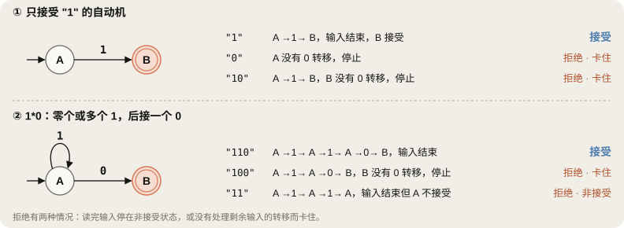

即使输入字符都属于字母表，没有贯穿整个输入的转移路径也会拒绝。`10` 虽以 `1` 开头，但 `B` 无法处理 `0`。

> [!note] 补充：缺失的转移 = 死状态
> 形式化的 DFA 定义要求转移函数 $\delta: S \times \Sigma \to S$ 对**所有**（状态，字符）对都有定义。图中省略转移，约定表示“进入未画出的死状态（dead state）”。死状态不接受，并对所有字符自环，所以进入后就必然拒绝。在表驱动实现（§6）中，死状态对应表中的实际一行。

### 3.4 DFA 与 NFA

| 特征 | DFA（确定性） | NFA（非确定性） |
|---|---|---|
| 每个（状态，字符）的转移 | 恰好 1 条，省略表示进入死状态 | 0 条、1 条或多条 |
| ε 转移 | 没有 | 可以有 |
| 执行路径 | 每个输入只有一条 | 可同时存在多条路径 |
| 接受条件 | 该路径结束于接受状态 | **任意一条路径**结束于接受状态 |

> [!warning] 常见误解
> “确定性与非确定性的区别在于有没有 ε 转移”是不对的。即使没有 ε 转移，只要**同一状态读同一字符有两条以上出边**，就是 NFA。ε 转移是另一种非确定性：机器可以“选择”是否在不读取输入的情况下转移。

ε 转移改变状态，但**输入位置不变**；普通转移在改变状态的同时将输入指针前移一格。

### 3.5 NFA 执行：跟踪状态集合

可以把 NFA 理解为“预先知道正确选择的机器”。实际计算机无法预知，因此同时跟踪所有选择，维护**当前可能所在的状态集合**。

原笔记遗漏了示例 NFA。课堂的 NFA 示例中，$A$ 对 0 和 1 自环，$A$ 读 0 可到 $B$，$B$ 读 0 到接受状态 $C$，即接受**以 00 结尾的字符串**。

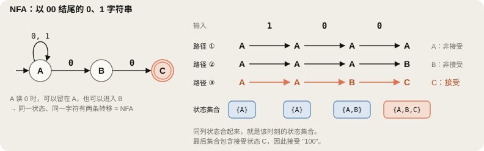

| 已读输入 | 状态集合 | 说明 |
|---|---|---|
| （开始） | $\{A\}$ | |
| `1` | $\{A\}$ | $A$ 的 1 转移只有自环 |
| `10` | $\{A, B\}$ | $A$ 读 0 分为 $A$ 和 $B$ 两条路径 |
| `100` | $\{A, B, C\}$ | $A \to \{A, B\}$, $B \to C$ |

最后集合包含接受状态 $C$，因此接受。各时刻的集合汇总了所有仍然有效路径的当前位置。

> [!note] 补充：模拟开销
> 用状态集合直接模拟 NFA，每个字符都要遍历集合中所有状态的转移，并重新计算 ε 闭包。每字符开销 O(状态数 + 边数)，若输入长度为 $N$、正则表达式大小为 $m$，则为 O($N \cdot m$)。DFA 每字符只需一次查表，正因如此，§5 要将 NFA 转为 DFA。

### 3.6 DFA 与 NFA 的权衡

| 比较项 | 结果 |
|---|---|
| 表达能力 | **相同。**两者都恰好识别正则语言。每个 NFA 都能转换为识别同一语言的 DFA（§5） |
| 执行速度 | **DFA 更快。**每个字符查表一次 |
| 大小 | **NFA 更小。**有 $n$ 个状态的 NFA 转成 DFA，最坏有 $2^n$ 个状态 |

### 3.7 状态爆炸示例：倒数第 $k$ 个字符是 1

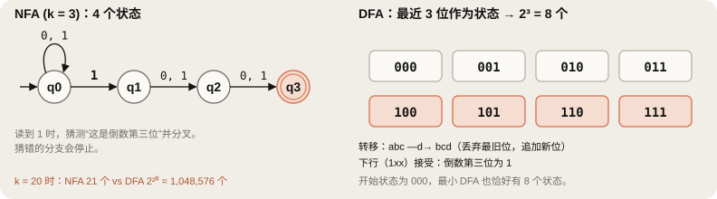

NFA 每读到 1，就猜测“它可能是倒数第 $k$ 个”，并创建一条恰好再读 $k-1$ 个字符后到达接受状态的分支，只需 $k+1$ 个状态。

DFA 不能猜测，必须记住最近 $k$ 位。状态数不能少于 $2^k$ 的证明与直观解释如下：

1. **存在差异位**：任取两个不同的 $k$ 位历史记录 $u \ne v$。既然不同，它们从左数必然存在某个第 $j$ 位不同（$1 \le j \le k$），不妨设 $u$ 的第 $j$ 位是 1，$v$ 的第 $j$ 位是 0。
2. **故意制造分歧（追加后缀）**：给二者末尾各追加 $j-1$ 个 `0`。随着新字符推入，原本左数第 $j$ 位就恰好被推到了**倒数第 $k$ 位**（因为后面有 $(k - j) + (j - 1) = k - 1$ 个字符）。此时 $u$ 的倒数第 $k$ 位是 1（属于该语言，应接受），而 $v$ 的倒数第 $k$ 位是 0（不属于该语言，应拒绝）。
   - **直观例子（$k=3$）**：取 $u = \text{011}$ 与 $v = \text{001}$，它们在左数第 $j=2$ 位不同（$u$ 为 1，$v$ 为 0）。各追加 $j-1=1$ 个 `0` 后：
     - $u0 = \text{0\textbf{1}10} \to$ 倒数第 3 位是 **1**，必须**接受（绿灯）**；
     - $v0 = \text{0\textbf{0}10} \to$ 倒数第 3 位是 **0**，必须**拒绝（红灯）**。
3. **推导矛盾（反证不能合并）**：如果 DFA 试图偷懒，把 $u$ 和 $v$ 读完后合并为同一个状态，那么在这个状态下再读取相同的输入（那 $j-1$ 个 `0`）时，根据确定性转移只能跳到同一个后继状态，最终要么同时接受、要么同时拒绝，必然会判错其中一个，产生矛盾。
4. **结论**：所有 $2^k$ 个不同的 $k$ 位字符串之间未来都有可能成为关键判断位，因此**必须各自对应互不相同的状态**，最小状态数必定不少于 $2^k$。

用 Python 验证，$k$ = 1、2、3、4、5 时，最小 DFA 状态数分别是 2、4、8、16、32。

> [!note] 补充：lexer 中会有问题吗？
> 理论最坏情况是指数级，但编程语言 Token 规则产生的 DFA 通常只有数百至数千个状态，因此 lexer 生成器会预先完整构造 DFA。允许用户输入任意正则表达式的 grep、RE2 则为了避免状态爆炸，采用读取输入时按需生成 DFA 状态的方式（lazy DFA）。

---

## 4. CS143 4-3：正则表达式到 NFA（Thompson 构造）

### 4.1 思路：结构归纳

正则表达式由五条规则（ε、字符、连接、并、重复）构成（10/26 §3.1）。为每条规则确定对应的 NFA 片段后，就可以沿语法树自底向上组合，得到整个 NFA。

为便于组合，每个片段都要满足相同约定：**一个开始状态、一个接受状态**。这样外层规则只需根据内层片段的入口和出口连接。

### 4.2 五条规则

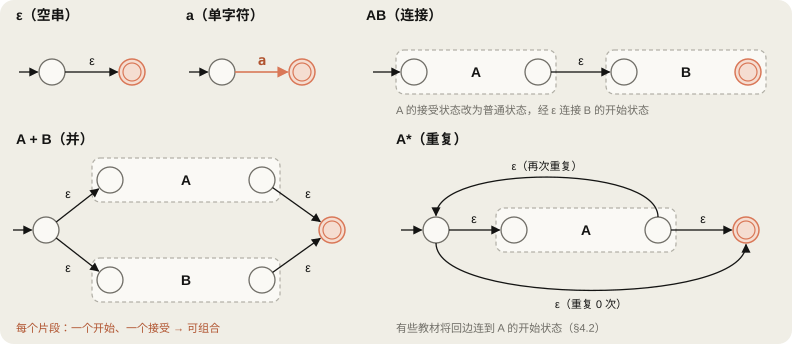

| 规则 | 构造方式 | 新增状态 |
|---|---|---|
| $\varepsilon$ | 开始 →ε→ 接受 | 2 |
| $a$ | 开始 →a→ 接受 | 2 |
| $AB$ | 将 $A$ 的接受状态改为普通状态，通过 ε 连接 $B$ 的开始状态 | 0 |
| $A + B$ | 新开始状态经 ε 到 $A$、$B$ 的开始状态；两者接受状态经 ε 到新接受状态 | 2 |
| $A^*$ | 新开始 →ε→ $A$ →ε→ 新接受；$A$ 末尾 →ε→ 新开始（再次重复），新开始 →ε→ 新接受（重复 0 次） | 2 |

> [!note] 补充：重复规则的两种版本
> 原笔记的 $A^*$ 通用图将回边连到 $A$ 的开始状态（$s_A$），而 $(1+0)^*1$ 示例图连到新的开始状态。两者都正确。Aiken 教授的课程连到新开始状态（示例的 $G \to A$），Dragon book 则使用 $f_A \to s_A$。两者都表示“将 $A$ 重复 0 次或多次”。本笔记为与 §5 示例一致，采用课程版本。

> [!note] 补充：如何处理语法糖？
> 将 `A?` 展开为 `A + ε`，将 `[a-z]` 展开为 26 个字符的并，再应用相同规则。若把 `A+` 展开为 `AA*`，会复制两份 $A$ 片段，因此实际实现会为 `A+` 单独构造片段：去掉重复规则中“重复 0 次”的边即可得到 `A+`。实际工具也会直接在一条边上标注字符集合来处理 `[a-z]`。

### 4.3 示例：$(1+0)^*1$

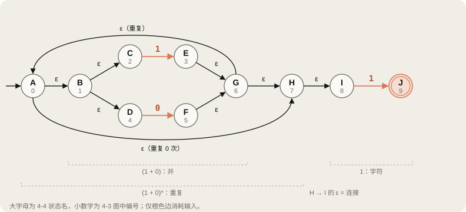

自底向上组合。

1. `1` 片段（$C \xrightarrow{1} E$）和 `0` 片段（$D \xrightarrow{0} F$）
2. `1 + 0`：新开始 $B$，新接受 $G$
3. `(1 + 0)*`：新开始 $A$，新接受 $H$；再次重复 $G \to A$，重复 0 次 $A \to H$
4. 最后的 `1` 片段（$I \xrightarrow{1} J$）
5. 连接：$H \xrightarrow{\varepsilon} I$。整个自动机只有 $J$ 一个接受状态。

字母名称来自第 4-4 讲，数字 0–9 来自第 4-3 讲。原笔记混用了两种名称，所以在同一图中并列标注。

| 数字 | 0 | 1 | 2 | 3 | 4 | 5 | 6 | 7 | 8 | 9 |
|---|---|---|---|---|---|---|---|---|---|---|
| 字母 | A | B | C | E | D | F | G | H | I | J |

### 4.4 大小与时间

每个字符（或 ε）、并和重复分别新增 2 个状态，连接不增加状态。因此状态数不超过正则表达式大小的 2 倍，每个状态最多有 2 条出边。每个片段以常数时间组合，总构造时间也与正则表达式长度成正比（O($m$)）。

以该示例验证：3 个字符（`1`、`0`、`1`）+ 1 次并 + 1 次重复 = 5 × 2 = **10 个状态**（A–J）。

---

## 5. CS143 4-4：NFA 到 DFA（子集构造）

### 5.1 三个核心思路

1. **DFA 状态 = NFA 状态集合。**读取相同输入后，NFA 可能处于的全部状态视为一个 DFA 状态，相当于提前完成 §3.5 的状态集合跟踪，不必等实际输入到来。
2. **ε 闭包**：不读取输入，仅沿 ε 边可达的状态。
3. **接受条件**：集合中只要有一个 NFA 接受状态，对应 DFA 状态就是接受状态（$X \cap F \ne \emptyset$）。

### 5.2 ε 闭包

$\varepsilon\text{-clos}(s)$ 是 $s$ 本身，以及从 $s$ 沿 ε 边走 0 次或多次可达的所有状态的集合。集合 $X$ 的闭包是各元素闭包的并集，通过图搜索计算。

```text
eps_closure(X):
    result = X; stack = X 的所有元素
    while stack 非空:
        s = stack.pop()
        for 边 s →ε→ t:
            if t ∉ result: 将 t 加入 result; stack.push(t)
    return result
```

在 §4.3 的 NFA 中计算如下。

- $\varepsilon\text{-clos}(B) = \{B, C, D\}$
- $\varepsilon\text{-clos}(G)$：$G$ 本身 → 从 $G$ 到 $H$、$A$ → 从 $H$ 到 $I$，从 $A$ 到 $B$ → 从 $B$ 到 $C$、$D$。结果为 $\{A, B, C, D, G, H, I\}$。

因为有重复边 $G \to A$，闭包还包括“向后”到达的状态（$A$、$B$、$C$、$D$），表示可以再重复一次。

### 5.3 定义对照表

| 组成部分 | NFA | 构造出的 DFA |
|---|---|---|
| 状态 | $S$ | $S$ 的子集中，从开始状态实际可达的那些集合 |
| 开始状态 | $s$ | $\varepsilon\text{-clos}(s)$ |
| 接受状态 | $F$ | $\{X \mid X \cap F \ne \emptyset\}$ |
| 转移 | $x \xrightarrow{a} y$ | $X \xrightarrow{a} \varepsilon\text{-clos}(a(X))$，其中 $a(X) = \{y \mid x \in X,\ x \xrightarrow{a} y\}$ |

有 $n$ 个状态的 NFA 只有 $2^n - 1$ 个非空子集，数量有限，因此算法必定终止。实际只构造从开始状态可达的集合，通常远少于这个数量。

### 5.4 示例：$(1+0)^*1$

| DFA 状态 | NFA 状态集合 | 是否接受？ | `0` | `1` |
|---|---|---|---|---|
| $S_0$（开始） | $\varepsilon\text{-clos}(A) = \{A,B,C,D,H,I\}$ | 否 | $S_1$ | $S_2$ |
| $S_1$ | $\varepsilon\text{-clos}(\{F\}) = \{A,B,C,D,F,G,H,I\}$ | 否 | $S_1$ | $S_2$ |
| $S_2$ | $\varepsilon\text{-clos}(\{E,J\}) = \{A,B,C,D,E,G,H,I,J\}$ | **是**（包含 $J$） | $S_1$ | $S_2$ |

在 $S_0$ 读取 `0` 时，只有 $D \to F$ 这条 0 边；读取 `1` 时有 $C \to E$ 和 $I \to J$ 两条边。$S_1$、$S_2$ 也都包含 $C$、$D$、$I$，因此重复同样的转移，不再产生新集合，构造结束。

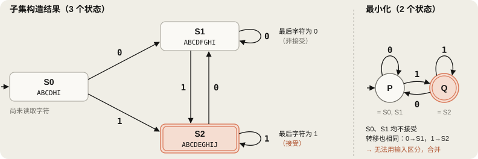

- $S_0$：尚未读取任何字符。
- $S_1$：最后读到的字符是 0，不接受。
- $S_2$：最后读到的字符是 1，接受。

### 5.5 补充：DFA 最小化

$S_0$ 和 $S_1$ 都不是接受状态，读 `0` 到 $S_1$，读 `1` 到 $S_2$。无论追加什么输入，结果都相同，无法区分，因此可以合并。最小 DFA 只有 2 个状态。实际上 $(1+0)^*1$ 表示“以 1 结尾的字符串”，只需记住“最后一个字符是否为 1”。

最小化算法反复分开可以区分的状态。先按接受与非接受分为两组，再不断拆分那些读相同字符会进入不同组的状态。Hopcroft 算法用 O($n \log n$) 完成（$n$ 为 DFA 状态数，将字母表大小视为常数）。

> [!note] 补充：lexer 的最小化
> lexer 的接受状态携带“属于哪个 Token”的信息，因此初始划分要**按 Token 类别**进行，不能只分接受与非接受。否则，接受 Keyword 和 Identifier 的状态可能被错误合并。

### 5.6 补充：优先级在生成时确定

§2.5 的优先级不是运行时扫描规则列表实现的。将所有 Token 的 NFA 从新开始状态用 ε 连接成一个大 NFA，再做子集构造；读取 `if` 后的 DFA 状态会**同时**包含 Keyword `if` 的 NFA 接受状态和 Identifier 的 NFA 接受状态。lexer 生成器在此 DFA 状态上标记最先声明的规则，即 Keyword。运行时只需读取接受状态上的标记。

---

## 6. CS143 4-5：表驱动实现（Table-driven Implementation）

### 6.1 二维转移表

用二维数组 `T[state][c]` 表示 DFA：行为当前状态编号，列为输入字符（ASCII 码），值为下一个状态。若 $S_i \xrightarrow{a} S_k$，则 `T[i][a] = k`。

§5.4 的 DFA 转成表如下（课件中的 S、T、U 分别对应 $S_0$、$S_1$、$S_2$）。

| 状态 \ 输入 | `0` | `1` |
|:---:|:---:|:---:|
| **S**（开始） | T | U |
| **T** | T | U |
| **U**（接受） | T | U |

### 6.2 驱动循环

```c
// 课件中的伪代码
i = 0;
state = 0;
while (input[i]) {
    state = A[state, input[i++]];
}
```

> [!warning] 纠正
> 课件的 `A[state, input[i++]]` 是伪代码。直接用于 C 时，逗号运算符会使它变成 `A[input[i++]]`，指向整行数组。实际应写 `T[state][c]`。另外，在 `char` 有符号的平台（如 x86 Linux 的 GCC）上，UTF-8 韩文等 0x80 以上的字节会变为负数，导致数组越界，因此要转换成 `unsigned char`。最后，循环结束后还要检查最终状态是否接受，才能完成判断。

```c
int state = START;
for (size_t i = 0; input[i] != '\0'; i++)
    state = T[state][(unsigned char)input[i]];
return accepting[state];
```

循环体没有条件分支，每个字符只有一次数组查询和一次赋值。

> [!note] 补充：实际决定速度的因素
> 虽然没有分支预测失败，但必须先知道下一个状态才能开始后续查询，因此各次查询存在**串行依赖**。处理速度大致受“每字符一次内存加载延迟”限制。表能放入 L1 缓存（每核 32–48KB）时，每字符只需几个周期；超过缓存就会变慢。这是 §6.4 压缩的重要原因。

### 6.3 lexer 驱动：最长匹配与回退

§6.2 的循环只判断“整个输入是否属于语言”。lexer 则要从输入中切出一个 Token，并满足最长匹配，因此将循环改为以下流程。

1. 持续读取，直到进入死状态。
2. 读取过程中，每经过接受状态就记录**最后接受位置和 Token**。
3. 停止后**退回**最后接受位置，输出该 Token，再从那里重新开始。

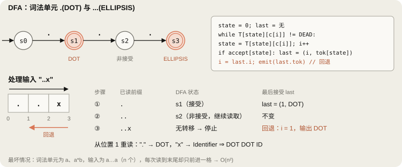

C 的 Token `.` 和 `...`（可变参数）是一个例子。读取 `..x` 时，第二个 `.` 后仍可能形成 `...`，所以虽然状态不接受，却仍然有效。直到在 `x` 处卡住，才知道 `..` 不是 `...`，需要回退一格。

```text
// 最长匹配驱动（伪代码）
while pos < n:
    state = START; i = pos; last = 无
    while i < n and T[state][c[i]] != DEAD:
        state = T[state][c[i]]; i++
        if accept[state]: last = (i, token[state])
    if last == 无:                       // 与 Error 规则效果相同
        报告错误; pos++; continue
    emit(last.token, c[pos .. last.i)); pos = last.i   // 回退
```

C++ 实现留作 10/30 的任务。

> [!note] 补充：回退的开销
> - 实际语言中，切出一个 Token 通常只回退 1–2 个字符，因此实际近似 O($N$)。
> - 最坏情况不同。如果只有 `a` 和 `a*b` 两种 Token，输入为 $n$ 个 `a`，每次都要读到末尾（因为后面可能出现 b），却只前进一格。读取字符总数为 $n + (n-1) + \dots + 1 = n(n+1)/2$。Python 验证 $n$ = 10、100、1000 时分别为 55、5050、500500。Reps（1998）提出通过记忆化在线性时间内处理的方法。
> - flex 的 `-b` 选项会将发生回退的状态报告到 `lex.backup`。

### 6.4 表压缩

按 ASCII 字节建表，每个状态有 256 列。500 个状态、每格 2 字节约为 250KB，远大于 L1 缓存，因此需要缩小表。

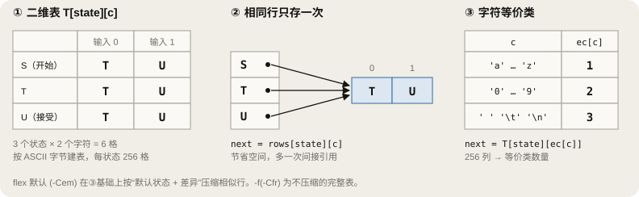

1. **行共享（课程内容）**：内容相同的行只存一次，每个状态保存指向该行的指针。示例 DFA 的三行都是 `T U`，只需保存一行。代价是 `rows[state][c]` 多了一次间接引用。
2. **字符等价类**：如果 `a`–`z` 在所有状态中行为相同，可将 26 列合为一列。先用 `ec[c]` 将字符转换为等价类编号，再查询 `T[state][ec[c]]`。
3. **默认状态 + 差异**：若各行相似但不完全相同，就指定一行为默认，仅存储不同的格子。

> [!warning] 纠正
> - 原先写道“表会增大到数十 MB”。一般 lexer 的表即使未压缩，也通常不超过数百 KB。但这已大于 L1 缓存，仍值得压缩。
> - “flex 默认使用这种行指针共享压缩”的说法也不准确。flex 默认 `-Cem` 使用字符等价类（`-Ce`）和元等价类（`-Cm`），用 `yy_base`、`yy_def`、`yy_nxt`、`yy_chk` 数组压缩表。`yy_def` 对应上面的默认状态，是行共享的更一般形式。`-f`（等同 `-Cfr`）生成不压缩的完整表，速度最快，体积也最大。

flex 生成扫描器的查询循环可简化为如下形式。

```c
do {
    yy_c = yy_ec[(unsigned char)*yy_cp];               // 字符 → 等价类
    if (yy_accept[state]) {                            // 记录 §6.3 的 last
        yy_last_accepting_state = state;
        yy_last_accepting_cpos  = yy_cp;
    }
    while (yy_chk[yy_base[state] + yy_c] != state) {   // 若不是该状态的格子
        state = yy_def[state];                         //   从默认状态继续查找
        if (state >= 模板_起点) yy_c = yy_meta[yy_c];
    }
    state = yy_nxt[yy_base[state] + yy_c];
    ++yy_cp;
} while (/* 直到进入死状态 */);
```

`yy_last_accepting_state` 和 `yy_last_accepting_cpos` 与 §6.3 伪代码中的 `last` 作用完全相同。

### 6.5 补充：三种实现方式

| 方式 | 示例 | 特点 |
|---|---|---|
| 表驱动 | flex、课程示例 | 生成器构造表，通用驱动负责运行 |
| 直接代码（direct-coded） | re2c | 为每个 DFA 状态生成 `switch`/`goto` 代码，用分支替代查表 |
| 手写 | Clang、GCC(libcpp)、MLIR `AsmParser/Lexer.cpp` | 根据首字符 `switch`，每种 Token 执行一个小循环；可细调错误提示、上下文处理（C++ `>>`，10/26 §2.5）和速度 |

手写 lexer 本质上也是将 DFA 转成代码。最长匹配通过“下一个字符还能接续就继续读”实现，优先级通过“完整读取标识符后查询关键字表”实现。10/31 在 MLIR lexer 中查找这两种逻辑。

---

## 7. 词法分析总结：各阶段开销

| 阶段 | 输入 → 输出 | 大小 | 时间 |
|---|---|---|---|
| Thompson 构造 | 正则表达式（大小 $m$）→ NFA | 状态 ≤ $2m$ | O($m$) |
| 子集构造 | NFA（$n$ 个状态）→ DFA | 最坏 $2^n$ | 最坏指数级，lexer 通常较小 |
| 最小化（Hopcroft） | DFA（$d$ 个状态）→ 最小 DFA | ≤ $d$ | O($d \log d$) |
| 表生成与压缩 | 最小 DFA → 表 | 状态 × 等价类 | 与表大小成正比 |
| 扫描 | 输入（长度 $N$）→ Token 序列 | — | 每字符查表 1 次；计入回退最坏 O($N^2$)，实际语言近似 O($N$) |
| （参考）直接模拟 NFA | 输入 → 判定 | — | O($N \cdot m$) |

高开销工作（子集构造、最小化、压缩）在生成时只做一次，运行时只需查表。得到的 Token 序列交给解析器进行语法分析（CS143 第5讲）。

---

## 8. 面试准备：多线程与 C++ 内存模型

这是 10/26 线程池问题的延伸，常见问题如下。

- `std::atomic` 如何保证原子性？
- `memory_order_relaxed` 与 `acquire`/`release` 有什么区别？
- 为什么不能用 `volatile` 作为线程间标志？
- 为什么 x86 的 acquire/release 不需要额外指令？即便如此，为什么仍要使用 `std::atomic`？

以下以 C++17 为准整理。

### 8.1 线程安全为什么会被破坏

访问共享数据时缺少同步，会产生数据竞争，或让多步操作交错，破坏不变量。即使只有单核，上下文切换也能让其他线程插入操作之间，因此问题仍会发生。

| 概念 | 需要保证什么 | 破坏后的示例 |
|---|---|---|
| 原子性 | 操作对其他线程表现为不可分割的整体 | 两个线程同时读到 5，各自加 1 后写入 6，丢失一次递增 |
| 顺序性 | 内存访问遵守程序期望的先后关系 | `ready` 已是 true，但之前写入的 `data` 仍是旧值 |
| 可见性 | 同步后，一个线程的写入对另一个线程可见 | 生产者写入还在存储缓冲区，或编译器把值保存在寄存器，消费者读不到新值 |

> [!warning] 纠正：可见性问题不只是缓存问题
> 原先写道“生产者的数据停留在缓存或缓冲区，消费者读不到”。缓存通过一致性协议（§8.3）在核间协调，因此数据仅仅位于**缓存**中，并不意味着其他核心看不到。延迟可见的原因包括进入缓存之前的**存储缓冲区**（§8.4），以及将值保存在寄存器或改变访问顺序的**编译器优化**。

**数据竞争（C++ 标准定义）**：不同线程的两个访问作用于同一内存位置，至少一个是写入，**至少一个不是原子访问**，且两者之间没有 happens-before 关系。存在数据竞争的程序具有未定义行为（UB）。

> [!warning] 纠正
> 最初只写了“非原子访问”。准确条件是“**两者中至少一个**非原子”。如果两个访问都是 `std::atomic` 操作，即使用 `relaxed` 也不构成数据竞争。

> [!note] 补充：数据竞争与竞态条件不同
> 竞态条件（race condition）是结果依赖执行顺序的**逻辑错误**。即使将所有访问改成 atomic 消除数据竞争，竞态条件仍可能存在。
>
> ```cpp
> std::atomic<int> stock{1};
> if (stock.load() > 0)    // 两个线程都可能看到 1 并通过检查
>     stock.fetch_sub(1);  // 结果为 -1：不是 UB，但程序逻辑错误
> ```
>
> 必须将检查和修改合并成一个原子操作。
>
> ```cpp
> int cur = stock.load();
> while (cur > 0 && !stock.compare_exchange_weak(cur, cur - 1)) {
>     // 失败时 cur 更新为最新值，再次检查
> }
> ```

### 8.2 `std::atomic` 如何保证原子性

`counter.fetch_add(1, std::memory_order_relaxed)` 由硬件整体完成读-改-写（RMW）。若拆成 `load` → `+1` → `store`，即使每步都用 `seq_cst`，其他线程仍能插入**两步之间**，导致递增丢失。内存顺序与原子性是两个独立维度。

| 架构 | 实现 |
|---|---|
| x86-64 | 带 `lock` 前缀的指令：不用结果时为 `lock add`，使用结果时为 `lock xadd`。访问落在同一缓存行内时，独占该行完成 RMW（缓存锁定）；跨两行（split lock）会产生代价更高的总线锁定 |
| ARMv8.0 | `LDXR`/`STXR` 循环（LL/SC）。读取时设置独占监视器；写入前若其他核心访问了该位置，`STXR` 失败并重试 |
| ARMv8.1 LSE | `LDADD`、`CAS` 等单条原子指令 |
| 非 lock-free 类型 | 库内部用锁实现（GCC 使用 libatomic）；运行时用 `is_lock_free()`，编译时用 C++17 `is_always_lock_free` 判断 |

g++ 13 `-O2` 的实际输出：

```asm
inc_unused:                  # c.fetch_add(1, relaxed);  丢弃结果
    lock addl   $1, c(%rip)
inc_used:                    # return c.fetch_add(1, relaxed);
    movl        $1, %eax
    lock xaddl  %eax, c(%rip)
```

> [!note] 补充
> - LL/SC 的 `STXR` 即使没有其他核心写入，也可能失败，例如期间发生中断。因此 C++ 区分 `compare_exchange_weak`（允许伪失败，适合循环）与 `compare_exchange_strong`（不允许伪失败，内部可能有循环）。
> - AArch64 的 GCC/Clang `-moutline-atomics` 会在运行时检测 CPU 是否支持 LSE，再选择 LSE 指令或 LL/SC 循环。
> - MESI 等缓存一致性协议只协调缓存行副本和写权限，不会把普通 `load` → `add` → `store` 自动变成原子操作。“所有原子操作都锁总线”和“绝不会锁总线”都是过度概括。

### 8.3 多核与 MESI

L1/L2 缓存属于各核心或核心组，OS 可以把线程迁移到其他核心。MESI 以**缓存行**（通常 64 字节）为单位管理副本状态和写权限。

| 状态 | 含义 | 当前核心准备写入时 |
|---|---|---|
| M (Modified) | 仅本核拥有，内容不同于内存（dirty） | 已有权限，直接写入 |
| E (Exclusive) | 仅本核拥有，内容与内存相同（clean） | 无需通信，E → M 后写入 |
| S (Shared) | 其他核心可能也有副本（clean） | 发出失效请求，收到全部响应（ACK）后转为 M |
| I (Invalid) | 不可用 | 请求数据和写权限（RFO, Read For Ownership），取得后转为 M |

- ACK 是缓存控制器之间的硬件协议响应，与软件线程无关。
- 变为 I 后不会立即重新读取；实际再次读取该地址时，才通过缓存未命中填充。

> [!note] 补充
> - 实际协议存在变体：Intel 使用 MESIF（F: Forward），AMD 使用 MOESI（O: Owned）。
> - **缓存一致性（coherence）**约束**单个地址**，要求各核心认同该地址的写入顺序。**不同地址之间**的顺序由**内存一致性模型（consistency model）**规定，这是 §8.4–8.7 的主题。
> - **伪共享（false sharing）**：不同变量如果在同一缓存行内，两核交替写入会使该行反复失效和转移。线程独立计数器可用 `alignas(std::hardware_destructive_interference_size)`（C++17，`<new>`）或 `alignas(64)` 分隔。

### 8.4 存储缓冲区与失效队列

| 结构 | 作用 | 引起的延迟 |
|---|---|---|
| 存储缓冲区 | 在获得写权限前暂存写入，使核心无需等待即可执行后续指令 | 本核可直接从缓冲区读取新值（store-to-load forwarding），其他核心暂时看不到该写入 |
| 失效队列 | 将收到的失效请求入队，立即回复 ACK，稍后再处理 | 已回复 ACK 但尚未实际失效，期间仍可能读取旧值 |

这两种结构使缓存一致性不足以保证不同地址之间的观察顺序，因此需要内存屏障和语言层面的内存顺序。

> [!note] 补充：失效队列是解释模型
> 这两种结构来自 Paul McKenney 的 "Memory Barriers: a Hardware View for Software Hackers" 所使用的解释模型。实际 CPU 内部结构不同，且往往不公开。程序员应依赖架构文档承诺的内存模型（x86-TSO、ARMv8 内存模型），而非推测内部实现。

#### 存储缓冲区造成的重排序：Store buffering 试金石测试

```cpp
std::atomic<int> x{0}, y{0};
int r1, r2;

// 线程 1
x.store(1, std::memory_order_release);
r1 = y.load(std::memory_order_acquire);

// 线程 2
y.store(1, std::memory_order_release);
r2 = x.load(std::memory_order_acquire);

// r1 == 0 && r2 == 0 是否可能？
```

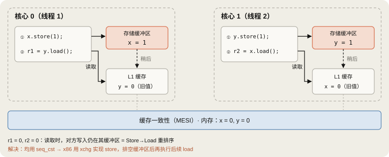

可能。两个线程的 store 仍停留在各自存储缓冲区时，load 若先执行，就会同时读到对方的旧值 0。这是 x86 也允许的 **Store→Load 重排序**。acquire/release 无法阻止：release 只防止“前面的操作移到后面”，acquire 只防止“后面的操作移到前面”，并不阻止 **release store 后面的 acquire load** 提前执行。

在这台机器（x86-64、4 核）上重复 200,000 次的结果：

| 内存顺序 | `r1 == r2 == 0` |
|---|---|
| store release / load acquire | 381 次 |
| 全部使用 `seq_cst` | 0 次 |

x86 的 `seq_cst` store 编译为 `xchg`（已用 g++ 13 确认）。带内存操作数的 `xchg` 始终表现得像带有 `lock`；锁定指令完成前会排空存储缓冲区，因此后续 load 不能提前。所有 `seq_cst` 操作处于一个全局顺序中，所以至少一个线程会看到对方写入的 1。

### 8.5 用 Release-Acquire 发布数据

```cpp
#include <atomic>
#include <cassert>
#include <thread>

int data = 0;
std::atomic<bool> ready{false};

void producer() {
    data = 42;
    ready.store(true, std::memory_order_release);
}

void consumer() {
    while (!ready.load(std::memory_order_acquire)) {
        std::this_thread::yield();
    }
    assert(data == 42);  // 退出循环后始终成立
}
```

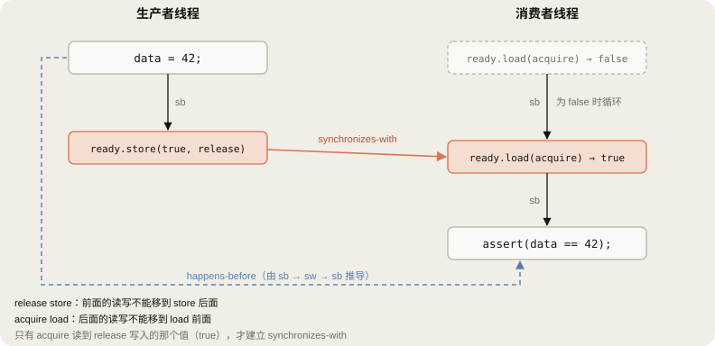

**同步关系证明：**

$$\text{写入 data} \xrightarrow{\text{sb}} \text{release 写入 ready} \xrightarrow{\text{sw}} \text{acquire 读取 ready(true)} \xrightarrow{\text{sb}} \text{读取 data}$$

sb 是 sequenced-before（单线程内的程序顺序），sw 是 synchronizes-with。只有 acquire load 读到 release store 写入的**那个值**，才会建立 sw。循环中读到 false 的轮次不建立该关系。这条链保证 `data` 写入 happens-before `data` 读取，因此无数据竞争，并保证 `data == 42`。

release 和 acquire 是**只限制一个方向的屏障**。

- release store：其**前面**的读写不能移到 store **后面**，所以 `data = 42` 不会移到 `ready = true` 之后。
- acquire load：其**后面**的读写不能移到 load **前面**，所以读取 `data` 不会提前到检查 `ready` 之前。

修改 `ready` 的类型或顺序，结果如下。

| `ready` 的类型与顺序 | 结果 |
|---|---|
| `std::atomic<bool>`，release/acquire | 正确，TSan 无警告（已实际验证） |
| `std::atomic<bool>`，两者都用 relaxed | `ready` 自身是原子的，但没有 sw。`data` 存在**数据竞争，属于 UB**。TSan 报告了 `consumer()` 对 `data` 的读取（已实际验证） |
| 普通 `bool` | `ready` 自身有数据竞争，属于 UB。实际编译器可能把 `ready` 的读取移到循环外，造成死循环 |
| `volatile bool` | `volatile` 只限制编译器删除或合并访问，不保证原子性或线程间顺序，仍有数据竞争，属于 UB |

> [!warning] 纠正
> 最初写道“使用 relaxed 可能观察到 `data == 0`”。更准确地说，**存在数据竞争，整个程序都是 UB**。观察到 `data == 0` 只是 UB 的一种表现，在 ARM 等弱内存模型中较容易出现。面试时应回答“没有 happens-before，导致数据竞争，即 UB”，而不只是“可能读到 0”。

### 8.6 内存顺序对照

| 顺序 | 保证 | 典型用途 |
|---|---|---|
| `relaxed` | 只保证该变量的原子性和修改顺序，不约束其他内存访问 | 统计计数器、增加引用计数 |
| `acquire` (load) | 后面的访问不能提前；与 release 配对时建立 sw | 检查标志后读取数据、获取锁 |
| `release` (store) | 前面的访问不能推后 | 写入数据后设置标志、释放锁 |
| `acq_rel` (RMW) | acquire + release | 用 `fetch_sub` 减少引用计数，归零时释放 |
| `seq_cst`（默认） | acq_rel + 所有 seq_cst 操作处于一个全局顺序 | Store buffering 等需要约束不同变量间 store→load 顺序的情况 |

还有 `memory_order_consume`，但主流编译器都按 acquire 处理，实际开发中通常不用。

### 8.7 x86 vs ARM

| 项目 | x86-64 (TSO) | AArch64（弱模型） |
|---|---|---|
| 普通访问重排序 | 只允许 Store→Load，保留 Load→Load、Load→Store、Store→Store 顺序 | 无依赖时，允许不同地址间几乎所有重排序 |
| relaxed load / store | `mov` / `mov` | `LDR` / `STR` |
| acquire load | `mov` | `LDAR`（v8.3 以上也可用 `LDAPR`） |
| release store | `mov` | `STLR` |
| seq_cst load | `mov` | `LDAR` |
| seq_cst store | `xchg`（或 `mov` + `mfence`） | `STLR` |
| RMW (`fetch_add`) | `lock xadd` | `LDADDAL`（LSE）或 `LDAXR`/`STLXR` 循环 |
| `atomic_thread_fence(seq_cst)` | `mfence` | `DMB ISH` |

x86 列中的 acquire load（`movzbl`）、release store（`movb`）、seq_cst store（`xchgb`）、RMW（`lock addl`/`lock xaddl`）已通过 g++ 13 `-O2` 输出验证。ARM 列来自标准映射表（§12 的 Cambridge 映射）。ARMv8 规定 `STLR` 后的 `LDAR` 不重排，因此 seq_cst 也不需要额外屏障。`LDAPR` 没有这一保证，但更轻量，用于 acquire。

> [!note] 补充：为什么 x86 也需要 `std::atomic`
> x86 硬件无需额外指令即可保证 acquire/release 顺序，但**编译器**仍可重排普通变量访问、把值保存在寄存器或消除访问。`std::atomic` 和内存顺序既选择硬件指令，也约束编译器优化。表中 x86 的 release store 看似与普通 `mov` 相同，但编译器受到相应的访问顺序限制。此外，在 x86 上“碰巧工作”的代码移到 ARM 后可能失效。Apple Silicon、AWS Graviton，以及带移动端或边缘 NPU 的 SoC，其主机 CPU 都采用 ARM。

### 8.8 面试回答示例（30 秒）

> “`std::atomic` 的原子性由硬件 RMW 指令保证。x86 通过 `lock` 前缀独占缓存行执行操作，ARM 使用 LL/SC 循环或 LSE 指令。内存顺序是另一回事：存储缓冲区等结构会改变不同地址之间的观察顺序，因此发布数据时，需要 release store 和 acquire load 建立 synchronizes-with，进而形成 happens-before。使用 relaxed 时没有这一关系，普通数据访问会产生数据竞争，即 UB。x86 采用 TSO，acquire/release 可以是普通 `mov`，但仍允许 Store→Load 重排序。如果这会影响正确性，就需要 seq_cst，此时 store 编译为 `xchg`。”

---

## 9. 算法：15. 3Sum

找出所有和为 0 的三元组 `[a, b, c]`，且**不能重复**。即使下标不同，相同的数值组合也只输出一次。

### 9.1 思路

1. 排序，O($n \log n$)。
2. 固定第一个元素 `nums[i]`，剩余问题就是在后续区间寻找和为 `-nums[i]` 的两个元素（Two Sum II）。
3. 有序区间可用双指针在 O($n$) 内查找，总时间 O($n^2$)。

### 9.2 代码

```cpp
#include <vector>
#include <algorithm>

class Solution {
public:
    std::vector<std::vector<int>> threeSum(std::vector<int>& nums) {
        std::vector<std::vector<int>> res;
        int n = static_cast<int>(nums.size());

        if (n < 3)
            return res;

        std::sort(nums.begin(), nums.end());

        for (int i = 0; i < n - 2; i++) {
            // 剪枝：排序后第一个元素大于 0，三数之和不可能为 0
            if (nums[i] > 0)
                break;

            // 去除第一个数的重复值
            if (i > 0 && nums[i] == nums[i - 1])
                continue;

            int left = i + 1;
            int right = n - 1;

            while (left < right) {
                int sum = nums[i] + nums[left] + nums[right];

                if (sum == 0) {
                    res.push_back({nums[i], nums[left], nums[right]});
                    left++;
                    right--;

                    // 左指针跳过重复值
                    while (left < right && nums[left] == nums[left - 1]) {
                        left++;
                    }

                    // 右指针跳过重复值
                    while (left < right && nums[right] == nums[right + 1]) {
                        right--;
                    }
                } else if (sum > 0) {
                    right--;
                } else {
                    left++;
                }
            }
        }

        return res;
    }
};
```

### 9.3 为什么正确

**双指针不会漏解的原因：**若 `sum > 0`，`nums[right]` 与当前位置 `left` 及其右侧的任意候选组合，和都不小于 `sum`，不可能为 0，因此可以丢弃 `right`。若 `sum < 0`，同理可以丢弃 `left`。每一步都确定排除一个候选，不会漏掉有效数对，与 10/26 §7.2 第 11 题的证明相同。

**去重正确的原因：**

- 第一个元素：若 `nums[i] == nums[i - 1]` 就跳过。`i - 1` 的搜索区间包含 `i` 的搜索区间，以相同数值开头的组合已经在 `i - 1` 时找全。
- 第二、三个元素：只在找到答案后跳过相同值。`nums[i]` 和 `nums[left]` 固定后，`nums[right]` 唯一确定，再使用相同的 `nums[left]` 只会重复同一组合。

**剪枝：**数组有序，若 `nums[i] > 0`，后面的元素也全为正数，不可能和为 0。

### 9.4 执行示例

`[-1, 0, 1, 2, -1, -4]` 排序后为 `[-4, -1, -1, 0, 1, 2]`。

| i | nums[i] | 过程 | 找到的组合 |
|---|---|---|---|
| 0 | -4 | 加上最大的两个数仍为 -4 + 1 + 2 = -1 < 0，`left` 一直前移 | — |
| 1 | -1 | (-1, -1, 2) 和为 0 → 记录；然后 (-1, 0, 1) 和为 0 → 记录 | `[-1,-1,2]`, `[-1,0,1]` |
| 2 | -1 | `nums[2] == nums[1]` → 跳过 | — |
| 3 | 0 | (0, 1, 2) 和为 3 > 0 → `right--` → `left == right`，结束 | — |

结果为 `[[-1,-1,2], [-1,0,1]]`。

### 9.5 复杂度与额外剪枝

- 时间 O($n^2$)，排序空间 O($\log n$)，不计结果数组。
- 数值范围为 $[-10^5, 10^5]$，三数之和可用 `int` 保存。

```cpp
// 可放在 for 循环开头，去重检查前后均可
if (nums[i] + nums[i + 1] + nums[i + 2] > 0) break;     // 最小组合也为正
if (nums[i] + nums[n - 2] + nums[n - 1] < 0) continue;  // 最大组合也为负
```

第一条已覆盖 `nums[i] > 0` 的检查，因为若 `nums[i] > 0`，后面的两个数也都是正数。

> [!note] 补充：常见错误
> - 用 `nums[i] == nums[i + 1]` 去重第一个元素会出错。对 `[-1, -1, 2]` 会跳过 `i = 0`，到 `i = 1` 时只剩一个元素，漏掉答案。正确方式是“与前一个相同则跳过”。
> - 用 `set<vector<int>>` 去重也能得到正确结果，但会增加开销。面试通常期望使用上述指针跳过方式。
> - 用哈希集合解 Two Sum 也能达到 O($n^2$)，但去重更复杂，占用内存也更多。

---

## 10. 检查题

在 11/2 复习时先自己回答，再展开核对。

> [!question]- 1. 对 `if (x` 直接应用 §2.4 的五步算法，为什么第一个 Token 可能是 `<ID, "i">`？用什么规则避免？
> 第 3 步只要求“存在某个 $i$”使 $x_1 \dots x_i \in L(R)$。单字符 `i` 也是 Identifier，所以 $i = 1$ 就成功。最长匹配要求选最大的 $i = 2$，即 `if`。

> [!question]- 2. 只有 `.`（DOT）与 `...`（ELLIPSIS）两种 Token 时，`....` 和 `.....` 分别如何切分？哪种情况需要回退？
> `....` 分为 ELLIPSIS DOT。读完 `...` 后的状态没有 `.` 转移，在读取第 4 个字符前停止；最后接受位置 3 与当前位置相同，无需回退。
> `.....` 分为 ELLIPSIS DOT DOT。扫描第二个 Token 时读到 `..` 后输入结束，停在非接受状态，需要退回一格到最后接受位置 4。

> [!question]- 3. DFA 图中未画出的（状态，字符）转移是什么意思？表驱动实现如何处理？
> 表示进入未画出的死状态。表中死状态有实际的一行，所有省略转移对应的格子都填入该行编号。

> [!question]- 4. NFA 可以完全没有 ε 转移吗？
> 可以。同一状态读同一字符有两条以上转移就是 NFA。§3.5 的示例便是如此：$A$ 读 0 可以到 $A$ 或 $B$。

> [!question]- 5. 为什么“倒数第三个字符是 1”的语言，DFA 不能少于 8 个状态？
> 任意两个不同的 3 位字符串在某个位置 $j$ 不同；追加 $j-1$ 个 0 后，只有一方属于该语言。如果读完两个字符串后处于相同状态，就无法区分。因此 8 个字符串必须对应不同状态（§3.7）。

> [!question]- 6. `a(b|c)*` 的 Thompson NFA 有几个状态？子集构造结果和最小 DFA 呢？（10/29 手动转换练习）
> 3 个字符 + 1 次并 + 1 次重复 = 5 × 2 = 10 个状态。子集构造得到 4 个 DFA 状态：开始（非接受）、读 `a` 后（接受）、读 `b` 后（接受）、读 `c` 后（接受）。三个接受状态读 `b` 都到“读 `b` 后”，读 `c` 都到“读 `c` 后”，读 `a` 都进入死状态，无法区分。最小 DFA 为开始和接受两个状态，不计死状态。已用 Python 验证。

> [!question]- 7. 读取 `if` 后的 DFA 状态包含哪些 NFA 接受状态？lexer 生成器给它标记哪个 Token？
> 同时包含 Keyword `if` 的接受状态和 Identifier 的接受状态。生成器标记先声明的 Keyword，优先级在生成时确定（§5.6）。

> [!question]- 8. 将 `state = A[state, input[i++]];` 直接作为 C 编译会怎样？
> 逗号运算符使其变成 `A[input[i++]]`。若 `A` 是二维数组，结果是一行数组，不能赋给 `int`，会产生错误或警告。应写为 `T[state][(unsigned char)input[i++]]`。

> [!question]- 9. 发布代码中将 `ready` 改为 relaxed，会有什么问题？
> `ready` 自身是原子的，但没有 synchronizes-with，`data` 的读写之间也没有 happens-before。普通变量 `data` 存在数据竞争，属于 UB，TSan 也会报告。

> [!question]- 10. 为什么 Store buffering 测试的 acquire/release 无法避免 `r1 == r2 == 0`？如何解决？
> release 只阻止前面的操作移到后面，acquire 只阻止后面的操作移到前面。“release store 后的 acquire load”仍可能重排，即 x86 也允许的 Store→Load 重排序。全部改为 seq_cst 后，所有 seq_cst 操作处于同一全局顺序，就能阻止该结果。x86 的 store 会变为 `xchg`。

> [!question]- 11. MESI 中写入 S 状态缓存行需要什么？E 状态呢？
> S：向其他核心发出失效请求，收到全部 ACK 后转为 M，期间写入在存储缓冲区等待。E：没有其他副本，无需通信即可转为 M 并写入。

> [!question]- 12. 3Sum 的首元素去重若写成 `nums[i] == nums[i + 1]`，什么输入会出错？
> `[-1, -1, 2]`。跳过 `i = 0` 后，到 `i = 1` 时 `left = 2`、`right = 2`，循环不执行，漏掉 `[-1, -1, 2]`。

---

## 11. 纠正内容汇总

| 位置 | 最初理解 | 纠正后的内容 |
|---|---|---|
| §2.2 | 无法用单个正则表达式匹配整个源文件 | 可写为 $R^* = (R_1 + \dots + R_n)^*$；问题是只返回是或否，不能给出切分与分类 |
| §2.5 | 只有允许作为变量名时，`if` 才符合标识符正则表达式 | 正则表达式只看形状，所以始终匹配；成为 Keyword 是优先级的作用 |
| §2.6 | 前缀 `i` 只是“检查候选后继续前进” | `i` 已属于 $L(R)$（Identifier），所以需要最长匹配 |
| §2.6 | `if` 匹配 $R_\text{Keyword}$ | 同时匹配 Keyword、Identifier，由优先级选择 Keyword |
| §2.8 | 单遍扫描，不需要缓冲区回退，保证 O(N) | 最长匹配会退回最后接受位置；最坏 O(N²)，实际语言近似 O(N) |
| §6.2 | `A[state, input[i++]]` | C 中这是逗号运算符；应写 `T[state][(unsigned char)input[i++]]`，循环后检查是否接受 |
| §6.4 | 表会增大到数十 MB | 通常不超过数百 KB，但已超过 L1，值得压缩 |
| §6.4 | flex 默认模式 = 行指针共享 | 默认 `-Cem`：字符等价类 + 元等价类 + base/def/nxt/chk 压缩；`-f` 为不压缩的完整表 |
| §8.1 | 可见性问题是数据停留在缓存中 | 缓存由一致性协议协调，原因包括存储缓冲区与编译器优化 |
| §8.1 | 数据竞争条件：“非原子访问” | “至少一个非原子”；两者都为 atomic 时，即使 relaxed 也不构成数据竞争 |
| §8.5 | relaxed 可能观察到 `data == 0` | 数据竞争意味着 UB，看到 0 只是其中一种表现 |

主要补充内容：

| 位置 | 补充 |
|---|---|
| §0.1 | 计划检查及 10/30–11/2 计划 |
| §2.7 | flex 的 `.` 不含换行、COOL 的 `@` |
| §3.3 | 缺失转移 = 死状态 |
| §3.5 | 原笔记遗漏的示例 NFA、NFA 模拟开销 |
| §3.7 | $2^k$ 下界证明、lazy DFA |
| §4.2 | 重复规则的两种版本、语法糖处理 |
| §4.3–4.4 | 4-3 数字名称与 4-4 字母名称对照，状态数 ≤ 2m 的依据 |
| §5.5–5.6 | DFA 最小化（3 → 2）、lexer 的最小化、生成时确定优先级的原理 |
| §6.2 | `unsigned char` 转换、串行依赖与缓存 |
| §6.3 | 最长匹配驱动（最后接受位置 + 回退）、O(n²) 最坏示例 |
| §6.4–6.5 | 字符等价类、flex 查询循环、表驱动、直接代码与手写 lexer |
| §7 | 各阶段开销表 |
| §8.1 | 数据竞争与竞态条件的区别、CAS 循环 |
| §8.2 | 实际 x86 汇编、`compare_exchange_weak`、outline atomics |
| §8.3 | MESIF/MOESI、coherence 与 consistency、伪共享 |
| §8.4 | Store buffering 试金石测试与实测结果 |
| §8.5–8.7 | 单向屏障、`volatile`、内存顺序表，扩展到 seq_cst、RMW、fence 的 x86/ARM 映射 |
| §8.8 | 30 秒回答示例 |
| §9 | 正确性证明、执行示例、额外剪枝、常见错误 |

---

## 12. 参考资料

- [Stanford CS143 Compilers (Alex Aiken)](https://web.stanford.edu/class/cs143/)
- [flex 手册](https://westes.github.io/flex/manual/): Options Affecting Scanner Behavior(`-C`, `-f`, `-b`), Performance Considerations
- T. Reps, "'Maximal-Munch' Tokenization in Linear Time", ACM TOPLAS 20(2), 1998
- [C++ 标准草案：数据竞争 [intro.races]](https://eel.is/c++draft/intro.races)
- [C++ 标准草案：内存顺序 [atomics.order]](https://eel.is/c++draft/atomics.order)
- [C/C++11 mappings to processors (Cambridge)](https://www.cl.cam.ac.uk/~pes20/cpp/cpp0xmappings.html)
- Paul E. McKenney, "Memory Barriers: a Hardware View for Software Hackers"
- [MLIR `AsmParser/Lexer.cpp`](https://github.com/llvm/llvm-project/blob/main/mlir/lib/AsmParser/Lexer.cpp)
