# 11月2日学习记录

学习了斯坦福 CS143 第5讲：正则语言的局限、上下文无关文法、推导、语法分析树和二义性。周末和同学去了北汉山，学习进度稍有延后；第5讲也没能一次理解，因此按问题顺序重新整理。

> [!info] 阅读说明
> - 正文整理了自己的理解。“纠正”标出原先理解有误的地方，“补充”标出新增内容。
> - 去掉原笔记对应课件的“图 N”编号，图示统一引用 `assets/10_28/` 中的 SVG，原来的3张 Mermaid 图也已重绘为 SVG。
> - 原笔记记录：用 Python 穷举字符串并统计语法分析树，检查了13个 Token 以内的5,439个表达式，以及17个 Token 以内的281个悬空 else 示例。有限长度的穷举不能替代证明。
> - 对 DFA 的局限（§1.1），原笔记在1,054,474个状态数不超过4的 DFA 上，检查了证明中的两个字符串是否到达相同状态。
> - **原验证没有实际运行 Bison。** 当时未安装 Bison，也无权下载外部二进制。§6 的冲突数量与过程来自按 Bison 手册规则编写的 Python LALR(1) 分析表生成器；实际复现方法见 §6.7。
> - 原笔记曾对照 CS143 Lecture 5 PDF（Aiken 原稿、Kjolstad 修订），与所看视频版本可能不同；§6.8 的 MLIR 内容来自对 `AffineParser.cpp` 的阅读。
> - 只看纠正内容可直接阅读 §9。以上是原笔记的验证记录，并非本次翻译重新执行的实验。

## 0. 第5讲概览

第5讲由五个问题串联起来，不知道卡在哪里时，可以从表中不理解的问题开始阅读。

| 顺序 | 问题 | 回答 | 位置 |
|---|---|---|---|
| 1 | DFA 为什么不能匹配任意深度的括号？ | 状态数有限，无法记录无限增长的深度 | §1 |
| 2 | 用什么描述嵌套结构？ | 上下文无关文法（CFG），规则中可以再次包含自身 | §2 |
| 3 | 文法如何表示输入结构？ | 把推导画出来，就得到语法分析树 | §3 |
| 4 | 同一输入出现两棵树怎么办？ | 文法有二义性，可以分层改写消除 | §4、§5 |
| 5 | 不改写文法也能处理吗？ | 声明优先级与结合性，解决分析冲突 | §6 |

容易混淆的概念集中在 §7。

### 0.1 计划检查

原笔记未找到10/27笔记中10/30至11/2计划的完成记录，当时的仓库也没有10/29之后的成果。因此将迷你 lexer、MLIR `Lexer.cpp` 阅读、指针和线程池、复习等项目按未完成顺延。已经完成的项目可从下表删除。

| 日期 | 主题 | 任务 | 时长 |
|---|---|---|---|
| 11/3 周二 | 手动练习第5讲 | 不看答案完成 §8；分别用 §4 的三种文法画出 `id + id * id` 的树 | 2h |
| 11/4 周三 | 迷你 lexer（顺延） | 用 C++ 实现10/27 §2.5的三条规则和 §6.3的回退 | 2h |
| 11/5 周四 | 阅读解析器代码（顺延及新增） | 在 MLIR `Lexer.cpp` 和 `AffineParser.cpp` 中查找最长匹配与优先级处理，见 §6.8 | 2h |
| 11/6 周五 | CS143 第6讲 | 错误处理、AST 构建、递归下降解析 | 2h |
| 11/7 周六 | C++ 与 Bison 实践（顺延及新增） | 指针基础、线程池 TSan 检查、用 Bison 复现 §6.7 的表格 | 4h |
| 11/8 周日 | 复习 | 重做答错的自测题，进行周复盘 | 1h |

这张表只衔接 CS143 主线，与06文档《每日学习计划与作息》中的 W2（11/2至11/8，LLVM/MLIR 构建与参考实现）时间重叠，两项计划难以同时完整执行。

---

## 1. 正则语言的局限

### 1.1 DFA 为什么无法处理任意深度的嵌套括号

考虑语言：

$$
L = \{(^i )^i \mid i \ge 0\}
$$

```text
ε
()
(())
((()))
...
```

左括号先出现，随后是数量相同的右括号。嵌套的 `if ... then ... else ... fi` 也有类似结构。

**有限自动机的状态数有限，装不下无限增长的信息：**

1. **有限状态只能算“余数”**：状态间循环只能追踪有限规律（例如 2 个状态区分奇偶，3 个状态记录模 3），但**无法精确记录无上限的数字**。
2. **括号匹配需要“无限精确记忆”**：读入 10,000 个左括号，必须精确确认右括号也恰好有 10,000 个，固定数量的状态根本无法保存任意大的计数。
3. **反证法核心（抽屉原理）**：假设 DFA 只有 $k$ 个状态，当读入超过 $k$ 个左括号时，必然至少有两个不同深度的状态发生重合（比如读了 $i$ 个和读了 $j$ 个左括号后停在同一状态，机器发生了“失忆”）。此时再喂入相同的 $)^i$，合法的 $(^i)^i$ 与非法的 $(^j)^i$ 就会得到完全相同的接受结果，机器必然判错。

无论状态数 $k$ 设得多大，这一矛盾始终存在，因此**不存在识别任意深度括号匹配的 DFA**。

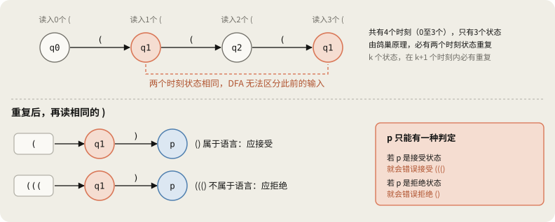

> DFA 只有有限状态信息，没有随嵌套深度增长的独立栈，因此无法识别任意深度的这类括号结构。

> [!note] 补充：限制深度后可以使用 DFA
> 问题在于深度没有上限。若限定深度不超过 $n$，字符串数量有限，就可以用 DFA 识别。原笔记最小化实验得到：$\{(^i)^i\mid0\le i\le n\}$ 的最小 DFA 包含死状态时有 $2n+2$ 个状态。$n$ 为1、2、3、5、10、100时，状态数分别为4、6、8、12、22、202。状态数随深度增长，固定的 $k$ 个状态无法处理所有深度。

> [!note] 补充：什么时候计数器足够，什么时候需要栈
> 仅处理 $(^i)^i$ 时，一个整数计数器配合阶段检查即可。多种括号混合时还要记录打开的种类和顺序：要接受 `([])`、拒绝 `([)]`，通常用栈保存这些信息。上下文无关语言恰好是非确定性下推自动机能够识别的语言。

### 1.2 词法分析与语法分析的分工

描述这些结构的工具是**上下文无关文法**（Context-Free Grammar，CFG）和**语法分析器**（Parser）。

| 阶段 | 输入 | 输出 | 主要理论与工具 | 处理的结构 |
|---|---|---|---|---|
| 词法分析 | 字符流 | Token 流 | 正则表达式、DFA | 标识符、数字、关键字等单个 Token |
| 语法分析 | Token 流 | 语法分析树或 AST 等结构 | CFG、使用栈的分析方法 | 嵌套语法、递归表达式 |

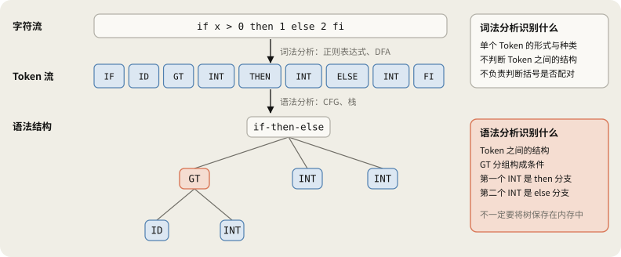

`if-then-else` 树根代表整个条件结构，下面是条件表达式、`then` 分支和 `else` 分支，每个分支又可以包含另一个条件结构。这种在同类结构中再次包含自身的递归定义，能够描述嵌套。

### 1.3 `Parse tree (may be implicit)` 的含义

课件中的 `may be implicit` 表示树不一定需要作为独立数据结构保存。

- **显式树**：在内存中创建并连接节点，例如构建 AST。
- **隐式树**：不保存整棵树，但分析过程仍体现结构。递归解析时直接生成代码，层次关系可体现在函数调用与调用栈中，而不留下独立的树。

语法分析与保存整棵树是两件事。

### 1.4 词法分析与语法分析能否合并

通常流程为 $\text{字符}\to\text{Token}\to\text{语法结构}$。也可以不设独立词法分析器，直接从字符进行**无扫描器解析**（Scannerless Parsing）。它同时处理字符级与语法级规则，适用于同一字符串根据上下文充当关键字或标识符等情况。PEG、Packrat Parsing 可以用于实现，但使用这些技术不意味着一定取消词法分析器。

> [!note] 补充：为什么通常仍然分开
> 正则语言都可以用 CFG 表示，理论上可以合并。分开后，空白和注释等字符级规则不必写入语法规则，文法更简洁；Token 识别也能通过表驱动 DFA（10/27 §6）高效完成。

---

## 2. 上下文无关文法与推导

### 2.1 CFG 的四个组成部分

| 组成部分 | 含义 | 括号文法中的例子 |
|---|---|---|
| 终结符 $T$ | 不再由规则替换的符号 | `(`、`)` |
| 非终结符 $N$ | 可替换为其他符号串的占位符 | `S` |
| 开始符号 | 推导开始时的非终结符 | `S` |
| 产生式 | 规定非终结符可以替换为什么 | $S\to(S)$、$S\to\varepsilon$ |

**终结符**（Terminal）表示到此不再替换，如 `(`、`)`、`if`、`+`；语法分析中的 `ID`、`INT` 等 Token 种类也可以是终结符。

**非终结符**（Nonterminal）是文法中的占位符。`EXPR` 表示“这里放一个表达式”，既可以是单个标识符，也可以是复杂条件表达式。

产生式 $A\to\alpha$ 读作“可以把非终结符 $A$ 替换为符号串 $\alpha$”。

- $S\to(S)$：用一对括号包住 $S$，内部的 $S$ 可继续展开。
- $S\to\varepsilon$：将 $S$ 替换为空串。

> [!note] 补充：大写字母不一定是非终结符
> 课件约定非终结符使用大写、终结符使用小写，并将第一条规则左侧作为开始符号。但 Token 经常写成 `ID`、`INT`。应依据文法中的符号定义判断；出现在 CFG 产生式左侧的一定是非终结符。

### 2.2 逐步观察推导

**推导**（Derivation）从开始符号出发，不断应用产生式：

1. 从只有开始符号的状态出发。
2. 选择一个非终结符，替换为某条产生式右侧。
3. 重复第2步，直到没有非终结符。

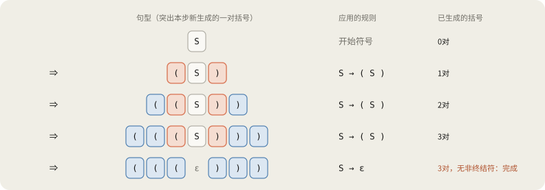

$$
S\Rightarrow(S)\Rightarrow((S))\Rightarrow(((S)))\Rightarrow((()))
$$

### 2.3 文法如何保证括号数量相等

$S\to(S)$ **每次同时生成一对左右括号**。应用10,000次就得到10,000对。DFA 识别输入时需要追踪数量，该文法则在生成时就保持数量一致。

- 文法描述字符串如何生成。
- 分析器检查给定字符串是否符合文法，可用栈追踪嵌套结构。

该文法只能生成 `(())` 这样由外向内包裹的形式，不能生成 `()()`。

> [!note] 补充：全部合法括号串的文法
> 课件把 $(^i)^i$ 称为“balanced parentheses”，但若要包括并排的 `()()`，可用：
>
> $$S\to(S)S\mid\varepsilon$$
>
> 前面的 $(S)$ 生成第一对括号及其内部，后面的 $S$ 生成右侧剩余部分。原笔记穷举覆盖长度不超过14的626个合法括号串：全部能生成，没有生成其他字符串，每个字符串只有一棵树。

### 2.4 为什么叫“上下文无关”

CFG 产生式左侧只有**一个非终结符**。出现 $S$ 时，无论前后是什么，都可以应用它的规则。替换不以周围上下文为条件，因此称为上下文无关。

| 文法概念 | 制作面包的类比 |
|---|---|
| 非终结符 | 还能加工的面团 |
| 终结符 | 成品面包 |
| 产生式 | 加工配方 |
| 推导 | 按配方将面团加工为成品 |

> [!note] 补充：CFG 的能力也有限
> 对一般编程语言，“变量使用前必须声明”需要核对可能相距很远的标识符信息，不能只靠 CFG 完成。这类检查由语法分析之后的语义分析处理。

### 2.5 记号：$\to$、$\Rightarrow$、$\Rightarrow^*$、$L(G)$

| 记号 | 含义 | 例子 |
|---|---|---|
| $A\to\alpha$ | 文法中的产生式 | $S\to(S)$ |
| $\alpha\Rightarrow\beta$ | 应用一次规则得到 $\beta$ | $(S)\Rightarrow((S))$ |
| $\alpha\Rightarrow^*\beta$ | 应用零次或多次规则得到 $\beta$ | $S\Rightarrow^*((S))$ |

$\alpha$、$\beta$ 是文法符号串，可混合终结符和非终结符。`((S))` 中括号是终结符，`S` 是非终结符。从开始符号能够推导出的形式称为**句型**（Sentential Form）；最终只含终结符的字符串也属于句型。

$$
L(G)=\{w\in T^*\mid S\Rightarrow^*w\}
$$

字符串属于 $L(G)$，要求能从开始符号推导出来，且全部符号都是终结符。`((S))` 虽然可以推导出来，但还有非终结符，因此不属于 $L(G)$。

### 2.6 为什么终结符不再改变

1. CFG 没有替换终结符的规则，产生式左侧只能是非终结符。
2. 已生成的终结符会保留，展开其他非终结符不会修改它们。
3. 语法文法中的终结符通常对应 Token 种类，如 `IF`、`ID`、括号和分号。具体变量名 `count` 可作为 `ID` Token 的附加信息传递。

### 2.7 Lexer 已生成 Token，为什么还需要非终结符

词法分析器能将 `((((1 + 2) * 3) - 4))` 切分为括号、数字和运算符，却不能仅凭这些 Token 的识别回答：括号是否配对？哪个表达式是谁的操作数？`else` 属于哪个 `if`？

非终结符表示这些 Token 之间的结构。用一句自然语言作简化类比：

```text
<句子> → <主语> <谓语> <宾语>
<主语> → 敏圭
<谓语> → 吃
<宾语> → 苹果
```

“敏圭”“吃”“苹果”是实际出现的词，`<主语>` 等则是解释其作用的类别。编程语言的非终结符也有类似作用。

```text
if x > 0 then 1 else 2 fi          （源代码）
IF ID GT INT THEN INT ELSE INT FI   （Token 序列）
```

```text
PROGRAM → STMT

STMT → if EXPR then STMT else STMT fi
     | EXPR

EXPR → EXPR > EXPR
     | ID
     | INT
```

`if`、`>`、`ID`、`INT` 是对应输入的终结符，`PROGRAM`、`STMT`、`EXPR` 是表示结构的非终结符。

1. `PROGRAM → STMT`：本例的程序由一条语句组成。
2. `STMT → if EXPR then STMT else STMT fi`：条件语句包含条件表达式和两个分支。
3. `STMT → EXPR`：一个表达式也可以作为语句，需要它才能把 `1`、`2` 推导为分支体。
4. `EXPR → EXPR > EXPR | ID | INT`：表达式可以是比较式、标识符或整数字面量。

| 缩写 | 英文 | 含义 | 作用 | 例子 |
|---|---|---|---|---|
| `PROGRAM` | Program | 程序 | 整体程序结构 | 整个源文件 |
| `STMT` | Statement | 语句 | 执行单元、控制流或状态修改 | `if (...) {...}`、`x = 10;`、`return;` |
| `EXPR` | Expression | 表达式 | 构成值或运算的语法结构 | `1 + 2`、`x > 0`、`a * b` |
| `ID` | Identifier | 标识符 | 变量名、函数名等对应的 Token | `x`、`count`、`foo` |
| `INT` | Integer | 整数字面量 | 整数常量对应的 Token | `0`、`42`、`100` |

语句与表达式的具体区别取决于语言。

> [!note] 补充：这个说明用文法也有二义性
> `if x > 0 then 1 else 2 fi` 只有一棵树，但 `EXPR → EXPR > EXPR` 会让 `a > b > c` 出现两棵树，问题见 §4。

### 2.8 推导与归约：方向相反

定义文法时，从开始符号展开非终结符，最终生成终结符串。分析器面对已有输入，识别结构。自底向上分析可理解为反复回答：

> 能把 `x > 0` 归为一个 `EXPR` 吗？
> 能把 `if EXPR then STMT else STMT fi` 归为一个 `STMT` 吗？
> 能继续归并，直到整个输入对应开始符号吗？

将产生式右侧归并为左侧非终结符的动作称为**归约**（Reduction）。成功后可用树等形式表示结果，失败则报告 `Syntax Error: unexpected token` 等错误。并非所有分析器都通过归约工作；自顶向下分析从开始符号展开，同时匹配输入。

用建筑类比：Token 是材料，非终结符是房间、门等结构角色，产生式是设计规则，分析器检查材料排列是否符合规则。

### 2.9 使用 `|` 合并规则与递归嵌套

左侧相同的规则可用表示“或者”的 `|` 合并，含义不变。以 COOL 的一部分为例：

```text
EXPR → if EXPR then EXPR else EXPR fi
     | while EXPR loop EXPR pool
     | id
```

可以生成：

```text
id
if id then id else id fi
while id loop id pool
if while id loop id pool then id else id fi
if if id then id else id fi then id else id fi
```

最后两行把整个控制结构放进另一 `if` 的条件位置。该位置为 `EXPR`，所以任何由 `EXPR` 推导出的结构都可以放入。

像嵌套盒子：最小盒子是 `id`，较大的盒子是 `if` 或 `while`，大盒子留有 `EXPR` 槽位，既能放 `id`，也能放另一个大盒子。

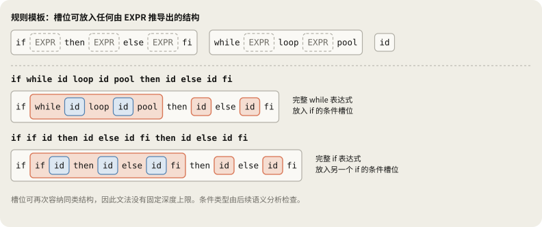

同一非终结符再次出现在规则中，因此文法没有固定嵌套深度上限。但这只是语法层面的可能性；条件类型等语义规则需要另外检查。

### 2.10 算术表达式文法

后续反复使用的文法：

$$
E\to E+E\mid E*E\mid(E)\mid id
$$

```text
id
id + id
id + id * id
(id + id) * id
```

出现 $E$ 的位置，可再次放入含加法、乘法或括号的表达式。

### 2.11 引入 CFG 后仍存在的问题

1. 仅判断是否合法不够，还要知道如何解释结构，供类型检查和中间代码生成使用。
2. 错误报告需要易懂：缺分号或右括号时说明位置和原因，也可通过错误恢复继续分析，一次发现多个错误。
3. 文法形式影响实现：词法分析有 `flex`，语法分析有 Bison、Yacc。同一语言的不同文法，分析难度可能不同。

第三个问题的典型例子就是 §4 的二义性。

---

## 3. 语法分析树与推导顺序

### 3.1 推导如何形成语法分析树

把开始符号作为根，每次应用 $X\to Y_1\dots Y_n$，就在 $X$ 下添加子节点 $Y_1\dots Y_n$。以 `id * id + id` 为例：

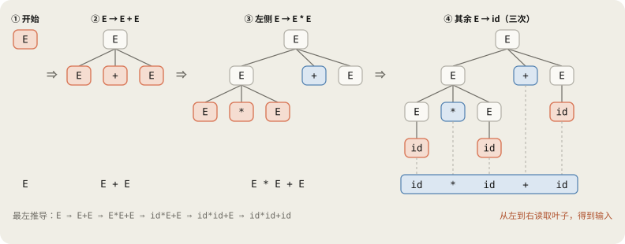

$$
E\Rightarrow E+E\Rightarrow E*E+E\Rightarrow id*E+E\Rightarrow id*id+E\Rightarrow id*id+id
$$

### 3.2 能从树中读出什么

**从左到右读取叶子，就得到输入。** 完整树的内部节点是非终结符，叶子是终结符（空产生式通常另以 $\varepsilon$ 表示）。这里读取的是叶子，不是普通二叉树的中序遍历。

**树还表达运算分组。** 这部分信息没有直接写在输入里。上图中乘法结果是加法的左操作数，因此分组为 `(id * id) + id`。

> [!note] 补充：分组不等于执行顺序
> 树规定值的依赖关系，不规定所有运行时顺序。C++ 的 `f() + g() * h()` 确定将 `g() * h()` 的结果参与加法，但没有指定 `f`、`g`、`h` 的调用先后。

| 对比项            | 语法分析树（Parse Tree） | AST           |
| -------------- | ----------------- | ------------- |
| 内容             | 完整记录产生式应用结构       | 保留后续处理所需的核心结构 |
| `(id)` 的括号     | 有 `(`、`E`、`)` 节点  | 通常省略，树形已表达分组  |
| `E → E'` 等单一规则 | 增加一层节点            | 通常省略          |

### 3.3 最左推导与最右推导

推导中可同时存在多个非终结符，按先替换哪个区分顺序。

| 类型 | 英文 | 规则 | 与分析器的关系 |
|---|---|---|---|
| 最左推导 | Leftmost Derivation | 每步替换最左边非终结符 | LL 类自顶向下分析 |
| 最右推导 | Rightmost Derivation | 每步替换最右边非终结符 | LR 对应其逆过程 |

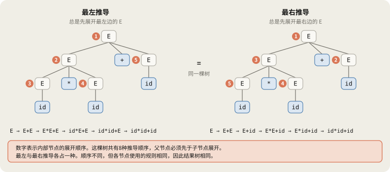

固定一棵树后，最左推导与最右推导各自恰好一种。展开顺序不同，树结构相同。

### 3.4 一棵树可以对应多个推导

根应用 $E\to E+E$ 后，最左推导先完成左子树，最右推导先完成右子树。像盖房子时先建卧室或厨房，只要设计相同，最终结构相同。

也不必总从两端选择：$E*E+E$ 有三个 $E$，可以先替换中间的。各位置应用相同规则，仅改变顺序，结果树就相同。

> [!warning] 纠正
> 原先写“固定有限树对应的推导顺序未必有无限多种”。更准确地说，**一定有限**。有 $n$ 个内部节点的树应用 $n$ 次规则，顺序最多为 $n!$ 种；父节点必须先于子节点展开，实际通常更少。`id * id + id` 的这棵树有5个内部节点，恰好有 **8种**推导顺序。
>
> 根最先展开。左侧 $E$ 及其两个子节点共3步，两个子节点可交换顺序，因此有2种。右侧 $E\to id$ 可插入这3步前后的4个位置，所以共 $2\times4=8$ 种。原笔记通过枚举检查。

### 3.5 为什么有时出现不同的树

考虑 $E\to E+E\mid E*E\mid id$ 和输入 `id + id * id`，把数值设为 `2 + 3 * 4`：

| 解释 | 分组 | 值 |
|---|---|---|
| A：先结合乘法 | `id + (id * id)` | $2+(3\times4)=14$ |
| B：先结合加法 | `(id + id) * id` | $(2+3)\times4=20$ |

差异在于**同一位置选择的产生式不同**。A 的根用 $E\to E+E$，B 的根用 $E\to E*E$，不只是先展开哪边。

- 推导涉及规则应用顺序，树表达得到的结构。
- 二义性是同一输入有不同结构的问题。
- 固定最左或最右推导，不会消除二义性。

### 3.6 两种推导与解析器实现

自顶向下分析从开始符号展开并匹配输入，LL 可视为构造最左推导。LR 将部分输入归约为非终结符，对应最右推导的逆过程。

**LL 与 LR 都从左向右读取输入。** 首字母 L 表示读取方向，第二个字母表示构造哪种推导。R 不表示从右开始读取。

---

## 4. 二义性与文法改写

### 4.1 什么是二义性文法

> 存在一个字符串，对应两棵或更多不同语法分析树的文法，称为**二义性文法**（Ambiguous Grammar）。等价地，存在一个字符串有两个或更多最左推导（或最右推导）。

每棵树恰好对应一个最左推导，所以两种定义等价。原笔记在不超过9个 Token 的257个字符串中核对，两种计数全部相同。

$E\to E+E\mid E*E\mid(E)\mid id$ 没有区分加法与乘法优先级，`id * id + id` 既可将加法放在外层，也可将乘法放在外层。

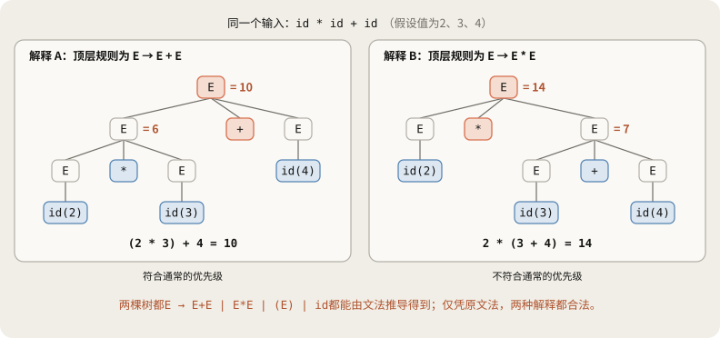

课件指出，二义性使某些程序的意义没有明确规定。同一代码可能得到10或14，需要补充决定解释方式的规则。

> [!note] 补充：二义性并非偶发
> 原笔记统计：13个 Token 以内5,439个字符串中，4,552个存在二义性。`id + id + ... + id` 的操作数由1增至8时，树数依次为1、1、2、5、14、42、132、429，对应卡特兰数。

### 4.2 两种解决办法

1. 重写文法，划分非终结符，只允许期望的树，见 §4.3至§4.5、§5。
2. 保留简洁文法，声明优先级与结合性，告诉工具如何解决冲突，见 §6。

### 4.3 文法分层

课件分为两层：

$$
E\to E'+E\mid E'
$$

$$
E'\to id*E'\mid id\mid(E)*E'\mid(E)
$$

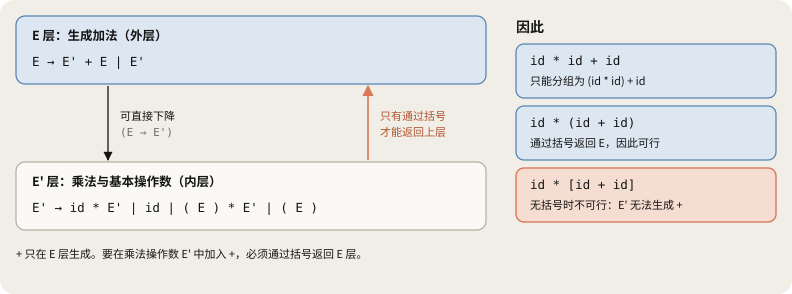

低优先级运算放在划分整体表达式的外层，高优先级运算放在构成操作数的内层，括号允许内层重新进入完整表达式。

### 4.4 用新文法分析相同输入

`id * id + id` 只剩一棵树。

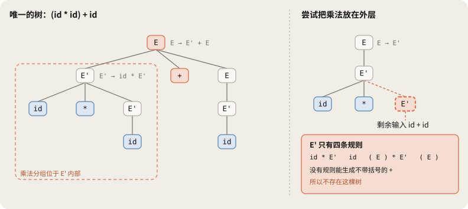

整体应用 $E\to E'+E$，左侧 $E'$ 生成 `id * id`，右侧 $E$ 生成 `id`。

若将整体视为一次乘法，右操作数 $E'$ 必须生成没有括号的 `id + id`，但规则做不到。`id * (id + id)` 则可通过 `(E)` 返回表达式层。

原笔记比较原始文法、课件分层文法和下面的 Expr/Term/Factor 文法：13个 Token 以内生成的语言相同，两种分层文法中每个字符串都只有一棵树。

| 输入（值为2、3、4） | 原始文法 | 分层文法 |
|---|---|---|
| `id * id + id` | 两棵树：10、14 | 一棵树：10 |
| `id + id * id` | 两棵树：14、20 | 一棵树：14 |

构造树时加法结构先出现，计算时却需要先得到乘法结果。

> 产生式应用顺序与表达式求值顺序不同。

### 4.5 解决优先级后，还要处理结合性

即使通过文法分层解决了“先乘除后加减”（优先级），同级运算的先后顺序（结合性）仍未解决。

课件的 $E\to E'+E$ 是右递归，连续运算向右结合。而编译原理中最通用的则是 **Expr/Term/Factor 经典文法**，使用左递归：

$$
Expr\to Expr+Term\mid Term
$$

$$
Term\to Term*Factor\mid Factor
$$

$$
Factor\to(Expr)\mid id
$$

#### 什么是 Expr / Term / Factor？
这三个概念源于初中数学的多项式（如 $3x^2 + 2x + 1$）：
- **Expr（Expression，表达式）**：整个式子，由加减号连接（优先级最低，处于语法树顶层）。
- **Term（项）**：加减号分割出的每一项，由乘除号连接（优先级居中，处于语法树中间层）。
- **Factor（因子 / 因数）**：乘除号分割出的最小构件，不可再分（优先级最高，处于语法树底层）。

#### 它是怎么巧妙解决“先乘除后加减”的？
过去写的简单文法 $E \to E + E \mid E * E \mid id$ 会产生二义性（计算机不知道先算加还是先算乘）。

而 Expr / Term / Factor 通过自上而下的分层，把优先级死死刻进了文法骨子里：

1. **加法管不到乘法**：  
   看乘法规则：$Term \to Term * Factor$。乘号两边只能是 `Term` 和 `Factor`。若想把 `2 + 3` 作为一个整体塞进乘号旁边，文法直接拒绝！因为加法属于 `Expr`，根本没有资格直接充当乘法的操作数。
2. **乘法一定先算**：  
   输入 `2 + 3 * 4` 时，这套文法只能画出唯一的一棵语法树：

```text
                    Expr
             ┌───────┼───────┐
            Expr     +      Term                       <-- 加法处在顶层（较浅）
             │          ┌────┴────┐
            Term       Term  *  Factor                 <-- 乘法处在底层（较深）
             │          │         │
           Factor     Factor    num(4)
             │          │
           num(2)     num(3)
```

树越深、越靠底层的算式越先被计算。乘法 `3 * 4` 只能诞生在底层的 `Term` 中，加法 `+` 诞生在顶层的 `Expr` 中；因此计算机执行时，必须先算出底层的乘法（12），再回传给顶层做加法（$2 + 12 = 14$），想算错都由不得它！

#### 括号如何实现“逆袭”？（直通电梯机制）
按照层级，加法处于顶层 `Expr`，乘法处于中间 `Term`，乘法天然先算。那当程序员写出 `(2 + 3) * 4` 时，加法是如何实现“逆袭先算”的？

秘密就在规则：$Factor \to ( Expr )$。
- 这条规则是一个**“直通电梯”**：括号把整个顶层的 `Expr`（加法）直接打包回了最底层的 `Factor`！
- 在括号外面的乘法 `*` 看来，`(2 + 3)` 已经不再是一个散装的加法表达式，而是被括号包裹成了一个安全的、不可侵犯的原子构件——**`Factor`**！
- 此时语法树的最深层变成了括号内部的加法，计算机必须先算出最深层的子树，加法成功优先计算。

以 `(2 + 3) * 4` 为例，其语法分析树如下：

```text
                            Expr
                             │
                            Term                       <-- 乘法处在较浅层
                 ┌───────────┼───────────┐
                Term         *         Factor
                 │                       │
               Factor                  num(4)
        ┌────────┼────────┐
        (       Expr      )                            <-- 直通电梯：将 Expr 打包成原子 Factor
             ┌───┼───┐
            Expr +  Term                               <-- 加法被沉降到最深层，必须优先计算！
             │       │
            Term   Factor
             │       │
           Factor  num(3)
             │
           num(2)
```

---

两者都采用**“外层加法、内层乘法”的分层策略**，在**优先级处理上完全一致**；但在**同级运算的结合方向**以及**工程实现**上存在本质分歧：

| 比较维度 | 课件的 $E / E'$ 文法 | 经典的 $Expr / Term / Factor$ 文法 |
|---|---|---|
| **优先级分层（相同点）** | 外层 $E$ 生成加法，内层 $E'$ 生成乘法（加法在顶层，乘法在底层） | 外层 $Expr$ 生成加法，中间 $Term$ 生成乘法（加法在顶层，乘法在底层） |
| **递归形式** | **右递归**（$E \to E' + \mathbf{E}$） | **左递归**（$\mathbf{Expr} \to Expr + Term$） |
| **语法树生长方向** | 树向**右**侧延展，右侧子树更深 | 树向**左**侧延展，左侧子树更深 |
| **结合性（运算方向）** | **向右结合**（右侧先算） | **向左结合**（左侧先算） |
| **加法分组：`id + id + id`** | `id + (id + id)` | `(id + id) + id` |
| **乘法分组：`id * id * id`** | `id * (id * id)` | `(id * id) * id` |
| **减法结果：`1 - 2 - 3`** | `1 - (2 - 3) = 2` ❌ **（违背数学常识）** | `(1 - 2) - 3 = -4` ✅ **（符合数学常理）** |
| **对递归下降解析器的影响** | ✅ **天然友好**（无左递归，直接手写不会死循环） | ❌ **直接死循环**（左递归导致 `parseExpr()` 无限递归爆栈，第 6 讲需专门消除） |

#### 递归方向如何操纵结合性？
- **左递归让树“向左长”**：在 $Expr \to Expr + Term$ 中，左侧是可展开的 $Expr$。拆解 `a + b + c` 时，树的最深层在左侧的 `(a + b)`，底层先计算，因而强制**向左结合**。
- **右递归让树“向右长”**：在 $E \to E' + E$ 中，右侧是可展开的 $E$。拆解 `a + b + c` 时，树的最深层在右侧的 `(b + c)`，因而强制**向右结合**。

> [!note] 补充：既然左结合更符合直觉，课件为什么还要讲右递归？（理论与工程的冲突）
> 1. **减法暴露逻辑问题**：数学上整数加法与乘法满足结合律，无论向哪边结合结果都一样（不易察觉差异）；但减法并不满足结合律。若直接在右递归中添加 $E\to E'-E$，`1 - 2 - 3` 会被错误解析为 $1-(2-3)=2$。
> 2. **左递归引发工程灾难（死循环爆栈）**：虽然写成左递归能解决向左结合，但在第 6 讲手写**自顶向下递归下降分析器**时，对应函数逻辑为：
>    ```cpp
>    void parseExpr() {
>        parseExpr(); // 尚未读入任何 token 就递归调用自己，无限死循环！
>        match('+');
>        parseTerm();
>    }
>    ```
>    简单递归下降分析器遇到左递归会发生无限死循环。课件之所以展示右递归，正是为了避开爆栈；但这也付出了“结合性反向”的代价。这一矛盾将在第 6 讲通过**“消除左递归”**或改用 **LR / Pratt 解析算法**得到解决。

---

## 5. 悬空 Else（Dangling Else）

### 5.1 else 应该连接哪个 if

```text
if E1 then if E2 then E3 else E4
```

两个 `if`、一个 `else`。简单文法 $E\to\text{if }E\text{ then }E\mid\text{if }E\text{ then }E\text{ else }E\mid\text{OTHER}$ 允许：

```text
if E1 then (if E2 then E3) else E4     连接外层 if
if E1 then (if E2 then E3 else E4)     连接内层 if
```

通常采用连接内层的解释。

> [!warning] 纠正：是“最近的 then”，而不只是“最近的 if”
> 
> 平时常说的口诀是 **“`else` 连接前面最近的 `if`”**，但斯坦福课件更严谨的表述是 **“连接最近且尚未配对的 `then`（closest unmatched then）”**。
> 
> **两者的区别在于：条件本身是否允许嵌套 `if` 语句。**
> 例如下面的表达式（为了直观，用括号表示结构层次）：
> ```text
> if (if a then b) then c else d
> ```
> * **若按“最近的 if”**：文本上离 `else` 最近的是内层的 `if a`。但内层 `if` 仅作为条件，在外层 `then` 出现前已经结束，不应接收后续分支。
> * **若按“最近的 then”**：外层 `then c` 尚未配对，因此最后的 `else d` 正确归属于最外层的 `if`。
> 
> > 只有当条件限定为不含控制流的简单表达式时，“最近的 if”与“最近的 then”才完全等价。通用语法分析必须以 **“分支尚未闭合的 then”** 为准。

### 5.2 MIF 与 UIF：直观理解“闭合”与“开放”

为了在文法层面杜绝二义性，编译器引入了两个非终结符，本质就是区分语句是**闭合安全**还是**开放未决**：

- **MIF（Matched IF，闭合安全组件）**：自身已经完整配对了 `else`（如 `if ... then ... else ...`），或者根本不含 `if` 的基本语句（如 `OTHER`）。它已经完全“闭合”，绝不会向外争夺后续的 `else`。
- **UIF（Unmatched IF，开放危险组件）**：末尾缺少 `else`（如 `if ... then ...`）。它处于“开放”状态，随时准备捕获后面紧跟的 `else`。

> **文法防二义性的核心铁律**：  
> 如果一个 `if` 语句自带 `else`，那么它的 `then` 与 `else` 之间**绝不能夹带开放的 UIF**！否则夹在中间的内层 if 会把后面的 `else` 截胡抢走，造成二义性。

### 5.3 逐行拆解消歧文法

```text
E   → MIF | UIF

MIF → if E then MIF else MIF      （中间被夹着的必须是 MIF，严防内层截胡）
    | OTHER

UIF → if E then E                 （形式 1：尾部无 else，天然处于开放状态）
    | if E then MIF else UIF      （形式 2：中间安全闭合，但末尾挂着未闭合的 UIF，整体仍开放）
```

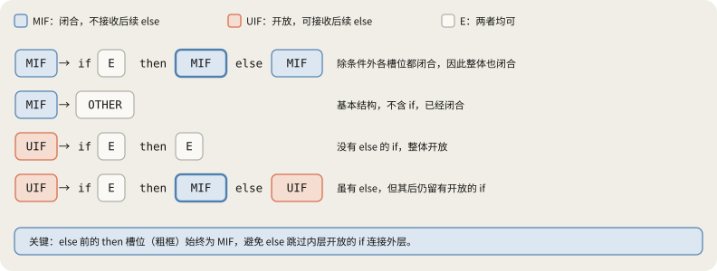

1. **`MIF → if E then MIF else MIF`**：`then` 后的分支**强制要求为 MIF**，不能填入一般 `E` 或 `UIF`。这从规则源头封死了“外层拥有 else 时，中间夹着一个缺 else 的内层 if”的可能。
2. **`UIF → if E then E`**：整体没有 `else`，`then` 分支不需要保护后面的 `else`，因此填入普通 `E` 即可（闭合或开放均可）。
3. **`UIF → if E then MIF else UIF`**：虽然自身包含 `else`，但 `else` 之后连接了一个未闭合的 `UIF`。整条语句末尾依然留有缺口，因此整体归属于开放结构 `UIF`。

> [!note] 补充：为什么条件位置的 E 允许是 UIF？
> 每条规则中 `if` 后的条件都是通用 `E`。因为条件表达式在随后的 `then` 关键字处就已经强制终结，条件内部开放的 `if` 绝不可能跨越 `then` 去争夺后续分支的 `else`，因此无需限制。

### 5.4 歧义是如何被文法彻底消除的？

以经典悬空代码为例：
```text
if E1 then if E2 then E3 else E4
```

编译器尝试用文法推导时，会发生以下判定：

1. **若企图让 `else E4` 连接外层 `if E1`**：
   * 结构必须形如：`if E1 then [if E2 then E3] else E4`；
   * 但外层模板要求 `then` 和 `else` 之间**必须填入 MIF**；
   * 内部的 `if E2 then E3` 缺少 `else`，属于 **UIF**；
   * ❌ **类型不符，产生式直接拒绝匹配！非法树从语法层面被彻底抹杀。**

2. **只能让 `else E4` 连接内层 `if E2`**：
   * 外层选择开放规则：`UIF → if E1 then E`；
   * 内层 `E` 顺利展开为完整的闭合结构：`MIF → if E2 then E3 else E4`；
   * ✅ **成功推导出唯一合法的一棵语法分析树！**

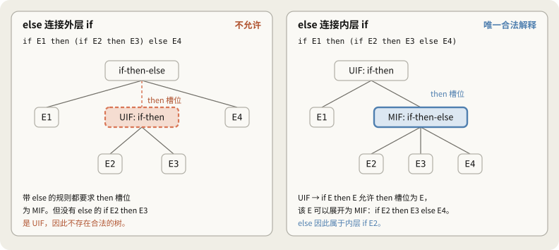

原笔记检查17个 Token 以内281个字符串，两文法生成语言相同。原文法78个有二义性，MIF/UIF 文法则全部只有一棵树，且与“遇到 else 就立即接入当前可接收结构”的递归分析结果一致。

### 5.5 从语言设计上避免问题

> [!note] 补充：COOL 没有这个问题
> §2.9 的规则为 `if E then E else E fi`，`else` 必须存在，且用 `fi` 明确结束。原笔记检查的19个 Token 以内177个字符串都只有一棵树。Go、Rust 要求分支使用花括号，Python 用缩进划分范围，也能明确结构边界。

### 5.6 能否自动消除所有文法的二义性

没有通用方法将任意二义性文法自动转换为生成相同语言的无二义性文法。

- 判断任意 CFG 是否有二义性，本身不可判定。
- 有些语言具有固有二义性，不能用无二义性 CFG 表示。典型例子为 $\{a^i b^j c^k\mid i=j\text{ 或 }j=k\}$。$a^n b^n c^n$ 同时满足两条件，说明自然写法中的两种推导来源；但仅凭条件重合不能证明固有二义性，完整证明需额外论证。

分层也会增加规则数量，因此还需要另一种工程处理办法。

---

## 6. 优先级与结合性声明

前面为了解决优先级和悬空 else，我们把文法拆得格外繁琐（写了 `Expr/Term/Factor` 和 `MIF/UIF`）。在实际工程中，运算符可能有几十种，如果全靠人工拆分文法层级，规则会迅速膨胀，难以维护。

另一种实用的工程做法是：**文法依旧保留最简短直观的形式（哪怕它有二义性），额外给分析生成工具提供优先级和结合性声明，让工具在遇到冲突时替我们做出裁决。**

### 6.1 区分两个概念

面对连续运算时，歧义通常来自两处：

| 概念 | 决定什么 | 典型例子 |
|---|---|---|
| 结合性 | 相同优先级的运算往哪边分组 | `1 - 2 - 3` 是算成 `(1 - 2) - 3` 还是 `1 - (2 - 3)` |
| 优先级 | 不同运算符相遇时谁先结合 | `2 + 3 * 4` 是先加还是先乘 |

### 6.2 理解移进与归约的冲突

在 LR 分析器眼里，二义性并不是抽象的文法概念，而是实实在在的选择困难。分析器工作时持有一个状态栈和未读的 Token 输入：

- **移进（Shift）**：把下一个 Token 读入栈内（先不急着算，往后看看）。
- **归约（Reduce）**：发现栈顶几个符号刚好吻合某条产生式的右侧，立即打包合成为非终结符（先把手头这部分算掉）。

在声明 `%left '+'` 和 `%left '*'` 后，处理 `int + int * int` 的动作轨迹如下（来自原笔记自制生成器测试，省略状态编号）：

| 栈 | 剩余输入 | 执行动作 | 说明 |
|---|---|---|---|
| 空 | `int + int * int` | 移进 | 读入第一个 `int` |
| `int` | `+ int * int` | 按 $E\to int$ 归约 | 栈顶变为 $E$ |
| `E` | `+ int * int` | 移进 | 读入 `+` |
| `E +` | `int * int` | 移进 | 读入第二个 `int` |
| `E + int` | `* int` | 按 $E\to int$ 归约 | 栈顶变为 $E$ |
| **`E + E`** | **`* int`** | **移进（决策点）** | **面临移进/归约冲突** |
| `E + E *` | `int` | 移进 | 读入第三个 `int` |
| `E + E * int` | 无 | 按 $E\to int$ 归约 | 栈顶变为 $E$ |
| `E + E * E` | 无 | 按 $E\to E*E$ 归约 | 优先归约乘法 |
| `E + E` | 无 | 按 $E\to E+E$ 归约 | 最后归约加法 |
| `E` | 无 | 接受 | 分析成功 |

加粗的那一行正是分歧所在：
- 如果此时选择**归约**，就会先把 `E + E` 打包，变成先算加法；
- 如果此时选择**移进**，就会先把 `*` 吞进栈里，等待后面先算乘法。

这就是典型的**移进/归约冲突（Shift/Reduce Conflict）**。声明的作用，就是给分析器一把明确的标尺，告诉它在这里必须选移进还是归约。

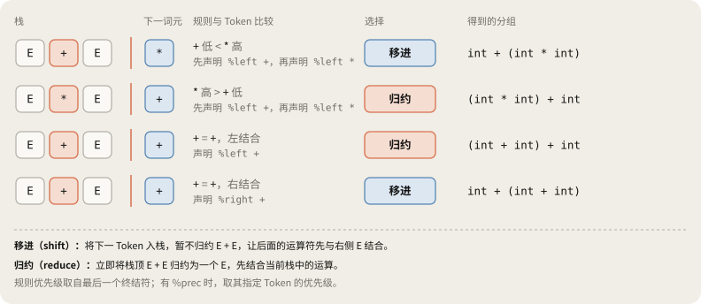

### 6.3 结合性：同优先级运算

对于简单文法 $E\to E+E\mid int$：
- `(int + int) + int` 是左结合；
- `int + (int + int)` 是右结合。

对于整数加法，两边算结果碰巧一样；但如果是减法，向右结合就会把 `1 - 2 - 3` 算成 2。

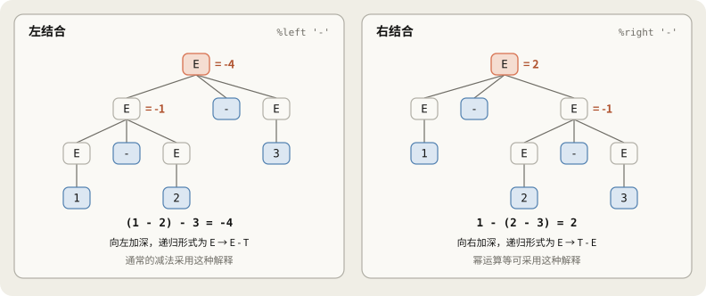

在 Bison 里写：

```yacc
%left '+'
```

分析器在栈顶是 `E + E`、下一个 Token 还是 `+` 时，看到声明是 `%left`，就会选择**立即归约**，形成 `(int + int) + int`。反之，如果声明为 `%right`，分析器就会选择**移进**，把右边的加号也收进来，形成向右结合。

> [!note] 补充：计算机里的加法并不总满足结合律
> 浮点数加法会丢失精度，不满足数学结合律。在 Python 里验证：
> - `(1e20 + -1e20) + 1.0` 结果是 `1.0`；
> - `1e20 + (-1e20 + 1.0)` 结果却是 `0.0`。
> 在没有开启 `-ffast-math` 等允许浮点重排的优化选项时，编译器必须严格尊重语法的分组顺序，不能随意调换。

### 6.4 优先级：不同运算符的竞争

在 $E\to E+E\mid E*E\mid int$ 文法中，遇到 `2 + 3 * 4` 时，Bison 配置如下：

```yacc
%left '+'
%left '*'
```

Bison 规定：**声明在后面的行，优先级更高。**  
这里两条都是左结合，但 `*` 声明在 `+` 下面，因此乘法的优先级更高。当栈顶是 `E + E`、输入遇到 `*` 时，因为输入符号的优先级压过了加法规则，分析器会移进 `*`，解析为 `int + (int * int)`。

文法本身其实依然有二义性，只是分析生成器在生成状态跳转表时，按照声明裁决掉了冲突的分支。

### 6.5 Bison 的冲突裁决流程

当分析器在某个状态既能移进又能归约时，Bison 按以下顺序做判断：

1. **确定两方的优先级**：
   - 规则的优先级默认等于它右侧最后一个终结符的优先级（也可用 `%prec` 手动指定）。
   - 输入 Token 的优先级取自声明。
2. **比较优先级高低**：
   - 规则优先级更高 $\to$ **归约**（先算栈里的）。
   - Token 优先级更高 $\to$ **移进**（先读后面的）。
3. **优先级相同时看结合性**：
   - `%left` $\to$ **归约**。
   - `%right` $\to$ **移进**。
   - `%nonassoc` $\to$ **直接报错**（用于禁止链式写法，例如不允许写 `a < b < c`）。
4. **任一方没有声明优先级**：
   - 无法裁决，Bison 会报告移进/归约冲突，并在默认行为中偏向**移进**。

### 6.6 用声明化解悬空 else

在 Bison 中，解决悬空 else 不需要引入复杂的 MIF 和 UIF，可以通过一条规则优先级声明搞定：

```yacc
%nonassoc LOWER_THAN_ELSE
%nonassoc ELSE

stmt : IF expr THEN stmt            %prec LOWER_THAN_ELSE
     | IF expr THEN stmt ELSE stmt
     | OTHER
     ;
```

这里定义了一个虚拟记号 `LOWER_THAN_ELSE`，优先级排在 `ELSE` 之前。  
第一条没有 `else` 的规则通过 `%prec` 被赋予了这个更低的优先级。

当分析器栈里持有 `if c then stmt`、眼前面临输入 `else` 时：
- 栈顶规则的优先级是 `LOWER_THAN_ELSE`；
- 输入 Token 的优先级是 `ELSE`（更高）。

Token 胜出，分析器决定**移进**，把 `else` 吃进栈里并归给最近的 `if`。  
即使不写这套声明，Bison 默认偏向移进的选择也能碰巧得出相同结果，但显式写出声明可以彻底消除那条刺眼的“Shift/Reduce conflict”警告。

### 6.7 声明机制的常见陷阱

下面是原笔记在测试生成器时跑出的对照数据，与正常预期不同的结果以加粗标出：

| 运算符声明方式 | 未解决冲突 | `2 + 3 * 4` | `2 * 3 + 4` | `1 + 2 + 3` 的分组 |
|---|---|---|---|---|
| 无声明 | 4 个移进/归约冲突 | 14 | **14** | **`1 + (2 + 3)`** |
| 仅声明 `%left '+'` | 3 个移进/归约冲突 | 14 | **14** | `(1 + 2) + 3` |
| `%left '+'` 后接 `%left '*'` | 0 | 14 | 10 | `(1 + 2) + 3` |
| `%left '*'` 后接 `%left '+'` | 0 | **20** | **14** | `(1 + 2) + 3` |

| 悬空 else 的处理方式 | 未解决冲突 | `if c then if c then o else o` | `if c then o else o` |
|---|---|---|---|
| 无声明 | 1 个移进/归约冲突 | 连接内层 `if` | 正常 |
| §6.6 的声明及 `%prec` | 0 | 连接内层 `if` | 正常 |
| 只有声明，未加 `%prec` | 1 个移进/归约冲突 | 连接内层 `if` | 正常 |
| 颠倒两条 `%nonassoc` | 0 | **语法错误** | **语法错误** |
| MIF/UIF 文法，无声明 | 0 | 连接内层 `if` | 正常 |

测试反映出几点需要注意的细节：

1. **零冲突不等于逻辑正确。** 把 `%left '+'` 和 `%left '*'` 的顺序写反，Bison 依然能生成零冲突的分析表，但会心平气和地把 `2 + 3 * 4` 算成 20。没有警告不等于没有错误。
2. **声明必须覆盖全面。** 如果只声明了加法而漏了乘法，分析器里仍会残留 3 个冲突，在默认移进策略下把 `2 * 3 + 4` 算成 14。
3. **颠倒声明不会反向绑定外层 if。** 如果误把 `ELSE` 的优先级排在 `LOWER_THAN_ELSE` 前面，分析器在遇到 `else` 时会一律执行归约，导致所有的 `else` 根本没有被移进的机会，带 else 的输入直接报语法错误。

在装有 Bison 的机器上可以这样验证冲突：

```yacc
/* expr.y */
%token INT
%left '+'
%left '*'
%%
e : e '+' e | e '*' e | INT ;
```

```bash
bison -v expr.y                   # 生成 expr.output，查看完整状态机与冲突细节
bison -Wcounterexamples expr.y    # 去掉 %left 声明后运行，查看 Bison 给出的冲突反例
```

### 6.8 两种方案的取舍与 MLIR 实践

消除二义性的两条路线各有优劣：

| 方案 | 核心做法 | 优势 | 代价 | 典型场景 |
|---|---|---|---|---|
| **改写文法** | 拆分 `Expr/Term/Factor` 或 `MIF/UIF` | 逻辑完全自洽，不依赖外部工具机制 | 规则繁杂，非终结符成倍增加 | 手写递归下降解析器、形式化文法设计 |
| **声明式裁决** | 保持原始文法，外挂 `%left` 与优先级 | 文法极简，直观易读 | 二义性未在数学层面消失，需防范声明写错 | Bison、Yacc 等自动分析器生成工具 |

> [!note] 补充：MLIR Affine 表达式手写解析器里的分层
> `mlir/lib/AsmParser/AffineParser.cpp` 是 LLVM/MLIR 中的手写递归下降解析器，没有使用生成器，但代码完全体现了 §4 的分层理念：
> - 拆分优先级：`AffineLowPrecOp` 包含加减法，`AffineHighPrecOp` 包含乘法、整除（FloorDiv/CeilDiv）与取模。对应函数分别拆为 `parseAffineLowPrecOpExpr` 和 `parseAffineHighPrecOpExpr`。
> - 实现左结合：源码注释标明所有 Affine 二元运算符都左结合。解析时先把左侧已构成的表达式作为 `llhs` 传给下一步，再与后续符号依次结合。
> - 遇到括号重回顶层：遇到括号时，`parseParentheticalExpr` 重新调用顶层的 `parseAffineExpr`，实现从底层向顶层重新开始表达式解析。
>
> 11/5阅读时，追踪 `i + j * 2 - k` 的解析调用顺序。

---

## 7. 第5讲总结：主线脉络与概念辨析

### 7.1 核心主线：消除二义性的三幕大戏

回顾本讲脉络，消除二义性并不是零散知识点的堆砌，而是一场**从“人工文法修补”走向“工业级工程裁决”的破局过程**：

#### 第一幕：文法修补匠的苦难史（§4 ~ §5）
1. **解决乘除优先（§4.3 ~ §4.4）**：原始文法 $E \to E + E \mid E * E$ 存在二义性。为了让乘法先算，课件小心翼翼地搞了 **$E / E'$ 分层**。
2. **解决减法翻车（§4.5）**：$E / E'$ 采用右递归，连减 `1 - 2 - 3` 竟然算出了 $2$！为了修复结合性，文法被迫升级为左递归的 **$Expr / Term / Factor$**。
3. **解决悬空 else（§5）**：遇到 `if-then-else` 嵌套，二义性再次冒头。为了让 `else` 就近匹配，又费尽心机设计了极其烧脑的 **$MIF$（闭合 if）** 与 **$UIF$（开放 if）**。

#### 第二幕：痛点全面爆发 —— 工程师快疯了（§5.6）
走到这里，任何正常的编译器工程师都会发现不对劲：
> “这才仅仅处理了加减乘除和一个 `if-else`，文法就已经膨胀成这副复杂的模样！现实中的 C/C++ 或 Java 拥有 **40 多种运算符**（位运算、逻辑运算、指针解引用、三元运算符等），如果全靠人工拆出几十层非终结符、组合各种 Matched/Unmatched，文法将长达上千行，根本无法阅读与维护！”

#### 第三幕：降维打击 —— 工具派的极简救赎（§6）
工业界（Yacc / Bison）的大佬们选择“掀桌子”：**文法就写最原始、最直观、最简短的模样（$E \to E + E \mid E * E \mid \dots$），不再人工切碎文法！**

他们的破局思路极其干脆：
- **看清本质**：分析器基于**栈（Stack）**读取输入，语法二义性在机器底层其实只有一个纠结 —— 到底该**移进（Shift，等后面的符号）**还是**归约（Reduce，先算手头的符号）**。
- **外部裁决**：人类不再去改写文法，直接外挂声明几行简明规则（如 `%left '+'`、`%left '*'`）。
- **机器打表**：分析器生成工具在打表遇到移进/归约冲突时，照着声明规则自动选定路径，静默消除冲突，彻底解放人类大脑。

### 7.2 核心概念辨析

| 区分 | 前者 | 后者 | 记忆要点 |
|---|---|---|---|
| $\to$ / $\Rightarrow$ | 产生式（文法中的静态规则） | 推导（应用规则的动态一步） | 单箭头是产生式规则，双箭头是实际推导步骤 |
| 文法 / 分析器 | 描述生成方法 | 检查给定字符串的程序 | 文法不执行栈操作，分析器可以用栈 |
| 推导 / 归约 | 左侧到右侧 | 右侧到左侧 | LR 构造最右推导的逆过程 |
| 推导顺序 / 树结构 | 先替换哪个非终结符 | 各位置使用什么规则 | 顺序不同，树可以相同 |
| 推导顺序 / 求值顺序 | 构造树的顺序 | 计算值的顺序 | 先生成加法结构，也可能先需要乘法值 |
| 语法分析树 / AST | 完整记录规则应用 | 保留核心结构 | AST 通常省略括号节点 |
| 二义性 / 推导顺序 | 同一输入有多棵树 | 构造同一树的顺序不同 | 固定最左推导仍有二义性 |
| 优先级 / 结合性 | 不同优先级运算的分组 | 同优先级运算的分组 | `2 + 3 * 4` 与 `1 - 2 - 3` |
| 左递归 / 右递归 | 本例生成左结合 | 本例生成右结合 | 课件 $E\to E'+E$ 为右结合 |
| 改写文法 / 声明 | 本例使文法无二义性 | 保留二义性，只解决冲突 | 声明后仍要用输入检查 |
| LL、LR 的第一个 L / 第二个字母 | 从左向右读输入 | 构造最左或最右推导 | R 不表示从右开始读 |

---

## 8. 自测题

11/3先回答，再展开核对。

> [!question]- 1. 假设三个状态的 DFA 能识别 $(^i)^i$，哪两个字符串产生矛盾？
> 读入0至3个 `(` 的四个时刻中，存在 $i<j$ 使状态相同。再读相同的 $)^i$，$(^i)^i$ 与 $(^j)^i$ 会到达相同状态，但前者属于语言，后者不属于。

> [!question]- 2. 深度限制为3时，最小 DFA 有几个状态？为何不与第1题矛盾？
> 包含死状态共8个，即 $2n+2$。限制深度后是有限语言，可由 DFA 识别；第1题讨论没有上限的情况。

> [!question]- 3. 为什么 $S\to(S)\mid\varepsilon$ 不能生成 `()()`？怎样修改？
> 只能向内包裹，不能横向连接括号对。改为 $S\to(S)S\mid\varepsilon$，后面的 $S$ 生成右侧剩余部分。

> [!question]- 4. `((S))` 属于 $L(G)$ 吗？是句型吗？
> 是句型，但不属于 $L(G)$。能从开始符号推导出来，却还含非终结符 `S`。

> [!question]- 5. 写出 `id * id + id` 在乘法位于内层的树中对应的最右推导。
> $E\Rightarrow E+E\Rightarrow E+id\Rightarrow E*E+id\Rightarrow E*id+id\Rightarrow id*id+id$

> [!question]- 6. 限定最左推导能消除二义性吗？
> 不能。二义性字符串本身有多个最左推导。`id + id * id` 有两个，第一步分别选 $E\to E+E$ 或 $E\to E*E$，区别在规则选择。

> [!question]- 7. 在 $E\to E'+E\mid E'$、$E'\to id*E'\mid id\mid(E)*E'\mid(E)$ 中，为什么不能把 `id * id + id` 整体看成一次乘法？
> 右操作数 $E'$ 必须生成 `id + id`，但无法生成无括号的加法。`+` 只在 $E$ 层出现，从 $E'$ 返回 $E$ 必须经过括号。

> [!question]- 8. 在第7题文法加入 $E\to E'-E$，`1 - 2 - 3` 得什么？怎样改为通常结果？
> 得 `1 - (2 - 3) = 2`，因为该右递归规则生成右结合。改成 $E\to E-E'$ 这样的左递归，得到 `(1 - 2) - 3 = -4`。

> [!question]- 9. `UIF → if E then MIF else UIF` 有 else，为何还是 UIF？
> `else` 分支仍有开放的 `if`。例如 `if a then b else if c then d` 的最后一个 `if` 还可接收后续 `else`。

> [!question]- 10. `if if o then o then o else o` 的 else 属于谁？
> 第一个 `if`。第二个位于条件内，在外层 `then` 处已结束，不能只按文本位置选最近的 `if`。

> [!question]- 11. 声明 `%left '+'`、`%left '*'` 后，栈为 `E + E`，下一 Token 为 `*` 时选什么？若为 `+` 呢？
> `*` 时移进，因为规则优先级 `+` 低于 Token 的 `*`。`+` 时归约，因为优先级相同且左结合。

> [!question]- 12. 改成 `%left '*'`、`%left '+'`，`2 + 3 * 4` 得多少？有冲突警告吗？
> 得20，没有未解决冲突警告，因为冲突已按声明解决。零冲突不等于语义符合预期。

> [!question]- 13. 颠倒两条 `%nonassoc`，会把 else 接到外层 if 吗？
> 不会。对 §6.6 的文法及 `%prec` 配置，不带 `else` 的规则优先级更高，遇 `else` 就归约。外层也归约后没有移进机会，连 `if c then o else o` 都报错。

> [!question]- 14. 使用 `%left` 与 Expr/Term/Factor 的文法有什么根本区别？
> 后者本身无二义性；前者仍有二义性，只在生成分析器时按声明解决冲突。交给其他工具或分析方式，声明效果不一定保留。

---

## 9. 纠正与补充内容汇总

原笔记认为最初内容大部分准确，重点纠正两处：

| 位置 | 原先理解 | 纠正后 |
|---|---|---|
| §3.4 | 有限树的推导顺序“未必无限” | 一定有限，示例树恰好8种 |
| §5.1 | else 连接最近的未匹配 if | 需考虑语法边界：连接 then 分支尚未结束的最近 if；条件内有 if 时区别会显现 |

主要补充：

| 位置 | 内容 |
|---|---|
| §0.1 | 计划检查及11/3至11/8安排 |
| §1.1 | 鸽巢原理证明、受限深度 DFA 的 $2n+2$ 个状态、计数器与栈 |
| §1.4 | 分开词法与语法分析的理由 |
| §2.3 | 全部合法括号串的文法 $S\to(S)S\mid\varepsilon$ |
| §2.4 | CFG 无法单独完成的检查 |
| §2.7 | `STMT → EXPR` 及示例文法的二义性 |
| §3.2 | 分组与执行顺序、语法分析树与 AST |
| §4.1 | 二义性定义的等价关系与树数量增长 |
| §4.5 | 递归方向与结合性、直接加入减法的问题 |
| §5.3、§5.5 | 条件允许 UIF 的原因、语言设计如何避免悬空 else |
| §5.6 | 固有二义性语言示例 |
| §6.2 | 移进、归约和栈变化过程 |
| §6.3 | 浮点加法不满足结合律 |
| §6.5 | Bison 冲突解决规则 |
| §6.7 | 声明的冲突数量与结果、颠倒 `%nonassoc` 的陷阱 |
| §6.8 | MLIR `AffineParser.cpp` 的联系 |

---

## 10. 参考资料

- [Stanford CS143 Compilers](https://web.stanford.edu/class/cs143/)：[第5讲课件](https://web.stanford.edu/class/cs143/lectures/lecture05.pdf)
- [Bison 手册](https://www.gnu.org/software/bison/manual/)：移进/归约冲突、运算符优先级、上下文相关优先级、反例
- [MLIR `AsmParser/AffineParser.cpp`](https://github.com/llvm/llvm-project/blob/main/mlir/lib/AsmParser/AffineParser.cpp)
- [MLIR `AsmParser/Lexer.cpp`](https://github.com/llvm/llvm-project/blob/main/mlir/lib/AsmParser/Lexer.cpp)
