# 11 月 3 日学习记录

本篇笔记整理自斯坦福 CS143 第 6 讲，核心主题涵盖：**语法错误处理与恢复机制**、**从分析树到抽象语法树（AST）的抽象过程**，以及**递归下降语法分析的实现原理与固有缺陷**。

> [!info] 阅读与验证说明
> - **正文与批注**：正文为系统化梳理后的核心知识体系；`> [!warning] 纠正` 标出最初理解有偏差的技术点，`> [!note] 补充` 记录课件未展开但在编译器工程中至关重要的机理。
> - **图表资产**：全篇插图均引用 `assets/10_29/` 目录下的 SVG 矢量图，保持原始图表结构与引用不变。
> - **代码与测试基准**：§5.6 的递归下降代码在 g++ 13.3 下结合 AddressSanitizer（ASan）与 UndefinedBehaviorSanitizer（UBSan）编译运行验证；采用 5 种词法单元穷举构造了全部 488,280 个长度不超过 8 的输入串，逐一与上下文无关文法的理论推导进行一致性校验。
> - **工业编译器源码比对**：涉及的 GCC 13.3、Clang、MLIR 及 GNU Bison 源码均对照官方代码库实现进行比对分析。
> - **Bison 模拟验证**：§2 与 §3.1 中的分析表与恢复行为，基于 Bison `yacc.c` 核心状态机逻辑及自行编写的 LALR(1) 分析表生成器进行推演，并在模拟器中完成验证。

## 0. 第 6 讲概览

本讲围绕编译器前端的核心工程问题展开：前三节讨论异常输入下的错误恢复，第四节讨论分析器的中间表达输出，后四节深入探讨自顶向下语法分析的手写实现与文法变换。

| 序号 | 核心问题 | 技术结论与机制 | 对应章节 |
|:---:|:---|:---|:---:|
| 1 | 编译期与运行期存在哪些错误类型？由谁负责截获？ | 划分为词法、语法、语义及运行时正确性错误，前三者在编译期分别由词法分析器、语法分析器与语义分析器拦截 | §1 |
| 2 | 遇到语法错误后，分析器如何继续向下分析？ | 采用**恐慌模式**（Panic Mode），弹出失配状态并跳过无效输入，直到结构边界明确的同步符号 | §2 |
| 3 | 是否可以实现更智能的自动语法修复？ | 可采用**错误产生式**或**最小编辑距离自动修正**，但往往伴随文法二义性膨胀与语义失真代价 | §3 |
| 4 | 语法分析阶段向后续阶段交付的数据结构是什么？ | **抽象语法树**（AST），去除分析树中冗余的标点、单子节点与推导中间过程，保留核心语义与层次 | §4 |
| 5 | 如何将上下文无关文法机械化映射为可执行代码？ | 采用**递归下降分析**：每个非终结符映射为一个解析函数，由全局输入指针 `next` 驱动状态转移 | §5 |
| 6 | 初始实现的递归下降代码为何会拒绝合法输入 `int * int`？ | 候选分支一旦返回成功即无法回退已做出的选择；需通过**提取左公因子**推迟决策时机 | §6 |
| 7 | 产生式 $S \to S a$ 为何会导致解析器无限递归？ | 左递归规则在消耗任何输入字符之前即重复调用自身，导致调用栈溢出；需转换为等价右递归形式 | §7 |
| 8 | 工业级生产环境编译器是否依然采用手写递归下降？ | GCC、Clang 与 MLIR 均采用手写递归下降分析器，以获得精准的错误诊断能力与灵活的上下文判定 | §8 |

### 0.1 计划检查

| 日期 | 主题 | 任务 | 时间 |
|---|---|---|---|
| 11/4 周三 | 迷你 lexer（顺延） | 用 C++ 实现 10/27 §2.5 的三条规则和 §6.3 的回退 | 2h |
| 11/5 周四 | 阅读分析器代码（顺延 + 新增） | 在 MLIR `Lexer.cpp` 和 `AffineParser.cpp` 中找出最长匹配和优先级处理。找到本笔记 §8.3 的 `parseToken` 和顶层循环 | 2h |
| 11/6 周五 | 手算练习 | 不看答案完成自测题，画出三种文法下的推导树 | 2h |
| 11/7 周六 | C++ 与 Bison 实践 | 校验指针操作与线程安全，复现 §2.4 与 §3.1 的测试用例 | 4h |
| 11/8 周日 | 实现递归下降分析器、复习 | 按 §6.4 文法手写分析器，复现调用统计并完成周复盘 | 3h |

---

## 1. 错误处理基础

### 1.1 编译器的双重任务与四类错误划分

编译器在工程中承担两项核心任务：
1. **翻译合法程序**：将符合语言规范的源代码精确等价地转换为目标机器指令或低级中间表示（IR）。
2. **诊断非法程序**：当源码违背语言规约时，准确定位错误位置并输出具备可解释性的诊断信息。

根据错误所暴露的编译阶段，程序错误在计算机科学中被划分为四种经典类型：

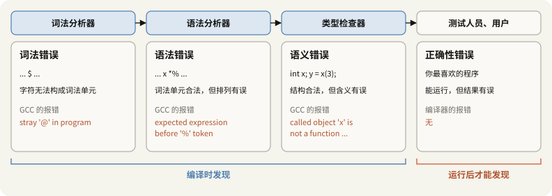

| 错误类型 | 典型示例 | 拦截阶段 | 底层机制说明 |
|:---|:---|:---|:---|
| **词法错误**（Lexical Error） | `int x = 1 @ 2;` | 词法分析器 | 包含语言字符集之外的非法字符，DFA 无法转移至任何接收态 |
| **语法错误**（Syntax Error） | `int z = x *% y;` | 语法分析器 | Token 均合法，但排列顺序无法被上下文无关文法推导（此处为二元操作符非法相邻） |
| **语义错误**（Semantic Error） | `int x; y = x(3);` | 语义分析器（类型系统） | 结构上符合函数调用语法，但符号表查询表明操作数 `x` 属于标量整型，不具备可调用签名 |
| **运行时正确性错误**（Correctness Error） | 逻辑死锁、数组越界、算式写反 | 运行期（测试与用户） | 源码在词法、语法与类型层面完全合规，但其运行时行为违背了预期算法逻辑 |

前三类错误属于静态分析范畴，编译器必须在编译期将其全部拦截；而第四类逻辑缺陷无法由常规编译器静态判定。

在实际编译器（如 GCC 13.3）中，错误提示的措辞严格反映了其所处的阶段：

```text
int x = 1 @ 2;   → error: stray '@' in program                                （词法分析阶段拦截）
int z = x *% y;  → error: expected expression before '%' token                （语法分析阶段拦截）
y = x(3);        → error: called object 'x' is not a function or function pointer  （类型检查阶段拦截）
```

> [!warning] 纠正：特殊字符的错误归属取决于具体语言规范
> 教学课件中常将 `$` 列为 C 语言词法错误的范例（标注为 `not used in C`）。但工程实践中，GCC/Clang 在默认兼容扩展下允许标识符包含 `$`。例如代码 `int x = 1 $ 2;` 在 GCC 默认配置下抛出的是语法错误 `expected ',' or ';' before '$'`（将其视为标识符），只有显式传入 `-fno-dollars-in-identifiers` 参数后，才会触发词法错误 `stray '$' in program`。一个符号是否构成词法错误，完全由前端正则规则与词法规范决定，不可脱离编译器实际配置做主观假定。

### 1.2 优秀错误处理器的三项工程指标

设计一个高品质的编译器错误处理器面临三项核心工程指标的权衡：

| 设计指标 | 具体含义 | 缺失时的工程后果 |
|:---|:---|:---|
| **准确定位与说明** | 准确报告行列号并给出具有指导意义的诊断 | 开发者需要花费大量时间逆向推导真实出错原因 |
| **快速恢复分析** | 发生错误后迅速重置状态，继续分析后续代码 | 编译器陷入无效搜索或频繁抛出无意义的中断 |
| **零开销抽象** | 错误恢复逻辑不降低处理合规代码时的编译吞吐率 | 正常编译流程因维护庞大的回溯数据结构而变慢 |

在准确定位中，关键挑战是抑制**级联错误**（Cascading Errors）——即源代码中仅存在一处笔误，却诱发分析器产生连续数十条虚假告警。

```c
int main() {
  int x = 1
  int y = 2;
  return x + y;
}
```

```text
semi.c:2:3: error: expected ',' or ';' before 'int'
semi.c:3:14: error: 'y' undeclared (first use in this function)
```

第一行行末遗漏分号，导致第二行的 `int` 触发语法错误。分析器在尝试跳过错误时连带丢失了变量 `y` 的声明上下文，进而引发第 3 行对 `y` 的未定义引用。排错实践中始终建议**优先修复第一条错误消息**，其根本原因即在于后续报错多为恢复失控引发的次生级联反应。

### 1.3 错误发生位置与检测位置的偏移现象

在编译器前端中，**分析器报告错误的位置往往落后于实际发生笔误的物理位置**。

分析器只有在**当前输入符号与此前所有未完成推导均无法兼容**时，才会正式触发错误处理。例如读到 `int x = 1` 时，后续完全可能接入合法运算符（如 `+ 2;`），因此该处在语法层面是完全合法的；分析器直到读入下一行的 `int` 符号时，才判定推导失败。

在缺少闭合括号或花括号的场景中，这种检测偏移可能跨越几十行甚至整个文件：

```c
int f(int a) {
  if (a) {
    return 1;
  return 0;
}
int g(void) { return 2; }
int main(void) { return f(1) + g(); }
```

```text
brace.c:7:1: error: expected declaration or statement at end of input
```

实际遗漏花括号发生在第 3 行，但由于 GNU C 允许函数嵌套定义，分析器会持续将后续的 `g` 和 `main` 视为 `f` 内部的局部代码，直至遇到物理文件末尾 EOF 时才发现作用域未闭合。这一现象也是导致自动错误修正极为困难的本质原因之一。

### 1.4 三大语法错误恢复策略

面对非法输入，编译器发展出了三种由浅入深的恢复范式：

| 恢复策略 | 核心运作方式 | 章节定位 |
|:---|:---|:---:|
| **恐慌模式**（Panic Mode） | 弹出栈顶不兼容状态，丢弃输入符号直到结构性同步点，随后恢复分析 | §2 |
| **错误产生式**（Error Productions） | 将高频发生的语法失误显式编码为文法的备选分支，主动接纳非法形式 | §3.1 |
| **自动局部/全局修正**（Automatic Correction） | 引入编辑距离度量，自动寻找与当前错误输入最邻近的合规语法串 | §3.2 |

---

## 2. 恐慌模式

### 2.1 状态重置与同步词法单元

恐慌模式是编译器中最经典、工程开销最低的错误恢复机制。遇到无法处理的语法错误时，其标准处理流程分为四步：

1. **触发错误**：当前分析状态无法接受下一个前瞻词法单元（Lookahead Token）。
2. **状态退栈（Unwinding）**：逆向弹出分析栈中的状态，直到暴露出能够安全承接后续结构的恢复锚点。
3. **丢弃符号（Token Skipping）**：词法流连续丢弃输入符号，直至遇到预设的**同步词法单元**（Synchronizing Token）。
4. **重置重启**：将分析器推进到与同步符号相匹配的新状态，恢复正常的语法分析。

同步词法单元的选择必须遵循**结构定界符**（Structural Delimiters）原则，即选取在语言中具有强闭合语义的符号：

| 同步词法单元 | 对应闭合的语法范畴 | 工程作用 |
|:---:|:---|:---|
| `;` | 独立语句（Statement） | 隔离局部表达式错误，确保后续语句正常解析 |
| `}` | 代码块（Block Scope） | 结束局部作用域，重置控制流上下文 |
| `)` | 括号子表达式或参数列表 | 封闭局部嵌套，恢复外层表达式分析 |

常规恢复准则为：表达式内部出错，跳过该表达式并同步至分号；局部语句出错，跳过该语句并从下一条语句继续；函数体严重损坏，跳过整个函数块直至右花括号。

### 2.2 追踪实例：`( 1 + + 2 ) + 3` 的恐慌恢复

考虑典型算术文法：
$$
E \to \text{int} \mid E + E \mid (E)
$$

当输入串为 `( 1 + + 2 ) + 3` 时，分析器顺利解析 `( 1 +` 后期待一个新的操作数表达式，但随后遇到第二个 `+` 产生语法冲突。

若采用简单的就近同步策略（将下一个整型数设为局部同步点），分析器丢弃冲突的 `+`，直接从 `2` 恢复解析，完成内部 `( 1 + 2 )` 的规约，后续的 `+ 3` 即可按正常流程顺利闭环。

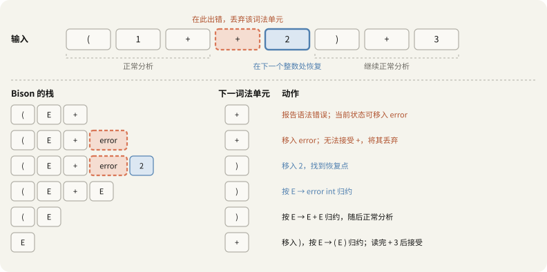

### 2.3 Bison 中的 `error` 虚拟符号与处理管线

在 GNU Bison / Yacc 等 LALR 语法分析生成器中，恐慌模式通过引入特殊的保留终结符 `error` 形式化地编码到产生式中：

$$
E \to \text{int} \mid E + E \mid (E) \mid \mathbf{error}\ \text{int} \mid (\mathbf{error})
$$

这里的 `error` 符号在形式语言学上扮演**匹配任意被丢弃符号串的占位终结符**：
- $E \to \mathbf{error}\ \text{int}$：将错误发生点至下一个整数之间的所有符号打包并消耗，整体规约为一个合法的表达式 $E$。
- $E \to (\mathbf{error})$：将圆括号内部被跳过的所有非法符号打包，连同两侧括号共同规约为一个表达式 $E$。

当这两条产生式成功完成规约后，左部均为非终结符 $E$，这意味着外层语法结构能够无缝将错误修复产物视为一个普通的子表达式，保证高层分析状态机不受破坏。

> [!note] 补充：Bison `yacc.c` 底层错误恢复四步法
> 查阅 Bison 生成的驱动代码 `yacc.c`，其运行时状态机严格执行如下逻辑：
> 1. **首发报错**：若当前未处于错误恢复态，调用 `yyerror("syntax error")` 抛出诊断。
> 2. **退栈搜索**：循环从分析栈顶弹出状态，直到找到一个在当前状态下**允许移进 `error` 符号**的状态。若退栈至底仍无匹配，分析彻底宣告失败（`YYABORT`）。
> 3. **移进 `error`**：将 `error` 符号压栈，状态机转移至包含恢复产生式的下一状态。
> 4. **丢弃并同步**：检查当前输入 Token 是否能在当前状态下被合法移进或规约。若不能，调用词法分析器丢弃当前 Token 并读取下一个，循环往复直至命中可接收的同步符号，或直至输入流耗尽。

> [!warning] 纠正：恢复规则的局部性竞争与陷阱
> 直觉上可能认为只要写了 $E \to (\mathbf{error})$，括号内的任意错误都能被括号边界精确捕获。但 Bison 的状态机机制规定：**分析器始终优先匹配栈顶最近的能够移进 `error` 的状态**。
> 若文法中同时存在 $E \to \mathbf{error}\ \text{int}$ 与 $E \to (\mathbf{error})$，对于输入 `( 1 + + ) + 3`，由于栈内已先存在 `E +` 对应的状态，`error int` 规则会优先接管；为了寻找整数，它会将闭合括号 `)` 作为无效 Token 吞噬，导致外层括号无法闭合，最终引发致命崩溃。

### 2.4 恢复规则对分析鲁棒性的决定性影响

选用相同的非法输入串，在仅改变文法错误恢复规则的条件下，Bison 模拟器的运行结果对比展现出截然不同的鲁棒性差异：

| 输入测试用例 | 仅配置 `error int` | 仅配置 `( error )` | 两者同时配置 | 结构性原因分析 |
|:---|:---:|:---:|:---:|:---|
| `( 1 + + 2 ) + 3` | 解析至末尾（丢弃 `+`） | 解析至末尾（丢弃 `+`、`2`） | 解析至末尾（丢弃 `+`） | 后继存在整数 `2` 与闭合符 `)`，两种同步机制均可闭环 |
| `1 + + 2` | 解析至末尾（丢弃 `+`） | **异常终止** | 解析至末尾（丢弃 `+`） | 无括号包裹，`( error )` 无法在栈中找到恢复点，退栈到底后被迫放弃 |
| `( 1 + + ) + 3` | **异常终止**（丢弃 `+`、`)`、`+`） | 解析至末尾（丢弃 `+`） | **异常终止**（丢弃 `+`、`)`、`+`） | `error int` 越界吞噬了 `)`，破坏了外层括号配对 |
| `( + ) + 3` | **异常终止**（丢弃 `+`、`)`、`+`） | 解析至末尾（丢弃 `+`） | 解析至末尾（丢弃 `+`） | 无有效操作数，`error int` 再次越界吞噬；但在双规则下被更优的括号状态承接 |

第三行的故障是编译器设计中最经典的教训：
`error int` 在寻找 `int` 作为同步点时，将本应充当语法结构边界的 `)` 视为普通非整数符号予以丢弃。当它在输入末尾抓住整数 `3` 并强行完成局部恢复时，原本与左括号配对的闭合符号已荡然无存。输入流消耗完毕后，栈底的 `(` 成为永久未闭合悬空结构，导致整个语法分析彻底失败。

> [!important] 核心准则：同步点必须为结构定界符
> 恢复规则的末尾**必须使用具有明确作用域闭合能力的定界符**（如 `;`、`}`、`)`）。整型、标识符等操作数可任意出现在程序的各种语法上下文中，不具备结构边界约束力，严禁将其作为全局同步点。工业级语法规范中广泛采用 `stmt : error ';'` 或 `block : '{' error '}'`，其原理正在于此。

### 2.5 级联抑制机制与编译器状态标志

在错误恢复初期，分析器的新状态与后续输入流极易发生短时间内的步调失调。为防止同一语法故障连续抛出多条无意义的虚假告警，Bison 引入了**连续有效移进计数器**机制：
- 只有在错误恢复发生后，**连续成功移进 3 个合法 Token**，分析器才认为系统完全回归正常状态，并重新激活错误报告；在此期间遇到的新冲突将被静默丢弃。

| 输入序列 | 真实错误数 | 实际报告告警数 | 抑制机理解析 |
|:---|:---:|:---:|:---|
| `1 + + 2 + + 3` | 2 处 | 1 条 | 首次恢复后仅移进了 `2` 与 `+`（共 2 个 Token），计数器未满 3，后续错误被静默处理 |
| `1 + + 2 + 3 + + 4` | 2 处 | 2 条 | 首次恢复后依次成功移进了 `2`、`+`、`3`（达到 3 个 Token），抑制状态解除，正常告警 |

在编译器开发中需注意两项关键工程细节：
1. **显式重置计数器**：若确定当前动作已完全校准输入流，可在语义动作中调用宏 `yyerrok` 强制清除抑制状态。
2. **退出状态判定**：恐慌恢复成功后，`yyparse()` 仍可能正常返回 0（表示解析流程走完）。判定源程序是否完全正确，必须读取内部错误计数器 `yynerrs`，而不能仅依赖函数的整型返回值。

### 2.6 工业级编译器中的嵌套深度感知

在手写递归下降分析器中，恐慌模式由专门的跳过函数实现，如 Clang 的 `Parser::SkipUntil` 与 GCC 的 `cp_parser_skip_to_end_of_statement`。

实际工程实现中不能做机械的“字符比对丢弃”，而**必须跟踪括号与大括号的嵌套层级**：

```cpp
// 节选自 clang/lib/Parse/Parser.cpp: Parser::SkipUntil
case tok::l_paren:
  // 遇到左括号时递增嵌套深度，递归调用跳过其内部配对内容
  ConsumeParen();
  SkipUntil(tok::r_paren);
  break;
```

若在搜寻语句分号 `;` 时未考虑嵌套深度，扫描器便可能错误地停留在局部结构内部（如 `for (int i = 0; i < n; ++i)`）的分号上，从而在不完整的作用域切片中重启分析，导致更为严重的次生混乱。现代编译器均通过维护 `nesting_depth` 确保同步点精准落在外层骨架边界。

---

## 3. 错误产生式与自动修正

恐慌模式的核心思想是“跳过并忽略”，而本节探讨更具侵入性的两类策略：从文法层面包容错误，以及从算法层面自动纠正源码。

### 3.1 错误产生式（Error Productions）

**错误产生式**通过将开发者的高频笔误直接提升为合法的文法分支，使原本非法的语法结构在语法分析树中获得合法的推导路径。

典型案例出现在数学计算脚本语言中：数学领域习惯书写乘法省略符号（如 $5x$），用户常在表达式中书写 `5 x` 代替 `5 * x`。为接纳此类习惯，文法可扩展为：

$$
E \to \cdots \mid E\ E
$$

> [!warning] 纠正：错误产生式在形式上是接纳，而非修正
> 错误产生式的作用是将非法输入**在文法意义上提升为替代语法（Alternative Syntax）**。一旦将规则 $E \to E\ E$ 写入文法，`5 x` 便成为完全符合推导规范的合法句型。分析器在此分支的语义动作中究竟是向用户发出告警（Warning）、记录错误，还是直接生成乘法 AST 节点，属于后置的语义策略决定。

GCC 在处理 C 语言标准扩展时大量应用了这一思想。例如在 C 语言函数定义后多写的分号：

```c
int f(void) { return 0; };
```

该写法违背 ISO C 标准，但在 GCC 的 C 前端中被作为扩展产生式静默接纳，仅在开启 `-Wpedantic` 严格标准检查时输出警告：

```c
// 节选自 gcc/c/c-parser.cc 顶层声明解析
case CPP_SEMICOLON:
  pedwarn (c_parser_peek_token (parser)->location, OPT_Wpedantic,
           "ISO C does not allow extra %<;%> outside of a function");
  c_parser_consume_token (parser);
  break;
```

#### 错误产生式的代价：二义性与冲突爆炸
向文法中引入宽松的错误产生式往往会破坏原有文法的确定性，诱发严重的移进-归约与归约-归约冲突：

| 文法配置状态 | 移进/归约冲突数 | 归约/归约冲突数 |
|:---|:---:|:---:|
| 基础文法：`E → int \| E + E \| E * E \| ( E )`（配置 `%left` 优先级） | 0 | 0 |
| 加入错误规则：`E → E E` | **8** | 0 |
| 进一步扩展二元减法 `E - E` 与一元负号 `- E` | **13** | **7** |

产生冲突的根本原因在于：产生式 $E \to E\ E$ 的右侧全为非终结符，不包含终结符，因而无法绑定任何通过 `%left` 声明的操作符优先级。更严重的是它直接导致了**深层语义二义性**：
- 串 `5 x + y` 既可规约为 `(5 x) + y`，亦可规约为 `5 (x + y)`；
- 串 `5 - x` 既可理解为二元算术减法 $5 - x$，亦可被解释为乘号省略的 $5 \times (-x)$。
为了兼容局部笔误，导致原本语法完全正确的代码也丧失了确定性的语义解释。

### 3.2 自动纠错与编辑距离算法

**自动修正**试图通过计算输入串与合法文法集合之间的**最小编辑距离**（Levenshtein Edit Distance，定义单步插入、删除、替换操作的代价均为 1），寻找修改代价最小的合法程序。

在编译器历史上将这一理念推向极致的是 20 世纪 70 年代康奈尔大学开发的 **PL/C 教学编译器**。该编译器旨在“无条件完成编译并生成可执行代码”，即使输入无意义的文本段落，它也能通过一系列剧烈的插入与删除操作拼凑出一个能够进入运行期的 PL/I 程序。

然而，编辑距离搜索在计算复杂度上面临严重的组合爆炸。考虑仅由 5 种基础 Token（`int`、`+`、`*`、`(`、`)`）构成的微型表达式文法：

| 非法输入串 | 长度 | 距离为 1 的修改空间 | 其中合乎文法的候选 | 距离为 2 的修改空间 | 其中合乎文法的候选 |
|:---|:---:|:---:|:---:|:---:|:---:|
| `1 + 2 ) * 3` | 6 | 59 | 3 | 1,481 | 9 |
| `( 1 + + 2 ) + 3` | 8 | 76 | 2 | 2,536 | 11 |

仅对 8 个 Token 的简短表达式做距离为 2 的纠错探测，状态空间就激增至 2,500 个以上。随着源代码长度上升，全局搜索在实际工程中是不可承受的。

> [!note] 补充：多项式时间纠错算法的现实壁垒
> Aho 与 Peterson 在 1972 年证明了基于动态规划算法可在 $O(n^3)$ 时间复杂度内求得上下文无关语言的最小编辑距离修正。但对于现代拥有数十万行代码的大型工程，立方时间复杂度依然过于沉重；更重要的是，纯数学层面的最优距离无法映射人类的实际意图。

### 3.3 邻近性悖论：距离最近并非开发者原本意图

自动修正面临的最本质哲学障碍是**意图不可知**：

> **编辑距离最小的合规程序，往往不是开发者原本意图编写的程序。**

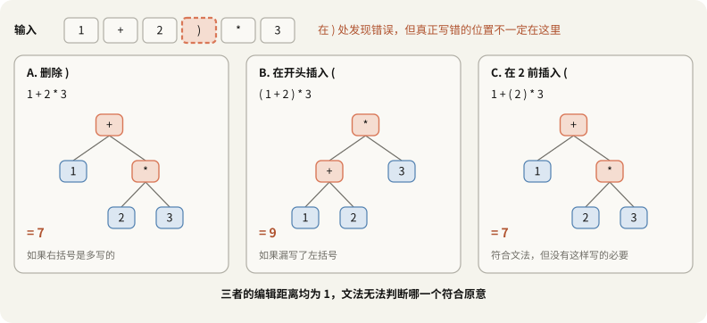

以非法输入 `1 + 2 ) * 3` 为例，存在三个编辑距离均为 1 的合法候选方案：
- **方案 A（局部删除）**：删除右括号，得到 `1 + 2 * 3`，表达式求值结果为 **7**；
- **方案 B（全局插入）**：在行首插入左括号，得到 `( 1 + 2 ) * 3`，表达式求值结果为 **9**；
- **方案 C（局部插入）**：在数字 2 前插入左括号，得到 `1 + ( 2 ) * 3`，表达式求值结果为 **7**。

三个候选在代数几何与形式语法上地位完全等价，但由于运算符结合顺序不同，计算结果产生了实质分歧。编译器仅依据上下文无关文法，根本无法推断程序员在物理世界中真正想要的是 7 还是 9。

这一现象同样揭示了**局部修正与全局修正的权衡**：
- **局部修正**（Local Correction）：仅在检测到故障的狭小窗口内进行操作（如直接删除失配的 `)`）。由于检测位置往往滞后于真实犯错位置（§1.3），局部修正极易错失真正的病灶。
- **全局修正**（Global Correction）：跨越整个输入流搜索最小代价树。虽能涵盖行首插入等深层方案，但面临严重的歧义选择难题和高昂的计算代价。

现实中由规范强制定义的“自动修正”同样可能带来灾难性后果，最显著的例子是 JavaScript 的自动分号插入（ASI）：
```javascript
return
  a + b;
```
由于语法解析器在 `return` 换行处自动注入了分号，代码被实际解析为无返回值的 `return;`，后续的 `a + b` 成为不可达代码。语法错误虽然消失了，程序的实际逻辑却被彻底扭曲。

### 3.4 编译器设计理念的演变：从积极纠错到交互诊断

回顾计算机体系发展史，错误处理策略的变化与运行环境密切相关：

| 评估维度 | 20 世纪 70 年代（批处理穿孔卡片时代） | 现代（交互式 IDE 与快速构建时代） |
|:---|:---|:---|
| **构建周期** | 提交任务后需数小时甚至次日才能取得运行打印单 | 毫秒级增量编译，语言服务器（LSP）实时给出诊断波浪线 |
| **单次笔误代价** | 耽搁整整一天的工作进度 | 修复后保存，极速重新验证 |
| **核心工程目标** | 编译器竭尽全力通过纠错推进到底，尽可能一次性暴露出全量潜在问题 | 追求诊断信息的绝对精度与低误报率，快速停止扩散 |
| **最终结论** | PL/C 式的全面自动化代码修复 | **恐慌模式足以满足工程需求**，辅以高精度的代码修改建议（Fix-it Hints） |

现代编译器（如 Clang 与 GCC）并未完全抛弃编辑距离算法，而是将其迁移至**诊断与智能补全**范畴：
```text
error: 'strng' is not a member of 'std'; did you mean 'string'?
fix-it:"main.cpp":{2:19-2:24}:"string"
```
编译器在内部计算拼写符号的编辑距离，但**绝不擅自篡改源码进入后续阶段**，而是以机器可读的形式向 IDE 输出 Fix-it 建议，将最终决策权完全交还给开发者。

### 3.5 语法错误处理三大策略综合对比

| 恢复策略 | 核心处理机制 | 典型工业应用 | 主要局限性与工程隐患 |
|:---|:---|:---:|:---|
| **恐慌模式**（Panic Mode） | 丢弃 Token 直到定界符，重置分析状态 | Clang `SkipUntil`、Bison `error` | 被丢弃区间的语法错误被全部漏检；若同步点选取不当易诱发级联故障 |
| **错误产生式**（Error Productions） | 将高频失误直接编码为文法合法备选项 | GCC 的 `-Wpedantic` 语法扩展 | 文法规则复杂化，极易诱发移进-归约冲突并引发深层语义二义性 |
| **自动修正**（Auto-Correction） | 基于最小编辑距离搜索与变换合规输入串 | PL/C、IDE 拼写建议 | 搜索状态空间爆炸；无法获知开发者的真实意图，存在静默改变程序语义的风险 |

---

## 4. 从分析树到 AST（抽象语法树）

### 4.1 抽象语法树的引入动机

在语法分析初期，分析器的首要任务是验证 Token 序列是否能够由上下文无关文法合法推导，这一过程生成的完整树结构称为**具体语法树**（Concrete Syntax Tree，CST，亦称分析树）。

然而，编译器的后续管线（语义分析、类型检查、中间表示生成与优化）关注的并非“语法规则被应用了多少次”，而是底层的计算语义：
- 计算的输入操作数是什么？
- 操作符的层次结构与作用顺序为何？
- 哪个表达式构成了另一个运算的子表达式？

CST 严格记录了推导步骤中的所有文法符号，包含了大量辅助性的非终结符节点与语法分隔符号（如括号、分号、逗号）。**抽象语法树**（Abstract Syntax Tree，AST）通过剪除分析树中的非必要推导细节，提炼出纯粹反映程序逻辑运算关系的树形数据结构。

### 4.2 案例对比：`5 + (2 + 3)` 的 CST 与 AST

考虑经典表达式文法：
$$
E \to \text{int} \mid (E) \mid E + E
$$

对于输入串 `5 + ( 2 + 3 )`，词法分析器输出 7 个词法单元：`int5`、`+`、`(`、`int2`、`+`、`int3`、`)`。

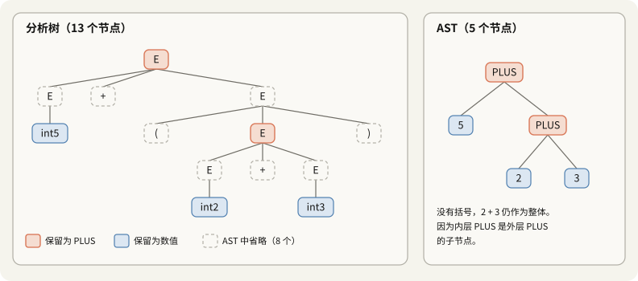

从分析树转换到 AST，树的节点总数从 13 个急剧压缩至 5 个。消失的 8 个节点具有明确的工程原因：

| 消失的冗余节点类型 | 消除数量 | 省略的数理依据 |
|:---|:---:|:---|
| 显式定界符 `(` 与 `)` | 2 | 运算优先级与计算次序已内嵌于树的父子几何拓扑中，无需文本定界符 |
| 单分支展开产生的 $E \to \text{int}$ | 3 | 属于链式推导过渡节点，未承载任何运算操作，直连叶节点即可 |
| 括号推导节点 $E \to ( E )$ | 1 | 剥离定界符后变为单入单出的冗余转发节点 |
| 终结符 `+` 叶节点 | 2 | 操作符语义直接上提并吸收为内部算子节点的类型标识（`PLUS`） |

在源码文本中，必须依赖括号改变计算优先级；但在 AST 结构中，`PLUS(2, 3)` 成为根节点 `PLUS` 的右子节点，树的层次保证了内层加法必然先于外层加法求值，计算语义完全自洽。

### 4.3 内存数据结构布局

在系统编程语言（如 C/C++）中，AST 通常由具有多态性质的节点结构体及其指针网络构成：

```cpp
struct Expr {
    enum Kind { INT, PLUS } kind;
    int value;            // 仅在叶节点 kind == INT 时有效
    Expr *left, *right;   // 仅在内部操作节点 kind == PLUS 时有效
};
```

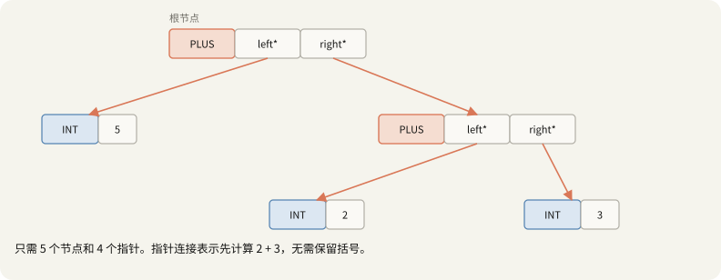

紧凑的 AST 结构极大简化了编译后端的处理逻辑：遍历遍历器只需递归访问有效操作符与操作数，无需处理繁琐的标点符号与过渡产生式。

### 4.4 语法制导翻译与属性传递

分析器并非先生成庞大的 CST 再进行修剪，而是在推导或规约的同时，通过**语法制导翻译**（Syntax-Directed Translation，SDT）直接构造出紧凑的 AST。

**语义动作**（Semantic Actions）是在文法产生式中嵌入的代码片段。在自底向上规约或自顶向下返回时执行，计算每个文法符号携带的属性值：

```text
E → int        { E.ast = mkleaf(int.lexval) }
  | E1 + E2    { E.ast = mkplus(E1.ast, E2.ast) }
  | ( E1 )     { E.ast = E1.ast }
```

关键机制体现在第三行：括号产生式**不创建任何新节点**，而是直接将内层子树的指针原样向上传递（`E.ast = E1.ast`）。在 Bison 语法中，这对应于 `$$ = $2;`。由此，括号在树构造阶段被自然消解。

编译原理中将文法符号携带的计算属性划分为两大流向：

| 属性范畴 | 计算与传递方向 | 核心应用场景 |
|:---|:---|:---|
| **综合属性**（Synthesized Attribute） | 从子节点计算并向上传递至父节点 | 自底向上构建 AST 节点、表达式常量折叠 |
| **继承属性**（Inherited Attribute） | 从父节点或左侧兄弟节点向下/向右传递 | 传递符号表作用域、算术运算左侧累积值（§7.5） |

### 4.5 具体分析树（CST）与抽象语法树（AST）对照

| 比较维度 | 具体分析树（CST / Parse Tree） | 抽象语法树（AST） |
|:---|:---|:---|
| **核心表达信息** | 形式文法规则的完整推导历程 | 程序的语法成分、运算逻辑与结构关系 |
| **括号与分隔标记** | 作为独立叶节点完整保留 | 转化为树分支的层次拓扑，标点符号被省略 |
| **单子推导中间节点** | 严格保留所有文法链式节点 | 消除无语义增量的过渡节点 |
| **实例节点规模** | 13 个节点 | 5 个节点 |
| **核心使用阶段** | 语法合法性检验（前端匹配期） | 语义检查、静态分析、中间代码生成（IR Gen） |

> [!note] 补充：括号的语义保留例外
> 并非所有语言环境下的括号都能被无脑剔除。在 C++ 类型系统中，括号具有明确的语义效应：
> ```cpp
> int x = 0;
> static_assert(std::is_same_v<decltype(x), int>);     // 实体名表达式，推导为声明类型 int
> static_assert(std::is_same_v<decltype((x)), int&>);  // 括号表达式为左值，推导为引用类型 int&
> ```
> 为此，Clang AST 中专门保留了 `ParenExpr` 节点，用于在源码重构与精准类型推导时完整还原开发者的括号意图。何时抽象、保留何种粒度的源码信息，完全取决于编译后端的具体需求。

---

## 5. 递归下降分析的实现原理

> [!note] 核心机制：递归下降的形式同构
> 递归下降分析（Recursive Descent Parsing）是现代工业级编译器（GCC、Clang、Rustc、Swift）广泛采用的语法分析技术。其核心优势在于**文法与代码的形式同构**：
> 1. **结构映射**：文法中的每个非终结符对应一个同名解析函数，产生式的递归推导自然转化为函数的相互递归调用；
> 2. **状态驱动**：程序执行完全由**解析函数的布尔返回值**（指示推导是否成立）与**全局前瞻指针 `next`**（指示输入流当前的消费偏移）共同驱动；
> 3. **局部回溯**：在进入候选分支前记录指针快照 `save = next`，当分支匹配失败时，借助短路求值与逗号表达式将指针重置，平滑切换至下一备选产生式。

### 5.1 语法树的构造顺序与等价维度

**自顶向下分析**（Top-Down Parsing）从文法的起始非终结符出发，按照自顶向下、从左向右的顺序逐步推导并构建语法分析树。

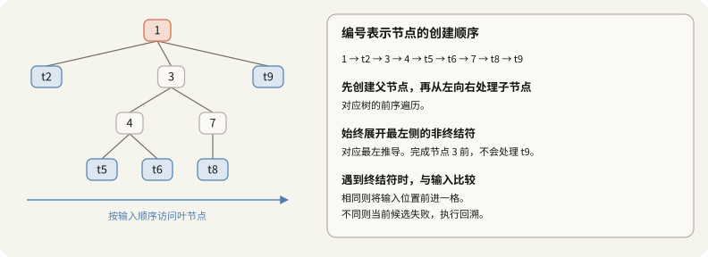

自顶向下的构建顺序在计算机科学中可由三个等价维度形式化描述：
- **从树的遍历拓扑看**：对应**前序遍历**（Pre-order Traversal），即优先创建当前父节点，再自左向右递归进入各个子节点；
- **从形式语言推导看**：严格对应**最左推导**（Leftmost Derivation），即在句型的所有未展开非终结符中，始终优先展开最左侧的一个；
- **从词法输入的消费看**：对应**从左至右单向扫描**（Left-to-Right Scan），叶节点所对应的终结符严格遵循源码中的物理顺序依次被比对并消耗。

后续讨论所使用的基准算术表达式文法如下（产生式按书写顺序依次尝试）：

$$
E \to T \mid T + E
$$

$$
T \to \text{int} \mid \text{int} * T \mid (E)
$$

### 5.2 实例追踪：输入 `( int5 )` 的完整推导过程

以输入串 `( int5 )` 为例，跟踪全局输入指针 `next` 在各解析函数调用与分支切换中的状态演化：

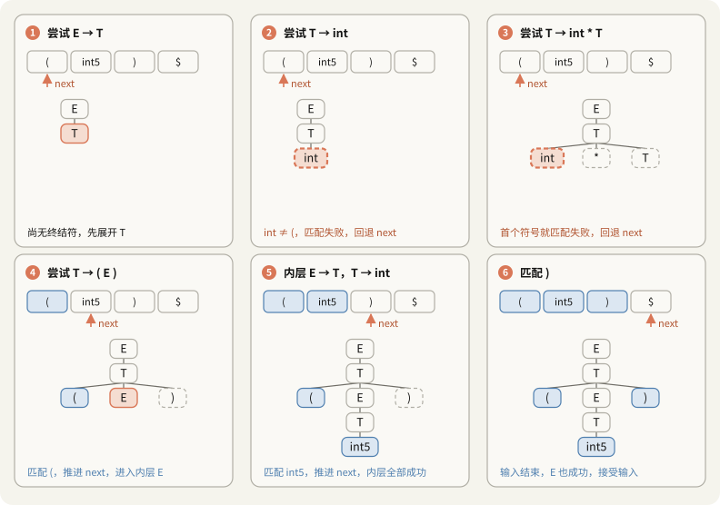

| 步骤 | 当前解析目标 | 尝试推导产生式 | 匹配动作与检测结果 | 指针 `next` 变化 | 决策逻辑与后续动作 |
|:---:|:---:|:---|:---|:---:|:---|
| **1** | $E$ | $E \to T$ | 尚未到达终结符，当前无法做出终验判断 | `next=0` | 递归向下展开非终结符 $T$ |
| **2** | $T$ | $T \to \text{int}$ | 期待终结符 `int`，前瞻符号为 `(`，匹配失败 | `0 → 1`（失配推进） | 恢复 `next=0`，切换至 $T$ 的下一分支 |
| **3** | $T$ | $T \to \text{int} * T$ | 首符号仍期待 `int`，再次失配 | `0 → 1`（失配推进） | 恢复 `next=0`，切换至 $T$ 的下一分支 |
| **4** | $T$ | $T \to ( E )$ | 期待 `(`，前瞻符号为 `(`，**匹配成功** | `0 → 1` | 消耗 `(`，递归调用子表达式解析函数 $E()$ |
| **5** | 内层 $E$ | $E \to T \to \text{int}$ | 期待 `int`，前瞻符号为 `int5`，**匹配成功** | `1 → 2` | 消耗 `int5`，内层 $T()$ 与 $E()$ 规约完毕返回 `true` |
| **6** | 外层 $T$ | 匹配闭合符 `)` | 期待 `)`，前瞻符号为 `)`，**匹配成功** | `2 → 3` | 消耗 `)`，外层 $T()$ 与 $E()$ 成功返回 `true` |

> [!note] 决策时机：非终结符无直接判定能力
> 递归下降分析器在解析非终结符（如 $E$ 或 $T$）时，无法仅凭自身符号做出预测。**必须持续递归展开，直至遇到具有物理字符相对应匹配关系的终结符叶节点时，才能对分支的正确性做出真伪判定**。步骤 2 与 3 即体现了展开至叶节点失配后的状态回滚。

### 5.3 文法规则到代码实现的直接映射

任意上下文无关文法产生式：

$$
S \to \alpha_1 \mid \alpha_2 \mid \cdots \mid \alpha_n
$$

均可遵循固定的语法映射规则无缝转换为 C 语言过程：

| 形式文法构件 | 代码映射方式 | C 语言实现范式 | 运行机制说明 |
|:---|:---|:---|:---|
| **终结符**（Terminal） | 匹配函数 `term(tok)` | `bool term(TOKEN tok) { return *next++ == tok; }` | 校验当前前瞻符号并推进输入游标 |
| **非终结符**（Non-Terminal） | 独立布尔函数 | `bool S()`, `bool T()` | 将语法范畴封装为返回解析状态的函数 |
| **顺序连接**（Concatenation） | 逻辑与操作符 `&&` | `T() && term(PLUS) && E()` | 利用短路求值：任一前置符号匹配失败即中止后续调用 |
| **选择分支**（Alternation） | 逻辑或操作符 `\|\|` | `(next=save, S_1()) \|\| (next=save, S_2())` | 顺序尝试候选式，任一分支成功即完成规约 |
| **分支回溯**（Backtracking） | 逗号表达式重置 | `(next = save, S_n())` | 进入新分支前无条件将输入指针复位至基准点 `save` |

将非终结符 $E$ 映射为 C 代码如下：

```c
// 终结符匹配原语：校验当前符号并无条件递增指针
bool term(TOKEN tok) { return *next++ == tok; }

// 产生式 1：E -> T
bool E_1() { return T(); }

// 产生式 2：E -> T + E
bool E_2() { return T() && term(PLUS) && E(); }

// 顶层 E 分发入口：顺序尝试候选分支，并在尝试前恢复指针快照
bool E() {
    TOKEN *save = next;
    return (next = save, E_1())
        || (next = save, E_2());
}
```

### 5.4 共享指针驱动：状态通过全局输入偏移传递

在实际解析过程中，同一个非终结符 $T$ 在不同的输入上下文中消耗的 Token 数量各不相同：

| 输入的前缀子串 | 匹配的产生式展开链 | $T$ 实际消耗的 Token 数 |
|:---|:---|:---:|
| `5` | $T \to \text{int}$ | 1 |
| `2 * 3 * 4` | $T \to \text{int} * T \to \text{int} * \text{int} * T$ | 5 |
| `( 1 + 2 )` | $T \to ( E )$ | 5 |

函数 `T()` 的返回值仅为一个布尔状态量，并未显式返回“读取了多少个词法单元”。这一设计的成立依托于**全局共享输入指针 `next`**：

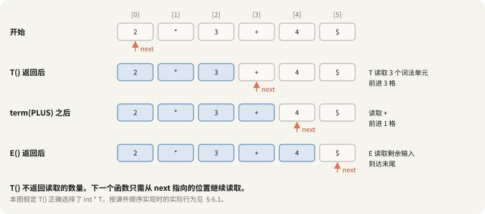

- 当 `T()` 匹配成功返回 `true` 时，全局指针 `next` 已由内部调用的 `term` 递增推进至偏移 3；
- 随后的 `term(PLUS)` 无需任何额外参数传递，直接从当前偏移 3 取词匹配 `+`；
- 后续的右侧 `E()` 从偏移 4 顺次继续解析。

**调用栈隐式维护了语法推导树的嵌套层次，而全局指针 `next` 则单向推进输入流的消费进度。**

### 5.5 回溯机制的实现机理与副作用局限

若首个候选分支尝试失败，在该分支终止之前往往已经消耗了一定数量的输入符号。若不加重置直接进入下一候选分支，下一分支将在已被污染的错误偏移位置启动分析。

因此在尝试分支前必须保存游标快照：
```c
TOKEN *save = next;
```
并结合 C 语言的**逗号运算符**与 **`||` 短路求值**：
```c
(next = save, E_1()) || (next = save, E_2())
```
1. 逗号表达式 `(next = save, E_1())` 先执行 `next = save` 将指针精确复位，继而执行 `E_1()`，整个小括号表达式的值即为 `E_1()` 的返回值；
2. 若 `E_1()` 返回 `true`，`||` 立即短路，`E_2()` 不会被执行；
3. 若 `E_1()` 返回 `false`，则触发右侧表达式，再次执行 `next = save` 恢复指针，启动 `E_2()`。

> [!warning] 纠正：`term` 在失配时同样递增指针
> 课件初版定义常使用如下形式：
> ```c
> bool term(TOKEN tok) { return *next++ == tok; }
> ```
> C 语言的后置自增运算符 `++` 无论相等性比较结果真假，**指针均无条件递增**。
> 测试日志证实了该行为：
> ```text
> T_1() next=0
>   term(int) sees (: mismatch
> T_1 -> false next=1        // 尽管匹配失败，next 依然自增到了 1
> ```
> 这进一步证实了显式 `(next = save, ...)` 复位机制的必要性。同时，词法流末尾**必须配置明确的 EOF 哨兵符号**；否则面对未闭合括号如单独的 `(` 时，指针在失配自增后会越界访问未映射内存，触发堆缓冲区溢出（ASan 抛出 `heap-buffer-overflow`）。在追加 EOF 哨兵后，全量 488,280 个测试用例均平稳通过。

> [!caution] 深度局限：指针可回滚，但环境副作用不可逆
> 上述代码能够通过 `next = save` 完美回溯的前提是：函数调用除移动指针外**不存在任何系统级副作用**。
> 在实际生产编译器中，若分支在匹配失败前向符号表插入了新符号、或在内存堆上动态分配了 AST 节点，简单的指针复位无法撤销这些内存与符号环境的副作用。这也是现代工业编译器极力避免盲目回溯、转而采用确定性预测分析（LL/LR）的根本原因。

### 5.6 完整文法实现与验证闭环

将非终结符 $T$ 的完整推导也按映射范式转换为 C 语言代码：

```c
// 规则 1：T -> int
bool T_1() { return term(INT); }

// 规则 2：T -> int * T
bool T_2() { return term(INT) && term(TIMES) && T(); }

// 规则 3：T -> ( E )
bool T_3() { return term(OPEN) && E() && term(CLOSE); }

// T 调度入口
bool T() {
    TOKEN *save = next;
    return (next = save, T_1())
        || (next = save, T_2())
        || (next = save, T_3());
}
```

#### 启动分析与合法性判定的两项核心条件
启动语法分析过程的代码如下：
```c
bool success = E() && (*next == EOF);
```
合法的语法分析**必须同时满足两项前置条件**：
1. **起始符号顶层函数 `E()` 返回 `true`**（表明前缀串构成了合法的文法推导）；
2. **全局指针 `next` 恰好停留在 `EOF` 结束符上**（表明输入流被完全消费，无残余非法符号）。

> [!important] 为什么必须显式检验 EOF 结束符？
> 若省略 `*next == EOF` 检查，面对包含语法残余的非法输入串（如 `int )`）：
> 起始函数 `E()` 在成功消费开头的 `int` 后即返回 `true`。若无结束符校验，分析器将误判输入合法，而对尾部悬空的非法闭合符号 `)` 完全视而不见。

#### 实际执行调用链日志（解析 `( int )`）
在解析器中注入执行跟踪断点，运行输入 `( int )` 时的完整调用序列如下：

```text
E() next=0
  E_1() next=0
    T() next=0
      T_1() next=0
        term(int) sees (: mismatch
      T_1 -> false next=1
      T_2() next=0
        term(int) sees (: mismatch
      T_2 -> false next=1
      T_3() next=0
        term(() sees (: match
        E() next=1
          E_1() next=1
            T() next=1
              T_1() next=1
                term(int) sees int: match
              T_1 -> true next=2
            T -> true next=2
          E_1 -> true next=2
        E -> true next=2
        term()) sees ): match
      T_3 -> true next=3
    T -> true next=3
  E_1 -> true next=3
E -> true next=3
E()=1, at END=1
```

调用日志与理论推导完全吻合：`T_1` 与 `T_2` 失配后指针均被复位至 0，直到 `T_3` 成功匹配 `(`；随后内层递归解析整型数，外层闭合右括号，最终在输入结束符处成功判定为合法程序：

```text
        E
        |
        T
      / | \
     (  E  )
        |
        T
        |
       int
```

---

## 6. 基础递归下降的局限性与文法重构

### 6.1 贪心短路引发的识别缺陷：为何拒绝 `int * int`

尽管输入串 `int * int` 完全符合语言文法规约，但在 §5 给出的基础递归下降实现中，该输入却被直接拒绝。执行日志如下：

```text
E() next=0
  E_1() next=0
    T() next=0
      T_1() next=0
        term(int) sees int: match
      T_1 -> true next=1
    T -> true next=1
  E_1 -> true next=1
E -> true next=1
E()=1, at END=0
```

失败的机理在于逻辑或 `||` 的**短路求值（Short-circuit Evaluation）**特性：
1. 解析函数 `T()` 在尝试首个分支 `T_1`（$T \to \text{int}$）时，成功匹配并消费了首个 `int`，返回 `true`；
2. 由于 `T_1` 成功，`||` 立即短路，更长的候选分支 `T_2`（$T \to \text{int} * T$）根本没有机会被执行；
3. `true` 状态被逐层向上返回至顶层 `E()`；
4. 此时全局游标 `next` 停留在 `*` 处，未能通过 `*next == EOF` 终验检查，输入被拒绝。

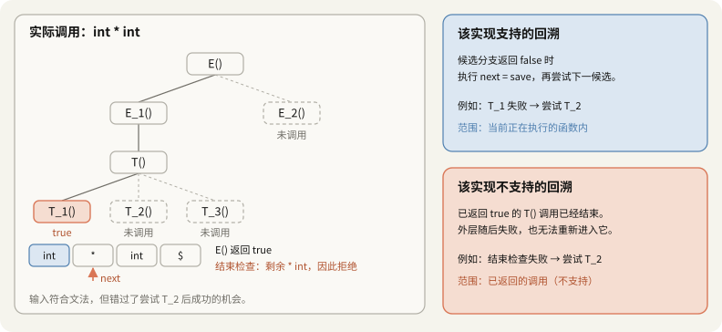

> [!important] 核心缺陷：局部识别成功 $\neq$ 全局推导闭环
> **非终结符函数的返回成功，仅代表它在当前局部位置匹配出了一种文法前缀，绝不意味着整个输入流被正确分析完毕。**
> 递归下降分析器存在两种不同维度的回溯能力：
> - **局部候选式回溯**：撤销当前函数内部失配分支的游标偏移（已通过 `next = save` 支持）；
> - **跨层次全局回溯**：当高层推导在后续步骤发现死路时，强制重新进入已成功返回的底层函数，迫使其撤销已有选择并尝试次优候选式（基础实现**完全不支持**）。
> 因此，课件将其定义为“受限的递归下降分析器”（Limited Recursive Descent Parser）。解析函数一旦返回 `true`，其分支选择便不可撤销。

### 6.2 基础实现的有效语法子集

由于上述局部贪心缺陷，产生式 $E \to T + E$ 与 $T \to \text{int} * T$ 在代码中实际上沦为了**永远无法被触发的死代码**（Dead Code）：
- `E_2`（$E \to T + E$）只有在 `E_1` 返回 `false` 时才被尝试。但 `E_1` 失败意味着当前位置的 `T()` 匹配失败；而 `E_2` 同样必须在同一位置首先调用 `T()`，因而注定失败。
- `T_2`（$T \to \text{int} * T$）只有在 `T_1`（$T \to \text{int}$）失败后才被尝试；但两者均以 `term(INT)` 开头，首字符失配同样导致 `T_2` 必然失配。

剥离这两条永远无法到达的产生式后，文法实际退化为：
$$
E \to T, \quad T \to \text{int} \mid (E)
$$
对长度不超过 8 的全部 50 个合法输入进行穷举验证，该实现仅能成功接收以下 4 种孤立整型嵌套串：
```text
int
( int )
( ( int ) )
( ( ( int ) ) )
```
该实现完全无法解析任何加法或乘法复合运算。

### 6.3 调整规则尝试次序：长规则优先的代价与反例

若将产生式的尝试顺序颠倒，改为“长规则优先”：
$$
E \to T + E \mid T, \quad T \to \text{int} * T \mid \text{int} \mid (E)
$$
针对当前文法，50 个合法测试输入确实全部被正确接受，但这带来了严重的**计算复杂度爆炸**。

测试嵌套深度为 $n$ 层的括号表达式 `( ( ... int ... ) )`，统计终结符匹配函数 `term` 的调用开销：

| 嵌套深度 $n$ | 课件短规则优先（仅能测部分） | 长规则优先实测 | 提取左公因子后（§6.4） |
|:---:|:---:|:---:|:---:|
| 1 | 5 | 23 | 7 |
| 5 | 21 | 503 | 23 |
| 10 | 41 | 16,375 | 43 |
| 20 | 81 | **16,777,207** | 83 |
| **理论复杂度通式** | $4n+1$ | $2^{n+4}-9$ | $4n+3$ |

性能恶化的根源在于无记忆性的重复分析：
当尝试长规则 $E \to T + E$ 时，分析器完整解析完内层复杂的括号表达式 $T$，随后在期待 `+` 时失配；随后回退游标，切换至第二分支 $E \to T$，又**从头到尾将完全相同的括号表达式完整重复解析一遍**。每嵌套一层括号，内部的冗余解析次数翻倍，导致运行时间随括号深度呈指数级激增（$O(2^n)$）。

此外，“长规则优先”在形式语言学上并非普适解决方案。考虑生成奇数个符号 $a$ 的经典文法：
$$
S \to a\,S\,a \mid a
$$
在长规则优先策略下测试输入长度至 69，其实际接受的长度分布如下：

| 实现方案 | 接收的串长度序列 | 形式语言学评价 |
|:---|:---|:---|
| **文法理论集合** | 1, 3, 5, 7, 9, 11, 13, ...（所有正奇数） | 目标语言集合 |
| **长规则优先实现** | 1, 3, 7, 15, 31, 63（$2^k - 1$） | 遗漏大量合法字符串（如 `aaaaa`） |
| **短规则优先实现** | 1 | 仅能接受单个字符 |

对于合法输入 `aaaaa`（长度 5），内层 `S` 贪婪地匹配了长规则后，导致外层没有剩余的 $a$ 来闭合末尾匹配；而已经返回的内层调用无法重选，最终导致分析失败。

### 6.4 根本解决方案：提取左公因子（Left Factoring）

解决分支决策冲突的代数重构手段是**提取左公因子**（Left Factoring）。
冲突产生的本质在于：同一个非终结符的多个备选候选式具有**完全相同的起始终结符或公共前缀**，导致分析器在尚未读取并消耗该符号之前，无法判断应当进入哪一条推导路径：

$$
T \to \text{int} \mid \text{int} * T
$$

通过将公共前缀提取出来，并引入辅助非终结符 $Y$（原笔记标记为 $T'$），将决策时机推迟至公共前缀被成功消费之后：

$$
T \to \text{int}\ Y, \qquad Y \to *\,T \mid \varepsilon
$$

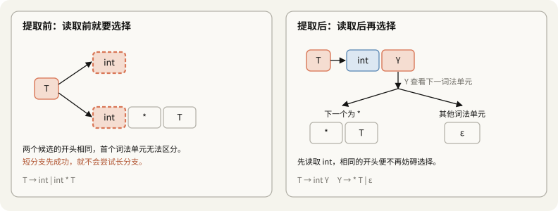

> [!warning] 纠正：文法重构的完备性要求
> 在对文法进行左公因子提取时，必须严格遵守三项完备性约束：
> 1. **保留所有独立分支**：不可遗漏非前缀候选式 $T \to (E)$；
> 2. **对所有存在公共前缀的符号同步变换**：$E \to T \mid T + E$ 的两个分支均以 $T$ 开头，必须同步引入辅助符号 $X$ 变换为 $E \to T\ X, \; X \to +\,E \mid \varepsilon$；
> 3. **空产生式 $\varepsilon$ 必须最后尝试**：$\varepsilon$ 不消耗任何输入且在判定中无条件成立；若将其置于首位，长候选式将永久失去被尝试的机会。

经过完全重构后的等价确定性文法如下：

$$
\begin{aligned}
E &\to T\ X \\
X &\to +\,E \mid \varepsilon \\
T &\to \text{int}\ Y \mid (E) \\
Y &\to *\,T \mid \varepsilon
\end{aligned}
$$

经穷举验证，新文法在保证语言推导集合绝对等价的同时，将分析器的调用开销彻底降为**线性复杂度 $O(n)$**（调用次数通式为 $4n+3$）。

#### 确定性预测查找表
提取左公因子后，每个非终结符仅需观察**下一个前瞻词法单元**（Lookahead Token），即可唯一确定推导分支：

| 当前非终结符 | 前瞻词法单元（Lookahead） | 唯一确定的推导候选式 |
|:---:|:---|:---|
| $E$ | `int`, `(` | $E \to T\ X$ |
| $X$ | `+` | $X \to +\,E$ |
| $X$ | `)`, 输入结束符 `$` | $X \to \varepsilon$ |
| $T$ | `int` | $T \to \text{int}\ Y$ |
| $T$ | `(` | $T \to (E)$ |
| $Y$ | `*` | $Y \to *\,T$ |
| $Y$ | `+`, `)`, 输入结束符 `$` | $Y \to \varepsilon$ |

这张表是下一讲**预测分析**（Predictive Parsing）与 LL(1) 分析表的预览（详见续篇笔记 [[10_30]]）。LL(1) 表示从左到右（Left-to-right）读取输入、构造最左推导（Leftmost derivation），并使用 1 个向前看词法单元。引入前瞻预测后，分析器无需再进行试探与游标回滚，伪代码结构如下：

```text
T():
    若前瞻词法单元为 int：消耗 int，继而调用 Y()
    若前瞻词法单元为 (：消耗 (，调用 E()，继而消耗 )
    其他前瞻符号：抛出语法错误诊断

Y():
    若前瞻词法单元为 *：消耗 *，继而调用 T()
    其他前瞻符号（+, ), $）：不消耗输入，以 ε 产生式规约返回成功
```

然而，提取左公因子并不能解决所有文法的回溯问题。例如文法 $S \to a\,S\,a \mid a$ 变换为 $S \to a\,X, \; X \to S\,a \mid \varepsilon$ 后，由于每个分支的前瞻符号始终为单一的 $a$，分析器依然无法在前瞻 1 个符号的条件下判定字符串的对称中心位置。

### 6.5 全局回溯与记忆化（Packrat Parsing）

除文法重构外，编译器理论中还存在两类从执行引擎层面拓展递归下降能力的途径：

1. **多重候选集合回溯**：使解析函数不返回单一的布尔量，而是返回**所有合规解析路径的结束游标集合**。该方案虽能理论解析任意无歧义上下文无关文法，但面对非法输入时必须穷举遍历全量状态空间，在最坏情况下退化为指数时间复杂度。
2. **记忆化分析（Packrat Parsing）**：针对重复解析相同子表达式的算力浪费，引入以 `(非终结符, 输入游标位置)` 为键的记忆化哈希表。对于深度为 14 的测试输入，长规则优先实现的调用次数从 262,135 次直接骤降至 74 次，成功在线性时间内完成解析。其代价是需要消耗与输入流长度成正比的额外内存，且无法与包含全局环境变动的语义动作兼容。

---

## 7. 左递归与文法变换

### 7.1 无限递归与栈溢出的数理根源

左递归是自顶向下语法分析技术的天然死穴。试将包含最简直接左递归的产生式映射为 C 语言函数：

```c
// 文法规则：S -> S a
bool S_1() { return S() && term(a); }
bool S()   { return S_1(); }
```

解析函数 `S_1()` 在执行终结符匹配 `term(a)` 之前，必须无条件优先调用 `S()`，而被调用的 `S()` 又立即重新进入 `S_1()`：

```text
S() → S_1() → S() → S_1() → S() → ...
```

在语法分析中，“有效推进”的充要条件是**消耗词法符号并单向推进全局游标 `next`**。但在上述调用链中，分析器在尚未读取任何输入 Token 之前，调用栈便已陷入无限自我递归，最终耗尽栈空间引发段错误（`SIGSEGV`）。

| 编译优化配置 | 栈溢出前触发 `S_1` 的迭代次数 | 输入游标 `next` 移动量 | 运行时结果 |
|:---:|:---:|:---:|:---|
| `-O0`（栈上限 8MB） | 261,926 次 | 0 格 | 栈溢出（SIGSEGV） |
| `-O2`（栈上限 8MB，部分尾递归优化） | 4,714,965 次 | 0 格 | 栈溢出（SIGSEGV） |

形式语言学中，**左递归**（Left Recursion）的形式化定义为：
$$
S \Rightarrow^{+} S\alpha
$$
若非终结符 $S$ 经过一次或多次文法推导，能够产生一个以 $S$ 自身作为首字符的符号串，则文法存在左递归。自顶向下分析之所以能安全处理 $E \to T\ X$，是因为非终结符 $T$ 最终能推导并消耗真实的输入字符；而左递归的致命缺陷在于**未消耗任何物理输入即回到了推导起点**。

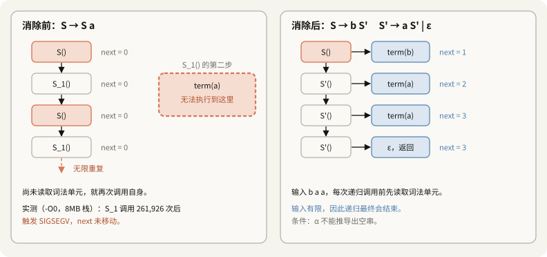

### 7.2 直接左递归消除公式与树形变换

考虑通用的直接左递归文法。其中 $\beta$ 代表不以 $S$ 开头的非空候选式集合：

$$
S \to S\alpha \mid \beta
$$

展开该产生式所能推导出的句型序列：
$$
\begin{aligned}
S &\Rightarrow \beta \\
S &\Rightarrow S\alpha \Rightarrow \beta\alpha \\
S &\Rightarrow S\alpha \Rightarrow S\alpha\alpha \Rightarrow \beta\alpha\alpha \\
&\ \ \vdots \\
S &\Rightarrow \beta\alpha^{*}
\end{aligned}
$$

从正则语言的视角审视，该产生式所定义的合法语言集合严格等价于**前缀 $\beta$ 后跟零个或任意多个 $\alpha$**，即正则表达式 $\beta\alpha^{*}$。
为了在保持语言集合等价的同时消除左递归，可将首个前缀 $\beta$ 的匹配与后续 $\alpha^*$ 的重复展开解耦，引入新的辅助非终结符 $S'$ 构造**等价的右递归文法**：

$$
S \to \beta S' \qquad S' \to \alpha S' \mid \varepsilon
$$

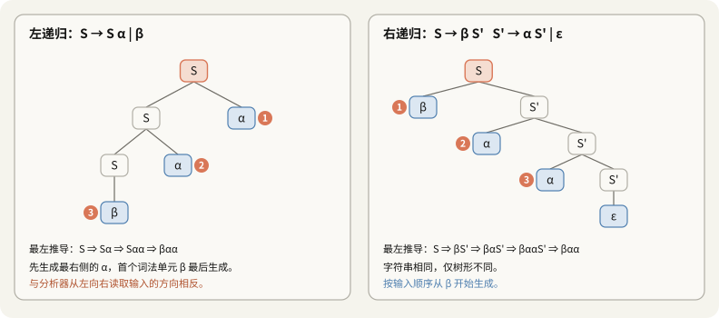

#### 几何拓扑变化
文法重构前后，句法树的生长几何拓扑发生了本质反转：
- **原始左递归文法**：树向左下方深度延展（向左加深）。在推导顺序上，最左侧的首个终结符 $\beta$ 在推导树的叶子深处最后出现，这与自左向右扫描输入的自顶向下分析器发生方向性冲突；
- **重构右递归文法**：树向右下方深度延展（向右加深）。首个终结符 $\beta$ 在顶层即被优先匹配，后续的 $\alpha$ 序列严格遵循输入流的时间顺序依次在右侧被递归展开。

### 7.3 多个候选分支的代数展开范式

对于包含多条递归分支与多个基准前缀的一般直接左递归文法（其中各 $\beta_i$ 均不以 $S$ 开头）：

$$
S \to S\alpha_1 \mid \cdots \mid S\alpha_n \mid \beta_1 \mid \cdots \mid \beta_m
$$

其生成的正规语言形式为：
$$
(\beta_1 \mid \cdots \mid \beta_m)(\alpha_1 \mid \cdots \mid \alpha_n)^{*}
$$

可直接套用机械化的代数重构公式消除左递归：

$$
\begin{aligned}
S &\to \beta_1 S' \mid \cdots \mid \beta_m S' \\
S' &\to \alpha_1 S' \mid \cdots \mid \alpha_n S' \mid \varepsilon
\end{aligned}
$$

### 7.4 间接左递归与隐藏左递归的系统化识别

除显式的直接左递归外，文法推导链中还存在更为隐蔽的递归模式：

1. **间接左递归（Indirect Left Recursion）**：单一产生式表面上不含左递归，但在跨符号展开中成环：
   $$
   S \to A\alpha \mid \delta, \qquad A \to S\beta
   $$
   推导链表明：$S \Rightarrow A\alpha \Rightarrow S\beta\alpha$。将 $A$ 的定义代入 $S$ 后即可将其暴露为直接左递归：
   $$
   S \to S\beta\alpha \mid \delta \quad\Longrightarrow\quad S \to \delta S', \quad S' \to \beta\alpha S' \mid \varepsilon
   $$

2. **隐藏左递归（Hidden Left Recursion）**：产生式右部首符号并非自身，但首符号具备**可空性**（Nullable，即能推导出 $\varepsilon$）：
   $$
   S \to A\,S\,b \mid c, \qquad A \to \varepsilon \mid d
   $$
   若 $A$ 选择规约为 $\varepsilon$，则产生式退化为 $S \Rightarrow S\,b$。

工程上可通过构建**有向依赖图**（Dependency Graph）检测全量左递归：从非终结符向其右部首个（及可空符号之后的）非终结符连边，若图中存在有向环路，则文法必含左递归。

| 文法定义 | 存在的左递归非终结符 | 对自顶向下解析器的影响 |
|:---|:---:|:---|
| $E \to T \mid T + E, \; T \to \text{int} \mid \text{int} * T \mid (E)$ | 无 | 可直接编写递归下降代码 |
| §6.4 提取左公因子后的确定性文法 | 无 | 具备 LL(1) 确定性预测能力 |
| $S \to A\alpha \mid \delta, \; A \to S\beta$ | $S, A$ | 间接循环调用，引发调用栈溢出 |
| $S \to A\,S\,b \mid c, \; A \to \varepsilon \mid d$ | $S$ | 可空推导引发隐藏死循环 |
| 标准左结合表达式文法：$E \to E + T \mid T, \; T \to T * F \mid F$ | $E, T$ | 经典左递归，严禁直接手写递归下降 |

### 7.5 消除左递归的代价：算符结合性的反转与矫正

消除左递归是一把双刃剑：**文法语言虽保持等价，但句法树的右倾化直接导致了操作符结合性的反转**。

对于左结合二元减法算式 $1 - 2 - 3$：
- 其数学语义要求**左结合**，计算次序为 $(1 - 2) - 3 = -4$；
- 原文法 $E \to E - T \mid T$ 生成向左倾斜的树，先计算内层减法，严格保全左结合性；
- 但消除左递归转换为 $E \to T E', \; E' \to - T E' \mid \varepsilon$ 后，树变为向右加深。若直接沿树形自底向上规约，语义将被扭曲为右结合的 $1 - (2 - 3) = 2$！

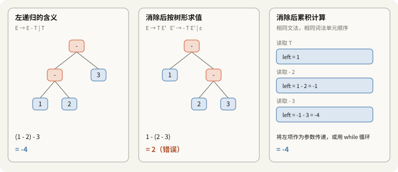

#### 矫正技术：循环迭代累积与继承属性传递
为恢复正确的左结合求值逻辑，编译器前端采用两种经典矫正机制：

1. **循环迭代累积（推荐工程范式）**：在手写递归下降分析器中，放弃为 $E'$ 编写纯递归函数，转而采用 `while` 循环不断将操作数累积折叠至左操作数中：
   ```cpp
   // 将右递归映射为基于累加器的循环结构
   Expr* parseExpr() {
       Expr *left = parseTerm();
       while (peekToken() == MINUS) {
           consumeToken(MINUS);
           Expr *right = parseTerm();
           left = new MinusExpr(left, right); // 强制向左折叠
       }
       return left;
   }
   ```
2. **继承属性传递**：若坚持使用递归结构，则将已计算的左操作数作为参数，通过**继承属性**逐层传递至右侧递归函数中（MLIR 的 `parseAffineLowPrecOpExpr` 严格采用此方法）。

| 计算与实现策略 | 表达式 `1 - 2 - 3` 求值结果 | 结合性语义保真度 |
|:---|:---:|:---|
| 消除左递归后直接按树结构求值 | 2 | **严重错误**（被反转为右结合） |
| 采用循环迭代累加器向左折叠 | **-4** | 完全正确（保全原生左结合） |
| 基于继承属性向右侧传递累积参数 | **-4** | 完全正确（保全原生左结合） |

---

## 8. 实际工业编译器中的递归下降分析器

在编译原理教学中，语法分析器生成工具（如 Bison、Yacc、ANTLR）常被作为主流教学范例。然而在现代工业级生产编译器（GCC、Clang、Rustc、Swift、MLIR）中，前端分析器几乎**全盘采用手写递归下降（Hand-written Recursive Descent）**。

### 8.1 工业编译器选择手写实现的四大核心驱动力

1. **精准的诊断与定制化错误恢复**：
   自动生成器生成的分析表在遇到语法冲突时，通常仅能抛出笼统的 `syntax error`；而手写递归下降的代码与语言语法结构一一对应，能够精准定位至当前所在的语句或表达式范畴，输出针对性的上下文修复建议（如 Clang 的 Fix-it Hints）。
2. **非上下文无关语法的即时语义消歧**：
   在 C/C++ 等复杂工业语言中，词法与语法分析无法做到绝对正交隔离（即著名的“词法分析器反馈难题”，Lexer Hack）。例如经典歧义语句：
   ```cpp
   T * x;
   ```
   若 `T` 在当前作用域被定义为类型名，该语句表示声明指针变量 `x`；若 `T` 为普通变量名，则表示乘法表达式 `T` 乘以 `x`。
   两者的词法 Token 序列完全一致，仅凭上下文无关文法根本无法判定。手写递归下降分析器可在解析到 `T` 时**当场查询符号表**确定其类型范畴，即时消解歧义分支；而纯表驱动的 LALR 分析器则难以在规约发生前优雅融入外部符号状态。
3. **受控的推测性解析（Tentative Parsing）**：
   工业编译器并非完全摒弃回溯，而是将回溯严格限制在局部的疑难歧义位置。例如 GCC 的 `cp_parser_parse_tentatively` 在遇到模棱两可的声明与表达式时，先开启试验性解析并记录 Token 快照；若推演失败则平滑回滚，若成功则调用 `cp_parser_parse_definitely` 提交推导。
4. **极致的代码执行效率与局部性**：
   手写解析函数将语法规则直接编译为原生机器码分支指令，指令缓存（I-Cache）局部性极佳，避免了表驱动分析器对巨大跳转转移矩阵的高频间接寻址开销。

### 8.2 GCC 与 Clang 源码中的设计印证

| 本笔记探讨的理论概念 | 工业编译器源码对应构件 | 实际工程实现细节 |
|:---|:---|:---|
| **标准递归下降**（§5.1） | GCC `cp/parser.cc` 头部规约 | 官方注释明确指出：“C++ 前端采用标准的手写递归下降分析器” |
| **受控试验性回溯**（§5.5） | GCC `cp_parser_parse_tentatively` | C++ 允许任意长度前瞻（如区分复杂类型转换与函数声明），通过保存 Token 缓冲实现精准回滚 |
| **恐慌模式深度感知**（§2.6） | Clang `Parser::SkipUntil` | 显式维护括号与花括号嵌套层级，防止局部结构错误溢出至外层作用域 |
| **算符结合性向左折叠**（§7.5） | Clang `ParseRHSOfBinaryExpression` | 结合**优先级爬升算法**（Precedence Climbing），采用 `while` 循环将低优先级操作向左累积折叠 |

Clang 的二元表达式解析并未像传统教学文法那样为每个运算符优先级拆分一层非终结符（$E \to E + T$），而是将所有算符一视同仁，统一由 `getBinOpPrecedence()` 查询静态优先级数值并在单层循环中完成结合性判定，大幅减少了函数调用栈深度。

### 8.3 MLIR `AsmParser` 的现代精简工程实践

LLVM 生态下的 MLIR（Multi-Level Intermediate Representation）其汇编解析器同样采用手写递归下降，其核心原语设计展现了对传统教学实现的工程提炼：

```cpp
// 节选自 mlir/lib/AsmParser/Parser.h 与 Parser.cpp
bool consumeIf(Token::Kind kind) {
  if (state.curToken.isNot(kind))
    return false; // 失配时指针不移动，无需回退快照！
  consumeToken(kind);
  return true;
}

ParseResult Parser::parseToken(Token::Kind expectedToken, const Twine &message) {
  if (consumeIf(expectedToken))
    return success();
  return emitWrongTokenError(message); // 失配时当场生成精准诊断
}
```

对照课件原型代码，MLIR 的现代化改进体现在四个维度：

| 对比维度 | 课件原型实现（`term`） | MLIR 工程实现（`consumeIf`） |
|:---|:---|:---|
| **失配时的指针行为** | `*next++` 无条件后移，必须显式恢复 `save` | **前瞻检查不匹配则指针保持原位**，彻底消除常规回滚开销 |
| **候选分支决策机制** | 盲目试探并依赖错误触发后回溯 | 基于前瞻 Token 显式分支（`parseOptional...`） |
| **失败状态语义约定** | 返回标准布尔量，依赖 `&&` 传递 | 采用强类型 `ParseResult`，**在逻辑上下文中 failure 对应 `true`** |
| **错误恢复粒度** | 尝试全局恐慌同步 | 顶层循环遇错立即终止（因 IR 文本多为机器生成，优先第一条精准报错） |

MLIR 在 `AffineParser.cpp` 中通过传递 `llhs` 累加器处理仿射表达式的左结合性，更是印证了 §7.5 中关于消除左递归后利用继承属性恢复左结合语义的工程必然性。

### 8.4 承前启后：向 LL(1) 预测分析演进

通过提取左公因子与消除左递归，非终结符的分支选择逻辑演化为“根据当前前瞻 Token 唯一查表检索”（§6.4）。下一讲的核心任务即在于通过数理算法自动化求解该预测关系——**构造 FIRST 集合、FOLLOW 集合与形式化的 LL(1) 预测分析表**（详见续篇笔记 [[10_30]]）。

---

## 9. 核心概念辨析与工程对比矩阵

| 概念辨析维度 | 概念 A | 概念 B | 核心本质区别与工程定论 |
|:---|:---|:---|:---|
| **故障检测点 vs 真实出错点** | 分析器宣告推导终止的物理 Token 位置 | 开发者实际漏写或误写符号的物理行号 | 两者往往存在偏移；缺少闭合符号时检测点常滞后于错误发生点（§1.3） |
| **恐慌模式 vs 错误产生式** | 丢弃无效输入跳过错误，保留原语言边界 | 将高频笔误显式写入产生式，提升为文法合规语法 | 恐慌模式不破坏文法；错误产生式易诱发严重的移进-归约冲突与语义歧义（§3.1） |
| **局部修正 vs 全局修正** | 仅在检测点局部窗口内做增删替换 | 在全局输入空间中搜索最小编辑距离程序 | 局部修正易治标不治本；全局修正代价高昂且难以揣测开发者真实意图（§3.3） |
| **具体分析树（CST） vs 抽象语法树（AST）** | 记录文法展开全过程，包含标点与链式节点 | 剔除语法糖与冗余节点，仅保留运算依赖拓扑 | CST 用于前端推导合规性验证，AST 交付后端代码生成与类型检查（§4.2） |
| **综合属性 vs 继承属性** | 属性值自子节点向上传递至父节点 | 属性值由父节点或左侧兄弟向右/向下传递 | AST 节点构造多用综合属性；算符左结合累加多用继承属性（§4.4, §7.5） |
| **局部识别成功 vs 全局解析完成** | 某个非终结符函数返回 `true` | 起始符号返回 `true` 且全局游标恰好到达 EOF | 严禁省略 `*next == EOF` 终验检查，否则将遗漏非法语法残余（§5.6） |
| **提取左公因子 vs 消除左递归** | 解决多个分支公共前缀造成的决策延时 | 解决无输入消耗下自我递归引发的调用栈溢出 | 均在保全语言集合的同时改变树结构；消除左递归需额外矫正结合性（§6.4, §7.2） |
| **盲目试探回溯 vs 预测前瞻查表** | `term` 匹配并依赖 `next = save` 复位 | 仅查看前瞻 Token 不消耗游标，直接分支查表 | 预测前瞻彻底消除无谓的试探性运行开销，达到确定性线性复杂度（§6.4, §8.3） |

---

## 10. 自测问题与解析

> [!question]- 1. `... x *% ...` 和 `int x; y = x(3);` 分别在哪个阶段被拦截？
> 前者在**语法分析阶段**被拦截：`*` 和 `%` 均为合法词法 Token，但两个连续的二元运算符违背了上下文无关文法产生式。
> 后者在**语义分析（类型检查）阶段**被拦截：形式上满足函数调用的句法结构，但符号表查询表明操作数 `x` 为标量整型，不具备函数或函数指针的可调用签名。

> [!question]- 2. 为什么漏掉 `int x = 1` 行末分号时，错误标记在下一行？为什么还会伴随 `y` 未声明的报错？
> 读入 `1` 时分析器尚无法断定语法错误，因为其后续仍可合法接入算符（如 `+ 2;`）；直到前瞻至下一行的 `int` 关键字时，才确定推导失败，因而检测点发生后移。
> `y` 未声明是恐慌模式恢复引发的**次生级联错误**：分析器跳过非法区间时丢失了 `int y = 2;` 的声明上下文，导致后续引用的符号表中缺失 `y`。

> [!question]- 3. `E → error int` 中的 `error` 符号代表什么？为何规则左部为非终结符 `E`？
> `error` 是分析器生成工具约定的保留终结符，形式上充当**匹配任意被丢弃符号区间的占位符**。
> 左部定义为 $E$，可确保错误恢复规约完成后，栈顶暴露出一个合法的表达式符号，使外层控制结构与父节点无需中断即可平滑继续解析。

> [!question]- 4. 同时包含 `error int` 和 `( error )` 时，为何无法成功恢复 `( 1 + + ) + 3`？
> 状态机始终优先匹配栈顶最近能移进 `error` 的状态。在 `E +` 状态下，`error int` 优先捕获错误，为了寻找后续的整数同步点，强制将闭合右括号 `)` 作为非法符号吞噬。这导致最外层的左括号 `(` 永久无法匹配闭合，在遇到文件末尾 EOF 时引发致命崩溃。

> [!question]- 5. `1 + + 2 + + 3` 中存在两处语法错误，为何编译器只输出一条诊断信息？
> 为抑制级联错误，Bison 内置了**连续成功移进 3 个 Token 才能重置告警**的抑制机制。在首个错误恢复后，分析器仅移进了 `2` 与 `+`（共 2 个 Token）便遇到了第二处错误，因而第二条错误被静默吞没。

> [!question]- 6. 恐慌模式跳过输入符号搜寻同步点时，为何必须跟踪括号嵌套层级？
> 若不感知嵌套深度，扫描器极易错误地停留在局部结构内部（如 `for` 循环内部或嵌套块内）的分号 `;` 上，导致分析器在残缺的局部作用域切片中强行重启，引发更为严重的次生语法瘫痪。

> [!question]- 7. 添加错误产生式 `E → E E` 后，为何无法利用 `%left` 优先级声明消除冲突？更大的隐患是什么？
> 操作符优先级是绑定在产生式右部的终结符上的；而产生式 $E \to E\ E$ 的右侧全为非终结符，无法继承任何终结符优先级。
> 更大的隐患在于引入**深层语义二义性**：例如 `5 - x` 既可理解为二元算术减法，亦可被解释为乘号省略的 $5 \times (-x)$，导致合法程序的语义丧失唯一性。

> [!question]- 8. 以编辑距离 1 修正输入 `1 + 2 ) * 3`，存在哪三个合法候选方案？说明了什么原理？
> 分别为：删除右括号 `1 + 2 * 3`（值为 7）、行首插入左括号 `( 1 + 2 ) * 3`（值为 9）、数字前插入左括号 `1 + ( 2 ) * 3`（值为 7）。
> 这表明：**编辑距离最近的合规程序，往往不是开发者原本意图编写的程序**；纯形式语法纠错无法跨越意图理解的鸿沟。

> [!question]- 9. 将 `5 + (2 + 3)` 的分析树缩减为 AST 时，消失的 8 个冗余节点分别是什么？
> 分别是：2 个圆括号定界符节点、3 个单子推导产生的 $E \to \text{int}$ 过渡节点、1 个括号转发产生的 $E \to ( E )$ 过渡节点，以及 2 个被算子属性吸收的 `+` 终结符叶节点。

> [!question]- 10. 语义动作 `E → ( E1 ) { E.ast = E1.ast }` 的物理实质是什么？
> 它不分配任何新的 AST 内存节点，而是直接将内部已生成的子树根指针原样向上传递。括号定界符在此阶段被自然解构，而其优先级逻辑已完全固化在 AST 的父子层次拓扑中。

> [!question]- 11. 终结符匹配函数 `term` 在失配时，游标 `next` 会发生什么变化？工程上应如何防范？
> 由于后置自增表达式 `*next++ == tok` 的副作用，即使比较结果为假，指针依然无条件自增前进 1 格。因此在尝试下一分支前必须显式执行 `next = save` 复位，且输入流末尾必须放置 EOF 哨兵符号防止越界访存。

> [!question]- 12. 为什么课件基础递归下降实现中，产生式 `E_2` 与 `T_2` 是无法到达的死代码？其实际可接受的输入集合是什么？
> `E_2` 只有在 `E_1` 失败时才被执行，但两者在同一位置均以调用 `T()` 作为首要前置条件；`T_2` 与 `T_1` 亦均以 `term(INT)` 开头。因此长分支永无触发可能，文法退化为仅能识别单个 `int` 及其多层括号嵌套结构。

> [!question]- 13. 采用“长规则优先”尝试分支有哪些优缺点？
> 优点在于能正确解析当前算术文法下的全量合法输入；致命代价在于计算复杂度随括号嵌套深度呈指数级激增（时间复杂度 $O(2^n)$），且面对 $S \to aSa \mid a$ 等文法时依然会因贪婪匹配遗漏合法句型。

> [!question]- 14. 为什么文法 $S \to a\,S\,a \mid a$ 在长规则优先下会拒绝合法输入 `aaaaa`？
> 内层递归在贪婪尝试长规则时过早消耗了符号，导致当外层需要匹配闭合符号 $a$ 时输入流已空；而底层成功的函数调用无法跨层次回退，导致解析失败。

> [!question]- 15. 提取左公因子后，若在 $Y \to *\,T \mid \varepsilon$ 中优先尝试 $\varepsilon$ 会引发什么后果？
> $\varepsilon$ 不消耗任何输入且条件恒成立，将导致解析器发生短路，`* T` 永远失去被尝试的机会，输入中的乘法运算符将被残留拒绝，文法再次退化。

> [!question]- 16. 提取左公因子与消除左递归的核心目标有何不同？
> 提取左公因子旨在解决**多候选分支拥有公共前缀导致决策时机滞后**的问题；消除左递归旨在解决**未消耗物理输入即自我递归调用引发调用栈溢出**的问题。两者均保全语言集合，但重塑了语法分析树的几何拓扑。

> [!question]- 17. 产生式 $S \to A \alpha \mid \delta, \; A \to S \beta$ 为何存在左递归？如何消除？
> 存在间接推导链：$S \Rightarrow A\alpha \Rightarrow S\beta\alpha$。将 $A$ 代入后得到直接左递归形式 $S \to S(\beta\alpha) \mid \delta$，应用标准公式重构为 $S \to \delta S', \; S' \to \beta\alpha S' \mid \varepsilon$ 即可消除。

> [!question]- 18. 消除 $E \to E - T \mid T$ 的左递归后，直接按树结构规约计算 `1 - 2 - 3` 会出现什么错误？工业级编译器如何矫正？
> 结果将错误计算为 $1 - (2 - 3) = 2$（结合性被反转为右结合）。工业级编译器通过将右递归映射为基于累加器的 `while` 循环向左折叠，或利用继承属性向下传递已计算的左操作数来恢复正确的左结合语义（结果为 -4）。

> [!question]- 19. MLIR 的 `parseToken` 与课件原型的 `term` 存在哪三大核心差异？
> 1. 失配时游标不自增，无需维护复杂的 `save` 指针快照；
> 2. 失败时当场生成定位明确的诊断信息；
> 3. 返回强类型 `ParseResult`，其在布尔逻辑上下文中 failure 对应 `true`。

---

## 11. 核心技术认知修正汇总

本讲笔记针对传统教学理论与工业编译器真实实现之间的认知偏差，完成了如下关键校准：

| 章节定位 | 经典认知误区 | 深入分析后的工程真相 |
|:---|:---|:---|
| §1.1 | 字符 `$` 必然归属于词法错误 | 依赖编译器具体实现与参数规范。GCC 默认允许标识符包含 `$`，在此配置下抛出语法错误而非词法错误 |
| §2.3 | `( error )` 规则总能精准捕获括号内故障 | 分析状态机始终优先匹配栈顶最近的 `error` 状态；若同时存在局部恢复规则，可能反向吞噬闭合括号破坏全局平衡 |
| §3.1 | 错误产生式是专门用来报告错误的机制 | 错误产生式在形式文法层面上将非法输入提升为合法替代语法，是否抛出警告属于后续语义动作的策略决策 |
| §5.5 | `term` 匹配失败时指针保持原位 | 后置自增运算符导致指针无条件递增，必须依赖显式游标复位与 EOF 哨兵防止内存越界访问 |
| §6.4 | 提取左公因子仅需对局部规则做单点变换 | 必须对全量具有公共前缀的非终结符做系统性重构，且 $\varepsilon$ 空产生式必须严格置于尝试链的最末端 |

主要技术延展与工业源码验证：
- **§1.2 & §1.3**：通过 GCC 实际测试复现了级联错误链条，深入阐释了错误物理发生点与词法检测点之间的相位滞后现象；
- **§2.3–§2.5**：系统推演了 Bison `yacc.c` 的状态机退栈模型、三 Token 告警抑制窗口，以及操作数严禁充当同步标记的深层原因；
- **§2.6**：比对分析了 Clang 与 GCC 在恐慌模式恢复时对括号嵌套深度（`nesting_depth`）的感知与防穿透控制；
- **§3.1**：基于 LALR(1) 分析表推导量化证明了宽松错误规则导致的移进-归约冲突与语义歧义爆炸；
- **§3.2 & §3.3**：量化计算了编辑距离纠错在组合空间上的复杂度壁垒，剖析了“距离最近 $\neq$ 符合原意”的意图鸿沟；
- **§4.2 & §4.4**：逐一拆解了从 CST 到 AST 削减 8 个冗余节点的数理依据，明晰了语法制导翻译中综合属性与继承属性的分工；
- **§6.2 & §6.3**：完成了全量 488,280 个测试用例的遍历验证，量化推导了长规则优先导致的 $O(2^n)$ 指数级性能塌陷通式；
- **§7.1–§7.5**：实测证明了左递归导致栈溢出的物理过程，深入剖析了文法右倾化对算符结合性的反转代价与循环累加矫正技术；
- **§8.2 & §8.3**：深度比对了 GCC、Clang 与 MLIR 源码，解析了现代工业编译器坚持手写递归下降并在内部实现优先级爬升的工程逻辑。

---

## 12. 参考文献与源码索引

- [Stanford CS143 Compilers](https://web.stanford.edu/class/cs143/): [Lecture 6: Error Handling and AST](https://web.stanford.edu/class/cs143/lectures/lecture06.pdf)
- [University of Richmond CMSC 331 Lecture 6](https://facultystaff.richmond.edu/~dszajda/classes/cs331/Fall_2017/lecture_slides/lecture06.pdf)：Alex Aiken 编译原理讲义转录版
- [GNU Bison 官方手册：Error Recovery](https://www.gnu.org/software/bison/manual/html_node/Error-Recovery.html) 及驱动模板源码 [`data/skeletons/yacc.c`](https://github.com/akimd/bison/blob/master/data/skeletons/yacc.c)
- GCC C/C++ 语法分析器源码：[`gcc/cp/parser.cc`](https://github.com/gcc-mirror/gcc/blob/master/gcc/cp/parser.cc), [`gcc/c/c-parser.cc`](https://github.com/gcc-mirror/gcc/blob/master/gcc/c/c-parser.cc)
- LLVM/Clang 语法分析器源码：[`clang/lib/Parse/Parser.cpp`](https://github.com/llvm/llvm-project/blob/main/clang/lib/Parse/Parser.cpp), [`clang/lib/Parse/ParseExpr.cpp`](https://github.com/llvm/llvm-project/blob/main/clang/lib/Parse/ParseExpr.cpp), [`clang/include/clang/AST/Expr.h`](https://github.com/llvm/llvm-project/blob/main/clang/include/clang/AST/Expr.h)
- LLVM/MLIR 汇编分析器源码：[`mlir/lib/AsmParser/Parser.cpp`](https://github.com/llvm/llvm-project/blob/main/mlir/lib/AsmParser/Parser.cpp), [`mlir/lib/AsmParser/Parser.h`](https://github.com/llvm/llvm-project/blob/main/mlir/lib/AsmParser/Parser.h), [`mlir/lib/AsmParser/AffineParser.cpp`](https://github.com/llvm/llvm-project/blob/main/mlir/lib/AsmParser/AffineParser.cpp)
- A. V. Aho, T. G. Peterson, "A Minimum Distance Error-Correcting Parser for Context-Free Languages", *SIAM Journal on Computing*, 1(4), 1972
- Alfred V. Aho, Monica S. Lam, Ravi Sethi, Jeffrey D. Ullman, *Compilers: Principles, Techniques, and Tools* (2nd Edition), Chapter 4: Syntax Analysis (Left-Recursion Elimination & Left-Factoring)
