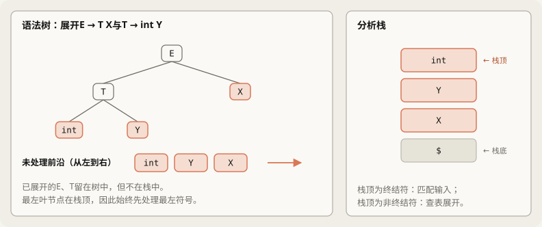
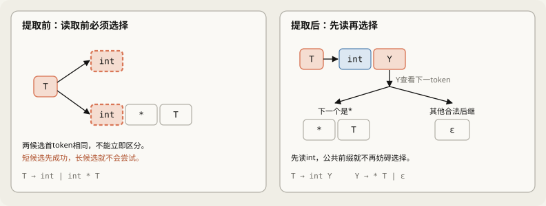
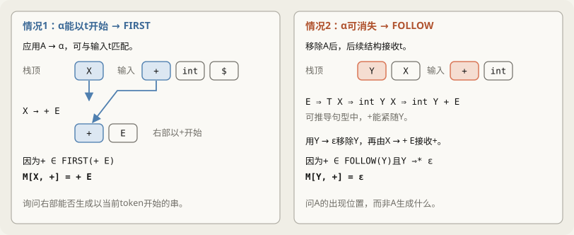
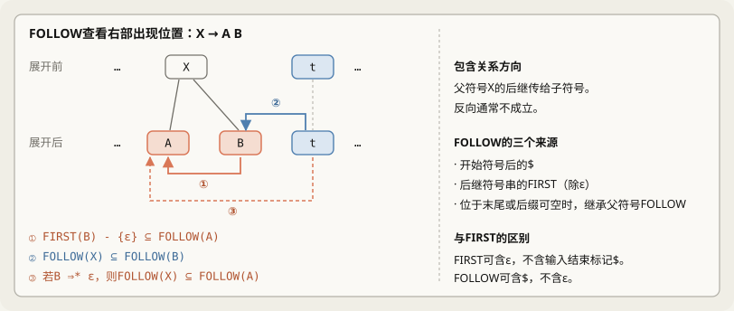
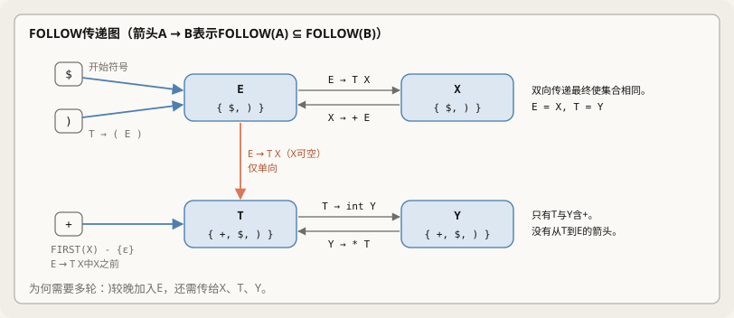
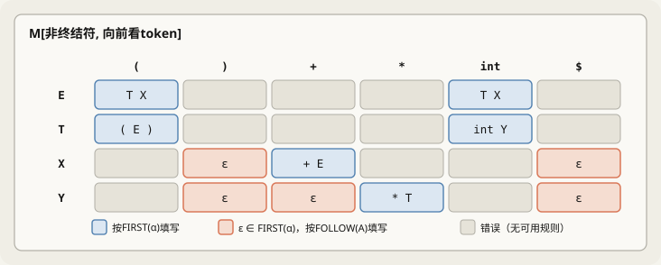
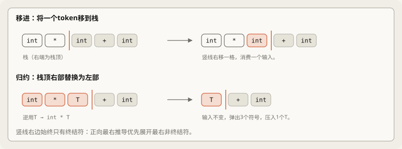
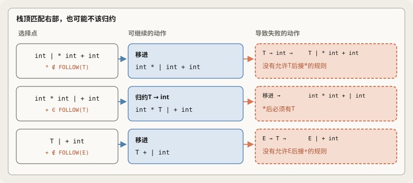
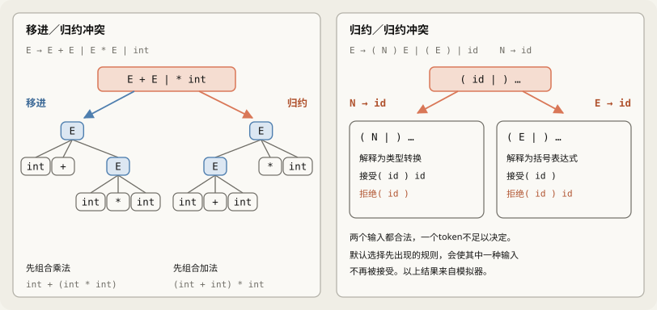
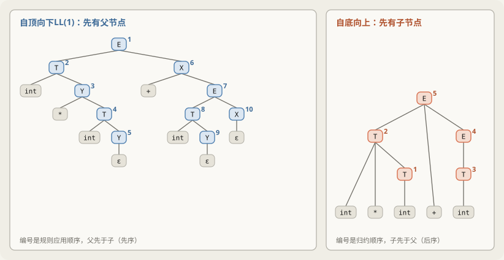

# 11月3日学习记录（2）：预测分析与移进归约

整理了斯坦福 CS143 第7讲（Top-Down Parsing and Intro to Bottom-Up Parsing）。与同日学习的[第6讲笔记](10_30.md)分开记录。这一讲原本安排在下一周，但这次接着看完了。内容较难、进度较慢，因此加入较多示例和图解。

> [!info] 阅读说明
> - 正文整理了自己的理解。`> [!warning] 纠正`标出原先理解有误之处，`> [!note] 补充`标出遗漏内容。只看纠正部分可直接阅读§18。
> - **全部动画集中在[`ll-lr-parsing.html`](assets/ll-lr-parsing.html)。** 用浏览器打开，即可沿同一时间线从文法变换播放到移进归约。用法见§0.2。
> - 表格和执行轨迹均与自行编写的 Python 生成器核对，包括 FIRST/FOLLOW 不动点、LL(1)、LR(0)、SLR(1)、LALR(1)、LR(1) 表。5种 token 组成、长度不超过8的488,281个输入，均与 LL(1) 驱动器、SLR(1) 驱动器及文法正确结果逐一比较。有限长度穷举不能代替证明。
> - 还按定义求过 FIRST 与 FOLLOW：枚举长度不超过8的1,145个句型，收集实际相邻符号，结果与算法一致。
> - **未运行真正的 Bison。** §14结果为自行实现的表生成器结合 Bison 手册默认规则的模拟，规则措辞在`doc/bison.texi`核对。真实工具复现列入11月7日计划。
> - **原笔记制作时未在真实浏览器运行动画。** 当时没有浏览器和 JS 引擎，用自制 JavaScript 子集解释器及 DOM 桩检查了脚本行为，未查看页面外观。详情见§0.2。
> - 原笔记的 SVG 也仅经文字重叠检查器与布局预览检查，未查看实际字体渲染效果。
> - 课件对照的是 University of Richmond 整理的 Aiken 讲义（2017版）第7、8讲文本；文本不包含图中连线。

## 0. 第7讲概览

第7讲围绕9个问题展开：前6个完成自顶向下分析，后3个介绍自底向上分析。

| 顺序 | 问题 | 回答 | 位置 |
|---|---|---|---|
| 1 | 如何消除递归下降的回溯？ | 查看下一个 token，预先选择规则 | §1、§2 |
| 2 | 候选以相同 token 开头怎么办？ | 先读取公共部分，将选择推后 | §3、§4 |
| 3 | 如何机械地选择规则？ | 使用栈与分析表驱动 | §1.4、§5 |
| 4 | 表项根据什么填写？ | 能以该 token 开始，或消失后交给后续结构 | §6 |
| 5 | 如何计算这两项条件？ | 迭代 FIRST、FOLLOW 到不动点 | §7、§8、§9 |
| 6 | 什么文法无法构成 LL(1) 表？ | 同一格含两条规则就不是 LL(1) | §10 |
| 7 | 如何处理更广的文法？ | 从输入反向归约到开始符号 | §11、§12 |
| 8 | 如何执行？ | 在栈与输入的分界处进行两类操作 | §13 |
| 9 | 会在哪里产生冲突？ | 移进／归约冲突和归约／归约冲突 | §14 |

§15并排比较两种方法，§16汇总易混概念。

本篇与前面的韩文笔记曾使用不同译名，所指概念相同。中文版统一使用“移进”“归约”“左因子提取”“语法分析树”。

### 0.1 计划检查

原定下周的第7讲已提前，第8讲（SLR）改为下周首项。由于本讲较难，将本篇习题加入11月6日手算练习。下表承接第6讲笔记§0.1。

| 日期 | 主题 | 任务 | 时间 |
|---|---|---|---|
| 11/4 周三 | 迷你 lexer（顺延） | 用 C++ 实现10/27 §2.5的3条规则及§6.3的回退 | 2h |
| 11/5 周四 | 阅读分析器源码（顺延） | 查找 MLIR `Lexer.cpp`、`AffineParser.cpp`和第6讲§8.3的`parseToken` | 2h |
| 11/6 周五 | 手算（顺延＋新增） | 完成11/2 §8及第6讲§10检查题；**不看答案，在纸上完成本篇§17 Q7–Q9** | 3h |
| 11/7 周六 | C++ 与 Bison 实践（顺延＋新增） | 指针基础、线程池 TSan 验证，复现11/2 §6.7与第6讲§2.4的表；**用 Bison 运行本篇§14.3文法，检查冲突数量及选择** | 4h |
| 11/8 周日 | 递归下降实现（顺延）、复习 | 用第6讲§6.4文法实现（2h）；重做错题、周复盘（1h） | 3h |
| 下周 | 表驱动分析器、第8讲 | 用 C++ 实现§1.5的 LL(1) 驱动器，复现§5表格（1.5h）；学习第8讲：句柄、LR(0)、SLR | - |

如第6讲所述，本表仅延续 CS143 学习线，与“每日学习计划与日程”的 W2（LLVM/MLIR 构建与参考实现）时间重叠，难以同时完成。

### 0.2 动画使用方法

[`ll-lr-parsing.html`](assets/ll-lr-parsing.html)把下面9章串成一条时间线。点击**播放**可从头播到尾，点击章节名或下方链接可从对应章节开始。空格播放／暂停，←与→逐步移动。

| 章节 | 展示内容 | 对应位置 |
|---|---|---|
| [1. 文法改写](assets/ll-lr-parsing.html#factor) | 提取公共前缀并引入$X$、$Y$ | §3、§4 |
| [2. FIRST](assets/ll-lr-parsing.html#first) | 扫描规则，迭代到集合不再增长 | §7 |
| [3. FOLLOW](assets/ll-lr-parsing.html#follow) | 元素沿包含关系图传递 | §8 |
| [4. 分析表](assets/ll-lr-parsing.html#table) | 按产生式填写 FIRST 和 FOLLOW 对应表项 | §9 |
| [5. LL(1) 执行](assets/ll-lr-parsing.html#ll) | 栈、输入、查表与向下生长的树 | §1.4、§5 |
| [6. LL(1) 冲突](assets/ll-lr-parsing.html#conflict) | 两条规则进入同一表项 | §10 |
| [7. 移进归约](assets/ll-lr-parsing.html#sr) | 分界线移动、决策依据与向上生长的树 | §12、§13 |
| [8. LR 冲突](assets/ll-lr-parsing.html#srconf) | 同一状态分出两种结果 | §14 |
| [9. 同屏比较](assets/ll-lr-parsing.html#compare) | 同一输入逐 token 对照两种方法 | §15 |

第5、7、9章支持更换输入，可选预设或直接输入`int * ( int + int )`。也建议运行会被拒绝的`( int ) * int`、`int * + int`、`int )`；静态表格不容易展示错误何时、如何出现。

> [!note] 原笔记如何检查动画
> 当时没有浏览器，因此采用以下检查。
> - 绘制全部87帧及7个输入示例的所有帧，检查标签配对、重复 id、`undefined`等意外输出及树节点重叠。
> - 第2、3、4章的集合与表格和 Python 结果一致；每帧的栈、输入标记、规则高亮也与状态一致。
> - 第5、7章驱动器对长度不超过4的全部输入和13个较长输入（共794个），与 Python 驱动器逐步对照，涵盖栈、输入位置、规则和树。
> - 检查播放、暂停、步进、输入变更、哈希链接和键盘操作。
> - 人为植入页面及数据中的35个错误全部被检测到；早期检查曾漏检，因此补强过检查器。
>
> 自制检查器可能与真实浏览器不同，当时未检查实际 CSS 布局及动画运动效果。以上仅为原笔记记录的验证范围。

---

**第一部分：预测分析与左因子提取**

## 1. 预测分析的概念与栈驱动模型

### 1.1 预测分析与 LL(k) 文法

带回溯的递归下降分析器在遇到分支规则时，只能按顺序逐一尝试，失配后再执行指针回退（见第6讲§5）。**预测分析**（Predictive Parsing）同样采用自顶向下展开文法的框架，但其核心在于“先决策、后展开”：在正式选择产生式之前，预先观察输入流中后续的若干个词法单元，从而直接确定正确的分支，从根本上消除了回溯。

- **向前看**（Lookahead）：指分析器在不消耗输入的前提下，预先向后探测的词法单元序列。
- **确定性决策**：根据当前非终结符与向前看词法单元的组合，唯一选定展开规则。
- **文法适用范围**：能够通过向前看 $k$ 个词法单元实现确定性决策的文法，称为 **$\text{LL}(k)$ 文法**。工程实践中绝大多数场景聚焦于只需查看 1 个符号的 **$\text{LL}(1)$ 文法**。

### 1.2 递归下降与预测分析的机制对比

带回溯的递归下降在分支处属于试探性搜索：先选择一条路径推进，若后续发现不匹配，则利用 `save` 恢复输入指针位置（`next = save`），再转向下一分支。当文法存在深层嵌套时，这种重试可能反复扫描相同的前缀，导致最坏情况下的尝试次数随嵌套深度呈指数级增长；且若短分支先匹配成功而外层后续失败，简单的递归下降实现无法重新激活已被判定的分支（第6讲§6.1）。

预测分析则通过二维分析表实现确定性单向推进：依据“当前待展开符号”与“下一个前瞻符号”查表定位产生式，无需试探与回滚。对于固定的 $\text{LL}(1)$ 文法，长度为 $n$ 的输入在 $O(n)$ 线性时间内即可完成分析。

```text
[带回溯的递归下降]
输入序列：[ a ] [ b ] [ c ] ...
指针位置：可能反复向前探索、向后回退
执行机制：尝试分支1 -> 失败 -> 恢复指针 -> 尝试分支2 -> ...
潜在问题：多层嵌套时存在大量重复扫描，最坏时间复杂度呈指数级。

[预测分析]
输入序列：[ a ] [ b ] [ c ] ...
向前探测：读取当前位置的 1 个 token（只读探查，不消耗输入流）
执行机制：(当前非终结符, 向前看 token) -> 查询分析表 M -> 确定唯一产生式
核心特征：无回溯，从左到右线性单向扫描，时间复杂度严格 O(n)。
```

以 $n$ 层括号嵌套的 `int` 算术表达式为例，两种分析方式的开销增长趋势对比如下（左列数据来自第6讲§6.3，右列数据来自§5的表驱动分析器实测）：

| 括号嵌套深度 $n$ | 回溯式递归下降（`term` 调用总次数） | LL(1) 预测分析（展开与匹配总步数） |
|:---:|:---:|:---:|
| 1 | 23 | 11 |
| 5 | 503 | 31 |
| 10 | 16,375 | 56 |
| 20 | **16,777,207** | **106** |
| **增长阶数** | $2^{n+4}-9$（指数级增长） | $5n+6$（严格线性增长） |

两列统计的底层操作单元不同，关键差异在于渐进增长速度。右侧一般式已通过 $n=1$ 至 59 的实测推导步骤逐一核验。

### 1.3 LL(k) 记号的学术定义

- **第一个 L**（Left-to-right）：表示从左向右单向扫描输入词法单元流。
- **第二个 L**（Leftmost derivation）：表示分析过程自顶向下重构的是文法的**最左推导**，即在句型中永远优先展开最左侧的非终结符。
- **参数 $k$**：表示在产生式决策时所允许向前观察的词法单元上限数量。

$\text{LL}(1)$ 仅观察后续 1 个词法单元。理论上增大 $k$ 值可以消除更多分支冲突、覆盖更广泛的文法，但向前看的符号组合数和分析表尺寸也会随之急剧膨胀。因此除特化理论分析外，编译系统主要构建和使用 $\text{LL}(1)$。

### 1.4 分析栈：存储语法树尚未处理的前沿

表驱动预测分析器通过显式维护一个**符号栈**来替代递归函数调用栈，其核心循环步骤如下：

1. 观察当前栈顶符号（若为非终结符，记为 $S$）；
2. 观察当前输入流指针处的词法单元 $a$（即 `*next`）；
3. 查询分析表项 $M[S, a]$，获取应选取的产生式规则。

从自顶向下生成语法树的几何视角来看，那些已被创建但其下层尚未展开、或尚未与输入词法单元完成匹配的叶节点，自左向右排列即构成了当前推导的**未处理前沿（Derivation Frontier）**。**分析栈存储的正是这个推导前沿的符号序列，且栈顶永远对齐最左侧未处理符号**：



分析栈中包含两类性质不同的符号：

- **非终结符**：查表后将其弹出，并用选定产生式的右部符号串替换；
- **终结符**：与输入指针所指的词法单元进行比对，若匹配则同步弹出并推进输入指针。

这种机制保证了栈顶符号永远是最左侧待处理项，从而严格实现了最左推导。

#### 语法树推导前沿与分析栈形态的演进

```text
阶段 1：初始状态（开始符号 E）
语法树：        E
推导前沿：      E
分析栈（顶至底）：E, $

阶段 2：展开规则 E -> T X
语法树：        E
              / \
             T   X
推导前沿：      T, X
分析栈（顶至底）：T, X, $

阶段 3：展开规则 T -> int Y
语法树：        E
              / \
             T   X
            / \
          int  Y
推导前沿：      int, Y, X
分析栈（顶至底）：int, Y, X, $

阶段 4：匹配并消费输入字符 int
语法树：        E
              / \
             T   X
            / \
          int  Y
           ^ 已匹配消费
推导前沿：      Y, X
分析栈（顶至底）：Y, X, $
```

> [!tip] 产生式右部为何必须逆序压栈？
> 为了让推导前沿中最左侧的符号处于栈顶以便优先处理，在应用规则 $E \to T X$ 展开时，必须先将右侧符号 $X$ 压入栈底，再将左侧符号 $T$ 压入栈顶。

分析器的终止判定条件：

- **接受（Accept）**：输入流与分析栈底部的结束标记 `$` 成功匹配，栈清空，表明整段输入完全符合文法。
- **拒绝（Reject）**：分析表项为空（即无可用规则），或者栈顶终结符与当前输入符号不一致，表明存在语法错误。

递归下降依赖系统运行时函数调用栈隐式记录展开状态；表驱动模型则将这一状态外置到显式的数据结构中以循环驱动，不仅解除了调用栈深度受系统内存限制的隐患，也更利于工程化优化。

### 1.5 表驱动预测分析算法形式化描述

```text
initialize stack = <S $> and next
repeat
  case stack of
    <X, rest> : if M[X, *next] = Y1 ... Yn
                then stack <- <Y1 ... Yn rest>;
                else error();
    <t, rest> : if t == *next ++
                then stack <- <rest>;
                else error();
until stack == < >
```

**算法执行要点解析：**

1. **初始化**：栈初始化为 `<S, $>`（$S$ 为文法开始符号，居于栈顶，`$` 为栈底哨兵），输入指针 `next` 指向输入缓冲区的第一个词法单元，输入串末尾同样追加 `$`。
2. **非终结符分支 `<X, rest>`**：栈顶 $X$ 为待展开非终结符。查询表项 $M[X, *next]$：
   - 若表项记录了产生式 $X \to Y_1 Y_2 \cdots Y_n$，则弹出 $X$，将其右部按顺序替换入栈，新栈形态为 `<Y1 ... Yn rest>`（$Y_1$ 位于栈顶）。此步骤仅改写推导前沿，不消耗输入，指针保持不动。
   - 若产生式右部为 $\varepsilon$（推导为空），则直接弹出 $X$ 且不压入任何新符号，新栈形态变为 `<rest>`。
   - 若表项为空，则说明当前语境下该输入非法，调用 `error()` 报错。
3. **终结符分支 `<t, rest>`**：栈顶 $t$ 为预期出现的终结符。检查 $t$ 是否与当前输入符号 `*next` 相同：
   - 若匹配，则弹出栈顶 $t$，并将输入指针前移一位；
   - 若失配，调用 `error()` 报告语法错误。
4. **循环终止**：当栈与输入中的 `$` 匹配完毕、分析栈彻底变为空集 `<>` 时，算法终止，判定句子合法。

## 2. 推导状态与三种决策结果

在预测分析的执行流程中，推导中的即时句型在形式上通常表示为：

$$wA\beta$$

分析器在每一步的核心任务，就是依据下一个前瞻词法单元，为当前最左非终结符 $A$ 决定采用哪一条产生式 $A \to \alpha$。

### 2.1 状态表达式 $wA\beta$ 的组成剖析

- **$w$**：已经成功匹配并消耗的终结符前缀（已从输入流中移走，不在栈中）。
- **$A$**：当前位于分析栈顶部的最左非终结符，即当前待展开产生式的左部（LHS）。
- **$\beta$**：在分析栈中位于 $A$ 之下的后续等待符号串。

> [!warning] 纠正：状态跟踪示例的符号一致性
> 原笔记曾使用 `w = 1 + 2 *`、$A = E$、$\beta = ;$，而下一个词法单元设为 `+`。在该状态下 $M[E, +]$ 为空表项，属于非法语法状态，无法展示正常的产生式选择。此处统一采用标准算术文法进行状态剖析。

在利用§5分析表解析输入 `int * int + int` 的过程中，两个典型中间状态如下：

| 分析时序节点 | $w$（已消耗的终结符前缀） | $A$（栈顶待展开符号） | $\beta$（待处理后继串） | 下一个前瞻词法单元 | 查表决策结果 |
|:---|:---|:---:|:---:|:---:|:---|
| 刚读完乘号 `*` | `int *` | $T$ | $X$ | `int` | $M[T, \text{int}] = \text{int}\ Y$ |
| 刚读完第二个 `int` | `int * int` | $Y$ | $X$ | `+` | $M[Y, +] = \varepsilon$ |

第二行对应的栈内符号即为 `Y X $`。**推导式中的 $A\beta$ 加上栈底哨兵 `$`，在物理上精准对应当前分析栈的全部内容**；而已被消费的前缀 $w$ 则已退出栈结构。这种对应关系清晰打通了抽象句型推导与底层栈存储。

### 2.2 分析表查询的三种必然结果

| 表项 $M[A, t]$ 的定义状态 | 形式语言学含义 | 分析器的执行决策 |
|:---|:---|:---|
| **恰有 1 条产生式** | 当前输入符号能唯一确定展开分支 | 确定性展开，单步推进 |
| **0 条产生式（空表项）** | 当前非终结符无法以该符号开头，亦无法通过消解为空让后继处理 | 判定语法错误，触发恢复机制 |
| **存在 2 条及以上产生式** | 仅靠 1 个前瞻符号无法消除分支二义性 | 判定文法发生 **LL(1) 冲突** |

当表项唯一时，自动机无需回溯，直接完成状态重构。

表项为空表明发生了语法不匹配：既不能以该符号启动推导，该符号也不属于其合法的后继符号集合。此时分析器停止正向推导，转入恐慌模式（Panic Mode）跳过无效词法单元以恢复同步（见第6讲§2）。

若同一个表项单元格内落入多条不同的产生式，则从数学上证明了该文法不属于 $\text{LL}(1)$ 文法。其根本原因通常源于文法存在的公共前缀、直接或间接左递归、或语言本身的二义性，必须通过文法等价变换消除冲突（详见§10）。

> [!note] 概念辨析：唯一规则不保证整句必定合法
> 查表获得唯一规则，仅意味着“如果该输入属于本语言，这必定是唯一合法的展开路径”，并不担保后续的所有符号均能匹配成功。例如面对非法输入 `int * + int`，$M[E, \text{int}]$、$M[T, \text{int}]$、$M[Y, *]$ 虽步步唯一，但后续遇到 `+` 时 $M[T, +]$ 变为空项，最终依然会被正确拒绝。此时依然无需回溯，因为已不存在其他潜在的合法候选路径。

## 3. 公共前缀为什么阻碍预测

考虑以下算术表达式文法。

$$
\begin{aligned}
E &\to T+E\mid T\\
T &\to \text{int}\mid\text{int}*T\mid(E)
\end{aligned}
$$

$T$的两个分支都以`int`开始，只看当前`int`不能判断它是单个整数还是后续乘法的开头。

$E$的两个分支都以$T$开始。$T$可从`int`或`(`开始，也可能很长，单个 token 无法判断其后有无`+`。

```text
T的候选：
  int
  int * T
  ( E )
  ^ 前两项首 token 相同。

E的候选：
  T + E
  T
  ^ 未读完T前，难以知道后面有无+。
```

构造表后恰有3个冲突项：$M[E,\text{int}]$、$M[E,\texttt{(}]$、$M[T,\text{int}]$。

> [!note] 补充：多看几个 token 行不行
> 两类冲突性质不同。
> - 对$T$，看**两个**可区分：`int *`选$T\to\text{int}*T$，`int`后不是`*`则选$T\to\text{int}$。
> - 对$E$，**任意固定数量都不够**。$T$可无限长，总能超过选定的k。枚举k=1至5的候选前缀始终有重叠，k=5时两边均可出现`( int * int )`。
>
> 因此该文法对任何k都不是 LL(k)，应改写文法而非只增加向前看长度。

## 4. 左因子提取与文法改写

[动画第1章](assets/ll-lr-parsing.html#factor)逐步展示这一变换。

### 4.1 将选择推迟到公共前缀之后

先读取公共前缀，再让新增非终结符处理余下的选择。一般形式如下。

$$A\to\alpha\beta_1\mid\alpha\beta_2\mid\gamma$$

提取公共前缀$\alpha$后：

$$
\begin{aligned}
A&\to\alpha A'\mid\gamma\\
A'&\to\beta_1\mid\beta_2
\end{aligned}
$$

### 4.2 对$T$提取左因子

原规则如下。

$$T\to\text{int}\mid\text{int}*T\mid(E)$$

公共前缀是`int`，剩余分别为$\varepsilon$和$*T$。

$$
\begin{aligned}
T&\to\text{int}\ T'\mid(E)\\
T'&\to *T\mid\varepsilon
\end{aligned}
$$

先处理`int`，再由$T'$查看下一 token。

- 若为`*`，选$T'\to*T$。
- 若为`+`、`)`或输入结束，选$T'\to\varepsilon$。



### 4.3 对$E$提取左因子

$$E\to T+E\mid T$$

提取公共前缀$T$后：

$$
\begin{aligned}
E&\to TE'\\
E'&\to +E\mid\varepsilon
\end{aligned}
$$

先分析完整的$T$，再由$E'$看下一 token。

- 若为`+`，选$E'\to+E$。
- 若为`)`或输入结束，选$E'\to\varepsilon$。

### 4.4 改写后的完整文法

将$E'$记为$X$、$T'$记为$Y$，与课件记法一致。

```text
E -> T X
X -> + E | ε
T -> int Y | ( E )
Y -> * T | ε
```

```text
改写前：
进入T -> 必须先选int还是int * T

改写后：
进入T -> 匹配int -> Y查看下一token
                          +-- *       -> * T
                          +-- +, ), $ -> ε
```

语言保持不变，长度不超过8的50个字符串已核对相同，只有树形改变。对本例，每个非终结符与向前看 token 组合至多对应一条规则，§9会通过构造表验证。

> [!note] 补充：可能需要多次提取
> 若改写后仍有公共前缀，需要继续。
>
> $$A\to a\,b\,c\mid a\,b\,d\mid a\,e$$
>
> 先提取`a`得$A\to aA'$、$A'\to bc\mid bd\mid e$，此时`b`仍重复；再提取为$A'\to bA''\mid e$、$A''\to c\mid d$。标准过程可先提最长公共前缀，但不同候选共享长度不同，往往仍需重复。结果已确认无表冲突且语言不变。

仅提取左因子不保证 LL(1)，第6讲§6.4的$S\to aSa\mid a$就是反例，§10.3还有其他例子。

## 5. LL(1)预测分析表：结构与使用

### 5.1 先用表，再学如何构造

先假定表已存在，理解运行方式，就更容易理解 FIRST/FOLLOW 的计算目的。它回答：

“当前待展开的是$A$，下一个输入为$t$，应应用哪条规则？”

### 5.2 行、列、表项

| 非终结符／向前看 | `int` | `*` | `+` | `(` | `)` | `$` |
|---|---|---|---|---|---|---|
| $E$ | $TX$ | 错误 | 错误 | $TX$ | 错误 | 错误 |
| $X$ | 错误 | 错误 | $+E$ | 错误 | $\varepsilon$ | $\varepsilon$ |
| $T$ | $\text{int}\ Y$ | 错误 | 错误 | $(E)$ | 错误 | 错误 |
| $Y$ | 错误 | $*T$ | $\varepsilon$ | 错误 | $\varepsilon$ | $\varepsilon$ |

- 行是栈顶非终结符，对应$wA\beta$中的$A$。
- 列是当前输入 token，`$`表示输入结束。
- 表项存选定产生式的右部（RHS），左部已由行确定。

$A=E$时查$E$行，$A=X$时查$X$行；用表中右部$\alpha$替换栈顶$A$。

### 5.3 空表项与有规则的表项

空表项表示这个组合下没有可用规则。

- $M[E,+]$：应开始表达式却遇到`+`；本例不支持一元加号，因此错误。
- $M[T,*]$：应开始项却遇到`*`，因此错误。

在这些位置报告错误，或转入另行实现的恢复过程。

有内容的表项指定下一次展开。

| 查询 | 表项内容 | 应用规则 |
|---|---|---|
| $M[E,\text{int}]$ | $TX$ | $E\to TX$ |
| $M[X,+]$ | $+E$ | $X\to +E$ |
| $M[X,\$]$ | $\varepsilon$ | $X\to\varepsilon$ |
| $M[T,\texttt{(}]$ | $(E)$ | $T\to(E)$ |
| $M[Y,+]$ | $\varepsilon$ | $Y\to\varepsilon$ |

### 5.4 `int * int $`完整追踪

每行表示动作执行前的状态，栈顶在左。[动画第5章](assets/ll-lr-parsing.html#ll)选`int * int`，可同时观察这条轨迹与树。

| 步骤 | 栈 | 剩余输入 | 动作 | 说明 |
|---|---|---|---|---|
| 1 | `E $` | `int * int $` | $E\to TX$ | 将$E$替换为$TX$ |
| 2 | `T X $` | `int * int $` | $T\to\text{int}\ Y$ | 展开$T$ |
| 3 | `int Y X $` | `int * int $` | 匹配终结符 | 消费第一个`int` |
| 4 | `Y X $` | `* int $` | $Y\to *T$ | 展开乘法后缀 |
| 5 | `* T X $` | `* int $` | 匹配终结符 | 消费`*` |
| 6 | `T X $` | `int $` | $T\to\text{int}\ Y$ | 展开第二项 |
| 7 | `int Y X $` | `int $` | 匹配终结符 | 消费第二个`int` |
| 8 | `Y X $` | `$` | $Y\to\varepsilon$ | 无后续乘法，移除$Y$ |
| 9 | `X $` | `$` | $X\to\varepsilon$ | 无后续加法，移除$X$ |
| 10 | `$` | `$` | 接受 | 匹配结束标记 |

与课件第17页的表相同。

得到以下语法树。

```text
                 E
               /   \
              T     X
             / \    |
          int   Y   ε
               / \
              *   T
                 / \
              int   Y
                    |
                    ε
```

从左到右读叶节点为`int`、`*`、`int`、$\varepsilon$、$\varepsilon$，去掉空串后正是输入`int * int`。

$Y\to*T$构成乘法部分，没有加法所以$X$为空。本例乘法和加法均为右递归，重复运算的树也呈右结合结构。若要左结合，应另行设计 AST 构造或文法（第6讲§7.5）。

### 5.5 `int + int $`执行追踪

与§5.4统一，均写动作执行前的状态。原笔记只有此表采用动作后的状态，这里统一以便比较。

| 步骤 | 栈 | 剩余输入 | 动作 | 含义 |
|---|---|---|---|---|
| 1 | `E $` | `int + int $` | $E\to TX$ | 不消费输入 |
| 2 | `T X $` | `int + int $` | $T\to\text{int}\ Y$ | 不消费输入 |
| 3 | `int Y X $` | `int + int $` | 匹配`int` | 消费首个整数 |
| 4 | `Y X $` | `+ int $` | $Y\to\varepsilon$ | **`+` ∈ FOLLOW(Y)**，结束当前项的乘法部分 |
| 5 | `X $` | `+ int $` | $X\to+E$ | **`+` ∈ FIRST(+E)**，选择加法分支 |
| 6 | `+ E $` | `+ int $` | 匹配`+` | 消费加号 |
| 7 | `E $` | `int $` | $E\to TX$ | 分析右操作数 |
| 8 | `T X $` | `int $` | $T\to\text{int}\ Y$ | 展开第二项 |
| 9 | `int Y X $` | `int $` | 匹配`int` | 消费第二个整数 |
| 10 | `Y X $` | `$` | $Y\to\varepsilon$ | 乘法后缀结束 |
| 11 | `X $` | `$` | $X\to\varepsilon$ | 加法后缀结束 |
| 12 | `$` | `$` | 接受 | 匹配结束标记 |

加粗的第4、5行是重点：同一个`+`，在$Y$行令其消失，在$X$行却开始加法。原因正是§6的两类条件。

```text
         E
       /   \
      T     X
     / \   / \
  int   Y +   E
        |    / \
        ε   T   X
           / \  |
        int   Y ε
              |
              ε
```

### 5.6 非法输入如何停止

> [!note] 补充：两个错误输入
> 只追踪正确输入，看不到空表项的作用。

`int * + int $`在空表项处停止。

| 步骤 | 栈 | 剩余输入 | 动作 |
|---|---|---|---|
| 1–3 | | | $E\to TX$、$T\to\text{int}\ Y$、匹配`int` |
| 4 | `Y X $` | `* + int $` | $Y\to *T$ |
| 5 | `* T X $` | `* + int $` | 匹配`*` |
| 6 | `T X $` | `+ int $` | $M[T,+]$为空：**错误** |

`int ) $`不同，看到非法`)`后还会发生两次展开。

| 步骤 | 栈 | 剩余输入 | 动作 |
|---|---|---|---|
| 1–3 | | | $E\to TX$、$T\to\text{int}\ Y$、匹配`int` |
| 4 | `Y X $` | `) $` | $Y\to\varepsilon$ |
| 5 | `X $` | `) $` | $X\to\varepsilon$ |
| 6 | `$` | `) $` | `$`与`)`不匹配：**错误** |

`)`属于$\operatorname{FOLLOW}(Y)$与$\operatorname{FOLLOW}(X)$，因此表选择ε。FOLLOW 汇总整个文法的上下文，不知道此处没有左括号，所以诊断可能延后几个展开步骤。但**不会消费错误 token**。原笔记对长度不超过6的19,531个输入检查后，LL(1)和 SLR(1)均停在可继续组成合法句子的最长前缀之后的那个 token 上。

`( int ) * int`也会拒绝，因为本例`*`左边只能是`int`（$T\to\text{int}*T$）。相反，`int * ( int + int )`会接受。

### 5.7 分析表的作用

行表示待展开的位置，列表示当前输入。有规则就展开，没有则报错。不必在运行时试探多条路径，使 LL(1)执行简单。

---

**第二部分：FIRST、FOLLOW 集合与 LL(1)表构造**

下面从使用表转向构造表，说明各表项填写规则的依据。

## 6. 填表规则与 FIRST、FOLLOW 定义

### 6.1 应填入哪条产生式

栈顶为非终结符$A$、输入为终结符$t$时，候选$A\to\alpha$可填入$M[A,t]$的依据有两种。

1. $\alpha$能推出以$t$开头的串，使用 FIRST。
2. $\alpha$能为空，且$t$能紧随$A$，使用 FOLLOW。

两项都不满足就不填此规则。处理完所有规则后仍为空的格子是错误项。两项条件一般不互斥；不同规则进入同一格时应检查冲突。



§5.5第4、5行正好对应这两类：$Y$行的`+`属于第二类，$X$行的`+`属于第一类。

### 6.2 情况1：用 FIRST 匹配开头 token

$$
t\in\operatorname{FIRST}(\alpha)
\quad\Longleftrightarrow\quad
\alpha\Rightarrow^*t\beta
$$

$t$为终结符，$\beta$为后续符号串，$\Rightarrow^*$表示零步或多步推导。

FIRST 收集该符号串能够产生的首个终结符。本文与课件一样，若可推出空串，也把$\varepsilon$纳入 FIRST。

若$t\in\operatorname{FIRST}(\alpha)$，应用$A\to\alpha$可开始与当前$t$匹配的推导。以$X\to+E\mid\varepsilon$且输入为`+`为例：

$$+\in\operatorname{FIRST}(+E),\qquad M[X,+]=+E$$

### 6.3 情况2：消失为空串，让后继结构接手

FOLLOW 定义如下。

$$
t\in\operatorname{FOLLOW}(A)
\quad\Longleftrightarrow\quad
S\Rightarrow^*\beta At\delta
$$

即从开始符号$S$能推出某个句型，其中终结符$t$紧跟$A$。输入结束标记`$`也按约定纳入 FOLLOW。

> [!warning] 课件第22页强调的常见混淆
> FOLLOW 与$A$是否生成$t$无关。问的不是$A$**生成什么**，而是$A$**出现在哪里**。$+\in\operatorname{FOLLOW}(Y)$，但$Y$不能生成`+`。

若候选$A\to\alpha$满足：

$$\alpha\Rightarrow^*\varepsilon,\qquad t\in\operatorname{FOLLOW}(A)$$

则将其填入$M[A,t]$。因为让$A$推出空串后，后面等待的结构就能处理当前输入。

```text
可推导的排列：... A t ...
                     |
                     +-> ε

A消失后：      ...   t ...
当前输入：           t ...
```

若$\alpha$本身就是$\varepsilon$，表中填写$\varepsilon$。若是一般的 nullable 右部，应填写原右部$\alpha$，不能一律改成$\varepsilon$。

**例A：$M[X,\$]=\varepsilon$。** $E\to TX$中$X$位于式尾，开始符号$E$后可跟`$`，因此$X$后也可跟`$`。选$X\to\varepsilon$后即可处理栈中的结束标记。

**例B：$M[Y,+]=\varepsilon$。** 改写后的文法可有以下推导。

$$E\Rightarrow TX\Rightarrow\text{int}\ YX\Rightarrow\text{int}\ Y+E$$

因此`+`可跟在$Y$后。乘法读完遇到`+`，用$Y\to\varepsilon$结束当前项，再由外层加法规则处理`+`。

### 6.4 各表项的填写依据

| 表项 | 右部 | 使用集合 | 依据 |
|---|---|---|---|
| $M[E,\text{int}]$ | $TX$ | FIRST | $TX$能以`int`开始 |
| $M[E,\texttt{(}]$ | $TX$ | FIRST | $TX$能以`(`开始 |
| $M[X,+]$ | $+E$ | FIRST | 右部以`+`开始 |
| $M[T,\text{int}]$ | $\text{int}\ Y$ | FIRST | 右部以`int`开始 |
| $M[T,\texttt{(}]$ | $(E)$ | FIRST | 右部以`(`开始 |
| $M[Y,*]$ | $*T$ | FIRST | 右部以`*`开始 |
| $M[X,\$]$ | $\varepsilon$ | FOLLOW | `$`可跟在$X$后 |
| $M[X,\texttt{)}]$ | $\varepsilon$ | FOLLOW | `)`可跟在$X$后 |
| $M[Y,+]$ | $\varepsilon$ | FOLLOW | `+`可跟在$Y$后 |
| $M[Y,\texttt{)}]$ | $\varepsilon$ | FOLLOW | `)`可跟在$Y$后 |
| $M[Y,\$]$ | $\varepsilon$ | FOLLOW | `$`可跟在$Y$后 |

> [!note] 两项规则的作用
> FIRST 指出当前规则能处理哪些开头；FOLLOW 指出 nullable 规则可以在哪些输入下结束当前结构。

## 7. FIRST 集合计算：算术式文法

[动画第2章](assets/ll-lr-parsing.html#first)可逐条跟随本节计算。

### 7.1 基础规则：终结符的 FIRST 是自身

$$\operatorname{FIRST}(t)=\{t\}$$

终结符不再展开，能出现的首符号只有自己。

| 符号或符号串 | FIRST |
|---|---|
| `+` | $\{+\}$ |
| `*` | $\{*\}$ |
| `(` | $\{\texttt{(}\}$ |
| `)` | $\{\texttt{)}\}$ |
| `int` | $\{\text{int}\}$ |
| $\varepsilon$ | $\{\varepsilon\}$ |

$\varepsilon$是空串，不是终结 token，因此应与终结符规则区分。

### 7.2 非终结符的 FIRST：查看候选右部

**$\operatorname{FIRST}(X)$。** 在$X\to+E\mid\varepsilon$中，$+E$以`+`开始，另一分支为空串。

$$\operatorname{FIRST}(X)=\{+,\varepsilon\}$$

**$\operatorname{FIRST}(Y)$。** 由$Y\to*T\mid\varepsilon$可得：

$$\operatorname{FIRST}(Y)=\{*,\varepsilon\}$$

**$\operatorname{FIRST}(T)$。** $T\to(E)\mid\text{int}\ Y$两分支分别以`(`和`int`开始。

$$\operatorname{FIRST}(T)=\{\texttt{(},\text{int}\}$$

### 7.3 右部以非终结符开始：$\operatorname{FIRST}(E)$

$$E\to TX$$

首符号为$T$，所以$E$的开头首先取自 FIRST(T)。

若$T$能为空，还应跳过它查看$X$；但本例$\varepsilon\notin\operatorname{FIRST}(T)$，因此不再向后。

$$\operatorname{FIRST}(E)=\operatorname{FIRST}(T)=\{\texttt{(},\text{int}\}$$

### 7.4 FIRST 汇总

| 符号 | 类别 | 依据 | FIRST |
|---|---|---|---|
| `+` | 终结符 | 自身 | $\{+\}$ |
| `*` | 终结符 | 自身 | $\{*\}$ |
| `(` | 终结符 | 自身 | $\{\texttt{(}\}$ |
| `)` | 终结符 | 自身 | $\{\texttt{)}\}$ |
| `int` | 终结符 | 自身 | $\{\text{int}\}$ |
| $X$ | 非终结符 | $X\to+E\mid\varepsilon$ | $\{+,\varepsilon\}$ |
| $Y$ | 非终结符 | $Y\to*T\mid\varepsilon$ | $\{*,\varepsilon\}$ |
| $T$ | 非终结符 | $T\to(E)\mid\text{int}\ Y$ | $\{\texttt{(},\text{int}\}$ |
| $E$ | 非终结符 | $E\to TX$，$T$不可为空 | $\{\texttt{(},\text{int}\}$ |

### 7.5 通用算法：重复到没有新元素

> [!note] 补充：原笔记没有的通用规则
> 前面的人工计算选了合适顺序（先$T$后$E$），一次完成；算法不依赖这个顺序，需要重复。将课件第25页的3条规则写成流程如下。

```text
将所有非终结符A的FIRST(A)初始化为空。

重复，直到没有变化：
  对每条 A -> Y1 Y2 ... Yk：
    从 i = 1 到 k：
      将 FIRST(Yi) - {ε} 加入 FIRST(A)。（若Yi是终结符，FIRST(Yi) = {Yi}）
      若 ε ∉ FIRST(Yi)，停止扫描右部。（Yi不可消失，无需继续）
    若扫描到末尾仍未停止，将ε加入FIRST(A)。（包括k = 0的空右部）
```

按$E$、$X$、$T$、$Y$顺序扫描，结果如下。

| 轮次 | $\operatorname{FIRST}(E)$ | $\operatorname{FIRST}(X)$ | $\operatorname{FIRST}(T)$ | $\operatorname{FIRST}(Y)$ |
|---|---|---|---|---|
| 1 | $\{\}$ | $\{+,\varepsilon\}$ | $\{\texttt{(},\text{int}\}$ | $\{*,\varepsilon\}$ |
| 2 | $\{\texttt{(},\text{int}\}$ | 不变 | 不变 | 不变 |
| 3 | 不变 | 不变 | 不变 | 不变 |

第一轮先看$E$时 FIRST(T)仍为空，因此无元素可加；第三轮无变化后结束，称为**不动点**（fixed point）。若按$T$、$X$、$Y$、$E$扫描，则2轮即可结束。集合只增不减且元素种类有限，所以必然终止；顺序只影响轮数，不影响结果。

### 7.6 连续可空符号的例子

算术式文法中的$T$不可空，没有机会继续检查下一个符号。再看一个真正需要跳过 nullable 符号的文法。

$$
S\to A\,B\,c \qquad A\to a\mid\varepsilon \qquad B\to b\mid\varepsilon
$$

从左到右计算$\operatorname{FIRST}(ABc)$。

1. 加入$\operatorname{FIRST}(A)-\{\varepsilon\}=\{a\}$。$A$可空，继续。
2. 加入$\operatorname{FIRST}(B)-\{\varepsilon\}=\{b\}$。$B$也可空，继续。
3. $c$是终结符，加入$\{c\}$后停止。

结果为$\operatorname{FIRST}(S)=\{a,b,c\}$；因停在$c$，不含$\varepsilon$。仅输入`c`也是合法句子，其可作为首 token 的原因就在这里。§17 Q8要求亲手构造此文法的表。

## 8. FOLLOW 集合计算与算术式文法推导

[动画第3章](assets/ll-lr-parsing.html#follow)展示元素沿图传递的过程；可先看动画再读本节。

### 8.1 FIRST 与 FOLLOW 观察的位置不同

计算 FIRST(X)查看$X$位于**左部**的规则，问它能以什么开始。

计算 FOLLOW(X)寻找$X$出现在产生式**右部**的位置，问该上下文中哪些终结符可紧随其后。

### 8.2 展开时的位置变化

考虑下列规则。

$$X\to AB$$

若$t\in\operatorname{FOLLOW}(X)$，则存在这样的句型。

$$S\Rightarrow^*\cdots Xt\cdots$$

展开$X$后得到：

$$S\Rightarrow^*\cdots ABt\cdots$$



由位置关系可得以下规则。

1. 因$B$紧随$A$：

   $$\operatorname{FIRST}(B)-\{\varepsilon\}\subseteq\operatorname{FOLLOW}(A)$$

2. 因$B$位于右部末尾：

   $$\operatorname{FOLLOW}(X)\subseteq\operatorname{FOLLOW}(B)$$

3. 若$B\Rightarrow^*\varepsilon$，$A$也继承父符号的 FOLLOW。

   $$\operatorname{FOLLOW}(X)\subseteq\operatorname{FOLLOW}(A)$$

4. 开始符号$S$后可跟输入结束标记。

   $$\$\in\operatorname{FOLLOW}(S)$$

### 8.3 FOLLOW 通用规则

```text
目标：计算每个非终结符X的FOLLOW(X)。

1. 将$加入开始符号S的FOLLOW。

2. 若有 A -> α X β：
   将 FIRST(β) - {ε} 加入 FOLLOW(X)。

3. 若有 A -> α X β，且β能推出空串：
   将 FOLLOW(A) 加入 FOLLOW(X)。
   包括β本来就为空，即X位于右部末尾的情况。

重复，直到集合不再增加新元素。
```

> [!note] 补充：何时加入`$`（课件第34页）
> `$`从开始符号沿包含关系传递，即只有**该符号可处于句型末尾**时才进入 FOLLOW。课件例$E\to TX$、$X\to Ta\mid Cb$、$T\to Tc\mid\varepsilon$、$C\to a\mid b$得 FOLLOW(X)=$\{\$\}$、FOLLOW(T)=$\{a,b,c\}$、FOLLOW(C)=$\{b\}$。课件原句的`B`不在文法中，应是$T$的笔误。

> [!note] 补充：定义与算法何时可能不一致
> 定义只考察从开始符号可达的句型，算法则遍历所有规则。若存在不可达或不能最终生成终结符串的非终结符，算法可能得到比定义更大的集合。预先去除无用符号后，两者一致。

### 8.4 第三条规则的包含方向证明

证明以下关系。

$$\operatorname{FOLLOW}(A)\subseteq\operatorname{FOLLOW}(X)$$

前提为$A\to\alpha X\beta$且$\beta\Rightarrow^*\varepsilon$。

**第一步，使用 FOLLOW 定义。** 任取$t\in\operatorname{FOLLOW}(A)$，根据定义存在以下句型。

$$S\Rightarrow^*\cdots At\cdots$$

**第二步，用产生式右部替换$A$。**

$$S\Rightarrow^*\cdots\alpha X\beta t\cdots$$

若$\beta$为空，直接得到$\cdots\alpha Xt\cdots$；否则也能将它推出空串，因此：

$$\cdots\alpha X\beta t\cdots\Rightarrow^*\cdots\alpha Xt\cdots$$

两种情况下$t$都可紧随$X$，所以$t\in\operatorname{FOLLOW}(X)$。对任意$t$成立，包含关系得证。

方向是“左部父符号的 FOLLOW 传给右部末尾子符号”。本例共有5个关系，原笔记漏了最后一行，§8.5会用到，因此补齐。

| 产生式 | 包含关系 | 原因 |
|---|---|---|
| $X\to+E$ | $\operatorname{FOLLOW}(X)\subseteq\operatorname{FOLLOW}(E)$ | $E$在右部末尾 |
| $E\to TX$ | $\operatorname{FOLLOW}(E)\subseteq\operatorname{FOLLOW}(X)$ | $X$在右部末尾 |
| $Y\to*T$ | $\operatorname{FOLLOW}(Y)\subseteq\operatorname{FOLLOW}(T)$ | $T$在右部末尾 |
| $T\to\text{int}\ Y$ | $\operatorname{FOLLOW}(T)\subseteq\operatorname{FOLLOW}(Y)$ | $Y$在右部末尾 |
| $E\to TX$ | $\operatorname{FOLLOW}(E)\subseteq\operatorname{FOLLOW}(T)$ | 后方$X$可空 |

### 8.5 计算本例 FOLLOW

所用文法如下。

$$
\begin{aligned}
E&\to TX\\
T&\to(E)\mid\text{int}\ Y\\
X&\to+E\mid\varepsilon\\
Y&\to*T\mid\varepsilon
\end{aligned}
$$

**FOLLOW(E)与 FOLLOW(X)。** 检查$E$出现的位置。

- $E$是开始符号，加入`$`。
- $T\to(E)$中，$E$后紧跟`)`。
- $X\to+E$中，$E$在末尾，继承 FOLLOW(X)。

因此得到以下关系。

$$\{\$,\texttt{)}\}\subseteq\operatorname{FOLLOW}(E),\qquad\operatorname{FOLLOW}(X)\subseteq\operatorname{FOLLOW}(E)$$

另一方面，$E\to TX$中$X$在末尾，所以$\operatorname{FOLLOW}(E)\subseteq\operatorname{FOLLOW}(X)$。两者互为子集，其他规则无新元素，最终得到：

$$\operatorname{FOLLOW}(E)=\operatorname{FOLLOW}(X)=\{\$,\texttt{)}\}$$

**FOLLOW(T)与 FOLLOW(Y)。** 在$E\to TX$中，$T$后面是$X$。

$$\operatorname{FIRST}(X)-\{\varepsilon\}=\{+\}$$

因此将`+`加入 FOLLOW(T)。$X$可空，还需传递 FOLLOW(E)，合并后如下。

$$\{+,\$,\texttt{)}\}\subseteq\operatorname{FOLLOW}(T)$$

$Y\to*T$使 FOLLOW(Y)包含于 FOLLOW(T)，$T\to\text{int}\ Y$使 FOLLOW(T)包含于 FOLLOW(Y)。最终：

$$\operatorname{FOLLOW}(T)=\operatorname{FOLLOW}(Y)=\{+,\$,\texttt{)}\}$$

**用图表示，就是元素的传递路径。** 将包含关系$P\subseteq Q$画为箭头$P\to Q$。



图中能看出3点。

- $E$与$X$互传，因此集合相同；$T$与$Y$同理。
- `+`进入$T$，但没有$T$到$E$的箭头，因此 FOLLOW(E)不含`+`。
- FOLLOW(E)全部传给$T$，所以 FOLLOW(T)更大。

算法按规则顺序逐步传递这些元素。按$E$、$X$、$T$、$Y$扫描的实际结果如下。

| 轮次 | $\operatorname{FOLLOW}(E)$ | $\operatorname{FOLLOW}(X)$ | $\operatorname{FOLLOW}(T)$ | $\operatorname{FOLLOW}(Y)$ |
|---|---|---|---|---|
| 初始 | $\{\$\}$ | $\{\}$ | $\{\}$ | $\{\}$ |
| 1 | $\{\$,\texttt{)}\}$ | $\{\$\}$ | $\{+,\$\}$ | $\{+,\$\}$ |
| 2 | 不变 | $\{\$,\texttt{)}\}$ | $\{+,\$,\texttt{)}\}$ | $\{+,\$,\texttt{)}\}$ |
| 3 | 不变 | 不变 | 不变 | 不变 |

第一轮看到$T\to(E)$时才把`)`加入$E$，但$E\to TX$已扫描过，因此还需一轮才能传至$X$、$T$、$Y$。

### 8.6 FOLLOW 汇总

用于构造 LL(1) 表的标准 FOLLOW 针对非终结符计算。

| 非终结符 | 依据 | FOLLOW |
|---|---|---|
| $E$ | 开始符号、$T\to(E)$、与$X$互传 | $\{\$,\texttt{)}\}$ |
| $X$ | $E\to TX$末尾，继承 FOLLOW(E) | $\{\$,\texttt{)}\}$ |
| $T$ | FIRST(X)、FOLLOW(E)、与$Y$互传 | $\{+,\$,\texttt{)}\}$ |
| $Y$ | $T\to\text{int}\ Y$末尾，继承 FOLLOW(T) | $\{+,\$,\texttt{)}\}$ |

也可以从上下文观察终结符后能跟什么，但下面是参考资料，与 LL(1)所需的标准 FOLLOW 区分。结果与课件第35页及枚举句型得到的结果一致。

| 终结符 | 可紧随其后的 token 或结束标记 | 依据 |
|---|---|---|
| `(` | $\{\texttt{(},\text{int}\}$ | 后面$E$的开始 token |
| `)` | $\{+,\$,\texttt{)}\}$ | 整个$(E)$后的 token |
| `+` | $\{\texttt{(},\text{int}\}$ | 后面$E$的开始 token |
| `*` | $\{\texttt{(},\text{int}\}$ | 后面$T$的开始 token |
| `int` | $\{*,+,\$,\texttt{)}\}$ | FIRST(Y)，及$Y$可空时的 FOLLOW(T) |

## 9. LL(1)表构造算法与应用

[动画第4章](assets/ll-lr-parsing.html#table)展示填表顺序。

### 9.1 通用算法

```text
输入：上下文无关文法G，FIRST与FOLLOW集合
输出：分析表M[A, t]

对每条产生式 A -> α：
  1. 对 FIRST(α) - {ε} 中的每个终结符t：
     向 M[A, t] 添加 A -> α。

  2. 若 ε ∈ FIRST(α)：
     对 FOLLOW(A) 的每个t（包括$）：
     向 M[A, t] 添加 A -> α。

同一格出现不同规则时，记录冲突。
```

也可以只存右部，但构造期间必须检查重复，不能静默覆盖已有规则，否则会漏掉冲突。

> [!warning] 课件记号注意
> 对照的 Richmond 版第39页文本写`For each terminal t ∈ First(A)`，正确应为$\operatorname{FIRST}(\alpha)$。若错误使用 FIRST(A)，会把$T\to(E)$也放进$M[T,\text{int}]$等位置，产生4个冲突格，错误判断此文法非 LL(1)。

### 9.2 可推出空串时为什么看 FOLLOW

输入不存在名为$\varepsilon$的 token。$A\to\varepsilon$不是读输入，而是结束当前结构、交给外层。以$X\to+E\mid\varepsilon$为例：

- 下一 token 为`+`，继续加法。
- 下一 token 为`)`或`$`，结束当前表达式。
- 其他 token 不能一律选择空规则。

空规则的前提是当前 token 确实能跟在$X$后，即$t\in\operatorname{FOLLOW}(X)$。

### 9.3 按行构造算术式分析表

汇总已算出的集合如下。

| 非终结符 | FIRST | FOLLOW |
|---|---|---|
| $E$ | $\{\texttt{(},\text{int}\}$ | $\{\$,\texttt{)}\}$ |
| $T$ | $\{\texttt{(},\text{int}\}$ | $\{+,\$,\texttt{)}\}$ |
| $X$ | $\{+,\varepsilon\}$ | $\{\$,\texttt{)}\}$ |
| $Y$ | $\{*,\varepsilon\}$ | $\{+,\$,\texttt{)}\}$ |

**$E$行：$E\to TX$。** $T$不可空，因此 FIRST(TX)=FIRST(T)=$\{\texttt{(},\text{int}\}$，在`(`与`int`列填$TX$。

$$M[E,\texttt{(}]=TX,\qquad M[E,\text{int}]=TX$$

**$T$行：$T\to(E)$与$T\to\text{int}\ Y$。** 两个右部分别以`(`和`int`开始，均不可空，其余格不填。

$$M[T,\texttt{(}]=(E),\qquad M[T,\text{int}]=\text{int}\ Y$$

**$X$行：$X\to+E$与$X\to\varepsilon$。** FIRST(+E)=$\{+\}$；空规则填入 FOLLOW(X)=$\{\$,\texttt{)}\}$对应列。

$$M[X,+]=+E,\qquad M[X,\texttt{)}]=\varepsilon,\qquad M[X,\$]=\varepsilon$$

**$Y$行：$Y\to*T$与$Y\to\varepsilon$。** FIRST(*T)=$\{*\}$；空规则填入 FOLLOW(Y)=$\{+,\$,\texttt{)}\}$对应列。

$$M[Y,*]=*T,\qquad M[Y,+]=\varepsilon,\qquad M[Y,\texttt{)}]=\varepsilon,\qquad M[Y,\$]=\varepsilon$$

### 9.4 完整 LL(1)分析表



没有任何表项包含多条不同规则，故文法为 LL(1)。本例橙色格都是$\varepsilon$，蓝色格均非$\varepsilon$，因为只有右部直接为空的规则使用 FOLLOW 填表。

## 10. 非 LL(1)文法与多重定义冲突

[动画第6章](assets/ll-lr-parsing.html#conflict)展示以下冲突表项。

### 10.1 一个表项有多条规则

每格至多一条规则是 LL(1)的要求。不同规则进入同一格称为**多重定义**（Multiply Defined），即 LL(1)冲突。

> [!warning] LL(1)判定
> 有一个冲突格就不是 LL(1)，因为当前非终结符与一个 token 不能唯一确定规则。课件第44页直接以此定义 LL(1)，构造表也就是判定过程。

### 10.2 左递归的冲突例

$$S\to Sa\mid b$$

此文法生成$b$、$ba$、$baa$、$baaa$等。

所有串以`b`开始，所以 FIRST(S)=FIRST(Sa)=$\{b\}$。$S$是开始符号，且$S\to Sa$的右部$S$后跟`a`，故 FOLLOW(S)=$\{\$,a\}$。

- $S\to Sa$：$b\in\operatorname{FIRST}(Sa)$，填入$M[S,b]$。
- $S\to b$：$b\in\operatorname{FIRST}(b)$，也填入同一格。

| 非终结符 | `a` | `b` | `$` |
|---|---|---|---|
| $S$ | 错误 | $Sa$／$b$：冲突 | 错误 |

栈顶$S$、输入`b`时无法选择。消除左递归后（第6讲§7.2）为$S\to bS'$、$S'\to aS'\mid\varepsilon$，保持语言并消除冲突。

### 10.3 LL(1)冲突的典型原因

课件第44页列出快速判断方向。

1. **公共前缀未提取。** $A\to\alpha\beta_1\mid\alpha\beta_2$使向前看 token 可能重叠，因此需提取左因子。
2. **直接或间接左递归。** $A\to A\alpha\mid\beta$会使递归与非递归分支 FIRST 重叠。$\beta$为空时也可能冲突，此时 FIRST(Aα)与 FOLLOW(A)重叠。
3. **文法有歧义。** 同一输入存在不同语法树的歧义文法不可能是 LL(k)。
4. **其他结构限制。** 消除左递归、公共前缀和歧义不保证 LL(1)，可能需要更多向前看 token 或 LR 方法。

> [!note] 补充：按原因分类的例子
> 为说明第四类，下面列出已核对冲突格的示例。“改写方法”中的文法经检查无冲突，长度不超过8的语言也相同。$\mid$用于分隔候选。

| 原因 | 文法 | 冲突格 | 重叠类型 | 改写方法 |
|---|---|---|---|---|
| 公共前缀 | §3的$T$ | $M[T,\text{int}]$ | FIRST／FIRST | $T\to\text{int}\ Y\mid(E)$ |
| 左递归 | $S\to Sa\mid b$ | $M[S,b]$ | FIRST／FIRST | $S\to bS'$，$S'\to aS'\mid\varepsilon$ |
| 带ε的左递归 | $A\to Aa\mid\varepsilon$ | $M[A,a]$ | FIRST／FOLLOW | $A\to aA\mid\varepsilon$ |
| 隐藏公共前缀 | $S\to Aa\mid Bb$，$A\to c$，$B\to c$ | $M[S,c]$ | FIRST／FIRST | 代入再提取：$S\to cS'$，$S'\to a\mid b$ |
| 与后继重叠 | $S\to Aa$，$A\to a\mid\varepsilon$ | $M[A,a]$ | FIRST／FOLLOW | 代入再提取：$S\to aS'$，$S'\to a\mid\varepsilon$ |
| 歧义 | $S\to\text{if}\ e\ \text{then}\ S\ S'\mid\text{other}$，$S'\to\text{else}\ S\mid\varepsilon$ | $M[S',\text{else}]$ | FIRST／FOLLOW | 此歧义文法仍有冲突；实现中优先选$S'\to\text{else}\ S$ |

最后一行说明：悬空 else 提取左因子后仍冲突，因为根源是歧义，而非只有公共前缀。`else`同时属于 FIRST(S')与 FOLLOW(S')。

### 10.4 实际语言与自底向上分析

实际语言的自然上下文无关文法常不是 LL(1)。改写需消除左递归、引入中间非终结符，可能变长且不易理解原结构。优先级与结合性也应结合文法和 AST 构造一起设计。

课件第45页说明仍要学 LL(1)的原因：更强方法是在这些组件上进一步组合，§13.5会再次使用 FOLLOW。

> [!warning] 纠正：后续主题的安排
> 原笔记把后续列为“移进归约、LR(0)、SLR、LR(1)、LALR(1)”。实际上移进归约概念就在本讲后半（§11–§14），第8讲重点是**如何决定何时移进、何时归约**，也就是句柄、LR(0)、SLR；LR(1)和 LALR(1)在第8讲末尾简要介绍。

---

**第三部分：自底向上分析与移进归约**

前面为 LL(1)改写文法并分离公共前缀；现在从输入 token 出发，自底向上构造语法树根。

## 11. 自底向上分析的优势与自然文法

### 11.1 为什么广泛使用

- 文法范围更广，按文法类比较，LL(1)包含于 LR(1)。
- 固定文法的确定性 LR 分析可在线性时间内完成。
- 使用状态与分析表，决定何时逆向应用产生式。

> [!note] 补充：工具具体方法不同
> Yacc、Bison、Tree-sitter 大体属于自底向上分析，但具体不同：Yacc、Bison 默认 LALR(1)，Tree-sitter 文档说明基于 GLR，能处理任意上下文无关文法，越接近 LR(1)通常越高效。第6讲的 GCC、Clang、MLIR 则是手写递归下降。课件“最常用”应放在**分析器生成工具**范围内理解。

> [!note] 补充：包含关系的准确范围
> LL(1)包含于 LR(1)，**不代表包含于 SLR(1)或 LALR(1)**。以下文法是 LL(1)和 LR(1)，但自制生成器构造的 SLR(1)、LALR(1)表均出现2格归约／归约冲突。
>
> $$
> S\to a\,A\mid b\,B\quad A\to C\,a\mid D\,b\quad B\to C\,b\mid D\,a\quad C\to E\quad D\to E\quad E\to\varepsilon
> $$
>
> 读完$E$后的 LR(1)状态分为以`a`开头与以`b`开头两种，核心项目相同、向前看不同。LALR 合并后状态从16降为15，$C\to E$与$D\to E$冲突。反向例子也有：$S\to A\mid B$、$A\to aAb\mid ab$、$B\to aBc\mid ac$的 SLR(1)表无冲突，但前面的`a`无论多长，都需看到后面才能确定$A$或$B$，所以对任何k都不是 LL(k)。

### 11.2 不提取左因子也能分析算术式

自底向上不要求文法必须提取左因子，可以省去$X$、$Y$等辅助非终结符，直接使用下列规则。

$$
\begin{aligned}
E&\to T+E\mid T\\
T&\to\text{int}*T\mid\text{int}\mid(E)
\end{aligned}
$$

用它分析以下输入。

$$\text{int}*\text{int}+\text{int}$$

> [!note] 补充：左递归也不是问题
> 自底向上通常更适合左递归。下面增加`int + int + ... + int`的项数，测量最大栈深度。三种方式的展开、移进、归约次数均与输入长度成正比。

| 项数 | LL(1)，§4.4文法 | 自底向上，$E\to T+E$ | 自底向上，$E\to E+T$ |
|---|---|---|---|
| 10 | 4 | 19 | 3 |
| 100 | 4 | 199 | 3 |
| 1000 | 4 | 1999 | 3 |

右递归要把后续各项读入后才完成相应加法归约，栈随输入增长；左递归每读一项即可归约，深度恒定。Bison 手册也建议优先用左递归。LL(1)不能用左递归，但本例展开时不断弹出再放入$X$，不会累积待办加法，因此深度恒定。括号嵌套则三者都随深度增长。$E\to E+T$还自然保留第6讲§7.5的左结合含义。

## 12. 归约与最右推导的逆过程

### 12.1 归约是逆向应用产生式

自顶向下用右部符号串替换非终结符。

$$T\to\text{int}$$

**归约**（Reduce）则把匹配右部的符号串替换为左部非终结符。

$$\text{int}\quad\Longrightarrow_{\text{reduce}}\quad T$$

`int * int + int`的完整归约过程如下。

| 当前句型 | 逆用的产生式 | 动作 |
|---|---|---|
| `int * int + int` | $T\to\text{int}$ | 第二个`int`归约为$T$ |
| `int * T + int` | $T\to\text{int}*T$ | 前面的`int * T`归约为$T$ |
| `T + int` | $T\to\text{int}$ | 最后`int`归约为$T$ |
| `T + T` | $E\to T$ | 右侧$T$归约为$E$ |
| `T + E` | $E\to T+E$ | 整体归约为$E$ |
| `E` | 接受 | 到达开始符号 |

```text
              [ E ]
             /  |  \
          [T]  [+]  [E]
         / | \       |
    [int] [*] [T]   [T]
               |     |
             [int] [int]

建树方向：从输入token叶节点向上构造，最终得到根E。
```

课件第61页也给出最朴素办法：任找输入中匹配某产生式右部的位置替换为左部，失败则回退。它能工作但搜索慢，也没有告诉我们该归约哪里。后面两项性质把搜索限制到一个栈上。

### 12.2 核心事实1：逆序追踪最右推导

> [!important] 最右推导的逆过程
> 自底向上分析器逆序追踪最右推导（Rightmost derivation）。

把前面的归约顺序倒过来，得到以下推导。

$$
\begin{aligned}
E
&\Rightarrow T+E\\
&\Rightarrow T+T\\
&\Rightarrow T+\text{int}\\
&\Rightarrow\text{int}*T+\text{int}\\
&\Rightarrow\text{int}*\text{int}+\text{int}
\end{aligned}
$$

先展开唯一$E$，然后是右侧$E$、右侧$T$，最后两步展开唯一剩余的非终结符。每次均选最右非终结符，因此是最右推导。

### 12.3 正确归约部分的右侧只有终结符

在沿最右推导逆过程进行的正确归约中，当前句型为$\alpha\beta\omega$，下一步逆用$X\to\beta$：

$$\alpha\beta\omega\quad\Longrightarrow_{\text{reduce}}\quad\alpha X\omega$$

此时$\omega$必为纯终结符串。

**证明。** 正向看为$\alpha X\omega\Rightarrow\alpha\beta\omega$。最右推导必须展开最右非终结符$X$，因此其右侧$\omega$不可能有非终结符。

```text
逆向归约：α β ω -> α X ω
正向推导：α X ω -> α β ω
               ^
               当前最右非终结符

所以ω是终结符串。
```

### 12.4 用竖线划分的移进归约模型

由此可将分析状态分为栈与未处理输入。



- 左侧：保存已移进的 token 和归约出的非终结符。
- 右侧：尚未读取的原始输入 token。
- 竖线：栈与输入的边界，不属于输入字符串。

基本动作有两种。

**移进**（Shift）：读取一个输入 token 并压栈。

$$\cdots\mid\mathbf{t}\cdots\quad\Longrightarrow\quad\cdots\mathbf{t}\mid\cdots$$

**归约**（Reduce）：把栈尾$\beta$替换为产生式$X\to\beta$的左部$X$，不消费输入。

$$\cdots\mathbf{\beta}\mid\cdots\quad\Longrightarrow\quad\cdots\mathbf{X}\mid\cdots$$

> [!note] 执行模型
> 移进归约分析器使用栈，根据状态和向前看 token 选择下一动作。

## 13. 移进归约模型与11个配置的追踪

[动画第7章](assets/ll-lr-parsing.html#sr)展示竖线移动与语法树向上生长。

### 13.1 两种动作的形式定义

**移进：把一个输入移到栈。**

$$ABC\mid xyz\quad\Longrightarrow\quad ABC\mathbf{x}\mid yz$$

读取$x$压栈，未处理输入变为$yz$。

**归约：在栈顶逆用产生式。** 假设有$A\to xy$，当前为$Cb\mathbf{xy}\mid ijk$，弹出$xy$并压入$A$后：

$$Cb\mathbf{A}\mid ijk$$

右侧$ijk$不变，归约不读取新输入。

### 13.2 `int * int + int`完整追踪

再次使用以下文法。

$$
\begin{aligned}
E&\to T+E\mid T\\
T&\to\text{int}*T\mid\text{int}\mid(E)
\end{aligned}
$$

每行列出从当前配置转到下一配置所需的动作。竖线左侧为栈，**右端是栈顶**，与§5的表示方向相反。

| 步骤 | 栈与剩余输入 | 下一动作 | 说明 |
|---|---|---|---|
| 0 | `\| int * int + int` | Shift | 压入首个`int` |
| 1 | `int \| * int + int` | Shift | 压入`*` |
| 2 | `int * \| int + int` | Shift | 压入第二个`int` |
| 3 | `int * int \| + int` | Reduce：$T\to\text{int}$ | 栈顶`int`归约为$T$ |
| 4 | `int * T \| + int` | Reduce：$T\to\text{int}*T$ | `int * T`整体归约为$T$ |
| 5 | `T \| + int` | Shift | 压入`+` |
| 6 | `T + \| int` | Shift | 压入最后`int` |
| 7 | `T + int \|` | Reduce：$T\to\text{int}$ | 最后`int`归约为$T$ |
| 8 | `T + T \|` | Reduce：$E\to T$ | 右侧$T$归约为$E$ |
| 9 | `T + E \|` | Reduce：$E\to T+E$ | 整体归约为开始符号$E$ |
| 10 | `E \|` | Accept | 读取全部输入并完成分析 |

真正的 LR 分析器不只看符号形状，还需确认对应开始规则的接受状态与输入结束标记。此表只展示符号栈的变化。

> [!warning] 纠正：“11个配置”不是“11个 LR 状态”
> 原标题把11行称为“11个状态”。每行实际是栈与输入的组合，即**配置**（configuration）；LR **状态**是自动机顶点。本例 LR(0)恰好也有11个状态，只是巧合。输入变长会增加配置数量，但自动机仍为11个状态。

### 13.3 归约与语法树生长

每次归约，都在右部对应的若干子树上添加一个父节点。

```text
步骤3：在第二个int上建立T。
          [ T ]
            |
          [int]

步骤4：把int * T组合为一个T。
          [ T ]
         /  |  \
     [int] [*] [ T ]
                 |
               [int]

步骤7、8：最后int归约为T，再归约为E。
          [ E ]
            |
          [ T ]
            |
          [int]

步骤9：两部分合并到根E下。
                 [ E ]
               /   |   \
            [ T ] [+] [ E ]
           / | \        |
       [int][*][ T ]   [ T ]
                 |       |
               [int]   [int]
```

移进读取输入、积累材料，归约将栈顶材料组合为子树，两者交替把 token 序列构造成完整语法树。

### 13.4 栈实现

将竖线左侧符号串作为栈，可实现如下。

1. 移进：读取下一 token，执行`stack.push(token)`。
2. 归约$A\to\beta$：弹出与右部长度相同的符号数，再压入$A$。

```text
归约 A -> α β

原栈（从顶向下）：β, α, ...
动作：弹出β和α -> 压入A
新栈（从顶向下）：A, ...
```

这与 LL 对称：**LL 逆序压入右部，自底向上逆序弹出右部。** LL 栈顶是右部最左符号，自底向上栈顶是右部最右符号。

> [!note] 补充：弹出数量可以为0（课件第83页）
> 对$\varepsilon$右部归约，不弹出任何符号，只压入左部。§4.4文法用于自底向上时也无表冲突，`int * int`轨迹如下，注意不移动竖线却出现$Y$的步骤。
>
> `int * int | ` → （归约$Y\to\varepsilon$） → `int * int Y | ` → （归约$T\to\text{int}\ Y$） → `int * T | ` → （归约$Y\to*T$） → `int Y | ` → ...

真正 LR 实现还保存状态，归约后用余下栈顶状态与左部非终结符计算 GOTO。这里重点是符号移动和归约。

### 13.5 何时移进，何时归约

> [!note] 补充：轨迹表没有回答的难题
> 课件第71页强调，上面的轨迹只证明**存在**成功动作序列，还没说明如何选择。若不明白§13.2为何采用这个顺序，是因为答案在第8讲。这里只看问题及解决思路。

对`int * int + int`搜索每一步所有可行动作，得到以下结果。

| 项目 | 数值 |
|---|---|
| 走到终点的路径 | 11条 |
| 其中到达接受的路径 | **1条** |
| 可遇到的配置 | 66个 |
| 能继续到接受的配置 | **11个**，与§13.2完全相同 |

两种简单策略都失败。

- **能归约就归约**：把首个`int`立即归约为$T$再归约为$E$，最终卡在`E * E + E`。
- **能移进就移进**：最终卡在`int * int + E`。

即使栈顶已匹配右部，也可能不该归约。下列3个岔路展示判断条件。



检查下一 token 能否出现在归约左部之后，**§8的 FOLLOW 在此再次使用**。本例 FOLLOW(T)=$\{+,\texttt{)},\$\}$，FOLLOW(E)=$\{\texttt{)},\$\}$。

| 配置 | 栈顶匹配的右部 | 下一个 token | FOLLOW 判断 | 动作 |
|---|---|---|---|---|
| `int \| * int + int` | `int` | `*` | $*\notin\operatorname{FOLLOW}(T)$ | 移进 |
| `int * int \| + int` | `int` | `+` | $+\in\operatorname{FOLLOW}(T)$ | 归约 |
| `T \| + int` | `T` | `+` | $+\notin\operatorname{FOLLOW}(E)$ | 移进 |
| `T + T \|` | `T` | `$` | $\$\in\operatorname{FOLLOW}(E)$ | 归约 |

仅 FOLLOW 仍不够：`int * T |`后为`$`时，栈顶同时匹配$T\to\text{int}*T$和$E\to T$的右部，`$`也属于两者左部 FOLLOW，但选$E\to T$就错。因此需要**概括整个栈的状态**，这就是第8讲 LR(0)自动机；结合状态与 FOLLOW 的方法是 SLR。第8讲第96、107页的判断与上表相同，动画第7章“本次决策使用的状态”会预览它。

## 14. 两类移进归约冲突

[动画第8章](assets/ll-lr-parsing.html#srconf)展示同一状态分出两棵树。

特定状态和向前看 token 无法唯一指定动作时，就有冲突。

| 冲突 | 含义 |
|---|---|
| Shift-Reduce Conflict | 移进与归约同时成为候选 |
| Reduce-Reduce Conflict | 两个不同归约同时成为候选 |



### 14.1 移进／归约冲突

无法决定是继续读当前 token，还是先归约栈中部分。

**例A：运算符优先级。** 用歧义算术文法分析`1 + 2 * 3`，栈中已有`1 + 2`，下一 token 为`*`时可能有两个选择。

- 归约：先组合加法，得到`(1 + 2) * 3`结构。
- 移进：先读`*`再组合乘法，得到`1 + (2 * 3)`结构。

这是文法和声明均未规定优先级的例子，不代表前面的分层文法也有此歧义。表生成器验证§13文法有0个 SLR(1)冲突，而$E\to E+E\mid E*E\mid\text{int}$有4个移进／归约冲突格。

**例B：悬空 else**（Dangling Else）。

```text
if E1 then if E2 then S1 else S2
```

遇到`else`时可选：

- 移进：读取`else`，连接最近的内部`if`。
- 归约：先结束内部`if E2 then S1`，将`else`留给外部`if`。

通常语言规则规定连接最近的未匹配`if`，树形见11/2 §5.4。$S\to\text{if}\ e\ \text{then}\ S\mid\text{if}\ e\ \text{then}\ S\ \text{else}\ S\mid\text{other}$仅在`else`一格冲突。

### 14.2 归约／归约冲突

同一状态与向前看 token 可使用不同产生式归约，无法确定将同一部分变为$A$还是$B$。

优先级或悬空 else 引发的部分移进／归约冲突，可用优先级、结合性声明或语言规则明确意图。

归约／归约冲突可能来自重叠语法类别或歧义空规则，例如不能决定同一标识符是`type_name`还是`variable_name`。部分情况还需要名字解析或词法分析器协作。

下面用简化 C 强制转换文法说明，$N$表示类型名。

$$E\to(N)E\mid(E)\mid\text{id}\qquad N\to\text{id}$$

栈为`( id`、下一 token 为`)`时，`id`既可归约为$N$也可归约为$E$。多看`)`之后才可区分，一个 token 不够。该文法并不一定有歧义：枚举长度不超过9的15个句子，每个均只有一棵树。无歧义也可能有归约／归约冲突，此文法不是 LR(1)。

仅按规则先后覆盖冲突，可能改变执行的语义动作，应检查文法和分析方式是否符合意图。

### 14.3 Yacc、Bison 的默认冲突处理

若显式优先级等声明未解决冲突，传统确定性分析器采用下列默认选择。原笔记已核对 Bison 手册：未被优先级另行指定时偏向移进，归约／归约则选先出现的规则，但手册明确指出依赖此行为风险很高。

| 冲突 | 默认选择 | 含义及注意事项 |
|---|---|---|
| Shift-Reduce | 移进 | 恰好使 else 连接内部 if；不能保证其他文法也符合意图 |
| Reduce-Reduce | 文法文件中先出现的规则 | 可能因顺序改变归约与语义动作，应修正原因 |

工具会诊断冲突。存在默认选择，不等于文法冲突已经解决。

> [!note] 补充：直接采用默认选择的结果
> 将上述两项默认规则加入自制生成器运行，结果是模拟而非真实 Bison；真实验证安排在11月7日。

| 文法 | 输入 | 默认选择结果 | 预期 |
|---|---|---|---|
| $E\to E+E\mid E*E\mid\text{int}$ | `2 + 3 * 4` | `2 + (3 * 4)` = 14 | 正确 |
| 同上 | `2 * 3 + 4` | `2 * (3 + 4)` = **14** | 应为10 |
| $E\to E-E\mid\text{int}$ | `1 - 2 - 3` | `1 - (2 - 3)` = **2** | 应为-4 |
| 悬空 else 文法 | `if e then if e then other else other` | 连接内部`if` | 正确 |
| §14.2文法，$E\to\text{id}$在前 | `( id )`、`( id ) id` | 前者接受，**后者拒绝** | 应全部接受 |
| §14.2文法，$N\to\text{id}$在前 | `( id )`、`( id ) id` | **前者拒绝**，后者接受 | 应全部接受 |

默认移进在这些冲突点偏向继续读取，并不知道优先级和结合性，正确只是恰巧。归约／归约的默认处理甚至让**合法输入从接受语言中消失**。11/2 §6的优先级声明处理前三行，也说明第8讲第84页为何强调声明定义的是冲突处理方法。后两行需改文法、向词法分析器传递名字信息，或采用同时跟踪多条路径的 GLR。

## 15. 两种方式同屏比较

> [!note] 补充：连接两部分课程的比较
> 本节不在课件中。[动画第9章](assets/ll-lr-parsing.html#compare)用同一输入逐 token 同时比较两种分析。



按 token 对齐`int * int + int`，差异如下。

| 待读 token | LL(1)在此之前做什么 | 自底向上在此之前做什么 |
|---|---|---|
| 第1个`int` | $E\to TX$、$T\to\text{int}\ Y$ | 无 |
| `*` | $Y\to*T$ | 无 |
| 第2个`int` | $T\to\text{int}\ Y$ | 无 |
| `+` | $Y\to\varepsilon$, $X\to +E$ | $T\to\text{int}$, $T\to\text{int}*T$ |
| 第3个`int` | $E\to TX$、$T\to\text{int}\ Y$ | 无 |
| 输入结束 | $Y\to\varepsilon$、$X\to\varepsilon$ | $T\to\text{int}$、$E\to T$、$E\to T+E$ |

左侧在**读取之前**决定接下来读什么；右侧在**读取之后**决定刚读过的内容是什么。自底向上能处理更广文法，与这种决策时机有关：看完右部再决定，不必因公共前缀提前选择。

| 项目 | LL(1) | 移进归约（LR系） |
|---|---|---|
| 读取方向 | 从左到右 | 相同 |
| 推导 | 正向最左推导 | 逆向最右推导 |
| 决定规则的时机 | 读取右部之前 | 读取右部之后 |
| 栈内容 | 待处理符号 | 已处理符号 |
| 本文栈顶位置 | 左侧 | 右侧 |
| 右部操作 | 逆序压入 | 逆序弹出 |
| 树生长方向 | 根到叶 | 叶到根 |
| 本例动作数 | 10次展开、6次匹配 | 5次移进、5次归约、1次接受 |
| 公共前缀 | 需提取 | 可保留 |
| 左递归 | 不支持 | 支持且通常建议使用 |
| 本例右递归的栈深度 | 恒定 | 随输入长度增长 |
| 冲突形式 | 同格有两条规则 | 移进／归约、归约／归约 |
| 建表依据 | FIRST、FOLLOW | LR状态、向前看信息（如FOLLOW） |

## 16. 第7讲总结：易混概念

| 区分 | A | B | 说明 |
|---|---|---|---|
| FIRST／FOLLOW | 能以什么开始 | 什么能紧随其后 | 生成能力与出现位置不同（§6.3） |
| FIRST中的ε／FOLLOW中的`$` | ε仅进入FIRST | `$`作为结束标记进入FOLLOW | FOLLOW无ε，普通文法FIRST无结束标记$ |
| 查左部／查右部 | 计算FIRST | 计算FOLLOW | 查找位置相反（§8.1） |
| 包含方向 | $\operatorname{FOLLOW}(\text{父})\subseteq\operatorname{FOLLOW}(\text{末尾子符号})$ | 反向通常不成立 | 从父传向子（§8.4） |
| 空格／两条规则 | 输入错误 | 文法冲突 | 前者分析时发现，后者建表时发现 |
| 唯一规则／保证成功 | 无其他候选 | 全部输入合法 | 前者不保证后者（§2.2） |
| 左因子提取／消除左递归 | 公共前缀 | 左递归 | 均与LL(1)准备有关，不能自动消除歧义 |
| FIRST冲突／FOLLOW冲突 | 两右部FIRST重叠 | 某右部FIRST与FOLLOW重叠 | 后者不容易直接看出（§10.3） |
| 配置／状态 | 栈与输入的组合 | 自动机顶点 | 输入变长只增加前者（§13.2） |
| 栈顶右部／可正确归约的右部 | 形状匹配 | 归约后仍能到开始符号 | 后者对应第8讲句柄（§13.5） |
| 正向最左／逆向最右 | LL | LR | 以不同次序构树 |
| 默认选择／解决冲突 | 工具暂选一个动作 | 用文法或声明规定意图 | 有前者不代表完成后者（§14.3） |
| LR(1)／LALR(1) | 区分向前看不同的状态 | 合并LR(0)核心相同的状态 | LL(1)保证包含于前者，不保证后者（§11.1） |

## 17. 检查题

先作答再展开答案。Q7–Q9需要纸笔计算。

> [!question]- 1. 带回溯递归下降与 LL(1)的关键差别？
> 前者试候选、失败回退；LL(1)按非终结符和下一 token 预先决定，无需回退，因此可达$O(n)$，但可处理的文法更受限。

> [!question]- 2. LL(1)中的L、L、1分别是什么？
> 从左到右读输入，构造最左推导，向前看1个 token。

> [!question]- 3. LL栈中是什么？为何逆序压右部？
> 是树的未处理前沿，即待展开非终结符及待匹配终结符。要先处理最左符号，需使其处于栈顶，所以从右向左压入。

> [!question]- 4. $E\to T+E\mid T$增加向前看能解决吗？$T\to\text{int}\mid\text{int}*T$呢？
> $E$对任意固定k均不行，因为$T$可长于k，向前看仍停在其内部；$T$的两个分支看2个可区分。整体因$E$仍非LL(k)，需要改写。

> [!question]- 5. $Y$不能生成`+`，为什么$M[Y,+]=\varepsilon$？
> 因$+\in\operatorname{FOLLOW}(Y)$且$Y\Rightarrow^*\varepsilon$。例如$E\Rightarrow TX\Rightarrow\text{int}\ YX\Rightarrow\text{int}\ Y+E$。删除$Y$后$X$处理`+`。FOLLOW问位置，不问生成什么。

> [!question]- 6. FOLLOW(E)为何无`+`，FOLLOW(T)却有？
> `+`通过$E\to TX$中的FIRST(X)进入FOLLOW(T)，但没有从$T$向$E$的包含关系。本例是右递归$E\to T+E$，`+`左边是一个项，而非整个$E$。

> [!question]- 7. 【纸笔】求$S\to ABc$、$A\to a\mid\varepsilon$、$B\to b\mid\varepsilon$的FIRST与FOLLOW。
> FIRST(A)=$\{a,\varepsilon\}$，FIRST(B)=$\{b,\varepsilon\}$，FIRST(S)=$\{a,b,c\}$；FOLLOW(S)=$\{\$\}$，FOLLOW(A)=$\{b,c\}$，FOLLOW(B)=$\{c\}$。重点是$B$可空，使$c$也进入FOLLOW(A)。

> [!question]- 8. 【纸笔】构造Q7的LL(1)表，追踪`b c`。
> $S$行在`a`、`b`、`c`均填$ABc$；$A$行在`a`填$a$，`b`、`c`填ε；$B$行在`b`填$b$、`c`填ε，无冲突。
>
> 轨迹：`S $`，`b c $` → `A B c $` → （$A\to\varepsilon$）`B c $` → （$B\to b$）`b c $` → `c $`，`c $` → `$`，`$` → 接受。

> [!question]- 9. 【纸笔】求$S\to aSb\mid L$、$L\to cL\mid\varepsilon$的FIRST、FOLLOW和表，追踪`a c b`。
> $\operatorname{FIRST}(S) = \{a, c, \varepsilon\}$, $\operatorname{FIRST}(L) = \{c, \varepsilon\}$. $\operatorname{FOLLOW}(S) = \operatorname{FOLLOW}(L) = \{b, \$\}$.
>
> $S$行：`a`填$aSb$，`c`、`b`、`$`填$L$；$L$行：`c`填$cL$，`b`、`$`填ε，无冲突。$S\to L$右部非空但nullable，仍通过FOLLOW填表；应填$L$而非ε。
>
> 轨迹：`S $` → `a S b $` → （匹配`a`）`S b $` → `L b $` → `c L b $` → （匹配`c`）`L b $` → （$L\to\varepsilon$）`b $` → （匹配`b`）`$` → 接受。

> [!question]- 10. 为什么反复计算FIRST和FOLLOW？何时终止？
> 集合可能循环依赖，如FOLLOW(E)与FOLLOW(X)，无法一次排定计算顺序。集合只增不减且元素有限，一轮无变化即终止，结果与扫描顺序无关。

> [!question]- 11. 空表项与两条规则有何区别？
> 空项对应输入问题，在分析时出错；两条规则属于文法冲突，在建表时发现，说明非LL(1)。

> [!question]- 12. 悬空else提取左因子后为何仍非LL(1)？
> 根源是歧义。$S'\to\text{else}\ S\mid\varepsilon$中，else同时属于FIRST(else S)与FOLLOW(S')，内部if结束后可接外部if的else。同一输入有两棵树，任何k都不能解决此歧义文法。

> [!question]- 13. 无显式公共前缀、无左递归、无歧义却非LL(1)的例子？
> $S\to Aa$、$A\to a\mid\varepsilon$中，a同时属于FIRST(a)和FOLLOW(A)，$M[A,a]$冲突。另一例是$S\to Aa\mid Bb$、$A\to c$、$B\to c$。

> [!question]- 14. 逆序最右推导能推出什么性质？
> 下一正确归约部分右边全是终结符，因为正向展开的是最右非终结符。因此可分成左侧栈与右侧未读输入，归约发生在栈尾。

> [!question]- 15. `int | * int + int`为何不能把int归约为T，而`int * int | + int`可以？
> 前者得到`T * int + int`，文法不允许T后接*，即$*\notin FOLLOW(T)$；后者$+\in FOLLOW(T)$，可继续把`int * T`归约为T。穷举确认前者无法接受、后者可接受。

> [!question]- 16. 移进优先和归约优先哪个正确？
> 都不通用。本例归约优先卡在`E * E + E`，移进优先卡在`int * int + E`。应按状态和下一token逐次判断，第8讲的SLR处理此问题。

> [!question]- 17. 归约弹出几个符号？与LL有何对称？
> 弹出右部长度，可为0。LL逆序压入右部；自底向上的栈顶是右部最右符号，因此逆序弹出。

> [!question]- 18. 自底向上中$E\to T+E$与$E\to E+T$有何不同？
> 语言相同，栈深和结合性不同。1000项时前者最大深度1999，后者为3；前者读入后从右侧归约，后者逐项归约且左结合。

> [!question]- 19. 举例说明两类冲突及Bison默认选择。
> `E + E | * int`是移进还是归约；`( id | )`是把id归约为类型名还是表达式。Bison默认前者移进、后者选先出现的规则。默认移进可能使`2 * 3 + 4`得到14，默认归约选择可能拒绝合法输入，因此应修正冲突原因。

> [!question]- 20. LL(1)文法一定能由Bison无冲突处理吗？
> 不保证。LL(1)包含于LR(1)，Bison默认却是LALR(1)。§11.1文法是LL(1)和LR(1)，自制生成器构造LALR(1)时仍产生归约／归约冲突。也有只适合LR、不适合LL的文法。

---

## 18. 纠正内容汇总

原笔记大部分准确，未在表、追踪、推导及证明中发现错误。主要调整5处。

| 位置 | 原先理解 | 纠正后 |
|---|---|---|
| §2.1 | `1 + 2 *`、$E$、`;`，下一token为`+` | $M[E,+]$为空且含文法外token，改为文法内示例 |
| §10.4 | 后续为移进归约、LR(0)、SLR、LR(1)、LALR(1) | 移进归约概念就在本讲后半；第8讲重点是句柄、LR(0)、SLR决策 |
| §11.1 | Yacc、Bison、Tree-sitter同属一类 | 前两者默认LALR(1)，后者GLR；LL(1)包含于LR(1)不延伸至SLR、LALR |
| §13 | 轨迹11行是11个状态 | 行是配置，状态是自动机顶点，数量均为11只是巧合 |
| §5.5 | 仅此表采用动作后状态 | 原表不算错，为方便比较改为与§5.4一致的动作前状态 |

主要补充如下。

| 位置 | 补充 |
|---|---|
| §0.1、§0.2 | 计划检查、动画使用与原验证范围 |
| §1.2 | 回溯与LL(1)步骤数比较 |
| §2.1 | $A\beta\$$与栈的对应 |
| §2.2 | 唯一规则不保证成功（课件第4页） |
| §3 | T可用LL(2)区分，E对任意k均不行 |
| §4.4 | 需要重复提取左因子的例子 |
| §5.6 | 非法输入轨迹、合法前缀穷举 |
| §6.3 | FOLLOW与生成能力的区别（课件第22页） |
| §7.5、§7.6 | FIRST通用算法、不动点迭代、连续nullable例子 |
| §8.3 | `$`进入条件（课件第34页）、定义与算法差异 |
| §8.4、§8.5 | 第5个包含关系、依赖图、轮次表 |
| §9.1 | Richmond版的FIRST(A)笔误 |
| §10.3 | 分类冲突格及改写 |
| §11.1 | LL(1)不包含于LALR(1)、SLR不包含于LL(k)的实际文法 |
| §11.2 | 左右递归栈深差异 |
| §13.4 | 可弹出0个符号、与LL对称 |
| §13.5 | 何时移进：搜索、FOLLOW及状态 |
| §14.2 | 无歧义也可能有归约／归约冲突 |
| §14.3 | 默认选择的结果 |
| §15 | 两种方法逐token对照 |

---

## 19. 参考资料

- [Stanford CS143 Compilers](https://web.stanford.edu/class/cs143/)：原笔记制作时因证书错误未下载
- [University of Richmond CMSC 331 Lecture 7](https://facultystaff.richmond.edu/~dszajda/classes/cs331/Fall_2017/lecture_slides/lecture07.pdf)、[Lecture 8](https://facultystaff.richmond.edu/~dszajda/classes/cs331/Fall_2017/lecture_slides/lecture08.pdf)：Aiken课件转录版，本文核对依据，页码以此版为准
- Bison手册：[Shift/Reduce](https://www.gnu.org/software/bison/manual/html_node/Shift_002fReduce.html)、[Reduce/Reduce](https://www.gnu.org/software/bison/manual/html_node/Reduce_002fReduce.html)、[Recursive Rules](https://www.gnu.org/software/bison/manual/html_node/Recursive-Rules.html)。原文在[`doc/bison.texi`](https://github.com/akimd/bison/blob/master/doc/bison.texi)核对
- [Tree-sitter: Writing the Grammar](https://tree-sitter.github.io/tree-sitter/creating-parsers/3-writing-the-grammar.html)：说明基于GLR
- Aho、Lam、Sethi、Ullman，*Compilers: Principles, Techniques, and Tools*（第2版）§4.4：FIRST、FOLLOW、LL(1)；§4.5–4.6：移进归约、LR
- 配合阅读：11月2日笔记§5（悬空else）、§6（优先级声明）；[第6讲笔记](10_30.md)§5–§7（递归下降、左因子提取、左递归）
