# 11月4日学习记录：自底向上分析与句柄识别（LR 分析基础）

整理斯坦福 CS143 第8讲（Bottom-Up Parsing, Handles, and LR Parsing Intro）。承接[第7讲笔记](10_30.md)末尾对移进归约模型（Shift-Reduce）的初步讨论，本讲重点攻克自底向上语法分析的核心决策难题：**在分析过程中，面对栈顶符号，何时应当移进（Shift），何时应当归约（Reduce）？**

> [!info] 学习定位与核心问题
> - **物理模型**：栈（Stack）保存已移入的终结符和部分归约出的非终结符；输入缓冲区保存未读终结符；竖线 `|` 作为栈顶分界。
> - **核心动作**：移进（Shift）把下一个 token 压栈；归约（Reduce）把栈顶的产生式右部符号串替换为左部非终结符。
> - **核心困境**：栈顶“看起来能匹配某条规则”时，立刻归约往往会导致死胡同（致命错误）。如何从理论上定义“合法的归约位置”并给出机械化的判断依据？

---

## 0. 配套动画

- [LL/LR 分析：从问题到改进](assets/ll-lr-parsing.html)：前 9 章回顾预测分析与移进归约；第 10–17 章依次说明句柄、活前缀、项 NFA、DFA、SLR、状态缓存、优先级和 LR(1)。
- [从 Token 到语义分析](assets/10_31/parser-pipeline.html)：观察词法分析输出如何进入表驱动分析器，归约时怎样构造 AST，以及语义分析怎样检查名字与类型。

两个动画都支持播放、暂停和逐步查看。第二个动画可以改输入：`let x = 2 * (z + 3);` 会在语义分析阶段发现未声明的名字；`let b = true; let x = b + 1;` 会触发类型错误；`let x = 2 * (y + );` 则在语法分析阶段停止。

本次参照韩文版补入图示与说明，保留原有章节顺序。图中的项集编号 $I_0$–$I_{10}$ 与后半部分讲义编号 1–11 是两套编号，对应关系见 §27.1。

---

## 1. 移进归约模型回顾（栈视角）

在自底向上分析中，分析器的状态由**栈（Stack）**与**剩余输入（Input）**组成，二者以竖线 `|` 分界（竖线左端紧邻为栈顶）：

```text
[栈底 ... 栈顶] | [未读取的输入 Tokens ...]
```

### 1.1 两种基本动作形式化

1. **移进（Shift）**：从剩余输入读取一个终结符并压入栈顶。输入流消耗一个 token。
   $$\alpha \mid x \, \omega \quad\Longrightarrow\quad \alpha \, x \mid \omega$$

2. **归约（Reduce）**：当栈顶符号串匹配文法产生式 $A \to \beta$ 的右部时，将 $\beta$（共 $|\beta|$ 个符号）弹出栈，并将左部非终结符 $A$ 压入栈顶。**不消耗任何输入**。
   $$\alpha \, \beta \mid \omega \quad\Longrightarrow\quad \alpha \, A \mid \omega \qquad (\text{根据 } A \to \beta)$$

---

## 2. 致命错误：为什么“能归约”绝不等于“该归约”？

初学者最容易产生的直觉误区是：
> *“只要栈顶出现了某个产生式的右部，就顺理成章地执行归约。”*

这是一个极其严重的直觉陷阱。若无策略地“贪心归约”，分析器会迅速陷入不可挽回的死胡同。

### 2.1 经典反例拆解

考虑如下算术表达式文法：
$$
\begin{aligned}
E &\to T + E \mid T \\
T &\to \text{int} * T \mid \text{int} \mid (E)
\end{aligned}
$$

待分析输入为：`int * int + int`。

从初始状态出发，首先移进第一个 token：
$$\text{配置 0：} \quad \mid \text{int} * \text{int} + \text{int}$$
$$\Downarrow \text{Shift}$$
$$\text{配置 1：} \quad \text{int} \mid * \text{int} + \text{int}$$

此时栈顶为 `int`。观察文法，确实存在产生式：
$$T \to \text{int}$$

**如果在此处执行归约（Reduce by $T \to \text{int}$）：**
$$\text{int} \mid * \text{int} + \text{int} \quad\Longrightarrow\quad T \mid * \text{int} + \text{int}$$

此时栈顶是 $T$，右侧紧接着输入符号 `*`。
审查文法中的所有产生式右部：
- $E \to T + E$（要求 $T$ 后面跟 $+$）
- $E \to T$（单非终结符）
- $T \to \text{int} * T$（要求 `*` 前面必须是终结符 `int`，而不是非终结符 $T$）
- $T \to (E)$

**文法中没有任何一条产生式的右部包含形如 “$T * \dots$” 的序列！**
由于已经将 `int` 过早折叠为了 $T$，文法规则中再也没有任何可能消费掉后续的 `*` 并最终拼装出合法的 $T$。

> [!warning] 致命错误（Fatal Mistake）
> 栈顶出现产生式右部，仅仅是归约的**外在形式（必要条件）**，绝不是**正确归约的充分条件**。
> 一旦过早归约，会导致推导链断裂，使得分析器再也无法归约到开始符号 $E$。

---

## 3. 理论基石：最右推导的逆过程与“句柄（Handle）”

很多同学在这一步容易被抽象的希腊字母（$\alpha, X, \omega, \beta$）搞晕。其实用一句话概括：
> **自底向上分析，本质上就是把正向的“最右推导”像电影录像带一样一步步倒着放！**

### 3.1 直观对照：看一部“倒放的电影”

依然使用文法：
$$
\begin{aligned}
E &\to T + E \mid T \\
T &\to \text{int} * T \mid \text{int} \mid (E)
\end{aligned}
$$
目标输入串：`int * int + int`。

#### 正着放（最右推导）：永远只挑“最靠右”的非终结符展开
最右推导规定：**每一步若有多个非终结符，必须展开最靠右的那一个**。
1. $E$
2. $\Longrightarrow T + \mathbf{E}$ （展开最右侧的 $E \to T$）
3. $\Longrightarrow T + \mathbf{T}$ （展开最右侧的 $T \to \text{int}$）
4. $\Longrightarrow \mathbf{T} + \text{int}$ （右侧已无非终结符，展开唯一的 $T \to \text{int} * T$）
5. $\Longrightarrow \text{int} * \mathbf{T} + \text{int}$ （展开最右侧的 $T \to \text{int}$）
6. $\Longrightarrow \text{int} * \text{int} + \text{int}$ （推导完成）

#### 倒着放（自底向上归约）：从输入串一步步逆推回开始符号
自底向上分析器拿到输入串 `int * int + int`，做的事情就是**精确倒放上述过程**：
- **倒放第 1 步**：把中间的 `int` 归约为 $T$（对应正向第 6 步的逆操作）$\to \text{int} * T + \text{int}$
- **倒放第 2 步**：把 `int * T` 整体归约为 $T$（对应正向第 5 步的逆操作）$\to T + \text{int}$
- **倒放第 3 步**：把最后的 `int` 归约为 $T$（对应正向第 4 步的逆操作）$\to T + T$
- **倒放第 4 步**：把右边的 $T$ 归约为 $E$（对应正向第 3 步的逆操作）$\to T + E$
- **倒放第 5 步**：把 $T + E$ 整体归约为 $E$（对应正向第 2 步的逆操作）$\to E$（完成！）

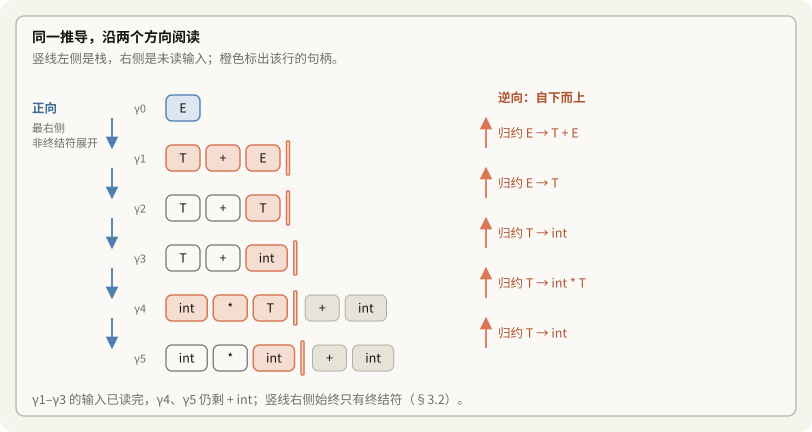

### 3.2 形式化符号拆解：为什么 $\omega$ 必然是纯终结符？

现在回过头来看课件上的抽象推导公式：
$$S \Longrightarrow_{\text{rm}}^* \alpha X \omega \Longrightarrow_{\text{rm}} \alpha \beta \omega$$

把正向推导的最后一步（第 5 步 $\to$ 第 6 步）代入进去对齐：
- 展开前的串是：$\underbrace{\text{int} *}_{\alpha} \ \mathbf{X} \ \underbrace{+ \text{int}}_{\omega} \quad$（其中非终结符 $X$ 即 $T$）
- 选用的产生式：$X \to \beta \quad$（即 $T \to \text{int}$，其中 $\beta$ 即 `int`）
- 展开后的串是：$\underbrace{\text{int} *}_{\alpha} \ \mathbf{\beta} \ \underbrace{+ \text{int}}_{\omega}$

> [!question] 为什么 $X$ 右侧的 $\omega$（此例中的 `+ int`）一定由纯终结符组成？
> **原因极度简单**：因为正向推导规定了是**最右推导**！
> 既然是“最右”，意味着在正向推导过程中，**凡是在 $X$ 右边的非终结符，之前早就已经被优先挑出来全部展开成终结符（token）了！**
> $X$ 是当前句型里**最靠右的唯一一个非终结符**。因此它右边的所有内容 $\omega$，必然已经是纯终结符串（对应输入流中尚未读取的 tokens）。

### 3.3 什么是句柄（Handle）？

在当前串 $\text{int} * \mathbf{int} + \text{int}$ 中，全文一共有 3 个 `int`。哪一个才是合法的下一步归约对象？
**只有中间那个 `int`！**

- **句柄的直观含义**：在当前右句型中，**刚好与某个产生式右部匹配、且把它换回左部非终结符后能够正确“倒退一步”的那个子串**，就叫做**句柄（Handle）**。
- **栈模型映射**：
  $$\underbrace{\text{int} *}_{\text{栈底内容 } \alpha} \quad \underbrace{\text{int}}_{\text{栈顶句柄 } \beta} \quad \mid \quad \underbrace{+ \text{int}}_{\text{未读输入 } \omega}$$
  句柄 $\beta$ 一定刚好位于**栈顶**，而 $\omega$ 则是尚未读入栈的剩余输入！
  此时分析器的唯一合法动作就是：**执行 Reduce，将栈顶的句柄 $\beta$ 替换为 $X$**。

```text
句型：  α        β       |  ω
        栈内深层 栈顶句柄   未读终结符
                 ^
                 |
                 +-- 将句柄 β 归约为 X
```

> [!note] 句柄还包含位置与规则
> 严格说，句柄要指明采用的产生式及其右部在当前右句型中的位置。三个 `int` 虽然文字相同，当前应归约的却只有第二个；不能只凭字符串匹配识别句柄。

### 3.4 为什么归约时句柄位于栈顶？

输入从左向右移进。正确的分析过程在句柄的右端到达栈顶时停止移进，随后归约该句柄。因此，“句柄在栈顶”说的是执行归约的时刻；移进尚未完成时，句柄可以部分或全部位于未读输入中。也不能把“最先匹配某个产生式右部”当成句柄已经形成的证明，§2 的反例正说明了这一点。

---

## 4. 核心问题解答：何时移进？何时归约？

基于句柄的概念，移进与归约的决策准则变得清晰而唯一：

| 决策 | 触发条件 | 物理意义 |
|---|---|---|
| **归约（Reduce）** | **当且仅当句柄已经在栈顶完全形成** | 栈顶符号串不仅形式上匹配某条规则 $X \to \beta$，而且在上下文全局推导中确系当前最右句型的合法句柄。 |
| **移进（Shift）** | **句柄尚未在栈顶完整出现** | 句柄可能还在右侧输入流中，或者当前栈顶符号只是未来更长句柄的一部分前缀。此时必须继续读取 token。 |

### 4.1 回看反例：正确的决策路径

在前面 $\text{int} \mid * \text{int} + \text{int}$ 的例子中：
- 终结符 `int` 虽然匹配 $T \to \text{int}$，但它**不是**此时句型的句柄。
- 根据文法运算优先级，正确的推导展开为：
  $$E \Longrightarrow_{\text{rm}} T + E \Longrightarrow_{\text{rm}} T + T \Longrightarrow_{\text{rm}} T + \text{int} \Longrightarrow_{\text{rm}} \text{int} * T + \text{int} \Longrightarrow_{\text{rm}} \text{int} * \text{int} + \text{int}$$
- 逆向回溯，整个句型的**第一个真正句柄是第二个 `int`**！
- 因此，在第一个 `int` 进栈后，**句柄尚未完整移入，必须执行移进（Shift）**，直到后续符号逐步满足句柄条件。

---

## 5. 识别句柄的现实困境与破局之路（Bad News & Good News）

既然自底向上分析的关键原则是“**仅当栈顶完整构成句柄时才执行归约**”，那么分析器如何能实时知道当前栈顶是不是句柄？

斯坦福 CS143 在这里给出了两个发人深省的基本结论：

```text
• Bad News
  - There are no known efficient algorithms to recognize handles
• Good News
  - There are good heuristics for guessing handles
  - On some CFGs, the heuristics always guess correctly
```

### 5.1 坏消息：通用句柄识别不存在高效算法

- 对于**任意通用的上下文无关文法（Arbitrary CFG）**，句柄的识别本质上是高度依赖全局推导树上下文的。
- 理论上，没有已知的高效确定性算法（如线性时间 $O(n)$）能在通用 CFG 的每一步移进-归约过程中直接指出句柄所在。对于通用二义性文法，甚至需要像 CYK 或 Earley 这类具有 $O(n^3)$ 时间复杂度的通用动态规划算法。

### 5.2 好消息：强大的启发式机制与“100% 猜对”的文法子集

- 虽然通用识别不可行，但计算机科学家们设计出了极其精妙的**启发式预测机制（Heuristics for guessing handles）**。
- 更关键的是：**在某些严格定义的 CFG 子集上，这些启发式机制可以做到 100% 正确预测，绝不猜错！**
- 这意味着：只要编程语言的语法设计落在这些特定的文法子集内，我们就能构建出**线性时间复杂度 $O(n)$、无回溯、绝对确定**的自底向上解析器。

---

## 6. 文法分类全景图（文法包含体系与工程权衡）

CS143 课件展示了一张经典的文法同心椭圆包含图（Venn Diagram），揭示了不同文法子集的层级关系：

```text
┌─────────────────────────────────────────────┐
│ All CFGs：所有上下文无关文法                   │
├─────────────────────────────────────────────┤
│ ┌─────────────────────────────────────────┐ │
│ │ Unambiguous CFGs：无二义性文法            │ │
│ ├─────────────────────────────────────────┤ │
│ │ ┌─────────────────────────────────────┐ │ │
│ │ │ LR(k)：向前看 k 个符号                │ │ │
│ │ ├─────────────────────────────────────┤ │ │
│ │ │ ┌─────────────────────────────────┐ │ │ │
│ │ │ │ LALR(k)：合并同核心状态            │ │ │ │
│ │ │ ├─────────────────────────────────┤ │ │ │
│ │ │ │ SLR(k)：简单 LR，使用 Follow 集   │ │ │ │
│ │ │ └─────────────────────────────────┘ │ │ │
│ │ └─────────────────────────────────────┘ │ │
│ └─────────────────────────────────────────┘ │
└─────────────────────────────────────────────┘
```

### 6.1 包含关系层级解析

从外向内，文法集合的限制越来越严格，解析器的构造越简单，但能表达的语言类别相应收缩：

$$\text{SLR}(k) \subset \text{LALR}(k) \subset \text{LR}(k) \subset \text{Unambiguous CFGs} \subset \text{All CFGs}$$

1. **All CFGs（所有上下文无关文法）**：
   - 包含二义性文法与高度非确定性的文法。不能直接构造确定性移进-归约分析器。
2. **Unambiguous CFGs（无二义性文法）**：
   - 保证了每个合法句子有且仅有一棵语法分析树。
   - **重要理解**：无二义性是句柄唯一性的前提，但**单凭无二义性仍然不足以实现确定性自底向上分析**（可能需要无限量向前看才能确定句柄，依然无法在线性时间内确定）。
3. **LR(k) CFGs（最广泛的确定性自底向上文法）**：
   - **L**：Left-to-right scanning（从左至右扫描输入）；
   - **R**：Rightmost derivation in reverse（最右推导的逆过程，即自底向上归约）；
   - **k**：Lookahead $k$ tokens（向前看 $k$ 个终结符辅助决策）。
   - 只要向前看 $k$ 个符号，就能 100% 无歧义地判定当前是移进还是按哪条产生式归约。
4. **LALR(k) CFGs（Look-Ahead LR，课件特别高亮蓝圈标注）**：
   - **为什么特别圈出 LALR(k)？**
     - 标准的 LR(1) 解析器虽然表达能力强，但其生成的 DFA 状态数极其庞大（通常几千到上万个状态），构造开销和内存占用过大。
     - LALR(1) 通过将 LR(1) 中具有相同“核心（Core）”的状态进行合并，将状态数量大幅缩减到与最简单的 SLR(1) 完全一致（几百个状态），同时保留了几乎等同于 LR(1) 的强大文法识别能力。
     - **工业界标准**：几乎所有经典编译器生成工具（如 Yacc、Bison）默认都采用 **LALR(1)**。
5. **SLR(k) CFGs（Simple LR）**：
   - 最简单的 LR 构造法。它仅借助全局非终结符的 $\text{Follow}$ 集来启发式地辅助做归约决策。算法极易实现，但识别能力偏弱，容易遇到冲突。

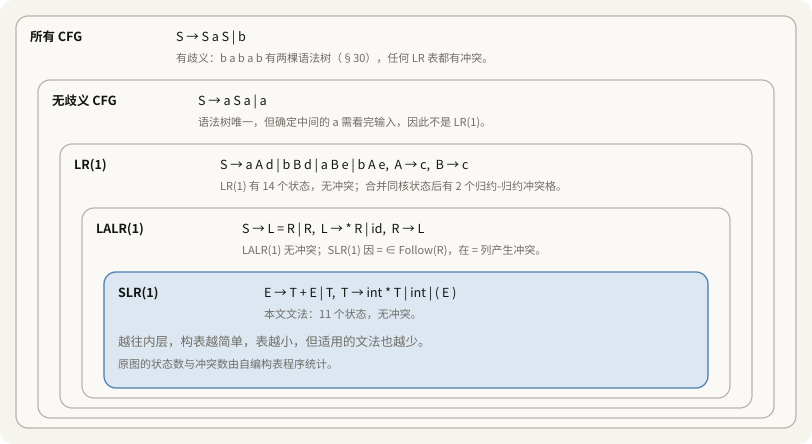

---

## 7. 剖析句柄识别的核心视角：栈与活前缀（Viable Prefix）

既然要在 LR 系列文法中确定性地识别句柄，分析器面临的物理环境是什么？

```text
• It is not obvious how to detect handles
• At each step the parser sees only the stack, not the entire input; start with that ...
• α is a viable prefix if there is an ω such that α | ω is a state of a shift-reduce parser
```

### 7.1 现实约束：分析器每一步只能看到“栈”

自底向上分析器工作时并不是拥有全局视角的“上帝”：
- 它**只能看到栈内已经存留的符号串 $\alpha$**，以及最多向前看几个紧邻的输入 token。
- 它无法预知未来几千行代码构成的完整输入 $\omega$。
- **立足点**：我们必须从栈内的符号串性质出发，寻找句柄出现的蛛丝马迹！

### 7.2 物理配置表示：$\alpha \mid \omega$

在移进-归约分析器中，任意时刻的机器状态（配置）可精确表示为：

$$\alpha \mid \omega$$

- **$\alpha$（栈内容）**：包含了已被移进的终结符以及阶段性归约出的非终结符（由终结符与非终结符混合构成，即 $\alpha \in (V_N \cup V_T)^*$）。竖线 `|` 的左侧就是当前栈顶。
- **$\omega$（未读输入）**：尚未读入分析器的输入流，是由纯终结符构成的串（$\omega \in V_T^*$）。

```text
┌────────────────────────────┐     ┌────────────────────────────┐
│ 栈 (Stack)                 │     │ 未读输入 (Input)             │
├────────────────────────────┤     ├────────────────────────────┤
│ α：栈底 ... 栈顶             │  |  │ ω：待消费的 token           │
└────────────────────────────┘     └────────────────────────────┘

中间的 | 是栈与未读输入的分界线。
```

### 7.3 核心概念：什么是活前缀（Viable Prefix）？

> [!important] 活前缀（Viable Prefix）的形式化定义
> 符号串 $\alpha$ 被称为文法的一个**活前缀（Viable Prefix）**，当且仅当：
> **存在一个终结符串 $\omega$，使得 $\alpha \mid \omega$ 是移进-归约分析器的一个合法分析状态（配置）。**

也就是说：一个符号串 $\alpha$ 要想配被称为“活前缀”，必须能够在某个实际的自底向上分析推导链条中，**合法地充当分析器栈中的内容**，并且从这个配置出发，后续是有可能成功归约到文法起始符号的。

---

## 8. 活前缀的三大核心内涵（What does this mean?）

CS143 课件用极具洞察力的三句话总结了活前缀的本质：

```text
What does this mean? A few things:
- A viable prefix does not extend past the right end of the handle
- It’s a viable prefix because it is a prefix of the handle
- As long as a parser has viable prefixes on the stack no parsing error has been detected
```

### 8.1 内涵一：活前缀绝不会越过句柄的右端点

> *“A viable prefix does not extend past the right end of the handle”*

- **为什么？**
  回顾自底向上分析的铁律：**句柄一旦在栈顶完整就位，必须立刻执行归约！**
  如果在状态 $\alpha \beta \mid \omega$ 中，$\beta$ 是当前右句型的句柄，那么下一步的合法动作只有唯一的 Reduce：弹出 $\beta$，压入非终结符 $A$。
- 分析器**绝对不可能**在句柄 $\beta$ 已经全部进栈后，还去执行 Shift 动作，将后续属于 $\omega$ 的符号再移进栈里！
- 换句话说：**一旦栈里的内容越过了句柄的右端，说明分析器错过了归约时机，整个分析过程就已经走入歧途了。**因此，所有合法的栈内容（活前缀），其最右端最多只能到达当前句柄的最右端。

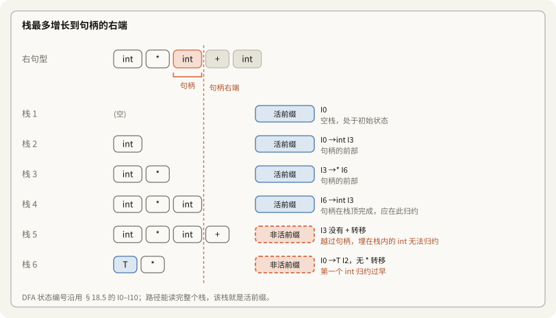

### 8.2 内涵二：它是“句柄的前缀”，带有未竟的归约希望

> *“It’s a viable prefix because it is a prefix of the handle”*

- 所谓“活（Viable）”，形象地说明了当前的分析状态仍然“**活着**”，具备生命力。
- 栈内的内容由两部分组成：
  $$\alpha = \gamma \, \beta_1$$
  - $\gamma$：历史已经完成归约的上下文非终结符与终结符前缀。
  - $\beta_1$：当前正在形成的句柄 $\beta = \beta_1 \beta_2$ 的**一个前缀（Prefix）**。
- 只要 $\beta_1$ 还是句柄的前缀，分析器就保留着希望——随着后续输入符号 $\beta_2$ 继续移入栈中，这个句柄终将在栈顶完整聚齐并成功归约。

```text
最右推导：S =>* γ A ω => γ β₁ β₂ ω
                         └───┬───┘
                           句柄 β

当前栈：  [ γ  β₁ ] | 尚未读取的终结符
          └──┬───┘
          活前缀 α

栈顶部分 β₁ 是句柄的前缀；后续分析补齐 β₂。
```

> [!note] 前缀位于栈的哪一端
> 在 $α = γβ_1$ 中，是栈顶一侧的 $β_1$ 对应句柄前缀，不是栈中任意位置包含一段前缀就足够。尚未完成的非终结符还需要通过后续移进和归约构造，不能一概把 $β_2$ 当成可直接读取的 token 串。

### 8.3 错误检测的边界

栈是活前缀，说明这种栈结构仍可能出现在某个合法分析过程中，并不保证当前剩余输入一定合法。还要结合向前看 token 查询 ACTION 表。

若当前 token 没有合法动作，分析器报告语法错误，不会先把错误 token 压栈再检查。SLR 或 LALR 使用的归约条件可能比当前上下文宽，因此报错前可能多做几次归约；“尽早发现错误”不等于收到错误 token 后立即报错、一次归约也不做。

---

## 9. 自底向上分析的重要定理（Important Fact #3）

在第 8 讲中，斯坦福教授给出了关于自底向上分析最为惊艳的第三个重大事实（Important Fact #3）：

```text
Important Fact #3 about bottom-up parsing:

For any grammar, the set of viable prefixes is a regular language
```

> [!important] 核心定理：活前缀集合是正则语言
> **对于任何上下文无关文法（CFG），其所有活前缀构成的集合，必定是一个正则语言（Regular Language）！**

### 9.1 直觉突破：为什么语言本身不是正则，栈里的前缀反而是正则？

这是所有初学者最容易卡住的地方：
* 编程语言本身充满了任意深度的括号嵌套匹配（形如 $a^n b^n$），**这绝对不是正则语言**（普通的 DFA 没有计数器，记不住嵌套了多少层）。
* **那为什么装这些符号的栈（活前缀），竟然是正则语言？**

#### 破除迷思：看“括号文法”的极端例子
考虑最典型的纯括号文法：$S \to ( \ S \ ) \mid \epsilon$。
- **整门语言（非正则）**：要求左括号数量必须等于右括号数量，为了验证配对，必须借助栈。
- **栈中的活前缀（纯正则！）**：
  在分析过程中，栈里可能出现的活前缀只有哪几种样子？
  - `(`
  - `((`
  - `(((` ... （任意多个左括号）
  - 或者是带上一个正在等待的 $S$：`((... ( S`
  - 亦或是即将归约的时刻：`((... ( (S)`
  
  **请问：判断栈里的这串符号“是不是合法活前缀”，需要去数括号有几个吗？**
  **完全不需要！** 只要符合正则表达式 `(^ * S? )?`，即“任意多个左括号紧跟可选的 $S$”，它就是合规的！
  识别这种模式只需要一台 **只有 2~3 个状态的简单有限状态机（DFA）** 就搞定了！

> [!note] 括号文法的具体形状
> 对 $S \to (S) \mid \varepsilon$，活前缀只有三类：零个或多个 `(`；零个或多个 `(` 后接 `S`；一个或多个 `(` 后接 `S)`。例如 `((S)` 可以出现在栈中，`((S))` 不可以：内层 `(S)` 完成后应先归约成 `S`。嵌套深度保存在栈里，DFA 无需独自计数。

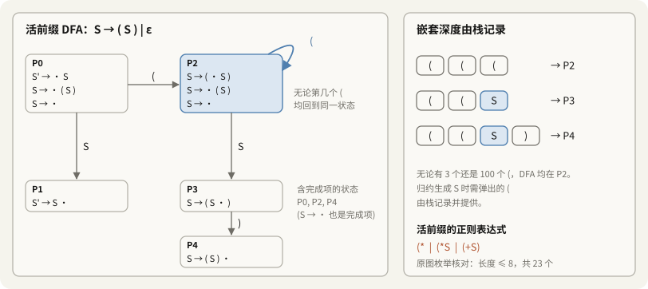

### 9.2 理论奇迹的工程威力

1. **不需要无限状态，不需要回溯**：
   因为文法产生式是有限的，圆点 $\cdot$ 在所有产生式右部能够停留的位置（状态项）是死死焊死的（几百到几千个）。
2. **栈里跑状态机（$O(1)$ 极速跳转）**：
   因为活前缀是正则语言，**必然存在确定性有限状态自动机（DFA）** 能实时识别它！
   分析器每吞进一个符号，DFA 就顺着一条有向边跳转到下一个状态号。分析器不需要翻看深层栈底，栈顶的状态号就凝聚了整个栈的合法性历史！

---

## 10. 自底向上的生命周期大循环

理解了活前缀与句柄的交替关系，自底向上分析的整个运作本质就可以总结为一个极其优美的永动循环：

```text
┌────────────────────────────────────┐
│ 当前栈：活前缀                       │
├────────────────────────────────────┤
│ 句柄尚未完整到达栈顶                  │
└────────────────────────────────────┘
                  |
                  | 移进所需 token
                  v
┌────────────────────────────────────┐
│ 句柄在栈顶完整形成                    │
├────────────────────────────────────┤
│ 按对应产生式执行归约                  │
└────────────────────────────────────┘
                  |
                  | 用左部非终结符替换句柄
                  v
┌────────────────────────────────────┐
│ 归约后的栈：新的活前缀                 │
├────────────────────────────────────┤
│ 继续判断移进、归约或接受               │
└────────────────────────────────────┘
```

1. **培育期（活前缀）**：栈顶是未完成的规则前缀，从右侧输入流 $\omega$ 移进符号；
2. **成熟期（句柄）**：随着最后一个关键符号移入，产生式右部全部到齐，在栈顶形成**句柄**；
3. **蜕变期（新的活前缀）**：立即执行归约（Reduce），弹出句柄并压入左部非终结符。这个新非终结符立即成为外层大规则的一个**新活前缀零件**！

---

## 11. 核心武器：LR(0) 项（Item）与圆点“进度指针”

为了在运行期精准追踪活前缀的匹配进度，编译理论引入了带圆点 $\cdot$ 的产生式——**LR(0) 项（Item）**：

```text
• An item is a production with a "." somewhere on the rhs
• The items for T -> (E) are:
  T -> .(E)
  T -> (.E)
  T -> (E.)
  T -> (E).
• The only item for X -> ε is X -> .
• Items are often called “LR(0) items”
```

### 11.1 圆点 $\cdot$ 的物理哲学：“战利品”与“愿望单”

圆点 $\cdot$ 本质上就是分析器在产生式上的**「进度光标（Cursor）」**：

$$A \to \alpha \cdot \beta$$

1. **圆点 $\cdot$ 的左侧（$\alpha$ —— 战利品）**：
   代表**迄今为止已经读入并识别、安全躺在栈中的符号串（What we have seen so far）**。
2. **圆点 $\cdot$ 的右侧（$\beta$ —— 愿望单）**：
   代表**接下来眼巴巴期盼看到的符号串（What we hope to see next）**。
3. **归约爆发点（$\cdot$ 到达最末尾：$A \to \alpha \beta \cdot$）**：
   愿望全部满足，产生式右部零件在栈顶彻底到齐，**句柄成熟，立即执行归约！**

### 11.2 单项的“唯一期待” vs 状态集合的“多路分支”

在理解圆点的期待时，需要做一个极其精妙的关键区分：

- **对于单条 LR(0) 项**：
  圆点右边紧挨着的**第一个符号是唯一且确切的期待**！
  例如：$S \to (\ S \ \cdot\ )$ 中，`· )` 明确宣布：**“顺着这条推导路线，我唯一期待的就是右边的输入流送来一个右括号 `)`！”** 如果送来别的符号，这条路线当场报错。
- **对于分析器的整个状态（项集集合）**：
  由于代码存在多种可能的分支，一个状态往往由多个项共同组成：
  $$\left\{ \begin{aligned} E &\to E \cdot + T \quad (\text{期待 } +) \\ E &\to E \cdot * T \quad (\text{期待 } *) \end{aligned} \right\}$$
  分析器整体处于分岔路口，输入 `+` 就走加法路线，输入 `*` 就走乘法路线。
  *(注：如果同一个状态里同时出现了“期待移进”和“期待归约”，就会引发著名的**移进-归约冲突**，这正是后续 LR 分析表需要解决的课题。)*

### 11.3 产生式项的分裂示例：以 $T \to (E)$ 为例

| LR(0) 项 | 圆点位置 | 物理语义与心智状态 |
|---|---|---|
| $T \to \cdot (E)$ | 最左端 | 刚刚启动规则 $T$，**唯一期待**读入首字符 `(`。 |
| $T \to (\cdot E)$ | 越过 `(` | 栈里已见 `(`，**唯一期待**后续输入能规约出一个表达式 $E$。 |
| $T \to (E \cdot )$ | 越过 $E$ | 栈里已见 `(` 和 $E$，**唯一期待**输入流提供右括号 `)` 闭合！ |
| $T \to (E) \cdot$ | 最右端 | 零件全部到齐！句柄就位，**触发归约（Reduce by $T \to (E)$）**！ |

空产生式 $X \to \epsilon$ 只有唯一项 $X \to \cdot$，圆点天生在末尾，无需任何输入直接就绪归约。

### 11.4 $\epsilon$ 产生式的特殊情形

对于空产生式 $X \to \epsilon$，它的右部本身没有任何符号。
因此它只有一个唯一的 LR(0) 项：

$$X \to \cdot$$

这代表着它不需要等待任何输入符号进栈，一旦被激活，直接就处于“可归约”就绪状态。

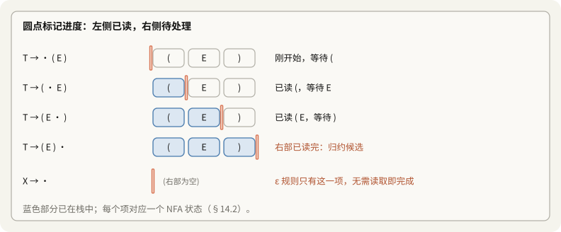

---

## 12. 实例深剖：输入 `(int)` 时的分析栈与项

CS143 课件给出了一个具体的表达式分析实例，清晰展现了活前缀、栈与项的完美统一：

```text
Consider the input (int)
  E -> T + E | T
  T -> int * T | int | (E)

- Then (E | ) is a state of a shift-reduce parse
- (E is a prefix of the rhs of T -> (E)
  • Will be reduced after the next shift
- Item T -> (E.) says that so far we have seen (E of this production
  and hope to see )
```

### 12.1 状态配置演进

考虑待分析句子 `(int)`，其推导经过如下步骤：
1. 初始状态：$\mid (\text{int})$
2. 移进 `(`：$(\ \mid \text{int})$
3. 移进 `int`：$(\ \text{int} \mid )$
4. 归约 $T \to \text{int}$：$(\ T \mid )$
5. 归约 $E \to T$：$(\ E \mid )$

此时，分析器停在配置：

$$\underbrace{(\ E}_{\text{栈 (Stack)}} \ \mid \ \underbrace{)}_{\text{输入 (Input)}}$$

### 12.2 项如何指导决策？

1. **栈内符号串**：栈中当前是 `(E`。
   观察产生式 $T \to (E)$，发现 `(E` 正是其右部的一个**真前缀（Prefix of RHS）**！
2. **对应的 LR(0) 项**：
   此时分析器内部追踪的项精确为：
   $$T \to (E \cdot )$$
3. **圆点的决策指引**：
   - 圆点左边是 `(E`：告诉分析器“你已经成功识别了 `(` 和 $E$”；
   - 圆点右边是 `)`：告诉分析器“**千万不能在这个时候执行归约！你还在眼巴巴地等待一个右括号 `)`！**”；
   - 下一步动作：既然当前输入就是期待的 `)`，分析器果断执行**移进（Shift）**；
4. **移进之后的状态跃迁**：
   $$(\ E \mid ) \quad\xrightarrow{\text{Shift } )}\quad (\ E\ ) \mid$$
   项中的圆点越过 `)`，跃迁到：
   $$T \to (E)\cdot$$
   此时圆点到达末端，期望全部满足，**分析器立刻触发归约（Reduce by $T \to (E)$），成功将栈顶替换为 $T$！**

> [!tip] 总结：活前缀的执行本质
> **活前缀在栈中的执行与识别，本质上就是由一组 LR(0) 项驱动的圆点移动游戏**：
> - 移进（Shift）一个符号，圆点越过该符号向右跳一格；
> - 圆点在产生式内部（$\cdot$ 右边还有符号） $\implies$ 只能移进或等待子规则归约，**绝不可归约当前规则**；
> - 圆点跳到产生式最末端（$\cdot$ 后面为空） $\implies$ 句柄成熟，**执行归约**！

---

## 13. 破解终极迷思：分析栈的微观结构——“嵌套等待链（Prefix 链条）”

在第 8 讲第二节的末尾，课件给出了三张极其精辟、但初看非常抽象的 PPT：

```text
• The stack may have many prefixes of rhs's
  Prefix₁ Prefix₂ . . . Prefix_{n-1} Prefix_n

• Let Prefix_i be a prefix of rhs of X_i -> α_i
  - Prefix_i will eventually reduce to X_i
  - The missing part of α_{i-1} starts with X_i
  - i.e. there is a X_{i-1} -> Prefix_{i-1} X_i β for some β

• Recursively, Prefix_{k+1}...Prefix_n eventually reduces to the missing part of α_k
```

很多同学第一次看到这一页公式时会完全看不懂：**为什么栈里会有好几个 Prefix 拼在一起？它们之间到底是什么关系？**

### 13.1 通俗心智模型：“函数递归调用栈”与“俄罗斯套娃”

要彻底看懂这个公式，最好的直觉就是**编程语言的函数调用栈（Call Stack）**：
- **函数 A** 执行到第 10 行，调用了 **函数 B**。此时函数 A 挂起暂停，**苦苦等待函数 B 的返回值**；
- **函数 B** 执行到第 5 行，又调用了 **函数 C**。此时函数 B 挂起暂停，**苦苦等待函数 C 的返回值**；
- **函数 C** 正在栈顶全力执行！等函数 C 执行完毕返回结果，函数 B 拿到结果才能继续往下走；函数 B 走完返回给函数 A，函数 A 才能最后收工！

**语法分析器的栈，本质上就是一模一样的“嵌套任务等待栈”！**
- 每一个 $\text{Prefix}_i$，就是一个**“推进到一半、被挂起的大任务/父规则”**；
- 它之所以停在那里，是因为它**缺少了后续的某个非终结符 $X$**；
- 为了制造出这个 $X$，分析器在栈顶开启了**子任务/子规则**；
- 栈顶的小任务一步步归约出的结果，**刚好严丝合缝地填补了底下父任务所欠缺的那个洞**！

---

### 13.2 结合实例（PPT 2）拆解：输入 `(int * int)`

对照文法：
$$
\begin{aligned}
E &\to T + E \mid T \\
T &\to \text{int} * T \mid \text{int} \mid (E)
\end{aligned}
$$

考虑待分析串 `(int * int)`，当分析器移进了 `(`、`int`、`*` 后，当前状态配置为：

$$\underbrace{(\ \text{int} *}_{\text{栈 (Stack)}} \ \mid \ \underbrace{\text{int} \ )}_{\text{剩余输入}}$$

此时栈中的内容是：`(` `int` `*`。
表面上看这只是三个零散的 token，但从文法视角拉开解剖，它其实由 **3 个前缀紧密咬合而成**：

从栈底到栈顶，依次是 Prefix₁、Prefix₂、Prefix₃：

| 对照项 | Prefix₁ | Prefix₂ | Prefix₃ |
|---|---|---|---|
| 符号片段 | `(` | `ε` | `int *` |
| 对应规则 | `T -> ( E )` | `E -> T` | `T -> int * T` |
| 当前项 | `T -> ( . E )` | `E -> . T` | `T -> int * . T` |
| 状态 | 已见 `(`，等待 E | 已见空串，等待 T | 已见 `int *`，等待 T |

让我们一行行对齐课件图二的解释：

1. **第一层任务 $\text{Prefix}_1 = \text{"("}$**：
   - 它是产生式 $T \to (E)$ 的前缀（即对应项 $T \to (\ \cdot\ E)$）；
   - 它已经看到了 `(`，但是**还缺少右半部分 $E\ )$**，它在等待一个非终结符 $E$！
2. **第二层任务 $\text{Prefix}_2 = \epsilon$（空串）**：
   - 既然最外层要等待 $E$，分析器就试图去造一个 $E$，激活规则 $E \to T$；
   - 此时它刚被激活，还没有读入属于它的任何终结符，所以它的前缀是 $\epsilon$（即对应项 $E \to \cdot T$）；
   - 它又在等待一个非终结符 $T$！
3. **第三层任务 $\text{Prefix}_3 = \text{"int *"}$**：
   - 既然第二层在等待 $T$，分析器又激活了规则 $T \to \text{int} * T$；
   - 此时已经读入了 `int` 和 `*`（即对应项 $T \to \text{int} * \cdot T$）；
   - 它正位于当前栈顶，等待后续的输入 `int` 归约为 $T$！

把这三层的前缀在物理上拼接在一起：
$$\text{栈中符号} = \text{Prefix}_1 + \text{Prefix}_2 + \text{Prefix}_3 = \text{"("} + \epsilon + \text{"int *"} = \text{"( int *"}$$
**字符完全一致！** 这就是为什么课件说：**栈的内容是由一连串产生式右部的前缀拼接而成的！**

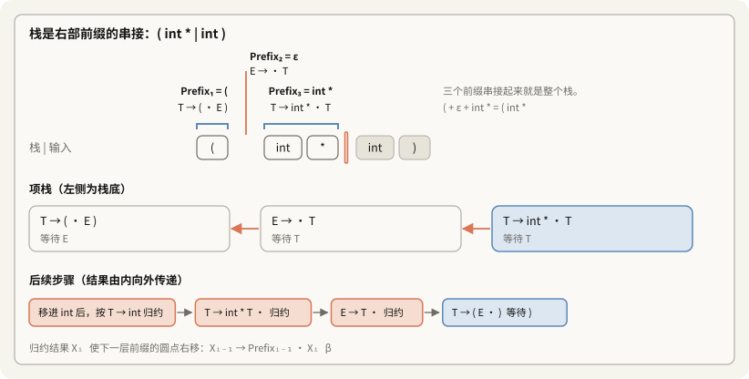

---

### 13.3 形式化契约拆解：为什么中间是一个 $X_i$？（回看 PPT 1）

课件上的核心公式：
$$X_{i-1} \to \text{Prefix}_{i-1} \ \mathbf{X_i} \ \beta$$

> [!important] 下标层级法则：$n$ 越小，辈分越大、越靠语法树顶层！
> - **$n$ 越小（如 $X_1$）**：处于**栈底深层**，代表**最外层、最宏观的父辈大任务**（如整个函数、外层括号结构）；
> - **$n$ 越大（如 $X_n$）**：处于**栈顶前沿**，代表**最内层、微观的子辈小任务**（正在吃进具体 token 并拼装句柄）；
> - **推导向下委托，归约向上汇报**：外层大任务等待内层小任务，小任务归约结果层层向上交付！

#### 深入剖析：为什么公式中间正巧是一个 $X_i$？

这个公式将“父任务”与“子任务”的交接机制展现得淋漓尽致：

1. **父任务（$i-1$ 层）的卡点**：
   产生式是 $X_{i-1} \to \text{Prefix}_{i-1} \cdot \mathbf{X_i} \ \beta$。
   父规则读完了已经进栈的前缀 $\text{Prefix}_{i-1}$，此时圆点停在 $X_i$ 之前，**它在眼巴巴等待的下一个零件正是非终结符 $X_i$**！
2. **非终结符不能从输入流直读**：
   代码输入流里只有纯 token（终结符），绝不可能凭空读出一个 $X_i$。这个 $X_i$ **必须由下一层子规则负责归约生产**！
3. **子任务（$i$ 层）启动与交接**：
   为了造出 $X_i$，分析器在栈顶激活规则 $X_i \to \alpha_i$。
   随着输入符号逐步补齐，子规则在栈顶成功归约出 $X_i$。
   **这个刚出炉的 $X_i$ 立即向上交付，刚好填进父规则缺失的那个洞里！**
   父规则拿到 $X_i$ 后，圆点越过它变成 $X_{i-1} \to \text{Prefix}_{i-1} X_i \cdot \beta$，继续等待后面的后缀 $\beta$。

> **一句话总结**：
> 中间的 $\mathbf{X_i}$ 就是连接两层产生式的**“铰链与接口”**——对于子任务它是**终点产物**，对于父任务它是**起点零件**！

---

### 13.4 终极思想总结（PPT 3：Idea to Recognize Viable Prefixes）

CS143 课件最后用一段精辟的话揭示了活前缀识别器的灵魂：

```text
Idea: To recognize viable prefixes, we must
- Recognize a sequence of partial rhs’s of productions, where
- Each partial rhs can eventually reduce to part of the missing suffix of its predecessor
```

> [!important] 自底向上分析器的真正使命
> 要想在运行期准确无误地识别出活前缀，分析器必须做到：
> 1. **识别出一串产生式右部的“局部碎片序列（sequence of partial rhs's）”**；
> 2. **保证每一个局部碎片，在未来都能合法地归约成其前驱产生式所缺失的那部分后缀（missing suffix of its predecessor）！**

只要这个链条没有断裂，说明栈中的前缀们正在环环相扣地协同工作，整个程序就没有语法错误；而一旦输入了一个字符使得这个“等待链条”无论如何都无法闭环，分析器就可以当场判定：**语法错误！**

---

## 14. 构建活前缀识别器：从产生式到 NFA（六大构建法则）

既然 **定理（Important Fact #3）** 已经证明：**任何上下文无关文法的活前缀集合都是正则语言**，那么在计算机科学中，任何正则语言都必然能够被一台**有限状态自动机（Finite Automaton）**所识别！

我们现在的任务是：**设计一台自动机。把移进-归约分析器栈里的符号串（终结符与非终结符的混合串）喂给它，只要自动机能走通并停在接受态，就判定当前栈内容是一个合法的“活前缀”；如果半路卡死无路可走，就当场判定语法错误！**

斯坦福 CS143（Alex Aiken 教授）给出了从文法产生式直接机械化生成这台 NFA 的 **六大构建黄金法则**：

```text
1. Add a dummy production S' -> S to G
2. The NFA states are the items of G (including the extra production)
3. For item E -> α.Xβ add transition:
   E -> α.Xβ  ──X──>  E -> αX.β
4. For item E -> α.Xβ and production X -> γ add transition:
   E -> α.Xβ  ──ε──>  X -> .γ  (X is non-terminal)
5. Every state is an accepting state
6. Start state is S' -> .S
```

---

### 14.1 规则 1：增广产生式（Add a dummy production $S' \to S$）

* **规则描述**：在原文法 $G$ 的基础上，增加一条虚构的产生式 $S' \to S$，其中 $S$ 是原文法的起始符号，$S'$ 是一个全新的非终结符。
* **为什么必须加这一条？**
  * 原文法中的开始符号 $S$（例如表达式文法中的 $E$）往往会出现在其他产生式的**右部**（例如 $E \to T + E$）。
  * 如果不引入 $S'$，当分析器在栈中把符号串归约成 $E$ 时，它很难分清：**“这是整个源代码分析完毕了，还是仅仅归约出了一个加法表达式的左操作数？”**
  * 引入一个**在所有产生式右部都绝不出现**的新符号 $S'$，作为整个语法的全局唯一总入口与总出口。当且仅当圆点越过了 $S'$（即到达 $S' \to S \cdot$ 时），分析器就可以 100% 毫无歧义地宣布：**整篇代码合法，语法分析圆满完成（Accept）！**

---

### 14.2 规则 2：NFA 的“状态” = 文法的所有 LR(0) 项（Items）

* **物理含义**：
  * NFA 的每一个状态节点，就是一个“带圆点 $\cdot$ 的产生式”（LR(0) Item）。
  * 圆点就像一个**进度光标（Cursor）**：
    * 圆点左侧：代表**栈中已经识别并躺好的符号（已实现的战利品）**；
    * 圆点右侧：代表**分析器眼巴巴期盼看到的后续符号（未来的愿望单）**。
  * 产生式右部有多少个缝隙，就能产生多少个 LR(0) 项，也就对应 NFA 中的多少个状态节点。

---

### 14.3 规则 3：符号推进边（Shift / 扫描边）

$$E \to \alpha \cdot X \beta \xrightarrow{\quad X \quad} E \to \alpha X \cdot \beta$$

* **物理含义（吃进一个符号，进度右移一格）**：
  * 当前状态为 $E \to \alpha \cdot X \beta$，圆点右边是 $X$（手写笔记标注：`seen α on stack`）。这表明当前规则**正眼巴巴地等待符号 $X$**（$X$ 可以是终结符如 `int`、`+`，也可以是非终结符如 $T$）。
  * 一旦分析器在栈里真的读到了符号 $X$，愿望达成！圆点自然跨过 $X$ 向右推进一格，机器跳转到新状态 $E \to \alpha X \cdot \beta$。

---

### 14.4 规则 4：$\epsilon$ 转移边（核心精髓！预测 / 任务下发边）

$$E \to \alpha \cdot X \beta \xrightarrow{\quad \epsilon \quad} X \to \cdot \gamma \qquad (X \text{ 为非终结符, 且存在产生式 } X \to \gamma)$$

这是许多同学最难理解的一步：**为什么不需要消耗任何字符（$\epsilon$），就能直接瞬移到另一条产生式？“开子任务”到底是什么意思？**

#### (1) 现实困境：程序员的键盘上没有“非终结符”
* 观察当前项的心态：$E \to \alpha \cdot X \beta$。它的圆点后面紧挨着一个**非终结符 $X$**。
* 它的意思是：“我期待在栈顶看到一个非终结符 $X$”。
* 但是在真实世界中，输入流里送过来的全是纯 Token（终结符，如 `int`、`+`、`(`），**键盘上根本没有按键能直接敲出一个抽象的非终结符 $X$！**

#### (2) 如何在栈里造出一个 $X$？
* 想在栈顶得到 $X$，唯一的途径就是：**让后续输入的具体 Token 先拼装出 $X$ 的产生式右部 $\gamma$，然后再执行一次归约（Reduce by $X \to \gamma$）！**
* 因此，分析器必须立刻去查文法手册：*“谁能生产出非终结符 $X$？”*
* 发现产生式 $X \to \gamma$ 可以造出 $X$。于是，分析器在心中**立刻激活这条子规则**，从它的起点 $X \to \cdot \gamma$ 展开等待！

#### (3) 为什么转移代价是 $\epsilon$？
* 用现代企业的“层级派活”来打比方：
  * **总经理状态（$E \to \alpha \cdot X \beta$）** 坐在办公室说：*“我需要一份报告 $X$！”*
  * 总经理自己是不干体力活的，他**动一动嘴皮子（不需要消耗任何外部零件，耗费代价为 0，即 $\epsilon$ 边）**，把任务立刻派发给下属生产组：
    👉 连一条 $\epsilon$ 边到 **制造科（$X \to \cdot \gamma$）**。
  * 制造科刚接到任务，圆点在最左边（$\cdot \gamma$），表示：*“报告总经理，生产线已就位，准备从头拼装 $\gamma$！”*
* **因此，$\epsilon$ 边本质上是分析器内部的“任务调用 / 预测贯通”机制**。此时栈里还没有移入新的具体符号，所以耗费代价为 $\epsilon$！

```text
[ E -> α . X β ]  等待非终结符 X
        |
        | ε 转移：激活 X 的产生式起始项
        v
[ X -> . γ ]      开始识别 γ，以构造 X
```

---

### 14.5 规则 5：为什么“每个状态都是接受状态”？它到底在拒绝什么？

初学者常常产生两大迷思：
1. *“状态圆点还在中间，甚至在最开头，怎么就算‘接受’了？”*
2. *“既然每个状态都能接受，而且接受态还能转移到另一个接受态，那这台自动机到底在拒绝什么？”*

#### (1) 自动机的输入到底是什么？
* **这台自动机的输入不是整篇源代码字符串！**
* **它的输入是：当前瞬间分析栈里的符号串（即当前的栈配置）！**
* 它的使命是回答一个问题：**“目前栈里的这串符号，到底算不算一个合法的‘半成品’？”**

#### (2) “接受”与“拒绝”的真实含义
* **接受（Accept）**：
  > 只要栈里的符号串能让自动机顺着某些边停在**任意一个状态**上，就证明：**当前栈里的符号是一个绝对合法的活前缀！迄今为止代码语法完全合规，分析器还“活着”（Viable）！**
* **拒绝（Reject）**：
  > 如果栈里的符号串让自动机在某个节点**无路可走（卡死崩溃）**，就证明：**当前栈里的符号串在文法中绝对不可能出现！分析器当场报错（Syntax Error）！**

#### (3) 形象比喻：汽车流水线的合格质检
在流水线上组装汽车：
* **状态 1（底盘到齐）**：质检员检验通过，判定为“合法的半成品”（**接受态 1**）；
* **状态 2（装上轮胎）**：质检员检验通过，依然是“合法的半成品”（**接受态 2**）；
* **状态 3（装上发动机）**：检验通过，依然是“合法的半成品”（**接受态 3**）；
* **状态 4（整车出厂）**：整机下线，检验通过（**接受态 4**）。

每装一个合法零件，机器就从一个接受态转移到下一个接受态。每一个中间过程都是合法的施工状态！
**但如果在装底盘时，工人突然递过来一个马桶盖，质检手册上根本没有“底盘 ──装马桶盖──> 下一步”这条边，自动机当场卡死——这就是拒绝！**

> [!important] 核心认知
> 自动机里的每一个 LR(0) 项，无论是刚开工（$\cdot$ 在最前）还是施工中（$\cdot$ 在中间），都代表了一种**合法的语法推导进度**。只要能对应上文法进度，就是合法活前缀（接受）；只有当遇到无法解释的非法符号导致走投无路时，才是拒绝！

---

### 14.6 规则 6：起始状态是 $S' \to \cdot S$

* 旅程从一切的源头开始。
* 分析器刚启动时栈为空，进度处于“尚未看到任何输入，正满怀期待地准备迎接整个语法结构的起始符号 $S$”。

---

## 15. 实战大推导：手把手构建完整的活前缀 NFA（图 3 到 图 4 全景还原）

现在，我们严格遵照上述六大规则，以 CS143 课件上的具体文法为例，一步一步推导出图 4 那张纵横交错的完整 NFA！

### 15.1 待分析的目标文法

$$
\begin{aligned}
S' &\to E \\
E &\to T + E \mid T \\
T &\to \text{int} * T \mid \text{int} \mid (E)
\end{aligned}
$$

---

### 15.2 第一步：清点所有状态节点（所有 LR(0) 项）

根据**规则 2**，文法中每个产生式在每个可能位置放置圆点 $\cdot$，一共产生 **18 个项（对应 NFA 的 18 个状态节点）**：

| 产生式类别 | 对应的 LR(0) 项状态 | 状态编号 |
|---|---|---|
| **增广规则 $S' \to E$** | $S' \to \cdot E$<br>$S' \to E \cdot$ | ① (起始状态)<br>② (全局成功态) |
| **加法规则 $E \to T + E$** | $E \to \cdot T + E$<br>$E \to T \cdot + E$<br>$E \to T + \cdot E$<br>$E \to T + E \cdot$ | ③<br>④<br>⑤<br>⑥ |
| **单项规则 $E \to T$** | $E \to \cdot T$<br>$E \to T \cdot$ | ⑦<br>⑧ |
| **乘法规则 $T \to \text{int} * T$** | $T \to \cdot \text{int} * T$<br>$T \to \text{int} \cdot * T$<br>$T \to \text{int} * \cdot T$<br>$T \to \text{int} * T \cdot$ | ⑨<br>⑩<br>⑪<br>⑫ |
| **整数规则 $T \to \text{int}$** | $T \to \cdot \text{int}$<br>$T \to \text{int} \cdot$ | ⑬<br>⑭ |
| **括号规则 $T \to (E)$** | $T \to \cdot (E)$<br>$T \to (\cdot E)$<br>$T \to (E \cdot)$<br>$T \to (E)\cdot$ | ⑮<br>⑯<br>⑰<br>⑱ |

> 仔细观察图 4 中的白色方框，正好整整齐齐地摆放着这 18 个状态项！

---

### 15.3 第二步：推导所有 $\epsilon$ 转移边（寻找所有等待非终结符的项）

根据**规则 4**，审查上述 18 个项：**只要圆点右边紧挨着非终结符（$E$ 或 $T$），就必须向该非终结符的所有产生式的初态发射 $\epsilon$ 边！**

#### 1. 谁在期待非终结符 $E$？
圆点紧靠在 $E$ 左侧的项共有 3 个：
1. `①` $S' \to \cdot E$（起始状态）
2. `⑤` $E \to T + \cdot E$（加号后面的右表达式）
3. `⑯` $T \to (\cdot E)$（左括号内部的子表达式）

而能够生产出 $E$ 的初态有两个：
* `③` $E \to \cdot T + E$
* `⑦` $E \to \cdot T$

👉 **连边结论**：
* 从 `①` $S' \to \cdot E$ 向 `③` 和 `⑦` 分别连接一条 $\epsilon$ 边；
* 从 `⑤` $E \to T + \cdot E$ 向 `③` 和 `⑦` 分别连接一条 $\epsilon$ 回调边；
* 从 `⑯` $T \to (\cdot E)$ 向 `③` 和 `⑦` 分别连接一条 $\epsilon$ 递归边。

#### 2. 谁在期待非终结符 $T$？
圆点紧靠在 $T$ 左侧的项共有 3 个：
1. `③` $E \to \cdot T + E$
2. `⑦` $E \to \cdot T$
3. `⑪` $T \to \text{int} * \cdot T$（乘号后面的右因子）

而能够生产出 $T$ 的初态有三个：
* `⑨` $T \to \cdot \text{int} * T$
* `⑬` $T \to \cdot \text{int}$
* `⑮` $T \to \cdot (E)$

👉 **连边结论**：
* 上述每个期待 $T$ 的状态，都要向 `⑨`、`⑬`、`⑮` **各自引出 3 条 $\epsilon$ 边（共 $3 \times 3 = 9$ 条 $\epsilon$ 边）**！
* 在图 4 中，这体现为从 $E \to \cdot T + E$ 和 $E \to \cdot T$ 往下密集扎入 $T$ 各个初态的红色箭头簇。

---

### 15.4 第三步：推导所有实线推进边（符号转移边）

根据**规则 3**，顺着产生式右部，吃进一个字符，圆点后移一格：

1. **$S'$ 系列**：$S' \to \cdot E \xrightarrow{\quad E \quad} S' \to E \cdot$
2. **$E \to T + E$ 系列**：
   $$E \to \cdot T + E \xrightarrow{\quad T \quad} E \to T \cdot + E \xrightarrow{\quad + \quad} E \to T + \cdot E \xrightarrow{\quad E \quad} E \to T + E \cdot$$
3. **$E \to T$ 系列**：
   $$E \to \cdot T \xrightarrow{\quad T \quad} E \to T \cdot$$
4. **$T \to \text{int} * T$ 系列**：
   $$T \to \cdot \text{int} * T \xrightarrow{\quad \text{int} \quad} T \to \text{int} \cdot * T \xrightarrow{\quad * \quad} T \to \text{int} * \cdot T \xrightarrow{\quad T \quad} T \to \text{int} * T \cdot$$
5. **$T \to \text{int}$ 系列**：
   $$T \to \cdot \text{int} \xrightarrow{\quad \text{int} \quad} T \to \text{int} \cdot$$
6. **$T \to (E)$ 系列**：
   $$T \to \cdot (E) \xrightarrow{\quad ( \quad} T \to (\cdot E \xrightarrow{\quad E \quad} T \to (E \cdot) \xrightarrow{\quad ) \quad} T \to (E)\cdot$$

---

### 15.5 完整的活前缀 NFA 架构图

我们用清晰的 Mermaid 状态图将这张大网的关键架构提取如下：

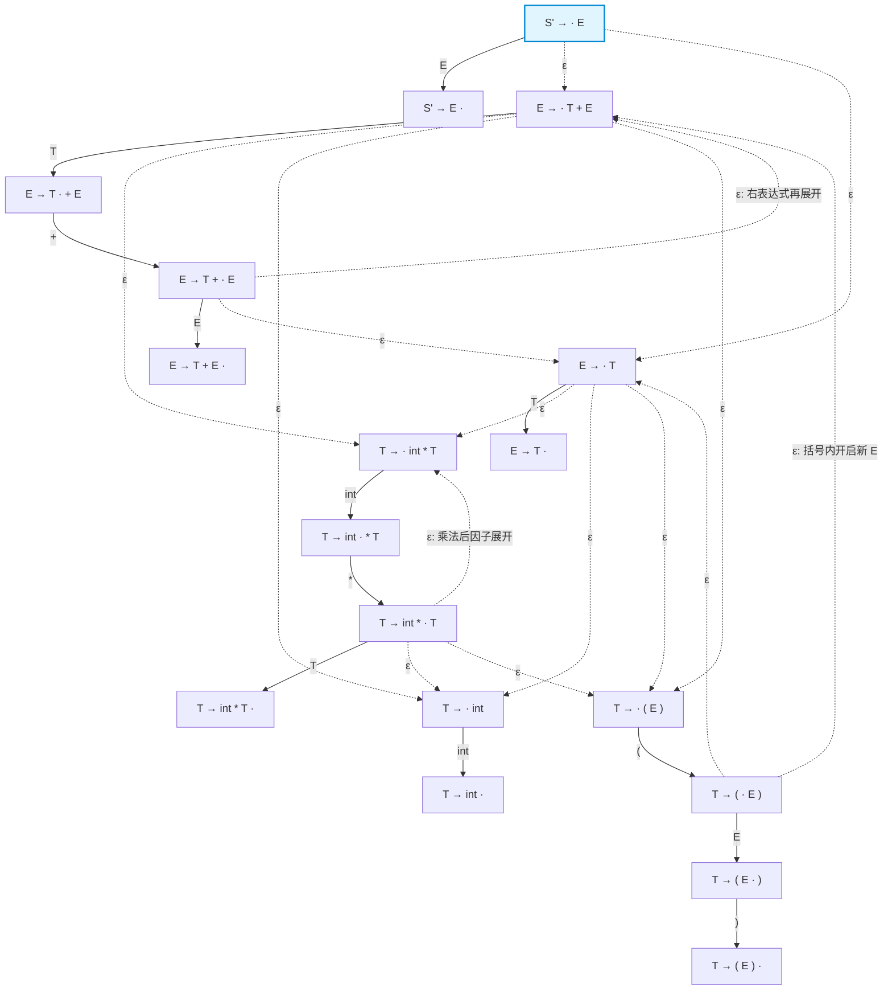

> [!note] 转移数量核对
> 上图补齐了 3 条遗漏的 ε 边。等待 E 的项有 3 个，每个连接 E 的 2 个起始项；等待 T 的项也有 3 个，每个连接 T 的 3 个起始项，共 3 × 2 + 3 × 3 = 15 条 ε 边。符号转移有 12 条，项状态共 18 个。

---

## 16. 运行期实战演练：这台 NFA 如何检验一个具体的分析栈？

假设移进-归约分析器运行到某一时刻，**分析栈中的内容是：`(` `int` `*`**。
请看这台 NFA 是如何一步步检验它的：

1. **起点**：自动机置于起始状态 $S' \to \cdot E$。
2. **零成本意念贯通（走 $\epsilon$ 边）**：
   $$S' \to \cdot E \xrightarrow{\quad \epsilon \quad} E \to \cdot T \xrightarrow{\quad \epsilon \quad} T \to \cdot (E)$$
   （分析器通过 $\epsilon$ 边，瞬间将“等待一个表达式 $E$”贯通到“准备在最左侧吃进一个左括号 `(`”）。
3. **消耗栈中的第 1 个符号 `(`（走实线边）**：
   $$T \to \cdot (E) \xrightarrow{\quad ( \quad} T \to (\cdot E$$
   （成功跨过 `(`，此时已在括号内部，开始等待括号内的子表达式 $E$）。
4. **再次零成本意念贯通（走 $\epsilon$ 边）**：
   $$T \to (\cdot E \xrightarrow{\quad \epsilon \quad} E \to \cdot T \xrightarrow{\quad \epsilon \quad} T \to \cdot \text{int} * T$$
   （分析器再次贯通：括号内的 $E$ 决定由一个乘法项 $T \to \text{int} * T$ 来实现！准备读取它的第一个零件 `int`）。
5. **消耗栈中的第 2 个符号 `int`（走实线边）**：
   $$T \to \cdot \text{int} * T \xrightarrow{\quad \text{int} \quad} T \to \text{int} \cdot * T$$
   （成功识别 `int`，圆点越过它，停在乘号 `*` 之前）。
6. **消耗栈中的第 3 个符号 `*`（走实线边）**：
   $$T \to \text{int} \cdot * T \xrightarrow{\quad * \quad} T \to \text{int} * \cdot T$$
   （成功跨过 `*`，停在状态 $T \to \text{int} * \cdot T$）。
7. **停机判定**：
   栈内所有符号全部消费完毕，NFA 稳稳停留在状态 **$T \to \text{int} * \cdot T$** 上。
   根据**规则 5**（每个状态都是接受状态），自动机判定：**匹配成功！**
   👉 **结论**：`(` `int` `*` 确确实实是一个合法的活前缀，程序语法健康，未发现任何错误！

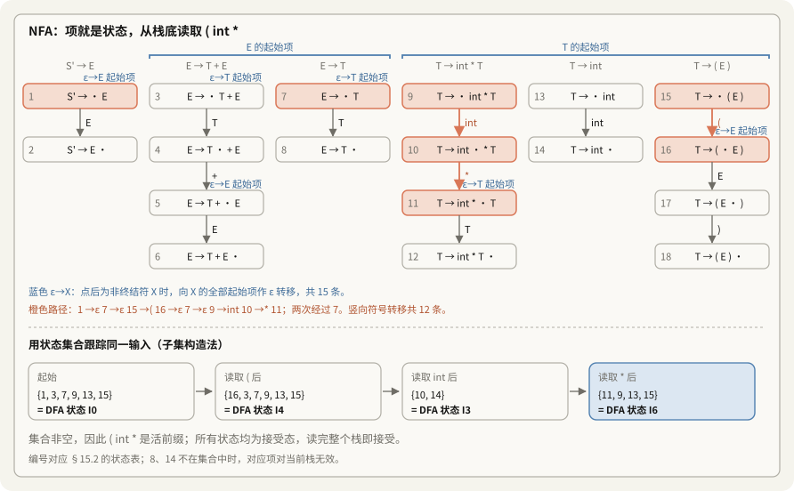

---

## 17. 总结与承上启下：为什么下一步必须由 NFA 转化为 DFA？

通过以上完整的六大规则与实例推导，我们彻底掌握了**活前缀识别器 NFA** 的构建机理。

但是，这台 NFA 存在一个巨大的工程缺陷：
> **它的状态之间充满了大量的 $\epsilon$ 边（非确定性分支）！**
> 在面对一个输入符号时，NFA 可能有好多条路都能走（例如从 $S' \to \cdot E$ 出发既能去 $E \to \cdot T + E$ 又能去 $E \to \cdot T$）。

真实的编译器不可能在运行时去“掷骰子猜哪条路是对的”，也不可能承受无限回溯的性能灾难。

**下一步的必然选择**：
借用自动机理论中极其成熟的**子集构造法（Subset Construction）**：
* 将所有能够通过 $\epsilon$ 边瞬间连通的 LR(0) 项打包合并成一个**项集集合（Item Set）**；
* 每一个项集集合，就构成了 **DFA 的一个确定性单一状态**！
* 由此生成的确定性有限状态自动机，就是编译原理中最负盛名的 **LR(0) 项集族自动机（Canonical Collection of LR(0) Items）**！这也正是我们构建 LR 分析表的终极基石。

---

## 18. 从 NFA 跃迁至 DFA：项集（Item Sets）与子集构造法

上一节构建的 NFA 虽然理论完备，但充斥着大量的 $\epsilon$ 边（非确定性分支）。真实编译器无法在运行时“掷骰子猜路线”。

为了将 NFA 转化为可在工程中直接执行的 **确定性有限状态自动机（DFA）**，编译理论采用了经典的**子集构造法（Subset Construction）**：
> **将所有通过 $\epsilon$ 边能够瞬间连通的 LR(0) 项，全部“打包合并”为一个大集合——项集（Item Set）！每一个项集，就是 DFA 的一个确定性单一状态。**

NFA 经子集构造转换为 DFA：

| 对照项 | NFA 视角 | DFA 视角 |
|---|---|---|
| 单个状态 | 一个 LR(0) 项 | 一组项，即项集 |
| 状态转移 | 符号边与 ε 边 | 确定的符号转移 |
| 运行方式 | 跟踪多个可能状态 | 查表更新当前状态 |

---

### 18.1 破除神秘感：与词法分析（Lexer）子集构造法的 1 对 1 镜像对齐

如果你在词法分析阶段学过 **NFA 转 DFA 的子集构造法（$\epsilon$-闭包、构建状态转换表 $D_0 \to D_n$）**，那么恭喜你：
> **语法分析里的这一步，在底层算法上和你之前学的手算词法 DFA 100% 完全一样！**
> 它只是“换了一身衣服”：把原本代表正则位置的小圆圈数字，换成了带圆点的文法项。

让我们做一次一目了然的 **1 对 1 镜像对照**：

| 维度对比                   | 词法分析（Lexer 子集构造法）                                       | 语法分析（LR(0) 项集 DFA）                                               | 本质对齐说明                                          |
| ---------------------- | ------------------------------------------------------- | ---------------------------------------------------------------- | ----------------------------------------------- |
| **NFA 的单个状态**          | 正则表达式衍生出的小圆圈节点（如状态 0, 1, 2...）                          | 带圆点的产生式（LR(0) 项，如 $E \to \cdot T$）                               | 只是状态的名字变长了，本质都是一个 NFA 节点！                       |
| **初始状态 $D_0$ / $I_0$** | 从 NFA 起点出发，沿 $\epsilon$ 边能到达的全部状态集合（$\epsilon$-closure） | 从 $S' \to \cdot E$ 出发，圆点后是非终结符就沿 $\epsilon$ 边拉进其所有产生式初态（CLOSURE） | **完全是一模一样的 $\epsilon$-闭包计算！** 打包出来的第一个集合就是初始状态。 |
| **输入字母表（Alphabet）**    | 源代码中的纯字符（如 `a`、`0-9`、`+`）                               | **终结符 Token**（`int`、`+`） + **非终结符**（$E$、$T$）                     | 语法分析的字母表变大了，非终结符也可以当做一种转移符号！                    |
| **推进并生成新状态**           | 看看 $D_0$ 里谁有字符 `a` 的出边，走过去后重新算闭包。若是新集合，命名为 $D_1$ 并记入转换表 | 看看 $I_0$ 里谁圆点后是符号 $X$，圆点右移一位后重新算闭包。若是新集合，命名为 $I_1$ 并记入转换表        | **完全是一模一样的状态扩展与填表逻辑！** 没见过的集合就建新编号。             |
| **转换表产物**              | 词法分析 DFA 转移表（判断接收哪类 Token）                              | **LR 分析表**（吃终结符是 **ACTION 表**，吃非终结符是 **GOTO 表**）                 | 两者产物都是状态机转移矩阵。                                  |
| **DFA 的工作对象**          | 顺着源文件字符流一路向右扫描                                          | **给当前的分析栈“拍 X 光片”**                                              | 监控分析栈里的符号串是否是一个合法的活前缀。                          |

---

### 18.2 通俗心智模型：为什么要把一堆规则打包进一个框框？

* **单打独斗的 NFA 为什么走不通？**
  上一节的 NFA 就像一个极度犹豫不决的人：每看到一个符号，心里就开始掷骰子猜路线，一旦猜错就得大量回溯，效率极低。
* **项集大框框（DFA）的本质：超市愿望清单！**
  > **超市购物比喻**：
  > 刚进超市大门时，你脑子里不是只想着一件东西，而是揣着一张**愿望清单（一个大框框）**：
  > * “我可能要买苹果”
  > * “我也可能要买香蕉”
  > * “我还可能要买牛奶”
  > 
  > 只要你走进了“水果区”（相当于输入了一个具体的符号），你的清单就**瞬间、确定性地更新**为：
  > * “买苹果”
  > * “买香蕉”
  > （牛奶被自动划掉了，绝不纠结）

每个大框框（项集），就是分析器在当前那一瞬间**所有可能发生的合法剧本清单**！输入一个符号，整张清单就确定性地翻到下一页。

---

### 18.3 核心算法：闭包（CLOSURE）计算

把一个或多个“核心项”扩展为一个完整项集的操作，称为**求闭包（CLOSURE）**：

1. **种子项入集**：将初始项加入项集 $I$；
2. **递归展开 $\epsilon$**：如果项 $A \to \alpha \cdot X \beta$ 属于项集 $I$，且 $X$ 是非终结符，那么对于文法中 $X$ 的**所有产生式** $X \to \gamma$，都将初始项 $X \to \cdot \gamma$ 加入 $I$；
3. **循环直至不动点**：重复第 2 步，直到没有新的项可以加入为止。

#### 实例推导：DFA 初始状态（状态 0）的生成
以算术表达式文法为例：
$$
\begin{aligned}
S' &\to E \\
E &\to T + E \mid T \\
T &\to \text{int} * T \mid \text{int} \mid (E)
\end{aligned}
$$

1. **初始种子**：从增广产生式的初态开始：
   $$S' \to \cdot E$$
2. **展开 $E$ 的产生式**（因为圆点后面是非终结符 $E$）：
   引入 $E \to \cdot T + E$ 与 $E \to \cdot T$；
3. **展开 $T$ 的产生式**（因为新加入项的圆点后面是非终结符 $T$）：
   引入 $T \to \cdot \text{int} * T$、$T \to \cdot \text{int}$、$T \to \cdot (E)$；
4. **闭包完成**：圆点后紧跟的符号要么是终结符（`int`、`(`），要么已无新规则可展开。

最终，**DFA 初始状态（状态 0）** 包含如下 6 个项构成的项集：

```text
┌──────────────────────────────┐
│ 状态 0 (I₀)                  │
├──────────────────────────────┤
│ S' -> . E                    │
│ E  -> . T + E                │
│ E  -> . T                    │
│ T  -> . int * T              │
│ T  -> . int                  │
│ T  -> . ( E )                │
└──────────────────────────────┘
```

> **物理意义**：刚开局时栈为空，分析器表面上是在期待起始符号 $E$，但在物理底层，它**同时且确定地准备好了**迎接加法、乘法、括号表达式以及基本整数 `int`！这 6 种潜在可能被统一封装进了一个确定性状态中。

---

### 18.4 核心算法：状态转移（GOTO）计算

从一个项集 $I$ 出发，面临栈顶输入的符号 $X$（终结符或非终结符），跳转到的下一个项集 $\text{GOTO}(I, X)$ 计算规则极度机械直观：
1. **圆点后移**：在项集 $I$ 中筛选出所有“圆点后紧跟 $X$”的项（形如 $A \to \alpha \cdot X \beta$），将圆点跨过 $X$ 向右移动一位，得到 $A \to \alpha X \cdot \beta$；
2. **再次求闭包**：对上述生成的所有新项集合，调用 $\text{CLOSURE}$ 操作，得到目标 DFA 状态。

#### 状态推进实例：
* **在状态 0 面临符号 `int`**：
  状态 0 中只有两条规则期待 `int`：
  - $T \to \cdot \text{int} * T$
  - $T \to \cdot \text{int}$
  圆点跨过 `int` 后移，得到核心项 $\{ T \to \text{int} \cdot * T, \; T \to \text{int} \cdot \}$。由于圆点后分别是 `*` 和末尾，无需额外闭包展开。该项集成为一个新 DFA 状态！
* **在状态 0 面临符号 `(`**：
  只有 $T \to \cdot (E)$ 期待左括号。圆点后移得到 $T \to (\cdot E)$。由于圆点后是 $E$，再次触发闭包，将 $E$ 与 $T$ 的所有初态全部吸纳进来，形成括号内部的新 DFA 状态！

---

### 18.5 完整的项集 DFA 架构拓扑图

将上述文法的所有项集及转移计算完毕，即可得到彻底消除 $\epsilon$ 边的确定性有限状态自动机：

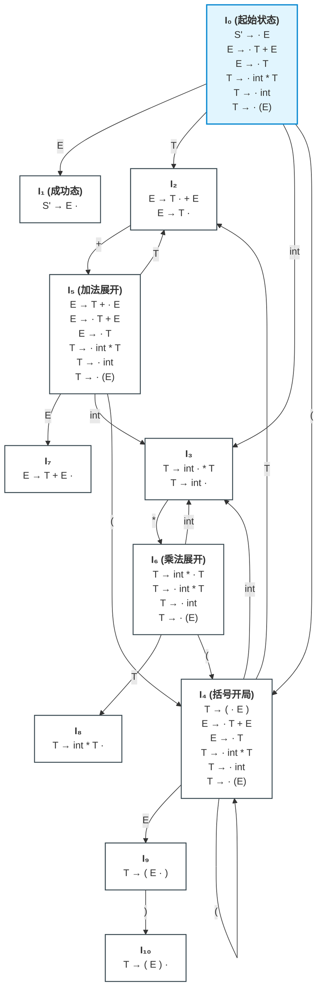

> **全景特征**：整张图中**不存在任何一条 $\epsilon$ 边**！所有的有向边均严格对应一个确切的终结符或非终结符。

---

## 19. 理论基石：形式化定义——什么是“有效项（Valid Item）”？

在掌握了 DFA 的构建后，编译理论给出了一个极为深刻且严密的数学概念：**有效项（Valid Item）**。

```text
Item X -> β.γ is valid for a viable prefix αβ if
    S' =>* αXω => αβγω
by a right-most derivation

After parsing αβ, the valid items are the possible tops of the stack of items
```

许多同学初看这个希腊字母公式时容易感到晦涩。我们将其逐个符号还原到分析现场：

### 19.1 公式符号的物理现场还原

$$S' \Longrightarrow_{\text{rm}}^* \alpha X \omega \Longrightarrow_{\text{rm}} \alpha \beta \gamma \omega$$

* **$\alpha\beta$（分析栈内容 / 活前缀）**：
  此时此刻，移进-归约分析器栈内实际躺着的符号串就是 $\alpha\beta$。其中 $\beta$ 正好位于**栈顶**。
* **$\omega$（未读输入 Tokens）**：
  右侧输入流中尚未读进来的纯终结符串。
* **$S' \Longrightarrow_{\text{rm}}^* \alpha X \omega \Longrightarrow_{\text{rm}} \alpha \beta \gamma \omega$（全局推导树）**：
  在文法正向的“最右推导树”中，曾经发生过一步推导：将最右侧的非终结符 $X$ 按照产生式 $X \to \beta\gamma$ 展开为了 $\beta\gamma$。

### 19.2 有效项的精确语义

观察展开后的产生式 $X \to \beta\gamma$：
* **前驱部分 $\beta$**：已经通过之前的移进和归约，**安全无误地躺在了当前的栈顶**；
* **后继部分 $\gamma$**：是紧接着**期望从剩余输入流 $\omega$ 中逐步读取并拼装的符号**。

因此，带圆点的项：
$$X \to \beta \cdot \gamma$$
精确地切中了当前分析现场的脉搏！
文法理论正式宣布：**项 $X \to \beta \cdot \gamma$ 对当前栈中的活前缀 $\alpha\beta$ 是“有效（Valid）”的！**

> [!important] 通俗心智模型：有效项 = “侦探办案与靠谱猜测”
> 抛开所有希腊字母，“有效项”翻译成人话就是：**“合乎文法常理的靠谱猜测！”**
> 
> * **侦探办案比喻**：
>   你在案发现场地面上看到了一截**烟头**（相当于**当前栈里的符号串**）：
>   * **靠谱猜想 A**：“嫌疑人可能抽烟，去翻翻垃圾桶可能还有烟盒”（合情合理，这就是**有效项**！）；
>   * **离谱猜想 B**：“这可能是外星人飞船掉下来的零件”（胡说八道，不是有效项）。
> 
> 在语法分析中：
> 栈里当前是 `1 +`，靠谱的猜测（有效项）就是：“后面该来一个数字或嵌套表达式了（$E \to T + \cdot E$）”；
> 如果有人猜：“后面该来一个 `while` 关键字了”，这就是离谱猜测，文法中根本不存在这样的推导树。
> **有效项，就是有完整语法树推导为它背书的、名正言顺的合法推导分支！**

---

## 20. 理论与工程的伟大结合：DFA 状态与有效项集合的等价性

图 2 的有效项定义虽然优雅严谨，但留出了一个巨大的工程鸿沟：
*在实际编译执行时，分析器每压入一个字符，总不可能停下来去遍历推导所有的最右推导树来检验一个项是不是 Valid 吧？*

CS143 课件展示了一条贯通理论与工程的伟大桥梁定理：

```text
An item I is valid for a viable prefix α if the DFA recognizing viable prefixes terminates on input α in a state s containing I.

The items in s describe what the top of the item stack might be after reading input α.
```

### 20.1 桥梁定理（理论与工程的完全等价）

> [!important] 等价性核心定理
> **一个项 $I$ 对活前缀 $\alpha$ 是有效的，当且仅当：**
> **将活前缀 $\alpha$ 喂给识别活前缀的 DFA 时，DFA 停在的那个状态集合 $s$ 中，恰好包含该项 $I$！**

也就是说：
* **数学视角**：所有对 $\alpha$ 具备合法最右推导树背书的项的集合；
* **工程视角**：把 $\alpha$ 喂给 DFA，DFA 停在状态 $s$，框框里所列出的所有项的集合。

**二者在数学上是严格等价的（分毫不差）！**

### 20.2 为什么说这是编译器的工程福音？（开挂的小抄秘籍）

* **理论家的笨办法**：
  理论家每次都要停下分析器，去把文法从头到尾排查一遍，画一棵巨大的语法树来推断下一步合法的猜测有哪些（耗时且会卡死）。
* **工程大师的“小抄秘籍”**：
  有了桥梁定理，**所有的靠谱猜测，早就提前打包印在图 18.3 的大框框里了！**
  编译器在运行时：
  1. 根本不需要动脑去推理语法树；
  2. 栈顶只记录一个**数字（状态号）**；
  3. 输入新符号时，直接做一次 $O(1)$ 的查表跳转（类似于查字典）；
  4. **停在状态 $s$，低头看一眼该框框里的项集“小抄”，立马就知道当前所有合法的移进与归约决策！**

---

## 21. 深刻特性：一个项对无穷多个前缀有效（递归与嵌套的本质）

课件最后一页揭示了一个发人深省的现象：

```text
• An item is often valid for many prefixes
• Example: The item T -> (.E) is valid for prefixes
  (
  ((
  (((
  ((((
  ...
```

*“为什么同一个项 $T \to (\cdot E)$，能够同时对 `(`、`((`、`(((`、`((((`……无穷多个活前缀都是有效的？”*

### 21.1 自动机视角的解释：状态图上的环路（Loop）

观察图 18.3 的 DFA 状态图：
* 状态 $I_4$ 包含项 $T \to (\cdot E)$；
* 仔细观察状态 $I_4$ 的出边：**有一条由左括号 `(` 引导的有向转移边，绕了一圈后又指回了 $I_4$ 自身！**

因此：
* 输入 1 个 `(`：DFA 从 $I_0 \xrightarrow{\quad(\quad} I_4$，停在 $I_4$（项有效）；
* 输入 2 个 `(`：DFA 从 $I_0 \xrightarrow{\quad(\quad} I_4 \xrightarrow{\quad(\quad} I_4$，依然停在 $I_4$（项依然有效）；
* 输入 100 个 `(`：DFA 沿着环路自旋 99 次，依然稳稳停在 $I_4$！

### 21.2 语言学视角的解释：剥洋葱与俄罗斯套娃（心智状态的跨层复用）

> **剥洋葱 / 俄罗斯套娃比喻**：
> * 剥开第 1 层洋葱，你说：“里面还有一层”；
> * 剥开第 2 层洋葱，你还说：“里面还有一层”；
> * 剥开第 100 层洋葱，你说的依然是：“里面还有一层”！

在写代码时：
* 遇到一个 `(`，分析器的心态是：“看到了左括号，我在等待里面的子表达式 $E$”；
* 程序员丧心病狂地写了 100 个嵌套左括号 `((((...`，分析器在吃到第 100 个括号时，**它的心智状态和吃第 1 个括号时完全没有任何区别！** 依然是：“看到了左括号，我在等待里面的子表达式 $E$”。

有限状态自动机（DFA）的状态总数虽然只有十几个，但借助**有向环路（Loop）**，它成功实现了心智状态的无限复用，用极简的机器完美驾驭了无限深度的程序嵌套语法！

---

## 22. 从自动机到实际决策：LR(0) 分析器的执行准则

在构造出了项集 DFA（每个大框框代表一个确定性的状态）之后，分析器在运行期到底该如何根据这些大框框，决定何时**移进（Shift）**、何时**归约（Reduce）**？

```text
栈内容 α                 下一个输入 token t
    |
    | 将 α 交给 DFA M
    v
到达状态 s：包含当前活前缀的有效项
    |
    v
结合项与向前看符号，判断后续动作
```

LR(0) 给出了最天真、最直观的决策模型：

```text
• LR(0) Parsing: Assume
  - stack contains α
  - next input is t
  - DFA on input α terminates in state s

• Reduce by X -> β if
  - s contains item X -> β.

• Shift if
  - s contains item X -> β.tω
  - equivalent to saying s has a transition labeled t
```

### 22.1 归约准则（Reduce）
* **触发条件**：当前状态框框 $s$ 中，只要存在任何一个圆点走到最末尾的项（形如 $X \to \beta \cdot$）；
* **动作逻辑**：产生式右部零件 $\beta$ 已经全部在栈顶集齐，**二话不说，立即执行归约**！将栈顶的 $\beta$ 弹出，压入左部非终结符 $X$。

### 22.2 移进准则（Shift）
* **触发条件**：当前状态框框 $s$ 中，存在某个项的圆点后面紧挨着下一个输入的终结符 $t$（形如 $X \to \beta \cdot t \omega$）；
* **动作逻辑**：这意味着状态框框 $s$ 存在一条标号为 $t$ 的有向出边。分析器**果断移进**，将输入流中的 $t$ 读取并压入栈顶，自动机顺着边跳到下一个新状态。

---

## 23. LR(0) 的致命死穴：两类冲突（Conflicts）与现实打脸

LR(0) 名字里的 `(0)` 意味着：**它在做决策时“向前看 0 个字符”，完全不顾未来的输入流，只凭当前框框里的清单就做决定**。这种短视策略导致它在实际运行中立刻陷入了严重的“选择困难症”——**冲突（Conflicts）**。

```text
• LR(0) has a reduce/reduce conflict if:
  - Any state has two reduce items:
    X -> β.  and  Y -> ω.

• LR(0) has a shift/reduce conflict if:
  - Any state has a reduce item and a shift item:
    X -> β.  and  Y -> ω.tδ
```

### 23.1 归约-归约冲突（Reduce/Reduce Conflict）
* **翻车现场**：同一个框框内，同时出现了两个圆点都在末尾的成熟项：
  $$\{ X \to \beta \cdot, \quad Y \to \omega \cdot \}$$
* **心理困境**：两套产生式的右部都在栈顶拼装完毕了，分析器根本不知道到底应该把栈顶折叠成 $X$，还是折叠成 $Y$！

### 23.2 移进-归约冲突（Shift/Reduce Conflict）
* **翻车现场**：同一个框框内，既有一条规则想归约，又有一条规则想移进：
  $$\{ X \to \beta \cdot, \quad Y \to \omega \cdot t \delta \}$$
* **心理困境**：一条规则喊着“已经到头了，快归约！”，另一条规则喊着“别急，后面还有 $t$，快移进！”。分析器左右为难，不知该动手折叠还是继续吃入字符。

### 23.3 经典打脸实录：我们手算的 DFA 里就存在冲突！

回顾我们在 **§18.3** 中精心推导出的算术表达式 DFA，Alex Aiken 教授直接指出了其中的两处冲突：

#### 冲突一：状态 $I_2$ 的移进-归约冲突
```text
┌──────────────────────────────┐
│ 状态 2 (I2)                  │
├──────────────────────────────┤
│ E -> T .                     │
│ E -> T . + E                 │
└──────────────────────────────┘

第一项：归约候选，将 T 归约为 E。
第二项：移进候选，等待 +。
```
当栈顶是 $T$，右侧输入流恰好是加号 `+` 时，分析器直接死锁：到底是把 $T$ 归约成 $E$，还是把 `+` 移进栈里继续算加法？

#### 冲突二：状态 $I_3$ 的移进-归约冲突
```text
┌──────────────────────────────┐
│ 状态 3 (I3)                  │
├──────────────────────────────┤
│ T -> int .                   │
│ T -> int . * T               │
└──────────────────────────────┘

第一项：归约候选，将 int 归约为 T。
第二项：移进候选，等待 *。
```
当栈顶是 `int`，右侧输入流是乘号 `*` 时，分析器同样不知所措：是立刻归约成 $T$，还是移进 `*` 去算乘法？

> [!warning] 残酷的编译学事实
> 纯粹的 LR(0) 分析器能力极其低下，**现实世界中几乎没有任何一门通用编程语言能够直接使用纯 LR(0) 完成解析**！

---

## 24. 救世主登场：SLR(1) 分析器与 Follow 集破局法

为了打破 LR(0) 的困局，计算机科学家提出了改良版：**SLR（Simple LR，简单 LR）**。

```text
• SLR = "Simple LR"
• SLR improves on LR(0) shift/reduce heuristics
  - Fewer states have conflicts
```

### 24.1 SLR 的核心哲学：“偷偷往右瞄一眼”（Lookahead 1 token）

SLR 保持 DFA 状态图（框框与连线）完全不变，只改变决策逻辑：
> **“别光盯着栈顶，偷偷往右瞄一眼下一个输入的 Token $t$ 是什么，并借助非终结符的 $\text{Follow}$ 集来断案！”**

```text
• Idea: Assume
  - stack contains α
  - next input is t
  - DFA on input α terminates in state s

• Reduce by X -> β if
  - s contains item X -> β.
  - t ∈ Follow(X)

• Shift if
  - s contains item X -> β.tω
```

### 24.2 约束法则：为什么看 $\text{Follow}(X)$？
假设框框里有一个成熟项 $X \to \beta \cdot$。
SLR 会在动手前做一次合法性验证：
* 如果把栈顶的 $\beta$ 归约成了 $X$；
* 那么紧挨在 $X$ 身后的下一个输入字符 $t$，**在语法上必须能够合法地出现在 $X$ 的后面**！
* 谁能合法出现在 $X$ 后面？**这就是我们在 LL(1) 阶段学过的 $\text{Follow}(X)$！**
* **裁决准则**：
  * **当且仅当下一个输入的 Token $t \in \text{Follow}(X)$ 时，才准许归约！**
  * 若 $t \notin \text{Follow}(X)$，说明就算现在归约成 $X$，后续也必然语法错误，因此**坚决禁止归约**！

> [!note] Follow 为什么可能过宽
> 考虑 $S \to L = R \mid R$、$L \to *R \mid \text{id}$、$R \to L$。全局 Follow(R) 包含 `=`，但在状态 $\{S \to L\cdot = R,\ R \to L\cdot\}$ 中，归约得到的 R 是整个句子的 R，后面只能接输入结束符。SLR 仍在 `=` 列填入归约，与移进冲突；LR(1) 的对应完成项只携带 `$`，因此避免了这个冲突。

---

### 24.3 实战断案：Follow 集现场秒杀两个冲突

计算文法的 Follow 集：
$$
\begin{aligned}
\text{Follow}(E) &= \{ \$, \; ) \} \\
\text{Follow}(T) &= \{ \$, \; ), \; + \}
\end{aligned}
$$

#### 1. 化解状态 $I_2$ 的冲突
* **归约项 $E \to T \cdot$**：归约后变成 $E$，要求下一个字符 $t \in \text{Follow}(E) = \{ \$, \; ) \}$；
* **移进项 $E \to T \cdot + E$**：期待的下一个字符是 $\{ + \}$；
* **裁决**：
  $$\text{Follow}(E) \cap \{ + \} = \{ \$, \; ) \} \cap \{ + \} = \emptyset$$
  **交集为空！两个派别的触发条件完全错开！**
  * 如果下一个 Token 是 `+` $\implies$ **果断移进，绝不归约**；
  * 如果下一个 Token 是 `$` 或 `)` $\implies$ **果断归约，绝不移进**；
  * **冲突彻底消除！**

#### 2. 化解状态 $I_3$ 的冲突
* **归约项 $T \to \text{int} \cdot$**：归约后变成 $T$，要求下一个字符 $t \in \text{Follow}(T) = \{ \$, \; ), \; + \}$；
* **移进项 $T \to \text{int} \cdot * T$**：期待的下一个字符是 $\{ * \}$；
* **裁决**：
  $$\text{Follow}(T) \cap \{ * \} = \{ \$, \; ), \; + \} \cap \{ * \} = \emptyset$$
  **交集依然为空！**
  * 下一个是 `*` 就移进；下一个是 `$`、`)`、`+` 就归约；
  * **冲突再次被完美化解！**

> [!important] 结论
> 借助向前看 1 个符号的 $\text{Follow}$ 集，原本的所有冲突全部消失，**该文法被正式证实为标准的 SLR(1) 文法！**

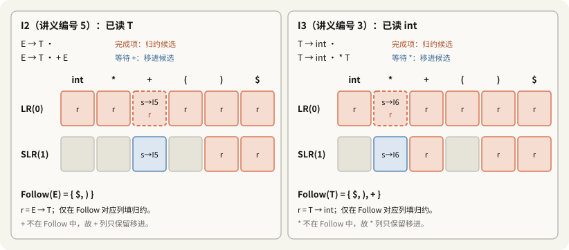

---

## 25. 二义性文法与 SLR 的局限性：优先级声明的本质

```text
• Lots of grammars aren't SLR
  - including all ambiguous grammars
• We can parse more grammars by using precedence declarations
  - Instructions for resolving conflicts
```

虽然 SLR 解决了很多问题，但它依然有其局限：**任何包含二义性的文法（Ambiguous Grammars），都绝对不可能属于 SLR 文法**。

### 25.1 经典二义性算术文法翻车
考虑极其紧凑但具有二义性的表达式文法：
$$E \to E + E \mid E * E \mid (E) \mid \text{int}$$

构造其 DFA，必然会出现如下状态：
$$\{ E \to E * E \cdot, \quad E \to E \cdot + E \}$$
此时栈顶是已经识别好的乘法 $E * E$，而右侧输入流送来一个加号 `+`。

* **为什么 SLR 在这里失灵了？**
  因为文法是二义性的，加法和乘法可以任意嵌套，$E$ 后面既可能合法地出现 `+`，也可能合法地出现 `*`。
  计算得出 $\text{Follow}(E) = \{ \$, \; +, \; *, \; ) \}$！
  $\text{Follow}(E)$ 包含了移进符号 `+`，**交集不再为空，SLR 再次陷入移进-归约冲突！**

### 25.2 优先级声明（Precedence Declarations）的介入

既然算法本身无法自动消除歧义，工程上就采用人工规则强行干预：
> **声明：“`*` 的优先级高于 `+`！”**

有了这条优先级指令，分析器在面临上述冲突时立刻有了裁决依据：
* 栈顶是乘法（较高优先级），输入流是加法（较低优先级）；
* 高优先级必须先计算，因此**强制选择归约（in favor of reducing）**！把栈顶的 $E * E$ 优先折叠成 $E$。

同一运算符的冲突还要看结合方向：`E + E` 后遇 `+`，以及 `E * E` 后遇 `*`，左结合选择归约，右结合选择移进。因此只声明乘法优先于加法，还不足以决定这两类冲突。

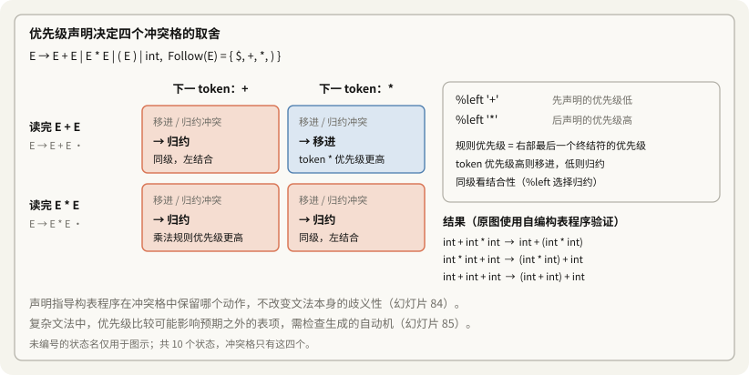

### 25.3 核心反思：“优先级声明”是个误导性术语

```text
• The term "precedence declaration" is misleading
• These declarations do not define precedence; they define conflict resolutions
  - Not quite the same thing!
```

Alex Aiken 教授特别提醒大家破除迷思：
* **初学者误区**：以为优先级声明是在文法层面上重构了数学逻辑；
* **底层真相**：**它根本不是在定义优先级，它只是在给分析器硬编码一条“冲突解决补丁（Conflict Resolution）”！**
  它只是在暴力地告诉分析表生成器：*“如果在这个状态下遇到 `+`，别犹豫，把 Action 表里这一格强制填上 Reduce，覆盖掉 Shift！”*

---

## 26. 终极大决战：SLR(1) 语法分析完整算法流水线

```text
1. Let M be DFA for viable prefixes of G
2. Let | x₁...xₙ$ be initial configuration
3. Repeat until configuration is S | $
   • Let α | ω be current configuration
   • Run M on current stack α
   • If M rejects α, report parsing error
     - Stack α is not a viable prefix
   • If M accepts α with items I, let a be next input
     - Shift if X -> β.aγ ∈ I
     - Reduce if X -> β. ∈ I and a ∈ Follow(X)
     - Report parsing error if neither applies
```

### 26.1 完整执行大循环

1. **初始配置**：栈为空 $\mid$ 剩余输入为源代码字符串加上终止符 $x_1 x_2 \dots x_n \$$；
2. **大循环持续运行，直到栈内为 $S \mid \$$（成功接收）**：
   * 将当前栈内符号串 $\alpha$ 喂给活前缀识别 DFA $M$，停在状态项集 $I$；
   * 读取下一个输入符号 $a$：
     * **分支 1（移进 Shift）**：如果 $I$ 包含 $X \to \beta \cdot a \gamma$，将 $a$ 移入栈顶；
     * **分支 2（归约 Reduce）**：如果 $I$ 包含成熟项 $X \to \beta \cdot$，**且 $a \in \text{Follow}(X)$**，将栈顶 $\beta$ 归约替换为 $X$；
     * **分支 3（报错 Syntax Error）**：若既不能移进也不能归约，当场报告语法错误！

---

### 26.2 关键理论洞察：为什么算法中的“M rejects α”在实际中从不需要检查？

仔细看课件伪代码中的这一行：
```text
• Run M on current stack α
• If M rejects α, report parsing error (Stack α is not a viable prefix)
```

> [!important] 教师核心提示：错误检查在这里是多余的（M 总是会接受栈）！
> **在实际编译器运行中，“If M rejects $\alpha$” 这一段逻辑是永远不会被触发的！**
> 
> * **为什么？**
>   因为自底向上分析器的**不变性（Invariant）**被前置防御死死守住：
>   只有在前一步确定了合法的 Shift 或 Reduce 时，分析器才会把符号压入栈。换句话说，**栈里的符号串 $\alpha$ 在压入的那一刻，就已经被保证了 100% 是文法的活前缀！**
>   因此，只要之前的步骤没有报错，当前的 $\alpha$ 喂给 DFA $M$ 时，**$M$ 必然会走到一个合法的状态框框并 Accept 栈，绝不可能发生中途卡死（Reject）！**
> 
> * **真正的语法错误发生在何时？**
>   真正的语法错误（Syntax Error）发生在下一步：
>   **$M$ 稳稳接受了栈 $\alpha$ 并停在状态 $I$，但面对接下来的输入符号 $a$，状态 $I$ 既无法移进 $a$，也无法按任何 $X \to \beta$（且 $a \in \text{Follow}(X)$）进行归约！**
>   只有在“既不能 Shift 又不能 Reduce”的绝境时刻，编译器才当场拦截报错！

---

### 26.3 SLR(k) 概括与工程实践（$k = 1$ 的绝对霸权）

```text
• If there is a conflict in the last step, grammar is not SLR(k)
• k is the amount of lookahead
  - In practice k = 1
```

* **SLR(k) 的定义**：向前看 $k$ 个符号来辅助判定归约条件。如果向前看 $k$ 个符号后依然存在冲突，则该文法不属于 SLR(k)；
* **工程常态**：在几乎所有现代编译器和分析工具（如 Yacc、Bison）中，**$k$ 永远取 1（即 SLR(1)）**。因为向前看 2 个或更多符号会导致状态分析表的大小呈指数级膨胀，而在实践中，增加优先级声明或改用 LALR(1) 就能完美解决绝大多数工程语法问题。

---

## 27. 实战全流程回放：SLR 分析器解析 `int * int $`（DFA 编号与慢动作模拟）

在学习了 SLR(1) 的理论与算法伪代码后，我们通过一个具体的算术表达式 `int * int $`，完整走一遍分析器在运行期的**慢动作回放（Slow Motion）**，彻底看清分析栈、DFA 状态和 Follow 集是如何协同工作的！

### 27.1 准备工作：DFA 状态编号与字典速查

Alex Aiken 教授将此前推导的项集 DFA 框框赋予了具体的数字编号（状态 1 ~ 11）：

* **Follow 集字典**：
  * $\text{Follow}(E) = \{ \$, \; ) \}$
  * $\text{Follow}(T) = \{ \$, \; ), \; + \}$
* **核心状态编号与项集映射**：
  * **状态 1（初始状态）**：包含 $S' \to \cdot E$ 以及展开的 $E$、$T$ 的所有初态（等待输入 `int` 或 `(`）；
  * **状态 2（成功态）**：包含 $S' \to E \cdot$（遇 `$` 即宣告 ACCEPT）；
  * **状态 3**：$\{ T \to \text{int} \cdot * T, \quad T \to \text{int} \cdot \}$（刚读入 `int`，潜在的移进-归约冲突态）；
  * **状态 4**：$\{ T \to \text{int} * T \cdot \}$（乘法全部零件集齐，成熟归约态）；
  * **状态 5**：$\{ E \to T \cdot, \quad E \to T \cdot + E \}$（刚识别出非终结符 $T$，潜在的移进-归约冲突态）；
  * **状态 6**：包含 $E \to T + \cdot E$ 及其闭包展开（加号后半部）；
  * **状态 7**：$\{ E \to T + E \cdot \}$（加法全部到齐成熟态）；
  * **状态 8**：包含 $T \to (\cdot E)$ 及其闭包展开（括号内部初态）；
  * **状态 9**：包含 $T \to (E \cdot)$（等待右括号）；
  * **状态 10**：包含 $T \to (E)\cdot$（括号产生式完成）；
  * **状态 11**：包含 $T \to \text{int} * \cdot T$ 及其闭包展开（乘号后半部）。

两套状态编号的对应关系如下，读图或查表时不要混用：

| §18.5 项集编号 | I0 | I1 | I2 | I3 | I4 | I5 | I6 | I7 | I8 | I9 | I10 |
|---|---|---|---|---|---|---|---|---|---|---|---|
| 讲义编号 | 1 | 2 | 5 | 3 | 8 | 6 | 11 | 7 | 4 | 9 | 10 |

---

### 27.2 全流程跟踪表（Execution Trace）

待分析句子为：`int * int $`。竖线 `|` 的左侧为**当前分析栈**，右侧为**未读输入流**：

| 步骤 | 当前配置（栈 $\mid$ 剩余输入） | DFA 停机状态 | 状态内核验与 Follow 集判定 | 裁决执行动作（Action） |
|---|---|---|---|---|
| **Step 1** | $\mid \text{int} * \text{int} \ \$$ | **状态 1** | 状态 1 中有项期待 `int` | **Shift**（将 `int` 移进栈） |
| **Step 2** | $\text{int} \mid * \text{int} \ \$$ | **状态 3** | 输入是 `*`，而 **$* \notin \text{Follow}(T)$**，禁止归约！ | **Shift**（将 `*` 移进栈） |
| **Step 3** | $\text{int} * \mid \text{int} \ \$$ | **状态 11** | 状态 11 中有项期待 `int` | **Shift**（将 `int` 移进栈） |
| **Step 4** | $\text{int} * \text{int} \mid \$$ | **状态 3** | 输入是 `$`，且 **$\$ \in \text{Follow}(T)$**，允许归约！ | **Reduce by $T \to \text{int}$** |
| **Step 5** | $\text{int} * T \mid \$$ | **状态 4** | 乘法到头，且 **$\$ \in \text{Follow}(T)$** | **Reduce by $T \to \text{int} * T$** |
| **Step 6** | $T \mid \$$ | **状态 5** | 输入是 `$`，且 **$\$ \in \text{Follow}(E)$**，允许归约！ | **Reduce by $E \to T$** |
| **Step 7** | $E \mid \$$ | **状态 2** | 栈顶为起始符号 $E$，输入为终止符 `$` | **ACCEPT（分析圆满成功！）🎉** |

---

### 27.3 慢动作逐步深度复盘

#### 第 1 步：空栈开局
* **配置**：$\mid \text{int} * \text{int} \ \$$
* **DFA 跑栈**：空栈，停留在 **状态 1**；
* **查阅决策**：状态 1 里的规则期待吃到第一个 `int`，输入流正是 `int`，果断执行 **Shift**。

#### 第 2 步：遭遇第一个移进-归约冲突（SLR 经典破局）
* **配置**：$\text{int} \mid * \text{int} \ \$$
* **DFA 跑栈**：从状态 1 吃进 `int`，转移停留在 **状态 3**；
* **状态 3 的冲突现状**：
  * 归约派：$T \to \text{int} \cdot$（想把 `int` 归约成 $T$）；
  * 移进派：$T \to \text{int} \cdot * T$（想移进乘号 `*`）。
* **SLR 判定**：
  * 下一个输入的 Token 是 **`*`**；
  * 如果执行归约，要求 `*` 必须属于 $\text{Follow}(T) = \{ \$, \; ), \; + \}$；
  * **现场核验：$* \notin \text{Follow}(T)$！**
  * **裁决：坚决禁止归约！唯一的生路就是移进乘号！** 执行 **Shift**。

#### 第 3 步：吃入操作符 `*`
* **配置**：$\text{int} * \mid \text{int} \ \$$
* **DFA 跑栈**：从状态 1 走 `int` 到 3，再走 `*`，停留在 **状态 11**；
* **查阅决策**：状态 11 正在等待右侧因子 `int`，输入流正好是 `int`，果断执行 **Shift**。

#### 第 4 步：第二个 `int` 到位，触发安全归约
* **配置**：$\text{int} * \text{int} \mid \$$
* **DFA 跑栈**：路径 $1 \xrightarrow{\text{int}} 3 \xrightarrow{*} 11 \xrightarrow{\text{int}} 3$，再次停留在 **状态 3**；
* **状态 3 的二次抉择**：
  * 此时下一个输入是终止符 **`$`**！
  * 核验：**$\$ \in \text{Follow}(T)$！**
  * 由于输入不是 `*`，移进走不通；而输入 `$` 完全符合归约后非终结符 $T$ 的合法后继要求！
* **裁决**：**Reduce by $T \to \text{int}$**。栈顶 `int` 弹出，替换为 $T$，栈变为 $\text{int} * T$。

#### 第 5 步：高优先级乘法运算成熟，整体大归约
* **配置**：$\text{int} * T \mid \$$
* **DFA 跑栈**：路径 $1 \xrightarrow{\text{int}} 3 \xrightarrow{*} 11 \xrightarrow{T} 4$，停留在 **状态 4**；
* **状态 4 决策**：
  * 状态 4 只有唯一项：$T \to \text{int} * T \cdot$（乘法全部就绪）；
  * 下一个符号 `$` 属于 $\text{Follow}(T)$；
* **裁决**：**Reduce by $T \to \text{int} * T$**。将栈顶的 3 个符号 $\text{int}$、`*`、$T$ 全部弹出，折叠为一个 $T$。栈变为 $T$。

#### 第 6 步：单项 $T$ 归约为表达式 $E$
* **配置**：$T \mid \$$
* **DFA 跑栈**：从状态 1 沿 $T$ 转移，停留在 **状态 5**；
* **状态 5 决策**：
  * 状态 5 中有归约项 $E \to T \cdot$ 与移进项 $E \to T \cdot + E$；
  * 当前输入是 **`$`**（不是加号，移进不可行）；
  * 检查：**$\$ \in \text{Follow}(E) = \{ \$, \; ) \}$！**
* **裁决**：**Reduce by $E \to T$**。栈顶 $T$ 弹出，替换为 $E$。栈变为 $E$。

#### 第 7 步：终局接收
* **配置**：$E \mid \$$
* **DFA 跑栈**：从状态 1 沿 $E$ 转移，停留在 **状态 2**（$S' \to E \cdot$）；
* **裁决**：栈顶为起始符号 $E$，输入流顺利到达末尾 `$`，**ACCEPT！语法分析宣告圆满成功！**

使用SVG进行全流程的模拟操作

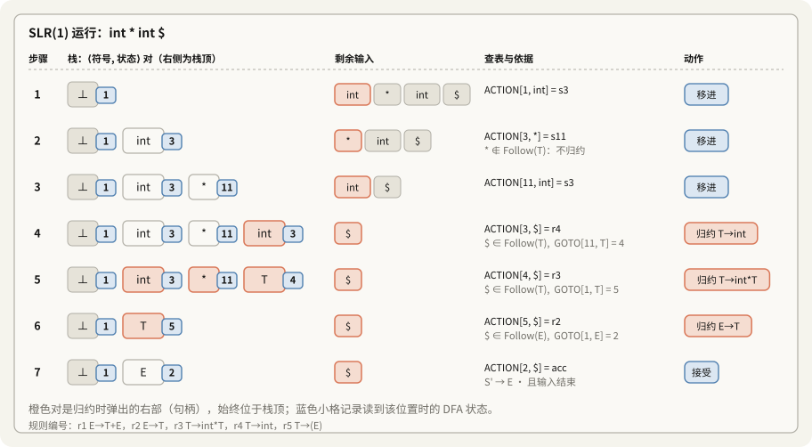

---

### 27.4 核心运行哲学总结

整个实战模拟向我们清晰展示了现代编译器的两大支柱组件分工：
1. **DFA 是编译器的“眼睛”**：
   无论分析栈内的符号串经历了多么复杂的压栈与弹出，只要把它喂进 DFA，DFA 就能瞬间将整个复杂的历史浓缩为一个精确的状态号（状态 1 ~ 11），告诉分析器“当前我们身处何地”。
2. **Follow 集是编译器的“刹车与方向盘”**：
   当状态框中同时存在多种可能的分支时，分析器往右瞄一眼输入 Token，利用事先计算好的 Follow 集做一次集合隶属度判断，就能在关键十字路口精准选择“踩刹车归约”还是“踩油门移进”，彻底消除歧义！

---

## 28. SLR 的工程化极致优化：从抽象自动机到表驱动解析器（Table-Driven Parser）

前述的 SLR 算法虽然逻辑自洽，但在工程实现上存在严重的算力冗余。本节将理论模型重构为现代编译器生成器（如 Yacc / Bison）通用的**工业级表驱动解析架构（Table-Driven Parsing Architecture）**，使单步分析开销严格收敛至 $O(1)$，全流程达到纯线性时间复杂度 $O(n)$。

---

### 28.1 算法时空复杂度缺陷：朴素活前缀重分析的代价

在前期给出的 SLR 抽象算法框架中，要求分析器在每一个配置 $\alpha \mid \omega$ 下：
> *“将当前分析栈内的符号序列 $\alpha$ 完整输入活前缀 DFA $M$ 中运行，以确定当前所处的项集状态 $s$。”*

```text
栈底                                            栈顶
 |                                                |
 v                                                v
[ 已经处理过的前缀及其状态轨迹 ] [ 新入栈的符号 ]
  <------ 不必重复扫描 ------>    只更新新增部分
```

#### 1. 形式化渐进时间复杂度推导
* 设待分析输入符号串长度为 $n$。整个语法分析过程由 $O(n)$ 次移进（Shift）与归约（Reduce）步骤组成；
* 在每一步操作中，栈深最大可达 $O(n)$；
* 若每推进一步均从栈底重新扫描整个活前缀序列：
  $$T(n) = \sum_{i=1}^{O(n)} O(i) = O(n^2)$$
  这将导致原本期望具备线性效率的自底向上解析器退化为二次时间复杂度 $O(n^2)$。

#### 2. 直观工程视角：无缓存（Cache）的重复计算
> **工程比喻：阅读带书签 vs 每次从头翻阅**
> 朴素模型如同读者每次阅读新的一页时，都必须从全书第 1 页开始从头顺着翻到当前页；
> 实际上，前 99 页的内容和状态转移轨迹在之前的阅读中已经完全被验证过（具备马尔可夫链的无后效性与确定性），重新逐页翻阅是完全无必要的重复劳作。

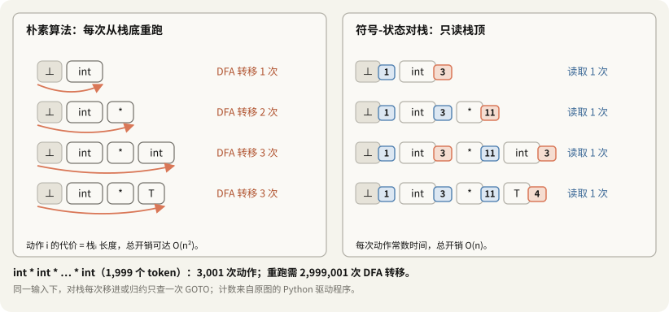

---

### 28.2 核心数据结构重构：符号-状态对偶栈（State Caching）

为了将状态确定开销从 $O(|\alpha|)$ 降低至严格的 $O(1)$，工程实践对分析栈进行了结构重构——引入**符号-状态对偶栈（Symbol-State Stack）**。

#### 1. 形式化定义
将原有的单一文法符号栈扩展为二元组序列：
$$\text{Stack} = \langle \text{any}, s_0 \rangle \, \langle X_1, s_1 \rangle \, \langle X_2, s_2 \rangle \dots \langle X_m, s_m \rangle$$

* $\text{any}$：栈底哨兵占位符（Dummy Symbol）；
* $s_0$：DFA 的初始状态（Start State）；
* $X_i \in V_N \cup V_T$：压入栈中的文法符号；
* $s_i$：DFA 在状态 $s_{i-1}$ 下消费符号 $X_i$ 后转移到达的状态编号。

#### 2. 核心结构不变量（Structural Invariant）
对于栈内任意深度 $k$（$1 \le k \le m$），状态 $s_k$ 严格满足：
$$s_k = \hat{\delta}(s_0, X_1 X_2 \dots X_k)$$
即：**栈中任意位置保存的状态 $s_k$，恒等于 DFA 扫描底层前缀 $X_1 \dots X_k$ 后的终止状态。**

> **工程比喻：记忆化（Memoization）与“状态书签”**
> 分析器在每走一步时，把当时到达的状态号如同“书签”一样直接缓存在栈项中。
> 当前分析栈所对应的 DFA 终态，永远直接由栈顶的 $\text{top}(\text{Stack}).\text{state} = s_m$ 给出，实现了**零计算开销的 $O(1)$ 瞬时状态提取**。

---

### 28.3 转移函数表格化：GOTO 函数与 GOTO 表

#### 1. 形式化定义
设 DFA 的状态转移函数为 $\delta: S \times (V_T \cup V_N) \to S$。定义二维数组 $\text{goto}$ 为：
$$\text{goto}[i, A] = j \iff \delta(s_i, A) = s_j$$

* **定义域**：
  * 状态索引 $i \in \{0, 1, \dots, |S|-1\}$；
  * 符号 $A \in V_N \cup V_T$（在经典分离表实现中，GOTO 表专门索引非终结符 $A \in V_N$）。
* **理论地位**：
  $\text{goto}$ 表是有限自动机状态转移矩阵的显式存储形式，构成 LR 分析驱动器两张核心调度表之一。

---

### 28.4 对偶栈驱动的操作语义规范（四大动作执行）

在维持结构不变量的前提下，分析器的基本操作执行语义形式化定义如下：

#### 1. 移进动作（Shift $j$）
设当前栈顶为 $\langle X_m, s_m \rangle$，当前输入终结符为 $a$：
1. 消费输入符号 $a$；
2. 查询转移目标状态：$j = \text{goto}[s_m, a]$；
3. 执行压栈：
   $$\text{Push}(\langle a, j \rangle)$$

#### 2. 归约动作（Reduce $X \to \alpha$）
设产生式右部符号串长度为 $|\alpha| = k$：
1. **弹出符号与状态**：从栈顶连续弹出 $k$ 个对偶项：
   $$\text{Pop}(k)$$
   此时栈顶暴露出的状态记为 $s_{\text{base}}$（即调用该产生式前的前驱状态）；
2. **状态跳转推演**：根据左部非终结符 $X$ 查询 GOTO 表：
   $$s_{\text{new}} = \text{goto}[s_{\text{base}}, X]$$
3. **推导结果压栈**：将非终结符及其关联的跳转状态重新入栈：
   $$\text{Push}(\langle X, s_{\text{new}} \rangle)$$

> **工程比喻：函数调用栈的现场保护与恢复（Call Stack Paradigm）**
> 产生式归约如同子函数执行完毕返回：
> 弹出右部符号如同“清退局部变量与子任务”，栈顶瞬间露出的 $s_{\text{base}}$ 就是当初挂起父规则时的“调用方现场”；
> 查 GOTO 表并压入 $X$，等价于父函数获取了子函数的返回值并跳转至下一行继续推进。
> 单步 Shift 与 Reduce 均为严格的 $O(1)$，整体解析全流程实现严格的**线性时间渐进复杂度 $O(n)$**。

#### 3. 接受动作（Accept）与 报错动作（Error）
* **Accept**：输入为 `$` 且栈顶为起始符号与接受状态，宣布语法分析顺利完成；
* **Error**：当前状态无法匹配任何 Shift 或 Reduce 规则，触发语法错误处理子例程。

> [!note] GOTO 查询用哪个状态
> 先弹出产生式右部对应的状态，再用此时露出的栈顶状态查询 GOTO。原来归约前的栈顶状态描述的是整个右部已经识别完的情形，不能拿它作为归约后左部非终结符的出发状态。

---

### 28.5 分析表构造理论：SLR(1) ACTION 表自动生成算法

编译器生成器（Parser Generator，如 Yacc/Bison）将 LR(0) 项集规范族与 Follow 集综合编译为二维驱动表 $\text{ACTION}[i, a]$ 的标准构造算法：

#### 算法：SLR(1) 分析表的构造
**输入**：拓广文法 $G'$，其 LR(0) 项集规范族 $\mathcal{C} = \{I_0, I_1, \dots, I_m\}$，活前缀转移函数 $\text{goto}$，各非终结符的 $\text{Follow}$ 集合。  
**输出**：$\text{ACTION}$ 表 与 $\text{GOTO}$ 表。

对于项集族中的每一个状态项集 $I_i$（对应状态号 $i$）及每一个终结符 $a \in V_T \cup \{\$\}$，按如下规则填充表项：

1. **移进表项填充（Shift）**：
   若项 $X \to \alpha \cdot a \beta \in I_i$，且状态转移满足 $\text{goto}[i, a] = j$（其中 $a \in V_T$）：
   $$\text{ACTION}[i, a] = \text{shift } j \quad (\text{工程缩写为 } S_j)$$
2. **归约表项填充（Reduce）**：
   若项 $X \to \alpha \cdot \in I_i$，且满足 $X \neq S'$：
   对于任意后继终结符 $a \in \text{Follow}(X)$：
   $$\text{ACTION}[i, a] = \text{reduce } X \to \alpha \quad (\text{工程缩写为 } r_k，k \text{ 为对应产生式编号})$$
3. **接受表项填充（Accept）**：
   若增广开始符号成熟项 $S' \to S \cdot \in I_i$：
   $$\text{ACTION}[i, \$] = \text{accept} \quad (\text{工程缩写为 } \text{acc})$$
4. **报错表项填充（Error）**：
   表格中所有未被上述三条规则定义的空白单元格（Undefined Entries）：
   $$\text{ACTION}[i, a] = \text{error} \quad (\text{工程通常以空白或特定负值错误码表示})$$

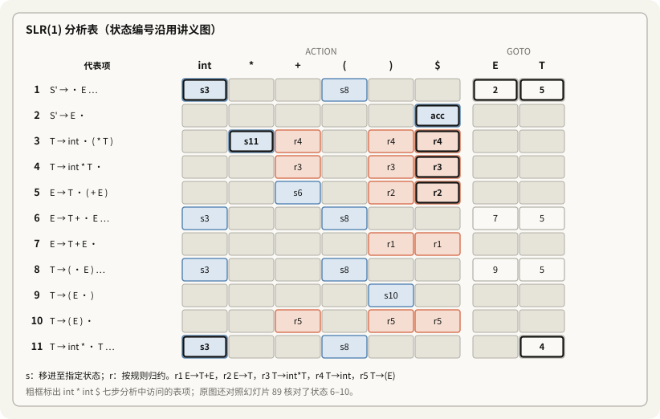

---

### 28.6 理论闭环：表驱动控制流架构图

经过上述优化，自底向上语法分析器的物理模型彻底蜕变为纯粹的**表驱动自动机架构（Table-Driven Parser Architecture）**：

```text
[未读输入缓冲区]                [分析栈]
 a₁ a₂ a₃ ... $                 ⟨s₀⟩ ⟨X₁,s₁⟩ ... ⟨Xₘ,sₘ⟩
        |                          |
        | 当前 token a             | 栈顶状态 sₘ
        v                          v
                  [LR 分析驱动器]
                          |
                          | 查询 ACTION[sₘ, a]
                          v
                  [ACTION / GOTO 表]
                          |
                          | 返回移进、归约、接受或错误
                          v
                  [执行动作并更新栈]
                          |
                          | 归约 X -> β 时：
                          | 弹出 |β| 个符号-状态对
                          | 查询 GOTO[s_base, X]
                          v
                  [继续处理当前配置]
```

在该体系下，语法分析器不再需要回溯、不再需要重新运行状态机，仅凭**当前栈顶的状态数字**和**输入流的下一个 Token**，通过两次简单的数组下标查表，即可在严格的 $O(1)$ 时间内完成一次无歧义的语法推导决策！

---

## 29. 工业级解析引擎主循环与“符号隐形论”（核心驱动与语义动作）

作为本讲的最终收官，课件给出了工业级表驱动 LR 分析器的核心伪代码实现，并深刻揭示了**语法状态机与语义计算在物理栈上的权责边界**。

---

### 29.1 通用表驱动 LR 分析器算法实现

任何现代编译器（如 GCC、Clang 或由 Bison 生成的解析器）在执行期均遵循如下标准驱动算法：

```text
Let I = w$ be initial input
Let j = 0
Let DFA state 1 have item S' -> .S
Let stack = ⟨dummy, 1⟩

repeat
  case action[top_state(stack), I[j]] of
    shift k:
      push ⟨I[j++], k⟩

    reduce X -> A:
      pop |A| pairs,
      push ⟨X, goto[top_state(stack), X]⟩

    accept:
      halt normally

    error:
      halt and report error
```

#### 形式化执行语义分解
1. **初始化配置**：
   * 输入流 $I = w\$$，输入游标 $j = 0$；
   * 包含 $S' \to \cdot S$ 的项集状态置为初始状态 $1$；
   * 分析栈初始化为哨兵元组 $\text{stack} = \langle \text{dummy}, 1 \rangle$。
2. **单步调度逻辑**：
   在每一步迭代中，分析器仅依靠当前栈顶状态 $\text{top\_state}(\text{stack})$ 与当前未读符号 $I[j]$，检索一次 ACTION 矩阵：
   $$\text{action}[\text{top\_state}(\text{stack}), \; I[j]]$$
   * **`shift k`**：消费当前 Token $I[j]$，并将对偶项 $\langle I[j], k \rangle$ 压入栈顶，游标递增 $j \leftarrow j + 1$；
   * **`reduce X -> A`**：仅根据产生式右部符号串的长度 $|A|$，从栈顶连续弹出 $|A|$ 个对偶项；暴露出基底状态后，查 GOTO 矩阵获取目标状态并压入 $\langle X, \text{goto}[\text{top\_state}(\text{stack}), X] \rangle$；
   * **`accept`**：输入顺利到达末尾 `$` 且识别至起始符号，解析成功退出；
   * **`error`**：当前状态与输入无法匹配，触发错误处理子例程。

---

### 29.2 编译学核心洞见：“符号隐形论”与语义动作（Semantic Actions）

```text
• Note that the algorithm uses only the DFA states and the input
  - The stack symbols are never used!
• However, we still need the symbols for semantic actions
```

仔细审查上述驱动算法的判断逻辑，可以得出一个在编译工程中极具分量的核心结论：

#### 1. 语法检查的纯粹性：栈内文法符号从未被读取
* **决策分支**：只取决于栈顶状态号与输入符号（$\text{action}[\text{top\_state}, I[j]]$）；
* **归约弹栈**：只取决于规则右部的**长度 $|A|$**（连续弹出 $|A|$ 个槽位即可，系统甚至根本不关心弹出的符号名是什么）；
* **跳转状态**：只取决于左部非终结符与基底状态号（$\text{goto}[\text{top\_state}, X]$）。

> [!important] 符号隐形定理
> **在纯粹的上下文无关语法判定（Syntactic Recognition）层面，栈里的文法符号实际上从未被读取！**
> 理论上，如果仅为了验证源代码是否合法，分析栈完全可以设计为一个**纯整数状态栈**，仅保存状态号即可毫无差错地完成语法分析。

#### 2. 构造 AST 需要语义值

语法判定只需要状态，但构造 AST 还需要各个符号对应的值或子树。文法符号、状态与语义值是不同概念，不要求实现中保存三个独立的栈。

例如 Bison 的默认 C 骨架使用状态栈 `yyss` 和语义值栈 `yyvs`，启用位置跟踪时还会有 `yyls`。归约时，语义动作通过 `$1`、`$2` 等读取右部的值，把左部结果写入 `$$`。未写动作时的默认动作是 `$$ = $1`（空产生式不能依赖这个默认值）。

因此 `E → T` 可以直接传递子树，不新增 AST 节点；`E → T + E` 则可执行 `$$ = Add($1, $3)`。括号和分号参与语法判断，但通常不会保留为 AST 节点。可在[编译器流水线动画](assets/10_31/parser-pipeline.html)中逐步查看这一区别。

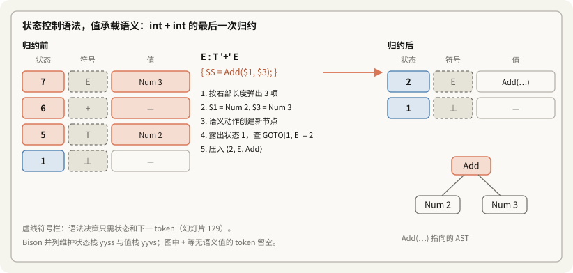

---

## 30. SLR(1) 判定试金石：经典对照范例（从单侧递归到二义性冲突）

作为整讲内容的最终收官，Alex Aiken 教授给出了两个结构高度相似但性质截然相反的**经典对比实验（A/B Test 对照分析）**，完整检验了求闭包、DFA 状态转移、Follow 集判定以及移进-归约冲突排查的全流程。

---

### 30.1 案例 A：单侧递归文法 —— 成功判定为 SLR(1)

#### 1. 文法与 Follow 集计算
$$
\begin{aligned}
S' &\to S \\
S &\to S a \mid b
\end{aligned}
$$
* **文法性质**：典型的单向左递归文法，对应语言为 $b a^*$。语法推导树全局唯一，**无二义性**。
* **计算 Follow 集**：
  * $\text{Follow}(S') = \{ \$ \}$；
  * 根据 $S \to S a$，非终结符 $S$ 后紧随终结符 $a$，故 $a \in \text{Follow}(S)$；根据 $S' \to S$ 继承终止符 $\$$；
  * 得到：$\text{Follow}(S) = \{ \$, \; a \}$。

#### 2. DFA 状态机拓扑
* **初始状态 $I_0$**：
  $$\{ S' \to \cdot S, \quad S \to \cdot S a, \quad S \to \cdot b \}$$
  * 消费 $b \implies$ 转移至状态 $\{ S \to b \cdot \}$（成熟归约态）；
  * 消费 $S \implies$ 转移至状态 $I_1$。
* **关键状态 $I_1$**：
  $$\{ S' \to S \cdot, \quad S \to S \cdot a \}$$
  * 消费 $a \implies$ 转移至状态 $\{ S \to S a \cdot \}$。

#### 3. 冲突核验与判定
在状态 $I_1$ 中，存在潜在的“接受”与“移进”竞争：
* 接受项：$S' \to S \cdot$，在输入结束符 `$` 上执行 Accept；
* 移进项：$S \to S \cdot a$，期待移进符号 $\{ a \}$。

**Follow 集判定裁决**：
$$\text{Follow}(S') \cap \{ a \} = \{ \$ \} \cap \{ a \} = \emptyset$$
* **交集为空！两路决策完全解耦**：
  * 遇到 `$` 严格执行 **Accept**；
  * 遇到 `a` 严格执行 **Shift**；
* **结论**：全图所有状态均无未解冲突，**该文法是严格的 SLR(1) 文法！**

---

### 30.2 案例 B：双侧递归文法 —— 冲突爆发，跌出 SLR(1)

#### 1. 文法与二义性引入
在右端同样增加非终结符 $S$：
$$
\begin{aligned}
S' &\to S \\
S &\to S a S \mid b
\end{aligned}
$$
* **文法性质**：典型的算术运算符文法结构（如 $E \to E + E \mid \text{id}$）。对于输入串 `b a b a b`，既可解析为左结合 $(b a b) a b$，也可解析为右结合 $b a (b a b)$，**具有强二义性**。
* **计算 Follow 集**：
  * $\text{Follow}(S') = \{ \$ \}$；
  * 对于 $S \to S a S$，前面的 $S$ 紧跟 $a$，后面的 $S$ 继承左部 Follow 集，得出：
    $$\text{Follow}(S) = \{ \$, \; a \}$$

#### 2. DFA 状态推进与冲突形成
1. 从初始状态沿 $S$ 转移至 $\{ S' \to S \cdot, \quad S \to S \cdot a S \}$；
2. 消费 $a$ 展开闭包，转移至 $\{ S \to S a \cdot S, \quad S \to \cdot S a S, \quad S \to \cdot b \}$；
3. 消费非终结符 $S$，到达右上角的**关键危险状态**：
   ```text
   ┌─────────────────────────────────┐
   │         移进-归约冲突状态          │
   ├─────────────────────────────────┤
   │ S → S a S ·                     │ ──> 归约项 (已识别完 SaS，想归约为 S)
   │ S → S · a S                     │ ──> 移进项 (期待移进下一个符号 a)
   └─────────────────────────────────┘
   ```

#### 3. SLR(1) 判定失效：重叠碰撞
在上述状态下执行 SLR 规则核验：
* **归约项 $S \to S a S \cdot$**：归约后为非终结符 $S$，要求下一个输入符号 $t \in \text{Follow}(S) = \{ \$, \; \mathbf{a} \}$；
* **移进项 $S \to S \cdot a S$**：要求下一个输入符号为 $\{ \mathbf{a} \}$。

**集合碰撞**：
$$\text{Follow}(S) \cap \{ a \} = \{ \$, \; a \} \cap \{ a \} = \{ \mathbf{a} \} \neq \emptyset$$

> [!danger] 核心结论：产生不可调和的移进-归约冲突！
> 当分析器停在该状态且当前输入 Token 为 `a` 时：
> 归约条件（$a \in \text{Follow}(S)$）与移进条件（期待 $a$）**同时满足**！
> 
> 分析器陷入死锁，无法确定是应当把当前的 $S a S$ 折叠为 $S$（左结合），还是应当继续移入 $a$ 并等待右侧表达式（右结合）。
> **由于向前看 1 个符号的 $\text{Follow}$ 集无法消除该冲突，该文法绝对不是 SLR(1) 文法（Not SLR(1)）！**

---

### 30.3 终局对比实验矩阵

| 评估维度 | 案例 A（图 1） | 案例 B（图 2） |
|---|---|---|
| **产生式结构** | $S \to S a \mid b$ | $S \to S a S \mid b$ |
| **文法语义定性** | 单向延伸（无二义性） | 双向可递归（强二义性） |
| **竞争核心状态** | $\{ S' \to S \cdot, \; S \to S \cdot a \}$ | $\{ S \to S a S \cdot, \; S \to S \cdot a S \}$ |
| **竞争两端** | 遇 `$` 接受 vs 遇 `a` 移进 | 归约至 $S$ vs 移进 $a$ |
| **判定集合交集** | $\text{Follow}(S') \cap \{a\} = \{\$\} \cap \{a\} = \emptyset$ | $\text{Follow}(S) \cap \{a\} = \{\$, a\} \cap \{a\} = \{a\} \neq \emptyset$ |
| **裁决结果** | **属于 SLR(1) 文法**（无冲突） | **不属于 SLR(1) 文法**（移进-归约冲突） |
| **工程救赎方案** | 无需干预，直接表驱动解析 | 声明结合方向以解决冲突，或改写为无二义性文法；升级 LR(1)/LALR(1) 不能消除该文法的二义性 |

对案例 B，`%left 'a'` 在冲突处选择归约，使 `b a b a b` 按 `(bab)ab` 结合；`%right 'a'` 选择移进，得到 `ba(bab)`。这规定了解析器的选择，原文法仍有二义性。

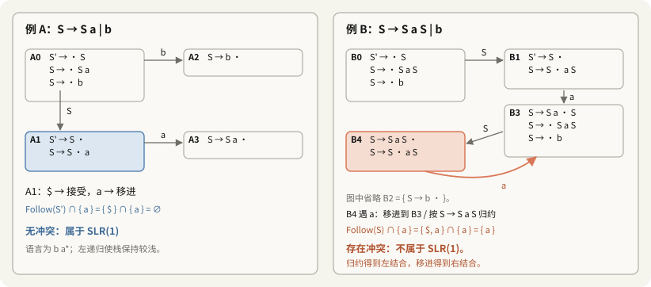

