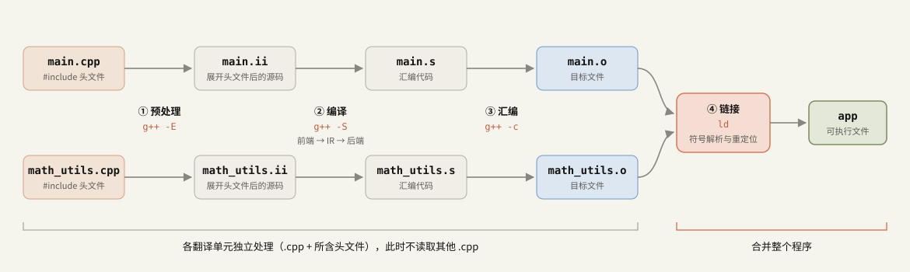

# 1.1 C++ 构建流程与目标文件

原文见 [[16.AI编译器/学习日记/01.十月/10_23#1. C++：预处理、编译、汇编、链接|§1.1–§1.5]]。

## 1. C++：预处理、编译、汇编、链接

### 1.1 整体流程



| 阶段 | 输入 → 输出 | 主要工作 | 停在该阶段的命令 |
|---|---|---|---|
| ① 预处理 | `.cpp` → `.ii`（C 为 `.i`） | 展开 `#include`、宏展开、条件编译 | `g++ -E` |
| ② 编译 | `.ii` → `.s` | 词法、语法、语义分析 → IR → 优化 → 生成汇编代码 | `g++ -S` |
| ③ 汇编 | `.s` → `.o` | 将汇编代码转为机器码，记录符号表和重定位信息 | `g++ -c` |
| ④ 链接 | 多个 `.o` + 库 → 可执行文件 | 符号解析、重定位 | `g++ *.o -o app` |

①–③ 对每个**翻译单元**（translation unit）分别进行，也就是一个 `.cpp` 文件与它所包含的头文件组成的单元。此时编译器不掌握其他 `.cpp` 的内容。到 ④ 链接阶段，多个文件才合并起来。

### 1.2 预处理

预处理器不分析 C++ 语法，主要进行**文本替换**。

- `#include "x.h"`：将 `x.h` 的内容展开到当前位置。
- `#define`：展开宏。下例中的 `SQUARE(4)` 会变为 `((4) * (4))`。
- `#if`、`#ifdef`：根据条件保留或排除代码；`#pragma once` 用于防止同一头文件在一个翻译单元内重复包含。
- 去除注释。

> [!warning] 纠正
> 最初把“预处理”只理解成“宏展开”，遗漏了 **`#include` 的头文件展开**。下例中，9 行的 `main.cpp` 经 `g++ -E` 处理后，因展开 `<cstdio>` 而增加到 1,066 行。

### 1.3 编译：前端、中端、后端

编译阶段还可以分为三部分：词法、语法、语义分析属于**前端**，IR 优化属于**中端**，生成目标 CPU 汇编代码的部分属于**后端**。

**词法分析（lexical analysis）**将字符序列切分为 token（词法单元）。关键字（如 `if`、`while`、`for`）、括号与标点、运算符、标识符（变量名）、常量等都是 token。这个阶段发现的是**无法组成合法 token 的字符序列**。

```text
int a@b = 1;          → error: stray '@' in program            （词法分析）
const char* s = "abc; → error: missing terminating " character （词法分析）
```

> [!warning] 纠正
> 最初认为缺少分号也由词法分析发现。但 <code>int a &#61; 1 }</code> 中的 `int`、`a`、`=`、`1`、`}` 都是合法 token，问题出在它们的**组合方式**，因此由语法分析报错（`expected ',' or ';' before '}' token`）。若把变量名写成 `my-var`，词法分析也能正常切分为 `my`、`-`、`var`，之后才在语法分析时报错（`expected initializer before '-' token`）。

**语法分析（parsing）**按语法规则组合 token，构建**抽象语法树（AST）**。在 <code>a &#61; 2</code> 中，`=` 是父节点，`a` 是左子节点，`2` 是右子节点。括号不匹配，或 <code>a &#61; ;</code> 这样缺少操作数的情况，会在此阶段报错。树形结构见 [[1.4 编译器的五个阶段#2.4 词法分析如何区分等号和双等号|§2.4 的图]]。

**语义分析**（semantic analysis）检查语法正确的 AST **在语义上是否成立**，并将分析结果附加到 AST。

- 名称解析：确定名称对应哪个作用域中的哪个声明。未声明的名称会触发 `'y' was not declared in this scope`。
- 类型检查：检查运算符与操作数的类型是否匹配。
- 插入隐式转换：如 <code>double d &#61; 1;</code>，需要在 AST 中加入 `int → double` 的转换节点。
- 重载决议：确定应调用哪个同名函数。

变量是否已经初始化，**一般无法在编译期完全准确地判断**，因为实际走哪条分支可能取决于运行时数据。因此，编译器有时只给出警告，也可能没有发现问题。

```cpp
int g()       { int x; return x; }                    // -Wall: 'x' is used uninitialized
int f(bool c) { int x; if (c) x = 1; return x; }      // -Wall -Wextra（-O0、-O2）：均无警告
```

语义分析后的 AST 会转换为 **IR（中间表示）**。中端优化 IR，后端选择目标 CPU 指令并生成汇编代码（`.s`）。在 LLVM 工具链中，Clang 对应前端，LLVM IR 优化 pass（`opt`）对应中端，`llc` 对应后端。

### 1.4 汇编

汇编器将 `.s` 转换为机器码，生成**目标文件（`.o`）**。

> [!warning] 纠正
> `.o` 不是可执行文件，而是**可重定位目标文件（relocatable object file）**。
> ```console
> $ file main.o
> main.o: ELF 64-bit LSB relocatable, x86-64, version 1 (SYSV), not stripped
> ```
> `.o` 除了机器码，还包含两类信息。
> - **符号表**：列出本文件定义的名称，以及需要从外部引入的名称。
> - **重定位信息**：标记“这里稍后需要填入 `add` 的地址”等待处理位置。
>
> 需要链接的原因也不限于使用库。调用自己编写的**另一个 `.cpp` 文件**中定义的函数，同样需要链接来解析引用。

用 `nm` 查看符号表即可观察这种区别。`U` 表示未定义（需要从外部引入），`T` 表示定义在代码（text）段中，`B` 表示定义在零初始化数据（bss）段中。

```console
$ nm -C main.o
                 U add(int, int)
                 U call_count
0000000000000000 T main
                 U printf
$ nm -C math_utils.o
0000000000000000 T add(int, int)
0000000000000000 B call_count
```

不加 `-C` 时，`add(int, int)` 会显示为 `_Z3addii`。为区分重载，C++ 实现会将参数类型等信息编码进符号名，这称为**名称修饰（name mangling）**。

### 1.5 链接

链接器主要做两件事。

1. **符号解析**：将各 `.o` 中的 `U` 符号与其他 `.o` 或库中的定义（`T`、`B` 等）匹配。找不到定义时出现 `undefined reference`；普通外部符号被重复定义时出现 `multiple definition`。
2. **重定位**：安排代码与数据的地址，并按重定位记录修正相应位置的地址或偏移。

结果是可执行文件。不指定 `-o` 时，默认文件名为 `a.out`；Linux 上的可执行文件不要求扩展名。
