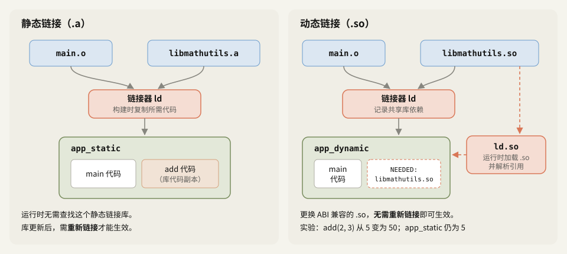

# 1.2 C++ 库链接、ODR 与多文件实验

原文见 [[16.AI编译器/学习日记/01.十月/10_23#1.6 静态链接与动态链接|§1.6–§1.9]]。

## 1.6 静态链接与动态链接



| | 静态链接（`.a`） | 动态链接（`.so`） |
|---|---|---|
| 链接时机 | 构建时的**链接阶段** | 链接时记录依赖，**运行时**由加载器（`ld.so`）加载并完成相应解析 |
| 可执行文件 | 包含所需库代码的**副本** | 保留对库的**引用**（`NEEDED: libmathutils.so`） |
| 大小与内存 | 可执行文件较大，不同程序可能包含各自的库代码副本 | 可执行文件较小，多个进程可共享内存中的库代码页 |
| 库发生变化后 | 必须**重新链接**程序才会生效 | ABI 兼容时，更换 `.so` 即可，无需重新链接 |
| 运行环境 | 不需要再查找被静态链接的那个库 | 找不到所需 `.so` 时，程序可能无法启动 |

> [!warning] 纠正
> - 静态链接发生在**链接阶段**，不发生在编译或汇编阶段。
> - 静态库变化后，自己的源文件**无需重新编译，只需重新链接**，已有 `.o` 可以继续使用。
> - 动态库的替换单位是**整个 `.so` 文件**，不是“修改过的片段”。如果函数签名或结构体布局等 ABI 发生变化，使用方也可能需要重新构建。

以下是原文记录的实验结果。

```console
$ ar rcs libmathutils.a math_utils.o                      # 静态库
$ g++ -fPIC -shared math_utils.cpp -o libmathutils.so     # 共享库
$ nm -C app_static | grep ' add'
0000000000001194 T add(int, int)          ← 定义已复制到可执行文件中
$ nm -C app_dynamic | grep ' add'
                 U add(int, int)          ← 运行时从 .so 中解析
$ readelf -d app_dynamic | grep NEEDED
 0x0000000000000001 (NEEDED)             Shared library: [libmathutils.so]
 0x0000000000000001 (NEEDED)             Shared library: [libc.so.6]

$ ./app_dynamic; echo "exit=$?"
./app_dynamic: error while loading shared libraries: libmathutils.so: cannot open shared object file: No such file or directory
exit=127
$ LD_LIBRARY_PATH=. ./app_dynamic
add(2, 3) = 5, SQUARE(4) = 16, call_count = 1

# 将 .so 替换为让 add 返回 10 * (a + b) 的版本（两个可执行文件均不重新链接）
$ LD_LIBRARY_PATH=. ./app_dynamic
add(2, 3) = 50, SQUARE(4) = 16, call_count = 1    ← 新版本立即生效
$ ./app_static
add(2, 3) = 5, SQUARE(4) = 16, call_count = 1     ← 仍使用旧副本
```

`NEEDED` 中也有 `libc.so.6`。若未另行指定，即使示例中的 `app_static` 静态链接了自己的库，C 标准库仍然采用动态链接。

## 1.7 ODR（One Definition Rule，单一定义规则）

ODR 规定实体的**定义数量及多份定义应满足的一致性要求**。

1. 同一个翻译单元中，变量、函数、类和模板等实体的定义**最多出现一次**。
2. 对程序中被 odr-use 的非 inline 函数或变量，程序整体必须提供一个定义；普通外部链接实体的定义不能重复。(**在整个程序里，只要你真正用到了某个普通函数或变量，它就必须【有且仅有一次定义】——少一次链接器报‘未定义引用’，多一次链接器报‘重复定义’。**)
3. 类、inline 函数、inline 变量、模板等可以在多个翻译单元中定义，但必须满足**定义的 token 序列一致**等 ODR 条件。

> [!warning] 纠正
> 最初认为“多处代码修改全局静态变量，会导致编译器无法从符号表确定值，因此违反 ODR”。这里有两处误解。
> - ODR 约束的是**定义的数量与一致性**，与运行时的值无关。一个全局变量只定义一次，由多个函数修改是正常用法；多线程下是否存在数据竞争是另一个问题。符号表记录名称和位置等信息，不记录变量运行中的值。
> - 全局 `static` 变量具有**内部链接**。在头文件中写 <code>static int counter &#61; 0;</code>，每个包含它的 `.cpp` 都会得到一个**同名但独立的变量**。这不违反 ODR，却容易与预期不同。
>   ```console
>   $ g++ sa.cpp sb.cpp -o st && ./st     # 调用两次 sa.cpp 的 inc() 后，在 sb.cpp 中输出
>   counter = 0                           # 只有 sa.cpp 中的 counter 变成了 2
>   ```

**实际 ODR 违规 ①：在头文件中定义普通外部链接变量。** 链接器会报告错误。

```cpp
// bad.h
#pragma once
int counter = 0;   // 定义：每个包含此头文件的 .cpp 都会产生一份定义
```

```console
$ g++ a.cpp b.cpp -o bad
/usr/bin/ld: /tmp/ccbjChGd.o:(.bss+0x0): multiple definition of `counter'; /tmp/cctBi8WF.o:(.bss+0x0): first defined here
collect2: error: ld returned 1 exit status
```

`#pragma once` 和 include guard 只能防止**同一个翻译单元中**重复包含头文件。`a.cpp` 和 `b.cpp` 分别包含一次，依然会产生重复定义，无法靠它们避免。

**实际 ODR 违规 ②：不同文件中的 inline 函数定义不同。** 这种情况可能构建成功且没有警告，但结果随选项和链接顺序改变；程序不符合 ODR，标准不要求编译器诊断。

```cpp
// x.cpp
inline int answer() { return 1; }
int from_x() { return answer(); }

// y.cpp
#include <cstdio>
inline int answer() { return 2; }   // 同名函数，定义不同
int from_x();
int main() { std::printf("main: %d, x.cpp: %d\n", answer(), from_x()); }
```

```console
$ g++ -O0 x.cpp y.cpp && ./a.out    →  main: 1, x.cpp: 1
$ g++ -O2 x.cpp y.cpp && ./a.out    →  main: 2, x.cpp: 1
$ g++ -O0 y.cpp x.cpp && ./a.out    →  main: 2, x.cpp: 2
```

在这次实验中，`-O0` 下链接器只保留先遇到的一份 `answer` 定义；`-O2` 下两个文件各自内联了本文件的定义。同一组源文件因此出现三种运行结果。这只是本次工具链的表现，不能依赖。

> [!note] 补充：命令解析与三种结果的根因
> - **命令解析**：`-O0` 与 `-O2` 分别为关闭与开启优化；未指定 `-o` 时 Linux 默认输出可执行文件 `a.out`；`&& ./a.out` 表示编译成功后紧接着执行该程序。
> - **`-O0` 结果随链接顺序改变**：不优化时编译器生成真正的函数调用跳转。链接器将 `inline` 函数视为弱符号（weak symbol），默认仅保留先扫描到的目标文件中的定义并丢弃后续同名定义（先扫描 `x.cpp` 则全为 `1`，先扫描 `y.cpp` 则全为 `2`）。
> - **`-O2` 结果分裂**：开启优化后，编译器在各翻译单元内部直接将短函数就地内联展开为常量（`main` 处直接替换为 `2`，`from_x` 处直接替换为 `1`），压根不经过链接器的符号去重，导致“精神分裂”。


**正确做法**：普通外部变量在头文件中声明，在一个 `.cpp` 中定义。C++17 起也可以使用 `inline` 变量。

```cpp
// 方法 1：头文件中声明，在一个 .cpp 中定义
extern int counter;          // math_utils.h
int counter = 0;             // math_utils.cpp

// 方法 2（C++17）：多个翻译单元中有定义，仍是同一个对象
inline int counter = 0;      // 可放入头文件 → 实验结果 counter = 2
```

| 类型                 | 是否允许在头文件中直接定义？                                                       | 违反规则后的表现                             |
| ------------------ | -------------------------------------------------------------------- | ------------------------------------ |
| **普通全局变量**         | ❌ **不行**。头文件只能用 `extern int x;` 声明，只能在某**一个** `.cpp` 里写 `int x = 0;` | 多个 `.cpp` 包含时报 `multiple definition` |
| **普通全局函数**         | ❌ **不行**。头文件只能放声明 `void f();`，在某**一个** `.cpp` 里实现函数体                 | 多个 `.cpp` 包含时报 `multiple definition` |
| **`inline` 函数/变量** | ✅ **可以**。每个包含它的 `.cpp` 都会有一份，链接器会安全合并                                | 合法（不属于“非 inline”）                    |
| **类定义 / `struct`** | ✅ **可以**。多个 TU 可以各有一份完全相同的类定义，但这只是类型信息，不属于外部链接的变量/函数实体               | 合法                                   |

> [!note] 补充：声明 vs 定义 vs 赋值，与链接器对称律
> 针对多文件使用全局变量（如上述方法 1 中的 `counter`），实践中极易混淆“声明”、“定义”与“函数内赋值”的边界：
>
> 1. **声明（`extern int counter;`）**：在头文件或全局中“画饼”，向编译器承诺该符号存在，**不分配内存**（符号表标记为 `U`）。
>    - 多个 `.cpp` 包含该头文件展开声明完全正常；同一个翻译单元内重复写多次同类型 `extern` 声明也完全合法。
> 2. **定义（`int counter = 0;`）**：必须写在某**一个** `.cpp` 的**全局作用域**中“落产”，真正向系统申请 **4 字节物理内存**（符号表标记为 `D` 或 `B`）。
> 3. **赋值（`counter = 0;`）**：必须写在**函数体内**进行“消费”（向已分配的物理内存写入数据）。
>    - ❌ **严禁在全局作用域裸写执行语句**：在函数外部直接写 `counter = 3;` 会导致编译报错（`expected constructor, destructor, or type conversion`）。
>    - ❌ **缺少全局定义直接在函数内赋值**：若只有头文件的 `extern` 声明，且所有 `.cpp` 全局都漏写了定义，只在某个函数内写 `counter = 0;`，则**编译能通过**（编译器留下了 `U` 欠条），但**链接时必定报错 `undefined reference to 'counter'`**。
>
> **链接器对称律归纳**：
> - 全局变量在所有 `.o` 中定义 **0 次** → 链接报错 **`undefined reference`**（欠条兑现不了）。
> - 全局变量在所有 `.o` 中定义 **恰好 1 次** → ✅ **构建成功**。
> - 全局变量在所有 `.o` 中定义 **≥ 2 次** → 链接报错 **`multiple definition`**（违反 ODR 规则）。

## 1.8 如何编译多文件程序

这是最初没弄清楚的部分。基本做法是**头文件放声明，`.cpp` 放定义**，**分别编译各个 `.cpp`，再通过链接合并**。

```cpp
// math_utils.h：声明“某处提供了这些实体”
#pragma once

int add(int a, int b);
extern int call_count;
```

```cpp
// math_utils.cpp：提供具体定义，整个程序只定义一次
#include "math_utils.h"

int call_count = 0;

int add(int a, int b) {
    ++call_count;
    return a + b;
}
```

```cpp
// main.cpp：根据声明调用 add，无需知道 add 的函数体
#include <cstdio>
#include "math_utils.h"

#define SQUARE(x) ((x) * (x))

int main() {
    int r = add(2, 3);
    std::printf("add(2, 3) = %d, SQUARE(4) = %d, call_count = %d\n",
                r, SQUARE(4), call_count);
    return 0;
}
```

**方法 1：一次构建。** `g++` 内部对每个文件分别执行 ①–③，最后统一链接。

```console
$ g++ -std=c++17 -Wall main.cpp math_utils.cpp -o app
$ ./app
add(2, 3) = 5, SQUARE(4) = 16, call_count = 1
```

命令行中不需要列出头文件，因为预处理时 `#include` 已将其展开到对应的 `.cpp` 中。

**方法 2：分步构建。** 这是实际项目中常用的方式。

```console
$ g++ -c main.cpp       -o main.o          # ①–③：仅处理 main.cpp
$ g++ -c math_utils.cpp -o math_utils.o    # ①–③：仅处理 math_utils.cpp
$ g++ main.o math_utils.o -o app           # ④：链接
```

这样只修改 `math_utils.cpp` 时，就只需重新编译该文件，然后重新链接。在 LLVM 这类大型项目中，避免重复编译能明显缩短构建时间。Make、CMake、Ninja 等工具会根据文件依赖，确定哪些内容需要重新构建。若修改头文件，包含该头文件的 `.cpp` 通常都需要重新编译。

**链接时遗漏文件**，可能导致编译通过、链接失败。因为 `main.cpp` 只根据声明就能完成编译。

```console
$ g++ main.o -o app2
/usr/bin/ld: main.o: in function `main':
main.cpp:(.text+0x17): undefined reference to `add(int, int)'
/usr/bin/ld: main.cpp:(.text+0x20): undefined reference to `call_count'
collect2: error: ld returned 1 exit status
```

| 错误信息 | 发生阶段 | 常见原因 |
|---|---|---|
| `'x' was not declared in this scope` | 编译（语义分析） | 漏写头文件 `#include`、名称拼写错误 |
| `undefined reference to 'f'` | 链接 | 遗漏包含定义的 `.cpp` 所生成的目标文件或库 |
| `multiple definition of 'x'` | 链接 | 在头文件中放置普通外部定义（§1.7 ①） |
| `cannot open shared object file`（退出码 127） | 运行（动态加载器） | 加载器找不到所需 `.so` |

## 1.9 复习问题

> [!question]- Q1. 执行 `g++ main.cpp math_utils.cpp -o app`，各阶段分别执行几次？
> 两个 `.cpp` 分别进行预处理、编译和汇编，各阶段共两次；最后链接一次。头文件在各 `.cpp` 的预处理阶段展开。

> [!question]- Q2. 修改静态库和共享库后，分别怎样让程序使用新版本？
> 静态库需要重新**链接**程序，自己的源文件无需重新编译。共享库在 ABI 兼容时只需更换 `.so`，从下一次运行起生效。

> [!question]- Q3. 为什么头文件中的 <code>int counter &#61; 0;</code> 会出问题？为什么 `#pragma once` 解决不了？
> 每个包含该头文件的 `.cpp` 都会生成 `counter` 的定义，违反 ODR，链接器报告 `multiple definition`。`#pragma once` 只能防止同一翻译单元内重复包含，不能阻止不同翻译单元产生重复定义。可在头文件中声明 `extern int counter;`，在一个 `.cpp` 中定义，或使用 C++17 的 <code>inline int counter &#61; 0;</code>。

---
