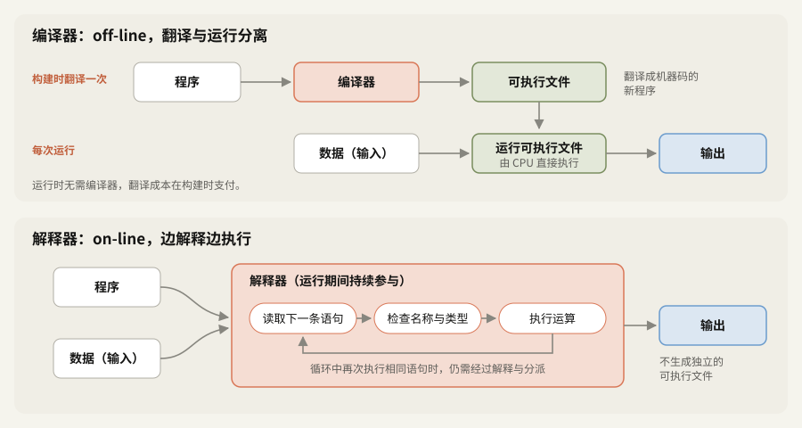

# 1.3 编译器与解释器

原文见 [[16.AI编译器/学习日记/01.十月/10_23#2. 斯坦福 CS143 第 1 讲|§2.1–§2.2]]。

## 2. 斯坦福 CS143 第 1 讲

### 2.1 编译器与解释器的区别

**编译器**以程序为输入，输出**用另一种语言表示的程序**，通常是机器码形式的可执行文件。此时不需要程序将来处理的数据。之后执行可执行文件，输入数据，才会得到结果。翻译与执行在时间上分离，因此称为 **off-line（离线）**。运行可执行文件时，编译器已经完成工作，无需继续参与。

**解释器**同时接收**程序和数据**，直接产生**执行结果**。在这个基本模型中，它不生成独立的可执行文件，而是逐条读取、解释并执行程序，因此称为 **on-line（在线）**。程序运行期间，解释器持续参与。

> [!warning] 纠正
> 最初写成了“将程序与数据交给解释器，会输出可执行文件”。解释器输出的是**程序执行结果**；生成目标程序的是编译器。

可以把编译器比作制作**译本**的翻译者：译本完成后，读者无需翻译者在场就能阅读。解释器则像**同声传译者**：演讲进行时持续翻译，相同演讲再次进行时，还要再次翻译。

| | 编译器 | 解释器 |
|---|---|---|
| 输入 | 程序 | 程序 + 数据 |
| 输出 | 可执行文件或另一种语言表示的程序 | 执行结果 |
| 翻译时机 | 运行前完成 | 在运行过程中持续解释 |
| 示例 | C、C++、Rust、Go 的常见实现 | Shell 脚本、早期 BASIC 的常见实现 |

> [!note] 补充：实际实现经常混用两种方式
> CPython 先将源码**编译**成字节码，再**解释执行**字节码。Java 编译成字节码后，JVM 可以先解释执行，再将高频执行部分即时编译为机器码（JIT，Just-In-Time）。JavaScript 的 V8 也使用 JIT。“编译型”和“解释型”主要区分的是**实现方式**，不是语言本身的固定属性。

### 2.2 为什么解释执行通常比编译后执行慢

对于相同的工作，解释器需要在**每次运行时，甚至循环的每次迭代中**承担解释开销。

1. **解释与分派（dispatch）开销**：每执行一条语句或字节码指令，都要判断指令种类并跳到相应处理代码。编译后的机器码通常已经完成这类选择，可由 CPU 直接执行。
2. **动态检查**：动态类型语言的解释器执行 `a + b` 时，可能需要检查两者类型，再选择整数加法、浮点加法或字符串拼接。若类型在编译时已知，编译器可以提前完成判断并直接生成相应的 `add` 等指令。
3. **变量访问开销**：解释器可能通过名称表、字典或内存中的对象访问变量；编译器则可能将常用变量放进 CPU 寄存器。
4. **优化机会有限**：提前编译可以在运行前花时间分析较大范围的代码。解释器边解释边执行，通常没有同样的时间预算和静态信息。

例如 Python 的 <code>for i in range(n): s +&#61; i</code>，每次迭代需要执行多条字节码、分派操作、处理对象类型，并产生新的整数结果。C 中类似循环的加法则可能直接作用于寄存器中的值。JIT 会在运行中将热点代码编译为机器码，以减少这类开销。

解释器也有优势：无需单独构建即可运行，在有兼容解释器的平台间迁移方便，也更容易在运行时检查状态或修改代码。
