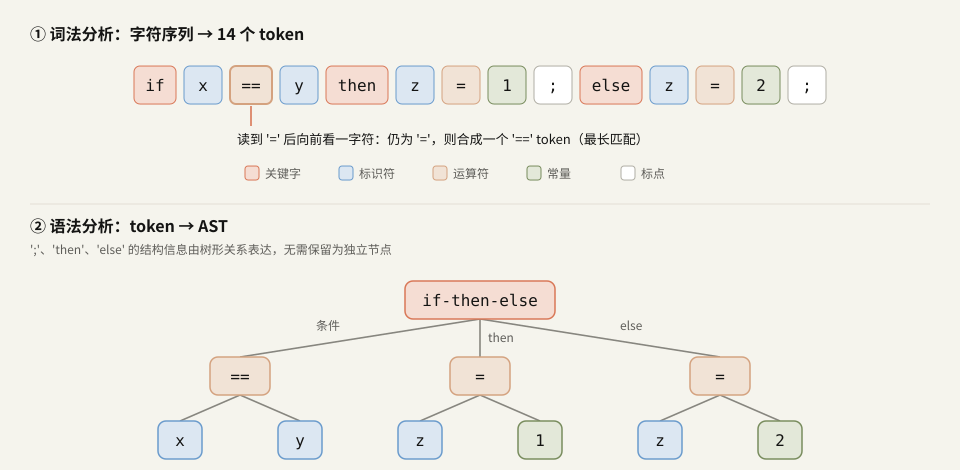

# 1.4 编译器的五个阶段

原文见 [[16.AI编译器/学习日记/01.十月/10_23#2.3 编译器的五个阶段|§2.3–§2.7]]。

## 2.3 编译器的五个阶段

| 阶段 | 工作内容 | 类比英语句子 | 所属部分 | Clang/LLVM 中的对应部分 |
|---|---|---|---|---|
| 1. 词法分析（Lexical Analysis） | 将字符序列切分为 token | 将字母组合成单词 | 前端 | Clang `Lexer` |
| 2. 语法分析（Parsing） | 根据 token 构建 AST | 分析主语、谓语、宾语关系 | 前端 | Clang `Parser` |
| 3. 语义分析（Semantic Analysis） | 名称和类型检查，为 AST 添加信息 | 检查语法正确的句子是否有合理含义 | 前端 | Clang `Sema` |
| 4. 优化（Optimization） | 变换为运行更快或体积更小的程序 | 保持含义，改用更简洁的表达 | 中端 | LLVM IR pass（`opt`） |
| 5. 代码生成（Code Generation） | 转换为另一种语言，通常为汇编代码 | 翻译成另一种语言 | 后端 | `llc`、CodeGen |

MLIR 使用**多个抽象层级的 IR**，使优化可以在合适的层次进行。例如，张量操作级优化与循环级优化可以分别在对应层次完成。

## 2.4 词法分析如何区分等号和双等号



词法分析器采用**最长匹配（maximal munch）**规则：从当前位置选取能够组成的**最长 token**。

读到 `=` 后，词法分析器继续向前看一个字符（lookahead），再确定 token。

- 下一个字符也是 `=`，就将两个字符合成一个 `==`（比较）token。
- 否则，当前字符组成 `=`（赋值）token。

图中的 `if x == y then z = 1; else z = 2;` 共包含 14 个 token。同理，`<=`、`>=`、`!=`、`++`、`->` 也各是一个 token。

最长匹配按词法规则机械地进行，因此 C++ 中的 `a+++b` 会切分为 `a ++ + b`。

```console
$ # int a = 1, b = 2; int c = a+++b;
c=3 a=2        ← (a++) + b = 1 + 2，之后 a 变为 2
```

C++03 中，`vector<vector<int>>` 里的 `>>` 会被识别为一个右移运算符 token，因此需要写成 `> >`。C++11 起，语法规则允许在相应模板上下文中将 `>>` 作为两个右尖括号处理。

## 2.5 语法分析

识别单词之后，还需要理解句子结构，就像分析英语的主语、谓语、宾语、修饰语与补语的关系。在程序语言中，这项工作由语法分析完成。

上图 AST 的 `if-then-else` 节点有三个子节点：条件、then 分支、else 分支。token 序列中的 `then`、`else`、`;` 不一定需要作为独立节点保留。它们标示的结构关系已经由树的形状表达，这就是“**抽象**语法树”的含义。

## 2.6 优化

优化类似于编辑句子：例如讲义将 “But a little bit like editing” 改为 “but akin to editing”，表达更简洁，**含义保持不变**。程序优化也是在保持语义的前提下，提高速度、减少内存使用或缩小代码体积。

例如，在适当的整数运算条件下，<code>X &#61; Y * 0</code> 可以改成 <code>X &#61; 0</code>。**浮点数不能直接套用这条规则**，因为结果不一定是普通的正零。

```console
    3 * 0.0 = 0
  nan * 0.0 = nan
  inf * 0.0 = -nan      ← 无穷大乘以零也得到 NaN
   -3 * 0.0 = -0        ← 负数乘以正零得到 -0.0（带符号的零）
```

原文使用 `-O2 -S` 检查 GCC 是否保留这种区别。

```asm
mul0_int:                 # int y * 0
    xorl  %eax, %eax      # 无需乘法，直接返回 0
    ret

mul0_double:              # double y * 0.0
    pxor  %xmm1, %xmm1    # 构造 0.0
    mulsd %xmm1, %xmm0    # 仍执行乘法，不能忽略 NaN、inf 与 -0.0
    ret
```

启用 `-ffast-math` 相当于允许优化器忽略 NaN、无穷大、带符号零等严格浮点约束，因此 `mul0_double` 也会变为 `pxor %xmm0, %xmm0; ret`。优化必须遵守**当前语言规则与编译选项所允许的语义范围**。

## 2.7 各阶段工作量的变化

讲义对比了早期编译器（如 FORTRAN I）与现代编译器各阶段的工作量。早期词法分析、语法分析占比较大；相关理论与工具（如词法分析器、解析器生成器）成熟后，这两部分占比下降。语义分析仍占一定比重，**优化的比重明显增加**，代码生成相对较小。这是课程中的总体比较，具体编译器和工作负载会有所不同。

AI 编译器中也常有类似情况：算子融合、分块、内存布局等优化，通常比单纯把模型读入 IR 需要更多工程工作。

观看讲义时留下了以下问题，在 [[1.5 编程语言的设计与取舍|§3–§5]] 中依次整理。

1. 为什么有这么多编程语言？
2. 为什么还在不断出现新的编程语言？
3. 什么是好的编程语言？

---
