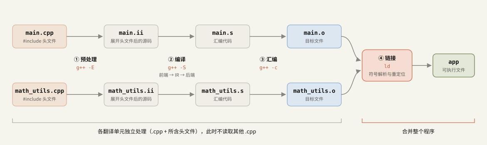

# 1.1 编译流程与各阶段职责

编译器把源程序翻译成目标程序。学习流程时，需要区分两个层次：C++ 程序的构建过程，以及编译阶段内部的分析、优化和代码生成。

## 1. C++ 程序如何生成可执行文件

以下是 Linux 上常见的 GCC 构建流程。中间文件可以只存在于工具内部，不一定写入磁盘。



| 阶段 | 输入与输出 | 主要工作 | 观察命令 |
|---|---|---|---|
| 预处理 | `.cpp` → `.ii` | 展开头文件和宏，处理条件编译，去除注释 | `g++ -E main.cpp -o main.ii` |
| 编译 | `.ii` → `.s` | 分析程序、生成并优化 IR、生成汇编 | `g++ -S main.ii -o main.s` |
| 汇编 | `.s` → `.o` | 编码机器指令，生成符号表和重定位信息 | `g++ -c main.s -o main.o` |
| 链接 | `.o` 和库 → 可执行文件 | 解析符号引用，安排地址并完成重定位 | `g++ main.o -o app` |

`-E`、`-S`、`-c` 指定停止位置。例如，对 `.cpp` 使用 `-c` 会先完成预处理和编译，再汇编得到 `.o`。

一个源文件经过头文件展开、条件编译等预处理后，形成一个翻译单元。普通的分离编译分别处理各翻译单元；链接时优化（LTO）则允许在链接阶段进行跨翻译单元的分析与优化。

`.o` 是可重定位目标文件，通常还不能独立运行。它除了机器码，还记录：

- 符号表：本文件定义了什么，以及引用了哪些外部符号。
- 重定位信息：哪些地址或偏移需要在后续链接或加载时修正。

## 2. 编译阶段内部做什么

| 部分 | 阶段 | 输入与产物 | 解决的问题 |
|---|---|---|---|
| 前端 | 词法分析 | 字符 → Token | 哪些字符组成一个词法单元？ |
| 前端 | 语法分析 | Token → 语法结构，通常构造 AST | 这些词法单元怎样组成表达式和语句？ |
| 前端 | 语义分析 | AST → 带名称、类型等信息的 AST | 名称指向哪个声明？类型和操作是否合法？ |
| 前端到中端 | IR 生成 | 已分析的程序 → IR | 怎样用适合后续处理的形式表示程序？ |
| 中端 | 优化 | IR → 变换后的 IR | 怎样保持语义，同时改善速度、体积或资源使用？ |
| 后端 | 代码生成 | IR → 目标汇编或机器码 | 选哪些指令，怎样分配寄存器、安排指令？ |

这是职责划分，不要求实现中每一步严格分开。语法分析和语义分析可以交错进行，优化也可以发生在 AST、不同层次的 IR 和机器指令上。

以表达式 `a + 2 * 3` 为例：

1. 词法分析得到标识符 `a`、加号、整数 `2`、乘号、整数 `3`。
2. 语法分析根据优先级构造 `Add(a, Mul(2, 3))`，而不是 `Mul(Add(a, 2), 3)`。
3. 语义分析查找 `a` 的声明，检查操作数类型，必要时插入转换。
4. 若采用普通整数运算，优化可以把 `2 * 3` 折叠成 `6`。
5. 后端将剩余运算映射到目标机器指令。

Token 保留词法单元的类别、词素或值等信息。AST 保留程序的结构关系；括号等标点的作用已经体现在结构中，通常不需要独立节点。IR 则服务于后续分析、优化和降级。

## 3. 错误属于哪个阶段

| 情况 | 主要检查阶段 | 原因 |
|---|---|---|
| 字符串缺少结束引号 | 词法分析 | 不能形成完整的字符串词法单元 |
| 声明末尾缺少分号 | 语法分析 | Token 本身合法，但组合不符合文法 |
| 使用未声明的变量 | 语义分析 | 无法将名称解析到声明 |
| 操作数类型不符合要求 | 语义分析 | 结构成立，但类型规则不允许 |
| 函数已声明，却找不到所需定义 | 链接 | 无法解析外部引用 |
| 启动时找不到共享库 | 动态加载 | 运行环境缺少依赖 |

这些是典型归属；实际诊断可能在不同阶段协作后给出。编译成功也不代表程序没有逻辑错误，或编译器已经发现所有未初始化读取等问题。

## 4. 多文件编译与链接

假设 `main.cpp` 调用 `math_utils.cpp` 中定义的函数，头文件提供声明，可以分别编译后链接：

```bash
g++ -std=c++17 -c main.cpp -o main.o
g++ -std=c++17 -c math_utils.cpp -o math_utils.o
g++ main.o math_utils.o -o app
```

调用方可以根据声明完成编译，定义由链接阶段寻找。只修改 `math_utils.cpp` 时，通常只需重新编译它，再重新链接；修改公共头文件时，依赖它的翻译单元通常都要重新编译。

头文件的 include guard 或 `#pragma once` 只防止同一翻译单元内重复包含，不能解决不同翻译单元中的重复定义。

关于定义和库，这里只需记住：

- ODR 约束定义的数量与一致性，不约束变量在运行中被修改多少次。普通外部变量通常在头文件中用 `extern` 声明，在一个 `.cpp` 中定义；inline、模板等另有允许多份定义的条件。
- 静态链接把所需库代码纳入产物。只更新库实现且接口不变时，通常需要重新链接，调用方已有的目标文件可以复用。
- 动态链接保留共享库依赖。更换 ABI 兼容的共享库后，程序下次启动可使用新版本；已经运行的进程不会因此自动更新。

ODR 反例、符号表输出和静态／动态库实验保留在原始记录中，概述不展开这些细节。

## 5. 优化必须满足什么条件

优化需要在语言规则和编译选项允许的范围内保持程序语义。

普通整数值乘零可以简化为零，但不能因此删除操作数求值中的必要副作用。例如，`f() * 0` 的结果即使确定为零，也可能仍需调用 `f()`。

严格浮点语义下，乘零还要考虑 NaN、无穷大和带符号零，不能直接照搬整数规则。更宽松的浮点编译选项可以允许额外变换，但改变了优化所依据的约束。

在 Clang/LLVM 工具链中，Clang 负责 C/C++ 前端，LLVM Pass 进行 IR 分析与变换，LLVM 后端生成目标代码。MLIR 允许在多个抽象层次表示计算，使张量、循环、内存等层次各自保留适合优化的信息。

## 自测

- 为什么缺少分号通常不是词法错误？
- 为什么调用方编译成功后，链接仍可能找不到函数？
- 为什么“数学上结果相同”不足以证明一次优化合法？

来源：[[16.AI编译器/学习日记/01.十月/10_23#1. C++：预处理、编译、汇编、链接|原始构建记录]]、[[16.AI编译器/学习日记/01.十月/10_23#2. 斯坦福 CS143 第 1 讲|CS143 第 1 讲记录]]。
