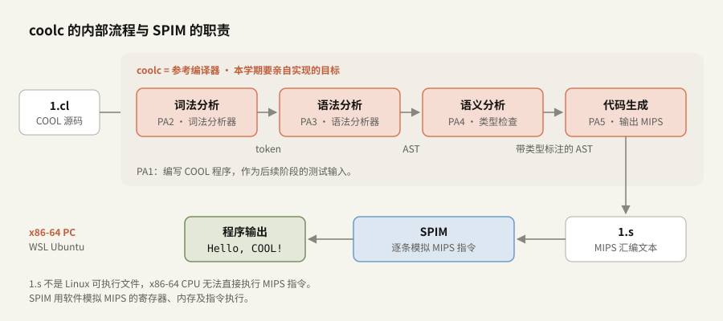

# 2.1 COOL 编译运行与环境排错

COOL（Classroom Object-Oriented Language）是 CS143 使用的教学语言，支持类、单继承、静态类型和自动内存管理。先用参考编译器运行小程序，是为了能判断后续自己编写的编译器是否正确。

## 1. coolc 和 SPIM 分别做什么



| 工具／文件 | 职责 |
|---|---|
| `main.cl` | COOL 源代码 |
| `coolc` | 分析源代码，生成 MIPS 汇编 `main.s` |
| `main.s` | 汇编文本，不是可直接启动的 Linux 可执行文件 |
| SPIM | 模拟 MIPS 指令，配合课程运行时执行程序 |

在配置好课程工具的 Linux／WSL 终端中运行：

```bash
coolc main.cl
spim -file main.s
```

第一条命令成功，只表示编译完成；第二条才执行程序。SPIM 的版本信息、加载运行时的提示及课程运行时的结束提示，不属于程序自己的输出。

MIPS 是这套参考编译器的目标架构，不是 COOL 语言的限制。若换成 x86-64 后端，还需配套处理调用约定、对象布局、内存管理和输入输出等运行时功能。

## 2. 先定位错误，再处理环境

原始日记使用 WSL Ubuntu 24.04（x86-64）和旧版课程工具。下文的 `~/compiler/cs143-tools` 是工具目录示例，请按实际位置替换；不要求系统必须与老师一致。

```bash
uname -m
type -a coolc
ls -l ~/compiler/cs143-tools/bin/coolc
file ~/compiler/cs143-tools/bin/.i686/coolc
```

| 现象 | 优先检查 | 处理方向 |
|---|---|---|
| `command not found` | 工具是否存在、所在目录是否在 PATH 中 | 先用完整路径调用，再配置 PATH |
| `Permission denied` | 外层脚本与内部程序的执行权限 | 只给所需程序补执行权限 |
| 文件存在却无法启动 | 实际二进制架构、加载器与依赖库 | 判断是否缺少旧版 32 位工具的兼容环境 |
| 外层脚本找不到内部程序 | 工具目录是否完整 | 保留脚本依赖的目录结构 |
| SPIM 无法加载程序或运行时 | 汇编文件路径、课程运行时配置 | 使用这套课程工具配套的 SPIM 配置 |

该旧版工具包的 `bin/coolc` 是启动脚本，实际二进制在 `bin/.i686/coolc`。只复制外层脚本不够；其他版本的布局可能不同。

原日记对这套工具采取的处理是：

```bash
sudo apt update
sudo apt install libc6-i386
chmod +x ~/compiler/cs143-tools/bin/coolc
chmod +x ~/compiler/cs143-tools/bin/.i686/coolc
```

这是 x86-64 Ubuntu 运行旧版 32 位 x86 二进制的处理记录，不是所有平台的通用安装步骤。ARM 主机仅安装这项兼容库，不能直接执行 x86 程序。

## 3. 配置 PATH

确认完整路径能调用后，在 `~/.bashrc` 中添加一次：

```bash
export PATH="$HOME/compiler/cs143-tools/bin:$PATH"
```

再让当前 Bash 读取配置，并核对命令来源：

```bash
source ~/.bashrc
type -a coolc
type -a spim
```

PATH 是用冒号分隔的搜索目录列表。新目录放在前面会优先搜索，末尾的 `$PATH` 保留原有路径。不要重复添加相同行，也不要覆盖整个 `.bashrc`。

## 4. A2I 与多文件编译

`Object`、`IO`、`Int`、`Bool`、`String` 是内置类。`A2I` 是课程提供的字符串／整数转换辅助类，通常定义在 `atoi.cl` 中，必须提供它的源码。

假设 `main.cl` 使用了 `A2I`：

```bash
coolc main.cl ~/compiler/cs143-tools/examples/atoi.cl
spim -file main.s
```

课程参考工具默认根据第一个输入文件命名输出，因此这里生成 `main.s`。全部输入文件中的类共同组成一个程序，不需要 C++ 的 `#include`。

- `inherits A2I` 只声明继承关系，不会自动加载文件。
- 缺少 `atoi.cl` 时，使用未定义类会在语义分析阶段报错。
- 文件名不必与类名相同。
- 如果有多份 `atoi.cl`，只传入其中一份，避免重复定义同名类。

转换代码见 [[2.3 类、方法与输入输出]]，完整多文件案例见 [[2.4 综合案例：异构对象链表]]。

## 5. 课程作业与工具的关系

| 作业 | 主要任务 |
|---|---|
| PA1 | 编写 COOL 程序，熟悉语言 |
| PA2 | 实现词法分析器 |
| PA3 | 实现语法分析器并构造 AST |
| PA4 | 检查作用域和类型 |
| PA5 | 生成 MIPS 汇编 |

课程框架允许用参考实现配合正在开发的阶段。具体连接方式以作业目录中的脚本为准。

来源：[[16.AI编译器/学习日记/01.十月/10_24#2. 环境配置与排错记录|环境排错记录]]及原文 §1、§3、§7。本文整理原有环境经验，本次未重新安装或执行课程工具。
