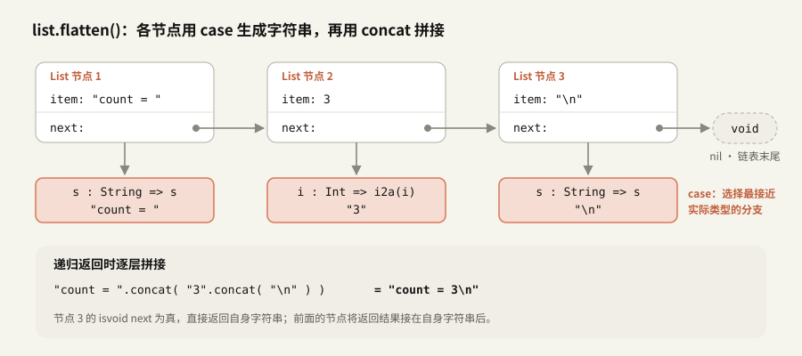

# 2.4 综合案例：异构对象链表

这个例子用一个链表存储字符串和整数，再把节点内容拼成字符串。它把 `Object`、`let`、`case`、空引用、方法返回值和递归放在同一段程序中。

## 1. 完整程序

保存为 `list.cl`，其中 `A2I` 来自课程的 `atoi.cl`：

```cool
class List inherits A2I {
    item : Object;
    next : List;

    init(i : Object, n : List) : List {
        {
            item <- i;
            next <- n;
            self;
        }
    };

    flatten() : String {
        let string : String <-
            case item of
                i : Int => i2a(i);
                s : String => s;
                o : Object => { abort(); ""; };
            esac
        in
            if isvoid next then
                string
            else
                string.concat(next.flatten())
            fi
    };
};

class Main inherits IO {
    main() : Object {
        let nil : List,
            list : List <-
                (new List).init("count = ",
                    (new List).init(3,
                        (new List).init("\n", nil)))
        in
            out_string(list.flatten())
    };
};
```

```bash
coolc list.cl ~/compiler/cs143-tools/examples/atoi.cl
spim -file list.s
```

预期程序输出：

```text
count = 3
```

完整代码沿用原始日记中已记录验证的链表示例。本次整理没有重新运行 coolc 或 SPIM。

## 2. 链表怎样建立

`item : Object` 允许引用不同类型的对象；如果声明为 `String`，整数节点就无法通过类型检查。`next : List` 保存下一个节点的引用。

`init` 完成两次赋值后返回 `self`，因此 `(new List).init(...)` 的结果就是初始化后的节点。它是显式调用的普通方法，不是构造函数。



`nil : List` 没有初始化表达式，默认值为空引用。nil 只是变量名，不是关键字。后面的 list 初始化式可以使用 nil，因为同一个 `let` 的声明按顺序进入作用域。

## 3. case 根据实际类型选择分支

`item` 的静态类型是 `Object`，直接调用 `i2a(item)` 不符合参数类型要求。`case` 检查实际对象类型，并在选中的分支中提供具有该分支声明类型的局部变量：

| 分支 | 分支内可用的信息 | 结果 |
|---|---|---|
| `i : Int` | i 可以作为整数使用 | `i2a(i)` 产生字符串 |
| `s : String` | s 可以作为字符串使用 | 直接返回 s |
| `o : Object` | 其他对象 | 调用 `abort()` 终止程序 |

选择规则是：在匹配的分支类型中，选择离实际类型最近的祖先类型。不是按书写顺序选第一个匹配分支，所以把 `Object` 分支放到最前面，也不会抢走整数或字符串分支。

`case` 每次只执行一个分支。如果待检查的值是空引用，会直接产生运行时错误；没有匹配分支也会报错。`Object` 分支不能捕获空引用。

## 4. abort 后为什么还有空字符串

```cool
o : Object => { abort(); ""; };
```

`abort()` 的声明返回类型是 `Object`，但运行时会终止程序。静态类型检查仍按照表达式的类型规则处理这个块。

块的最后一个表达式是空字符串，所以块的静态类型为 `String`。三个分支都是 `String`，整个 `case` 才能用于初始化 `string : String`。

删除空字符串后，这个分支的静态类型变成 `Object`，三个分支的最近公共祖先也变成 `Object`，不能用于初始化 `String` 变量。保留空字符串是为了满足静态类型规则，运行时不会执行到它。

## 5. flatten 怎样递归返回

每个节点先把自己的 item 转成字符串，再处理 next：

- next 为空，直接返回当前字符串。
- next 非空，调用 `next.flatten()`，将其结果接在当前字符串后面。

返回过程从末尾向前进行：

| 返回位置 | 当前字符串 | 后续结果 | 本次返回 |
|---|---|---|---|
| 第三个节点 | `"\n"` | 无 | `"\n"` |
| 第二个节点 | `"3"` | `"\n"` | `"3\n"` |
| 第一个节点 | `"count = "` | `"3\n"` | `"count = 3\n"` |

`flatten()` 返回字符串，真正输出发生在 Main 的 `out_string` 调用中。

## 自测

- 把整数节点改成 `new Object`，会进入哪个分支？
- 把 `Object` 分支移到最前面，输出是否改变？
- 如果 item 为空引用，能否进入 `Object` 分支？
- 删除 `abort()` 后的空字符串，会发生运行时错误还是类型检查错误？

来源：[[16.AI编译器/学习日记/01.十月/10_24#8. 课程最后的示例：存储不同类型对象的链表|原始链表记录]]。表达式的值与类型规则见 [[2.2 基本类型、变量与表达式]]。
