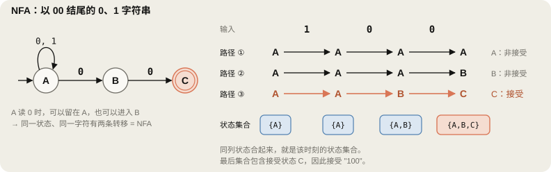

# 3.4 有限自动机：DFA 与 NFA

正则表达式描述字符串集合；有限自动机通过读取字符、改变状态来判断输入是否属于这个集合。

## 1. 自动机的组成与接受条件

| 组成 | 记号 | 含义 |
|---|---|---|
| 状态集合 | Q | 有限个状态 |
| 字母表 | $\Sigma$ | 输入符号集合 |
| 初始状态 | $q_0$ | 读输入之前所在的状态 |
| 接受状态集合 | F | 图中通常画成双圆圈 |
| 转移函数／关系 | $\delta$ | 根据当前状态和输入确定后续状态 |

对整个字符串做判定时，必须读完全部输入，且最后能够停在接受状态，才算接受。中途经过接受状态不够。

例如，只接受单个 `1` 的自动机不会接受 `10`，即使读完第一个字符时已经到过接受状态。Lexer 切分前缀时会记录这个位置，属于另一层驱动逻辑。

## 2. DFA 和 NFA 的区别

| 对比项 | DFA | NFA（本章允许 ε 边） |
|---|---|---|
| 一个状态读取同一字符 | 唯一后继 | 可以有零个、一个或多个后继 |
| ε 转移 | 不允许 | 允许，不消费字符 |
| 当前配置 | 一个状态 | 一组可能状态 |
| 接受条件 | 唯一路径读完整串后接受 | 至少一条路径读完整串后接受 |

严格定义的 DFA 对每个状态、字符对都有转移。图中缺失的边可以理解为通向非接受死状态；死状态对所有字符自环。实现中也可以用 DEAD 标记省略这些边。

NFA 的非确定性不只来自 ε 边：同一状态读同一字符有多个后继，也足以产生非确定性。ε 不是输入中的字符，经过 ε 边时输入位置保持不变。

## 3. 用状态集合模拟 NFA

下面的 NFA 接受以 `00` 结尾的二进制串：A 对 0、1 自环，A 读 0 还可以到 B，B 读 0 到接受状态 C。

每读一个字符，把当前所有可能状态的对应后继取并集。本例没有 ε 边；有 ε 边时，开始和每次字符推进后还需计算 ε 闭包，见 [[3.6 NFA 到 DFA]]。

对于 `100`，集合依次为 $\{A\}$、$\{A\}$、$\{A,B\}$、$\{A,B,C\}$。最后包含 C，接受。如果再读一个 1，集合只剩 A，输入 `1001` 被拒绝。

这不要求创建操作系统线程，也不需要枚举所有完整路径。多条路径到达同一状态时，可以合并为一个集合元素。

## 4. 表达能力相同，状态规模可能不同

DFA、NFA 与形式正则表达式描述的语言类相同，都是正则语言。NFA 并不因为有多个选择就能识别更多语言。

不同的是表示规模：n 个 NFA 状态最多对应 $2^n$ 个状态子集，转换后的 DFA 在最坏情况下会指数增长，但实际只需构造可达子集。

一个例子是“倒数第 k 位是 1”：NFA 可以在读到 1 时分出一条路径，再检查是否恰好剩 k−1 个字符；DFA 则需要保留足以区分最近 k 位的信息。

为什么不同的 k 位历史不能随意合并？任取两串 u、v，如果它们从左数第 j 位不同，给两串追加 j−1 个 0，原来的第 j 位就成为倒数第 k 位。此时一串应接受、另一串应拒绝；若此前合并到同一 DFA 状态，就无法给出不同结果。因此这些历史需要 $2^k$ 个可区分状态。

## 5. 运行成本

固定 DFA 做整串判定时，每字符只做一次转移，输入长度 N 对应 O(N) 次转移。直接模拟 Thompson NFA，需要维护状态集合；若表达式大小为 m，常规实现的时间上界为 O(Nm)。

这说明 DFA 将一部分计算提前到了生成阶段，不代表所有实现和输入下 DFA 都一定更快。表大小、缓存、构造成本也影响实际表现。

## 自测

- 经过接受状态后又读入字符，是否仍一定接受？
- 没有 ε 边的自动机为什么仍可能是 NFA？
- 状态集合模拟为什么不需要保存全部历史路径？

来源：[[16.AI编译器/学习日记/01.十月/10_27#3. CS143 4-2：有限自动机（Finite Automata）|10_27 有限自动机]]。
