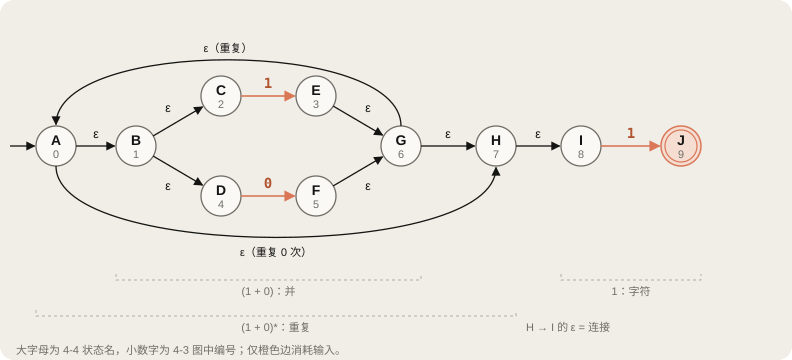

# 3.5 正则表达式到 NFA

Thompson 构造按正则表达式的结构递归生成 NFA：先构造子表达式，再用 ε 边组合片段。每个片段使用一个入口和一个出口，便于外层规则连接。

## 1. 基本构造规则

| 表达式 | 构造方式 |
|---|---|
| $\varepsilon$ | 入口用 ε 边连接出口 |
| 单字符 a | 入口用标记 a 的边连接出口 |
| AB | A 的出口经 ε 边连接 B 的入口；整体入口取 A，出口取 B |
| $A\mid B$ | 新入口经 ε 分别进入 A、B；两者出口经 ε 汇入新出口 |
| $A^*$ | 新入口可以跳过 A 直接到新出口，也可以进入 A；A 出口可以退出或返回重做 |

空语言可用两个没有连通路径的入口、出口表示。被组合进去的子片段出口不再独立作为整个自动机的接受状态，只有整体出口表示完整匹配。

本篇沿用原图的星闭包版本：子片段出口可以返回新入口，再决定重复或退出。返回子片段入口的另一种版本也正确，但不能混用不同图的状态编号。

## 2. 完整例子：以 1 结尾的二进制串

目标表达式为 $(1\mid0)^*1$。先构造并，再构造星闭包，最后连接末尾的字符 1。

图中的中缀加号表示并，等同于本文的 $\mid$；小数字是旧课件编号，下面统一使用字母。

1. C 读 1 到 E，D 读 0 到 F，构成两个字符片段。
2. 新增 B、G：B 用 ε 边进入 C、D，E、F 用 ε 边汇入 G，得到并。
3. 新增 A、H：A 可以进入 B，也可以直接到 H；G 可以回到 A 或退出到 H，得到星闭包。
4. I 读 1 到 J，构成最后一个字符片段。
5. H 经 ε 边连接 I。整体从 A 开始，只有 J 是接受状态。

完整边集合如下，未列出的转移为空：

| 状态 | ε 后继 | 读 0 | 读 1 |
|---|---|---|---|
| A | B、H | — | — |
| B | C、D | — | — |
| C | — | — | E |
| D | — | F | — |
| E | G | — | — |
| F | G | — | — |
| G | A、H | — | — |
| H | I | — | — |
| I | — | — | J |
| J | — | — | — |

读 `1` 时，可以走 A、H、I，再读 1 到 J，表示星闭包重复零次。读 `01` 时，先通过并中的 0 分支，再退出闭包、读最后的 1。空串不能接受，因为到 J 必须消费最后的 1。

## 3. 为什么构造正确

可以沿表达式结构归纳：

- 单字符与空串片段直接满足对应语言。
- 连接必须先完成 A，再完成 B，因此读取的是两个语言中字符串的连接。
- 并从入口选择 A 或 B，匹配其中任意一个即可。
- 星闭包允许零次通过子片段，也允许任意有限次重复。

构造允许一条输入有多条路径，正确性要求的是“存在一条完整接受路径”，不是每条路径都成功。

## 4. 规模与实现注意点

对大小为 m 的表达式语法树，每个基本构造只新增常数个状态与边。使用适当的数据结构连接片段，总状态数、边数和构造时间都是 O(m)。不要在每次组合时复制整个已有图，否则实现成本可能超过这个界。

本例有三个字符片段、一个并和一个星闭包，共 10 个状态；连接只添加 ε 边。

`A?` 可以展开为空串与 A 的并；`A+` 可以专门构造至少经过一次 A 的循环，避免机械复制两份 A；字符范围也可以用标记字符集合的边表示。

若为多个 Token 规则构造 Lexer，需要给各规则出口保留规则编号与动作，再新增总入口，用 ε 边连接各规则入口。不能把所有出口合成一个没有标签的终点，否则无法确定匹配的是哪条规则。

下一步用 [[3.6 NFA 到 DFA]] 将状态集合预先转换为确定状态。

来源：[[16.AI编译器/学习日记/01.十月/10_27#4. CS143 4-3：正则表达式到 NFA（Thompson 构造）|10_27 Thompson 构造]]。
