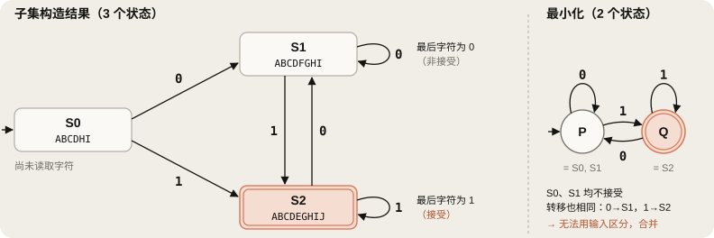

# 3.6 NFA 到 DFA

子集构造把“读完相同前缀后，NFA 所有可能所在的状态”作为一个 DFA 状态。集合中的成员可以很多，但整个集合只有一个确定的后继集合。

## 1. ε 闭包与 move

$\operatorname{closure}(X)$ 包含 X 本身，以及从 X 仅沿 ε 边走零次或多次可达的全部状态。

```text
closure(X):
    result = X 的副本
    work = X 中的所有状态
    while work 非空:
        s = 弹出 work 中一个状态
        for 每条 s --ε--> t:
            if t 不在 result 中:
                将 t 加入 result 和 work
    return result
```

加入集合后才继续搜索，可以避免 ε 环导致无限遍历。这里只访问 ε 边，不能顺手读取普通字符。

$\operatorname{move}(X,c)$ 则把 X 中每个状态的 c 边后继取并集，恰好消费一个字符，不自动包含后续 ε 转移。

因此 DFA 的转移是：

$$
\delta_D(X,c)=\operatorname{closure}(\operatorname{move}(X,c)).
$$

当前 X 本身已经是闭包；先读字符，再计算新闭包。

## 2. 构造流程

1. 以 $\operatorname{closure}(\{q_0\})$ 为 DFA 初始状态。
2. 对每个待处理集合 X、每个字符 c，计算后继集合 Y。
3. 若 Y 尚未出现，分配状态编号并加入待处理集合；记录转移到 Y。
4. 直到没有新集合需要处理。
5. X 与 NFA 接受集合 F 有交集时，将 X 标为接受状态。

集合相同就对应同一个 DFA 状态，集合的枚举顺序不影响身份。空集合可以作为死状态，也可以在实现中用 DEAD 表示。

n 个 NFA 状态共有 $2^n$ 个子集，包含空集合，因此过程必定结束；只构造实际可达的子集。

## 3. 延续 Thompson 构造例子

使用 [[3.5 正则表达式到 NFA]] 中的 A—J 自动机，接受状态只有 J。

首先：

$$
\operatorname{closure}(\{A\})=\{A,B,C,D,H,I\}.
$$

闭包没有 E、F、J，因为到这些状态必须读取字符。

| DFA 状态 | NFA 状态集合 | 接受？ | 读 0 | 读 1 |
|---|---|---|---|---|
| S0（初始） | A、B、C、D、H、I | 否 | S1 | S2 |
| S1 | A、B、C、D、F、G、H、I | 否 | S1 | S2 |
| S2 | A、B、C、D、E、G、H、I、J | 是 | S1 | S2 |

S0 读 0 时，只有 D 的 0 边可用，因此先得到 F；F 经 ε 到 G，再经 A、B、H 等状态扩展，得到 S1。

S0 读 1 时，C 到 E，I 到 J，因此先得到 $\{E,J\}$，再求闭包得到 S2。J 在其中，所以接受。

S1、S2 仍包含 C、D、I，字符后继与上述情况相同，不再产生新集合。



## 4. 多条 Token 规则如何保留标签

将所有规则的 NFA 从总入口连接起来，每个规则的接受状态保存规则编号和动作。对 DFA 集合 X：

- 不包含任何规则的接受状态：非接受。
- 只包含一条规则的接受状态：采用该规则。
- 包含多条规则的接受状态：采用优先级最高的规则。

读完 `i` 时，关键字 `if` 的路径还没到终点，但 ID 已经接受，所以标签是 ID。读完 `if` 时，两条规则都接受，按优先级标记 IF。读完 `if8` 时，关键字路径已经失效，只剩 ID 接受。

这些标签解决同一位置、同一长度的冲突。运行时仍需保存最后接受位置，才能让更长的 ID 覆盖较短的 IF，见 [[3.7 表驱动 Lexer 的实现]]。

## 5. 最小化与转移表共享不是同一件事

两个状态若对任意后续输入都产生相同判定，便可视为等价。本例 S0、S1 都不接受，且每个字符的后继相同，因此可以合并。

最小化通常先按接受／非接受分组，再反复拆分那些读同一字符会到不同组的状态。Lexer 还需按输出规则或动作分组，不能只看是否接受：IF 与 ID 的接受状态不能因为转移相同就直接合并。

如果两个状态只是转移行相同，可以共享表中的那一行，同时保留各自的接受标签。这是存储压缩，不等于合并状态。

## 自测

- 为什么闭包包含起点自身？
- 为什么读取一个字符后还要再求闭包？
- IF 和 ID 状态转移相同，是否可以无条件合并？

来源：[[16.AI编译器/学习日记/01.十月/10_27#5. CS143 4-4：NFA 到 DFA（子集构造）|10_27 子集构造]]。
