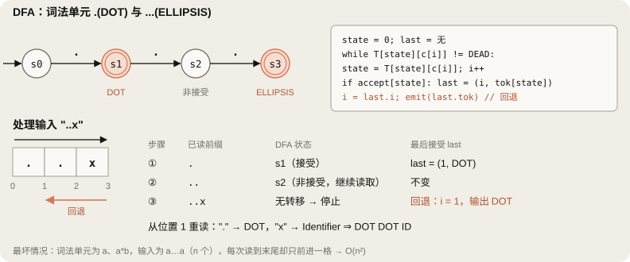

# 3.7 表驱动 Lexer 的实现

生成器已经把正则规则变成 DFA。运行时主要使用转移表和接受规则表，连续从输入中切出 Token。

## 1. 表与扫描状态

| 数据 | 用途 |
|---|---|
| `T[state][char]` | 下一状态，无合法后继时为 DEAD |
| `accept[state]` | 本状态的最高优先级接受规则；非接受状态为 NONE |
| `pos` | 当前 Token 的起始位置 |
| `i` | 向前探测的位置 |
| `last_end`、`last_rule` | 最近一次接受的末尾位置及规则 |

转移表回答“下一步去哪”，接受表回答“当前前缀能否作为完整词素”。到达接受状态后不能立即返回，因为后面可能还有更长匹配。

## 2. 扫描循环

以下为伪代码，区间采用左闭右开。假设普通规则不接受空串，输入可以按偏移访问。

```text
pos = 0
while pos < 输入长度:
    state = START
    i = pos
    last_end = NONE
    last_rule = NONE

    while i < 输入长度:
        next_state = T[state][input[i]]
        if next_state == DEAD:
            break
        state = next_state
        i = i + 1
        if accept[state] != NONE:
            last_end = i
            last_rule = accept[state]

    if last_end == NONE:
        报告 pos 处的词法错误
        pos = pos + 1
    else:
        按 last_rule 处理 input[pos:last_end]
        pos = last_end

输出 EOF
```

规则动作可能是输出 Token、跳过空白或报告 ERROR。若使用任意单字符 ERROR 兜底，非空输入通常总能找到接受位置，此时错误通过规则动作处理；`last_end` 为空的分支支持没有这类兜底的规格。

遇到 DEAD 的字符尚未消费；此前已探测但不属于最终词素的字符，也必须留给下一轮。采用流式缓冲区时，要保留能够回退的输入。源码位置应根据最终消费区间更新，或在回退时恢复，不能按探测位置直接提交。

到达文件末尾也需要输出最后接受的词素。若末尾残留未闭合字符串等结构，具体诊断由对应规则或专门扫描逻辑处理。

## 3. 为什么非接受状态仍要继续

考虑包含单点 DOT、三点 ELLIPSIS 和标识符的简化规则，输入为 `..x`。



读完第一个点时记录 DOT；读完第二个点时不是接受状态，但再来一个点就可能成为 ELLIPSIS，所以还不能停止。看到 x 无法继续后，回到第一个点的末尾，只输出一个 DOT。

下一轮重新处理第二个点，再输出 DOT；最后处理 x 得到 ID。图中“已读到 x”表示已探测该字符，伪代码在转移失败时并没有消费它。

不能用“当前不接受”作为停止条件；停止应依据“无法继续形成匹配”或到达输入末尾。

## 4. 扫描复杂度与回退

固定 DFA 对单个字符串做判定，每字符转移一次，是 O(N)。但连续切 Token 的朴素驱动可能反复探测同一段后缀，不能直接据此宣称总扫描必为线性。

若只有规则 `a` 和 `a*b`，输入为 N 个 a：第一轮会探测到末尾，最终只能输出一个 a；第二轮又探测剩下的全部 a。总探测次数为：

$$
N+(N-1)+\cdots+1=\frac{N(N+1)}2.
$$

最坏是 O(N²)。若规格保证回退距离有固定上界，总扫描可以保持线性。设计规则时应检查可能导致长距离失败探测的模式，不能只看每次查表是否为常数时间。

## 5. 选读：表压缩

按字节建表可以有 256 列；这是字节取值数量，不应称为“256 个 ASCII 字符”。空间大致与状态数乘列数成正比。

| 方法 | 做法 | 注意点 |
|---|---|---|
| 字符等价类 | 在所有状态下转移相同的字符共享一列 | 增加字符到类别的映射 |
| 相同行共享 | 多个状态引用同一转移行 | 接受标签仍按状态保存 |
| 默认行与差异项 | 只保存与默认行不同的转移 | 查询可能增加一次或多次间接访问 |
| 稀疏表打包 | 用 base、check、next 等数组存储稀疏行 | check 用于确认槽位是否属于当前状态 |

压缩减少数据体积，但可能增加查询步骤；完整表查询简单，但占用更多空间。应根据实际表规模和测试结果取舍，不能仅凭“能放进缓存”推断性能。

## 6. 表驱动、生成代码与手写

| 方式 | 状态转移怎样表示 | 主要取舍 |
|---|---|---|
| 表驱动 | 通用循环查询数据表 | 规则与驱动分离，需要考虑表大小和访问成本 |
| 生成直接代码 | 生成器输出分支、跳转等代码 | 减少部分数据查表，可能增大代码体积 |
| 手写扫描器 | 按首字符分派，调用数字、标识符等专用逻辑 | 便于定制上下文和诊断，需要自行维护规则一致性 |

直接代码不等于手写，也不保证比表驱动更快。跳转表不是固定单周期操作，手写代码也存在分支和数据依赖；诊断质量取决于设计，不由是否查表决定。

本章到这里形成完整过程：规则描述语言，Thompson 构造 NFA，子集构造 DFA，接受标签解决同长度冲突，扫描循环通过最后接受位置实现最长匹配。

来源：[[16.AI编译器/学习日记/01.十月/10_27#6. CS143 4-5：表驱动实现（Table-driven Implementation）|10_27 表驱动实现]]。保留原文算法要点，压缩部分只保留机制与取舍，不沿用依赖特定表布局的容量数字。
