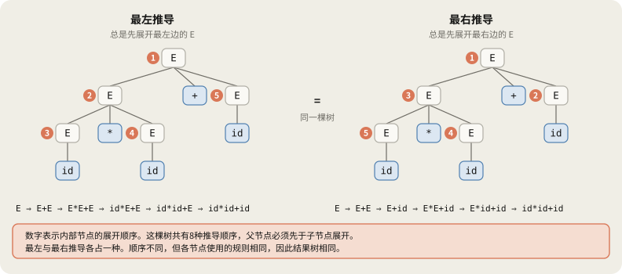

# 4.2 推导、句型与语法分析树

产生式是允许使用的规则；推导是逐次应用规则的过程；语法分析树记录每个位置用了什么规则。三者需要分开理解。

## 1. 产生式、推导和语言

| 记号 | 含义 |
|---|---|
| $A\to\alpha$ | 文法包含一条把 A 替换为 α 的产生式 |
| $\alpha\Rightarrow\beta$ | 在某个位置应用一次产生式，从 α 得到 β |
| $\alpha\Rightarrow^*\beta$ | 应用零次或多次产生式 |
| 句型 | 从开始符号可以推导出的文法符号串 |
| 句子 | 只包含终结符的句型 |

对括号文法 $S\to(S)\mid\varepsilon$：

$$
S\Rightarrow(S)\Rightarrow((S))\Rightarrow(())
$$

`((S))` 是句型，但不是句子；`(())` 两者都是。文法生成的语言只包含终结符串：

$$
L(G)=\{w\in T^*\mid S\Rightarrow^*w\}.
$$

产生式左侧相同，可以用竖线合写为多个候选。这个“或”说明允许哪些规则，并不自动指定分析器应该先尝试哪一条。

## 2. 推导怎样形成树

以开始符号为根，每次使用 $A\to X_1\cdots X_n$，就在相应 A 节点下添加按顺序排列的子节点。完整分析树的内部节点是非终结符，叶子是终结符；空产生式可画 ε 叶子或用约定省略。

从左到右读取叶子，忽略 ε，就得到输入 Token 序列。这是叶子顺序，不是二叉树的中序遍历：一条产生式可以产生三个或更多子节点。

## 3. 同一棵树可以有不同推导顺序

使用文法：

$$
E\to E+E\mid E*E\mid id.
$$

对分组 `(id * id) + id`，固定根使用加法规则，左子树使用乘法规则。

最左推导每步展开最左边的非终结符；最右推导每步展开最右边的非终结符。两者的展开顺序不同，各节点采用的产生式相同，所以得到同一棵树。

固定一棵有限分析树后，最左推导与最右推导各有一种；允许任意位置展开时，还可以有其他顺序，但父节点必须先于子节点展开。

## 4. 推导顺序不等于结构，也不等于求值顺序

| 概念 | 问的是什么 |
|---|---|
| 推导顺序 | 先展开哪个非终结符？ |
| 树结构／分组 | 哪些子表达式组成一个更大的表达式？ |
| 运行时求值顺序 | 程序实际先执行哪个操作或函数调用？ |

例如，根可以先应用加法产生式，再展开乘法子树；这不表示运行时先执行加法。计算加法结果需要相应操作数的值，但两个互不依赖的子表达式之间的执行先后，还要看语言规则。

因此，“树越深一定越先执行”不能作为通用结论。树表达结构和依赖，运行时还可能有分支、短路和副作用规则。

同一输入出现两棵不同分析树才是二义性；仅有两种不同展开顺序不够。判断方法见 [[4.3 二义性、优先级与结合性]]。

## 5. 推导与归约

推导把非终结符展开为产生式右部；归约把已经识别出的右部归并为左部非终结符。归约不是把任何恰好匹配右部的片段都替换掉，还必须选择符合当前分析的片段。

LL 分析对应最左推导，LR 分析对应最右推导的逆过程。两者的第一个 L 都表示从左向右读取输入；LR 中的 R 不表示从右向左读源码。

这一篇只建立对应关系，递归下降、预测分析与移进归约算法在后续章节分别展开。

## 自测

- 同一棵树有最左和最右两种推导，是否说明文法有二义性？
- 根节点先展开成加法，是否说明运行时先算加法？
- LR 中的 R 表示什么？

来源：[[16.AI编译器/学习日记/01.十月/10_28 词法到文法#2. 上下文无关文法与推导|10_28 §2]]、[[16.AI编译器/学习日记/01.十月/10_28 词法到文法#3. 语法分析树与推导顺序|10_28 §3]]。
