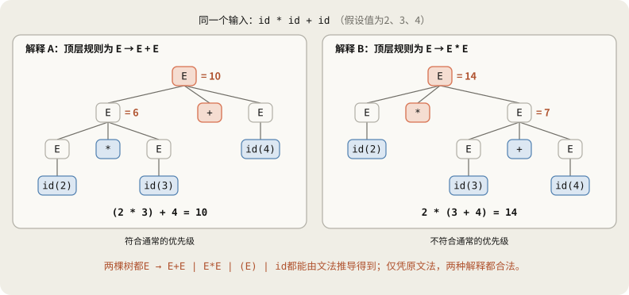

# 4.3 二义性、优先级与结合性

如果存在一个终结符串，可以由同一文法得到两棵不同的分析树，这个文法就是二义性文法。等价地，该串存在两个不同的最左推导，或两个不同的最右推导。

## 1. 二义性来自不同结构

文法 $E\to E+E\mid E*E\mid(E)\mid id$ 没有规定加法和乘法的分组关系。

令三个 id 的值依次为 2、3、4：

| 根节点的规则 | 分组 | 结果 |
|---|---|---|
| $E\to E+E$ | `(2 * 3) + 4` | 10 |
| $E\to E*E$ | `2 * (3 + 4)` | 14 |

两棵树都符合原文法。即使要求所有推导都采用最左顺序，仍然可以分别构造它们。固定展开顺序不能消除这种歧义。

## 2. 用文法分层表达优先级

改写为：

$$
\begin{aligned}
Expr&\to Expr+Term\mid Term\\
Term&\to Term*Factor\mid Factor\\
Factor&\to(Expr)\mid id
\end{aligned}
$$

| 层次 | 表示的结构 |
|---|---|
| Expr（表达式） | 用加号连接的项 |
| Term（项） | 用乘号连接的因子 |
| Factor（因子） | 标识符或括号括起的完整表达式 |

低优先级运算位于外层，高优先级运算构成它的操作数。`id + id * id` 的根必须分出加法，右侧 Term 再生成乘法；乘号右侧的 Factor 无法直接生成无括号的加法。

括号通过 $Factor\to(Expr)$ 允许一个完整表达式作为因子，所以 `(id + id) * id` 仍然合法。Factor 是该层的基本单位，不表示括号内不能有复杂表达式。

## 3. 结合性决定同级运算怎样分组

优先级区分不同层次的运算，结合性处理同一层连续出现的运算。例如减法：

| 文法形式 | 对 `a - b - c` 的分组 |
|---|---|
| $Expr\to Expr-Term\mid Term$ | `(a - b) - c`，左结合 |
| $Expr\to Term-Expr\mid Term$ | `a - (b - c)`，右结合 |

代入 `1 - 2 - 3`，两种结果分别为 −4 和 2。应当采用哪一种由语言规定；右结合本身不是错误。

这里的结合性是语法规则，不是数学结合律。即使整数加法在某种数学模型中满足结合律，也不能据此忽略溢出或浮点舍入对程序变换的约束。

原课件的右递归分层文法可以表达乘法优先，但会给连续运算带来右结合结构。上面的左递归版本表达左结合；简单递归下降不能直接照抄左递归产生式实现，需要改写或采用相应分析方法。

## 4. 改写文法与声明冲突处理规则

处理表达式结构常见两种方式：

- 改写为分层文法，把优先级与结合性写进产生式。
- 保留紧凑文法，再为分析器指定优先级与结合性，用于解决相应冲突。

第二种方式可以让生成的分析器作出确定选择，但原 CFG 本身仍可能是二义性的。声明解决的是分析决策，不能据此宣称所有文法歧义都已消失。具体移进／归约裁决留到 LR 章节。

## 5. 如何检查一次文法改写

至少检查三个问题：接受的字符串集合是否符合预期；每个字符串的结构是否唯一；产生的 AST 是否符合语言的优先级和结合性。

不能仅测试 `a + b`。还应覆盖混合运算、连续同级运算和括号，如 `a + b * c`、`a - b - c`、`(a + b) * c`。

一般 CFG 的二义性判定没有能处理所有输入文法的判定算法；也存在不能用无二义性 CFG 描述的上下文无关语言。因此，不能期待一个通用工具自动消除任意文法的二义性。

来源：[[16.AI编译器/学习日记/01.十月/10_28 词法到文法#4. 二义性与文法改写|10_28 §4]]及 §5.6、§6。
