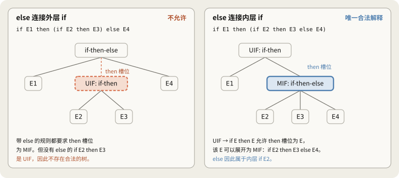

# 4.4 悬空 else 与文法消歧

当语言允许 if 没有 else，嵌套条件语句就可能出现归属问题。以下使用教学文法，条件用 Cond 表示，基本语句用 OTHER 表示。

## 1. 一个 else 对应哪个 if

简单文法：

$$
Stmt\to\text{if }Cond\text{ then }Stmt
\mid\text{if }Cond\text{ then }Stmt\text{ else }Stmt
\mid OTHER.
$$

对于输入：

```text
if c1 then if c2 then s1 else s2
```

它允许两种结构：

| 归属 | 分组 |
|---|---|
| else 属于外层 | `if c1 then (if c2 then s1) else s2` |
| else 属于内层 | `if c1 then (if c2 then s1 else s2)` |

常见约定是匹配当前语法结构中最近的、尚未匹配 else 的 if。这里必须考虑括号、块和条件边界，不能只在文本中倒着寻找最近出现的 if 字符串。

## 2. 将语句分成 Matched 和 Unmatched

Matched（MIF）表示没有暴露在右端、可继续接收 else 的未匹配 if；Unmatched（UIF）表示仍有这样的未匹配部分。基本语句属于 MIF。

```text
Stmt → MIF | UIF

MIF  → if Cond then MIF else MIF
     | OTHER

UIF  → if Cond then Stmt
     | if Cond then MIF else UIF
```

逐条理解：

- 完整匹配的 if，其 then 和 else 分支都必须是 MIF。
- 没有 else 的 if 自身未匹配，then 分支可以是任意 Stmt。
- 自身有 else，但 else 分支末尾仍有未匹配 if，整体仍属于 UIF。

所以“当前语句包含 else”不等于“整体是 MIF”。例如 `if c1 then s1 else if c2 then s2` 仍然属于 UIF。

原课件允许条件本身也是表达式 E。本篇用独立 Cond 隔离条件，先说明语句分支的消歧；若语言允许条件中嵌套控制表达式，需要连同条件边界一起定义完整文法。

## 3. 为什么只剩内层匹配

若把例子的 else 交给外层，外层就必须使用一条带 else 的规则。这些规则都要求 then 分支是 MIF。

但此时 then 分支是 `if c2 then s1`，它缺少 else，只能是 UIF，因此无法按该规则构造外层结构。

若把 else 交给内层，则内层 `if c2 then s1 else s2` 是 MIF；外层使用 `UIF → if Cond then Stmt`，合法。



图中沿用原课件的 E 记号；E1、E2 对应本例的条件，E3、E4 对应基本分支。图上的“不允许”是相对于消歧后的文法，原始简单文法允许两棵树。

## 4. 也可以从语法设计上明确边界

COOL 的条件表达式写作：

```text
if Expr then Expr else Expr fi
```

else 必须存在，fi 明确结束当前 if，因此不产生上述“可省略 else 且无明确结束符”的悬空问题。

其他语言可以用必须存在的块边界、缩进等方式确定分支范围。若语言仍采用就近匹配约定，分析器也可以通过相应冲突处理策略实现，但要区分“文法本身无二义性”和“分析器被规定选择其中一棵树”。

## 自测

- 为什么 `if c1 then s1 else if c2 then s2` 仍然是 UIF？
- 带 else 的规则为什么限制 then 分支为 MIF？
- 原始文法允许外层匹配，为什么上图却标成不允许？

来源：[[16.AI编译器/学习日记/01.十月/10_28 词法到文法#5. 悬空 Else（Dangling Else）|10_28 悬空 else]]。
