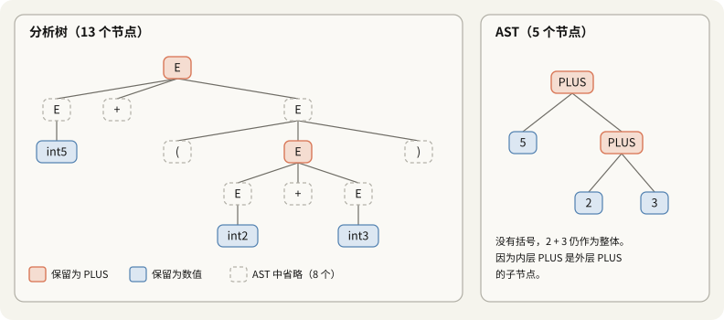

# 4.5 CST、AST 与语义动作

分析树记录产生式结构；AST 保留后续分析需要的程序结构。Parser 可以在识别输入时直接构造 AST，不必先建出完整分析树再删除节点。

## 1. 同一表达式的两种表示

对文法 $E\to int\mid E+E\mid(E)$，考虑输入 `5 + (2 + 3)`：



AST 可以表示为 `Add(Int(5), Add(Int(2), Int(3)))`。

| 信息 | 分析树／本例 CST | 本例 AST |
|---|---|---|
| 产生式层次 | 保留 E 的展开结构 | 省略只起转发作用的 E |
| 运算符 | `+` 是终结符叶子 | Add 是运算节点类型 |
| 括号 | 保留左右括号 | 分组已由子树关系表示 |
| 数字 | int Token 及数值 | Int 节点及数值 |

这里将具体语法树与分析树作为同一层次讨论。实际工具的 CST 可能额外保存空白、注释等信息；理论分析树并不自动包含 Lexer 已丢弃的内容。

## 2. AST 是怎样构造出来的

让每个表达式符号携带一个 `ast` 属性，表示对应子树。识别某条产生式时执行语义动作：

```text
E → int       { E.ast = Int(int.value) }
E → E1 + E2   { E.ast = Add(E1.ast, E2.ast) }
E → ( E1 )    { E.ast = E1.ast }
```

括号规则直接传递内部子树，所以没有单独创建括号节点。加法规则新建 Add 节点，保存左右子树引用。

对于例子，先得到三个 Int 节点；内部加法组合 2 和 3；括号向上传递该子树；外部加法再组合 5 与内部结果。构造出的树有五个节点，但这不要求分析器在内存中保存过图左侧的十三个节点。

这些动作只是在组织结构，没有把 `2 + 3` 计算成 5。常量折叠是另一种变换，可以在其他阶段进行，也可以按需要集成到动作中。

## 3. 语义动作不等于语义分析

| 名称 | 含义 |
|---|---|
| 语义动作（Semantic Action） | 与产生式相关联的计算，例如创建节点、传递属性 |
| 语义分析（Semantic Analysis） | 名称解析、类型检查等对程序含义的检查 |

名字中都有“语义”，职责却不同。Parser 中的动作可以只创建 `Add` 节点，稍后才检查操作数类型是否合法。

在 Bison 风格的动作中，`$$` 表示左部结果，`$1`、`$2` 等表示右部对应位置的语义值。因此，括号规则可写成 `$$ = $2`，加法规则可写成 `$$ = Add($1, $3)`。

其中 `+` 和括号仍参与语法判断，即使最终不出现在 AST 中。LR 状态栈负责分析决策，语义值用于保存数值或子树；具体栈操作留到 LR 实现章节。

## 4. 综合属性与继承属性

| 属性 | 信息来源 | 例子 |
|---|---|---|
| 综合属性 | 根据节点自身及子节点的信息计算 | 由左右子树构造 Add 节点 |
| 继承属性 | 来自父节点或兄弟节点的信息 | 将当前作用域环境传给子表达式 |

继承属性不是 OOP 的类继承。在一般属性文法中，依赖关系需要满足可计算性要求；某些常用形式限制为从父节点和左侧兄弟传递，便于按固定顺序计算。

## 5. 抽象时应保留什么

AST 的设计取决于用途，不是机械地删除所有标点。源码位置、显式括号或注释关联等信息，可能对诊断、重构和语言语义有用。

例如 C++ 中 `decltype(x)` 与 `decltype((x))` 可以得到不同类型，括号区别不能在完成相关语义判断前直接丢掉。

节点还需要明确所有权和生命周期。对于树形所有权，可以由父节点拥有子节点；编译器也可能统一在内存池中分配。源码中的名称引用则可以指向声明节点，不能把所有关联都当作需要独占拥有的子节点。

## 自测

- 省略括号节点后，AST 如何保留 `5 + (2 + 3)` 的分组？
- 构造 Add 节点是否已经完成了类型检查和常量折叠？
- 为什么 CST、AST 的信息保留范围不能只按固定节点数判断？

来源：[[16.AI编译器/学习日记/01.十月/10_29#4. 从分析树到 AST（抽象语法树）|10_29 AST 与属性传递]]；语义值说明与 10_31 原文 §29 衔接。
