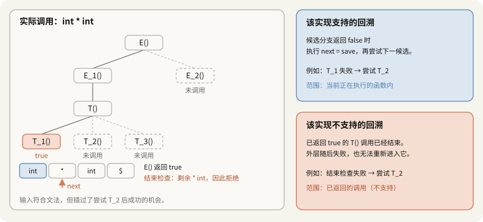

# 5.1 递归下降的实现与回溯

递归下降把非终结符写成解析函数。函数从当前 Token 位置开始，按产生式识别一段输入，成功后把游标留在这段输入之后。递归下降是一种实现方式，不意味着一定回溯，也不意味着只能处理 LL(1) 文法。

## 1. 文法如何对应函数

沿用课件文法，候选按书写顺序尝试：

```text
E → T | T + E
T → int | int * T | ( E )
```

这里 int 是整数 Token 类别。产生式中的终结符调用匹配操作，非终结符调用对应函数；右部顺序对应调用顺序，多个候选对应分支。

下面是控制流程伪代码，函数失败时恢复入口游标：

```text
parseE():
    save ← pos
    if parseT():
        return success
    pos ← save
    if parseT() and match(PLUS) and parseE():
        return success
    pos ← save
    return failure
```

`match` 只在 Token 类别匹配时前进；到达 EOF 时不越界。本实现与课件的 `*next++` 不同：后者即使失配也会递增指针。两种约定都必须与回退逻辑配套，单有一个 EOF 哨兵不能代替边界检查。

## 2. 局部失败如何恢复

识别 `( int )` 时，T 的前两个候选在左括号处失败，第三个候选匹配左括号，调用 E 识别 int，再匹配右括号。

| 时刻 | 游标指向 | 操作 |
|---|---|---|
| 进入外层 T | `(` | 保存入口位置 |
| 尝试 int、int * T | `(` | 失配，恢复入口位置 |
| 尝试 ( E ) | `(` | 消费左括号 |
| 内层 E、T 返回 | `)` | int 已被消费 |
| 外层 T 返回 | EOF | 右括号已被消费 |

完整输入的判定必须同时检查：开始符号解析成功，且游标停在 EOF。否则 `int )` 会被误当作合法输入。

回退还可能涉及临时 AST、符号表改动和诊断记录。只恢复游标不会自动撤销这些操作。试探分支应使用可丢弃的临时结果，或保存并恢复相应状态。

## 3. 局部成功为何仍会漏掉合法输入

对 `int * int`，T 的第一个候选已经成功，E 也随即返回。EOF 检查却看到剩余的 `* int`，于是拒绝。



代码只支持“当前候选失败后尝试下一个”。它没有保存已成功调用的其他选择，无法在调用者后来失败时重新进入那个调用。这是该实现的限制，不能概括为所有递归下降都做不到。

将长候选放前面可以修复部分输入，但不是通用办法。例如 `S → a S a | a` 生成所有正奇数长度的 a 串，采用“首个成功即返回”的长分支优先实现仍会拒绝 `aaaaa`：内层已返回的选择无法重新调整。

## 4. 如何改进

对课件算术文法，可以提取左因子，读完公共部分后再选择，见 [[5.2 左递归消除与左因子提取]]。进一步利用 FIRST/FOLLOW，就能在分析前确定分支。

若确实需要跨调用回溯，必须显式保留选择点，或让解析结果支持多个候选位置；不能只加一次游标复位。反复解析同一位置还可能带来大量重复工作。记忆化能减少重复，但缓存什么结果取决于解析模型；不能把 PEG 的有序选择与任意 CFG 的完整搜索混为一谈。

来源：[[16.AI编译器/学习日记/01.十月/10_29#5. 递归下降分析的实现原理|10_29 §5—§6]]。
