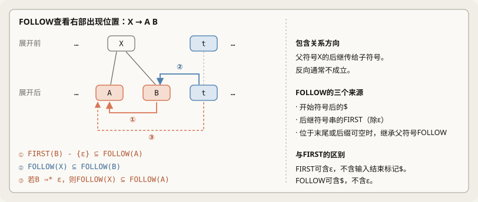

# 5.4 FOLLOW 的含义与计算

FOLLOW(A) 收集可能紧随非终结符 A 的终结符。若存在句型 $S\Rightarrow^*\alpha A a\beta$，则 a 属于 FOLLOW(A)。若 A 可出现在句型末尾，则加入输入结束标记 `$`。

FOLLOW 不问 A 自己能生成什么。比如 Y 只能生成乘法后缀或空串，但 `+` 可以出现在 FOLLOW(Y) 中。

## 1. 三条传播规则

开始符号 S 的 FOLLOW 初始含 `$`，其余集合为空。对于每一处右部出现的 B：

$$A\to\alpha B\beta$$

- 将 $FIRST(\beta)-\{\varepsilon\}$ 加入 FOLLOW(B)。
- 若 β 可空，将 FOLLOW(A) 加入 FOLLOW(B)。β 本来就为空也属于这种情况。
- 反复扫描所有产生式，直到集合不再变化。

FOLLOW 从不含 ε。检查的是 B 后面完整的后缀 β，不只是紧邻的一个符号。以下讨论采用已去除无用符号的文法，避免不可达规则干扰结果。



## 2. 为什么是 FOLLOW(A) 传给 FOLLOW(B)

设 β 可空，任取终结符 $a\in FOLLOW(A)$。根据定义，可以找到：

$$
S\Rightarrow^*\mu A a\nu
\Rightarrow\mu\alpha B\beta a\nu
\Rightarrow^*\mu\alpha B a\nu.
$$

a 也能紧随 B，所以：

$$FOLLOW(A)\subseteq FOLLOW(B).$$

对于结束标记，同理考虑 A 出现在句型末尾的情况。方向来自“展开后谁处在原位置的末尾”，不是看非终结符名字，也不能反向传播。B 可能在别处拥有额外后继，因此一般不能写成相等。

## 3. 完整例子：E、X、T、Y

```text
E → T X
X → + E | ε
T → int Y | ( E )
Y → * T | ε
```

先记录直接来源，再记录集合传递：

| 依据 | 新元素或包含关系 |
|---|---|
| E 是开始符号 | `$` 加入 FOLLOW(E) |
| T → ( E ) | `)` 加入 FOLLOW(E) |
| E → T X，FIRST(X) 除 ε 为 {+} | `+` 加入 FOLLOW(T) |
| E → T X，X 在末尾 | FOLLOW(E) ⊆ FOLLOW(X) |
| E → T X，X 可空 | FOLLOW(E) ⊆ FOLLOW(T) |
| X → + E | FOLLOW(X) ⊆ FOLLOW(E) |
| T → int Y | FOLLOW(T) ⊆ FOLLOW(Y) |
| Y → * T | FOLLOW(Y) ⊆ FOLLOW(T) |

E 与 X 互相传播，T 与 Y 互相传播。E 的集合还会传给 T，但没有反向关系。

| 阶段 | FOLLOW(E) | FOLLOW(X) | FOLLOW(T) | FOLLOW(Y) |
|---|---|---|---|---|
| 初始化 | {$} | ∅ | ∅ | ∅ |
| 加入直接来源 | {$, `)`} | ∅ | {+} | ∅ |
| 传播至稳定 | {$, `)`} | {$, `)`} | {+, $, `)`} | {+, $, `)`} |

这里按“先收集直接来源，再传播”的方式展示，不是声称任意扫描顺序都会恰好在同一轮得到这些集合。

## 4. 两个容易混淆的地方

FOLLOW(E) 不含 `+`：虽然表达式中会出现加法，但这份右递归文法把 `+` 放在 T 后面。应追踪具体产生式中的位置。

FOLLOW 汇总所有出现位置，无法记录某次调用的完整上下文。例如 `)` 可以跟在 E 后面，不代表顶层输入 `int )` 就合法；分析器仍要与外层栈及结束标记核对。

这些集合将在 [[5.5 LL(1) 分析表与预测分析器]] 中决定可空候选何时可以选用，后续 SLR 还会用 FOLLOW 限制归约。

来源：[[16.AI编译器/学习日记/01.十月/10_30#8. FOLLOW 集合计算与算术式文法推导|10_30 §8]]。
