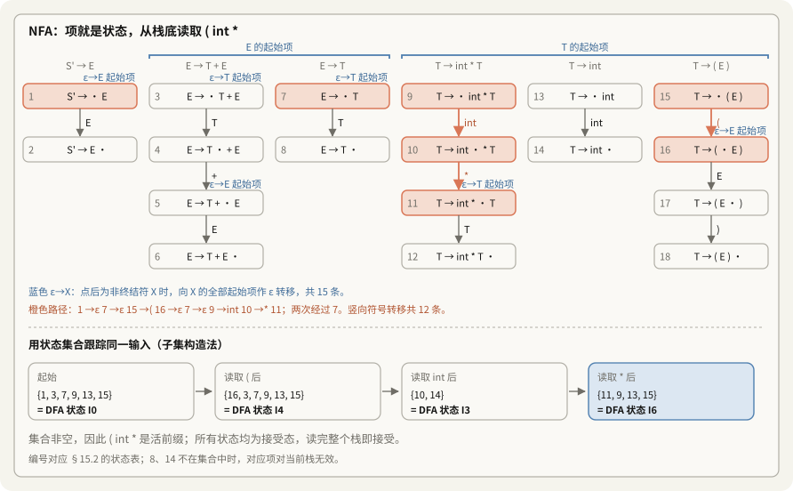

# 6.3 从 LR 项构造活前缀 NFA

这台 NFA 从栈底到栈顶读取文法符号，判断整段栈内容是不是活前缀。它不直接读取源代码字符，也不独立完成整个句子的语法分析。

## 1. 构造规则

先加入新的开始符号 S′ 和产生式 S′ → E。随后按以下规则构造：

| 构件 | 规则 |
|---|---|
| 状态 | 增广文法的所有 LR(0) 项 |
| 起点 | S′ → · E |
| 符号边 | A → α · X β 经 X 到 A → α X · β |
| ε 边 | 若 X 是非终结符，从 A → α · X β 连到每个 X → · γ |
| 接受状态 | 所有项状态 |

符号边表示读取一个栈符号；ε 边表示展开“等待哪个非终结符”的可能性，不读取栈符号，也不消费源码 Token。

等待 X 的项既有标 X 的推进边，也有到 X 各起始项的 ε 边。完成 X 的归约并压入 X，是 Parser 的动作；不要另造一条“从完成项返回父项”的 NFA 边。

## 2. 全部 18 个状态

使用 [[6.1 移进归约与句柄]] 的文法。下表每一行列出一条产生式对应的全部项，编号用于对照原图。

| 产生式 | 项状态 |
|---|---|
| S′ → E | 1: S′ → · E；2: S′ → E · |
| E → T + E | 3: E → · T + E；4: E → T · + E；5: E → T + · E；6: E → T + E · |
| E → T | 7: E → · T；8: E → T · |
| T → int * T | 9: T → · int * T；10: T → int · * T；11: T → int * · T；12: T → int * T · |
| T → int | 13: T → · int；14: T → int · |
| T → ( E ) | 15: T → · ( E )；16: T → ( · E )；17: T → ( E · )；18: T → ( E ) · |

同一行相邻项之间按圆点越过的符号连边，总共 12 条符号边。

ε 边可以完整地分成两组：

- 1、5、16 等待 E，各自连向 3 和 7，共 6 条。
- 3、7、11 等待 T，各自连向 9、13、15，共 9 条。

因此总共 15 条 ε 边。圆点后是终结符或已经到末尾时，不新增 ε 边。

## 3. 读取栈前缀 ( int *

每读一个符号，先取所有同名符号边的目标，再求 ε 闭包：

| 已读栈符号 | 当前状态集合 |
|---|---|
| 空 | {1, 3, 7, 9, 13, 15} |
| ( | {16, 3, 7, 9, 13, 15} |
| ( int | {10, 14} |
| ( int * | {11, 9, 13, 15} |

读取 `*` 后，状态 14 没有相应出边而消失，状态 10 推进到 11，再通过闭包加入 T 的起始项。

集合非空，且所有状态都是接受状态，所以整个栈串是活前缀。若再读取 `)`，没有可用转移，集合变空，便拒绝该栈串。

## 4. “全部接受”不等于接受所有程序

全部状态接受，是因为读到任意合法的中间进度都可以停止检查栈前缀。拒绝仍然可能发生：输入的栈符号无法沿任何路径继续时，就到达空状态集合。

活前缀接受与 Parser 接受是两个判定：后者还要完成开始符号并到达输入结束标记。NFA 也可以用集合直接模拟，并不必须猜路径或回溯；转换成 DFA 是将这些集合状态预先计算出来。

来源：[[16.AI编译器/学习日记/01.十月/10_31#14. 构建活前缀识别器：从产生式到 NFA（六大构建法则）|10_31 §14—§17]]。
