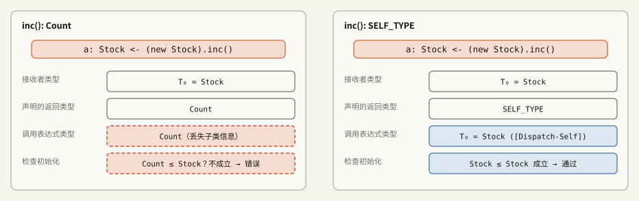

# 7.11 SELF_TYPE 与精确返回类型

SELF_TYPE 保留结果与 self 类型之间的关系，避免继承的方法把子类接收者的类型信息过早变成父类。它是一种静态类型记号，不是一个叫 SELF_TYPE 的运行时类。

## 1. Count 与 Stock 的问题

```cool
class Count {
    i: Int <- 0;
    inc(): SELF_TYPE {
        { i <- i + 1; self; }
    };
};
class Stock inherits Count { };
```

如果 inc 返回类型写成 Count，`(new Stock).inc()` 的静态类型就是 Count，不能直接用于要求 Stock 的位置。改为 SELF_TYPE 后，调用结果保留接收者的静态类型 Stock。



这不表示方法必须返回同一个对象。`new SELF_TYPE` 会创建与当前 self 动态类型相同的新对象，也具有 SELF_TYPE。

## 2. 宿主类与相容关系

SELF_TYPE 出现在类 C 的正文中时，记作 SELF_TYPE_C。self 的类型和 `new SELF_TYPE` 的类型均为 SELF_TYPE_C。

对普通类 T：

| 判断 | 规则 |
|---|---|
| SELF_TYPE_C ≤ SELF_TYPE_C | 成立 |
| SELF_TYPE_C ≤ T | 当且仅当 C ≤ T |
| T ≤ SELF_TYPE_C | 不成立，即使 T 就是 C |

最后一条的原因是 self 运行时可能是 C 的子类 D。普通的 `new C` 不能保证与这个 self 的类型关系一致，因此在 C 中声明返回 SELF_TYPE 的方法，不能简单用 `new C` 作为合法替代。

LUB 同样要保留特殊情况：

$$lub(SELF\_TYPE_C,SELF\_TYPE_C)=SELF\_TYPE_C,$$

$$lub(SELF\_TYPE_C,T)=lub(C,T)\quad(T\text{ 为普通类}).$$

不能先把所有 SELF_TYPE 都替换成 C，否则两个 self 分支汇合时也会丢掉信息。

## 3. 查方法的类与调用结果的类型

接收者的静态类型记作 T0：

- 查签名时，若 T0 是 SELF_TYPE_C，使用类 C；否则使用 T0 对应的类。
- 若签名返回普通类型 R，调用表达式类型为 R。
- 若签名返回 SELF_TYPE，调用表达式类型为 T0。

| 调用条件 | 调用结果静态类型（inc 返回 SELF_TYPE） |
|---|---|
| (new Stock).inc() | Stock |
| c.inc()，c 声明为 Count | Count |
| self.inc()，位于类 C 中 | SELF_TYPE_C |
| (new Stock)@Count.inc() | Stock |

静态分派的 @Count 选择实现，不改变接收者类型，因此最后一行不是 Count。查找时将 SELF_TYPE_C 暂用 C 代替，也不应连结果类型一起宽化。

## 4. 哪些位置允许使用

| 位置 | 是否允许 SELF_TYPE |
|---|---|
| 属性类型、let 声明类型 | 允许 |
| 方法返回类型 | 允许 |
| new 的创建类型 | 允许 |
| 方法形参类型 | 禁止 |
| case 分支声明类型 | 禁止 |
| 类名、父类名 | 禁止 |
| 静态分派 @ 后的类型 | 禁止 |

形参如果随继承把要求从 A 收窄到 B，可能出现调用点按 A 接受实参，实际 B 实现却要求 B 的问题。COOL 直接禁止形参 SELF_TYPE，并要求重写签名保持一致。

这是声明位置的限制，不表示不能把 self 当实参。若形参要求 Object，SELF_TYPE_C 符合 Object，传 self 可以合法。

## 5. 实现时集中处理

类型表示中保留 SELF_TYPE 标签与当前类信息。在相容性、LUB、方法查找和调用结果计算处分别应用规则，不要在读到类型名时就永久转换成 C。

来源：[[16.AI编译器/学习日记/0.2十一月/11_01#42. 引入 `SELF_TYPE`：解决多态自引用|11_01 §41—§43]]。静态分派结果与使用位置可对照 [COOL 手册 §4.1、§12.2](https://web.stanford.edu/class/cs143/materials/cool-manual.pdf)。
