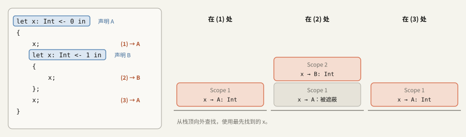

# 7.2 名称绑定、作用域与遮蔽

名称绑定回答“这一处使用指向哪个声明”。作用域规定声明在哪些程序位置可见；遮蔽规定内外层同名时使用哪一个。

## 1. 静态作用域与动态作用域

静态作用域按程序的词法结构确定绑定；动态作用域按运行时调用链寻找绑定。这里的“静态／动态”描述名称查找规则，与静态类型／动态类型不是同一组概念。

考虑示意代码，假设全局没有 a：

```text
g() = let a = 4 in f()
f() = a
```

静态作用域下，f 的定义不在 g 的局部 let 内，因此不能使用那个 a。动态作用域下，通过 g 调用 f 时，f 可以沿调用链找到 a；换一条调用路径可能得到其他值或找不到绑定。

COOL 使用静态作用域。判断依据是语法结构和语言的可见性规则，不是缩进长得近，也不是调用者恰好有同名变量。

## 2. 嵌套 let 的三次查找

```cool
let x: Int <- 0 in
{
    x;
    let x: Int <- 1 in x;
    x;
}
```

第一、三处读取外层声明，第二处读取内层声明。内层绑定生效时，外层记录仍存在；退出内层后重新可见。



COOL 的块 `{ ... }` 本身不引入变量绑定。这个例子的作用域来自 let，不能机械地见到一对花括号就新增符号表层。

作用域也不等于运行时生命周期：前者是文本中的可见范围，后者是值或存储对象存在的时间。语义分析符号表记录声明和类型，不需要保存本例运行时的 0、1。

## 3. 哪些结构引入名字

| 绑定来源 | 可见范围与查找方式 |
|---|---|
| 类声明 | 全局类名，允许前向引用 |
| 属性 | 类及其继承上下文中的对象环境 |
| 方法 | 根据接收者类型，在类与祖先中查找 |
| 方法形参 | 对应方法正文 |
| let 变量 | 自己的正文；多绑定时后续绑定也可见 |
| case 分支变量 | 仅该分支正文 |

类名、方法名、对象标识符不能混成一张无区别的表。COOL 的属性和方法可以同名，因为变量读取与方法调用使用不同的命名空间。

## 4. 遮蔽与重复声明

内层局部变量遮蔽外层同名变量通常合法，但不能据此允许所有重复名称：COOL 同一方法的形参不能重复；同类属性和同类方法各自不能重名。

顺序 let 是另一种规则：

```cool
let x: Int <- 1, x: Int <- x + 1 in x
```

第二个初始化式中的 x 指向第一个绑定，最后的正文指向第二个绑定。实现时可按嵌套 let 处理，而不是把两个名字一并登记后报重复。

名称查找的数据结构见 [[7.3 符号表与 AST 遍历]]；初始化式与正文的环境边界见 [[7.7 类型环境 O 与 let 规则]]。

来源：[[16.AI编译器/学习日记/0.2十一月/11_01#7. 作用域的本质（Scope of Identifiers）|11_01 §7—§12]]。
