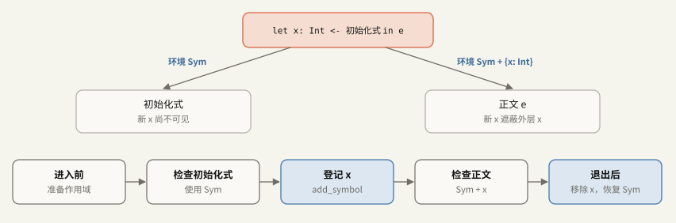

# 7.7 类型环境 O 与 let 规则

类型环境 O 是对象标识符到类型的有限映射。变量引用无法单凭名字确定类型，需要在当前位置的环境中查到绑定。

## 1. 自由变量与查表

自由变量是相对于某个表达式而言的：在 `x + y` 中两者都是自由变量；在 `let y: Int <- 0 in x + y` 中，正文 y 由 let 绑定，x 仍依赖外层。

自由变量不等于未声明变量。外层环境可以为它提供合法声明。

$$\frac{O(x)=T}{O\vdash x:T}\ [Var]$$

查不到 x 才报告未声明；若查到 String，则应按 String 检查后续操作，不能仅因“名字存在”就认为表达式合法。

## 2. O[T/x] 更新了什么

O[T/x] 表示一个新环境：x 映射为 T，其他名字保留 O 中的绑定。它更新的是类型绑定，不是给运行时变量赋值。

设 O 包含 x → Int、y → String：

| 操作 | 结果 |
|---|---|
| O(x) | Int |
| O[Bool/x] | 新的环境 |
| O[Bool/x](x) | Bool |
| O[Bool/x](y) | String |

原来的 O 仍然存在。退出内层作用域后继续使用 O，外层 x 自动恢复可见。实现可以使用作用域栈，无须真的复制整个映射。

## 3. 无初值 let

$$\frac{O[T/x]\vdash body:T_b}{O\vdash\text{let }x:T\text{ in }body:T_b}$$

检查整个表达式时从 O 出发；只在检查 body 时使用加入 x 的环境。结论中的 Tb 是整个 let 的类型，不是 x 的声明类型。

例如 `let x: Int in true`：x 是 Int，但正文和整个 let 都是 Bool。COOL 对无显式初值的变量有默认初始化规则，不能直接套用 C++ 中未初始化局部变量的语义。

## 4. 有初值 let

$$
\frac{O\vdash init:T_i\qquad T_i\le T\qquad O[T/x]\vdash body:T_b}
{O\vdash\text{let }x:T\leftarrow init\text{ in }body:T_b}
$$

这里 $T_i\le T$ 表示初值类型符合声明类型，细节见 [[7.8 子类型、赋值与初始化相容性]]。另外还须检查声明类型是否合法、x 是否为禁止绑定的 self。



对 `let x: Int <- x in x + 1`，声明位置的 x 引入新名字，初始化式中的 x 查外层，正文中的 x 查新绑定。外层没有 x 时，初始化式报错；不能先登记新 x，再让它错误地引用自己。

## 5. 正文环境存声明类型

```cool
let pet: Animal <- new Dog in
{
    pet <- new Cat;
    pet;
}
```

假设 Dog、Cat 都继承 Animal，初始化式为 Dog，正文绑定却应是 pet → Animal。这样后面的 Cat 赋值才按 Animal 的声明约束检查。

最后的 pet 引用类型仍是 Animal，所以整个块和 let 也是 Animal。把 pet 记成初值 Dog，会错误拒绝后续合法赋值；把整个 let 的类型固定成声明类型，也会在其他正文上算错。

来源：[[16.AI编译器/学习日记/0.2十一月/11_01#29. 引入类型环境（Type Environment $O$）|11_01 §29—§32]]。
