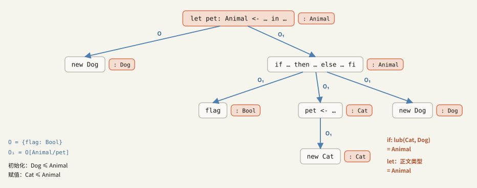

# 7.9 LUB、if 与 case 的类型汇合

分支可能产生不同子类的对象，整个表达式仍需要一个静态类型。COOL 对分支正文类型求最小上界 LUB，在普通类的单继承树中，它就是最近公共祖先。

## 1. 最小上界的含义与计算

Z 是 lub(A,B)，需要满足 A ≤ Z、B ≤ Z；对任意其他公共上界 U，还应有 Z ≤ U。

假设 Animal 继承 Object，Dog、Cat 继承 Animal，Int 继承 Object：

| 输入 | LUB |
|---|---|
| Dog、Cat | Animal |
| Dog、Animal | Animal |
| Dog、Dog | Dog |
| Dog、Int | Object |

若类深度已知，先将较深节点提升到相同深度，再同时沿父类向上，首次相等的位置就是结果。不能深度不同就同步上移，否则可能错过最近公共祖先。单次计算为 O(h)，h 是树高。

## 2. if 对分支正文求 LUB

$$\frac{O\vdash c:Bool\qquad O\vdash a:T_a\qquad O\vdash b:T_b}
{O\vdash\text{if }c\text{ then }a\text{ else }b\text{ fi}:lub(T_a,T_b)}$$

条件必须为 Bool，两侧正文分别检查。常规类型规则不会因为条件恰好写成 true，就跳过另一侧的类型检查。

```cool
let pet: Animal <- new Dog in
    if flag then pet <- new Cat else new Dog fi
```

假设 flag 为 Bool：初始化式为 Dog，pet 的声明类型为 Animal；then 中赋值表达式为 Cat，else 为 Dog，因此 if 和整个 let 都为 Animal。



## 3. case 的两组类型

```cool
case pet of
    d: Dog => 1;
    c: Cat => 2;
esac
```

检查 d 分支使用 O[Dog/d]，检查 c 分支使用 O[Cat/c]。两个局部环境彼此独立，不把 d 带入 c 分支。

| 分支 | 变量声明类型 | 正文类型 |
|---|---|---|
| d: Dog => 1 | Dog | Int |
| c: Cat => 2 | Cat | Int |

case 的结果取正文类型的 LUB，因此本例为 Int，而不是 Animal。

一般规则可写为：

$$\frac{O\vdash e_0:T_0\qquad O[T_i/x_i]\vdash e_i:R_i\ (1\le i\le n)}
{O\vdash\text{case }e_0\text{ of }\cdots\text{ esac}:lub(R_1,\ldots,R_n)}.$$

Ti 用于分支绑定，Ri 用于结果汇总。多分支 LUB 可逐个累积合并。

## 4. 静态检查与运行时选支

case 分支声明类型必须存在、互不重复，不能为 SELF_TYPE；分支变量不能绑定为 self。每个正文都要检查，不要求它的结果类型符合该分支变量的声明类型。

运行时根据被检查对象的动态类型，选择最接近它的匹配祖先分支，不是选源码中第一条可匹配分支。

如果对象为 void，或没有任何分支匹配，仍会发生规定的运行时错误。静态通过不保证分支穷尽；也不能仅凭 pet 静态为 Animal 就拒绝 Dog、Cat 分支。

SELF_TYPE 参与 LUB 时的例外见 [[7.11 SELF_TYPE 与精确返回类型]]。

来源：[[16.AI编译器/学习日记/0.2十一月/11_01#34. 控制流汇聚与最小上界（Least Upper Bound, LUB）|11_01 §34—§36]]。
