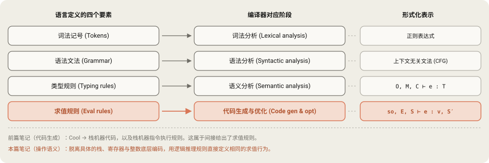

# 8.1 语义定义四要素与三大形式语义学

词法分析和语法分析管的是程序长什么样，类型检查管的是类型能不能对上，但这还不够。要真正定义一门语言，必须说明**每一个 Cool 表达式**求值时会发生什么，这正是表达式的“含义（meaning）”。

本章的核心任务，是将此前在代码生成章节（参见 [[11.1 带累加器的栈机器与表达式代码生成]]）中通过“先编译为栈机器代码、再按指令规则执行”所间接给出的求值语义，重新用与底层机器无关的、严谨的形式化**逻辑推理规则**（Rules of Inference）直接表述出来。其形式化判断与推理规则的表示方法与类型系统（参见 [[7.6 类型推理规则、证明树与基础表达式]]）保持高度一致。

> [!info] 形式化验证背景
> 本章各节讨论的操作语义规则均已通过一个精简的 Python 形式化操作语义解释器验证：解释器分别维护 $\mathrm{so}$、$E$ 与 $S$，每次规则推导均生成新的存储映射，位置分配严格遵循 $\mathrm{newloc}$ 语义；涵盖代码块求值、六种典型错误语义变体对照，以及 $\mathrm{class}(C)$ 展平、`new SELF_TYPE` 动态派发、对象别名（Aliasing）、变量遮蔽（Shadowing）与 `while` 循环等 25 项测试用例全部通过。C/C++ 对比结论基于本地 gcc/g++ 13.3 (x86-64) 编译实测，Java 语义依据 JLS 规范。

## 1. 语言定义的四个要素与编译器阶段

一门编程语言的完整定义可以拆成四块，恰好对应编译器从前端到后端的各个阶段：

**图解阅读**：左侧两列对应语言的定义要素与编译器处理阶段，右侧列补充了各要素在形式化理论中的标准书写范式。前三行在编译器前端已分别深入讨论：正则表达式是词法分析器（Lexer）的形式化规范，上下文无关文法（CFG）是语法分析器（Parser）的形式化规范，而类型判断 $O, M, C \vdash e : T$ 则是语义分析中类型检查器的形式化规范。最后一行正是本章的核心议题：我们使用与类型判断形式高度契合的逻辑推理规则，精确规定程序在运行期“究竟计算出什么”。

## 2. 为什么不用汇编或参考实现来定义语义

在代码生成章节里，我们已经间接给出过一套求值规则：先把 Cool 编译成栈机器代码，再按栈机器的指令规则去执行。这种做法确实给出了完整的行为描述，但它**还不够好**。

问题在于，基于汇编或特定机器实现来定义语义，会混入大量和语言本身无关的底层细节：

- 要不要采用栈机器
- 栈往高地址还是低地址增长
- 整数在底层怎么编码表示
- 目标架构具体长了一套什么指令集

我们需要的是一份**完整但不过度受限（not overly restrictive）**的语言规范，把“表达式应该算出什么”和“底层机器打算怎么实现”拆开，让不同架构上的编译器有自由优化的空间。描述语义的形式化方法有很多种，它们的表达能力其实等价，只是各自适合不同的场景；这里选用最贴近编译器实现直觉的**操作语义（Operational Semantics）**。

> [!note] 补充：以参考实现为规范的缺陷，以及程序语言的三大形式语义学
> - **参考实现沦为规范的陷阱**（Slide 8–9）：如果在设计一门编程语言时缺乏高层次的形式化规范，开发者往往只能退化为“以参考实现（Reference Implementation）的实际运行结果为准”。然而，任何参考实现都会包含 Bug，并且受限于初次实现时的偶然工程妥协。当缺乏独立定义时，这些未曾深思熟虑的实现瑕疵和巧合 Bug 就会不可逆转地被固化为该语言规范的一部分。
> - **形式语义学的三大流派**（Slide 10–12）：
>   - **操作语义（Operational Semantics）**：通过在抽象机器上的状态迁移与执行规则来定义程序含义。Stanford 课件将其生动地比喻为“一种极高层次的代码生成（Very High-Level Code Generation）”。由于它最贴合编译器构造与程序实现的工程直觉，Cool 语言全面采用此方法。
>   - **指称语义（Denotational Semantics）**：将程序中的语法成分直接映射为严谨的数学函数（从输入状态到输出状态的映射）。尽管形式极为优美严谨，但为了让函数拥有良好的数学性质，必须首先建立复杂的域理论（Domain Theory），这引入了大量与编译器工程实现无关的抽象复杂度。
>   - **公理语义（Axiomatic Semantics）**：用数理逻辑断言来表述程序性质，形式通常为“在满足前提断言 $P$ 的状态下执行语句，终止时必满足后置断言 $Q$”（即霍尔三元组 $\{P\}\;C\;\{Q\}$）。它是自动化程序验证与形式化证明的基石。
> - **大步语义 vs 小步语义**：本讲义采用的是**大步操作语义**（Big-Step Semantics，亦称自然语义 Natural Semantics），即一条推理规则一步到位地推导出表达式最终算出的值和最终存储状态；与之相对的是**小步操作语义**（Small-Step Semantics，亦称结构操作语义 SOS），它将表达式每次只向前重写/归约一步。在工业级语言规范中，WebAssembly 采用小步归约规则进行形式化定义，而 Standard ML (SML'97) 则采用大步语义。

## 3. 参考资料

- **Alex Aiken**, *Stanford CS143 Compilers Course Notes: Operational Semantics of Cool*（Slide 1–12）。
- **Glynn Winskel**, *The Formal Semantics of Programming Languages: An Introduction* (MIT Press, 1993)（系统介绍操作语义、指称语义与公理语义）。
- **W3C / WebAssembly Community Group**, *WebAssembly Core Specification: Execution Section*（小步归约操作语义的现代工业级规范范例）。
- **Robin Milner et al.**, *The Definition of Standard ML (Revised)* (MIT Press, 1997)（完全采用大步操作语义定义的经典规范）。

---

下一篇：[[8.2 环境 E、存储 S 与求值判断]]

来源：[[16.AI编译器/学习日记/0.2十一月/11_04#一、语义概述|11_04 §一]]。
