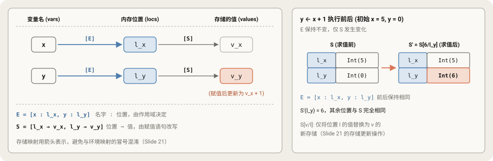

# 8.2 环境 E、存储 S 与求值判断

和类型检查一样，操作语义也用形式化的**逻辑推理规则**（logical rules of inference）来表述。要把变量读写、赋值副作用、同名遮蔽（Shadowing）与对象别名（Aliasing）都精确地刻画出来，必须把运行时上下文拆分为**环境 $E$** 与**存储 $S$** 两层，并连同当前对象 $\mathrm{so}$ 组成完整的求值判断。

## 1. 从类型判断到求值判断

回想类型检查里的类型判断（typing judgment，参见 [[7.6 类型推理规则、证明树与基础表达式]]）：

$$
\mathrm{Context} \vdash e : C
$$

意思是“在给定上下文 $\mathrm{Context}$ 中，表达式 $e$ 具有类型 $C$”。求值判断（evaluation judgment）的写法非常相似：

$$
\mathrm{Context} \vdash e : v
$$

意思是“在给定上下文 $\mathrm{Context}$ 中，表达式 $e$ 求值得到值 $v$”。写成横线上下形式的推理规则，比如加法求值的一个具体例子：

$$
\frac{\mathrm{Context} \vdash e_1 : 5 \qquad \mathrm{Context} \vdash e_2 : 7}{\mathrm{Context} \vdash e_1 + e_2 : 12}
$$

横线上方是前提，下方是结论：只要在当前上下文中 $e_1$ 求值出 `5`、$e_2$ 求值出 `7`，就能推出 $e_1 + e_2$ 求值出 `12`。

## 2. 环境 E 与存储 S 的两步查找机制

不过只写一个笼统的 $\mathrm{Context}$ 还不足以处理变量读写和赋值。考虑一条赋值表达式 `y ← x + 1`：我们需要知道 `x` 当前存着什么值，还要把算出来的结果写回 `y` 对应的位置，同时不能和同名遮蔽变量或别名搞混。为此，把运行时与变量相关的上下文拆成两层：

- **环境（Environment，$E$）**：回答变量**在哪里**（where in memory），即把变量名映射到内存位置（$\text{vars} \to \text{memory locations}$）。
- **存储（Store，$S$）**：回答内存里**有什么**（what is in memory），即把内存位置映射到具体的值（$\text{memory locs} \to \text{values}$）。

**图解阅读**：左侧为经典的两步查找模型：蓝色箭头代表环境 $E$ 的映射（确定位置），灰色箭头代表存储 $S$ 的映射（确定内容）。右侧展示了初始状态为 `x = 5`, `y = 0` 时，执行赋值语句 `y ← x + 1` 的前后对比：环境 $E$ 始终保持不变，而存储在内存位置 $l_y$ 处被改写，生成了一个崭新的存储 $S' = S[6/l_y]$。记号 $S[v/l]$ 表示“在保持其他内存位置完全不变的前提下，唯独将位置 $l$ 处的值替换为 $v$ 所派生出的新存储”（Slide 21）。在形式化操作语义中，存储从不被视为“原地可变对象（in-place mutable object）”，而是一个**不可变数学映射函数**；只有通过推导产生新存储，才能在同一推理规则中严谨地并列表示不同时间点的存储状态 $S, S_1, S_2$。

变量环境 $E$ 不仅记录了当前作用域里有哪些变量可见，还指明了每个变量各自落在哪一块内存地址上，通常记作：

$$
E = [a : l_1,\ b : l_2]
$$

之所以把“名字 $\to$ 位置”和“位置 $\to$ 值”分成两步，是因为变量的作用域绑定在进入块或函数时就定死了（即 $E$），而变量里存的值在执行过程中随时可能被赋值语句改写（即 $S$）。

> [!note] 补充：Cool 语言中环境 E 发生变化的时机与形式化 let 规则
> 在 Cool 中，普通的代码块语句 `{ e1; ...; en; }` 并不会引入新的局部变量作用域。在整个语言中，**唯一能够向环境 $E$ 引入新变量名绑定的语法构造只有四处**（对照静态绑定见 [[7.7 类型环境 O 与 let 规则]]）：
> 1. `let` 表达式（引入局部变量绑定）；
> 2. `case` 分支语句（为动态类型匹配成功的分支变量绑定新位置）；
> 3. 方法调用的形参绑定（为接收到的实参分配新的形式参数位置）；
> 4. `new` 表达式创建对象时构建的属性环境。
>
> 以最典型的局部变量声明 `let` 表达式为例，其完整的大步操作语义规则如下（Slide 40）：
>
> $$
> \frac{\mathrm{so},\ E,\ S \vdash e_1 : v_1,\ S_1 \qquad l_{\mathrm{new}} = \mathrm{newloc}(S_1) \qquad \mathrm{so},\ E[l_{\mathrm{new}}/\mathrm{id}],\ S_1[v_1/l_{\mathrm{new}}] \vdash e_2 : v_2,\ S_2}{\mathrm{so},\ E,\ S \vdash \texttt{let}\ \mathrm{id} : T \leftarrow e_1\ \texttt{in}\ e_2 : v_2,\ S_2}
> $$
>
> - 函数 $\mathrm{newloc}(S_1)$ 负责在当前存储 $S_1$ 中寻找一个**全新且尚未被占用的内存位置**，其本质等价于运行时的动态内存分配。
> - 记号 $E[l_{\mathrm{new}}/\mathrm{id}]$ 表示在当前环境 $E$ 的基础上，将标识符 $\mathrm{id}$ 绑定到新分配的位置 $l_{\mathrm{new}}$。若外部作用域已存在同名变量，该操作会自然地形成**作用域遮蔽（Variable Shadowing）**：在求值主体表达式 $e_2$ 时，查表必然优先命中新的 $l_{\mathrm{new}}$，而外部同名变量所对应的旧内存位置完好无损。
>   - 实测解释器运行嵌套遮蔽：`let x : Int ← 1 in { let x : Int ← 2 in x; x; }`，解释器会为内层与外层分配两个完全独立的内存位置，内层求值得到 2，离开内层后外层再次访问 `x` 正确读到 1。
> - 环境修改的生命周期仅限于子表达式 $e_2$ 的求值阶段；当整条 `let` 表达式求值完毕后，外部结论处依然保持着调用前的旧环境 $E$。

## 3. 完整的求值判断：$\mathrm{so}, E, S \vdash e : v, S'$

在 Cool 里，表达式的求值结果不仅依赖 $E$ 和 $S$，还必须知道当前正在执行方法的对象 `self`（记作 $\mathrm{so}$，即 self object）。同时，求值一个表达式可能会产生修改内存的副作用，所以每条求值判断还要把**求值后的新存储** $S'$ 吐出来：

$$
\mathrm{so},\ E,\ S \vdash e : v,\ S'
$$

读作“在当前对象为 $\mathrm{so}$、变量环境为 $E$、初始存储为 $S$ 的上下文下，求值表达式 $e$ 会得到值 $v$，并产生新存储 $S'$”。

**图解阅读**：$\vdash$ 符号左侧的三项构成了求值前的**输入状态**，右侧两项构成了求值后的**输出结果**。注意，$\mathrm{so}$ 与 $E$ **不会出现在输出侧**。这是因为在求值单个表达式的过程中，当前执行主体 `self` 绝不会突然变成其他对象，标识符与内存位置的映射关系也不会发生永久泄露（Slide 25–26）。虽然 `self` 的属性值可能在执行中被赋值修改，但这些修改全部统一记录在存储 $S'$ 中。

此外，该推理判断**仅在表达式求值能够在有限步内正常终止（Terminates）时才成立**。如果表达式发生死循环（例如条件恒为真的 `while true loop ... pool`），则不存在任何数学上的 $v$ 和 $S'$ 能够满足该判断（Slide 24–25）。因此在阅读操作语义规则时，潜台词始终是：“*若表达式 $e$ 的执行能够正常结束，则…*”。

图表下方对比了静态类型判断与动态求值判断的异同：类型检查期的上下文 $C$ 表示源码静态写在哪个类中，而运行时的 $\mathrm{so}$ 则表示真实执行的对象（其动态类型可能是 $C$ 的子类）；类型检查器使用 $O$ 进行名字到类型的一步映射，而运行时则通过 $E$ 和 $S$ 分解为两步查找；方法签名表 $M$ 在求值期无需直接对应，而是通过动态类型派发函数 $\mathrm{impl}(X, f)$ 在运行期类的虚表/实现结构中查找方法体。

---

上一篇：[[8.1 语义定义四要素与三大形式语义学]] | 下一篇：[[8.3 字面量、变量读写与求值顺序]]

来源：[[16.AI编译器/学习日记/0.2十一月/11_04#二、形式化操作语义|11_04 §二—§三开头]]。
