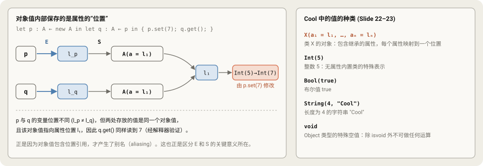
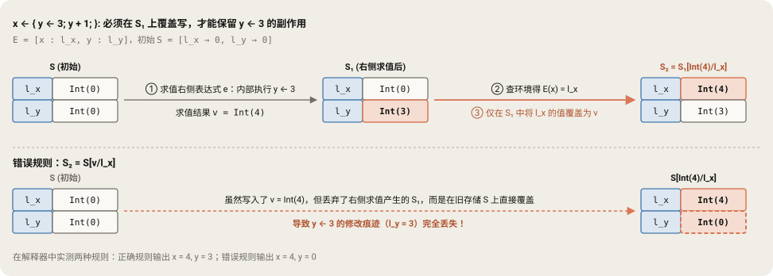
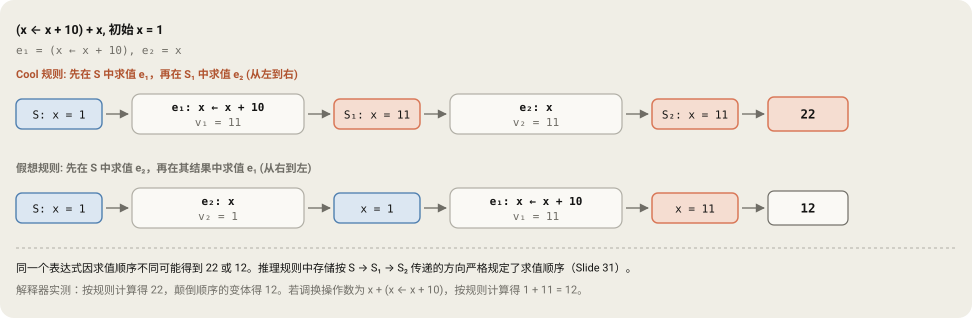
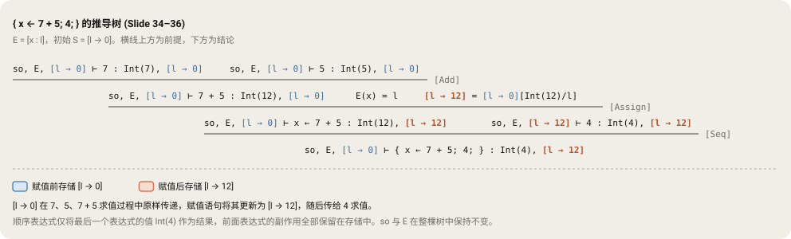

# 8.3 字面量、变量读写与求值顺序

建立好求值判断 $\mathrm{so}, E, S \vdash e : v, S'$ 之后，就可以逐一写出 Cool 基础表达式的操作语义规则。从不改写存储的字面量，到单点更新存储的赋值，再到串联多个中间存储的加法、顺序块与控制流，**存储传递链 $S \to S_1 \to S_2$** 决定了语言在运行期如何传播副作用并锁定求值顺序。

## 1. 字面量、`self` 与对象别名机制

布尔、整数、字符串字面量以及 `self` 都不修改内存，求值后的存储原封不动：

$$
\frac{}{\mathrm{so},\ E,\ S \vdash \texttt{true} : \mathrm{Bool}(\texttt{true}),\ S}
\qquad
\frac{}{\mathrm{so},\ E,\ S \vdash \texttt{false} : \mathrm{Bool}(\texttt{false}),\ S}
$$

$$
\frac{i \text{ is an integer literal}}{\mathrm{so},\ E,\ S \vdash i : \mathrm{Int}(i),\ S}
\qquad
\frac{s \text{ is a string literal} \quad n \text{ is the length of } s}{\mathrm{so},\ E,\ S \vdash s : \mathrm{String}(n, s),\ S}
$$

关键字 `self` 直接求值出当前上下文的自身对象 $\mathrm{so}$：

$$
\frac{}{\mathrm{so},\ E,\ S \vdash \texttt{self} : \mathrm{so},\ S}
$$

这里的 $\mathrm{Bool}(\texttt{true})$、$\mathrm{Int}(i)$、$\mathrm{String}(n, s)$ 都是带有类型标记和必要元数据的运行时对象值表示。

**图解阅读**：右下角展示了 Cool 运行期支持的全部值类型（Slide 22–23）。一般类的对象表示为 $X(a_1 = l_1, \dots, a_n = l_n)$，其**核心设计在于对象内部记录的是各属性的内存位置 $l_i$，而非直接存值**。只要掌握了属性所在的位置，其具体内容即可随时在存储 $S$ 中查询。基本数据类型 `Int`、`Bool`、`String` 可视为不含用户定义属性的特殊内置对象表示。`void` 则是 `Object` 继承体系中的特殊空引用标记，除 `isvoid` 判定外不能对其执行任何运算。

左图展示了由此产生的**别名机制（Aliasing）**：当执行 `q ← p` 发生对象赋值时，复制的是该对象值本身（即包含了属性位置 $l_1$ 的记录）。虽然局部变量 `p` 和 `q` 在环境 $E$ 中分配了不同的内存槽位（$l_p \neq l_q$），但它们内部存储的值指向了同一个属性内存位置 $l_1$。因此，通过 `p.set(7)` 改写 $S(l_1)$ 后，执行 `q.get()` 立即能够观测到更新后的值 7。这再次印证了将环境 $E$ 与存储 $S$ 彻底解耦的不可替代性。

## 2. 变量引用与赋值：副作用线索化

读一个标识符 $\mathrm{id}$（如 `x`、`y`）时，先去环境 $E$ 查到它的内存位置 $l_{\mathrm{id}}$，再去存储 $S$ 取出该位置存的值 $v$：

$$
\frac{E(\mathrm{id}) = l_{\mathrm{id}} \qquad S(l_{\mathrm{id}}) = v}{\mathrm{so},\ E,\ S \vdash \mathrm{id} : v,\ S}
$$

读变量不修改内存，存储依然是 $S$。而赋值表达式 $\mathrm{id} \leftarrow e$（如 `x ← 1 + 1`）则会改写存储：

$$
\frac{\mathrm{so},\ E,\ S \vdash e : v,\ S_1 \qquad E(\mathrm{id}) = l_{\mathrm{id}} \qquad S_2 = S_1[v / l_{\mathrm{id}}]}{\mathrm{so},\ E,\ S \vdash \mathrm{id} \leftarrow e : v,\ S_2}
$$

这里的存储传递顺序至关重要：必须先在初始存储 $S$ 下求值右边表达式 $e$，得到计算结果 $v$ 和中间存储 $S_1$。然后再去环境查到 $\mathrm{id}$ 绑定的位置 $l_{\mathrm{id}}$，在 $S_1$ 的基础上把位置 $l_{\mathrm{id}}$ 的内容替换成 $v$，得到新存储 $S_2 = S_1[v / l_{\mathrm{id}}]$。如果写成 $S[v / l_{\mathrm{id}}]$，求值 $e$ 时顺带改过的其他变量就全丢了。在 Cool 中赋值本身也是表达式，它的返回值就是 $v$。

**图解阅读**：上方主流程展示了符合语义规范的执行过程：① 求值右侧复合表达式 `{ y ← 3; y + 1; }`，在生成中间存储 $S_1$ 的同时使得 $l_y = 3$，并算出整体值 `Int(4)`；② 与 ③ 在 $S_1$ 的基础之上仅将 $l_x$ 覆盖为 4，最终得到保存了所有副作用的 $S_2$。

下方展示了**错误规则**的灾难性后果：若推理规则错误地定义为 $S_2 = S[v / l_x]$，尽管 $l_x$ 被成功赋为 4，但由于是以最初的 $S$ 为基准进行覆盖，右侧表达式内部发生的所有内存写入（即 $l_y = 3$）全部被回滚抹除！形式化规则中下标 $S_1$ 的精密串联，本质上就是在数学层面实现运行时的**副作用精确线索化（Side-Effect Threading）**。在解释器中实测对比：正确规则输出 `x = 4, y = 3`，而错误规则变体则输出 `x = 4, y = 0`。

## 3. 加法与求值顺序

加法规则体现了求值顺序对副作用的传递：

$$
\frac{\mathrm{so},\ E,\ S \vdash e_1 : v_1,\ S_1 \qquad \mathrm{so},\ E,\ S_1 \vdash e_2 : v_2,\ S_2}{\mathrm{so},\ E,\ S \vdash e_1 + e_2 : v_1 + v_2,\ S_2}
$$

左边 $e_1$ 在 $S$ 下算完后吐出 $S_1$，右边 $e_2$ 必须在 $S_1$ 下接着算，最后把 $S_2$ 作为整条加法的输出存储。两条前提把 Cool **从左到右**的求值顺序写死了：如果 $e_1$ 里带了赋值，后算的 $e_2$ 一定会看到更新后的值。

**图解阅读**：面对完全相同的表达式 `(x ← x + 10) + x`（初始 `x = 1`）：
- 上方行按照 Cool 的标准操作语义推导：$e_1$ 在初始存储 $S$ 下首先求值，将 `x` 改写为 11；随后的 $e_2$ 在承接了新状态的 $S_1$ 下求值读出 11，最终相加得到 **22**。
- 下方行展示假想的反向求值语义：若规定右侧 $e_2$ 先在初始存储 $S$ 下求值，它将读出原始值 1；随后左侧 $e_1$ 算得 11，最终相加得到 **12**。
- Slide 31 明确指出：**存储在前提之间的传递拓扑序列（$S \to S_1 \to S_2$），在数学上严格且唯一地锁定了子表达式的执行顺序**。

> [!note] 补充：C/C++ 语言为何故意不指定求值顺序？
> - 与 Cool 或 Java 严格固定求值顺序不同，**ISO C 与 C++ 标准故意将二元运算符的运算对象（Operands）以及函数参数的求值顺序规定为未指明的（Unspecified）**（ISO/IEC 9899:2011 §6.5 & §6.5.2.2）。这是设计者有意为之的选择：为了让不同 CPU 架构上的编译器能够根据寄存器分配压力与指令调度优势，自由决定先算左边还是先算右边（这是对 [[8.1 语义定义四要素与三大形式语义学]] “不过度受限”原则的更激进追求）。其代价则是：若代码中存在依赖未指明顺序的副作用，该程序在不同编译器或不同优化等级下的运行结果可能会截然不同。
> - 在本地环境使用 gcc 13.3 (x86-64) 进行了编译实测：编写包含全局自增记录的函数 `f()` 与 `g()`，计算表达式 `f() + g()` 时 gcc 先执行了 `f()`；然而在计算函数调用 `h(f(), g())` 时，无论是在 `-O0` 还是 `-O2` 下，gcc 均先执行了右侧参数 `g()`。
> - Cool 选择了严格保证跨平台的一致性与可移植性，宁可牺牲部分极端的编译器优化自由度。Java 语言规范（JLS §15.7）同样强制规定所有操作数从左至右求值。当然，若编译器能够静态证明两个表达式均无副作用（Pure Expressions），则仍可在底层自由调整其计算指令的排布。

## 4. 顺序代码块、推导树与控制流规则

Cool 语言中使用花括号包围的顺序复合表达式 $\{ e_1; \dots; e_n; \}$（即代码块）不仅是常见的编程结构，更是 [[8.4 对象创建 new T 与类属性展平]] 中 `new` 表达式属性初始化块的核心机制。其形式化推理规则如下（Slide 33）：

$$
\frac{\mathrm{so},\ E,\ S \vdash e_1 : v_1,\ S_1 \qquad \mathrm{so},\ E,\ S_1 \vdash e_2 : v_2,\ S_2 \qquad \cdots \qquad \mathrm{so},\ E,\ S_{n-1} \vdash e_n : v_n,\ S_n}{\mathrm{so},\ E,\ S \vdash \{ e_1;\ \dots;\ e_n; \} : v_n,\ S_n}
$$

存储按照流水线 $S \to S_1 \to \dots \to S_n$ 依次流转，每个子表达式产生的所有副作用被完整汇聚到最终的 $S_n$ 中，而整个代码块的求值结果只取最后一个表达式的值 $v_n$。

结合字面量规则、加法规则与赋值规则，可以为复合表达式 `{ x ← 7 + 5; 4; }` 构建一棵完整的**形式化推导树（Derivation Tree）**（Slide 34–36）：

**图解阅读**：阅读推导树时，自底向上阅读代表“为了证明该结论，需要满足哪些前置条件（目标导向的推理）”，自顶向下阅读则代表“程序在运行时的实际求解演化次序”。

树的最顶端叶子节点是常数字面量 7 和 5，依据常数规则可直接成立；加法规则 `[Add]` 将其合并为 `Int(12)`，初始存储 `[l → 0]` 毫无改变地向下传递；随后赋值规则 `[Assign]` 将存储单点更新为橙色的 `[l → 12]`；该新存储随后作为输入传递给代码块的第二个子表达式 4；最终顺序表达式规则 `[Seq]` 产出整体计算结果 `Int(4)`，并输出更新后的最终存储 `[l → 12]`。解释器实测输出与推导树的理论推导分毫不差。

> [!note]- 补充：其余基础控制流规则（条件分支 if 与循环 while 的形式化推导）
> 条件分支与循环结构同样通过存储传递机制实现形式化（Slide 32, 37–38）：
>
> - **条件分支 `if` 规则**（以 True 分支为例，False 分支呈对称形式）：
>
> $$
> \frac{\mathrm{so},\ E,\ S \vdash e_1 : \mathrm{Bool}(\texttt{true}),\ S_1 \qquad \mathrm{so},\ E,\ S_1 \vdash e_2 : v,\ S_2}{\mathrm{so},\ E,\ S \vdash \texttt{if}\ e_1\ \texttt{then}\ e_2\ \texttt{else}\ e_3\ \texttt{fi} : v,\ S_2}
> $$
>
> 必须先在 $S$ 下求值条件式 $e_1$ 产出 $S_1$，被选中的分支 $e_2$ 必须在承接了条件式副作用的 $S_1$ 下执行。类型检查器此前已保证条件表达式的求值类型必为 `Bool`。
>
> - **循环结构 `while` 规则**：
>
> $$
> \frac{\mathrm{so},\ E,\ S \vdash e_1 : \mathrm{Bool}(\texttt{false}),\ S_1}{\mathrm{so},\ E,\ S \vdash \texttt{while}\ e_1\ \texttt{loop}\ e_2\ \texttt{pool} : \mathrm{void},\ S_1}
> $$
>
> $$
> \frac{\mathrm{so},\ E,\ S \vdash e_1 : \mathrm{Bool}(\texttt{true}),\ S_1 \qquad \mathrm{so},\ E,\ S_1 \vdash e_2 : v,\ S_2 \qquad \mathrm{so},\ E,\ S_2 \vdash \texttt{while}\ e_1\ \texttt{loop}\ e_2\ \texttt{pool} : \mathrm{void},\ S_3}{\mathrm{so},\ E,\ S \vdash \texttt{while}\ e_1\ \texttt{loop}\ e_2\ \texttt{pool} : \mathrm{void},\ S_3}
> $$
>
> 当条件为真时，先在 $S_1$ 下执行循环体 $e_2$ 产生存储 $S_2$；随后**在更新后的状态 $S_2$ 下递归地再次求值整个 `while` 表达式本身**，最终产生 $S_3$。这种用“在崭新状态下重新求值自身”的方式，极其优雅地在无循环语句的形式化逻辑框架中定义了迭代语义！循环体的返回值 $v$ 被直接丢弃，整体返回值恒为 `void`（与 [[7.6 类型推理规则、证明树与基础表达式]] 中 `while` 静态类型为 `Object` 相呼应）。对于永不退出的死循环，推导树深度无限发散，形式化判断自然无法成立。

---

上一篇：[[8.2 环境 E、存储 S 与求值判断]] | 下一篇：[[8.4 对象创建 new T 与类属性展平]]

来源：[[16.AI编译器/学习日记/0.2十一月/11_04#三、COOL 语言操作语义的细节|11_04 §三.1—§三.3]]。
