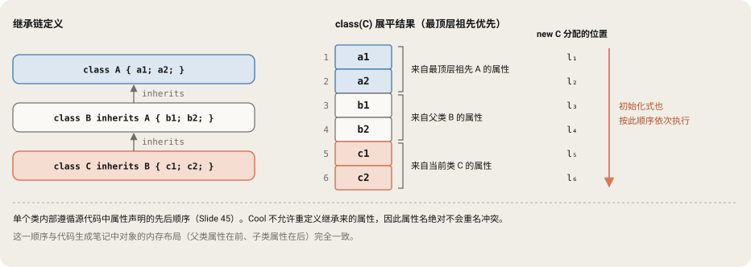
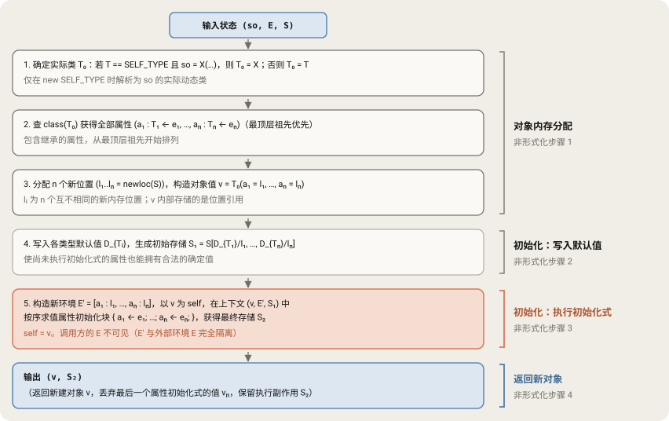

# 8.4 对象创建 new T 与类属性展平

在 Cool 的操作语义中，对象创建 `new T` 与动态方法分发（Dynamic Dispatch）是面向对象机制最复杂的两条核心规则（Slide 41）。它们把类继承、属性展平、默认初始化、环境隔离、`SELF_TYPE` 动态解析以及方法查找统一纳入形式化推理框架。

## 1. 类属性展平：$\mathrm{class}(A)$

按非形式化的理解，执行 `new T` 需要做四件事：

1. 为类 `T` 的对象的所有属性分配内存位置（本质上就是分配一个新对象）。
2. 把所有属性先设成各自的默认值。
3. 依次求值各属性的初始化表达式，并写入对应的属性位置。
4. 返回这个新分配的对象。

为了把继承下来的属性也一并算进去，对于任意类 $A$，定义记号 $\mathrm{class}(A)$ 列出它拥有的全部属性（**包括从祖先类继承来的属性**）、声明类型与初始化表达式：

$$
\mathrm{class}(A) = (a_1 : T_1 \leftarrow e_1,\ \dots,\ a_n : T_n \leftarrow e_n)
$$

排列顺序遵循**最顶层祖先优先（greatest ancestor first）**。沿着 `C inherits B`、`B inherits A` 的继承链一路展平，`class(C)` 会把 `A`、`B`、`C` 的属性顺次排开：

**图解阅读**：继承链中的属性从顶层祖先类开始向下展平。在单个类的内部，属性顺序严格遵循源代码中的书写声明顺序（Slide 45）。Cool 语言在语义规则层面禁止子类重定义继承而来的同名属性，因此展平后的属性元组中绝不会发生名字碰撞。

右侧突出强调了核心实现逻辑：在执行 `new C` 时，运行时**位置分配（$l_1$ 到 $l_6$）与初始化表达式的执行序列完全遵循这一展平顺序**。若子类属性 `c1` 的初始化式引用了父类属性 `a1 + b2`，由于父类属性在前且已率先初始化完毕，读取将能够合法获得确定的前序值。这一静态展平结构与代码生成章节（参见 [[11.5 面向对象代码生成：对象布局与分派表]]）中推导的**对象内存物理布局**（祖先属性槽位在前、派生属性槽位在后）完全对应。

## 2. `new T` 的完整推理规则与执行流程

有了 $\mathrm{class}(T_0)$，就可以写出 `new T` 完整的形式化推理规则：

$$
\frac{
  \begin{array}{l}
  T_0 = \text{if } (T == \text{SELF\_TYPE} \text{ and } \mathrm{so} = X(\dots)) \text{ then } X \text{ else } T \\
  \mathrm{class}(T_0) = (a_1 : T_1 \leftarrow e_1,\ \dots,\ a_n : T_n \leftarrow e_n) \\
  l_i = \mathrm{newloc}(S) \quad \text{for } i = 1, \dots, n \\
  v = T_0(a_1 = l_1,\ \dots,\ a_n = l_n) \\
  S_1 = S[D_{T_1} / l_1,\ \dots,\ D_{T_n} / l_n] \\
  E' = [a_1 : l_1,\ \dots,\ a_n : l_n] \\
  v,\ E',\ S_1 \vdash \{ a_1 \leftarrow e_1;\ \dots;\ a_n \leftarrow e_n; \} : v_n,\ S_2
  \end{array}
}{
  \mathrm{so},\ E,\ S \vdash \text{new } T : v,\ S_2
}
$$

这条规则看着长，拆开来看每一步都在精准落实前面的四件事：

**图解阅读**：各方框详细揭示了每一步的具体操作与存在理由。右侧大括号精准对应了开篇总结的非形式化四个阶段：第 1 到 3 步负责**对象分配**，第 4 到 5 步负责**对象初始化**，最后返回对象。

请特别关注第 5 步中求值上下文的微妙切换：求值判断左上角的首项从调用方的当前对象 $\mathrm{so}$ 切换为了**新构造的对象 $v$**！这意味着在执行各属性初始化表达式时，代码内部如果访问了关键字 `self`，其指向的是当前**正在被构造的新对象**，而不是外部触发 `new` 操作的调用方对象。

## 3. 三个关键语义细节与实现陷阱

有三个容易忽略的细节藏在规则里：

- **`SELF_TYPE` 动态解析**（静态类型部分见 [[7.11 SELF_TYPE 与精确返回类型]]）：`SELF_TYPE` 在运行期要看当前对象 $\mathrm{so}$ 的真实动态类型 `X`，这样子类调用父类继承来的 `new SELF_TYPE` 方法时，造出来的才会是子类 `X` 的实例。
- **初始化环境隔离**：初始化表达式块在全新的环境 $E'$ 下求值，而不是调用方的 $E$，因为属性初始化式里只能访问当前新对象的属性，不能看见外面的局部变量。
- **先填默认值再求值初始化式**：把所有属性先填上默认值 $D_{T_i}$（例如 `Int` 默认 `0`、`Bool` 默认 `false`、`String` 默认空串，其他引用类型默认 `void`）得到 $S_1$ 再跑初始化，保证了排在前面的属性初始化式万一读到了后面的属性或者调用了 `self` 的方法时，内存里已经有确定值而不是未定义状态。

> [!note] 补充：字面阅读形式化规则时的两个细节陷阱
> 1. **$l_i = \mathrm{newloc}(S),\; i = 1, \dots, n$ 的语义理解**：
>    形式化规则为了数学书写简练，将 $n$ 个位置分配写为基于同一初始存储 $S$ 的推导。但在程序实现中，若将其误当成纯函数不更新存储地调用 $n$ 次，每次都会返回同一个内存地址！其真实数学语义是**分配 $n$ 个互不相同的全新位置**。在解释器实验中，若未递增模拟分配，所有属性会重叠在同一内存位置上，导致后续赋值 `a ← 1; b ← 2` 后再读取 `a` 错误得到 2。
> 2. **缺少显式初始化式的属性处理**：
>    在实际 Cool 程序中，许多属性声明并没有附带赋值初始式（如 `o : A;`）。在形式化规则中，这类属性相当于在最后的属性初始化代码块中省略了对应的赋值语句。该属性槽位将直接保留在第 4 步中填入的默认值 $D_T$。基本类型的默认值为 `Int(0)`、`Bool(false)`、`String(0, "")`，所有其他对象类型则默认初始化为 `void`（Slide 44）。

**图解阅读**：
- **左侧：为什么必须先填充默认值**：在类 `A` 的定义中，排在前面的属性 `a` 初始化时引用了声明在后面的属性 `b`（前向引用），属性 `c` 则通过调用 `self.getb()` 间接读取 `b`。在第四步填入默认值后，$S_1$ 中所有属性均拥有了合法底线值（`Int` 均为 0，`o` 为 `void`）。因此执行 `a ← b + 1` 时能够安全读出 `b = 0` 算得 `a = 1`；`self.getb()` 同样读到 0。直到最后执行 `b ← 5` 时，$b$ 才被改写为 5。若跳过默认值填充阶段，解释器在执行 `a ← b + 1` 时将由于 $S(l_3)$ 尚未定义而直接抛出异常崩溃。
- **右侧：`new SELF_TYPE` 的动态分发**：类 `P` 中编写了方法 `copy() : SELF_TYPE { new SELF_TYPE }`，子类 `C` 继承了 `P`。当在子类实例上调用 `(new C).copy()` 时，方法体执行期间的自身对象 $\mathrm{so}$ 是实际的 `C` 对象（包含槽位 $l_1, l_2$）。操作语义规则的第一行 $T_0$ 判断成功捕获到这一动态事实，将 $T_0$ 解析为子类 `C`，最终为新对象分配新槽位 $l_3, l_4$，成功实例化出完整的子类对象 `C`，而非父类 `P`。

> [!note] 补充：跨语言对比 —— Java 与 C++ 中的对象初始化语义
> Slide 48 特别指出，对象初始化过程中复杂的前向依赖语义绝非 Cool 所独有：
> - **Java 的处理策略**：与 Cool 类似，Java 在进入构造函数之前，也会将对象的所有实例变量（Fields）先清零初始化（数值型为 0，布尔为 `false`，对象引用为 `null`）。随后按照文本声明顺序执行字段初始化器。若在属性初始化器中通过 `this.b` 访问后声明的字段，Java 允许编译通过并读到默认值 0；但为了提升安全性，若直接使用未加限定的裸变量名进行前向引用（如 `int a = b + 1;`），Java 编译器会在编译期直接报错阻止（"illegal forward reference"，参见 JLS §8.3.3 与 §12.5）。
> - **C++ 的处理策略**：C++ 遵循零开销原则，**不存在统一的默认零值预填充阶段**。非静态成员变量完全按照在类中声明的先后顺序进行初始化（无论构造函数初始化列表中的书写顺序如何）。若在初始化列表中读取了尚未初始化的成员变量（例如 `struct A { int a; int b; A() : a(b + 1), b(5) {} };`），这属于**未定义行为（Undefined Behavior, UB）**。在本地使用 g++ 13.3 开启 `-Wall` 编译该代码，编译器会报出警告 `"member 'A::b' is used uninitialized"`；运行时可能读取到栈/堆残留的随机内存垃圾值。

## 4. 动态方法分发（Dynamic Dispatch）的形式化规则

方法调用表达式 $e_0.f(e_1, \dots, e_n)$ 的完整大步操作语义推理规则如下（Slide 51，对照静态类型分派规则见 [[7.10 方法环境与动态、静态分派]]）：

$$
\frac{
  \begin{array}{l}
  \mathrm{so},\ E,\ S \vdash e_1 : v_1,\ S_1 \quad \mathrm{so},\ E,\ S_1 \vdash e_2 : v_2,\ S_2 \quad \cdots \quad \mathrm{so},\ E,\ S_{n-1} \vdash e_n : v_n,\ S_n \\
  \mathrm{so},\ E,\ S_n \vdash e_0 : v_0,\ S_{n+1} \\
  v_0 = X(a_1 = l_1,\ \dots,\ a_m = l_m) \\
  \mathrm{impl}(X, f) = (x_1,\ \dots,\ x_n,\ e_{\mathrm{body}}) \\
  l_{x_i} = \mathrm{newloc}(S_{n+1}) \quad \text{for } i = 1, \dots, n \\
  E' = [a_1 : l_1,\ \dots,\ a_m : l_m][l_{x_1}/x_1,\ \dots,\ l_{x_n}/x_n] \\
  S_{n+2} = S_{n+1}[v_1/l_{x_1},\ \dots,\ v_n/l_{x_n}] \\
  v_0,\ E',\ S_{n+2} \vdash e_{\mathrm{body}} : v,\ S_{n+3}
  \end{array}
}{
  \mathrm{so},\ E,\ S \vdash e_0.f(e_1,\ \dots,\ e_n) : v,\ S_{n+3}
}
$$

深入拆解该规则的关键设计：

1. **求值次序**：规则前两行明确规定，**所有实参表达式 $e_1, \dots, e_n$ 必须从左到右率先求值，最后才对接收者对象表达式 $e_0$ 进行求值**（Slide 49）。在解释器中实测：若让接收者表达式执行 `k ← k * 10 + 1`，参数表达式执行 `k ← k * 10 + 2`，按 Cool 规则先算参数后算接收者，最终 `k = 21`；若反转为先算接收者，`k` 则会变成 12。现代工业语言（如 Java JLS §15.12.4 以及 C++17 `[expr.call]`）则做出了相反选择，严格规定接收者对象优先于实参求值。
2. **动态分发实现函数**：记号 $\mathrm{impl}(X, f) = (x_1, \dots, x_n, e_{\mathrm{body}})$ 表示在对象 $v_0$ 的实际动态类 $X$ 虚表中查询方法 $f$ 的形参列表与实现体（包含从祖先继承的方法）（Slide 50）。
3. **执行环境与调用栈帧**：方法体 $e_{\mathrm{body}}$ 必须在目标对象 $v_0$ 的自身上下文（$\mathrm{so} = v_0$）以及一个全新的局部环境 $E'$ 下执行。该环境仅包含 $v_0$ 自身的属性映射与分配给各形参的新内存位置 $l_{x_i}$，**调用方的局部变量环境 $E$ 被彻底屏蔽隔离**。在形式化语义中并不存在物理意义上的调用栈帧（Stack Frame）数据结构，每个参数分配全新内存槽位 $l_{x_i} = \mathrm{newloc}(\dots)$ 的机制在数学上等价实现了活动记录（Activation Record）的栈帧空间分配（Slide 52）。
4. **静态类型系统无法阻止的四类运行时错误**：虽然静态类型检查器保证了合法的 Cool 程序绝不会出现“找不到方法 $\mathrm{impl}(X, f)$”的错误，但依然存在四种类型系统无法在编译期根除的致命运行时错误（Slide 53–54）：
   - 对空对象调用方法（Dispatch on void）；
   - 除以零（Division by zero）；
   - 字符串截取越界（`substr` out of range）；
   - 堆内存耗尽（Heap exhaustion）。

   按照语言规范，虚拟机在遇到这些错误时绝不能发生无响应或段错误（Segmentation fault），必须规范地向标准错误输出诊断信息并安全退出。

## 5. 参考资料

- **Alex Aiken**, *Stanford CS143 Compilers Course Notes: Operational Semantics of Cool*（Slide 41–54）。
- **Alex Aiken**, *The Cool Reference Manual: Operational Semantics Section*（涵盖 `case` 分支、静态分发、算术与比较运算等全部形式化规则）。
- **语言标准规范对比**：
  - Java Language Specification (JLS SE 8) §8.3.3 & §12.5（字段初始化顺序与前向引用限制）、§15.12.4（方法调用接收者优先于实参求值）；
  - ISO/IEC 14882:2017 (C++17) `[expr.call]`（后缀表达式接收者先于函数参数求值）。

---

上一篇：[[8.3 字面量、变量读写与求值顺序]] | 下一篇：[[9.1 中间代码的解耦价值与三地址码（TAC）]]

来源：[[16.AI编译器/学习日记/0.2十一月/11_04#三、COOL 语言操作语义的细节|11_04 §三.4]]。
