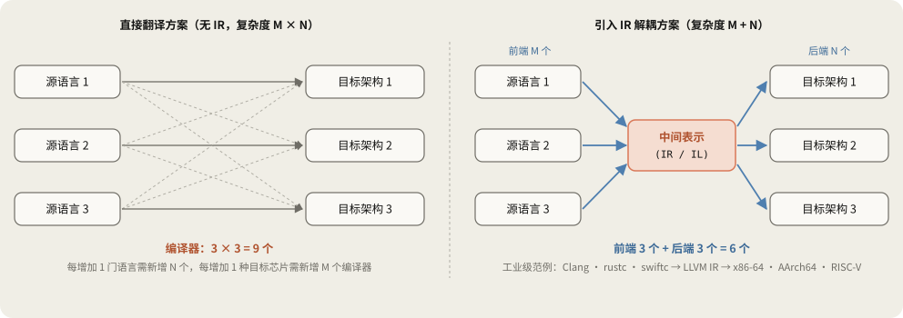
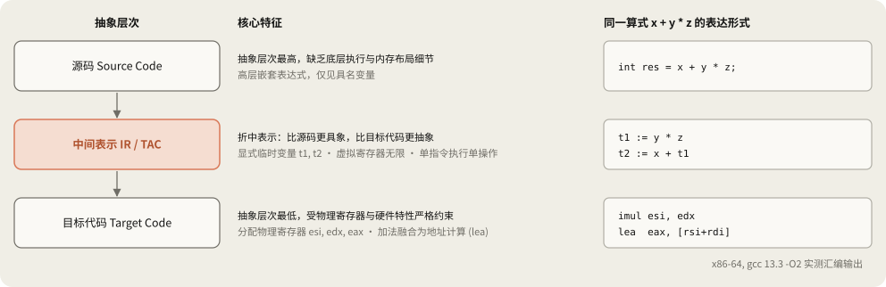

# 9.1 中间代码的解耦价值与三地址码（TAC）

中间代码（Intermediate Representation, IR / Intermediate Language, IL）是介于源语言与目标机器架构之间的一种抽象表达。

在抽象层级上，中间代码处于源语言与目标机器码的折中位置：
- 比源语言包含更多执行与布局细节（显式的临时变量、拍平的表达式、底层的线性控制流）。
- 比目标机器码保留更少的物理硬件约束（不绑定具体物理寄存器、指令流水细节与调用约定）。

> [!info] 本章导读与实测验证背景
> 本章基于斯坦福大学 CS143 编译原理课程（Lecture 14 *Intermediate Code & Local Optimizations* 与 Lecture 15 *Global Optimization*），系统梳理从 AST 降解到中间代码（IR）、基本块划分、窥孔优化、局部优化链、全局数据流分析（前向常量传播半格）到逆向数据流分析（活跃性分析与死代码消除）的完整演进路径。
>
> 核心理论与算法均已通过实测代码验证：
> - Python 求解器逐字实现了常量传播规则 1–8 与活跃性传播规则 1–4，对讲义 Slide 39、50、82 的 CFG 进行了定态求解，随机置换数百种更新顺序不动点均严格唯一；
> - 独立 Pass 函数模拟 Slide 60–78 的十步局部优化流，输入 500 组随机 $x$ 样本，各阶段计算结果严格等价；
> - MIPS 子集模拟器验证了窥孔优化安全边界（遗漏跳转目标检查导致循环结果由 `b = 7` 偏离为 `b = 5`）；
> - 代数化简与常量折叠边界在 x86-64 机器上通过 GCC 13.3（`-O0`、`-O2`、`-Os`）进行了汇编实测对照。

## 1. 解耦与架构复杂度

直接将 $M$ 种源语言编译到 $N$ 种目标架构，需要实现 $M \times N$ 个独立编译器。引入统一的中间表示后，编译器前端只需将源语言翻译为 IR（$M$ 个前端），后端只需将 IR 翻译为特定硬件指令（$N$ 个后端），系统工程复杂度降为 $M + N$。



**读图**：左侧展示无 IR 时的点对点全连接翻译，源语言与目标架构的每一种组合都需要一套专用的代码生成器，连线复杂度高达 $M \times N$（图中 3 种源语言与 3 种目标芯片对应 9 个独立编译器）。右侧展示引入统一 IR 后的解耦架构，蓝色箭头左半部分为语言前端，负责语法语义解析并发射 IR；右半部分为芯片后端，负责指令选择、寄存器分配与机器码发射。工程复杂度由相乘骤降为相加（$3 + 3 = 6$）。底部标注了工业界典型实践：Clang（C/C++）、rustc（Rust）与 swiftc（Swift）统一生成 LLVM IR，再由 LLVM 统一发射至 x86-64、AArch64、RISC-V 等主流架构。

> [!note] 补充：工业实践通常设计多层 IR
> - 讲义 Slide 9 指出，几乎所有工业级现代编译器都会引入中间表示，且通常会在源码与物理硬件之间设计多级分层的 IR 体系。讲义此处主要抽象出相当于“高层汇编”的一层经典 IR 进行分析。
> - GCC 采用多级降解：前端先生成高层语法树 GENERIC，降解为三地址形式的 GIMPLE，进入优化管线后再降为贴近物理寄存器的 RTL（Register Transfer Language）。rustc 在发射 LLVM IR 前先构建 MIR 以进行借用检查与所有权优化；swiftc 则借助 SIL 处理引用计数与高层泛型特化。语言专有的语义信息若过早降解到通用扁平 IR 中就会丢失，因此必须在专用高层 IR 阶段先行优化。
> - $M + N$ 是工程上的理想上界。在实践中，单一 IR 很难同时兼顾动态语言、函数式语言、高维张量计算与底层系统编程的所有语义需求。MLIR（Multi-Level Intermediate Representation）提出的解决方案是不再绑定单一固定 IR，而是在统一框架内定义具有不同抽象层级的方言（Dialect），逐层降解（如从张量计算 `linalg` 降解到循环控制 `scf` / `affine`，再进入 `llvm` 方言）。

抽象层次的过渡关系如下：



**读图**：图表纵向对比了三种核心表现形态的抽象层级。左侧两列界定了各层次的语义跨度与硬件依赖程度；右侧列追踪了同一算式 `x + y * z` 在编译各阶段的具体展开形态。在源码层，表达式高度嵌套，仅见具名变量；降至三地址码（IR / TAC）后，表达式被完全拍平，引入显式临时名字 `t1`、`t2`，单条指令仅承载单步操作；最下方为该函数用本机的 `gcc 13.3 -O2` 编译出的 x86-64 目标汇编，虚拟寄存器已分配给具体物理寄存器 `esi`、`edx`，乘法使用 `imul`，而顶层加法被巧妙合成为三操作数的地址加载指令 `lea eax, [rsi+rdi]`。硬件特有的寻址模式由后端处理，不会在 IR 层过早暴露。

## 2. 三地址码（Three-Address Code, TAC）

三地址码是中间代码最常见的表现形态。每条三地址指令最多包含三个操作数，其基本结构为：

$$x := y \text{ op } z$$
$$x := \text{op } y$$

其中 $y$ 和 $z$ 可以是虚拟寄存器或字面常量。

> [!note] 补充：“三地址”命名缘由与代码生成模板
> - 所谓“三地址”，是指每条指令至多引用三个地址空间（两个源操作数、一个目的操作数，见 Slide 11–12）。因为单条指令至多执行单步运算，复杂复合算式被彻底拆解，每个子表达式都拥有具名表示。
> - 三地址码的生成过程与基于栈计算机的代码生成结构高度一致（Slide 13–14，对照见 [[11.1 带累加器的栈机器与表达式代码生成]]），核心差异在于：三地址码假定拥有**无限数量的虚拟寄存器（IL 寄存器）**。若定义 $\mathrm{igen}(e, t)$ 为“计算表达式 $e$ 并将结果写入寄存器 $t$ 的指令序列”，加法表达式的降解模板为：
>
> $$\mathrm{igen}(e_1 + e_2,\ t) = \mathrm{igen}(e_1,\ t_1);\ \ \mathrm{igen}(e_2,\ t_2);\ \ t := t_1 + t_2 \qquad (t_1, t_2 \text{ 为分配的新虚拟寄存器})$$
>
> - 相比于栈式计算机频繁维护 `$sp` 压栈与出栈，无限虚拟寄存器假设让前端代码生成变得极其纯粹，把“物理寄存器不足时的溢出与调度问题”正交解耦给后端寄存器分配阶段（[[12.1 寄存器复用与干涉图（RIG）]]）。

在源代码中嵌套的复杂表达式，在降低到三地址码时会被拆解成一系列顺序执行的单步运算，每个子表达式都拥有独立的临时名字。

```cpp
// C++ 源码层面的复合表达式
int res = x + y * z;

// 编译器降解后的三地址码（对应 C++ 伪代码）
int t1 = y * z;   // 为子表达式命名并优先计算乘法
int t2 = x + t1;  // 计算顶层加法
```

## 3. 中间语言文法规范

基于三地址码的简化中间语言，可以通过如下上下文无关文法（CFG）定义：

$$\begin{aligned}
P &\to S \; P \mid S \\
S &\to \text{id} := \text{id} \text{ op } \text{id} \\
  &\mid \text{id} := \text{op } \text{id} \\
  &\mid \text{id} := \text{id} \\
  &\mid \text{push } \text{id} \\
  &\mid \text{id} := \text{pop} \\
  &\mid \text{if } \text{id} \text{ relop } \text{id} \text{ goto } L \\
  &\mid L: \\
  &\mid \text{jump } L
\end{aligned}$$

文法规则说明：
- 标识符 $\text{id}$ 通常对应虚拟寄存器名，也可以替换为立即数常量。
- 常见的双目操作符 $\text{op}$ 为 $+,-,\times$；关系比较操作符 $\text{relop}$ 包含 $<, \le, =, \ne$ 等。
- 控制流通过标签（$L:$）、无条件跳转（$\text{jump } L$）以及条件分支（$\text{if } \dots \text{ goto } L$）实现。过程调用的参数传递则借助栈操作（$\text{push} / \text{pop}$）或寄存器约定完成。

> [!note] 补充：与讲义文法的细微差异与高层 Opcode
> - Slide 18 的起始产生式定义为 $P \to S\,P \mid \varepsilon$。与上述文法 $P \to S\,P \mid S$ 唯一的区别仅在于是否显式允许空程序，两者在表达“语句流线性序列”这一语义上完全等价。
> - 按照 Slide 10 的界定，此处的 IL 属于“高层汇编”。它直接使用寄存器名，且绝大多数操作码与目标硬件指令（如 MIPS 指令）一一对应；但诸如 `push` 等操作属于复合抽象操作码，降解到物理汇编时会展开为栈指针移动与内存写入等多条底层指令（例如 MIPS 下的 `sw $a0 0($sp)` 与 `addiu $sp $sp -4`）。

---

上一篇：[[8.4 对象创建 new T 与类属性展平]] | 下一篇：[[9.2 程序优化的时机、基本块与工程权衡]]

来源：[[16.AI编译器/学习日记/0.2十一月/11_05#一、中间代码在编译中的用途|11_05 §一]]。
