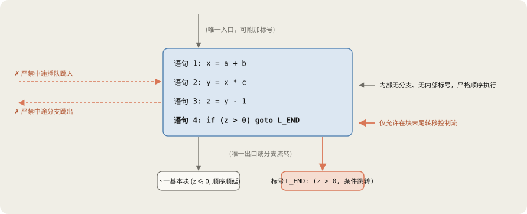
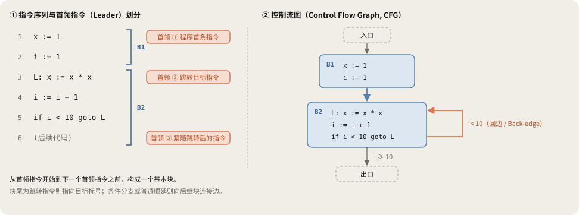

# 9.2 程序优化的时机、基本块与工程权衡

引入三地址码 IR 后，优化器需要回答三个基础问题：优化应该放在编译流水线的哪一层、代码流应该切分成什么基本单元、以及“优化”在计算理论上究竟能做到什么程度。

## 1. 优化的发生阶段对比

编译器各个阶段都可以实施优化，但取舍截然不同：

- **在抽象语法树（AST）上**：
  - 优点：完全机器无关。
  - 缺点：层次太高，缺乏平铺后的控制流和寄存器暴露，很多底层优化无法施展。
- **在目标汇编语言上**：
  - 优点：直接面对真实机器，容易发现硬件相关的优化机会（如指令融合、专用寻址模式）。
  - 缺点：严重依赖具体机器。一旦换一个目标芯片，所有优化逻辑都要重写一遍。
- **在中间代码（IR）上**：
  - 兼顾两端：既保持了跨平台独立性，又拆平了复杂的语法糖，把变量定义、使用链和跳转路径暴露得清清楚楚。绝大多数经典通用优化（常数折叠、死代码消除、循环不变量外提等）都在这一层完成。

## 2. 基本块（Basic Block）与 CFG 构建

基本块是程序局部优化最基础的处理单元。它的形式化定义为：**满足以下约束的最长指令连续序列（Maximal sequence of instructions）**：
- 序列内部不允许包含任何标号（标签只能出现在第一条指令处）。
- 序列内部不允许包含任何跳转或分支（跳转指令只能出现在最后一条指令处）。

基本块的精髓是**单入口、单出口（Single-Entry, Single-Exit）**的直线型代码段。程序一旦踏入基本块第一行，就只能老老实实顺着执行到末尾，绝不可能从中间某个位置插进来，也不可能从中间某个分叉溜走。

**读图**：中间区域展示了一个标准基本块，包含 4 条直线执行的连续语句。上方带有外部引用标号的入口是唯一的进入途径。当最后一条语句为条件跳转时，底部存在两条确定的流转路径：条件不满足时顺序顺延（fall-through）至下一基本块；条件满足时跳转至目标标号 `L_END`。这两条路径均由最后一条语句分流，符合“出口仅在末尾”的定义。左侧用虚线明确标出了非法情形：禁止任何控制流在语句 2、3 处插队跳入，也严禁从语句 2、3 中途分叉跳出。若语句 2 带有标号或属于跳转指令，则必须切断并分为不同基本块。

将线性指令流划分为基本块并构建控制流图（CFG）的标准流程如下：

**读图**：划分基本块的关键在于识别**首领指令（Leader）**（参考龙书《Compilers》第 2 版 §8.4）。首领指令共有三类判据：① 程序首条指令必为首领；② 任何跳转或分支指令的目标指令（带标号指令）为首领；③ 紧随跳转或分支指令之后的下一条指令为首领。从每个首领开始，到下一个首领之前的指令区间构成一个完整的基本块。右侧展示构建出的 CFG：程序自入口进入 $B_1$，$B_1$ 顺延进入 $B_2$；$B_2$ 末尾的分支在 $i < 10$ 时沿**回边（Back-edge）**跳回自身，构成循环结构；在 $i \ge 10$ 时流向出口。

> [!note] 补充：块内可知信息与块外盲区
> 考察 Slide 21 中的基本块：`L: t := 2 * x; w := t + x; if w > 0 goto L'`。由于块内指令执行顺序严格确定，可直接在块内将 `w := t + x` 化简为 `w := 3 * x`。但此时能否顺势将第一行 `t := 2 * x` 彻底删除？仅凭该基本块内部的信息无法给出答案——因为无法断定变量 `t` 在跳出该块后是否会被其他基本块引用。这一判定必须借助 [[9.7 活跃性分析与全局死代码消除]] 中的全局活跃性分析。

## 3. 关于“程序优化”的工程真相

“程序优化（Program Optimization）”这个说法在工程上往往言过其实。

编译器生成的代码在数学意义上从来不是真正的“最优解（Optimal）”。证明一段代码对于任意输入都是指令周期最短或体积最小的，往往属于不可判定问题或具有极高的理论复杂度。

更合理的称呼是**“程序改进（Program Improvement）”**。编译器优化器本质上是一组经过验证的启发式改写规则：在确保程序可观测行为（Observable Behavior）不变的前提下，让代码跑得更快一些、占用的内存和电量更少一些。

> [!note] 补充：最优解在原理上不可达的停机问题证明，以及优化的三级范围
> - **停机问题反证法**：假定存在能生成“绝对最优机器码”的终极优化编译器。对于任意待测程序 $P$，构造一个包装程序：“执行 $P$ 后立即正常停机退出”。若 $P$ 实际发生死循环，该程序在数学上的最优等价形式应为 `L: jump L`（单条死循环指令）；若 $P$ 最终停机，最优等价形式应为 `return`（单条返回指令）。若终极优化编译器存在，只需检查其生成的指令是 `return` 还是 `jump` 即可判定任意程序 $P$ 是否停机，这与图灵停机问题不可判定相矛盾。编译界将这一不可避免的渐进性戏称为“编译器工程师全就业定理”（Full Employment Theorem）。
> - **优化的三级作用范围**（Slide 26–27）：
>   1. **局部优化（Local）**：局限于单个基本块内，分析开销最低，收益稳定；
>   2. **全局优化（Global）**：覆盖单个函数内的整张 CFG，属于过程内优化（Intra-procedural，名称略带误导，并不涉及全程序跨函数）；
>   3. **过程间优化（Inter-procedural）**：跨越函数调用边界，如内联展开、全程序链接期优化（LTO），分析复杂度高且容易引发代码膨胀。
> - 大多数编译器默认集中火力攻克局部与全局优化。研究文献中计算复杂度过高（如全程序多态分析）、编译耗时暴增（动辄数小时甚至数天）的极端算法在工业生产编译中往往被舍弃，核心诉求是以最低编译开销换取最显著的代码执行收益（Slide 28–29）。

---

上一篇：[[9.1 中间代码的解耦价值与三地址码（TAC）]] | 下一篇：[[9.3 局部优化：代数化简与常量折叠]]

来源：[[16.AI编译器/学习日记/0.2十一月/11_05#二、程序优化的时机与本质|11_05 §二]]。
