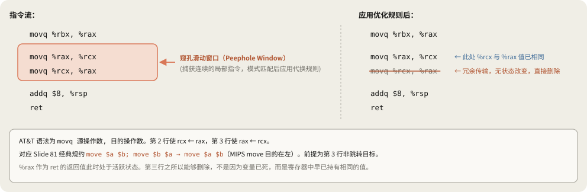

# 9.4 窥孔优化与典型改写模式

窥孔优化（Peephole Optimization）通常作用于汇编或底层 IR 指令序列上。

优化器维持一个极小的“观察视窗”（通常为连续的 2 到 4 条指令），像小孔一样贴在指令流上滑动。一旦窗口内的指令序列匹配到已知的低效模式，就用一套更紧凑、更快速的等价序列替换掉。

## 1. 滑动窗口与形式化规则



**读图**：左侧展示了原始指令流与滑动的窥孔窗口。窗口当前框选了连续的两条指令：`movq %rax, %rcx` 与 `movq %rcx, %rax`。右侧展示了模式替换的结果：在 AT&T 汇编语法中（`movq src, dst`），执行完第二条指令后寄存器 `%rcx` 与 `%rax` 必然持有完全相同的数值；因此紧随其后的第三条指令没有产生任何新的状态变化，属于纯冗余指令，直接予以剔除。该规则与 Slide 81 的经典规约 `move $a $b; move $b $a -> move $a $b` 一致。需要格外注意，`%rax` 作为后续 `ret` 指令的返回值，在程序点处处于活跃状态——第三行能够被删除的真正原因不是变量死亡，而是寄存器数值已经一致。

窥孔优化的规则可以形式化记为：

$$i_1, \dots, i_n \to j_1, \dots, j_m \quad (m \le n)$$

右侧（rhs）为左侧（lhs）在相同语义下的精简版本。

> [!note] 补充：$m \le n$ 并非严格铁律与算法终止的必要条件
> Slide 81 仅强调右侧必须是左侧的“改良版本（Improved Version）”。通常情况下指令条数会减少，但也存在例外：例如 [[9.3 局部优化：代数化简与常量折叠]] 中将乘 15 拆解为移位与减法（`sal` + `sub`），指令条数由 1 增加至 2（$m > n$），但总时钟周期显著缩减。衡量优化成立的标尺是执行成本而非单纯的指令计数。为了保证窥孔不动点循环必然停机，整套改写规则必须定义在严格单调递减的成本度量空间中；若同时引入互逆的规则（如对称交换操作数的乘法规则），就会引发死循环颠簸。

## 2. 典型改写模式与安全边界

1. **冗余数据搬移消除**：
   ```cpp
   // 汇编表现：
   // move $a, $b
   // move $b, $a  ===>  move $a, $b

   // C++ 对应语义：
   a = b;
   b = a;  // 冗余赋值，通常可删除
   ```
   - **安全边界**：这一项改写成立的前提是，第二条指令 `b = a` 绝对不能是任何外部跳转的目标地址（Not the target of a jump）。如果其他基本块有跳转分支直达第二条指令，删除它就会改变程序状态。

2. **连续常量累加合并**：
   ```cpp
   // 汇编表现：
   // addiu $a, $a, i
   // addiu $a, $a, j  ===>  addiu $a, $a, (i + j)

   // C++ 对应语义：
   a += 2;
   a += 3;
   // 窥孔合并为：
   a += 5;
   ```

3. **基本块优化下沉为窥孔规则**：
   不少原本需要基本块分析的简单局部优化，可以直接拆解为底层的窥孔替换模式。例如：
   - 规则一（加 0 转搬移）：`addiu $a, $b, 0` $\to$ `move $a, $b`
   - 规则二（自身复制消除）：`move $a, $a` $\to$ 空（直接丢弃）

   当遇到代码 `addiu $a, $a, 0` 时，规则一先将其重写为 `move $a, $a`，随后的扫描中规则二立即生效，整条指令彻底被抹除。

4. **不动点迭代（Fixed-Point Iteration）**：
   窥孔优化不是单次扫描就能完事的。某一条模式替换之后，往往会和前后原本不相干的指令拼接出全新的优化视窗。因此，窥孔优化必须反复多轮扫描，直到整个窗口滑过去没有任何一条规则被触发为止。

## 3. 窥孔微型引擎实测反馈

> [!note] 补充：MIPS 子集模拟器上的 4 组实测验证
> 在微型 MIPS 模拟器上实测了前述 4 组窥孔规则：
> - 对 `addiu $a, $a, 0` 进行扫描：首轮将其转为 `move $a, $a`，次轮匹配自身消除规则抹除该指令，第三轮无规则触发并正常停机。
> - 对级联序列 `addiu $a,$a,2; addiu $a,$a,3; addiu $a,$a,-5` 进行扫描：前两行首先合成为 `+5`，与下一行拼接后合成为 `+0`，再降解为 `move` 后彻底消除。共耗费 4 轮改写扫描与 1 轮收敛检验。
> - **立即数溢出约束**：MIPS `addiu` 的立即数字段为 16 位有符号数（范围 $-32768 \dots 32767$）。当两数累加超出该区间时（如 $30000 + 30000 = 60000$），常量合并必须放弃触发，否则会导致硬件截断或非法指令。
> - **安全边界的反例验证**：在指令序列 `b <- 5; c <- 0; a <- b; L: b <- a; a <- a + 1; c <- c + 1; (loop while c < 3)` 中，标号 `L` 处的 `move $b, $a` 与前序的 `move $a, $b` 表面上构成规则 1。若忽略跳转目标约束强行删除该行，循环内的 `b` 将无法捕获迭代递增后的 `a`，最终 `b` 的输出值从正确的 `7` 坍塌为 `5`。

---

上一篇：[[9.3 局部优化：代数化简与常量折叠]] | 下一篇：[[9.5 基本块内常量传播、死代码消除与 CFG]]

来源：[[16.AI编译器/学习日记/0.2十一月/11_05#3. 窥孔优化（Peephole Optimization）|11_05 §三.3]]。
