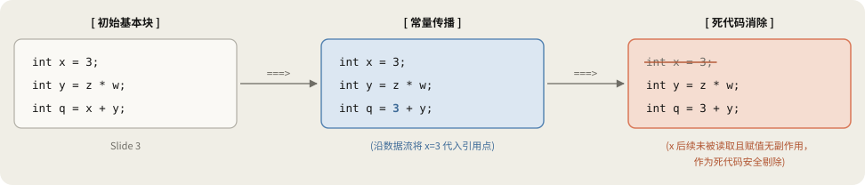
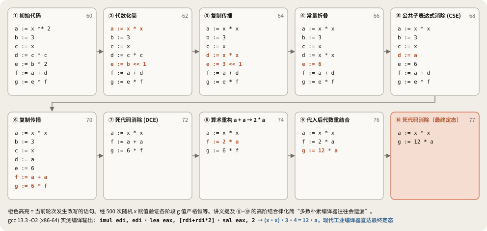
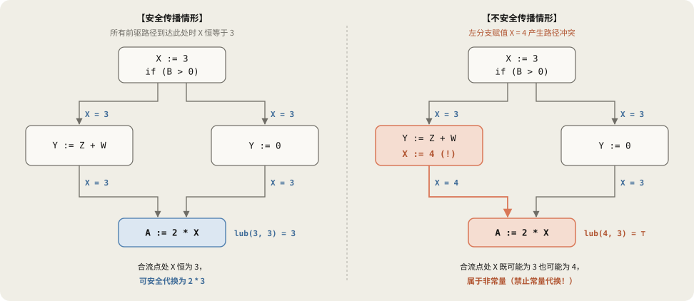

# 9.5 基本块内常量传播、死代码消除与 CFG

单一局部优化 Pass 往往只能露出新的简化机会，把**常量传播、复制传播、公共子表达式消除（CSE）与死代码消除**串联起来反复迭代，才能在基本块内形成连锁收割效应；而一旦越出单个基本块的边界，优化就必须面对控制流图（CFG）上的分支与汇合。

## 1. 基本块内的常量传播与死代码消除

在基本块内部，**常量传播（Constant Propagation）**和**死代码消除（Dead Code Elimination）**往往结伴登场。常量传播负责把已知的字面值往前推，为表达式求值和逻辑判断铺路；死代码消除则跟在后面打扫战场，清理掉失去意义的中间变量。



**读图**：流程清晰展示了局部优化 Pass 之间的连锁触发效应。初始基本块中定义了变量 `x = 3`，后续语句 `q = x + y` 引用了 `x`。第一步触发常量传播，沿数据依赖链将 `q` 中的操作数 `x` 替换为字面值 `3`。由于此项替换彻底消除了对 `x` 的后续所有读取操作，第二步死代码消除顺理成章地将已经失去存活意义的 `int x = 3;` 移出指令序列，仅保留真正参与后续计算的 `y` 与 `q`。单一优化 Pass 往往无法单独缩减指令，必须与其他 Pass 协作才能发挥最大效用。

1. **常量传播（Constant Propagation）**：
   编译器扫描基本块，确认 `x = 3` 是一处常量定义。在 `x` 被重新赋值之前，后续语句 `q = x + y` 引用了 `x`。编译器将操作数直接替换为字面量 `3`，表达式变形为 `q = 3 + y`。
2. **死代码消除（Dead Code Elimination）**：
   替换完成后，编译器检查符号表中的变量活性（Liveness）。如果在当前基本块及后续整个程序路径中，变量 `x` 再也不会被任何指令读取，且赋值语句本身不包含任何副作用（如 I/O 操作、内存屏障或修改全局状态），那么 `int x = 3;` 就沦为了死代码。优化器将其直接从指令流中剔除，节省寄存器分配压力与内存开销。

> [!note] 补充：讲义中的其余三项经典局部优化
> 讲义 Slide 44–57 还介绍了另外三项基础局部优化 Pass：
> - **单一赋值形式（Single Assignment Form）**：重写基本块中的局部寄存器，确保每个虚拟寄存器在赋值号左端至多出现一次。例如将序列 `x := z + y; a := x; x := 2 * x` 改写为 `b := z + y; a := b; x := 2 * b`（引入新变量 `b`）。在单个基本块内实现重命名十分简便，而将其推广至全函数即构成了现代编译管线（如 LLVM IR）的基石——静态单赋值（SSA）形式。
> - **公共子表达式消除（Common Subexpression Elimination, CSE）**：在单一赋值块中，若两处赋值的右端表达式完全相同，则二者必然产出相同值。编译器可直接将后出现的语句 `w := y + z` 替换为单纯的别名绑定 `w := x`。
> - **复制传播（Copy Propagation）**：遇到形如 `w := x` 的变量复制时，将后续所有对 `w` 的读取替换为直接读取 `x`。虽然单独执行不会缩减指令，但它能直接架空临时变量 `w`，为 CSE 和死代码消除铺平道路。
>
> 编译器通过遍历优化规则库，不断寻找并应用匹配项，循环推进直至不动点。

Slide 60–78 完整演示了这五种局部优化在一个包含 7 条语句的基本块上的连锁推演过程：



**读图**：全图直观呈现了 10 个阶段的代码演变形态，橙色行高亮了当前轮次被改写的语句。推演流程严格遵循讲义步骤：
- **① $\to$ ②（代数化简）**：将乘方 `x ** 2` 化为乘法 `x * x`，将乘 2 化为移位 `b << 1`；
- **② $\to$ ③（复制传播）**：将 `c` 与 `b` 传播为 `x` 与常量 `3`，暴露出下一步的折叠与 CSE 机会；
- **③ $\to$ ④（常量折叠）**：`3 << 1` 静态折叠为常量 `6`；
- **④ $\to$ ⑤（公共子表达式消除）**：识别出 `d := x * x` 与 `a := x * x` 重复，将 `d` 化简为 `a`；
- **⑤ $\to$ ⑥（再次复制传播）**：将 `d` 的引用点代入为 `a`，将 `e` 的引用点代入为 `6`，使得 $f$ 变为 `a + a`，$g$ 变为 `6 * f`；
- **⑥ $\to$ ⑦（死代码消除）**：逆向扫描发现中间变量 `b`、`c`、`d`、`e` 已无后续引用，全部剔除，代码行数从 7 行压缩至 3 行；
- **⑦ $\to$ ⑩（高阶代数重构与收敛）**：将 `a + a` 重构为 `2 * a`，代入 $g$ 并结合常量系数得出 `g := 12 * a`，最后再次消除死变量 $f$，收敛至终态两行代码 `a := x * x; g := 12 * a`。
- 本机用 GCC 13.3 `-O2` 编译该逻辑，直接生成两条连续的三操作数乘加指令：`imul edi, edi`（即 $x \cdot x$）与 `lea eax, [rdi+rdi*2]` 配合移位，完美达成 $12 \cdot a$ 的终态，证实工业级编译器均具备此类高级结合律代数推理能力。

## 2. 将优化推向整个控制流图（CFG）

基本块优化只能顾及无分支的直线代码。将常量传播扩展到整个控制流图（CFG）时，变量的值会沿着分支流动并在汇合点发生交汇。

此时，常量能否安全传播，取决于汇合前所有路径的一致性：



**读图**：左图展示安全传播情形：在入口处赋值 `X := 3` 后遭遇条件分支 `if (B > 0)`，分别派生出左分支 `Y := Z + W` 与右分支 `Y := 0`。在这两个分支中，变量 `X` 均未遭到修改。当控制流在 `A := 2 * X` 处重新交汇时，来自两边入边的数据流上 `X` 均恒等于 `3`，最小上界计算为 $\mathrm{lub}(3, 3) = 3$。因此优化器可以安全地将 `2 * X` 替换为 `2 * 3`。右图展示不安全传播情形：左分支内部执行了赋值 `X := 4`。在交汇点处，来自左边的边携带值 `4`，来自右边的边携带值 `3`，二者产生冲突，$\mathrm{lub}(4, 3) = \top$（表示非常量）。因此在汇合点处绝对不能实施常量代换。

对应 C++ 逻辑对比如下：

```cpp
// 1. 安全传播场景：不论进入哪个分支，x 始终保持为 3
int x = 3;
if (b > 0) {
    y = z + w;
} else {
    y = 0;
}
int a = 2 * x;  // 汇聚点各路径 x 均为 3，可安全代换为：int a = 2 * 3;

// 2. 不安全传播场景：分支内部存在对 x 的重写
int x = 3;
if (b > 0) {
    y = z + w;
    x = 4;      // 分支内修改了 x 的值
} else {
    y = 0;
}
int a = 2 * x;  // 到达此处的 x 取决于运行时分支走向，不可替换为常数！
```

## 3. 全局常量传播的正确性充要条件

要将程序中某处对变量 $x$ 的使用替换为常量 $k$，必须满足如下核心条件 $(**)$：

$$\text{在到达变量 } x \text{ 的该使用点之前，所有可能路径上的最后一次赋值均为 } x := k \quad (**)$$

这个条件检验起来绝非易事。“所有路径”既包含条件分支的各种组合，也包含循环体内不可预知次数的反复回绕。要判定条件 $(**)$ 是否成立，必须对整张控制流图建立**全局数据流分析（Global Dataflow Analysis）**（见 [[9.6 全局常量传播：数据流分析与半格]]）。

> [!note] 补充：“回答未知”永远是安全的保守近似
> - 在图论意义上全面检验条件 $(**)$ 在数学上属于停机可达性范畴，无法做到 100% 精确判定。但数据流分析能够落地的根基在于：**静态分析允许保守放弃优化，但绝不允许给出错误的优化判断**。当分析引擎无法完全断定某一路径上的值时，只需给出保守答案“未知（$\top$）”并保留原有运行时计算即可。
> - 静态数据流分析将 CFG 上的所有路径都假定为控制流可行路径，因此可能因为“死路径”而引入过度的保守性。例如以下代码：
>
> ```text
> if (B > 0) X := 3 else X := 4;
> if (B > 0) A := X;        // 运行时若到达此行，B 必然大于 0，故 X 必然为 3
> ```
>
> 在真实执行中，第二个 `if` 若为真，其前置条件必然是第一个 `if` 也为真，因此 `X` 恒等于 `3`。但在标准数据流分析中，CFG 会盲目保留“第一个分支走假、第二个分支走真”的死路径，导致汇合处计算出 $\mathrm{lub}(3, 4) = \top$，从而错失优化。这种“不精确但安全”的特性是所有经典数据流框架的共性；若想进一步消除此类假路径，需结合条件分支预测与稀疏条件常量传播（SCCP，Wegman & Zadeck 1991）。

---

上一篇：[[9.4 窥孔优化与典型改写模式]] | 下一篇：[[9.6 全局常量传播：数据流分析与半格]]

来源：[[16.AI编译器/学习日记/0.2十一月/11_05#四、基本块优化与跨基本块扩展|11_05 §四]]。
