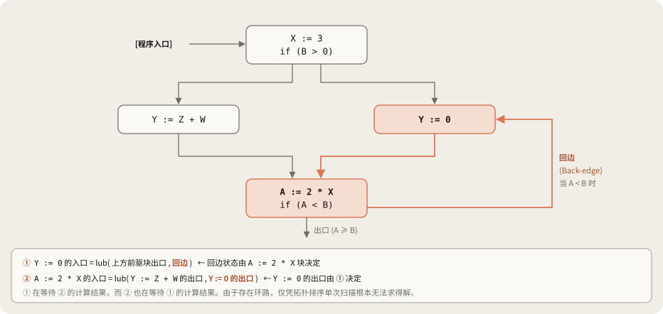
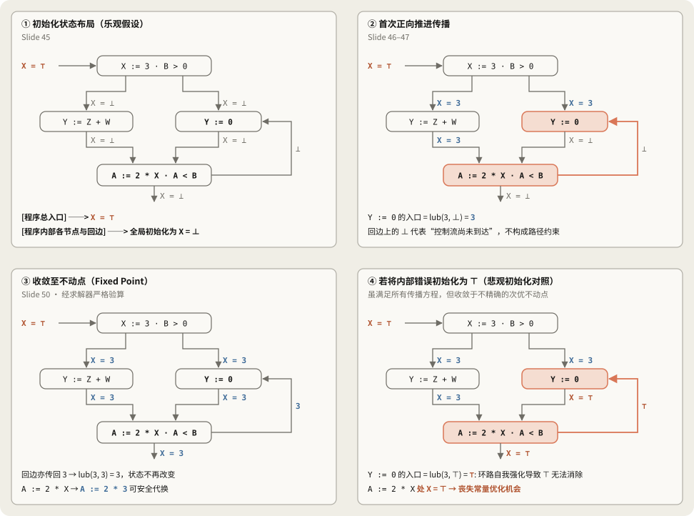
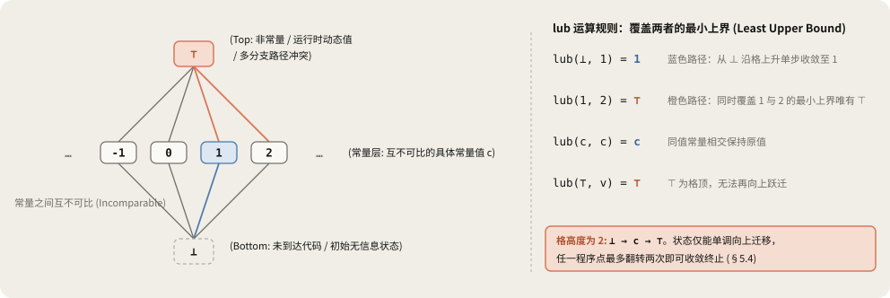

# 9.6 全局常量传播：数据流分析与半格

为了对整张控制流图（CFG）上所有程序点的变量状态做严谨计算，编译器为每个变量引入**抽象值域（Abstract Values）**，建立**半格（Semi-Lattice）**模型，并通过单调迭代在有限步内求解最小不动点。

## 1. 抽象值的三态定义

在程序的任意执行点，针对考察的变量 $X$，关联以下三种状态之一：

| 抽象值 | 术语 | 语义解释 |
| :---: | :---: | :--- |
| $\bot$ | **Bottom**（底元素） | 代码尚未执行 / 静态分析推断当前控制流尚不可达（"So far as we know, control never reaches this point"） |
| $c$ | **Constant**（常数） | 变量 $X$ 在此处确定持有常量值 $c$（即 $X = c$） |
| $\top$ | **Top**（顶元素） | 变量 $X$ 不是常量（存在分支冲突、外部未知输入或动态运行时变量） |

> [!note] 补充：状态值附着在语句之间的“程序点”上
> Slide 19 与 22 明确指出，数据流状态并非依附在语句本身，而是严格依附在**语句之间的程序切片点（Program Points）**上。对于语句 $s$ 与变量 $x$，分别定义其紧接执行前的入口状态 $C(s, x, \text{in})$ 与紧接执行后的出口状态 $C(s, x, \text{out})$。在多语句构成的基本块抽象图中，边上的标定值即代表离开前序块、流入后继块时的数据流抽象状态。

## 2. 为什么必须引入 $\bot$：环路与循环依赖的破局

如果程序中存在循环（回边），前驱与后继之间的依赖就会打成死结：

**读图**：图中展示了带循环控制流图所面临的典型循环依赖困局。从入口进入执行 `X := 3` 后遇到分支，分流至左侧 `Y := Z + W` 与右侧 `Y := 0`，随后汇入块 `A := 2 * X`。在块末尾，若条件 `A < B` 成立，则控制流通过**回边（Back-edge）**跳回上方的 `Y := 0` 处；若不成立则退出。底部面板详细拆解了互锁关系：
- 式 ① 指出，`Y := 0` 入口处的状态取决于上方块出口与回边状态的汇合；而回边状态由下方块 `A := 2 * X` 决定；
- 式 ② 指出，下方块 `A := 2 * X` 入口处的状态取决于两个前驱块出口的汇合，其中一个正是 `Y := 0`。

式 ① 在等待式 ② 的输出，而式 ② 又在等待式 ① 的输出。由于有向环的存在，控制流图不再是有向无环图（DAG），无法采用自顶向下的单次拓扑排序完成计算。

赋予初值是打破循环依赖的关键：
- **程序总入口**初始化为 $\top$（函数参数、全局状态等外部输入在编译期未知）。
- **程序内部其余所有点**全部初始化为 $\bot$（乐观假定：控制流尚未到达，没有任何冲突发生）。

通过迭代求解该循环 CFG 的四个阶段推演如下：

**读图**：
- **① 初始化阶段（乐观假设）**：程序总入口设定为 $X = \top$。除入口外的所有内部程序点以及回边全部赋予底元素 $\bot$。底元素 $\bot$ 的语义是“假定控制流未曾到达”，因此不会对汇合运算产生任何数值约束；
- **② 首轮正向推演**：控制流沿入口自顶向下推进，常量值 `3` 扩散至各分支。在计算节点 `Y := 0` 的入口时，上方前驱传入 `3`，而回边暂为 $\bot$。根据汇合规则 $\mathrm{lub}(3, \bot) = 3$（未到达边不造成干扰），成功将常量 `3` 传递至 `Y := 0` 并流向 `A := 2 * X`；
- **③ 收敛至不动点**：常量 `3` 沿循环体下行，最终随回边回传至上方入口。此时重新计算入口汇合：$\mathrm{lub}(3, 3) = 3$。状态与上一轮完全一致，求解器触发停机！最终成功在不动点下将 `A := 2 * X` 代换为 `A := 2 * 3`；
- **④ 悲观初始化的失败对照**：若错误地将内部节点全初始化为 $\top$，回边在第一轮就输入 $\top$。节点 `Y := 0` 的入口被迫计算 $\mathrm{lub}(3, \top) = \top$。这个 $\top$ 顺着环路自我循环强化，最终死锁在次优解，导致 `A := 2 * X` 错失常量化简机会。以 $\bot$ 作为起点自底向上求解，数学上能确保收敛至最精确的**最小不动点（Least Fixed Point）**。

## 3. 半格偏序与汇合运算（Least Upper Bound, lub）

通过偏序关系将抽象值进行层级排列，形成常量传播半格（Constant Propagation Semi-Lattice）：

$$\bot < c < \top$$

- $\top$ 是格中的极大元（Greatest value），代表最保守的无常量状态。
- $\bot$ 是格中的极小元（Least value），代表尚未探测到的乐观初值。
- 所有具象常量 $c$ 处于中间层，彼此互不可比（Incomparable）。

**读图**：左侧展示了经典的扁平格（Flat Lattice）拓扑架构。顶部的 $\top$ 代表非常量或多分支冲突状态；中间层是由互不相交的整数字面值构成的常量平面，任意两个不同常量之间均不可比较大小（Incomparable）；底部的 $\bot$ 代表未执行的无信息状态。右侧演示了最小上界运算（Least Upper Bound, $\mathrm{lub}$）的几何跃迁规则：两元素的 $\mathrm{lub}$ 即为沿偏序连线向上寻找的首个公共交汇点。从 $\bot$ 与具体数值 $1$ 出发，单步提升即收敛至数值 $1$（蓝色箭头）；而从数值 $1$ 与数值 $2$ 出发，在中间层无路可通，只能共同跃升至顶层元素 $\top$（橙色箭头）。整个半格的高度（Height）严格等于 2，这一性质构成了后文算法停机性证明的核心支撑。

> [!note] 补充：不同经典教材中格方向的倒置传统
> - CS143 课程约定将无信息的“尚未到达”置于格底 $\bot$，将“非常量”置于格顶 $\top$，使用自底向上的汇合运算 $\mathrm{lub}$（Join, $\vee$）。
> - 龙书（Aho 等《Compilers》第 2 版 §9.3–9.4）与 Kildall 1973 年奠基论文的传统则正好相反：将未定义状态记为 $\top$（UNDEF），将非确定常量记为 $\bot$（NAC, Not-A-Constant），汇合运算使用最大下界（Meet, $\wedge$）。两者仅是上下镜像颠倒，代数结构与计算实质完全同构。阅读论文与教材时需首先明确其正逆定义。LLVM 内部在实现 SCCP 时直接使用具名枚举 `unknown`、`constant` 与 `overdefined`，避免了符号歧义。
> - 此结构被称为“半格”，是因为分析算法仅用到上确界汇合运算 $\mathrm{lub}$。因其同时具备上确界与下确界，它在代数上亦构成完整格。

定义偏序关系上的最小上界（Least-Upper Bound, $\mathrm{lub}$）：

$$\begin{aligned}
\mathrm{lub}(\bot, c) &= c       && \text{（未达分支不提供约束，保留已有确定值）} \\
\mathrm{lub}(c, c) &= c          && \text{（多路径汇入相同常量，最小上界保持不变）} \\
\mathrm{lub}(c_1, c_2) &= \top \quad (c_1 \ne c_2) && \text{（常数产生分歧，最小上界跃迁至顶元素）} \\
\mathrm{lub}(\top, v) &= \top    && \text{（存在动态或未知路径，最小上界直接锁定为顶元素）}
\end{aligned}$$

通过 $\mathrm{lub}$ 可以简洁表达所有前驱节点向当前语句入口汇聚的状态方程：

$$C(s, x, \text{in}) = \mathrm{lub} \{ C(p, x, \text{out}) \mid p \text{ 是 } s \text{ 的前驱语句} \}$$

> [!note] 补充：语句内部的状态转移方程（规则 5 至 8）
> 上式解决了前驱出口到当前入口的跨节点传递，语句内部从入口 $C(s, x, \text{in})$ 到出口 $C(s, x, \text{out})$ 的转化则由 Slide 28–32 定义的规则 5–8 掌控：
>
> $$
> \begin{aligned}
> C(s, x, \text{out}) &= \bot \quad \text{若 } C(s, x, \text{in}) = \bot && \text{(规则 5: 未达代码的后继依然未达)} \\
> C(x := c,\ x, \text{out}) &= c \quad (c \text{ 为字面常量}) && \text{(规则 6: 常量赋值重写状态)} \\
> C(x := f(\dots),\ x, \text{out}) &= \top && \text{(规则 7: 动态函数或表达式赋值重置为未知)} \\
> C(y := \dots,\ x, \text{out}) &= C(y := \dots,\ x, \text{in}) \quad (x \ne y) && \text{(规则 8: 未触及变量 x 则状态原样穿透)}
> \end{aligned}
> $$
>
> 规则 5 拥有最高优先权。若入口为 $\bot$，即便是常量赋值语句 `x := 3`，出口依然保持为 $\bot$。这确保了初始置为 $\bot$ 的死分支绝不会产生幽灵常量，只有当控制流真正自入口激活注入时，节点才会被激活计算。

## 4. 算法终止性（Termination）的形式化保障

仅仅设定“重复遍历直到状态不再变化（Repeat until nothing changes）”，在数学上并不足以证明循环必然能停机。

引入 $\mathrm{lub}$ 之后，算法的停机证明变得直截了当：
1. **单调上升（Monotonicity）**：所有程序点均以 $\bot$ 为起点，且每次应用 $\mathrm{lub}$ 运算后状态值**只能单调增加**（沿偏序链 $\bot \le c \le \top$ 上升），绝不可能发生回退。
2. **有限跃迁步数（Finite Height）**：状态值的跃迁路径只有 $\bot \to c \to \top$ 一条链，每个程序点针对单个变量的状态最多只能改变 2 次。
3. **全局收敛边界**：迭代分析必然在有限轮次内达到不动点（Fixed Point）并完全停机。

> [!warning] 纠偏：全程序状态更新上界实为 $4 \times N \times V$
> 常见笔记常粗疏地将更新上界记为 $2 \times N \times V$。这一疏漏忽略了**每条语句都拥有两个独立程序点（入口 $\text{in}$ 与出口 $\text{out}$）**这一事实。
> 若 CFG 中包含 $N$ 条语句、跟踪 $V$ 个变量，全程序总共拥有的独立数据流状态切片点数量为 $2 \times N \times V$ 个。由于每个状态点至多只能发生 2 次单向跃迁（$\bot \to c$ 一次，$c \to \top$ 一次），因此整个不动点算法的最大理论更新上限为：
>
> $$2 \times (2 \times N \times V) = 4 \times N \times V \text{ 次}$$
>
> Slide 58 也明确指出了“总更新次数 = 状态值总数 $\times 2$ = 语句数 $\times 4$”。在自研求解器中测试 [[9.5 基本块内常量传播、死代码消除与 CFG]] 的不安全分支用例（6 条语句，跟踪变量 X，若按 $2N$ 计算上限仅为 12 次），在随机构建的特定遍历顺序下，汇合点 `A := 2 * X` 的入出状态各经历了 $\bot \to 3 \to \top$ 的两次翻转，实测总更新次数达到 13 次，直接突破了 $2NV$ 的估算。但无论常数系数如何，核心结论始终成立：算法复杂度与程序尺寸呈**线性阶**关系，且必然停机。

---

上一篇：[[9.5 基本块内常量传播、死代码消除与 CFG]] | 下一篇：[[9.7 活跃性分析与全局死代码消除]]

来源：[[16.AI编译器/学习日记/0.2十一月/11_05#五、全局常量传播的工作机制：数据流分析与半格|11_05 §五]]。
