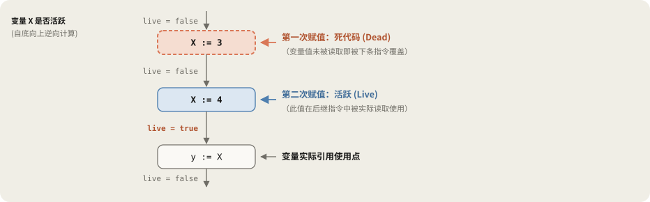
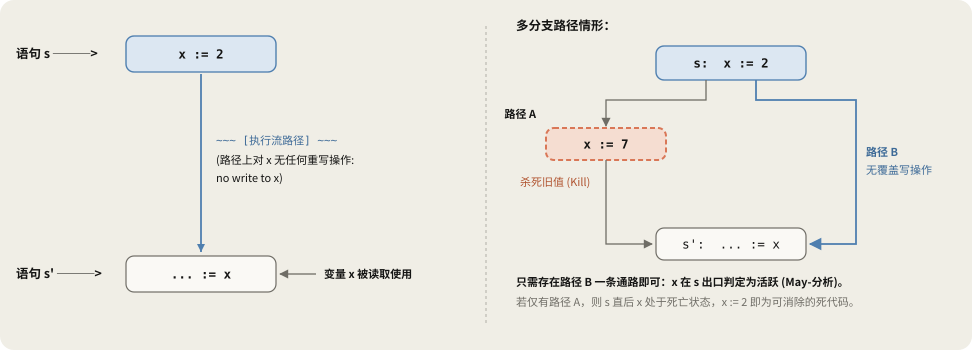
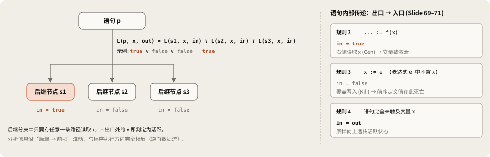
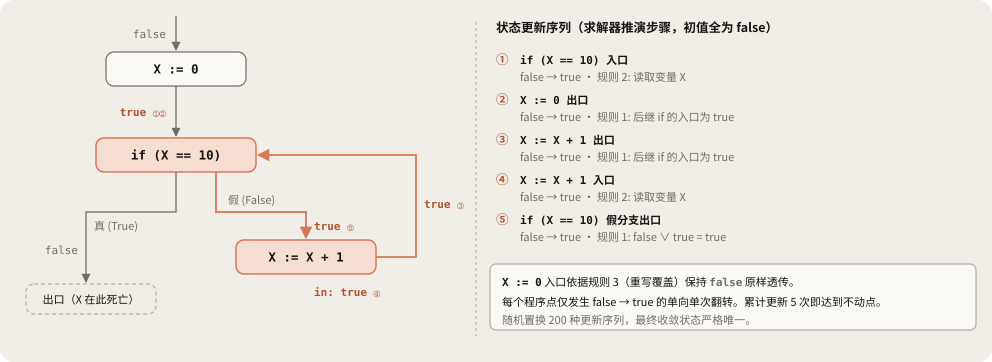

# 9.7 活跃性分析与全局死代码消除

全局常量传播完成后，常数已被直接代入使用点。例如语句 `A := 2 * X` 变成了 `A := 2 * 3`。此时，原有的赋值语句 `X := 3` 就失去了存在的意义，应当予以剔除。

判断一条赋值语句能否安全删除，核心依托于**活跃性分析（Liveness Analysis）**。同时，活跃性分析也是后端图着色寄存器分配的直接前置分析。

## 1. 变量的“活跃”与“死亡”

直观而言，**活跃（Live）意味着该变量的值在未来可能被读取（May be used in the future）**：
- 如果一个变量所持有的值在后续执行路径中还可能被任何语句作为操作数使用，它就是**活的（Live）**。
- 如果一个变量在被读取之前就被新的赋值直接覆写，或者程序此后完全不再读取它，那么当前的赋值就是**死的（Dead）**。



**读图**：右侧展示了三条顺序执行的语句：第一次赋值 `X := 3`、第二次赋值 `X := 4` 以及使用点 `y := X`。左侧展示了自底向上逆向推导出的变量 `X` 活跃性状态：在程序退出点（第 3 条语句之后），假定没有其他代码读取 `X`，故活跃性为 `false`；第 3 条语句读取了 `X`，因此在其紧邻上方，变量被成功激活为 `true`；第 2 条语句执行了对 `X` 的重写（Kill），切断了依赖链，使得在其紧邻上方活跃性再度复位为 `false`；因此在第一次赋值 `X := 3` 的紧后出口处，活跃性状态为 `false`。这意味着赋值 `X := 3` 产出的数值尚未被任何人读取便已死亡，属于彻头彻尾的死代码，优化器可直接予以切除。

对应 C++ 代码逻辑如下：

```cpp
int x = 3;  // 第一次赋值：死代码（从未被读取就遭覆盖）
x = 4;      // 第二次赋值：活跃（此值流入下一行）
int y = x;  // x 在此处被读取使用
```

## 2. 活跃性的形式化定义

变量 $x$ 在语句 $s$ 处是**活跃的（Live）**，当且仅当同时满足以下三个条件：
1. 存在某条语句 $s'$ 使用了变量 $x$（$\exists s', s' \text{ uses } x$）。
2. 在控制流图中，存在一条从 $s$ 指向 $s'$ 的可达路径（Path from $s$ to $s'$）。
3. 在这条路径上，**不存在对变量 $x$ 的任何中间赋值（No intervening assignment to $x$）**。



**读图**：左图展示单路径情形：语句 $s$ 执行 `x := 2`，沿控制流到达语句 $s'$ 读取 `... := x`。由于中间路径没有任何针对 `x` 的写入（no write to x），来自 $s$ 的值能无损送达 $s'$，因此 `x` 在语句 $s$ 出口处处于活跃状态。右图展示多分支情形：分支路径 A 包含了赋值 `x := 7`，重写杀死了来自 $s$ 的旧值；但并行的分支路径 B 没有任何写入。活跃性分析属于典型的 **May-分析**（只要存在至少一条通路使得未来可能读取，就判定为活跃），因此只要路径 B 畅通，`x` 在 $s$ 出口依然保持活跃！只有当路径 B 不存在（所有可行路径均包含覆盖写）时，$s$ 后的 `x` 才会彻底死亡。

## 3. 死代码消除（Dead Code Elimination）的判准

基于活跃性分析，死代码消除的判定极为干脆：

> 对于赋值语句 $x := \dots$，**如果紧随该赋值之后变量 $x$ 是死的（Dead after assignment）**，且该语句自身不包含外部可观测副作用（如向 volatile 内存写入、系统调用或 I/O 输出），则该语句即为死代码，可以直接从程序中彻底剥离。

> [!note] 补充：死代码消除的迭代连锁与副作用保留
> - **迭代级联效应**：死代码消除往往不能一蹴而就。删除一条死赋值语句后，该语句右侧所引用的源操作数变量可能随之失去使用点，进而沦为新的死变量。因此，死代码消除与活跃性分析同样需要循环执行直至不动点。在 [[9.5 基本块内常量传播、死代码消除与 CFG]] 的十步推演中，第 ⑩ 步之所以能删除 `f := 2 * a`，正是因为第 ⑨ 步优化将变量 $g$ 的计算重写为直接引用 $a$ 从而架空了 $f$。
> - **保留外部副作用**：对于包含函数调用的赋值 `x := f()`，即使变量 $x$ 已经死亡，函数调用本身绝不可轻率删除，必须改写为单独的求值语句 `f()`，防止遗漏 I/O 或全局状态变更。
> - **赋能寄存器分配**：活跃性分析除用于剔除死代码外，更是后续后端图着色寄存器分配（[[12.1 寄存器复用与干涉图（RIG）]]）的核心技术支撑。若两变量在某一程序点同时处于活跃状态，二者的生命周期产生重叠（Interference），绝不能共享分配同一个物理寄存器。

## 4. 活跃性分析的数据流方程与逆向传播

活跃性分析本质上比常量传播更纯粹：
- 它是一个**布尔属性（Boolean property）**：在任意点，变量要么活跃（`true`），要么死亡（`false`）。
- 常量传播是沿着代码执行顺序向后流动的**前向分析（Forward Analysis）**；而活跃性分析则必须从“未来的使用点”逆向回溯到“当下的定义点”，属于典型的**逆向数据流分析（Backward Dataflow Analysis）**。

### 汇合规则（Rule 1：后继汇聚到前驱出口）

对于拥有多个后继分支的语句 $p$，只要在其任何一条后继路径上变量 $x$ 是活跃的，那么在语句 $p$ 执行完毕的出口处，变量 $x$ 就必须保持活跃。

出口活跃状态由所有后继语句入口状态的**逻辑或（$\bigvee$）**决定：

$$L(p, x, \text{out}) = \bigvee \{ L(s, x, \text{in}) \mid s \text{ 是 } p \text{ 的后继语句} \}$$



**读图**：左侧展示后继分支向当前前驱节点汇聚的**规则 1**。语句 $p$ 拥有三个后续可能的分支 $s_1$、$s_2$、$s_3$。只要其中哪怕只有一个分支的入口活跃性为真（例如 $s_1$ 为 `true`，而 $s_2$、$s_3$ 为 `false`），通过逻辑析取汇合后，语句 $p$ 出口处的活跃性即确定为 `true`。右侧展示单个语句内部由出口向入口逆推的**规则 2 至 4**：
- **规则 2**：若语句右侧表达式读取了变量 $x$（生成活跃性 / Gen），则不论出口状态如何，该语句入口处 $x$ 必为 `true`；
- **规则 3**：若语句左侧定义了变量 $x$ 且右侧未读取 $x$（杀死活跃性 / Kill），则入口处 $x$ 的旧值彻底死亡，强制置为 `false`；
- **规则 4**：若语句未触及变量 $x$，则原样透传，入口状态与出口状态完全等价。

> [!note] 补充：规则 2 至 4 的形式化与经典数据流集合方程
> 单个变量在语句 $s$ 内部的逆向传递方程写作：
>
> $$
> \begin{aligned}
> L(s, x, \text{in}) &= \text{true} \quad (s \text{ 在右端读取了变量 } x) && \text{(规则 2)} \\
> L(x := e,\ x, \text{in}) &= \text{false} \quad (e \text{ 中不含变量 } x) && \text{(规则 3)} \\
> L(s, x, \text{in}) &= L(s, x, \text{out}) \quad (s \text{ 与变量 } x \text{ 无关}) && \text{(规则 4)}
> \end{aligned}
> $$
>
> 若语句形如 `x := x + 1`，由于其右侧读取了 `x`，规则 2 优先生效，入口活跃性为 `true`。若推广至整个符号表的所有变量集合，可紧凑表示为经典的数据流集合方程：
>
> $$\mathrm{in}(s) = \mathrm{use}(s) \cup \bigl(\mathrm{out}(s) - \mathrm{def}(s)\bigr), \qquad \mathrm{out}(s) = \bigcup_{t \in \mathrm{succ}(s)} \mathrm{in}(t)$$
>
> 其中 $\mathrm{use}(s)$ 为该语句引用的变量集合，$\mathrm{def}(s)$ 为该语句覆写的变量集合。

讲义 Slide 73–82 的经典循环用例求解过程推演如下：



**读图**：示例包含循环结构：入口进入 `X := 0`，随后进入循环守卫 `if (X == 10)`；条件为真时跳往出口退出（此时变量 X 死亡）；条件为假时进入循环体 `X := X + 1` 并折返回 `if` 处。
- 初始化时将所有边上的状态全部置为 `false`，随后逆向更新违背规则的程序点；
- **①** 语句 `if (X == 10)` 读取了变量 $X$，依据规则 2 将其入口逆向更新为 `true`；
- **②** 依据规则 1，前驱语句 `X := 0` 的出口被刷新为 `true`；
- **③** 同样依据规则 1，循环体 `X := X + 1` 的出口被刷新为 `true`；
- **④** 语句 `X := X + 1` 在右端读取了 $X$，依据规则 2 将其入口逆向更新为 `true`；
- **⑤** `if` 语句假分支的出口由此被更新为 `true`；
- 首行语句 `X := 0` 的入口由于执行了无自引用的覆写，依据规则 3 判定旧值已死，保持为 `false`。全网状态经 5 步翻转后达到完美不动点。实测随机重排 200 种更新次序，收敛形态严格一致；若漏掉规则 3，则会在程序入口处错误判定变量活跃。

## 5. 常量传播与活跃性分析的对偶对比

| 核心考量维度 | 全局常量传播（Constant Propagation） | 活跃性分析（Liveness Analysis） |
| :--- | :--- | :--- |
| **核心探查问题** | 在特定程序点，变量 $x$ 的值是否恒等于固定常数 $c$ | 在特定程序点，变量 $x$ 当前的值在未来是否可能被读取 |
| **数据流流动方向** | **正向（Forward）**：前驱出口 $\to$ 后继入口 | **逆向（Backward）**：后继入口 $\to$ 前驱出口 |
| **抽象值与偏序格** | 半格三态：$\bot < c < \top$（高度为 2） | 布尔二态：$\text{false} < \text{true}$（高度为 1） |
| **路径汇合运算** | 最小上界：$\mathrm{lub} \{ C(p) \}$ | 逻辑析取（并集）：$\bigvee \{ L(s) \}$ |
| **路径判定语义** | **Must-分析**（必须在所有可行前驱路径上成立） | **May-分析**（只要在任意一条后续路径上成立即可） |
| **全局初始底态** | 程序入口置为 $\top$，其余所有内部点置为 $\bot$ | 全程序所有切片点统一初始化为 `false` |
| **单点最大跃迁步数** | 至多翻转 2 次（$\bot \to c \to \top$） | 至多翻转 1 次（$\text{false} \to \text{true}$） |
| **产出主要赋能阶段** | 编译期常量代换、常量折叠、死控制流分支剪枝 | 死代码彻底剔除、图着色物理寄存器分配 |

绝大多数经典过程内数据流分析（如可用表达式分析 Available Expressions、到达定值分析 Reaching Definitions）均能纳入这一套前向/逆向、Must/May 的正交框架内。

## 6. 本章参考资料

- **Alex Aiken**, Stanford CS143 编译原理课程讲义：*Intermediate Code & Local Optimizations* (Lecture 14) 与 *Global Optimization* (Lecture 15)。
- **Alfred V. Aho, Monica S. Lam, Ravi Sethi, Jeffrey D. Ullman**, *Compilers: Principles, Techniques, and Tools* (2nd Edition, 2006, 龙书)：§8.4–8.7（基本块、局部优化、窥孔优化）、§9.2–9.4（数据流分析、半格模型、全局常量传播）。
- **Gary A. Kildall**, *"A Unified Approach to Global Program Optimization"*, ACM POPL 1973（格结构与不动点迭代数据流框架奠基论文）。
- **Mark N. Wegman, F. Kenneth Zadeck**, *"Constant Propagation with Conditional Branches"*, ACM TOPLAS 1991（稀疏条件常量传播 SCCP）。
- **William M. McKeeman**, *"Peephole Optimization"*, CACM 1965（窥孔优化原始论文）。
- **Henry S. Warren, Jr.**, *Hacker's Delight* (2nd Edition, 2012) 第 10 章（常量除法转乘法与位移及有符号偏置校正）。
- **Andrew W. Appel**, *Modern Compiler Implementation in ML*（全就业定理、活跃性干涉图与寄存器分配）。

---

上一篇：[[9.6 全局常量传播：数据流分析与半格]] | 下一篇：[[10.1 运行时组织的三件事与程序加载]]

来源：[[16.AI编译器/学习日记/0.2十一月/11_05#六、活跃性分析（Liveness Analysis）与死代码消除|11_05 §六]]。
