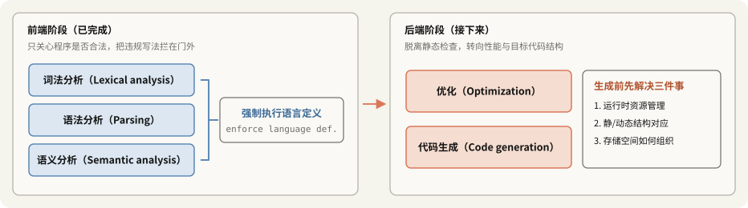
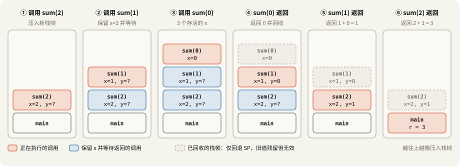
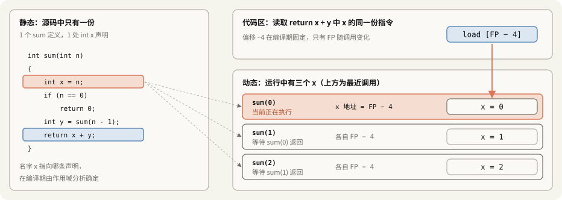
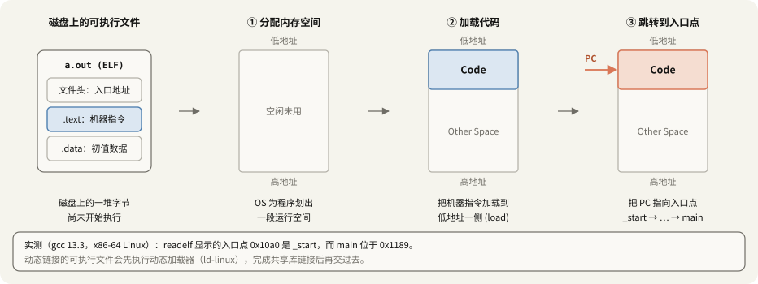
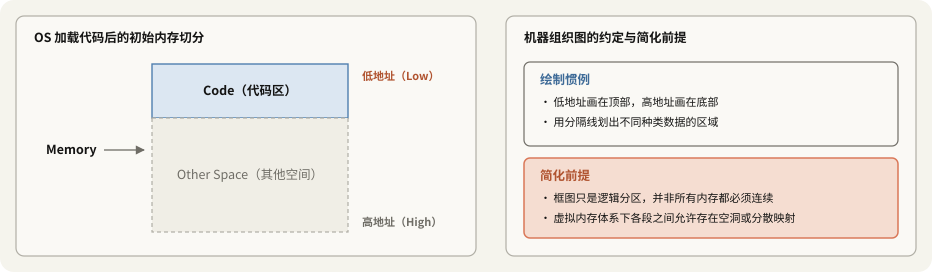

# 10.1 运行时组织的三件事与程序加载

在讨论后端代码生成之前，我们需要先理解“要生成的目标程序在运行时长什么样”。函数调用时参数往哪塞、递归调用时局部变量的几份拷贝怎么互不打架、动态申请的内存由谁分配和回收，这些事没法在编译期写死，必须先有一套运行时机制来托底。

> [!info] 本章实测背景
> 本章各节中的实测数值均在同一台机器（Ubuntu 24.04、x86-64、`gcc 13.3`）上实际编译运行测得，涵盖递归 `sum` 的反汇编（`-O0` 与 `-O2`）和各次调用的栈帧地址、`readelf` 查看入口点、进程各内存区域的实测地址、结构体 `sizeof` 与 `offsetof`、异常展开析构顺序、UBSan 对齐检查以及递归触及栈上限测试；栈式机器不变性则在小型 Python 模拟器上用 2000 条随机嵌套加法表达式做过验证。由于 ASLR（地址空间布局随机化）的存在，实际进程地址每次运行都会变化，图和笔记中记录的是其中一次运行的结果。

## 1. 从前端到后端：为什么先讲运行时系统？



在讨论代码生成之前，我们需要先理解要生成的是什么。业界已经有一批广泛使用的标准技术，用来组织可执行代码的结构。

词法、语法、语义分析合在一起叫编译器前端，批注“enforce language definition”点明了前端的全部职责：它只管程序合不合规矩，把不符合语言定义的写法挡在门外。

过了语义分析与中端优化，编译器就来到后端的运行时组织与代码生成。学到这里很容易想直接看语法树怎么翻译成汇编指令，但光把源码翻译成一条条指令还不够——函数调用、递归多份拷贝、动态内存生命周期，都依赖运行时组织提前立好规矩。

## 2. 运行时组织要解决的三件事

语义分析会检查“变量 x 是什么类型、能不能参与加法”。到了代码生成，还要回答：x 的值放在哪里？执行这次加法时，应该读取哪一份 x？

运行时组织讨论的就是程序执行时，函数调用和数据存储如何安排。

| 议题 | 具体要回答的问题 |
| --- | --- |
| 运行时资源的管理（Management of run-time resources） | 寄存器和内存什么时候给谁用？哪些值要保留？用完怎么回收或复用？ |
| 静态结构与动态结构的对应关系 | 源码里的一个函数定义、一个变量声明，运行时对应哪次调用、哪一份数据？ |
| 存储组织（Storage organization） | 代码、全局变量、局部变量和动态创建的对象分别放在哪里？ |

### 2.1 用一个递归函数来看

```cpp
int sum(int n)
{
    int x = n;

    if (n == 0)
        return 0;

    int y = sum(n - 1);
    return x + y;
}
```

调用 `sum(2)`，返回值为 3。下面按普通的栈实现解释，暂不考虑内联、消除局部变量等编译优化。

`sum(2)` 要先调用 `sum(1)`，`sum(1)` 又要调用 `sum(0)`。执行到最里面时，外面两次调用都还没结束，仍在等待结果。

### 2.2 资源管理：调用别人时，自己的数据怎么办？

`sum(2)` 中的 x \= 2。调用 `sum(1)` 后，这个值还要留着，因为最后需要计算 x 加上递归调用的返回值。

`sum(1)` 也有自己的 x，值为 1。它不能覆盖外层的 x，否则回到 `sum(2)` 时就无法得到正确结果。

因此，普通的栈实现需要安排这些操作：

- 进入一次函数调用，为这次调用准备栈帧，保存它需要的数据和返回信息。
- 调用其他函数前，保留返回后仍然需要的值。
- 函数返回时，撤销本次调用的栈帧，让这部分空间可以再次使用。撤销通常是调整栈指针，不需要把内存逐字节清零。



**读图**：栈帧往上累加、从顶部回收。第 ② 到第 ④ 步期间，`sum(2)` 的 `x = 2` 一直安稳留在原地，直到第 ⑥ 步才拿出来和返回的 `y = 1` 相加。灰色虚线画出的已回收栈帧说明内存并不会被清零，只是把栈指针 SP 拨了回去，旧数值在下一次调用覆盖之前其实还留在内存里，但逻辑上已经作废。

寄存器也需要遵守保存与恢复的约定。如果某个值在调用之后还要用，而被调用函数可能改写保存它的寄存器，就必须安排保护措施。

这里不意味着有一个独立的“运行时管理员”临时决定每个变量放哪里。寄存器分配通常由编译器完成；保存、恢复和调整栈空间等操作，也通常由编译器按照调用约定生成指令，程序运行时执行。堆内存分配则通常会调用分配器。

### 2.3 静态与动态的对应：一个 x 为什么有好几份？

源码中只有一个 `sum` 定义，也只有一处 `int x = n`。但执行到 `sum(0)` 的函数体时，可以有三份仍然存活的 x：

| 尚未结束的调用 | 这次调用自己的 x | 当前状态 |
| --- | --- | --- |
| `sum(2)` | 2 | 等待 `sum(1)` 返回 |
| `sum(1)` | 1 | 等待 `sum(0)` 返回 |
| `sum(0)` | 0 | 即将返回 0 |

这里的“静态”和“动态”，区分的是源码里的结构和执行时的实例：

- 静态：不运行程序，光看源码就能确定的结构。例如，`sum` 有一个参数 `n`，声明了局部变量 `x`，而 `return x + y` 中的 `x` 指向前面的那条声明。
- 动态：程序执行时实际产生的调用和数据。例如，调用 `sum(2)` 后，递归过程中出现三次尚未结束的调用，各自有一份 x，值分别为 2、1、0。

所以，“这个 x 对应哪条声明”由编译期的作用域分析确定；“这次执行应该读取哪份 x”则要结合当前调用的状态。源码中只有一处声明，运行时却可以产生多份变量。

一个函数定义可以对应多次调用，一处局部变量声明可以对应多份同时存在的变量。各次调用通常共用同一份机器代码，但分别保存自己的调用状态。每次调用所需的参数、局部变量、返回位置等信息组成一份活动记录（Activation Record，详见 [[10.3 激活记录（AR）与调用栈链]]）。在常见的栈实现中，它对应一个栈帧；其中部分信息也可能放在寄存器里。

那么，同一句 `return x + y` 怎么找到当前这次调用的 x？编译器可以使用“当前栈帧基址加固定偏移”的寻址方式。例如，假设 x 被放在栈帧基址之前的 4 字节处：

> x 的地址 \= 当前栈帧基址 − 4

偏移量可以在编译期确定，当前栈帧基址则随调用而变化。同一套指令就能访问各次调用自己的 x。这里的偏移量只是示例，实际布局由目标平台和编译器决定，也不一定使用独立的帧指针。



**读图**：左边的一处静态声明对应着右边三个动态栈帧（虚线连线）。机器指令 `load [FP − 4]` 在代码区里自始至终只有这一份，当前 FP 正好指着 `sum(0)` 的栈帧，所以读到 `x = 0`；等回到 `sum(1)` 时，FP 切换成 `sum(1)` 的栈帧，同一条指令读到的就是 `x = 1`。

> [!note] 补充：用 gcc 实测栈帧布局
> - 把上面的 `sum` 用 gcc 13.3 `-O0` 编译并反汇编，以帧指针寄存器 `rbp` 为基准，`n` 落在 `rbp-20`，`x` 落在 `rbp-8`，`y` 落在 `rbp-4`。虽然示例里的 `-4` 实际变成了 `-8`，但所有调用共用同一个固定偏移量的原理完全一致。
> - 在每次调用里把 `&x` 和 `rbp` 打印出来，会看到 `rbp` 依次从 `…140` 降到 `…110` 再到 `…0e0`，每次递减 48 字节，说明越往内层调用，栈帧放在越低的地址上。这 48 字节包括 `call` 压入的 8 字节返回地址、保存的调用方 `rbp` 8 字节以及 32 字节局部变量区（加入 `printf` 后因栈保护 canary 占用了 `rbp-8`，`x` 被挤到 `rbp-16`，但三层调用的偏移仍统一是 `-16`）。
> - 如果打开 `-O2` 优化，gcc 会把这段递归直接改写成循环，连栈帧和局部变量 `x` 都会被优化掉，这正是前面讨论时特意先关闭优化的原因。

返回时，`sum(0)` 先返回 0；`sum(1)` 用自己的 x 算出 1；`sum(2)` 再用自己的 x 算出 3。

### 2.4 存储组织：不同的数据放在哪里？

从整个程序看，不同内容需要保留的时间不同，因此通常采用不同的存储区域。

| 内容 | 常见存放位置 | 保留时间 |
| --- | --- | --- |
| `sum` 编译后的机器指令 | 代码区 | 普通程序中通常随程序保持加载 |
| 全局变量、`static` 变量的存储 | 静态存储区域 | 整个程序运行期间 |
| 每次 `sum` 调用的参数、局部变量等 | 栈帧，也可能使用寄存器 | 对应调用期间；局部对象还受自身作用域限制 |
| `new` 动态创建的对象 | 堆（Heap） | 由相应的销毁和释放操作决定，可以跨越函数返回 |

例如，`sum(1)` 返回后，它的局部变量不再需要，栈帧空间可以回收。全局变量还要供后续代码使用，不能跟着这次调用一起回收。函数通过 `new` 创建并返回给调用者的对象，也可能需要继续存在。

这三件事会交叉：栈属于存储组织；建立和撤销栈帧属于资源管理；通过当前栈帧找到本次调用的 x，则解释了源码声明与运行时数据的对应关系。

## 3. 程序怎么从静止变成运行？

程序的执行最初由操作系统（OS）控制。当一个程序被调用启动时，操作系统会做三件事：
1. 为程序分配空间
2. 把代码加载到该空间的一部分中
3. 跳转到入口点（即 `main`）

刚编译出来的可执行文件只是硬盘上的一堆字节，程序刚拉起时控制权并不在用户代码手里。直到操作系统完成空间分配和代码加载、把指令指针跳进 `main`，CPU 的控制权才正式交给程序，预先约定好的运行时机制也从这一刻起接管后续的函数调用与内存分配。



> [!note] 补充：真正的入口点通常不是 `main`
> 这里说的“跳转到 `main`”是从 C/C++ 程序员视角来看的。ELF 文件头里记录的真实入口点其实是 C 运行时库提供的 `_start`。实测 `readelf -h` 输出的 `Entry point address` 是 `_start`（`0x10a0`），和 `main`（`0x1189`）不是同一个地址。`_start` 先把栈上的 `argc`、`argv` 整理好再调用 `__libc_start_main`，由后者完成全局对象构造等初始化后才去调用 `main`，并在 `main` 返回后拿着返回值调用 `exit`。实际 Linux 内核也不会一口气把整个可执行文件全拷进内存，而是先建立虚拟地址映射，等真正访问到对应页面时才触发缺页按页载入。

## 4. 内存空间的基础切分与看图约定

操作系统把代码加载进分配好的空间后，对应的内存结构可以画成下面这样：



按照机器组织图的绘制惯例：
- 低地址画在顶部
- 高地址画在底部
- 用分隔线划出存放不同种类数据的区域

> [!warning] 纠偏：低地址画在上面只是教材惯例之一
> CS143 这门课的幻灯片和《操作系统导论》（OSTEP）习惯把低地址画在上方，但像《深入理解计算机系统》（CS:APP）这类教材则普遍把高地址画在上方，于是看起来就像栈从上往下长。图纸的上下朝向纯粹是排版习惯，看图前要先找准低地址和高地址在哪一头，牢记“栈向低地址增长，堆向高地址增长”才是不会出错的判断方法。两种画法的对照图见 [[10.4 全局变量、堆与进程内存四分区]]。

操作系统的第一步只是切出整块空间，把编译好的机器指令放进低地址这一头的 `Code` 区；下面那块更大的 `Other Space`，后续会继续细分成静态数据、栈和堆等运行时区域。

这类示意图还有一个简化前提：并非所有内存都必须是连续的。框图画成一个方方正正的整体只是为了讲清楚逻辑分区，在真实的硬件和虚拟内存体系下，各块区域在物理内存或虚拟地址上不必紧挨着排布，中间完全可以留出空洞或分散映射。记住这一点，后面学到栈从高地址向低地址增长、堆从低地址向高地址增长时，就不会被“盒子大小写死了”的错觉带偏。

---

上一篇：[[9.7 活跃性分析与全局死代码消除]] | 下一篇：[[10.2 运行时结构、生命周期与作用域]]

来源：[[16.AI编译器/学习日记/0.2十一月/11_02#一、运行时系统与后端优化开篇|11_02 §一]]。
