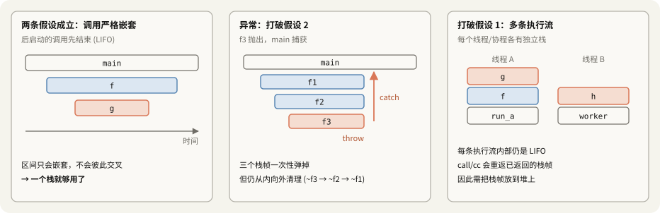
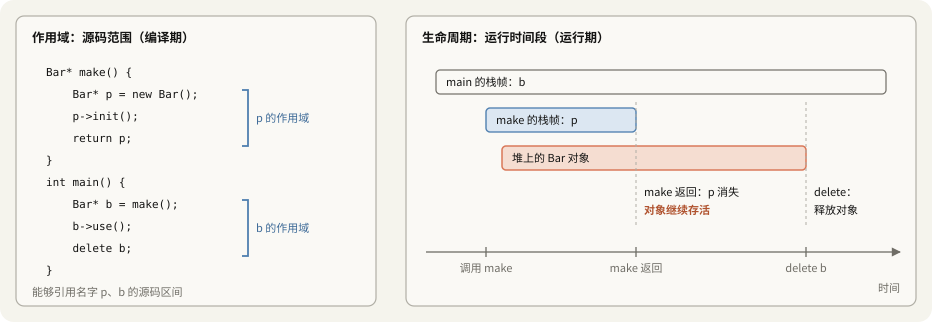

# 10.2 运行时结构、生命周期与作用域

设计运行时结构之前，需要明确代码生成的权衡目标、支撑调用栈模型的两条基础假设（以及何时会被打破），并厘清编译期**作用域（Scope）**与运行期**生命周期（Lifetime）**的边界。

## 1. 代码生成的两个目标

编译器在设计运行时结构时，主要盯着两个目标：正确性（Correctness）和执行速度（Speed）。代码生成之所以复杂，恰恰是因为我们既想让程序跑得对，又想让它跑得快。

如果只求正确，很多实现可以做得很笨重：所有变量全塞进内存、每次调用都把所有寄存器备份一遍、不做任何复用。反过来，想要速度，就得尽量把值留在寄存器里、精简调用开销、复用内存空间，而这又反过来要求编译器精确掌握数据的存活期、寄存器占用和栈帧布局。后端代码生成的各种麻烦，基本都来自在这两个目标之间找平衡。

## 2. 运行时结构的两条基本假设

先讨论最经典的一类语言模型，它建立在两条假设之上：
1. 执行是顺序的：控制流按照明确定义的顺序，从程序的一个位置移动到另一个位置。
2. 当一个过程（函数）被调用时，控制流总会返回到紧跟在这次调用之后的位置。

正是这两条假设，撑起了传统的调用栈（Stack）模型。控制流按单线顺序推进，每次调用结束后又原路返回，函数的激活和结束天然呈后进先出（LIFO）的嵌套关系，所以用一个栈就能把活动记录一层层叠起来。

但在实际语言里，这两条假设都可能被打破：
- 在并发程序中，第一条假设可能会被违反。多线程或协程同时推进时，不再只有单一的顺序控制流，各个执行流往往需要各自独立的栈或上下文。
- 在第二条假设中，像是异常（Exception）和 `call/cc`（call-with-current-continuation）这样的高级控制结构可能会违反。抛出异常时，控制流会直接跳过中间好几层调用，一路回退到外层的捕获点；`call/cc` 甚至能把当前执行上下文保存成对象，在之后某个完全不同的位置反复恢复执行，这就无法只靠“原路返回”的栈帧来支撑了。

> [!note] 补充：异常遵守 LIFO，而 `call/cc` 会打破它
> 异常虽然跳过了正常的逐层返回点，但并没有打乱销毁顺序。实测在 `main → f1 → f2 → f3` 调用链里让 `f3` 抛异常、由 `main` 捕获时，各函数局部对象的析构函数严格按 `~f3 → ~f2 → ~f1` 的顺序被调用。因为清理依然是从栈顶向栈底依次展开（栈展开，stack unwinding），所以异常仍旧能靠栈实现。真正绕开栈模型的是 `call/cc`：它保存下来的续延（continuation）可以在原函数已经返回之后再次跳回去执行，若栈帧随返回销毁就无处可回，因此实现上只能把栈帧分配在堆里，或者整段拷贝栈内容。带捕获局部变量且寿命长于外层函数的闭包也会遇到类似问题，被捕获的变量通常同样要逃逸到堆上。

## 3. 生命周期（Lifetime）与作用域（Scope）

变量 `x` 的生命周期（Lifetime），指的是程序执行过程中 `x` 处于已定义状态的那一段执行期。这里需要注意一组容易混用的概念：
- 生命周期是一个动态的（运行期，run-time）概念。
- 作用域（Scope）是一个静态的（编译期）概念（静态名称绑定规则见 [[7.2 名称绑定、作用域与遮蔽]]）。

作用域回答的是“在源码的哪几行里可以写下名字 `x` 并引用它”，编译期扫一遍语法树和符号表就能确定。生命周期回答的则是“程序跑起来以后，为 `x` 分配的那块存储从什么时候开始有效、什么时候能被回收”。

这两者不一定同步。比如在函数里动态申请一块堆内存，把地址赋给局部变量 `p`：名字 `p` 的作用域在函数结束时就结束了，但那块堆对象只要没被释放，它的生命周期就会一直延续到函数返回之后。局部栈变量则相反，它的作用域和生命周期大体贴合，只在当次调用期间有效。分清静态作用域和动态生命周期，才能决定一个变量该放在栈帧、静态区还是堆里。

**读图**：左边标的是源代码行号范围，右边是程序跑起来的时间轴。`make` 返回的那一刻，存放 `p` 的栈帧就消失了，但堆上的 `Bar` 对象直到 `delete b` 才结束寿命。还有另一种反方向的错位：C++ 函数内部的 `static` 局部变量，作用域只局限于这个函数体里面，但它的生命周期贯穿整个程序运行期（见 [[10.4 全局变量、堆与进程内存四分区]]）。

---

上一篇：[[10.1 运行时组织的三件事与程序加载]] | 下一篇：[[10.3 激活记录（AR）与调用栈链]]

来源：[[16.AI编译器/学习日记/0.2十一月/11_02#二、运行时结构|11_02 §二]]。
