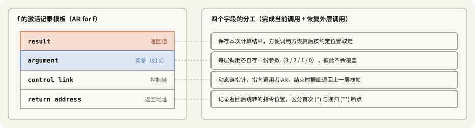
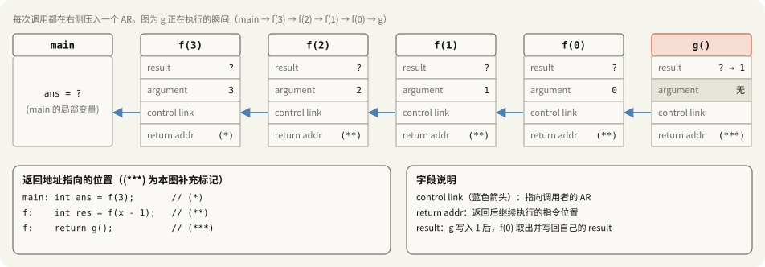

# 10.3 激活记录（AR）与调用栈链

在顺序调用与 LIFO 返回假设下，每一次过程调用在栈上对应一份**激活记录（Activation Record, AR）**。理解 AR 中各项字段的分工，以及控制链与返回地址如何串联多层递归调用，是后续编写函数代码生成模板的直接前提。

## 1. 什么是激活记录？

用来管理一次过程激活（也就是一次函数调用）所需的全部信息，称为激活记录（Activation Record，简称 AR），有时也叫栈帧（Frame）。

如果过程 `F` 调用了过程 `G`，在 `G` 跑完之前，`F` 会暂时处于“挂起（suspended）”状态；等到 `G` 执行结束，控制权交回，`F` 才从暂停的地方继续执行。所以 `G` 的激活记录里装的不只是 `G` 自己的数据，而是 `F` 和 `G` 两方信息的混合，主要包括两类内容：
- 完成 `G` 自身执行所需的信息（如参数、局部变量、临时存储等）。
- 恢复 `F` 继续执行所需的信息（如 `G` 结束后跳回哪里、怎么找回 `F` 的激活记录等）。

## 2. 具体例子：递归调用中的 AR 结构

下面这段代码展示了嵌套与递归调用的场景，其中 `(*)` 和 `(**)` 分别标出了调用返回后紧接着要继续执行的位置：

```cpp
int g() {
    return 1;
}

int f(int x) {
    if (x == 0) {
        return g();
    } else {
        int res = f(x - 1); // (**) 递归调用返回后继续执行的位置
        return res;
    }
}

int main() {
    int ans = f(3); // (*) 首次调用返回后继续执行的位置
    return 0;
}
```

执行 `f(3)` 时，调用链会依次经过 `main -> f(3) -> f(2) -> f(1) -> f(0) -> g()`。其中每一次对 `f` 的调用，它的激活记录（`AR for f`）可以画成下面这个结构：



这四个字段把完成当前调用和恢复外层调用所需的最小信息拆开了：
- `result` 保存这次调用计算出的返回值，调用方恢复执行后就从这里（或约定位置）取结果。
- `argument` 保存调用方传入的实参。初次调用 `f(3)` 时这里存 `3`，递归深入时，每一层新建立的 `AR for f` 里分别存 `2`、`1`、`0`，彼此不会覆盖。
- `control link`（控制链，也常称动态链）指向调用方（caller）的激活记录。比如 `f(2)` 的 AR 里的 `control link` 指向 `f(3)` 的 AR，`f(3)` 的指向 `main` 的 AR；当内层调用结束时，沿着它就能找回上一层挂起时的栈帧基址。
- `return address` 记录当前过程结束后应该跳回哪条指令继续执行。由 `main` 发起的 `f(3)`，返回地址指向 `(*)`；而 `f(3)` 内部递归发起的 `f(2)`，返回地址指向 `(**)`。有了控制链和返回地址，就算同一个函数 `f` 同时挂起了好几层，每一层返回时都能准确退回自己的调用现场。



**读图**：越往右表示越晚压栈的 AR。顺着蓝色的 `control link` 箭头往左追溯，就能一路走回完整的调用链。只有 `f(3)` 的返回地址指向 `(*)`，其余递归调用的 `f` 全部指向 `(**)`。当 `g()` 把 `1` 写入自己的 `result` 并返回后，`f(0)` 取走这个值填进自己的 `result`，然后一层层往回传递到 `f(3)`。

> [!note] 补充：真实机器上的 AR 和这四格模型不同
> 这四格的排列和内容只是概念教学模型，例如把 `result` 放在最前面，是为了让调用方能用相对于自己栈帧的固定偏移直接拿到结果。在真实的 x86-64 Linux（System V ABI）下，前 6 个整型参数通过寄存器 `rdi`、`rsi`、`rdx`、`rcx`、`r8`、`r9` 传递，返回值放在 `rax` 里带回。反汇编 [[10.1 运行时组织的三件事与程序加载]] 中的 `sum` 也能看到：参数 `n` 是从 `edi` 传进来的（`-O0` 下立即存进 `rbp-20`），返回值则由 `eax` 带出；内存栈帧里主要存放 `call` 自动压入的返回地址和保存的调用方 `rbp`，其中保存的 `rbp` 就起着控制链的作用。

---

上一篇：[[10.2 运行时结构、生命周期与作用域]] | 下一篇：[[10.4 全局变量、堆与进程内存四分区]]

来源：[[16.AI编译器/学习日记/0.2十一月/11_02#三、激活记录（Activation Record）|11_02 §三]]。
