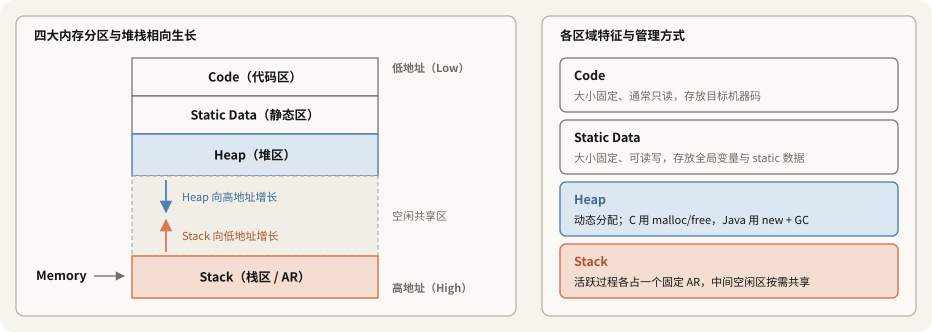
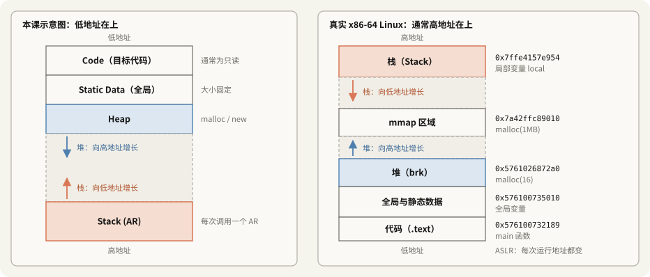

# 10.4 全局变量、堆与进程内存四分区

并不是所有数据都能装进随函数返回就销毁的激活记录里。生命周期贯穿整个程序的数据要放进**静态区**，活得比创建函数更久的对象要放进**堆**；再把它们和代码区、调用栈拼在一起，就构成了经典的进程内存四大分区。

## 1. 全局变量：为什么不能放进激活记录？

对同一个全局变量的所有引用，指向的都是同一个对象，因此不能把全局变量存放在某个函数的激活记录（AR）里。激活记录会随着函数调用创建、随着函数返回销毁，同一个函数被多次调用时还会产生好几份栈帧，全局唯一的数据显然不能跟它绑定。

编译期会给全局变量一次性分配好固定地址。这类拥有固定地址的变量称为“静态分配（statically allocated）”的变量。具体到不同语言，除了全局变量，还可能有其他静态分配的值，比如 C++ 里的 `static` 局部变量和字符串字面量。

## 2. 堆（Heap）：活得比函数更久的数据

如果一个值的生命周期超过了创建它的过程，它同样不能留在激活记录里。看下面这个 C++ 例子（对应幻灯片中的 `method foo() { new Bar }`）：

```cpp
Bar* foo() {
    return new Bar();
}
```


`foo` 返回后，它的激活记录就会被释放，但新创建的 `Bar` 对象必须在 `foo` 的激活记录销毁之后继续存在。凡是支持动态分配数据的语言，都会用堆（Heap）来存放这类动态数据。

## 3. 内存的四大分区与栈、堆的对向增长

把前面几类数据放在一起看，程序运行时的内存通常会划分为四个区域：
- **代码区（Code area）**：存放目标代码。在很多语言里（幻灯片手写将“大多数”改成了“很多”），这块区域大小固定且只读。
- **静态区（Static area）**：存放拥有固定地址的数据（不是代码），例如全局数据。这块区域大小固定，可以是可读或可写的。
- **栈（Stack）**：为每个当前活跃的过程保存一个激活记录。每个激活记录通常大小固定，里面存放局部变量、参数和返回信息等。
- **堆（Heap）**：存放其余所有数据。在 C 语言里，堆由 `malloc` 和 `free` 管理（C++ 中对应 `new` 和 `delete`）；在 Java 里，则是用 `new` 动态分配数据，之后由垃圾回收（Garbage Collection）自动回收。

运行过程中，堆和栈都会动态增长，因此必须防止它们长着长着撞到一起。标准的解法是把堆和栈分别放在可用内存空间的两端，让它们相向生长：



把两个会增长的区域摆在两头相向生长，中间那片空闲空间就能按需让给任意一方，只有当堆顶和栈顶真的碰到一起时才算耗尽，省去了提前把堆和栈各自上限切死的麻烦。



> [!note] 补充：在真实 Linux 进程里实测内存地址
> 在一个测试程序里把各区域变量的地址直接打印出来，从低到高的排列顺序与上面讲的完全一致（见上图右侧）：代码 < 全局数据 < 堆 < 局部变量。用 `readelf -l` 查看段权限时，代码段标记为可读可执行（`R E`），全局数据段为可读可写（`RW`）。和教材简化图不同的细节主要有三点：
> - 堆和栈中间还夹着一片 `mmap` 映射区，大块的 `malloc`（实测里分配 `1MB` 时就走这里）以及共享库都会放在这片区域。
> - 栈并不会真的涨到和堆撞上才停止。主线程栈大小受 `ulimit -s` 限制，这台机器上默认是 8MB（8192KB）；拿每次调用消耗约 1KB 栈帧的递归函数测试，用满大约 8MB 时就直接触发段错误（segmentation fault）结束了。新创建的线程也会各自拿到一块固定大小的独立栈。
> - 因为开启了 ASLR，每次运行各区域的起始地址都会重新随机分布，而且区域之间隔着巨大的地址空洞，正好印证了 [[10.1 运行时组织的三件事与程序加载]] 说的“内存不必连续”。

---

上一篇：[[10.3 激活记录（AR）与调用栈链]] | 下一篇：[[10.5 字长、内存对齐与结构体填充]]

来源：[[16.AI编译器/学习日记/0.2十一月/11_02#四、处理全局变量和堆数据结构|11_02 §四]]。
