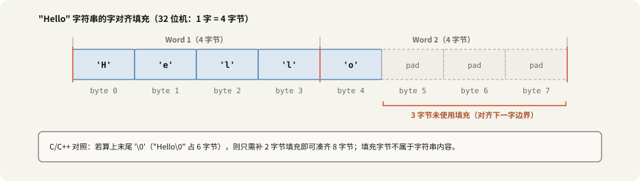
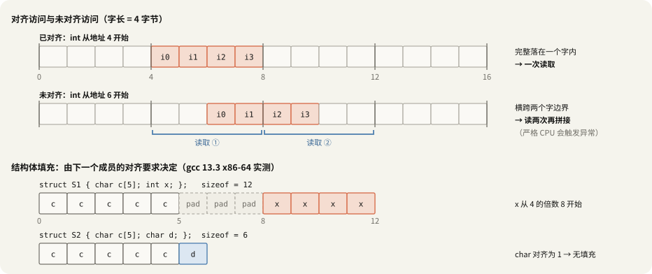

# 10.5 字长、内存对齐与结构体填充

编译器安排栈帧、全局变量和对象字段的偏移量时，不能只把字节挨个拼起来，还必须尊重硬件总线的**字对齐（Word Alignment）**规律，必要时插入填充字节（Padding）。

## 1. 字长与寻址方式

大多数现代机器都是 32 位或 64 位的：
- 1 个字节（byte）有 8 个比特（bit）
- 1 个字（word）占 4 个字节（32 位机）或 8 个字节（64 位机）
- 机器要么按字节寻址（byte addressable），要么按字寻址（word addressable）

虽然现代主流处理器大多支持按字节寻址，但 CPU 底层读写内存总线时，仍然倾向于以字为单位对齐读取。

## 2. 什么是字对齐，为什么未对齐会变慢？

如果一份数据的起始地址正好落在字边界上（起始地址能被字长整除），就称它是字对齐的（word aligned）。

大多数机器都对对齐有要求，或者会在数据未对齐时带来明显的性能惩罚。访问未对齐的数据比访问对齐的数据要慢很多：一个 4 字节整数如果跨在两个字的边界上，CPU 可能要分两次读取内存再把结果拼起来；在一些要求更严格的硬件架构上，未对齐访问甚至会直接触发异常。

## 3. 具体例子：字符串的字节填充（Padding）

以 32 位机器（每字 4 字节）上存放字符串 `"Hello"` 为例：
- 字符串 `"Hello"`（不含末尾的 `\0` 结束符）占 5 个字节。
- 为了让后面的下一个字从字边界开始，需要在字符串后面加上 3 个“填充（padding）”字节，凑够 8 字节（2 个字）。
- 这些填充字节不是字符串的一部分，只是为了凑齐边界而留出来的未使用内存。

按 4 字节一字画出来，内存排布如下：

顺带提一句 C/C++ 里的常见情况：如果按 C 风格字符串算上末尾的 `'\0'`，`"Hello\0"` 一共占 6 个字节，那么只需要在后面补 2 个填充字节就能对齐到下一个 4 字节边界。不管补 3 字节还是 2 字节，原理是一样的：用少数几个闲置字节的空间开销，换取后面所有字段的对齐访问速度。

> [!note] 补充：填充大小由紧随其后的数据决定
> - `"Hello"` 这个例子采用的是“下一个数据固定从字边界开始”的简化模型。真正的 C/C++ 编译器只会按下一个成员自身的对齐要求（`alignof`）去补齐空白。就像上图下方实测的两个结构体：`char c[5]` 后面如果跟着 `int`（对齐要求 4），编译器就会在偏移 5 后面补 3 个填充字节，让 `x` 从偏移 8 开始，`sizeof` 为 12；如果后面跟着的只是另一个 `char`（对齐要求 1），就不需要任何填充，直接紧挨着放在偏移 5，`sizeof` 为 6。`char` 数组本身的对齐要求也是 1。
> - 现代 x86-64 硬件对普通的未对齐 load/store 已经能自动处理，主要损失落在跨缓存行或跨页边界时变慢；不过在 C/C++ 语言标准里，通过未对齐指针解引用依然属于未定义行为（UB）。把地址满足 `addr % 4 == 2` 的指针强转成 `int*` 并开启 UBSan（`-fsanitize=alignment`）运行时，编译器会直接报出 `load of misaligned address … which requires 4 byte alignment`；而像 SSE 的 `movaps` 这类强制对齐指令在遇到未对齐地址时仍会直接触发硬件异常。

---

上一篇：[[10.4 全局变量、堆与进程内存四分区]] | 下一篇：[[10.6 栈式机器模型与寄存器机器对比]]

来源：[[16.AI编译器/学习日记/0.2十一月/11_02#五、对齐问题（Alignment）|11_02 §五]]。
