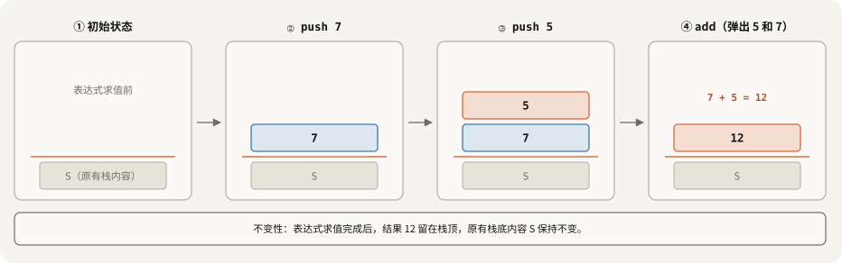
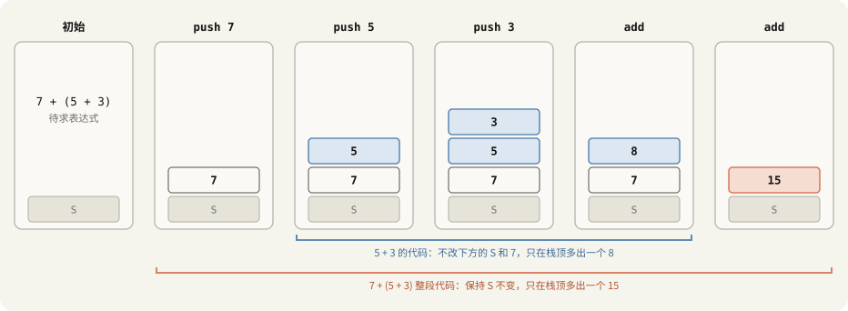
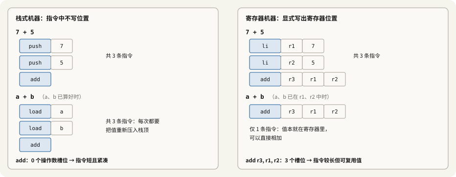

# 10.6 栈式机器模型与寄存器机器对比

在进入具体目标代码生成之前，先建立一个极简的目标执行模型——**栈式机器（Stack Machine）**。它的“栈顶求值不变性”让递归式代码生成变得极其直观，也为后续对比寄存器架构与现代 JIT 编译管线打下基础。

## 1. 栈式机器的执行模型

在栈式机器（Stack Machine）中，唯一的存储就是栈，不再像寄存器机器那样显式分配一堆通用寄存器。

对于一条通用的运算指令 $r = F(a_1, \dots, a_n)$，它的执行固定分为三步：
1. 从栈顶弹出 $n$ 个操作数 $a_1, \dots, a_n$。
2. 用这些操作数计算运算 $F$。
3. 把计算结果 $r$ 重新压回栈顶。

## 2. 具体例子：用两条指令计算 `7 + 5` 与栈不变性

先看两条最基本的指令：
- `push i`：把整数 `i` 压入栈顶。
- `add`：弹出栈顶的两个整数，相加后把结果压回栈顶。

用这两条指令写出计算 `7 + 5` 的程序：

```text
push 7
push 5
add
```

整个执行过程中栈的变化如下（`S` 表示执行这段表达式之前，栈里原本已经存放的内容）：



这里有一个栈式机器的关键性质（也是后续代码生成会直接依赖的不变性）：当计算一个表达式时，结果会留在栈顶，原本的内容 `S` 会被完整保留下来。哪怕表达式嵌套得很深，每算完一个子表达式，它对下方原有栈空间的影响也只是在栈顶多放了一个结果值。



**读图**：蓝色括号括起来的三条指令（`push 5`、`push 3`、`add`）对应子表达式 `5 + 3`。这段代码执行前后，下方原有的 `S` 和 `7` 毫发无损，栈顶只是多了一个 `8`。放大到整条表达式（橙色括号）也是如此：执行结束后原有的 `S` 保持不变，栈顶只多了一个 `15`。

> [!note] 补充：正是这条不变性支撑了递归代码生成
> 加法表达式 `e1 + e2` 的目标代码可以直接拼接成“`e1` 的代码 + `e2` 的代码 + `add`”。因为任何子表达式都会守住一条约定，就是算完之后不破坏下面的旧栈内容、只在栈顶留下一个结果值，所以不管 `e1` 和 `e2` 各自嵌套了多少层，轮到最后的 `add` 执行时，栈顶刚好就躺着这两个子表达式算出来的值。在自己写的 Python 栈式机器模拟器上按这套规则生成并跑了 2000 个随机嵌套加法表达式，每一条表达式和每一层子表达式都严格满足这条不变性。

## 3. 栈式机器与寄存器机器的对比

栈式机器指令有一个很鲜明的特点：操作数和结果的位置都不需要在指令里显式写出来，因为它们永远默认在栈顶。

把它和寄存器机器（Register Machine）放在一起对比就能看出来：
- 寄存器机器必须在指令中写明操作数和结果所在的寄存器，例如 $\text{add } r_1, r_2, r_3$。
- 栈式机器只需要写一条 `add`，不需要带任何寄存器编号或地址。

因此，栈式机器生成出来的程序通常更加紧凑（指令短、代码体积小）。不过代价是所有运算都得先压栈再弹出，执行指令条数和访栈次数往往会比寄存器机器多；像 JVM 字节码、WebAssembly 这类追求体积紧凑的虚拟指令集常采用栈式结构，而物理 CPU 与高性能编译器后端则更倾向于寄存器架构。



> [!note] 补充：栈式字节码在后端最终还是会走向寄存器
> 栈式格式主要是为了方便代码分发、压缩体积和静态校验。像 JVM HotSpot 的 C2 或 V8 的 TurboFan 这类即时优化编译器，并不会傻傻照着栈式字节码一条条压栈弹出，而是先把它转换成基于 SSA 的中间表示，再完成寄存器分配后放到物理寄存器上跑。反过来，Lua 5.0 之后的虚拟机和早期的 Android Dalvik 从一开始就设计成了基于寄存器的虚拟机，可见并非所有虚拟机都是栈式的。

## 4. 本章参考资料

- Alex Aiken, Stanford CS143 课程幻灯片 *Runtime Organization*（Lecture 11）
- *System V Application Binary Interface, AMD64 Architecture Processor Supplement*：参数寄存器与返回值调用约定
- Randal E. Bryant, David R. O'Hallaron, *Computer Systems: A Programmer's Perspective*（CS:APP）第 3 版，3.7 节（过程）与 9.7 节（Linux 虚拟内存）
- Remzi H. Arpaci-Dusseau, Andrea C. Arpaci-Dusseau, *Operating Systems: Three Easy Pieces*（OSTEP）第 13 章（地址空间）
- glibc `sysdeps/x86_64/start.S`：`_start` 调用 `__libc_start_main` 的启动代码
- Roberto Ierusalimschy, Luiz Henrique de Figueiredo, Waldemar Celes, *"The Implementation of Lua 5.0"* (2005)：Lua 转向基于寄存器虚拟机的设计原因

---

上一篇：[[10.5 字长、内存对齐与结构体填充]] | 下一篇：[[11.1 带累加器的栈机器与表达式代码生成]]

来源：[[16.AI编译器/学习日记/0.2十一月/11_02#六、栈式机器（Stack Machines）|11_02 §六]]。
